# Tema 1 - Introducció a la programació

!!! danger "Resultat d'aprenentatge associat"
    <strong>RA1. Reconeix l´estructura d’un programa informàtic, identificant i relacionant els elements propis del llenguatge de programació utilitzat.</strong>

    ### Criteris d'avaluació

    - [x] RA1.1. S'han identificat els blocs que componen l'estructura d'un programa informàtic.
    - [x] RA1.2. S'han creat projectes de desenvolupament d'aplicacions
    - [x] RA1.3. S'han utilitzat entorns integrats de desenvolupament.

## Hola món!

!!! success "Criteris d'avaluació associats"
    - [x] RA1.1. S'han identificat els blocs que componen l'estructura d'un programa informàtic.

Hola a tots i benvinguts al món de la programació. En aquest curs aprendrem com escriure programes utilitzant el **llenguatge de programació Java** per desenvolupar aplicacions. 

Com podreu observar, **programar** bàsicament consisteix en poder comunicar-se amb una màquina per tal que seguisca adequadament les **instruccions** que li donem, és a dir, aprendre a programar és aprendre un **idioma nou** per poder donar instruccions a una màquina, però no patiu, no es tracta d'un idioma com l'anglès o el llenguatge musical, ja que per tal que aquesta comunicació entre persona i màquina siga eficient i efectiva, el llenguatge a aprendre ha de ser molt més **senzill** i sobre tot lliure d'ambigüitats.

Però no avancem esdeveniments. Millor comencem pel principi. 

## Conceptes bàsics

Comencem per eixa qüestió que s'haureu estat fent tots des de que ha començat la classe. **Què és un programa i què és programar?**

!!! info "segons el DNV: Diccionari Normatiu Valencia"
    - **Programa:** Conjunt d'instruccions detallades i codificades que es donen a un sistema informàtic perquè execute unes determinades operacions.
    - **Programar:** Efectuar una programació, escriure un programa.

!!! info "segons el Termcat: Centre de Terminologia en llengua catalana"
    - **Programa:** Un programa és un **conjunt d’instruccions** escrites en un llenguatge de programació que s’utilitzen per donar ordres o indicacions a un ordinador.
    - **Programar:** Concebre, escriure i verificar programes informàtics.

En resum, el més paregut a **programar** que hi ha en el món real seria elaborar un conjunt d'instruccions de tal forma que una altra persona siga capaç de llegir, interpretar i executar satisfactòriament obtenint un resultat. Una **recepta de cuina** per exemple és un conjunt d'instruccions que __qualsevol__ és capaç de llegir, interpretar i executar obtenint al final un resultat.

Si seguim l'analogia amb la recepta de cuina i la comparem amb un **model de comunicació clàssica** els elements que ens podem trobar són: 

- **Origen:** persona que diu les instruccions o ordres, el que escriu la recepta.
- **Destí:** persona que les ha de llegir, interpretar i executar, el cuiner i el llenguatge usat (valencià).
- **Canal:** medi físic pel qual es transmet el missatge. Aire, televisió, telèfon, internet...
- **Missatge:** fàcil no? La recepta.

Observa l'esquema següent:

<center>
    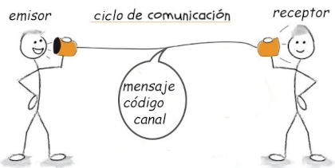
</center>
   
Doncs bé, en informàtica tindríem els mateixos elements on l'origen seria el **programador**, el destí **l'ordinador**, el llenguatge seria el **llenguatge de programació** i el missatge seria el **programa**. 

Podriem concloure que aprendre a programar és aprendre l'idioma que parlen els ordinadors per tal de poder comunicar-nos amb ells i donar-los ordres o instruccions.

En aquest primer tema, veurem una sèrie de conceptes bàsics que seran necessaris per entendre que és la programació.

Com ja hem explicat a la introducció d'aquest tema, programar consisteix en bàsicament donar ordres a un dispositiu mitjançant un **algorisme** en un **llenguatge de programació** concret que a l'executar-se en una màquina es converteix en **programa**. Veiem amb un poc més de detall aquests conceptes:

??? question "Activitat 101. Recepta de cuina"
    === "Enunciat"
        Escriu una recepta de cuina del menjar que vulgues utilitzant **llenguatge natural**. La recepta ha d'estar escrita de forma **ordenada, clara i estructurada** perquè qualsevol persona puga seguir-la sense dificultat.

        La recepta hauria d'incloure com a mínim:

        - Nom del plat
        - Ingredients necessaris
        - Passos o instruccions ordenades
        - Resultat final esperat

        Una vegada acabada la recepta, identifica els elements del model de comunicació presents al teu exemple:

        - **Origen**
        - **Destí**
        - **Canal**
        - **Missatge**
        - **Llenguatge**

        Explica breument quin element correspon a cadascun dins de la teua recepta.

    === "Rúbrica"
        | Ítem d'avaluació | 4 - Excel·lent | 3 - Correcte | 2 - Parcial | 1 - Incorrecte | 0 - Inexistent o incoherent |
        |---|---|---|---|---|---|
        | Estructura de la recepta | La recepta està perfectament organitzada i és molt fàcil de seguir. | La recepta està ben organitzada amb xicotets problemes de format o ordre. | La recepta presenta una estructura acceptable però confusa en alguns punts. | La recepta està desordenada i costa seguir-la. | No hi ha estructura recognoscible. |
        | Claredat de les instruccions | Les instruccions són clares, precises i sense ambigüitats. | Les instruccions s'entenen encara que alguna podria ser més precisa. | Algunes instruccions són poc clares o incompletes. | Les instruccions són difícils d'entendre o contradictòries. | Les instruccions no tenen sentit o no existeixen. |
        | Seqüència dels passos | Els passos segueixen un ordre lògic i correcte. | L'ordre és correcte encara que podria millorar-se lleugerament. | Hi ha alguns errors d'ordre que dificulten la comprensió. | L'ordre és incorrecte en gran part de la recepta. | No existeix cap seqüència coherent. |
        | Ingredients i informació necessària | Inclou tots els ingredients i informació necessària de forma completa. | Inclou quasi tota la informació necessària. | Falta informació rellevant o alguns ingredients. | La informació és insuficient per seguir la recepta. | No apareixen ingredients ni informació útil. |
        | Identificació dels elements de comunicació | Identifica correctament origen, destí, canal, missatge i llenguatge amb explicacions adequades. | Identifica correctament quasi tots els elements amb alguna explicació millorables. | Identifica només alguns elements o hi ha errors menors. | La major part dels elements estan mal identificats. | No identifica els elements o són incoherents. |
        | Expressió escrita i presentació | El text està molt ben redactat, sense faltes i amb bona presentació. | Bona redacció amb poques errades. | Redacció acceptable encara que amb diverses errades. | Moltes errades ortogràfiques o de redacció. | El text és incomprensible o molt deficient. |

    === "Solució"

        
        En realitat per aquesta activitat, existeixen moltes solucions possibles. La finalitat no és escriure el algorisme "perfecte" sino donar-se compte que no és el mateix el llenguatge natural que un llenguatge de programació entre altres coses a causa de les ambigüitats.

        <center>📦 **Fitxer PDF amb una possible solució.**</center>

    	<center>[📥   Descarrega la solució](./assets/Tema1/Activitat101.pdf){ .md-button .md-button--secondary }</center>
        
        Encara no disponible
        

### Algorisme vs Programa
Si el que farem en aquest curs és programar, per què parlem tant d'algorismes. Què és un algorisme? Quina diferència hi ha entre un algorisme i un programa? En aquest primer tema treballarem tots aquests conceptes.

!!! info "Definició d'algorisme"
    Un **algorisme** és un conjunt ordenat i finit d’operacions o instruccions a seguir que permeten trobar la solució a un problema. Per exemple: algorisme de la suma, la resta, la multiplicació o la divisió.

Per exemple, per tal de fer una suma de xifres de més d’un digit cadascuna, el que es diu comunament sumar portant, hem de seguir unes **instruccions** que si les realitzem de forma correcta, obtenim el resultat. Doncs bé, eixes ‘instruccions’ serien l’algorisme.

Finalment, un programa no és més que un algorisme en què les ‘instruccions’ són executades per un dispositiu digital com un ordinador escrit en un llenguatge de programació concret.

### Característiques d'un algorisme
Com ja hem pogut observar amb els algorismes vistos fins ara, aquests tenen una sèrie de característiques comunes com ara que han de ser precisos i no donar lloc a ambigüitats, estar formats per una seqüència ordenada de passos, ser finits —és a dir, acabar després d’un nombre determinat d’instruccions— i permetre resoldre un problema o executar una tasca concreta de manera clara i sistemàtica.

Finalment un algorisme posteriorment convertit a programa ha de complir una sèrie de característiques:

- **Finit:** ha de començar i acabar.
- **Llegible:** un programa s'escriu una vegada però es llig moltes.
- **Modificable:** ha de poder evolucionar.
- **Eficient:** No utilitza més recursos dels necessaris
- **Modular:** s'ha de dividir en parts el qual millora la legibilitat.
- **Estructurat:** utilitza les estructures del paradigma de la programació estructurada.

Ja hem vist que una recepta de cuina o l'algorisme de la suma portant podrien ser un exemple d'algorismes però, en saps algun més?

??? question "Activitat 102. Exemples d'algorismes"
    === "Enunciat"
        Per a cada algorisme:

        - Indica el seu nom
        - Explica amb les teues paraules quin problema resol
        - Escriu breument els passos o instruccions principals que segueix
        - Indica en quin context o situació es podria utilitzar

        Finalment, redacta una xicoteta conclusió explicant:

        - Quins patrons o característiques comunes has observat en els algorismes trobats
        - Quines coses t'han cridat més l'atenció
        - Per què creus que és important que les instruccions estiguen ordenades i siguen precises

    === "Rúbrica"
        | Ítem d'avaluació | 4 - Excel·lent | 3 - Correcte | 2 - Parcial | 1 - Incorrecte | 0 - Inexistent o incoherent |
        |---|---|---|---|---|---|
        | Quantitat i varietat d'algorismes | Presenta 5 o més algorismes variats i adequats. | Presenta 5 algorismes encara que poc variats. | Presenta menys de 5 algorismes o alguns no són adequats. | La major part dels exemples no són algorismes vàlids. | No presenta exemples o són incoherents. |
        | Explicació del problema que resolen | Explica clarament i amb les seues paraules la funció de cada algorisme. | Les explicacions són correctes encara que millorables. | Algunes explicacions són poc clares o incompletes. | Les explicacions són incorrectes o molt confuses. | No hi ha explicacions. |
        | Descripció de les instruccions o passos | Els passos dels algorismes estan ben descrits i ordenats. | Els passos s'entenen encara que falta detall. | Els passos són incomplets o poc clars. | Els passos són incorrectes o desordenats. | No es descriuen passos. |
        | Relació amb situacions del món real | Relaciona correctament tots els algorismes amb contextos reals. | Relaciona quasi tots correctament. | Algunes relacions són poc adequades. | Les relacions amb el món real són incorrectes. | No hi ha relació amb contextos reals. |
        | Reflexió sobre patrons comuns | Identifica i explica molt bé característiques comunes dels algorismes. | Identifica algunes característiques comunes correctament. | La reflexió és superficial o incompleta. | La reflexió és incorrecta o molt pobre. | No hi ha reflexió final. |
        | Capacitat d'anàlisi i comprensió | Demostra una comprensió clara del concepte d'algorisme. | Demostra una comprensió acceptable amb alguns errors menors. | La comprensió és parcial o limitada. | Mostra moltes confusions conceptuals. | No demostra comprensió del concepte. |
        | Expressió escrita i presentació | Text molt ben redactat, ordenat i sense faltes importants. | Bona presentació amb poques errades. | Presentació acceptable amb diverses errades. | Mala redacció o presentació desordenada. | El document és incomprensible o inexistent. |

    === "Solució"

        
                <center>📦 **Fitxer PDF amb una possible solució.**</center>

    	<center>[📥   Descarrega la solució](./assets/Tema1/Activitat102.pdf){ .md-button .md-button--secondary }</center>
        
        Encara no disponible
        

### Algorisme del sandwich de melmelada i crema de cacau
Una de les dificultats inicials a l'hora d'aprendre a programar és desfer-se de l'ambigüitat amb la s'utilitza el llenguatge natural, l'esser humà té la capacitat de contextualitzar i desambiguar però una màquina no, per tant, és necessari que el llenguatge amb el que es donen ordres a un ordinador, estiga lliure d'ambigüitat i siga el més exacte possible. 

A continuació observa el següent vídeo on uns fills li donen instruccions "precises" al pare per tal que els faja un sandwich.

<div style="margin:0px auto;width:80%;display:flex;gap:20px;">
<iframe width="560" height="315" src="https://www.youtube.com/embed/cDA3_5982h8?si=Hpck1ulqigz6AA5S" title="YouTube video player" frameborder="0" allow="accelerometer; autoplay; clipboard-write; encrypted-media; gyroscope; picture-in-picture; web-share" referrerpolicy="strict-origin-when-cross-origin" allowfullscreen style="margin:0px auto;"></iframe>
</div>

??? question "Activitat 103. Algorisme de la Nutella"
    === "Enunciat"
        Al vídeo anterior uns xiquets intenten explicar-li al pare els passos que ha de seguir per preparar un sandwich de crema de cacau. El problema és que les instruccions no són prou precises i això provoca errors i malentesos.

        Primer identifica els elements del model de comunicació clàssica presents al vídeo:

        - **Emissor**
        - **Receptor**
        - **Missatge**
        - **Canal**
        - **Llenguatge**

        A continuació escriu un algorisme en llenguatge natural per preparar un sandwich de Nutella.

        Has de tenir en compte les següents condicions:

        - Les instruccions han de ser breus i concises.
        - Les instruccions han d'estar adaptades al destinatari.
        - S'ha d'evitar qualsevol tipus d'ambigüitat.
        - L'algorisme ha de ser senzill i estar ben ordenat.

        També has de considerar les següents **precondicions**:

        - Estàs assegut davant d'una taula.
        - Sobre la taula hi ha:
            - Un pot de Nutella tancat
            - Un ganivet d'untar
            - Un paquet de pa de motle tancat

        Quan acabes l'algorisme:

        1. Dona-li'l a una altra persona perquè intente seguir exactament les instruccions.
        2. Demana-li que siga molt estricta interpretant-les.
        3. Anota els errors, problemes o ambigüitats detectades.
        4. Escriu una proposta de millora del teu algorisme.

        Opcionalment, pots representar també l'algorisme de forma gràfica mitjançant un esquema, diagrama o diagrama de flux senzill.

        **Entrega:**  
        Un document PDF que continga:

        - Identificació dels elements del model de comunicació
        - Algorisme en llenguatge natural
        - Correccions o suggeriments del company/a
        - Reflexió final o proposta de millora
        - (Opcional) representació gràfica de l'algorisme

    === "Rúbrica"
        | Ítem d'avaluació | 4 - Excel·lent | 3 - Correcte | 2 - Parcial | 1 - Incorrecte | 0 - Inexistent o incoherent |
        |---|---|---|---|---|---|
        | Identificació dels elements de comunicació | Identifica correctament emissor, receptor, missatge, canal i llenguatge amb explicacions adequades. | Identifica quasi tots correctament amb alguna errada menor. | Identifica només alguns elements o amb explicacions incompletes. | La major part dels elements són incorrectes. | No identifica els elements o és incoherent. |
        | Definició de les precondicions | Les precondicions estan clarament descrites i són adequades. | Les precondicions són correctes encara que incompletes. | Les precondicions són poc clares o insuficients. | Les precondicions són incorrectes. | No apareixen precondicions. |
        | Claredat i precisió de les instruccions | Les instruccions són molt clares, precises i sense ambigüitats. | Les instruccions són correctes amb alguna ambigüitat menor. | Hi ha diverses instruccions poc precises. | Les instruccions són confuses o incorrectes. | No hi ha instruccions útils o coherents. |
        | Ordre i estructura de l'algorisme | L'algorisme està perfectament ordenat i estructurat. | L'ordre és correcte amb xicotets problemes. | L'estructura és acceptable però millorable. | L'ordre dificulta la comprensió. | No existeix una seqüència coherent. |
        | Adequació al destinatari | Les instruccions estan molt ben adaptades a qui les ha d'executar. | En general estan ben adaptades. | L'adaptació és parcial o irregular. | Les instruccions no tenen en compte el destinatari. | No existeix adequació al destinatari. |
        | Prova de l'algorisme i detecció d'errors | La prova està ben documentada i identifica clarament problemes i millores. | La prova és correcta encara que poc detallada. | La prova és superficial o incompleta. | La prova està mal explicada o és incorrecta. | No es realitza la prova. |
        | Reflexió i proposta de millora | Analitza molt bé els errors i proposa millores adequades. | Detecta alguns problemes i planteja millores útils. | La reflexió és limitada o poc concreta. | Les millores proposades no són adequades. | No hi ha reflexió ni millores. |
        | Presentació i expressió escrita | Document molt ben redactat, ordenat i sense faltes importants. | Bona presentació amb poques errades. | Presentació acceptable amb diverses errades. | Mala organització o moltes errades. | Document incomprensible o inexistent. |

    === "Solució"
        Com passa en aquestes primeres activitat no hi ha una única solució i la que vos plantege jo a continuació és només una entre moltes.

        
                <center>📦 **Fitxer PDF amb una possible solució.**</center>

    	<center>[📥   Descarrega la solució](./assets/Tema1/Activitat103.pdf){ .md-button .md-button--secondary }</center>
        
        Encara no disponible
        
        

Com has observat al vídeo anterior, si la interpretació del llenguatge és molt estricta com fa el pare, és quasi una tasca impossible per als xiquets escriure les instruccions de forma tan precisa que aconseguisquen el que inicialment es pretenia, un sandwich de Nutella. 

#### Errors en els algorismes i programes
Quan un algorisme o programa no està ben definit poden aparèixer diferents tipus d’errors. Detectar-los i corregir-los forma part del treball habitual de qualsevol programador.

Els errors més habituals són:

- **Errors sintàctics:** el llenguatge està mal escrit i el programa no es pot executar.
- **Errors lògics:** el programa funciona però el resultat és incorrecte.
- **Errors d’execució:** apareixen mentre el programa s’està executant.

Per exemple, al vídeo del sandwich de Nutella apareixen diversos errors lògics, ja que les instruccions són ambigües i el resultat final no és l’esperat.

#### Característiques
Tu ja havies fet anteriorment a l'activitat 101 una recepta de cuina, que com ja pots deduir es tracta, en definitiva, d'un algorisme si ens atenem a les característiques d'un algorisme: 

- és **finit**, comença i acaba.
- és **llegible** perquè està escrit en llenguatge natural.
- és **modificable**, de fet, es pot corregir.
- és **eficient**, en teoria no fa coses innecessàries.
- és **modular**, està dividit en parts.
- i és **estructurat** ja que al cap i la fí és una seqüència d'instruccions.

Aplicant tot el que hem vist fins ara, intenta fer el tu el mateix que la família del vídeo a la següent activitat.

??? question "Activitat 104. Dissenya el teu propi algorisme"
    === "Enunciat"
        Basant-te en l'activitat anterior, pensa en un problema quotidià i escriu un algorisme que el solucione. 
        
        Alguns exemples podrien ser:

        - Preparar una motxilla per anar a classe
        - Rentar-se les dents
        - Posar una rentadora
        - Fer un café
        - Encendre un ordinador
        - Organitzar una partida d'un videojoc

        Primer has d'indicar les **precondicions**, és a dir, des d'on parteix la situació inicial i quins elements tens disponibles.

        A continuació escriu les instruccions de l'algorisme de forma ordenada i clara.

        Recorda que un algorisme ha de ser:

        - **Finit**
        - **Llegible**
        - **Modificable**
        - **Eficient**
        - **Modular**
        - **Estructurat**

        Finalment escriu una breu reflexió explicant:

        - Quines dificultats has trobat en escriure l'algorisme
        - Quines parts creus que podrien provocar errors o ambigüitats
        - Com milloraries l'algorisme després de revisar-lo

        Opcionalment pots representar també l'algorisme mitjançant un esquema o diagrama senzill.

        **Entrega:**  
        Un document PDF que continga:

        - Descripció del problema triat
        - Precondicions
        - Algorisme en llenguatge natural
        - Reflexió final
        - (Opcional) representació gràfica

    === "Rúbrica"
        | Ítem d'avaluació | 4 - Excel·lent | 3 - Correcte | 2 - Parcial | 1 - Incorrecte | 0 - Inexistent o incoherent |
        |---|---|---|---|---|---|
        | Elecció i descripció del problema | El problema és adequat, interessant i està molt ben explicat. | El problema està ben definit encara que amb poc detall. | El problema és acceptable però poc clar. | El problema és inadequat o confús. | No es descriu cap problema. |
        | Definició de les precondicions | Les precondicions estan clarament definides i són adequades. | Les precondicions són correctes encara que incompletes. | Les precondicions són superficials o poc clares. | Les precondicions són incorrectes. | No hi ha precondicions. |
        | Claredat de les instruccions | Les instruccions són molt clares, precises i sense ambigüitats. | Les instruccions són correctes amb algun detall millorable. | Algunes instruccions són poc clares. | Les instruccions són confuses o incorrectes. | No hi ha instruccions coherents. |
        | Ordre i estructura de l'algorisme | L'algorisme està perfectament ordenat i estructurat. | L'ordre és correcte amb xicotets errors. | L'estructura és acceptable però millorable. | L'ordre dificulta la comprensió. | No hi ha seqüència coherent. |
        | Compliment de les característiques d'un algorisme | L'algorisme compleix clarament les característiques estudiades. | Compleix quasi totes les característiques. | Compleix només parcialment les característiques. | Compleix molt poques característiques. | No compleix les característiques d'un algorisme. |
        | Eficiència i simplicitat | L'algorisme resol el problema de forma simple i eficient. | La solució és adequada encara que millorables. | Hi ha passos innecessaris o redundants. | La solució és poc eficient o inadequada. | No resol el problema plantejat. |
        | Reflexió i capacitat d'autocrítica | Analitza molt bé les dificultats i proposa millores útils. | Reflexiona correctament sobre possibles millores. | La reflexió és superficial. | La reflexió és molt limitada o incorrecta. | No hi ha reflexió final. |
        | Presentació i expressió escrita | Document molt ben redactat, ordenat i sense faltes importants. | Bona presentació amb poques errades. | Presentació acceptable amb diverses errades. | Mala redacció o organització deficient. | Document incomprensible o inexistent. |

    === "Solució"
        
            <center>📦 **Fitxer PDF amb una possible solució.**</center>

    	<center>[📥   Descarrega la solució](./assets/Tema1/Activitat104.pdf){ .md-button .md-button--secondary }</center>
        
        Encara no disponible
        

## Fases desenvolupament

!!! success "Criteris d'avaluació associats"
    - [x] RA1.2. S'han creat projectes de desenvolupament d'aplicacions.

A l’hora d’afrontar la realització d’un programa hem de tindre clar que hem de fer. És un error començar a crear programari a lo loco ja que només aconseguirem dedicar a aquest menester més temps que el que es necessita. A més a més el procés de creació d’un programa no només és picar codi. D’aquesta manera a l’hora de construir un programa es deurien seguir una sèrie de fases o pautes.

Les fases de desenvolupament de programari són: **anàlisi, disseny, codificació, prova i documentació**

### Anàlisi del problema
Consisteix en l'estudi del problema que es pretén solucionar. S'ha d'entendre què ha de fer el programa, qui l'utilitzarà, quina informació necessita.
La finalitat d’aquesta fase és fer un recull dels diferents **requeriments** que ha de tenir el nostre producte. Per tant al final d'aquesta fase deuriem tindre una llista amb les funcionalitats la nostra aplicació. Aquesta fase respon al **QUÈ** del nostre projecte, es a dir, s'intenta esbrinar què és el que realment es necessita o es vol fer.

??? example "FruitApp - Anàlisi"
    Imaginem que ens disposem a fer una aplicació que gestione la **fruiteria del barri**. En aquesta fase és on hauriem d'esbrinar, entre altres coses: quins productes es venen, quin preu tenen, l'agenda de clients, quina informació volem saber dels clients, quina informació volem saber de proveïdors etc. Suposem que ens farem càrrec d'una part xicoteta d'aquesta aplicació: **la introducció de tickets de compra nous**. En aquesta fase, l'encarregat de la tenda, ens ha dit que necessitaria que els per cada client que compre es necessita un ticket, amb còpia per al venedor, que mostrara el **nom de la botiga**, **adreça** completa juntament amb la **data i hora** de la compra. A continuació el ticket reflectirà els productes que s'han comprat tenint en compte que s'ha de mostrar per cada producte: **quantitat**, **nom del producte**, **preu per unitat** i **preu total** (preu per unitat per quantitat). Finalment també ha de mostrar la **base imposable**, suma del total dels productes comprats, **IVA** (21%), **descompte** i **preu total** de la compra. Per acabar, al ticket també es reflectirà la quantitat de **diners rebuts** per part del client i els diners que li hem **tornat**.

    Mira el següent exemple:
    
    <center>
        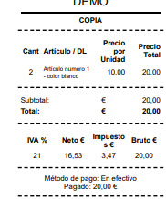
    </center>

??? success "Producte - Anàlisi"
    **Requeriments del sistema o aplicació** en base a la informació que hem aconseguit per mitjançant entrevistes, enquestes etc.. En altres paraules: el que ha de fer la nostra aplicació, finalitat, objectius. S'hauria de descriure detalladament el que realitza el sistema i com reacciona en les diferents situacions en les que ens podríem trobar.
    
    El producte d'aquesta fase podria ser per exemple una **llista de requeriments** a partir de la quan podrem començar a treballar a la fase següent.

        1. Els tiquets tindran una capçalera amb la informació de la botiga.
        2. En la capçalera també es reflectirà la data i hora en que s'ha fet la compra.
        3. Per cada producte que es compre, hem de coneixer el nom del producte, la quantitat, el preu unitari i el total.
        4. Cada línia del tiquet només mostra informació relativa a un producte.
        5. Una vegada tancada la compra, es mostrarà un footer que tindra: preu, IVA, descompte i preu final.
        6. El preu o base imposable és la suma del total de cadascuna de les línies de productes anteriors
        7. L'IVA és del 21%
        8. El descompte és un percentatge que s'aplica al preu total amb IVA i que podria anar des del 0% fins al 15%.
        9. Del càlcul anterior obtindrem el preu total que ha de pagar el client.
        10. Es guardarà informació al sistema de la quantitat de diners que ha entregat el client.
        11. Al tiquet també es mostrarà quin és el canvi que se li ha tornat a client.
        12. Finalment el tiquet s'imprimirà en paper per duplicat: un per al client i un per a la botiga.

### Disseny de l'algorisme

Es refereix a **com anem a solucionar** els requeriments obtinguts a la fase anterior. En definitiva com solucionar el problema que ens estem plantejant. En aquesta fase deuriem començar a pensar: quins passos seguirà el programa, quines pantalles tindrà, quines dades necessitem, etc..

??? example "FruitApp - Disseny"
    Continuant en la nostra aplicació de la **fruiteria**, en aquesta fase i una vegada acabada la fase d'anàlisi d'on s'obtenen els requeriments, hauriem de decidir com solucionar el problema mitjançant un algorisme o una representació del comportament del programa. Després, a la fase de codificació, es traduiria eixa solució en un llenguatge concret.

??? success "Producte - Disseny"
    Un resultat possible d'aquesta fase és l'algorisme que resol el problema. Seguint l'exemple de les receptes anteriors, una possible solució a aquesta fase seria:

        1. Obre un nou ticket.
        2. Agafa el primer producte que porta el client
        3. Selecciona el producte al sistema informàtic.
        4. Pesa o compta la quantitat de producte que vol comprar.
        5. Introdueix les dades anteriors.
        6. Repeteix els passos 2, 3, 4 i 5 mentre queden productes per enregistrar.
        7. Aplica descompte en cas necessari.
        8. Tanca el ticket.
        9. Imprimeix el ticket.

### Codificació
Ha arribat el moment de **picar codi**. A la fase de codificació, ens arriben els documents de les fases anteriors necessaris per poder **començar a programar**. En aquesta fase hem d'escollir les eines (IDEs) adequades per poder desenvolupar el nostre projecte i també escollirem (va lligat en realitat) el llenguatge de programació 

??? example "FruitApp - Codificació"
    Seguint amb la fruiteria i suposant que ens han passat un diagrama de flux, pseudocodi o diferents diagrames en UML de la nostra aplicació de generació de tickets, podriem per exemple triar l'IDE **Visual Studio Code i C#** com a llenguatge de programació o **l'IDE Eclipse i Java** o Visual Studio i Java, per després, traduir l'algorisme de la fase anterior a un llenguatge de programació concret.

??? success "Producte - Codificació"
    El projecte amb tots els fitxers que tenen el codi desenvolupat així com també els **executables o binaris** ja compilats i funcionant.

    ```java linenums="1"
    Ticket t = new Ticket();
    while(quedenProductesPerPesar) {
        Producte p = new Producte("Nom");
        p.pesa();
        t.afegir(p);
    }
    t.aplicaDescompte(10);
    t.close();
    t.print();
    ```

### Prova i depuració
Com que **errar es d'humans**, la fase de proves del cicle de vida de programari busca **detectar els errors** comesos en les etapes anteriors per tal de poder corregir-los. Per suposat, allò ideal és fer-ho abans que l'usuari final se'ls trobe. Es diu que una prova amb exit és una prova que detecta algun error.

Seguint amb la nostra aplicació podria passar que una vegada posada en marxa ens adonem que no hem contemplat la possibilitat d'esborrar línies del ticket. Com ho solucionariem? Primer agafariem el diagrama de flux d'aquesta funció i el modificariem per tal que s'adapte a la nova realitat. Després hauriem de modificar el codi a la fase de codificació per tornar finalment a la fase de prova i depuració.

### Documentació
Aquesta és la fase que a cap programador li agrada fer, però en realitat és una fase que no està necessàriament al final del cicle de vida del programa, sino que es fa de forma **transversal** en totes les etapes del desenvolupament. 

Es considera documentació **des dels requeriments inicials al manual d'usuari** passant per el pseudocodi (algorisme inicial de la fase de disseny) i també els comentaris que es posen al codi, manuals d'instruccions, vídeos, etc..

??? question "Activitat 105. Simula les fases de desenvolupament software"
    === "Enunciat"
        Imagina que tens el projecte d'una aplicació té com a finalitat gestionar les **diverses llistes de compra** que poden haver a una casa. Simula que passes per cadascuna de les fases de desenvolupament de programari vistes a l'apartat anterior i genera tota la documentació necessària.

        La idea és digitalitzar la típica llibreta de la nevera on s'apunten els productes que falten per comprar: aliments, productes de neteja, higiene, etc.

        Quan l'usuari obri l'aplicació hauria d'aparéixer una pantalla amb les diferents llistes de compra disponibles. En seleccionar una llista, s'haurien de mostrar els productes pendents de comprar i permetre:

        - Afegir productes
        - Esborrar productes
        - Consultar els elements pendents

        A partir d'aquest enunciat has de simular algunes de les fases del desenvolupament de programari estudiades al tema.

        El teu document haurà de contindre com a mínim:

        #### 1. Fase d'anàlisi
        Escriu almenys **5 requeriments o funcionalitats** que hauria de complir l'aplicació.

        #### 2. Fase de disseny
        Escriu un algorisme senzill d'alguna funcionalitat de l'aplicació, per exemple:

        - Afegir un producte
        - Crear una nova llista
        - Esborrar un producte
        - Mostrar una llista

        Pots escriure'l en llenguatge natural o representar-lo amb un esquema o diagrama senzill.

        #### 3. Reflexió final
        Explica breument:

        - Quina part t'ha resultat més complicada
        - Per què és important planificar abans de programar
        - Quins problemes podrien aparéixer si no es fa una bona fase d'anàlisi

        La presentació del document és important. Es recomana incloure portada, índex i cuidar la formatació del text i les imatges.

        #### Entrega
        Un document PDF amb les fases descrites anteriorment.

    === "Rúbrica"
        | Ítem d'avaluació | 4 - Excel·lent | 3 - Correcte | 2 - Parcial | 1 - Incorrecte | 0 - Inexistent o incoherent |
        |---|---|---|---|---|---|
        | Comprensió del problema plantejat | Interpreta perfectament el funcionament de l'aplicació i les seues necessitats. | Comprén correctament el problema amb alguna imprecisió menor. | La comprensió és parcial o incompleta. | Interpreta incorrectament gran part del problema. | No es comprén el problema plantejat. |
        | Definició dels requeriments | Defineix 5 o més requeriments clars, útils i ben redactats. | Defineix els requeriments correctament encara que millorables. | Alguns requeriments són poc clars o incomplets. | Els requeriments són incorrectes o inadequats. | No hi ha requeriments o són incoherents. |
        | Qualitat dels requeriments | Els requeriments són realistes, coherents i útils per al projecte. | La major part dels requeriments són adequats. | Alguns requeriments tenen poca utilitat o coherència. | Els requeriments són poc útils o contradictoris. | Els requeriments no tenen sentit. |
        | Disseny de l'algorisme | L'algorisme està molt ben estructurat, ordenat i és fàcil de seguir. | L'algorisme és correcte amb alguns aspectes millorables. | L'algorisme és parcialment correcte o poc clar. | L'algorisme és incorrecte o molt confús. | No hi ha algorisme o és incoherent. |
        | Claredat i precisió de les instruccions | Les instruccions són precises, completes i sense ambigüitats. | Les instruccions són clares encara que amb algun detall millorable. | Hi ha instruccions poc clares o incompletes. | Les instruccions són difícils d'entendre. | No hi ha instruccions útils. |
        | Relació entre anàlisi i disseny | El disseny resol clarament els requeriments plantejats. | Hi ha bona relació entre requeriments i disseny. | La relació és parcial o poc clara. | El disseny no respon adequadament als requeriments. | No existeix relació entre apartats. |
        | Reflexió final | Reflexiona de forma profunda i coherent sobre el procés de desenvolupament. | La reflexió és correcta encara que poc detallada. | Reflexió superficial o incompleta. | Reflexió molt limitada o incorrecta. | No hi ha reflexió final. |
        | Presentació, estructura i expressió escrita | Document molt ben organitzat, redactat i presentat. | Bona presentació amb poques errades. | Presentació acceptable amb diverses errades. | Mala organització o moltes errades. | Document incomprensible o inexistent. |

    === "Solució"
        
            <center>📦 **Fitxer PDF amb una possible solució.**</center>

    	<center>[📥   Descarrega la solució](./assets/Tema1/Activitat105.pdf){ .md-button .md-button--secondary }</center>
        
        Encara no disponible
        

## IDE's

!!! success "Criteris d'avaluació associats"
    - [x] RA1.2. S'han creat projectes de desenvolupament d'aplicacions.
    - [x] RA1.3. S'han utilitzat entorns integrats de desenvolupament.

Un **entorn de desenvolupament** integrat o **IDE** (de l'anglès Integrated Development Environment) és una eina informàtica per al desenvolupament de programari de manera còmoda i ràpida. Així doncs és un entorn de desenvolupament que agrupa diferents funcions en un sol programa, habitualment: editor de codi, compilador, depurador i un programa de disseny d'interfície gràfica.

Els IDE estan dissenyats per **maximitzar la productivitat del programador** proporcionant components molt units amb interfícies d'usuari similars. Els IDE presenten un únic programa en què es porta a terme tot el desenvolupament. Generalment, aquest programa sol oferir moltes característiques per a la creació, modificació, compilació, implementació i depuració de programari.

Durant el curs utilitzarem principalment el següent IDE: **Processing IDE**. Però també podriem treballar utilitzant **Eclipse IDE**. Una alternativa a Eclipse i que usarem aquest curs és: **Visual Studio Code**

Veiem-los amb més detall.

### Processing IDE
Processing és un entorn de desenvolupament integrat de codi obert basat en Java, de fàcil utilització, i que serveix com a mitjà per a l'ensenyament i la producció de projectes multimèdia i interactius de disseny digital. Va ser iniciat per Ben Fry i Casey Reas, ambdós membres d'Aesthetics and Computation Group del MIT Media Lab dirigit per John Maeda.

Un dels objectius declarats de Processing és actuar com a eina perquè artistes, dissenyadors visuals i membres d'altres comunitats aliens al llenguatge de la programació, n'aprenguessin les bases a través d'una mostra gràfica instantània i visual de la informació. El llenguatge de Processing es basa en Java, tot i que fa servir una sintaxi simplificada i un model de programació de gràfics.

#### Característiques
- **Orientat al disseny visual:** Permet generar programes interactius amb sortida directa en formats 2D, 3D (gràcies a OpenGL) i PDF.
- **Llenguatge simplificat:** Simplifica conceptes complexos de programació i utilitza una sintaxi molt més accessible que la del Java tradicional.
- **Estructura bàsica en dos blocs:** Utilitza de manera nativa les funcions <pre style="background-color:#FFFFCC;white-space: pre; display: inline;">setup()</pre> per la configuració inicial i <pre style="background-color:#FFFFCC;white-space: pre; display: inline;">draw()</pre> pel bucle d'animació constant o bucle de joc.
- **Mode Sketch:** Els projectes s'anomenen sketch (esbossos), facilitant la creació de prototips visuals.
- **Multiplataforma:** Funciona de manera estable en sistemes Windows, macOS i Linux.
- **Exportació fàcil:** Inclou eines per exportar el projecte final com a aplicació autònoma per a qualsevol sistema operatiu.

#### Com instal·lar Processing IDE
Instal·lar Processing IDE és relativament senzill independentment de la plataforma o sistema operatiu en el que es vullga instal·lar. A continuació s'exposarà com fer-ho a Linux i a Windows.

!!! danger "Tens el JDK instal·lat?"
    Assegura't que tens instal·lada la versió d'OpenJDK 17 abans d'instal·lar cap IDE per programar amb Java. Ho pots saber executant el comandament <pre style="background-color:#FFFFCC;white-space: pre; display: inline;">java -version</pre> al terminal.

**A Linux**
Visita la pàgina de [baixades de Processing IDE](https://processing.org/download)

<center>
    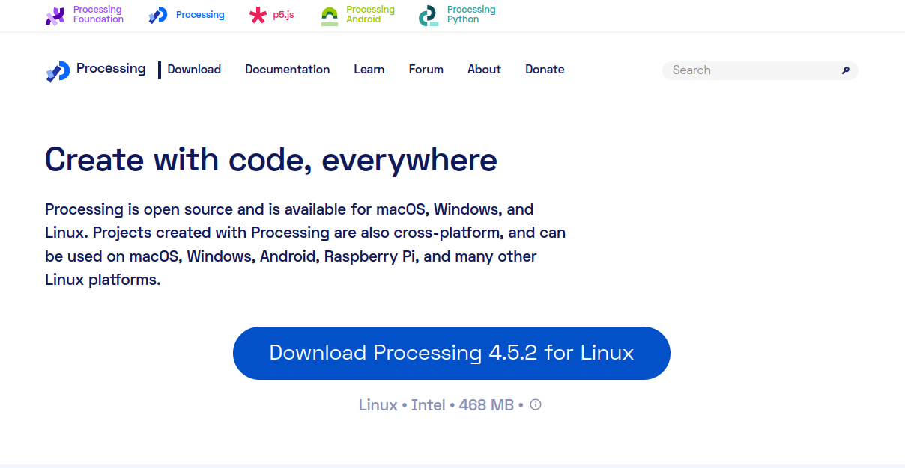
</center>

Si fas clic al botó descarregar de la pàgina anterior aniràs al següent lloc web:

<center>
    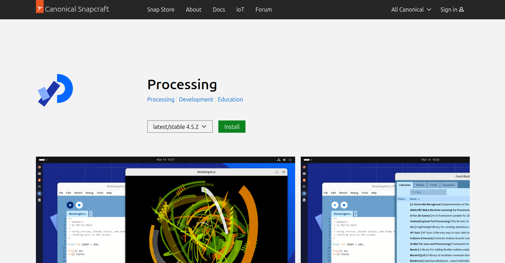
</center>

Fes clic al botó instal·lar de la pàgina de canonical i veuràs la següent pantalla:

<center>
    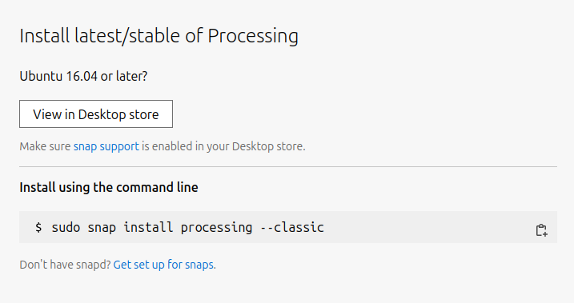
</center>

Finalment el que has de fer és copiar el comandament que apareix al terminal i executar-lo i ja estaria. Així de simple

<center>
    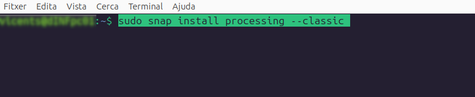
</center>

**A Windows**
A la mateixa pàgina de Processing IDE pots trobar l'enllaç a la versió de Windows com mostra la imatge

<center>
    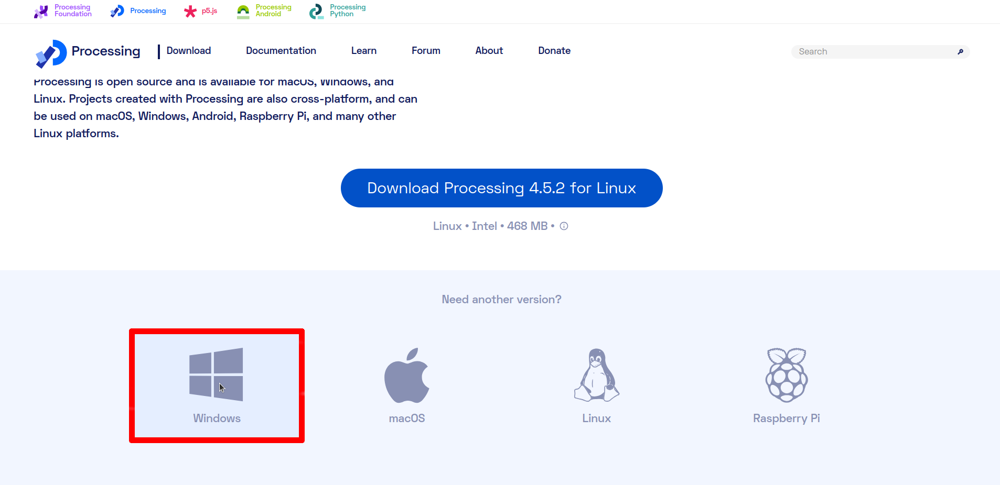
</center>

Fes clic sobre la icona de Windows i començarà la descarrega de l'IDE. Després només hauràs de seguir els passos que et marca l'assistent d'instal·lació.

[Estructura Projecte Processing IDE](#estructura-en-processing-ide)

#### Estructura en Processing IDE
Com ja hem explicat abans **Processing IDE** és un entorn integrat de desenvolupament juntament amb una llibreria gràfica que inicialment es va construir per a arts electròniques i disseny visual per tal de poder ensenyar els fonaments de la programació a **no-programadors** en un context visual. És per això que s'ha escollit aquest IDE per començar a treballar.

A continuació vos mostrem un exemple d'estructura de programa en **Processing IDE**

!!! example "Codi Projecte Processing IDE"

    ```java
    // Bloc 1. Referències a altres llibreries.
    import javax.swing.JOptionPane;      // Llibreria gràfica per a diàlegs

    // Bloc 2. Constants
    final static int TAM = 30;
    
    // Bloc 3. Variables globals a l'aplicació.
    int posX, posY;

    // Funció setup: només s'executa una vegada a l'inici de l'execució.
    void setup () {  
        // Sentències d'inicialització de la nostra aplicació.
        size (640,480);
        background (255);
        posX = -1;
        posY = -1;
    }

    // Funció draw: s'executa 60 vegades per segon (60 fps)
    void draw () { 
        fill(255,0,0);
        // Codi principal del programa.
        if (posX != -1 && posY != -1)
            ellipse(posX, posY, TAM, TAM);
    }

    // Declaració d'altres funcions. Opcional

    // Esdeveniments
    void mousePressed () {
        posX = mouseX;
        posY = mouseY;
    }

    void keyPressed() {}
    void keyReleased () {}
    void mouseDragged () {}
    void mouseMoved () {}
    ```

??? question "Activitat 106. Instal·la Processing IDE i crea un projecte"
    === "Enunciat"
        Descarrega i instal·la **Processing IDE** des de la seua pàgina oficial al teu ordinador.

        Una vegada instal·lat, crea un projecte nou anomenat **activitat106** i prova algun exemple compatible amb Processing:
        
        - Pots copiar el codi d'exemple dels apunts.
        - Pots buscar un sketch senzill per Internet.
        - O pots crear-ne un des de zero.

        Després modifica el comportament original del programa perquè faça alguna cosa diferent. Per exemple:
        
        - Canviar colors o formes.
        - Afegir moviment.
        - Reaccionar al teclat o al ratolí.
        - Mostrar missatges.
        - Afegir noves funcionalitats.

        Les modificacions han d'estar explicades mitjançant comentaris dins del codi.

        Recorda que en guardar el projecte, Processing crearà una carpeta amb el nom del projecte i dins trobaràs l'arxiu `.pde`.

        **Entrega:** carpeta comprimida o PDF amb:
        
        - El fitxer `activitat106.pde`
        - Captures de pantalla del programa executant-se
        - Comentaris explicant les modificacions realitzades

    === "Rúbrica"
        | Ítem d'avaluació | 4 - Excel·lent | 3 - Correcte | 2 - Parcial | 1 - Incorrecte | 0 - Inexistent o incoherent |
        |------|----------------|---------------------------|--------------------------|----------------|----------------|
        | **Instal·lació de Processing IDE** | Processing IDE està instal·lat i funciona correctament | Instal·lat amb algun problema menor | Instal·lat però amb dificultats evidents | Instal·lació incompleta o incorrecta | No s'ha instal·lat |
        | **Creació del projecte** | El projecte està correctament creat i organitzat | El projecte funciona però té algun problema d'organització | El projecte existeix però està incomplet | Projecte incorrecte o mal guardat | No hi ha projecte |
        | **Execució del codi** | El programa s'executa correctament sense errors | El programa funciona amb errors menors | El programa funciona parcialment | El programa quasi no funciona | No executa |
        | **Modificacions realitzades** | Les modificacions són creatives i canvien clarament el comportament original | Hi ha modificacions correctes però senzilles | Les modificacions són mínimes | Modificacions incorrectes o poc funcionals | No hi ha modificacions |
        | **Ús d'elements de Processing** | Utilitza adequadament funcions gràfiques, esdeveniments o moviment | Utilitza alguns elements de Processing correctament | Ús molt limitat dels elements de Processing | Ús incorrecte dels elements | No utilitza funcionalitats de Processing |
        | **Comentaris al codi** | El codi està molt ben comentat i explica clarament els canvis | Hi ha comentaris suficients | Comentaris escassos o poc clars | Comentaris incorrectes | Sense comentaris |
        | **Presentació i organització** | Codi net, ben indentat i fàcil de llegir | Bona organització amb alguns detalls millorables | Organització acceptable | Codi desordenat o difícil de seguir | Sense estructura |
        | **Captures o evidències** | Inclou captures clares i útils del funcionament | Inclou captures correctes | Captures insuficients | Captures incorrectes o poc útils | Sense captures |

### Visual Studio Code
Visual Studio Code és un editor de codi font desenvolupat per Microsoft per a Windows, Linux i macOS. Inclou suport per a la depuració, control integrat de Git, ressaltat de sintaxi, finalització intel·ligent codi, fragments i refactorització de codi. També és personalitzable, de manera que els usuaris poden canviar el tema de l'editor, les adreces de teclat i les preferències. És gratuït i de codi obert, encara que la descàrrega oficial està sota programari propietari. Visual Studio. 

L'avantatge principal del Visual Studio Code és l'ecosistema d'extensions que l'envolten i que el fan un entorn de desenvolupament tant potent com l'Eclipse IDE però no tan pesat

#### Característiques
Aquestes són algunes de les característiques de l'entorn de desenvolupament integrat Visual Studio Code:

- **Gratuit de codi obert i multiplataforma:** Es pot instal·lar tant en Ubuntu, Windows com macOS.
- **Autocompletament intel·ligent o IntelliSense:** Ofereix suggeriments de codi basats en variables, definicions de funcions i mòduls importats, molt més enllà del text simple.
- **Depuració integrada (Debugger):** Permet executar el codi pas a pas, inspeccionar variables i avaluar expressions directament des de la interfície, sense necessitat d'eines externes.
- **Controls de versions Git integrat:** Inclou suport natiu per gestionar repositoris, permetent fer commits, pulls i pushes ràpidament.
- **Gran ecosistema d'extensions:**Disposa d'una botiga pròpia on pots descarregar complements per afegir suport a nous llenguatges, temes visuals, eines de desplegament al núvol o funcionalitats d'Intel·ligència Artificial.
- **Personalització extrema:** Permet configurar des de dreceres de teclat fins a l'aspecte visual i comportament de l'editor.

#### Com instal·lar Visual Studio Code
Instal·lar Visual Studio Code és relativament senzill a **Ubuntu**, només has d'entrar al terminal amb permisos d'administrador i executar la següent línia de codi:

<center>
    
</center>

Una vegada acabe el procés d'instal·lació de Visual Studio Code ja podràs accedir a l'IDE des del menú principal del sistema operatiu.

A **Windows** hauràs de descarregar l'arxiu instal·lador i seguir les instruccions. Igualment que en Ubuntu, en quan acabe el procés podràs accedir a l'entorn des del menú principal de Windows.

Ara per poder executar projectes en Java has d'instal·lar-li al Visual Studio Code **Extension Pack for Java** que es pot trobar a la pestanya d'extensions del Visual Studio Code.

<center>
    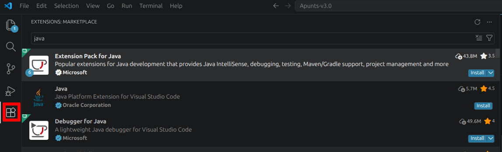
</center>

Només has de fer clic sobre el botó __install__ i esperar a que acabe el procediment. És igual tant per a Linux com per a Windows.

També pots fer a Visual Studio Code "Ctrl+Majus+X" i te s'obrirà el taules d'extensions al tauler de l'esquerra de l'IDE. Busca **Java Extension Pack** o qualsevol altra extensió que necessites i instal·la-la.

**Extension Pack for Java** inclou:

    1. Language Support for Java(TM)
    2. Debugger for Java
    3. Java Test Runner
    4. Maven for Java
    5. Gradle for Java
    6. Project Manager for Java
    7. Visual Studio IntelliCode (opcional)

#### Estructura d'un programa en Visual Studio Code
El primer que s'ha de tenir en compte és que tot programa escrit en Java ha de tindre almenys un main() a la classe principal per tal que s'execute. En resum, un programa escrit en Java ha de tindre:

- **Imports:** permeten utilitzar llibreries externes.
- **Classes:** contenen el codi del programa.
- **Mètode main():** és el punt d'inici del programa.
- **Instruccions:** les ordres que executa el programa.
- **Comentaris:** textos que expliquen el codi.

??? example "Codi Projecte Visual Studio Code"
    ```java linenums="1"
    import java.util.Random; // Importem la llibreria Random que permet generar números aleatoris

    // Definim la classe principal del programa
    public class PersonatgeRPG {

        // És el mètode principal. El programa comença a executar-se des d’ací.
        public static void main(String[] args) {
            Random rnd = new Random(); // Crea un generador de números aleatoris.

            // Dades del personatge
            String nom = "Guerrer Pixelat";

            int vida = rnd.nextInt(100) + 1;    // Genera un número aleatori entre 1 i 100
            int atac = rnd.nextInt(20) + 1;     // Genera un número aleatori entre 1 i 20
            int defensa = rnd.nextInt(20) + 1;  // Genera un número aleatori entre 1 i 20

            // Mostrar informació per pantalla (Terminal)
            System.out.println("=== PERSONATGE GENERAT ===");
            System.out.println("Nom: " + nom);
            System.out.println("Vida: " + vida);
            System.out.println("Atac: " + atac);
            System.out.println("Defensa: " + defensa);

            // Combat fictici
            System.out.println();
            System.out.println("⚔ El personatge entra en combat...");
            System.out.println("👾 Ha derrotat un slime salvatge!");
        }
    }
    ```

El codi anterior és un generador de personatges RPG (Role-Playing Game) que si l'executes en Visual Studio Code veuràs com per terminal es mostren les característiques d'un personatge generat aleatòriament i el resultat d'un combat simulat. 

<center>
    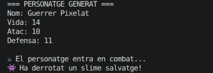
</center>

És un programa senzill però com podràs observar, si compares el codi escrit en Processing a l'apartat anterior amb el codi de Visual Studio, el primer és més senzill i el resultat és molt més efectista. En definitiva no és que el llenguatge que s'utilitza a Processing siga un Java diferent al de Visual Studio sino que Processing simplifica moltes coses de Java.

#### Crear un projecte en Visual Studio Code
 Segueix els següents passos per crear un projecte a Visual Studio Code

- Obre la paleta (Ctrl+Majús+P) i tria Java: Create Project.

<center>
    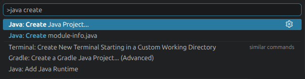
</center>

- Tria **No build tools** (si no vols usar Maven/Gradle).
- Dona-li nom al projecte.
- Tria la carpeta de destí.

Si vas al explorador de carpetes del sistema, et trobaràs la següent estructura de carpetes:

<center>
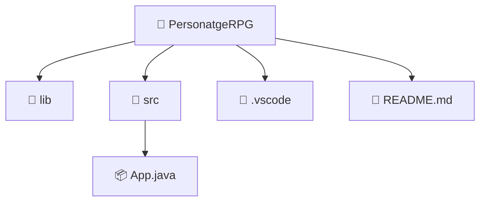
</center>

Edita l'arxiu App.java esborra el contingut que hi ha per defecte i posa al seu lloc el codi de l'exemple anterior del **PersonatgeRPG**. Compte perquè també hauràs de canviar-li el nom a App.java per el de PersonatgeRPG.java per tal que no done error.

#### Executar el projecte
Per poder executar el projecte has d'obrir el fitxer .java principal, al nostre cas PersonatgeRPG.java, després fes clic a la icona de "play" al costat de la funció main o a la cantonada superior dreta. La sortida apareixerà al terminal integrat.

??? question "Activitat 107. Instal·la Visual Studio Code i crea un projecte"
    === "Enunciat"
        Instal·la **Visual Studio Code** i l'extensió **Extension Pack for Java** seguint les instruccions dels apunts.

        Després crea un projecte Java nou anomenat **PersonatgeRPG** utilitzant l'opció:

        - `Java: Create Project`
        - `No build tools`

        Recorda que:
        
        - El nom de la classe principal i el nom del fitxer `.java` han de coincidir.
        - El projecte ha de poder executar-se sense errors.

        A partir de l'exemple dels apunts, modifica el programa perquè el personatge siga diferent de l'original:

        - Canvia el nom del personatge.
        - Modifica els valors de vida, atac o defensa.
        - Afegeix almenys una característica nova (mana, velocitat, nivell, arma, etc.).
        - Mostra un missatge final diferent.
        - Afig comentaris explicant les modificacions.

        També pots personalitzar el programa afegint:
        
        - Nous enemics.
        - Més missatges de combat.
        - Emojis o text decoratiu.
        - Nous càlculs aleatoris.

        **Entrega:**
        
        - Carpeta del projecte comprimida (`.zip`)
        - Fitxer principal `.java`
        - Captura de pantalla del programa executant-se
        - Comentaris explicant les modificacions realitzades

    === "Rúbrica"
        | Ítem d'avaluació | 4 - Excel·lent | 3 - Correcte | 2 - Parcial | 1 - Incorrecte | 0 - Inexistent o incoherent |
        |------|----------------|---------------------------|--------------------------|----------------|----------------|
        | **Instal·lació de Visual Studio Code i extensions** | VS Code i les extensions Java funcionen correctament | Instal·lació correcta amb algun detall menor | Instal·lació parcial | Instal·lació incorrecta | No instal·lat |
        | **Creació del projecte Java** | El projecte està perfectament creat i organitzat | Projecte correcte amb algun detall menor | Projecte incomplet | Projecte incorrecte | No hi ha projecte |
        | **Execució del programa** | El programa compila i funciona sense errors | Funciona amb errors menors | Funciona parcialment | Presenta molts errors | No executa |
        | **Modificació del personatge** | Les dades del personatge estan clarament personalitzades | Hi ha modificacions suficients | Modificacions mínimes | Modificacions incorrectes | Sense modificacions |
        | **Nova característica afegida** | La nova característica és funcional i coherent | Característica correcta però simple | Característica incompleta | Característica incorrecta | No hi ha característica nova |
        | **Ús de variables i instruccions** | Utilitza correctament variables, concatenació i impressió per pantalla | Ús correcte amb algun error menor | Ús parcial dels conceptes | Ús incorrecte | No utilitza els conceptes |
        | **Comentaris al codi** | Comentaris clars i útils que expliquen els canvis | Comentaris suficients | Comentaris escassos | Comentaris incorrectes | Sense comentaris |
        | **Presentació i organització del codi** | Codi net, ben indentat i molt llegible | Bona organització general | Organització acceptable | Codi desordenat | Sense estructura |
        | **Creativitat i personalització** | El programa és original i creatiu | Té alguns elements originals | Poca personalització | Quasi igual a l'exemple | Sense personalització |
        | **Captura o evidència de funcionament** | Captura clara i completa del programa funcionant | Captura correcta | Captura poc clara | Captura incorrecta | Sense captura |

#### Extensió per a Processing-IDE
Com ja haviem introduit abans, uns dels grans avantatges de Visual Studio Code és la gran quantitat d'extensions de tots tipus que té a la seua disposició. Doncs bé, una d'aquestes extensions és diu **Processing** i ens permet que projecte fet amb Processing és puga gestionar també utilitzant Visual Studio Code si segueixes aquests passos

<center>
    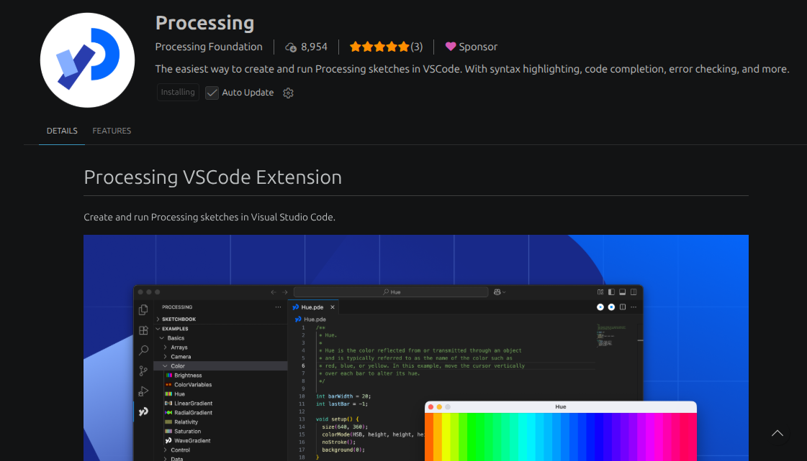
</center>

1. Ves a la pestanya Extensions **(Ctrl+Majús+X)**
2. Busca l'extensió **Processing**
3. Instal·la-la

<center>
    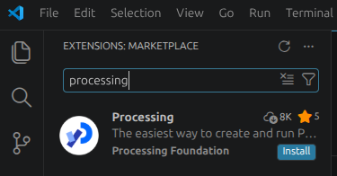
</center>

Ara ja podem obrir fitxers **.pde** propis de Processing IDE en Visual Studio Code i executar-los en un IDE un poc més complet que el de Processing IDE.

??? question "Activitat 108. Crea un projecte de Processing IDE en Visual Studio Code"
    === "Enunciat"
        Reutilitza el projecte de **Processing IDE** que has creat a l'activitat 106 i obri'l ara utilitzant **Visual Studio Code** amb l'extensió de Processing instal·lada.

        Comprova que el programa:
        
        - S'obri correctament.
        - Es pot executar des de Visual Studio Code.
        - Manté el mateix comportament que tenia en Processing IDE.

        Una vegada provat, fes algunes modificacions senzilles al projecte i comprova si el procés de treball et resulta més còmode o més complicat que amb Processing IDE.

        Finalment redacta una reflexió breu sobre:
        
        - Quins avantatges té utilitzar Visual Studio Code per treballar amb Processing.
        - Quins inconvenients o dificultats has trobat.
        - Quin entorn prefereixes i per què.

        Pots acompanyar les reflexions amb captures de pantalla o exemples.

        **Entrega:**
        
        - Carpeta del projecte
        - Fitxer `.pde`
        - Captures de pantalla del projecte executant-se a Visual Studio Code
        - Reflexió personal

    === "Rúbrica"
        | Ítem d'avaluació | 4 - Excel·lent | 3 - Correcte | 2 - Parcial | 1 - Incorrecte | 0 - Inexistent o incoherent |
        |------|----------------|---------------------------|--------------------------|----------------|----------------|
        | **Instal·lació de l'extensió de Processing** | L'extensió està instal·lada i configurada correctament | Instal·lació correcta amb algun detall menor | Instal·lació parcial | Instal·lació incorrecta | No instal·lada |
        | **Obertura del projecte a VS Code** | El projecte s'obri i es gestiona perfectament | Obertura correcta amb problemes menors | El projecte s'obri parcialment | Molts problemes d'obertura | No s'obri |
        | **Execució del projecte** | El projecte s'executa correctament sense errors | Funciona amb errors menors | Funciona parcialment | Funciona incorrectament | No executa |
        | **Modificacions al projecte** | Les modificacions són útils i funcionals | Modificacions correctes però simples | Modificacions mínimes | Modificacions incorrectes | Sense modificacions |
        | **Reflexió sobre avantatges** | Explica avantatges de manera clara i raonada | Reflexió correcta però poc profunda | Reflexió molt breu | Reflexió incorrecta | Sense reflexió |
        | **Reflexió sobre inconvenients** | Identifica problemes o limitacions amb criteri | Identifica alguns inconvenients | Reflexió superficial | Reflexió incorrecta | Sense reflexió |
        | **Comparació entre IDEs** | Compara els dos entorns amb arguments coherents | Comparació correcta però limitada | Comparació simple | Comparació incorrecta | Sense comparació |
        | **Presentació i organització** | Document molt ben estructurat i fàcil de seguir | Bona organització general | Organització acceptable | Desordre evident | Sense estructura |
        | **Captures o evidències** | Inclou captures útils i ben seleccionades | Captures correctes | Captures insuficients | Captures incorrectes | Sense captures |

<!--### Visual studio Code + PApplet
Cada esquema de Processing és en realitat una subclasse de PApplet, un tipus Java que posa en funcionament la majoria de les característiques del llenguatge del Processing.

En programar a Processing, totes les classes addicionals definides seran tractades com a classes internes quan el codi es tradueix en pur Java abans de compilar. Això vol dir que l'ús de variables estàtiques i mètodes de les classes està prohibit llevat que s'indiqui específicament a Processing què vol el codi en mode pur Java.-->