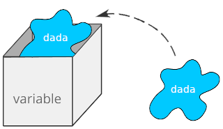
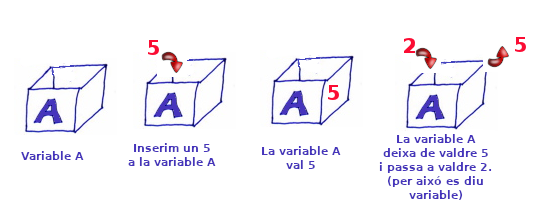
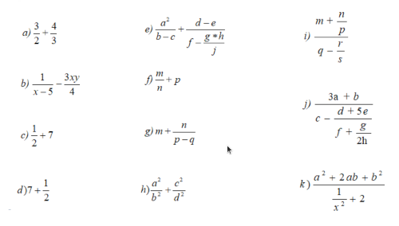
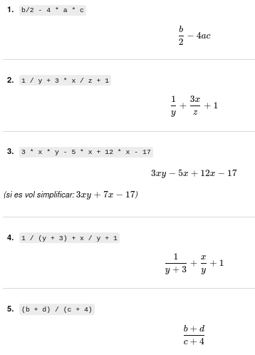
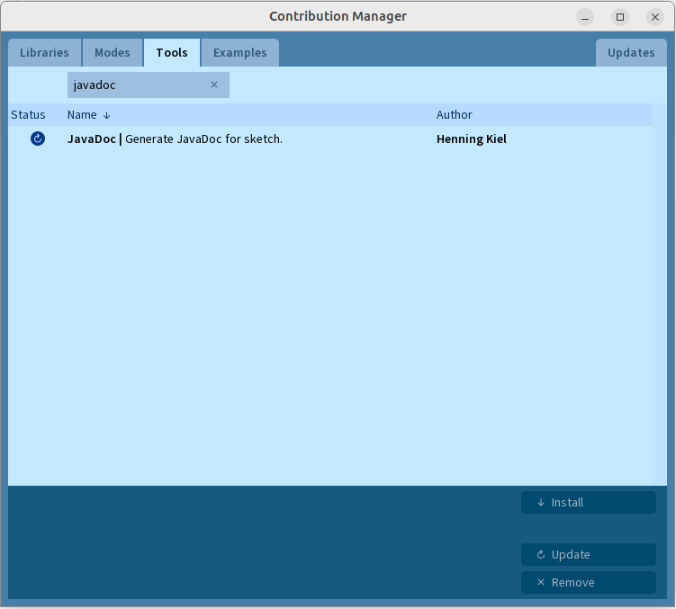

# Tema 2. El llenguatge Java

!!! danger "Resultat d'aprenentatge associat"
    <strong>RA1. Reconeix l´estructura d’un programa informàtic, identificant i relacionant els elements propis del llenguatge de programació utilitzat.</strong>

    ### Criteris d'avaluació
    - [x] RA1.4. S'han identificat els diferents tipus de variables i la utilitat específica de cadascun.
    - [x] RA1.5. S'ha modificat el codi d'un programa per crear i utilitzar variables.
    - [x] RA1.6. S'han creat i utilitzat constants i literals.
    - [x] RA1.7. S'han classificat, reconegut i utilitzat en expressions els operadors del llenguatge.
    - [x] RA1.8. S'ha comprovat el funcionament de les conversions de tipus explícites i implícites.
    - [x] RA1.9. S'han introduït comentaris en el codi.

## Introducció
El **Java** és un llenguatge de programació dissenyat el 1990 per **James Gosling** amb altres companys de Sun Microsystems a partir del **llenguatge C**. Des del seu naixement fou pensat com un llenguatge orientat a objectes. Entre el 13 de novembre de 2006 i el maig del 2007 Sun va alliberar parts de Java com a **programari lliure de codi obert amb llicència GPL**. És un dels llenguatges de programació més utilitzats, i s'utilitza tant per aplicacions web com per aplicacions d'escriptori.

El Java és un llenguatge **compilat amb una màquina virtual** d'intermediari i, per tant, pot semblar lent en comparació amb altres llenguatges, però ofereix un índex de re-utilització de codi molt elevat, sent possible trobar moltes **llibreries lliures de Java**. És un llenguatge flexible i potent tot i la facilitat amb la qual es programa i dels resultats que ofereix. Un dels trets que el caracteritza i que el fa una eina molt valorada a l'hora de desenvolupar aplicacions distribuïdes, és el fet que és un llenguatge multi-plataforma.

Generalment els programes de Java es compilen en un **bytecode** (fitxer .class) que pot córrer en una **Màquina Virtual Java.** Sun Microsystems disposa de tres implementacions diferents de Java: **J2SE** per a aplicacions d'escriptori; J2EE per a aplicacions distribuïdes i J2ME per a plataformes amb recursos més reduïts com ara mòbils o PDAs. Per a cada una de les tres implementacions és possible descarregar el JRE (entorn d'execució Java) per a executar aplicacions o el SDK (Eines per al desenvolupament d'aplicacions) per a programar aplicacions en Java, aquest últim també inclou el JRE.

### Característiques de Java

- **<u>Senzill:</u>** Java s'ha creat perquè sigui un llenguatge senzill amb una sintaxi elegant. Únicament consta de tres tipus de dades primàries, eliminant els punters i l'herència múltiple
- **<u>Orientat a objectes:</u>** Java segueix els paradigmes de la programació orientada a objectes, ja que la programació amb Java se centralitza en la manipulació, creació i construcció d'objectes.
- **<u>Distribuït:</u>** Java permet la construcció d'aplicacions distribuïdes per mitjà d'una col.lecció específica de classes.
- **<u>Interpretat:</u>** Es necessita un intèrpret per executar els programes de Java, això alenteix als programes però els hi dona flexibilitat.
- **<u>Robust:</u>** Java és un llenguatge robust i fiable, s'ha escrit pensant a poder verificar errors i està molt tipificat.
- **<u>Segur:</u>** Java té pocs problemes de seguretat, característica molt important en les aplicacions distribuïdes d'Internet.
- **<u>Arquitectura neutral:</u>** Java és independent de la plataforma final on s'executarà el programa.
- **<u>Portable:</u>** Java és un llenguatge d'alt nivell i de plataforma independent, això li dona portabilitat.
- **<u>Alt rendiment:</u>** Els compiladors Java han anat millorant les seves prestacions. Els nous compiladors coneguts com a JIT permeten un rendiment molt semblant als llenguatges convencionals compilats.
- **<u>Concurrent:</u>** Java permet l'execució de múltiples fils d'execució, o diverses tasques de forma simultània.
- **<u>Dinàmic:</u>** En temps d'execució, l'entorn Java es pot ampliar mitjançant enllaços a classes que poden estar localitzades en servidors remots o en xarxa.

Un programa desenvolupat amb Java no necessita compilar-se de nou per a poder executar-se en qualsevol de les plataformes que disposi d'una versió instal·lada de JRE prou actualitzada per al programa.

En aquest tema veurem la sintaxis bàsica de Java: paraules reservades, dades, variables, constants, identificadors i com també es codifiquen les estructures de control vistes al tema anterior en llenguatge Java.

## Dades, Variables i identificadors.

!!! success "Criteris d'avaluació associats"
    - [x] RA1.4. S'han identificat els diferents tipus de variables i la utilitat específica de cadascun.

Eventualment la informàtica el que tracta de fer és interpretar i processar **informació**, per tant, el primer pas hauria de ser implementar el mecanisme que s'encarregue de representar la informació tal i com la interpretem nosaltres al món real. 

La **informació** en informàtica és el contingut d'una o més **dades**, fent abstracció de la representació concreta que adopta.

Dit d'una altra manera. Imagineu el caixer d'un supermercat. Al final del dia el treballador que està a càrrec del caixer, traurà tota la recaptació del dia i la comptarà. En aquest cas la **informació** seria la quantitat total de diners que s'han recaptat, i es representa en forma de **dada numèrica** utilitzant nombres i algun signe de puntuació, **1.200,45€** seria la dada que representa la informació que es vol saber al final del dia.

???+ info "Què són les Dades"
    Una **dada** és "la representació convencional de la informació en un format adequat perquè puga ser processada, comunicada o interpretada per mitjans manuals o automàtics."

Ara la qüestió és com aquesta informació que al món real es representa utilitzant números la podem representar en forma de dada per tal que una màquina siga capaç de processar.  En qualsevol llenguatge de programació, la informació es pot representar de forma constant, amb **literals** per exemple, o de forma **variable** utilitzant **identificadors**.  Mirem a continuació amb més detall aquests conceptes.

???+ info "Què són les Variables"
    Una **variable** en el camp de les **matemàtiques** és una quantitat que pot créixer o decréixer d'una manera contínua o discontínua. Mentre que en **informàtica** és un símbol emprat en programació per a emmagatzemar en memòria valors canviants.

En resum, la realitat conté una **informació** en forma de **dada** que representarem en un programa informàtic de diverses formes, bé a través de **literals** o de **variables** a les quals accedirem utilitzant **identificadors**.

Però no ens avancem encara i estudiem bé què és un **identificador**. En tot llenguatge de programació existeixen una sèrie d'elements com variables, constants, funcions, llibreries. Aquests elements requereixen d'un nom per tal de distingir-lo de la resta. Aquests noms es diuen **identificadors**

???+ info "Què són els identificadors"
    Un **identificador** és una cadena alfanumèrica que representa o dona un nom a un element dins del nostre programa. Els **identificadors** de les variables són noms que s'inventa el programador i s'hauria de tindre en consideració al següent màxima: **han de ser significatius**

En altres paraules, un **identificador** és una etiqueta que podem utilitzar per anomenar "coses" en un programa informàtic. Pel que fa al concepte de **significatiu**, vol dir que el nom que escollim per a l'etiqueta hauria de ser suficientment esclaridor per saber què és el que representa. Per exemple, si volem posar una etiqueta (amb un adhesiu) a una botella d'aigua que tenim a la nevera, una bona elecció seria: **AIGUA**.

Una última cosa, com en tot llenguatge de programació, Java té una sèrie de normes que hem de seguir per construir identificadors vàlids. LLig i revisa les normes de construcció d'identificadors de Java, que d'altra banda, són molt semblants a la majoria de llenguatges de programació.

!!! tip "Normes per construir identificadors en Java"
    Quan triem el nom per identificar a una variable, ha de ser significatiu, és a dir, que el mateix identificador ja done alguna pista de que és el que representa.

    - **1. Estan formats per caracters i/o digits.**<br>
    - **2. No poden començar per digit.**<br>
    - **3. No poden usar els següents caracters especials:**
    &nbsp; ```+ - * / = % & # ! ? ^ “ ‘ ~ \ | < > ( ) [ ] { } : ; . ,```<br>
    - **4. No poden ser cap paraula reservada de Java.**<br>
    - **5. Els identificadors de Java distingeixen entre majúscules i minúscules (case sensitive).**
    - **6. No hi ha límit a la llargària de l'identificador, però és aconsellable utilitzar una grandària òptima entre 4 i 15 caracters.**

Vejam a continuació alguns exemples d'identificadors inventats per un programador qualsevol:

### Exemples d'identificadors

Observa la llista d'identificadors següents:

#### Identificadors Correctes

- **H0la:** malgrat tindre un número comença per un caracter alfanumèric.
- **$vicent:** vàlid ja que el símbol de dollar és un caracter alfanumèric vàlid per inicia un identificador.
- **_strNom:** els identificadors poden començar per '_' és més de vegades és un convencionalisme per algun tipus concret de variable.
- **_3variable:** seria incorrecta si no tingués '_' com a primer caracter de l'identificador.
- **VarTest:** totalment correcta.
- **variabletest:** cap incorrecció
- **aci_tens_una_variable_valida_que_representa_un_enter:** identificador totalment vàlid, altra cosa és que els noms tan llargs siguen útils.
- **valor_max:** el subratllat també sol ser una tècnica que s'utilitza per a separar dues paraules que formen un identificador.

#### Identificadors Incorrectes

- **8exemple:** comença per número
- **exa+mple:** el signe + no està permès
- **prova variable:** espai en blanc
- **esta_variable_no_es_valida_no_per_llarga_sino_per_este-guionet:** a banda del guió del final tampoc és massa aconsellable utilitzar noms tan llargs.

??? question "Activitat 201. Classifica els següents identificadors"
    Com ja hem explicat a l'apartat anterior, per formar un identificador s'han de seguir unes normes. Classifica els identificadors següents segons si són vàlids o no en Java i justifica la resposta indicant quina norma compleixen o incompleixen.

    Tingues en compte:
        - paraules reservades,
        - caràcters permesos,
        - ús d'espais,
        - números,
        - majúscules i minúscules.

    === "Identificadors"

        |Identificador       |Es vàlid?|Justificació                                      |
        |--------------------|---------|--------------------------------------------------|
        |**Registre1**       |   Sí    |                                                  |
        |**1registre**       |   No    | Els identificadors no poden començar per número  |
        |**while**           |         |     |
        |**$impost**         |         |     |
        |**año**             |         |     |
        |**primer cognom**   |         |     |
        |**primer_cognom**   |         |     |
        |**primer-cognom**   |         |     |
        |**primerCognom**    |         |     |
        |**Tom's**           |         |     |
        |**C3PO**            |         |     |
        |**123#**            |         |     |
        |**PesMàxim**        |         |     |
        |**%descompte**      |         |     |
        |**Weight**          |         |     |
        |**$$preuMàxim**     |         |     |
        |**pes.maxim**       |         |     |
        |**Preu_____**       |         |     |
        |**matricula?**      |         |     |
        |**muchoVale**       |         |     |
        |**high**            |         |     |
        |**barça**           |         |     |
        |**piragüista**      |         |     |
        |**B_011**           |         |     |
        |**X012AB**          |         |     |
        |**70Llibre**        |         |     |
        |**nom&cognom**      |         |     |
        |**0X1A**            |         |     |
        |**else**            |         |     |
        |**class**           |         |     |
        |**nomJugador**      |         |     |
        |**Class**           |         |     |
        |**teemperatura**    |         |     |
        |**int**             |         |     |
   
    
    === "Solució"
        
        |Identificador       |Es vàlid?|Motiu                                                     |
        |--------------------|---------|----------------------------------------------------------|
        |**Registre1**       |   Sí    |                                                          |
        |**1registre**       |   No    | Els identificadors no poden començar per número          |
        |**while**           |   No    | Paraula reservada                                        |
        |**$impost**         |   Sí    |                                                          |
        |**año**             |   Sí    | (*)                                                      |
        |**primer cognom**   |   No    | No es permeten espais en blanc enmig dels identificadors |
        |**primer_cognom**   |   Sí    |                                                          |
        |**primer-cognom**   |   No    | "-" no està permès per a la creació d'identificadors     |
        |**primerCognom**    |   Sí    |                                                          |
        |**Tom's**           |   No    | "'" no és un caracter permès                             |
        |**C3PO**            |   Sí    |                                                          |
        |**123#**            |   No    | Un identificador no pot començar per número              |
        |**PesMàxim**        |   Sí    | (*)                                                      |
        |**%descompte**      |   No    | "%" no és un caracter permès                             |
        |**Weight**          |   Sí    |                                                          |
        |**$$preuMàxim**     |   Sí    | Java permet $, encara que no és recomanable              |
        |**pes.maxim**       |   No    | "." no és un caracter vàlid                              |
        |**Preu_____**       |   Sí    |                                                          |
        |**matricula?**      |   No    | "?" no és un caracter vàlid                              |
        |**MuchoVale**       |   Sí    |                                                          |
        |**high**            |   Sí    |                                                          |
        |**barça**           |   Sí    | (*)                                                      |
        |**piragüista**      |   Sí    | (*)                                                      |
        |**B_011**           |   Sí    |                                                          |
        |**X012AB**          |   Sí    |                                                          |
        |**70Llibre**        |   No    | Comença per número                                       |
        |**nom&cognom**      |   No    | "&" caracter no vàlid                                    |
        |**0X1A**            |   No    | Comença per número                                       |
        |**else**            |   No    | Paraula reservada                                        |
        |**class**           |   No    | Paraula reservada                                        |
        | *nomJugador**      |   Sí    |                                                          |
        |**Class**           |   Sí    |                                                          |
        |**teemperatura**    |   Sí    |                                                          |
        |**int**             |   No    | Paraula reservada                                        |

        (*) Java els permet, però NO és recomanable usar accents ni caràcters especials.

        
        Encara no disponible
        

### Algunes idees per crear identificadors

Observa els identificadors següents i apren com crear identificadors significatius, alguns exemples:

- **estatura:** pot identificar l'estatura (alçada) d'una persona per exemple.
- **RAM:** podria indicar la capacitat RAM d'un ordinador.
- **oratge:** ens podria servir per emmagatzemar informació relativa a l'oratge: solejat, nuvol, plovent, vent...
- **resolucio:** indicaria la resolució d'una pantalla

??? question "Activitat 202. Crea identificadors"
    === "Enunciat"
        Inventa identificadors adequats per a les situacions següents.

        Tingues en compte les normes dels identificadors en Java i també les bones pràctiques:

        - Els identificadors han de ser descriptius.
        - No poden contindre espais.
        - No poden començar per números.
        - Es recomana utilitzar la nomenclatura **camelCase**.
        - Evita accents i caràcters especials.

        A més de crear l'identificador, indica quin tipus de dada podria emmagatzemar.

        | Situació | Identificador | Tipus de dada |
        |---|---|---|
        | L'edat d'una persona | | |
        | El nom d'una assignatura | | |
        | La mitjana aritmètica de les notes | | |
        | La profunditat d'una piscina | | |
        | Els litres d'aigua que hi ha a la nevera | | |
        | La distància al supermercat més pròxim | | |
        | La puntuació d'un videojoc | | |
        | El nombre de vides d'un personatge | | |
        | Si una porta està oberta o tancada | | |
        | La temperatura d'una habitació | | |

    === "Rúbrica"
        | Ítem d'avaluació | 4 - Excel·lent | 3 - Correcte | 2 - Parcial | 1 - Incorrecte | 0 - Inexistent o incoherent |
        |---|---|---|---|---|---|
        | L'edat d'una persona | L'identificador és vàlid, significatiu i usa camelCase | L'identificador és vàlid però no usa camelCase | L'identificador és vàlid però no és del tot significatiu | L'identificador no és vàlid | No resolt |
        | El nom d'una assignatura | L'identificador és vàlid, significatiu i usa camelCase | L'identificador és vàlid però no usa camelCase | L'identificador és vàlid però no és del tot significatiu | L'identificador no és vàlid | No resolt |
        | La mitjana aritmètica de les notes | L'identificador és vàlid, significatiu i usa camelCase | L'identificador és vàlid però no usa camelCase | L'identificador és vàlid però no és del tot significatiu | L'identificador no és vàlid | No resolt |
        | La profunditat d'una piscina | L'identificador és vàlid, significatiu i usa camelCase | L'identificador és vàlid però no usa camelCase | L'identificador és vàlid però no és del tot significatiu | L'identificador no és vàlid | No resolt |
        | Els litres d'aigua que hi ha a la nevera | L'identificador és vàlid, significatiu i usa camelCase | L'identificador és vàlid però no usa camelCase | L'identificador és vàlid però no és del tot significatiu | L'identificador no és vàlid | No resolt |
        | La distància al supermercat més pròxim | L'identificador és vàlid, significatiu i usa camelCase | L'identificador és vàlid però no usa camelCase | L'identificador és vàlid però no és del tot significatiu | L'identificador no és vàlid | No resolt |
        | La puntuació d'un videojoc | L'identificador és vàlid, significatiu i usa camelCase | L'identificador és vàlid però no usa camelCase | L'identificador és vàlid però no és del tot significatiu | L'identificador no és vàlid | No resolt |
        | El nombre de vides d'un personatge | L'identificador és vàlid, significatiu i usa camelCase | L'identificador és vàlid però no usa camelCase | L'identificador és vàlid però no és del tot significatiu | L'identificador no és vàlid | No resolt |
        | Si una porta està oberta o tancada | L'identificador és vàlid, significatiu i usa camelCase | L'identificador és vàlid però no usa camelCase | L'identificador és vàlid però no és del tot significatiu | L'identificador no és vàlid | No resolt |
        | La temperatura d'una habitació | L'identificador és vàlid, significatiu i usa camelCase | L'identificador és vàlid però no usa camelCase | L'identificador és vàlid però no és del tot significatiu | L'identificador no és vàlid | No resolt |

    === "Solució"
        

        Existeixen moltes solucions possibles. Ací tens alguns exemples correctes:

        | Situació | Identificador | Tipus de dada |
        |---|---|---|
        | L'edat d'una persona | edat | int |
        | El nom d'una assignatura | nomAssignatura | String |
        | La mitjana aritmètica de les notes | mitjanaNotes | float |
        | La profunditat d'una piscina | profunditatPiscina | float |
        | Els litres d'aigua que hi ha a la nevera | litresNevera | float |
        | La distància al supermercat més pròxim | distanciaSupermercat | double |
        | La puntuació d'un videojoc | puntuacio | int |
        | El nombre de vides d'un personatge | videsJugador | int |
        | Si una porta està oberta o tancada | portaOberta | boolean |
        | La temperatura d'una habitació | temperaturaHabitacio | float |

        
        Encara no disponible
        

## Paraules reservades

Els llenguatges de programació utilitzen una sèrie de paraules o símbols que fan una funció específica dins d’un programa.  A aquest conjunt de signes o combinació d’ells se les anomena paraules reservades.
Aquestes paraules només poden usar-se en un concepte determinat, mai lliurement per l’usuari.
Per exemple, el llenguatge C té com a paraules reservades if o while. Ambdues només podran ser utilitzades en cas que es vullga iniciar una sentència de control condicional o bucle.

!!! danger "Paraules Reservades"
    Les **paraules reservades** són identificadors o etiquetes reservades predefinides que tenen un significat especial i no es poden utilitzar com identificadors o etiquetes en els programes.

Uns dels principals **identificadors** que ens trobarem a tot llenguatge de programació són les **paraules reservades**. Per entendre-ho, el conjunt de paraules reservades d'un llenguatge de programació són el diccionari de totes les paraules que té aquest llenguatge. 

Aquestes paraules reservades no poden utilitzar-se per cap altra cosa més, per exemple, si Java té la paraula reservada **public**, el programador no podrà crear cap variable utilitzant l'identificador public.

| Paraules reservades  |            |          |          |         |         |       |       |  
|:--------------------:|:----------:|:--------:|:--------:|:-------:|:-------:|:-----:|:-----:|
|abstract              |continue    |for       |new       |switch   |assert   |default|goto   |
|package               |synchronized|boolean   |do        |if       |private  |this   |break  |
|double                |implements  |protected |throw     |byte     |else     |import |public |
|throws                |case        |enum      |instanceof|return   |transient|catch  |extends|
|int                   |short       |try       |char      |final    |interface|static |void   |
|finally               |long        |strict    |volatile  |const    |float    |native |super  |
|while                 |class       |

!!! warning "Identificadors reservats de l'API de Processing IDE"
    Com que Processing IDE no és  més que una capa afegida a l'entorn de programació en Java, té les mateixes paraules reservades que Java i a més a més, com que disposa d'una API (Application Programming Interface) amb moltes funcionalitats, ja hi han una sèrie **d'identificadors** d'aquestes funcions que s'hauran de tindre en compte i no les podrem utilitzar. A continuació una breu llista d'aquests identificadors: 
    
    - **setup, draw, mouseClicked, keyPressed, delay, background, size, clear, rect, ellipse, circle, triangle, pushMatrix, popMatrix, translate, PVector, PImage, etc..**

    No existeix una taula on les podem consultar totes, és qüestió d'anar treballant amb Processing i aprendre-les conforme les anem utilitzant.

??? question "Activitat 203. Localitza i classifica identificadors"
    === "Enunciat"
        Llig el següent codi amb atenció i respon les preguntes següents:

        1. Localitza tots els identificadors que apareixen al programa.
        2. Classifica'ls segons siguen:
            - Paraules reservades de Java
            - Funcions de Processing
            - Variables
            - Paràmetres
            - Funcions creades per l'usuari
        3. Explica amb les teues paraules quina informació creus que representa cada identificador.
        4. Detectes algun possible error al programa? Explica'l.

    === "Codi en Java"

        ```java linenums="1"
        int mida = 30;
        float velocitat = 2.5;

        void setup() {
            size(640,480);
            background(255);
        }

        void draw() {
            clear();

            float posX = random(640);
            float posY = random(480);

            dibuixaBoleta(posX, posY, mida);

            delay(500);
        }

        void dibuixaBoleta(float x, float y, int radi) {
            fill(255,0,0);
            ellipse(x, y, radi, radi);

            String missatge = "Boleta dibuixada";
            println(missatge);
        }
        ```
    === "Rúbrica"
        | Ítem d'avaluació | 4 - Excel·lent | 3 - Correcte | 2 - Parcial | 1 - Incorrecte | 0 - Inexistent o incoherent |
        |---|---|---|---|---|---|
        | Ha localitzat tots els identificadors que són paraules reservades | Els ha localitzat tots sense deixar-se'n cap | Els ha localitzat tots però també n'ha posat d'altres que no eren. | No els ha localitzat tots. | Ha localitzat pocs i no té clar el concepte. | Apartat no realitzat |
        | Dels que no són paraules reservades, ha localitzat tots els identificdors de l'usuari | Els ha localitzat tots sense deixar-se'n cap | Els ha localitzat tots però també n'ha posat d'altres que no eren. | No els ha localitzat tots. | Ha localitzant pocs i no té clar el concepte. | Apartat no realitzat |
        | Ha localitzat tots els identificadors de l'API de Processing IDE | Els ha localitzat tots sense deixar-se'n cap | Els ha localitzat tots però també n'ha posat d'altres que no eren. | No els ha localitzat tots. | Ha localitzant pocs i no té clar el concepte. | Apartat no realitzat |
        | Ha raonat que és el que pensa que volen indicar | Ha posat raonament per a tots els identificadors | Ha posat raonament només per a una secció d'identificadors | Ha posat poc  | No ha posat res | Apartat no realitzat |
        | Ha localitzat els literals | Ha localitzat tots els literals | Ha localitzat tots els literals però també ha posat alguns que no eren. | Ha localitzat pocs literals | No ha tingut en compte els literals. | Apartat no realitzat |
        | Presentació i creativitat (opcional) | L'identificador és vàlid, significatiu i usa camelCase | L'identificador és vàlid però no usa camelCase | L'identificador és vàlid però no és del tot significatiu | L'identificador no és vàlid | Apartat no realitzat |
        

    === "Solució"
        
        | Identificador   | Classificació               | Què representa         |
        |-----------------|-----------------------------|------------------------|
        | int             | Paraula reservada de Java   | Tipus enter            |
        | mida            | Variable                    | Grandària de la boleta |
        | float           | Paraula reservada de Java   | Tipus decimal          |
        | velocitat       | Variable                    | Velocitat de moviment  |
        | void            | Paraula reservada de Java   | Funció sense retorn    |
        | setup           | Funció de Processing        | Inicialització         |
        | size            | Funció de Processing        | Grandària finestra     |
        | background      | Funció de Processing        | Color de fons          |
        | draw            | Funció de Processing        | Bucle principal        |
        | clear           | Funció de Processing        | Neteja pantalla        |   
        | posX            | Variable                    | Posició horitzontal    |
        | posY            | Variable                    | Posició vertical       |
        | random          | Funció de Processing        | Generar aleatoris      |
        | dibuixaBoleta   | Funció creada per l'usuari  | Dibuixar una boleta    |
        | delay           | Funció de Processing        | Retrassa l'execució    |
        | x               | Paràmetre                   | Coordenada X           |
        | y               | Paràmetre                   | Coordenada Y           |
        | radi            | Paràmetre                   | Grandària boleta       |
        | fill            | Funció de Processing        | Color de dibuix        |
        | ellipse         | Funció de Processing        | Dibuixar cercle        |
        | String          | Paraula reservada de Java   | Cadenes de text        |
        | missatge        | Variable                    | Text informatiu        |
        | println         | Funció de Processing        | Mostrar text           |

        El programa no presenta errors de variables ni d'identificadors.

        
        Encara no disponible
        
 
## Tipus de dades

!!! success "Criteris d'avaluació associats"
    - [x] RA1.4. S'han identificat els diferents tipus de variables i la utilitat específica de cadascun.
    
Fins ara tot ha girat al voltant d'informació, dades, identificadors, literals i variables, ja que són la base per poder representar la informació i les dades d'un problema. Però, quins **tipus de dades** es poden representar en Java?

Tot llenguatge de programació porta una sèrie de tipus de dades predefinits que es poden usar. Aquests tipus de dades també es coneixen com a **tipus primitius o tipus simples.**. Java defineix 8 tipus diferents de dades: **byte, short, int, long, char, float, double i boolean.** Aquests tipus es poden agrupar en quatre blocs:

- **<u>Nombres enters:</u>** on podem trobar el **byte, short, long i int.** Aquests tipus admeten valors no fraccionables en parts més xicotetes que la unitat. Per exemple: 1, 3, 5, 15, 20, 132... 
- **<u>Punt flotant:</u>** aquest grup inclou el **float** i el **double** on es representen els nombres decimals, és a dir, aquells que sí admeten fraccions. Per exemple: 1.3, 5.802039, etc..
- **<u>Caracters:</u>** char representa a tot el conjunt de **caracters** del nostre sistema alfabètic inclosos els símbols. Per exemple: a, b, c, $, ?...
- **<u>Booleà:</u>** boolean és un tipus especial que només pot tindre dos possibles valors: **true o false**. Què són els dos valors lògics de l'algebra de George Boole.

### Taula de tipus de dades en Java

| Tipus    | Bytes | Representació                            | Categoria |
|----------|:-----:|------------------------------------------|:---------:|
|**byte**  |1      |de -128 a 127                             |enter      |
|**short** |2      |de -32.768, 32.767                        |enter      |
|**int**   |4      |de -2^31 a 2^31-1                         |enter      |
|**long**  |8      |de -2^63 a 2^63-1                         |enter      |
|**float** |4      |de 1.4x10^-45 a 3.4028235x10^38           |decimal    |
|**double**|8      |de 4.9x10^-324 a 1.7976931348623157x10^308|decimal    |
|**char**  |2      |caracters UTF-16                          |caracter   |
|**bool**  |1      |true o false                              |booleà     |

En resum del que hem vist fins ara, el primer que s'ha d'establir en tot llenguatge de programació d'alt nivell, són els mecanismes necessaris per tal de poder representar en totes les seues variants possibles la informació del món real que volem informatitzar i processar. Aquests mecanismes són: **Tipus de dades, Identificadors, Paraules reservades i Variables**

## Variables

!!! success "Criteris d'avaluació associats"
    - [x] RA1.4. S'han identificat els diferents tipus de variables i la utilitat específica de cadascun.
    - [x] RA1.5. S'ha modificat el codi d'un programa per crear i utilitzar variables.

Al final tot programa s'encarrega de processar **informació** i aquesta informació ha d'estar disponible en algun lloc del nostre codi. Per exemple si volem fer un programa que sume dos números enters, haurem de tindre la informació o el valor d'aquests dos números en algun lloc. 

Una **variable** és com un contenidor (_una caixeta_) que té associat un **tipus de dades** (int, float, double, char) i conté un **valor**, si es tracta d'una variable de tipus enter contindrà un valor enter, si per contra es tracta d'una variable de tipus caracter contindrà una lletra o símbol alfanumèric.

<center>
    
</center>

La **variable** és l'unitat bàsica d'emmagatzemament en Java. Una **variable** en java es defineix amb la combinació d'un **identificador** i el seu **tipus de dades**. Mira els exemples a continuació:

```java linenums="1"
// Declaració d'una variable en Java
// type identifier;
// On type és algun dels tipus de dades que hem vist a l'apartat anterior
// i identifier és l'identificador que volem utilitzar.
// Per exemple:
int a;  // Declaració d'una variable entera amb nom a
float b; // Variable flotant de nom b
char c;  // Variable caracter amb nom c
int i = 0; // En aquesta declaració s'inclou també la inicialització del seu valor.
long j; 
```

Les variables com a contenidors d'informació, **poden variar** (d'ací el nom de variable) el seu **valor** durant l'execució del programa.

<center>
    
</center>

Però millor vegem un exemple, imaginem una aplicació en la que volem controlar la **posició** d'un element qualsevol, per exemple un cercle a una pantalla 2D (o una boleta). Per determinar la posició de qualsevol element en un escenari **2D** necessitem dues coordenades: **x i y**. Les **variables** que podriem utilitzar serien dos variables de tipus enter on al seu nom s'indique clarament el que intenten representar. Si volguerem fer un sistema on les posicions tingueren més precisió, podriem usar floats en lloc d'**int.**

```java linenums="1"
int posX;           // Variables que representa la posició X de l'element.
int posY;           // Variable que representa la posició Y de l'element.

float posXPrecisa;  // Variable que representa la posició X de l'element amb precisió flotant.
float posYPrecisa;  // Variable que representa la posició Y de l'element amb precisió flotant.
```

Observa el codi anterior i basant-se en la norma de creació de variables **type identifier;** que hem vist abans, raona quins són els tipus de dades de les variables i quins els seus identificadors?

Si hi han moltes variables que tenen el mateix tipus base, podem agrupar les declaracions per tipus separant els identificadors amb coma excepte a l'últim identificador, on a continuació seguiríem posat un punt i coma per indicar el final de la sentència.

```java linenums="1"
int a, b, c, d, e, f, g; // Declaracio de múltiples variables de tipus enter
float m, n, o, p, q;     // Declaració de múltiples variables de tipus flotant
```

??? question "Activitat 204. Declaració de variables"
    === "Enunciat"
        Imagina que estàs desenvolupant un programa per gestionar la informació d’un equip de bàsquet.

        Per a cada jugador necessitem emmagatzemar diferents dades personals i esportives. Pensa quina informació podria ser útil per al programa i declara les variables necessàries utilitzant tipus de dades adequats.

        Com a mínim, el teu programa hauria de contemplar:

        - Informació personal del jugador
        - Informació física
        - Informació esportiva
        - Alguna dada de control o estat

        Recorda:
        
        - Utilitzar identificadors clars i significatius
        - Escollir correctament el tipus de dada
        - Seguir les normes de nomenclatura de Java

        No cal assignar valors encara, només declarar les variables.
    
    === "Rúbrica"
        | Ítem d'avaluació | 4 - Excel·lent | 3 - Correcte | 2 - Parcial | 1 - Incorrecte | 0 - Inexistent o incoherent |
        |---|---|---|---|---|---|
        | Tipus de dada assignat | Cada variable té un tipus de dada totalment adequat (text, enter, decimal, booleà...), coherent amb el seu ús previst. | Els tipus són majoritàriament correctes, amb algun cas millorable. | Hi ha errors en diversos tipus o decisions poc justificades. | Tipus incorrectes o no definits. | Apartat no realitzat |
        | Identificador significatiu | Els noms de les variables són clars i descriuen exactament la informació que contenen (ex.: nomJugador, alturaMetres). | Els noms són comprensibles, però algun és genèric o poc precís. | Alguns noms no descriuen bé la dada o són confusos. | Noms incorrectes o sense sentit (ex.: a, x1, etc.). | Apartat no realitzat |
        | Ús correcte de la nomenclatura camelCase | Totes les variables segueixen la convenció camelCase (primera minúscula, següents paraules amb majúscula inicial). | S’aplica correctament en la majoria, amb algun error puntual. | Hi ha errors freqüents o inconsistència en l’estil. | No s’utilitza el format camelCase. | Apartat no realitzat |
        | Estructura de la declaració de variables | Les declaracions són sintàcticament correctes i completen la informació necessària (tipus, nom, possible inicialització). | Les declaracions són correctes amb algun error menor o d’ordre. | Algunes declaracions són incorrectes o incompletes. | No s’han declarat les variables o la sintaxi és errònia. | Apartat no realitzat |
        | Presentació i claredat del treball (PDF o codi) | El document/codi està ben presentat, clar, llegible i ordenat (cada variable separada, comentaris clars, etc.). | Presentació correcta, amb algun detall formal millorable. | Presentació acceptable però poc cuidada o confusa. | Presentació deficient o desordenada. | Apartat no realitzat |

    === "Solució"
        

        ```java linenums="1"
        // Informació personal
        String nomJugador;
        String primerCognom;
        int edat;

        // Informació física
        float altura;
        float pes;

        // Informació esportiva
        String posicio;
        int dorsal;
        int puntsTemporada;
        int assistencies;
        int rebots;

        // Estat del jugador
        boolean lesionat;
        boolean titular;
        ```

        
        Encara no disponible
        

## Literals

!!! success "Criteris d'avaluació associats"
    - [x] RA1.6. S'han creat i utilitzat constants i literals.

En programació no només es pot tractar la informació mitjançant l'ús de **variables**, també es poden emmagatzemar dades fent ús dels **literals**. I què són els literals?

Un literal és, segons el termCAT,  una expressió o part d'una instrucció que representa **explícitament** un valor. En altres paraules, mentre que les **variables** són cadenes alfanumèriques que representen un valor canviant, un **literal** és una cadena alfanumèrica que representa exactament el que posa.  Des del punt de vista més específic de la informàtica, un literal és un valor alfanumèric que s'utilitza com una **constant**, és a dir, que el seu valor no varia durant l'execució del programa.

Però com podem distingir el tipus dels literals o si són correctes o no? Mirem primer quins tipus de terminals ens podem trobar en Java.

 - **Literals enters:** existeixen tres formes de el valor d'un número enter. Si s'escriu solament el número, aquest representa una xifra en **base decimal**. Si té un 0 davant estem escrivint números en **sistema octal** i si té el prefix "0x" aleshores està representat en **base hexadecimal**. Finalment si el que volem és representar un literal de tipus **long** ho farem afegint un caracter 'L' al final de la cadena numèrica.
 - **Literals decimals:** Per representar literals en coma flotant podem utilitzar el '.' per exemple: 10.3, o la notació científica com 10.3e+5 que seria l'equivalent a 10.3 per 10 elevat a 5.
 - **Literals caracters i cadenes:** Un literal de tipus caracter emmagatzema un caracter **Unicode**. Aquest sistema de codificació amplia les opcions que té la codificació **ASCCII** per incloure altres alfabets. Podem escriure en grec, hebreu o vietnamita sense que el compilador proteste. Un literal de tipus char s'expressa envoltant el caracter entre **cometes simples.** Una altra manera de representar un caracter és indicant el codi **Unicode** en hexadecimal, posant com a **prefix** la cadena \u, tot entre cometes simples. D'aquesta forma el símbol '@' s'escriuria: '\u0040.

!!! info "Literal"
    Un **literal** és un valor que poden assignar a les variables o que es pot usar com a terme constant. Depenent del tipus de variable, podrem assignar uns valors o uns altres. Els literals poden ser: enters, decimals, caracter o cadena.

    1. **Literals enters:** 12, 2, -3, 12L (long), 0b101010 (binària), 0x1a (hexadecimal), 0754 (octal)
    2. **Literals decimals:** 12.2, 12.2F, 12.2D (double).
    3. **Literals caràcter:** 'a', 'b', '$'.
    4. **Literals cadena:** "Bela", "Ciao".

??? question "Activitat 205. Literals numèrics"
    === "Enunciat"
        Analitza els següents literals numèrics de Java.

        Per a cadascun d’ells indica:

        - Si és un literal vàlid o no
        - Quin tipus de dada representa (`int`, `long`, `float` o `double`)
        - Quin sistema numèric utilitza:
            - decimal
            - binari
            - octal
            - hexadecimal
        - En cas de ser incorrecte, explica el motiu de l’error

        Pots ajudar-te del compilador de Java o Processing IDE per comprovar els casos més difícils.

    === "Enunciat"
        |Literal      |Tipus|Vàlid|Sistema   |
        |:------------:|-----|-----|----------|
        |**0.5**       |     |     |          |
        |**.5**        |     |     |          |
        |**9.3e12**    |     |     |          |
        |**9.3e-12**   |     |     |          |
        |**12345678**  |     |     |          |
        |**12345_L**   |     |     |          |
        |**0.8E+0.8**  |     |     |          |
        |**0.8E 8**    |     |     |          |
        |**05_15**     |     |     |          |
        |**018CDF**    |     |     |          |
        |**0XBC5DA**   |     |     |          |
        |**0x87e3a**   |     |     |          |
        |**234567L**   |     |     |          |
        |**0_B11**     |     |     |          |
        |**010101**    |     |     |          |
        |**0_557**     |     |     |          |
        |**.00.8E2**   |     |     |          |
        |**.3e3f**     |     |     |          |
        |**0b111**     |     |     |          |
        |**12_234L**   |     |     |          |
        |**0Xabcd**    |     |     |          |
        |**0xabcEL**   |     |     |          |
        |**_234**      |     |     |          |
        |**1010B**     |     |     |          |
        |**0x1010B**   |     |     |          |
        |**1_234.2E-2**|     |     |          |
        |**1234.2EF**  |     |     |          |
        |**1234.2E3F** |     |     |          |
        |**1_1.2e_2**  |     |     |          |
        |**0bABCDL**   |     |     |          |
        |**0X1A**      |     |     |          |
        |**0X12AL**    |     |     |          |
        |**abcd**      |     |     |          |
        |**0125**      |     |     |          |
        |**.01011**    |     |     |          |
        |**3e12**      |     |     |          |
        |**3_e12**     |     |     |          |
        |**-3E-1_2**   |     |     |          |
        |**0.8E**      |     |     |          |
        |**0B1212**    |     |     |          |
        |**1_2_3**     |     |     |          |
        |**0xedad**    |     |     |          |
        |**0XBE2**     |     |     |          |
        |**101e2**     |     |     |          |
        |**B1101**     |     |     |          |
        |**1.34.5**    |     |     |          |
        |**12.3E4F**   |     |     |          |
        |**0X12AG**    |     |     |          |

    === "Solució"
        
        |Literal       |Tipus   |Vàlid|Sistema /Error                                   |
        |--------------|--------|-----|-------------------------------------------------|
        |**0.5**       | double | Sí  | sistema decimal                                 |
        |**.5**        | double | Sí  | sistema decimal                                 |
        |**9.3e12**    | double | Sí  | sistema decimal                                 |
        |**9.3e-12**   | double | Sí  | sistema decimal                                 |
        |**12345678**  | int    | Sí  | sistema decimal                                 |
        |**12345_L**   | -      | No  | posició no vàlida per al caracter '_'           | 
        |**0.8E+0.8**  | -      | No  | exponent no vàlid. No pot ser decimal           |
        |**0.8E 8**    | -      | No  | hi ha un espai entre E i 8                      |
        |**05_15**     | int    | Sí  | sistema octal                                   |
        |**018CDF**    | -      | No  | Comença per 0 (octal) però té CDF?              |
        |**0XBC5DA**   | int    | Sí  | sistema hexadecimal                             |
        |**0x87e3a**   | int    | Sí  | sistema hexadecimal                             |
        |**234567L**   | long   | Sí  | sistema decimal                                 |
        |**0_B11**     | -      | No  | '_' caracter no vàlid                           |
        |**010101**    | int    | Sí  | sistema octal                                   |
        |**0_557**     | int    | Sí  | sistema octal                                   |
        |**.00.8E2**   | -      | No  | només poden tenir un sol punt (.)               |
        |**.3e3f**     | float  | Sí  | sistema decimal                                 |
        |**0b111**     | int    | Sí  | sistema binari                                  |
        |**12_234L**   | long   | Sí  | sistema decimal                                 |
        |**0Xabcd**    | int    | Sí  | sistema hexadecimal                             |
        |**0xabcEL**   | long   | Sí  | sistema hexadecimal                             |
        |**_234**      | -      | No  | el caracter '_' no és correcte                  |
        |**1010B**     | -      | No  | si fora binari deuria començar per 0b           |
        |**0x1010B**   | int    | Sí  | sistema hexadecimal                             |
        |**1_234.2E-2**| double | Sí  | sistema decimal                                 |
        |**1234.2EF**  | -      | No  | falta el valor exponent entre E i F             |
        |**1234.2E3F** | float  | Sí  | sistema decimal                                 |
        |**1_1.2e_2**  | -      | No  | el caracter '_' després d'exponent              |
        |**0bABCDL**   | -      | No  | Si fora hexadecimal deuria començar per 0x      |
        |**0X1A**      | int    | Sí  | sistema hexadecimal                             |
        |**0X12AL**    | long   | Sí  | sistema hexadecimal                             |
        |**abcd**      | -      | No  | si fora hexadecimal començaria per 0x           |
        |**0125**      | int    | Sí  | sistema octal                                   |
        |**.01011**    | double | Sí  | sistema decimal                                 |
        |**3e12**      | double | Sí  | sistema decimal                                 |
        |**3_e12**     | -      | No  | caracter '_' incorrecte.                        |
        |**-3E-1_2**   | double | Sí  | sistema decimal                                 |
        |**0.8E**      | -      | No  | falta el valor de l'exponent                    |
        |**0B1212**    | -      | No  | els numeros binaris només poden contindre 1 i 0 |
        |**1_2_3**     | int    | Sí  | sistema decimal                                 |
        |**0xedad**    | int    | Sí  | sistema hexadecimal                             |
        |**0XBE2**     | int    | Sí  | sistema hexadecimal                             |
        |**101e2**     | double | Sí  | sistema decimal                                 |
        |**B1101**     | -      | No  | si fos binari començaria per 0B                 |
        |**1.34.5**    | -      | No  | els literals només poden tenir un punt (.)      |
        |**12.3E4F**   | float  | Sí  | sistema decimal                                 |
        |**0X12AG**    | -      | No  | 'G' no és un caracter vàlid                     |
        
        Encara no disponible
        

!!! warning "Important"
    No és el mateix un identificador que un literal numèric.

    - `0xFF` és un literal hexadecimal.
    - `valorFinal` és un identificador.

??? question "Activitat 206. Literals caracter"
    Indica quins dels següents literals de tipus caracter són vàlids.

    === "Enunciat"

        |Literal    |Vàlid|Motiu|Literal     |Vàlid|Motiu|
        |-----------|-----|-----|------------|-----|-----|
        |**'a'**    |     |     |**'$'**     |     |     |
        |**'\n'**   |     |     |**'/n'**    |     |     |
        |**'\\'**   |     |     |**'\ñ'**    |     |     |
        |**"T"**    |     |     |**'ñ'**     |     |     |
        |**'xyz'**  |     |     |**'\u0066'**|     |     |
        |**"XYZ"**  |     |     |**'4'**     |     |     |
        |**'\t'**   |     |     |**'\b'**    |     |     |
        |**k**      |     |     |**+**       |     |     |
        |**'+'**    |     |     |**'?'**     |     |     |
        |**'à'**    |     |     |**':'**     |     |     |
        |**'\''**   |     |     |**'\"'**    |     |     |
        |**'\u03A9' |     |     |**' '**     |     |     |

    === "Solució"
        
        |Literal    |Vàlid|Motiu                     |Literal     |Vàlid|Motiu                                          |
        |-----------|-----|--------------------------|------------|-----|-----------------------------------------------|
        |**'a'**    | Sí  |                          |**'$'**     | Sí  |                                               |
        |**'\n'**   | Sí  | Seqüència d'escapament   |**'/n'**    | No  | Per ser seq. escapament la barra és invertida |
        |**'\\'**   | Sí  | Seqüència d'escapament   |**'\ñ'**    | No  | Seqüència d'escapament no vàlida              |
        |**"T"**    | No  | S'usen comentes simples  |**'ñ'**     | Sí  |                                               |
        |**'xyz'**  | No  | Hi ha mès d'un caracter  |**'\u0066'**| Sí  | Representa un valor UNICODE                   |
        |**"XYZ"**  | No  | Hi ha més d'un caracter  |**'4'**     | Sí  |                                               |
        |**'\t'**   | Sí  | Seqüència escapament     |**'\b'**    | Sí  | Seqüencia d'escapament                        |
        |**k**      | No  | Falten les comentes simp |**+**       | No  | Falten cometes simples                        |
        |**'+'**    | sí  |                          |**'?'**     | Sí  |                                               |
        |**'à'**    | Sí  |                          |**':'**     | Sí  |
        |**'\''**   | sí  | Cometa simple escapada   |**'\"'**    | Sí  | Comenta doble     |
        |**'\u03A9' | Sí  | Caracter unicode real    |**' '**     | Sí  | Espai en blanc    |
        
        Encara no disponible
        

??? question "Activitat 207. Literals String"
    Indica quins dels següents literals són literals de tipus string vàlid.

    === "Enunciat"

        |Literal            |Vàlid|Motiu                       |Literal                 |Vàlid|Motiu                         |
        |-------------------|-----|----------------------------|------------------------|-----|------------------------------|
        |**'8:15 PM'**      |     |                            |**"FP'**                |     |                              |
        |**"Roig i blau"**  |     |                            |**" programació "**     |     |                              |
        |**"Nom:**          |     |                            |**"programació "Java""**|     |                              |
        |**"Capitol\'3\'"** |     |                            |**programació**         |     |                              |
        |**"1.e3-1-2"**     |     |                            |**'W'**                 |     |                              |
        |**""**             |     |                            |**"\n"**                |     |                              |
        |**" "**            |     |                            |**"\b"**                |     |                              |
        |**"A"**            |     |                            |**"4 + 5 * 2"**         |     |                              |

    === "Solució"
        
        |Literal            |Vàlid|Motiu                           |Literal                 |Vàlid|Motiu                             |
        |-------------------|-----|--------------------------------|------------------------|-----|----------------------------------|
        |**'8:15 PM'**      | No  | String va entre cometes dobles |**"FP'**                | No  | La cometa simple del final       |
        |**"Roig i blau"**  | Sí  |                                |**" programació "**     | Sí  |                                  |
        |**"Nom:**          | No  | Falten les cometes al final    |**"programació "Java""**| No  | Les cometes dins de les cometes  |
        |**"Capitol\'3\'"** | Sí  | Un literal pot tindre escapa.  |**programació**         | No  | On estan les cometes dobles?     |
        |**"1.e3-1-2"**     | Sí  |                                |**'W'**                 | No  | Cometes dobles                   |
        |**""**             | Sí  | Cadena buida                   |**"\n"**                | Sí  |                                  |
        |**" "**            | Sí  | String amb un sol espai blanc  |**"\b"**                | Sí  | Backspace                        |
        |**"A"**            | Sí  |                                |**"4 + 5 * 2"**         | Sí  |                                  |
        
        Encara no disponible
        

## Declaració, inicialització de variables

!!! success "Criteris d'avaluació associats"
    RA1.5. S'ha modificat el codi d'un programa per crear i utilitzar variables.

Cal diferenciar entre la **declaració d'una variable**, quan li donen nom i el tipus base com hem fet a l'activitat 304, **i la inicialització** d'aquesta mateixa, quan li donem valor. Si recordeu l'exemple al qual necessitavem dues variables per representar la posició d'un element en un escenari 2D, haviem declarat les variables de tipus enter **posX** i **posY** però no els hauriem donat cap valor inicial.

Si per declarar una variable és necessari l'ús d'un **identificador** que ens servirà d'etiqueta per poder accedir a dita variable, per tal d'assignar-li un valor hem de fer ús d'un **literal**.

Per defecte Java inicialitzaria aquestes dues variables a zero, és a dir, dins la caixa (contenidor) de cada variable, tindriem el valor zero si no s'indica el contrari.

??? question "Activitat 208. Inicialització de variables"

    === "Enunciat"
        Basant-nos en l'activitat del jugador de basquet, declara i inicialitza les variables que hages triat amb el tipus de dades que li corresponga i també les hauràs d'inicialitzar.

        Guarda aquesta activitat amb el nom de: **CognomNomAct208.pde** per poder lliurar-lo a aules.

    === "Rúbrica"
        | Ítem d'avaluació | 4 - Excel·lent | 3 - Correcte | 2 - Parcial | 1 - Incorrecte | 0 - Inexistent o incoherent |
        |---|---|---|---|---|---|
        | Assignació de literals a totes les variables declarades | Totes les variables declarades a l’activitat 204 han sigut inicialitzades correctament amb un literal adequat. | La majoria de variables estan inicialitzades, però falta alguna o hi ha una repetició innecessària. | Només una part de les variables estan inicialitzades. | No s’han inicialitzat les variables o s’ha fet incorrectament. | Apartat no realitzat |
        | Correspondència tipus de dada ↔ tipus de literal | Els literals utilitzats corresponen exactament al tipus de dada declarat (String amb cometes, float amb decimals, int amb enters, boolean amb true/false...). | La correspondència és generalment correcta, amb algun error menor (ex.: ús de cometes o punts decimals incorrectes). | Hi ha diversos literals incoherents amb el tipus declarat. | Els literals assignats no corresponen al tipus o són invàlids. | Apartat no realitzat |
        | Sintaxi de l’assignació | Totes les assignacions segueixen la sintaxi correcta (variable = valor;) i respecten el llenguatge utilitzat. | Sintaxi correcta amb algun petit error de format o puntuació. | Alguns errors que dificulten l’execució o lectura del codi. | Assignacions incorrectes o inintel·ligibles. | Apartat no realitzat |
        | Coherència amb les variables declarades (noms, camelCase) | Els noms i l’estil d’escriptura coincideixen amb les declaracions originals i mantenen la convenció camelCase. | Hi ha coherència general, però algun nom o estil ha canviat lleument. | Inconsistència en diversos noms o pèrdua del format camelCase. | No hi ha coherència amb les variables declarades. | Apartat no realitzat |
        | Presentació i claredat del treball (PDF o codi) | Codi o pseudocodi clar, ben presentat i fàcil de llegir, amb cada assignació separada i ordenada. | Presentació correcta però amb petits detalls millorables. | Presentació acceptable però poc clara o sense format uniforme. | Presentació desordenada o incompleta. | Apartat no realitzat |

    === "Solució"
        
        ```java linenums="1"
        String nomJugador;
        String primerCognom;
        String segonCognom;
        float  pes;
        int    alçada;
        String posicio;
        int    puntsAnuals;
        int    assistències;
        float  efectivitat;
        
        void setup () {
            nomJugador   = "Manolo";
            primerCognom = "Studamaier";
            segonCognom  = "Junior";
            pes          = 95.7f;
            alçada       = 210;
            posicio      = "Ala-pivot";
            puntsAnuals  = 500;
            assistències = 120;
            efectivitat  = 0.9f;
        }
        ```
        
        Encara no disponible
        

### Entrada i eixida bàsica
Abans de passar al següent apartat i encara que no siga part d'aquest tema la entrada eixida, sí que considere necessari que en aquest punt sapigau mínim mostrar per terminal alguns missatges que seran molt útils per a poder comprendre millor el que esta passant en el codi que estem començant a escriure.

```java linenums="1"
// Per escriure per terminal usem la següent instrucció:
System.out.println("Hola"); // Aquesta funció mostra el literal cadena "Hola" pel terminal

int a = 15;
System.out.println("a val: " + a); // Aquesta instrucció mostrarà per terminal "a val 15"
```

La resta de funcions i llibreries d'entrada i eixida les deixarem per més endavant...

## Constants

!!! success "Criteris d'avaluació associats"
    RA1.6. S'han creat i utilitzat constants i literals.

Les **constants en Java** (les no literals) són semblants a les variables, és a dir, són contenidors d'informació, tenen un identificador i un tipus bàsic associat però el seu valor no canvia durant l'execució del programa. L'ús de les constants sol ser per a definir valors immutables dins d'un programa com per exemple en un tauler d'escacs el número de files i columnes és 8 sempre.

!!! warning "Declaració i inicialització de constats"
    Una de les peculiaritats de les constants, a banda que el seu valor no varia mentre s'executa el programa, és que el seu valor s'ha de fer a la mateixa línia que la declaració.

    Les **constants** en java es defineixen de la següent forma:

    ```java linenums="1" linenums="1"
    // Constant en java
    static final int totalFiles = 8; // totalFiles valdrà 8 durant tot el programa. 
    ``` 

??? question "Activitat 209. Declara constants"
    === "Enunciat"
        Hem de fer un programa que ens servisca més endavant per a convertir temperatures de Celsius a Fahrenheit i Kelvin. Per començar necessitem saber que el factor de conversió és 1.8 que l'offset de Fahrenheit es 32 i que l'offset Kelvin és 237.15.

        Declara les constants necessàries per poder començar a fer aquesta aplicació. Recorda que es valorarà l'elecció correcta dels identificadors, el tipus de variable i que les constants es declaren de forma correcta en Java.

    === "Rúbrica"
        | Ítem d'avaluació | 4 - Excel·lent | 3 - Correcte | 2 - Parcial | 1 - Incorrecte | 0 - Inexistent o incoherent |
        |---|---|---|---|---|---|
        | Declaració formal de constants | S’utilitza correctament la paraula clau final, amb la sintaxi exacta de Java (final double FACTOR_CONVERSIO = 1.8;). | Declaració correcta però amb petits errors de format o absència d’alguna part opcional (ex.: punt i coma o espaiat). | La declaració és funcional però incompleta o amb errors sintàctics menors (no utilitza final). | Declaració incorrecta o confusió amb variables normals. | Apartat no realitzat |
        | Tipus de dada assignat | Totes les constants tenen el tipus adequat al seu valor (double per decimals, int per enters). | Tipus generalment correcte, amb algun cas millorable (ex.: float en lloc de double). | Diversos tipus incorrectes o incoherents amb el valor. | Tipus erronis o absents. | Apartat no realitzat |
        | Identificador i convenció d’escriptura | Els identificadors són clars, descriptius i escrits en majúscules amb guions baixos (FACTOR_CONVERSIO, OFFSET_FAHRENHEIT). | Els noms són comprensibles, però amb alguna errada en el format (majúscula o subratllat). | Noms poc clars o que no segueixen la convenció (factor, offsetF, etc.). | Identificadors incorrectes o sense significat. | Apartat no realitzat |
        | Assignació de valors literals correctes | Els valors literals són exactes i corresponents a l’enunciat (1.8, 32, 273.15), amb el format numèric correcte (punt decimal, no coma). | Valors coherents però amb algun error numèric menor o format incorrecte. | Hi ha literals incorrectes o poc precisos (ex.: 273, 1.9...). | Valors incorrectes o absents. | Apartat no realitzat |
        | Coherència semàntica i claredat del codi | El conjunt de constants està ben organitzat, comentat si cal i facilita la comprensió del programa. | Codi clar però sense comentaris o amb petits errors d’ordre. | Codi poc estructurat o amb comentaris confusos. | Codi desordenat o difícil de llegir. | Apartat no realitzat |

    === "Solució"
        
        ```java linenums="1"
        final static float FACTOR_CONVERSIO = 1.8f;
        final static int   OFFSET_FARENHEIT = 32;
        final static float OFSSET_KELVIN = 237.15f;
        ```
        
        No disponible
        
    
## Operadors i expressions

!!! success "Criteris d'avaluació associats"
    - [x] RA1.7. S'han classificat, reconegut i utilitzat en expressions els operadors del llenguatge.

Ha arribat el moment de revisar el que hem vist. Fins ara hem vist les **dades** com a unitat d'emmagatzemament **d'informació**. Els diferents **tipus de dades** que ens proporciona Java, com les **variables** i les **constants** poden emmagatzemar dades que poden variar o no han de variar durant l'execució del programa. I finalment també hem estudiat els **literals** i com construir **identificadors** per tal d'etiquetar distints elements dins del nostre programa.  En definitiva em vist en detall com es pot representar tota classe d'informació en un llenguatge de programació com Java però, com varem dir al primer tema, un programa informàtic s'encarrega (entre d'altres) de **processar l'informació**. Bé doncs, nosaltres de moment només hem estudiat els diferents mecanismes que proporciona Java per gestionar eixa informació però no hem vist encara com la podem processar.  Per tal de poder processar la informació haurem primer d'estudiar que són esl **operadors i les expressions.**

### Expressions
Una **expressió** és una equació matemàtica que representa un càlcul, per exemple:

!!! info "Exemple d'expressions"
    - 3*x + 7*z. 
    - 2*a*b + a*a + 7

**L'expressió** anterior la formen els següents elements: dos **literals** enters: 3 i 7; dos **identificadors** de variables (no sabem el tipus) x i z; i els **simbols** * i +.

Al final tota operació té un **valor**, per exemple, si x val 3 i z val 2, el resultat (valor) de l'expressió seria 23. Que consistiria en multiplicar (\*) el literal '3' per el contingut de la variable amb identificador **x** i després sumar-li (+) el resultat de la multiplicació del literal 7 per el contingut de la variable z.

Els **simbols** + i * que hem vist a l'expressió anterior, són els operadors, concretament * és l'operador aritmètic de multiplicació i el símbol + representa l'operador de suma. Però abans de passar als operadors aritmètics, vejam abans l'operador assignació.

### Operador assignació
L'operador assignació **(=)**, com el seu nom indica, s'encarrega d'assignar-li a una variable el resultat d'una expressió matemàtica o el valor de una altra variable o un literal. S'ha de tenir en compte que el tipus de dades que representa bé l'expressió matemàtica, el literal o l'altra variable han de coincidir als dos costats de l'operació d'assignació.

Com ja hem dit abans, l'operador assignació en Java és el símbol '=' i s'utilitza de la següent forma:

```java linenums="1"
// variable = expressió
// Seguint l'exemple anterior
int x=3, y, z=2;
y = 3*x + 7*z;
```

On l'operador '=' assignaria el valor de l'expressió '3x+2z' a la variable y, és a dir, executada aquesta acció dins de la variable y hauríem depositat el valor 23.

Observa el codi escrit a continuació on podràs veure altres exemples d'ús de l'operador assignació:

```java linenums="1"
int a, b, c;
a = b = c = 10;
// Tant a com b com c tindrien valor 10

int i = 3;
i = i * 3;
// i valdria 9

int j = 2;
j *= 2;    // Aquesta manera peculiar d'usar l'operador assignació és el mateix que j = j * 2;
```

- A la línia 2 s'està assignant simultàniament el valor enter del literal 10 a les variables a, b i c.
- A la línia 5 assignem el valor enter 3 a la variable amb identificador 'i' acabada de crear.
- A la línia 6 assignem a la variable 'i' el seu propi valor multiplicat per 3. En altres paraules, tripliquem el valor inicial de 'i'.
- A la línia 9 creem una variable de tipus enter amb identificador 'j' i li assignem el valor 2.
- A la línia 10 dupliquem el valor inicial de 'j'.

??? exemple "Exemples d'operacions aritmètiques"
    Escriu i executa el següent codi en Processing IDE i digues que és el que mostra. 

    ```java
    // Codi per a Processing IDE
    void setup() {
        int a = 20, b = 10, c, d, e = 10, f = 4, g = 9;
    
            
            c = b;
            System.out.println("Valor de c = " + c); 
            a = a + 1;
            b = b - 1;
            e = e * 2;
            f = f / 2;
            System.out.println("a,b,e,f = " + a + ","
                            + b + "," + e + "," + f);
            a = a - 1;
            b = b + 1;
            e = e / 2;
            f = f * 2;
    
            a += 1;
            b -= 1;
            e *= 2;
            f /= 2;
            System.out.println("a,b,e,f (utilitzen operador curst)= " + 
                                a + "," + b + "," + e + "," + f);
    }
    ```

### Operadors aritmètics
Els operador aritmètics en Java serveixen per realitzar operacions bàsiques algebraiques com: la suma, resta, multiplicació o divisió. Els resultats de tota expressió aritmètica és de tipus de dades numèric, per tant, podrà ser assignat a una variable numèrica o podra ser utilitzant en qualsevol altra operació numèrica.  

- **Suma:** símbol (+). Exemple: 4+5. Resultat 9.
- **Resta:** símbol (-). Exemple: 5-2. Resultat 3.
- **Multiplicació:** símbol (*). Exemple: 3*7. Resultat 21.
- **Divisió (Quocient):** símbol (/). Exemple: 8/4. Resultat 2.
- **Divisió (Residu):** símbol (%). Exemple 10%2. Resultat 0.

??? question "Activitat 210. Executa el següent codi d'operadors aritmètics"
    === "Enunciat"
        Còpia i compila el codi anterior i observa el que mostra pel terminal. Has de fer l'activitat amb Processing IDE. Explica amb les teues paraules què està passant.

        ```java linenums="1"
        // OPERADORS ARITMÈTICS
        void setup() 
        {
            int a = 20, b = 10, c = 0, d = 20, e = 40, f = 30;
            String x = "Thank", y = "You";
            
            println("a + b = "+(a + b));
            println("a - b = "+(a - b));
            println("x + y = "+x + y);
            println("a * b = "+(a * b));
            println("a / b = "+(a / b));
            println("a % b = "+(a % b));
        }
        ```

    === "Rúbrica"
        | Ítem d'avaluació | 4 - Excel·lent | 3 - Correcte | 2 - Parcial | 1 - Incorrecte | 0 - Inexistent o incoherent |
        |---|---|---|---|---|---|
        | Execució correcta del programa | El codi s’executa sense errors a Processing IDE i reprodueix exactament el comportament esperat. | El codi s’executa amb èxit però conté alguna modificació menor o advertiment sense afectació. | El codi funciona parcialment o necessita correccions per a executar-se. | El codi no s’executa o no és el que es demanava. | Apartat no realitzat |
        | Comprensió dels operadors aritmètics | L’alumne entén perfectament el paper de cada operador (+, –, *, /, %) i el reflexa en la seua explicació. | Entén el funcionament general, però amb alguna confusió en un o dos operadors. | Explicació superficial o parcial, amb errors conceptuals. | No mostra comprensió del que fa el codi. | Apartat no realitzat |
        | Claredat i precisió de l’explicació en el comentari del codi | El comentari en el .pde és clar, ben redactat i explica amb les seues paraules què està passant i per què. | El comentari és correcte però una mica breu o genèric. | Comentari present però poc clar o incomplet. | No hi ha comentari o no explica res significatiu. | Apartat no realitzat |
        | Identificació de resultats i relació amb les operacions | L’alumne relaciona correctament els resultats obtinguts amb les operacions que els generen (ordres, càlculs, variables). | Relaciona bé la majoria de resultats, amb alguna confusió menor. | Relació parcial o poc raonada. | No estableix relació entre operacions i resultats. | Apartat no realitzat |
        | Presentació i format del fitxer .pde | Codi clar, ben organitzat, amb comentaris correctament ubicats i sintaxi neta. | Codi correcte però amb algun detall formal millorable (espaiat, alineació). | Codi poc ordenat o difícil de llegir. | Fitxer desordenat o sense format adequat. | Apartat no realitzat |

    === "Solucio"
        
        Aquest programa mostra pel terminal la següent informació:
        ```code linenums="1"
        a + b = 30
        a - b = 10
        x + y = ThankYou
        a * b = 200
        a / b = 2
        a % b = 0
        ```
        
        (% else %)
        Ecnara no disponible
        

A l'exemple anterior has pogut observar com s'escriuen en java algunes expressions aritmètiques. A l'activitat següent hauràs d'escriure tu aquestes expressions o operacions aritmètiques en un programa de Processing IDE.

??? question "Activitat 211. Operacions i expressions aritmètiques"
    === "Enunciat"
        1. A partir de les següents expressions matemàtiques, construeix les respectives expressions aritmètiques escrites en java.

                    

        2. A continuació fes el procés contrari, és a dir, a partir de l'expressió aritmètica escrita en llenguatge java, escriu-la en format matemàtic correcte.

            |Expressió        |Formula|Expressió      |Formula|
            |-----------------|-------|---------------|-------|
            |b/2-4*a*c        |       |1/y+3*x/z+1    |       |
            |3*x*y-5*x+12*x-17|       |1/(y+3)+x/y+1  |       |
            |(b+d)/(c+4)       

        
        3. Resol les següents expressions aritmètiques suposant que **a** val 8, **b** val 3 i **c** val 5.

            |Expressió                          |Resultat|Expressió                               |Resultat|
            |-----------------------------------|--------|----------------------------------------|--------|
            |a + b + c                          |        |2 * b + 3 * (a – c)                     |        |
            |a / b                              |        |a % b                                   |        |
            |a / c                              |        |a % c                                   |        |
            |a * b / c                          |        |a * (b / c)                             |        |
            |(a * c) % b                        |        |a * (c % b)                             |        |
            |(3 * a – 2 * b) % (2 * a – c)      |        |2 * ( a / 5 + (4 - b * 3)) % (a + c – 2)|        |
            |(a - 3 * b) % (c + 2 * a) / (a – c)|        |a - b - c * 2                           |        |


        4. Si x, y i z són variables de tipus double amb valors 88, 3.5 i -5.2 respectivament, determina els valor de les següents expressions aritmètiques (màxim 4 decimals)

            |Expressió        |Resultat|Expressió          |Resultat|
            |-----------------|--------|-------------------|--------|
            |x + y + z        |        |2 * y + 3 * (x – z)|        |
            |x / y            |        |x % y              |        |
            |x / (y + z)      |        |(x / y) + z        |        |
            |2 * x / 3 * y    |        |2 * x / (3 * y)    |        |
            |x * y % z        |        |x * (y % z)        |        |
            |3 * x – z – 2 * x|        |2 * x / 5 % y      |        |
            |x - 100 % y % z  |        |x - y - z * 2      |        |

        5.  Si c1, c2 y c3 son variables de tipus char amb valors c1=’E’, c2=’5’, c3=’?’, determina el valor numèric de les següents expressions aritmètiques. Per resoldre’l necessites saber el valor numèric corresponent a aquests caracters en base a la taula ASCII: 'E' = 69, '5' = 53 i '?' = 63. Consulta a la taula ASCII els valors numèrics de la resta de caracters que apareixen a les operacions

            |Expressió|Resultat|Expressió     |Resultat|
            |---------|--------|--------------|--------|
            |c1 + 1   |        |c1 – c2 + c3  |        |
            |c2 – 2   |        |c2 – '2'      |        |
            |c3 + '#' |        |c1 % c3       |        |
            |'2' + '2'|        |(c1 / c2) * c3|        |
            |3 * c2   |        |'3' * c2      |        |

    === "Solució"
        
        **Primer apartat**

        |Expressió|Resultat          |Expressió|Resultat                     |Expressió|Resultat                         |
        |---------|------------------|---------|-----------------------------|---------|---------------------------------|
        |    a    | 3/2+4/3          |    e    | a*a/(b-c) + (d-e)/f-(g*h/j) |    i    | (m+n/p)/(q-r/s)                 |
        |    b    | 1/(x-5)-3*x*y/4  |    f    | m/n+p                       |    j    | (3*a+b)/(c-(d+5*e)/(f+g/2*h))   |
        |    c    | 1/2+7            |    g    | m+n/(p-q)                   |    k    | (a*a+2*a*b+b*b)/(1/x*x+2)       |
        |    d    | 7+1/2            |    h    | a*a/b*b+c*c/d*d             |         |                                 |

        **Segon Apartat**

                
        
        **Tercer Apartat**

        |Expressió                          |Resultat|Expressió                               |Resultat|
        |-----------------------------------|--------|----------------------------------------|--------|
        |a + b + c                          |   16   |2 * b + 3 * (a – c)                     |   15   |
        |a / b                              |    2   |a % b                                   |    2   |
        |a / c                              |    1   |a % c                                   |    3   |
        |a * b / c                          |    4   |a * (b / c)                             |    0   |
        |(a * c) % b                        |    1   |a * (c % b)                             |   16   |
        |(3 * a – 2 * b) % (2 * a – c)      |    7   |2 * ( a / 5 + (4 - b * 3)) % (a + c – 2)|   -8   |
        |(a - 3 * b) % (c + 2 * a) / (a – c)|    0   |a - b - c * 2                           |   -5   |


        **Quart apartat**

        |Expressió        |Resultat            |Expressió          |Resultat             |
        |-----------------|--------------------|-------------------|---------------------|
        |x + y + z        | 86.30000019073486  |2 * y + 3 * (x – z)| 286.5999994277954   |
        |x / y            | 25.142857142857142 |x % y              | 0.5                 |
        |x / (y + z)      | -51.76471169019718 |(x / y) + z        | 19.942857333592006  |
        |2 * x / 3 * y    | 205.33333333333331 |2 * x / (3 * y)    | 16.761904761904763  |
        |x * y % z        | 1.2000112533569336 |x * (y % z)        | 308.0               |
        |3 * x – z – 2 * x| 93.19999980926514  |2 * x / 5 % y      | 0.20000000000000284 |
        |x - 100 % y % z  | 86.0               |x - y - z * 2      | 94.89999961853027   |

        **Cinqué apartat**

        |Expressió|Resultat|Expressió     |Resultat|
        |---------|--------|--------------|--------|
        |c1 + 1   |   70   |c1 – c2 + c3  |   79   |
        |c2 – 2   |   51   |c2 – '2'      |    3   |
        |c3 + '#' |   98   |c1 % c3       |    6   |
        |'2' + '2'|  100   |(c1 / c2) * c3|   63   |
        |3 * c2   |   159  |'3' * c2      |  2703  |

        
        Encara no disponible
        

### Operadors increment i decrement (unaris)

En programació i com herència de C i C++ existeixen els operadors increment (++) i decrement (--) que el que fan és incrementar o decrementar en una unitat la variable a la qual s'apliquen. Aquests operadors es diuen **unaris** perquè només treballen sobre un sol operand. Encara que aquest operador s'aplique només sobre un element, també es tractaria d'una expressió aritmètica, per tant, també hauria de retornar un resultat numèric per ser utilitzat com a tal.
    
```java linenums="1"
int x = 10;
// Postincrement o postdecrement
x ++; // Aquest codi seria equivalent a x = x + 1;
x --; // Aquest codi seria equivalent a x = x -1 ;
```

Aquests operadors també es poden posar abans de la variable produint el mateix efecte

```java linenums="1"
int x = 10;
// Preincrement o predecrement
++ x; // Aquest codi seria equivalent a x = x + 1;
-- x; // Aquest codi seria equivalent a x = x -1 ;
```

La diferència essencial entre el **postincrement** i el **preincrement** és que el contingut de la variable, el que tenim dins la caixeta, s'avalua abans (postincrement) o després (preincrement) de sumar-li un al seu valor.
    
??? question "Activitat 212. Operadors postincrement i preincrement"
    === "Enunciat"
    
        Prova el codi següent i digues-me el que passa. En acabar fes algunes modificacions al codi i escriu un comentari al codi.

        ```java linenums="1"
        void setup() 
        {
            int a = 20, b = 10, c = 0, d = 20, e = 40, f = 30;
            boolean condition = true;
            
            c = ++a;
            println("Valor de c (++a) = " + c);
            
            c = b++;
            println("Valor de c (b++) = " + c);
            
            c = --d;
            println("Valor de c (--d) = " + c);
            
            c = e--;
            println("Valor de c (e--) = " + c);
            println("Valor de !condition = " + !condition);
        }
        ```

        **Entrega:** Fitxer .pde amb el codi modificat i un comentari per tal d'explicar-ho.

    === "Rúbrica"
        | Ítem d'avaluació | 4 - Excel·lent | 3 - Correcte | 2 - Parcial | 1 - Incorrecte | 0 - Inexistent o incoherent |
        |---|---|---|---|---|---|
        | Execució correcta del programa | El codi s’executa sense errors i mostra clarament el comportament esperat dels operadors ++i i i++. | El programa s’executa però amb alguna modificació menor o sense mostrar tots els casos. | El programa funciona parcialment o no mostra clarament el resultat esperat. | El programa no s’executa o no és el codi demanat. | Apartat no realitzat |
        | Comprensió de la diferència entre preincrement i postincrement | L’alumne explica amb claredat la diferència: en el preincrement s’incrementa abans d’utilitzar el valor, en el postincrement després. Ho exemplifica amb el resultat del codi. | Explicació correcta però una mica superficial o sense exemple. | Explicació parcial o amb alguna confusió entre ++i i i++. | No entén o confon completament els dos operadors. | Apartat no realitzat |
        | Comentari personal en el codi (.pde) | El comentari és clar, personal i demostra que l’alumne ha reflexionat sobre el que observa. No copia definicions literals. | Comentari correcte però molt breu o poc personal (més descriptiu que reflexiu). | Comentari genèric o repetició del llibre/enunciat sense interpretació pròpia. | No hi ha comentari o no aporta res. | Apartat no realitzat |
        | Identificació dels resultats i la seqüència d’execució | Relaciona correctament cada línia de codi amb el valor que es mostra i l’ordre en què canvia la variable. | Identifica bé la major part dels resultats, amb alguna errada menor. | Relació parcial o confusa entre resultats i línies. | No estableix cap relació entre el codi i els resultats. | Apartat no realitzat |
        | Presentació del fitxer .pde | Fitxer clar, ordenat i comentat correctament, amb ús coherent d’espais, noms de variables i estructura. | Fitxer correcte però amb petits detalls de format o llegibilitat millorables. | Fitxer poc ordenat o sense coherència visual. | Fitxer incomplet, desordenat o amb sintaxi incorrecta. | Apartat no realitzat |

    === "Solució"
    
        Al codi anterior el que està passant és el següent: s'inicialitzen 6 variables de tipus enter a, b, c, d, e, f i una variable booleana condition amb valor incial true. 
        
        A les dues primeres instruccions després de les declaracions de variables, ll ++a és un preincrement per tant primer s'incrementa la variable a i després s'assigna a c i mostra per pantalla:  Valor de c (++a) = 21.

        En canvi a la instrucció següent que s'usa el postincrement i això provoca que l'assignació es produeixca abans que l'increment de b i es mostra per pantalla: Valor de c (b++) = 10.

        Al tercer parell d'sintruccions passa una cosa semblant al primer parell però amb un predecrement (restant en lloc de sumant) i mostra per pantalla:  Valor de c (--d) = 19 perquè l'assignació es produeix després del decrement.

        Finalment amb l'últim postdecrement passa el mateix que amb el postincrement, primer es realitza l'operació aritmètica i després l'assingació: Valor de c (e--) = 40

        Per últim: Valor de !condition = false, ja que el contrari de true és false.

    
        Encara no disponible
    

### Operadors relacionals

Com hem explicat en l'apartat sobre [**Tipus de dades**](#tipus-de-dades), existeix en Java el tipus **boolean** que només pot tenir valors **true o false.** Aquest tipus de dades està relacionat amb els operadors relacionals, ja que tota expressió relacional ha de donar com a resultat bé **true o false.**

Tant els operadors relacionals com els tipus de dades boolean, estan directament relacionats amb **l'algebra de boole**. A continuació hi pots veure un resum de les operacions bàsiques en l'algebra de boole:

#### Negació. Operador unari

| A | NOT |
|:-:|:---:|
| 0 | 1 |
| 1 | 0 |

#### OR i AND. Operadors binaris

| A | B | OR | AND |
|:-:|:-:|:--:|:---:|
| 0 | 0 | 0  | 0   |
| 1 | 0 | 1  | 0   |
| 0 | 1 | 1  | 0   |
| 1 | 1 | 1  | 1   |

Els operadors relacionals a Java són:

- **Igual que: ==** o igual a. Exemple d'ús: a == b, compara si a i b són iguals o no.
- **Distint de: !=** o distint de. Exemple d'ús: a != b, comprova si a i b són distints.
- **Major que: >** o major que. Exemple d'ús: 'a>b' comprova si a és major que b.
- **Menor que: <** o menor que. Exemple d'ús: 'a<b' comprova si a és menor que b.
- **Major o igual que: >=** o major igual que. Exemple d'ús: 'a>=b' comprova si a és major o igual que b.
- **Menor o igual que: <=** o menor igual que. Exemple d'ús: 'a<=b' comprova si a és menor o igual que b.

Així tenim que una **expressió relacional**, que com hem explicat ha de donar un resultat booleà, es podrà utilitzar bé en altres expressions relacionals o en avaluacions de condicions per a les estructures de control que veurem en pròxims apartats.
    
??? question "Activitat 213. Expressions relacionals"
    === "Enunciat"
        Còpia i executa el codi anterior en Processing i observa el que passa. Després fes algunes modificacions al codi i escriu un comentari al codi.

        ```java linenums="1"
        // Programa Java per mostrar operadors relacionals
        void setup() 
        {
            int a = 20, b = 10;
            String x = "Thank", y = "Thank";
            int ar[] = { 1, 2, 3 };
            int br[] = { 1, 2, 3 };
            boolean condicion = true;

            // Diversos operadors relacionals
            println("a == b :" + (a == b));
            println("a < b :" + (a < b));
            println("a <= b :" + (a <= b));
            println("a > b :" + (a > b));
            println("a >= b :" + (a >= b));
            println("a != b :" + (a != b));

            // Els arrays no es poden comparar cma operadors relacionals perquè els objectes emmagatzemen referències i no el valor
            println("x == y : " + Arrays.equals(ar, br));

            println("condicion==true :" + (condicion == true));
        }
        ```

        **Entrega:** Fitxer .pde amb el codi modificat i un comentari per tal d'explicar-ho.

    === "Rúbrica"
        | Ítem d'avaluació | 4 - Excel·lent | 3 - Correcte | 2 - Parcial | 1 - Incorrecte | 0 - Inexistent o incoherent |
        |---|---|---|---|---|---|
        | Execució correcta del programa original | El fitxer .pde s’executa sense errors i mostra exactament el comportament esperat del codi original. | S’executa amb èxit, pot haver-hi advertències o petits canvis que no afecten el concepte. | S’executa parcialment; cal una correcció per a obtenir el resultat esperat. | No s’executa o el codi lliurat no és l’original demanat. | Apartat no realitzat |
        | Comprensió dels operadors relacionals | Explica amb claredat cada operador utilitzat (==, !=, <, >, <=, >=) i la relació entre condició i resultat; fa notar casos límit. | Explica la majoria d’operadors amb coherència, però amb alguna confusió menor o sense casos límit. | Explicació bàsica o parcial, amb errors conceptuals notables. | No mostra comprensió dels operadors o explica incorrectament. | Apartat no realitzat |
        | Qualitat de les modificacions proposades i implementades | Modificacions pertinents i ben pensades que exploren casos nous o milloren la comprensió (p. ex. provar igualtat vs. aproximació, combinar condicions). Les modificacions estan implementades i funcionen. | Modificacions rellevants però senzilles; la majoria funcionen correctament. | Modificacions simples o incompletes; algunes no funcionen o aporten poc. | No hi ha modificacions raonables o són tècnicament incorrectes. | Apartat no realitzat |
        | Comentaris explicatius (original + modificacions) | Comentaris al .pde que expliquen amb paraules pròpies què fa el codi original, per què s’han fet les modificacions i què canvien els resultats; reflexió crítica. | Comentaris correctes però una mica breus o descriptius (poca reflexió pròpia). | Comentari present però molt superficial o repetitiu; poc reflexiu. | No hi ha comentari o el comentari és copiat i sense valoració pròpia. | Apartat no realitzat |
        | Presentació i claredat del fitxer .pde | Codi net i ben organitzat; noms de variables entenedors; bon format; comentaris ben ubicats. | Presentació correcta amb petits detalls (indentació, espais). | Codi llegible però poc formatat o desordenat; comentaris difícils de seguir. | Fitxer desordenat, sense comentaris o difícil de llegir. | Apartat no realitzat |

    === "Solució"
        
            <center>📦 **Fitxer ZIP amb una possible solució.**</center>

    	<center>[📥   Descarrega la solució](./assets/Tema2/act213.zip){ .md-button .md-button--secondary }</center>
        
        Encara no disponible
        

### Operadors lògics

Aquests operadors s'utilitzen per realitzar operacions **lògiques AND** i **lògiques OR**, és a dir, la funció semblant a la port **AND** i la porta **OR** e l'electrònica digital. Una cosa a tindre en compte és que la segona condició no s'avalua si la primera és falsa, és a dir, té un efecte de curtcircuit. S'utilitza molt per provar varies condicions per prendre una decisió.

- **not (!)**: negació lògica.
- **and (&&)**: and lògic.
- **or (||)**: or lògic.
- **or exclusiu (^)**: or exclusiu.

??? question "Activitat 214. Operadors lògics"
    === "Enunciat"
        Prova i executa el codi anterior. Has de fer l'activitat en Processing IDE.

        ```java linenums="1"
        void setup() {
            println("TAULA DE BOOLE");
            println("--------------");
            println(" OPERADOR &&");
            println("--------------");
            println(" V  &&  V  = " + (true&&true));
            println(" V  &&  F  = " + (true&&false));
            println(" F  &&  V  = " + (false&&true));
            println(" F  &&  F  = " + (false&&false));
            println("--------------");
            println(" OPERADOR ||");
            println("--------------");
            println(" V  ||  V  = " + (true||true));
            println(" V  ||  F  = " + (true||false));
            println(" F  ||  V  = " + (false||true));
            println(" F  ||  F  = " + (false||false));
            println("--------------");
            println(" OPERADOR !");
            println("--------------");
            println(" !V  = " + !true);
            println(" !F  = " + !false);
            println("--------------");
        }
        
        ```
    
    === "Rúbrica"
        | Ítem d'avaluació | 4 - Excel·lent | 3 - Correcte | 2 - Parcial | 1 - Incorrecte | 0 - Inexistent o incoherent |
        |---|---|---|---|---|---|
        | Execució correcta del programa original | El codi s’executa perfectament i mostra el comportament esperat dels operadors lògics. No hi ha errors de sintaxi ni execució. | El codi s’executa correctament però amb alguna modificació menor que no altera el concepte. | El programa s’executa parcialment o amb algun error menor. | No s’executa o no correspon amb el codi demanat. | Apartat no realitzat |
        | Comprensió dels operadors relacionals | Explica amb claredat cada operador utilitzat (&& || ! ) i la relació entre condició i resultat; fa notar casos límit. | Explica la majoria d’operadors amb coherència, però amb alguna confusió menor o sense casos límit. | Explicació bàsica o parcial, amb errors conceptuals notables. | No mostra comprensió dels operadors o explica incorrectament. | Apartat no realitzat |
        | Qualitat de les modificacions proposades i implementades | Les modificacions són creatives i pertinents (prova diferents combinacions, afegeix negacions o casos compostos) i funcionen correctament. | Les modificacions són adequades però senzilles o amb poc impacte. | Modificacions simples o incompletes; algunes no funcionen o aporten poc. | No hi ha modificacions raonables o són tècnicament incorrectes. | Apartat no realitzat |
        | Comentaris explicatius (original + modificacions) | Comentaris al .pde que expliquen amb paraules pròpies què fa el codi original, per què s’han fet les modificacions i què canvien els resultats; reflexió crítica. | Comentaris correctes però una mica breus o descriptius (poca reflexió pròpia). | Comentari present però molt superficial o repetitiu; poc reflexiu. | No hi ha comentari o el comentari és copiat i sense valoració pròpia. | Apartat no realitzat |
        | Presentació i claredat del fitxer .pde | Codi net i ben organitzat; noms de variables entenedors; bon format; comentaris ben ubicats. | Presentació correcta amb petits detalls (indentació, espais). | Codi llegible però poc formatat o desordenat; comentaris difícils de seguir. | Fitxer desordenat, sense comentaris o difícil de llegir. | Apartat no realitzat |

    === "Solució"
        
            <center>📦 **Fitxer ZIP amb una possible solució.**</center>

    	<center>[📥   Descarrega la solució](./assets/Tema2/act214.zip){ .md-button .md-button--secondary }</center>
        
        Encara no disponible
        

### Operador condicional o ternari

Java inclou un operador especial de tipus ternari que de vegades s'utilitza per substituir algunes estructures if then else. Aquest és l'operador **?** i la seua forma general és:

```java linenums="1"
expressio1 ? expressio2 : expressio 3;
```

Expressió 1: és l'expressió que avalua un valor booleà, d'aquesta forma, si l'expressió 1 s'avalua com a **true**, s'executaria l'expressió 2 mentre que si l'expressió 1 s'avalua a **false**, s'executaria l'expressió 3. Mira l'exemple següent:

```java linenums="1"
// Bàsicament el que faria aquesta expressió seria engegar l'aire condicionat si la temperatura és superior a 25 graus.

double temperatura;     // Variable que ens indica la temperatura ambient
boolean AC_ON = false;  // Variable booleana que ens indica si l'aire condicionat està en marxa
temperatura > 25 ? AC_ON = true : AC_ON = false;
```

??? question "Activitat 215. Estudia i resol les següents expressions relacionals i lògiques"

    === "Enunciat"
        1.  Si x, y i z són variables de tipus booleà amb valors ‘x’ veritable, ‘y’ fals i ‘z’ veritable, determina el valors de les següents expressions lògiques:

        |Expressió|Resultat|Expressió|Resultat|
        |---------|--------|---------|--------|
        |(X &&  Y) &#124;&#124; (X && Z)||(X &#124;&#124; !Y)&& (!X &#124;&#124; Z)||X &#124;&#124; Y && Z||
        |!(X &#124;&#124; Y) && Z||X &#124;&#124; Y &#124;&#124; X && !Z && !Y||
        |!X &#124;&#124; !Y &#124;&#124; Z && X && !Y||

        2.  Si w, x, y i z són variables de tipus booleà amb valors w falsa, x veritable, y veritable i z falsa, determina el valor de les següents expressions lògiques:

        |Expressió|Resultat|Expressió|Resultat|
        |---------|--------|---------|--------|
        |W &#124;&#124; Y && X && W &#124;&#124; Z||X && !Y && !X &#124;&#124; !W && Y||
        |!(W &#124;&#124; !Y) && X &#124;&#124; Z||X && Y && W &#124;&#124; Z &#124;&#124; X||
        |Y &#124;&#124; !(Y &#124;&#124; Z && W)||!X && Y && (!Z &#124;&#124; !X)||

        3. A partir de les següents declaracions de variables:

            int i = 8, j = 5;

            float x = 0.005F, y = -0.01F;

            char c = ‘c’, d = ‘d’;

        Determina el valor de les següents expressions.

        |Expressió|Resultat|Expressió|Resultat|
        |---------|--------|---------|--------|
        |i <= j   |        |c > d    ||
        |x >= 0||x < y--||
        |j != 6||c == 99||
        |!(i <= j)||!(c == 99)||
        |!(x > 0)||–j == i - 13||
        |++x > 0||y-- < 1||
        |c > d &#124;&#124; c > 0||5 * (i + j) > ‘c’||
        |2 * x + y == 0||2 * x + (y == 0)||
        |x + y >= 0||x < ++y||
        |– (i + j) != -i + j||i <= j && i >= c||
        |i > 0 && j < 5||i > 0 || j < 5||
        |x > y && i > 0 &#124;&#124; j < 5||(3 * i – 2 * j) % (2 * d – c) > 3 * d||
        |2 * ((i / 5) + (4 * (j – 3)) % (i + j – 2)) >= 10||(i – 3 * j) % (c + 2 * d) / (x – y) >= 0||
        
    === "Solució"
        
        **Primer apartat**

        |Expressió|Resultat|Expressió|Resultat|
        |---------|--------|---------|--------|
        |(X &&  Y) &#124;&#124; (X && Z)|true|(X &#124;&#124; !Y)&& (!X &#124;&#124; Z)||X &#124;&#124; Y && Z|true|
        |!(X &#124;&#124; Y) && Z|false|X &#124;&#124; Y &#124;&#124; X && !Z && !Y|true|
        |!X &#124;&#124; !Y &#124;&#124; Z && X && !Y|true|
        
        **Segon apartat**

        |Expressió|Resultat|Expressió|Resultat|
        |---------|--------|---------|--------|
        |W &#124;&#124; Y && X && W &#124;&#124; Z|false|X && !Y && !X &#124;&#124; !W && Y|true|
        |!(W &#124;&#124; !Y) && X &#124;&#124; Z|true|X && Y && W &#124;&#124; Z &#124;&#124; X|true|
        |Y &#124;&#124; !(Y &#124;&#124; Z && W)|true|!X && Y && (!Z &#124;&#124; !X)|false|

        **Tercer apartat**

        |Expressió|Resultat|Expressió|Resultat|
        |---------|--------|---------|--------|
        |i <= j   |        |c > d    ||
        |x >= 0||x < y--||
        |j != 6||c == 99||
        |!(i <= j)||!(c == 99)||
        |!(x > 0)||–j == i - 13||
        |++x > 0||y-- < 1||
        |c > d &#124;&#124; c > 0||5 * (i + j) > ‘c’||
        |2 * x + y == 0||2 * x + (y == 0)||
        |x + y >= 0||x < ++y||
        |– (i + j) != -i + j||i <= j && i >= c||
        |i > 0 && j < 5||i > 0 || j < 5||
        |x > y && i > 0 &#124;&#124; j < 5||(3 * i – 2 * j) % (2 * d – c) > 3 * d||
        |2 * ((i / 5) + (4 * (j – 3)) % (i + j – 2)) >= 10||(i – 3 * j) % (c + 2 * d) / (x – y) >= 0||

        
            No disponible encara
        

## Conversió de tipus

!!! succes "Criteris d'avaluació associats"
    - [x] <strong style="color:#444;">S'ha comprovat el funcionament de les conversions de tipus explícites i implícites.</strong>

Hem dit que en una expressió d'assignació de valors, els tipus de dades han de ser el mateix als dos costats de l'operació, però, què passa si aquests no coincideixen? És a dir, que passa si a una variable de tipus enter li assignem un nombre decimal? o un caracter? Amb Java és possible transformar el tipus d'una variable o objecte en un altre diferent a l'original amb el que inicialment va ser declarat. Aquest procediment s'anomena **"Conversió de tipus"**, encara que també podreu trobar aquest terme com a **tipat** o **modelat** o **casting** i és un mecanisme que hem de utilitzar amb cura ja que un mal ús d'aquest és una 
font d'errors.

En **Java** ens podem trobar dos escenaris diferents: un en el que els tipus que es volen convertir són compatibles, en aquest cas Java fa una conversió automàtica o l'escenari al qual els dos tipus de dades de l'assignació no són compatibles per la qual cosa haurem de forçar aquesta conversió amb un **casting**.

### Conversió automàtica de tipus o ampliació

La conversió automàtica de tipus ampliació es produeix quan dos tipus de dades es converteixen automàticament. Açò passa quan:

- Els dos tipus de dades són compatibles
- Quan assignem el valor de un tipus de dades més menut a un tipus de dades més gran.
- Tipus de dades ordenats per grandària: **byte < short < int < long < float < double**

Per exemple, en Java, els tipus de dades numèrics són compatibles entre sí, però no s'admet la conversió automàtica de tipus numèric a char o boolean. A més a més, char i boolean no són compatibles entre ells. Mira el codi a continuació on es produeix una conversió automàtica en Java.
    
```java linenums="1"
void setup()
{
    int i = 100; 
    
    // Conversió automàtica de tipus
    long l = i; 
    
    // Conversió automàtica de tipus
    float f = l; 
    println("Valor Int " + i);
    println("Valor Long " + l);
    println("Valor Float " + f);
}
```

### Conversió explicita de tipus o casting
Si volem assignar un valor de tipus de dades més gran a un tipus de dades més xicotet, farem un **casting** o el que també es coneix com conversio de tipus explicit.

- Util per als tipus de dades incompatibles on la conversió automàtica no es pot realitzar.
- char i int no són compatibles entre ells i donarà un error de compilació.
- On necessitarem la conversió explicita: **double > float > long > int > short > byte**

Mira el següent codi on hi ha un cas de tipus incompatibles.

```java linenums="1"
void setup()
{
    char ch = 'c';
    int num = 88;
    ch = num;
}
```

L'exemple anterior donaria un error a la línia 7 dient que no es pot convertir d'int a char. Per tant com podriem fer aquesta conversió explicita?. Una possible forma d'evitar aquests casos de tipus incompatibles és la conversió explicita, on hem d'indicar al compilador especificament a quin tipus volem convertir.

```java linenums="1"
void setup()
{
    double d = 100.04; 
    
    //casting de tipus
    long l = (long)d;
    
    //casting de tipus
    int i = (int)l; 
    println("Valor Double " + d);
    
    //part fraccionària perduda
    println("Valor Long " + l); 
    
    //part fraccionària perduda
    println("Valor Int " + i); 
} 
```

La eixida de l'execució d'aquest codi seria: 

- Valor Double 100.04
- Valor Long 100
- Valor Int 100

??? question "Activitat 216. Conversió de tipus"
    === "Enunciat"
        Estudia el següent codi i identifica quins tipus de conversió hi veus. Quines són implicites i quines explicites? 
        És possible que el següent codi tinga algun error. En tal cas corregeix-ho.
        Finalment afegeix codi que genere aleatòriament un nombre decimal i el passe a enter i mostra el resultat pel terminal.

        ```java linenums="1"
        void setup() 
        { 
            byte b = 100;
            int i = b;

            double d = 9.99;
            int n = (int) d;

            char c = 'A';
            int ascii = c;

            long bigNum = 1_000_000L;
            short smallNum = (short) bigNum;

            double valor = 5.75;
            int enter = valor; 
            
            long gran = 1000000;
            short petit = gran;  

            float decimal = 4.5f;
            double mesGran = decimal; 
        }
        ```

    === "Rúbrica"
        | Ítem d'avaluació | 4 - Excel·lent | 3 - Correcte | 2 - Parcial | 1 - Incorrecte | 0 - Inexistent o incoherent |
        |---|---|---|---|---|---|
        | Correcció dels errors inicials del codi | Ha identificat i corregit correctament els dos errors de tipus; el programa s’executa perfectament. | Ha corregit un dels errors i el codi s’executa parcialment. | Ha localitzat els errors però no els ha corregit completament. | No identifica ni corregeix els errors; el programa no funciona. | Apartat no realitzat |
        | Identificació i comprensió de conversions de tipus | Identifica totes les conversions del programa (implícites i explícites) i explica amb claredat què fan i per què són necessàries. | Identifica la majoria de conversions amb explicacions acceptables. | Reconeix algunes conversions però confon tipus o raons. | No identifica correctament les conversions o les confon completament. | Apartat no realitzat |
        | Aplicació pràctica addicional: generació i conversió d’un nombre aleatori | Afegeix correctament codi que genera un nombre decimal aleatori, el converteix a enter i mostra clarament el resultat. Inclou comentaris explicatius. | Afegeix el codi però amb algun error menor o sense comentaris clars. | Afegeix un intent de codi que no funciona o sense explicació. | No afegeix la part de codi o és totalment incorrecta. | Apartat no realitzat |
        | Comentaris explicatius i reflexió personal | Comentaris clars, amb llenguatge propi, que expliquen el que s’ha fet (errors, conversions, proves addicionals). Reflexió evident. | Comentaris correctes però una mica descriptius o incomplets. | Comentaris superficials o copiats. | No hi ha comentaris o són irrellevants. | Apartat no realitzat |
        | Presentació i claredat del fitxer .pde | Codi clar, ben estructurat, amb bon ús d’espais i comentaris. Fitxer complet i ben presentat. | Presentació correcta però amb petits errors de format o alineació. | Codi llegible però poc ordenat o amb comentaris dispersos. | Fitxer desordenat, incomplet o inintel·ligible. | Apartat no realitzat |
        
    === "Solució"
        
        Al primer intent d'executar el programa, dona dos errors a la línia int enter = valor; i també a la instrucció short petit = gran. Aquest error és el següent: Type mismatch, "double" does not mathc with "int" i també a la línia short petit = gran. Això és perquè aquesta conversió no es pot fer de forma implicita i s'ha de fer explicitament.

        Conversions de l'activitat

        - int i = b; //Implicita de byte a int
        - int n = (int)d; // Explicita de double a int
        - int  ascii = c;  // Implicita de char a int
        - int enter = valor; // Esta era una de les erronies s'havia de fer explicita
        - short petit = gran; // També era erronia i s'havia de fer explicita
        - double mesGran = decimal; // Implicita de float a dobule
        - 
        {$ else %}
        No disponible
        

??? question "Activitat 217. Juga amb tipus de dades i conversions"
    === "Enunciat"
        Escriu un programa en Processing IDE que faja el següent:

        1. Declara una variable int amb un valor qualsevol.
        2. Assigna aquest valor a una variable double (sense cast explicit)
        3. Declara una variable double amb decimals, i assigna aquest valor a una variable int fent servir conversió explicita (cast)
        4. Mostra el resultat per pantalla: tant el valor inicial de les variables com els resultats de les conversions.
        
        Afig comentaris adequats en el codi explicant què passa en cada conversió.

    === "Rúbrica"
        | Ítem d'avaluació | 4 - Excel·lent | 3 - Correcte | 2 - Parcial | 1 - Incorrecte | 0 - Inexistent o incoherent |
        |---|---|---|---|---|---|
        | Declaració i ús de variables (identificadors i tipus) | Declara correctament totes les variables (int, double) seguint la nomenclatura Java (camelCase) i amb noms significatius. No hi ha errors de tipus. | Declara correctament les variables però amb algun nom poc clar o alguna incoherència lleu. | Declara variables correctes però amb errors de tipus o noms no significatius. | Variables mal declarades, tipus incorrectes o sense seguir cap convenció. | Apartat no realitzat |
        | Implementació correcta de conversions (implícita i explícita) | Implementa correctament una conversió implícita (int → double) i una explícita (double → int) i mostra els resultats de manera clara. | Implementa correctament una conversió i l’altra parcialment o amb explicació incompleta. | Fa intents de conversió amb errors de sintaxi o de lògica. | No aplica o confon conversions. | Apartat no realitzat |
        | Explicació i comentaris en el codi | Comentaris clars, correctament situats i redactats amb llenguatge propi, explicant què passa en cada conversió i per què. | Comentaris correctes però poc detallats o una mica genèrics. | Comentaris superficials o repetitius, sense explicar el perquè de la conversió. | No hi ha comentaris o són incorrectes/copiats literalment. | Apartat no realitzat |
        | Execució i resultats mostrats en pantalla | El programa s’executa sense errors i mostra de manera clara els valors inicials i finals de cada variable després de la conversió. | El programa s’executa correctament però amb algun petit error en la sortida. | El programa s’executa parcialment o mostra resultats incomplets. | El programa no s’executa o dona errors. | Apartat no realitzat |
        | Presentació i format del projecte (Processing IDE) | El fitxer .pde està ben organitzat, amb codi clar i llegible. El treball està lliurat correctament en format Processing IDE. | Lliurament correcte però amb algun detall de format millorable. | Lliurament en format incorrecte (PDF, text...) o amb desordre en el codi. | Fitxer incorrecte o mal presentat, difícil de llegir o incomplet. | Apartat no realitzat |

    === "Solució"
        
            <center>📦 **Fitxer ZIP amb una possible solució.**</center>

    	<center>[📥   Descarrega la solució](./assets/Tema2/act217.zip){ .md-button .md-button--secondary }</center>
        
        Encara no disponible
        


## Comentaris

!!! success "Criteris d'avaluació associats"
    - [x] <strong style="color:#444;">S'han introduït comentaris en el codi.</strong>

Els **comentaris** a qualsevol llenguatge de programació, s'utilitzen per fer que el codi siga **més fàcil de llegir** millorant així el manteniment. Els comentaris són totalment ignorats pel compilador. D'altre banda, els comentaris són part de la **documentació** de tot programa. És molt important escriure comentaris breus però significatius. Massa text als comentaris produirà l'efecte contrari i deixarà encara més illegible el codi.

!!! tip "Principi en programació"
    "Un programa s'escriu una vegada però es llig moltes vegades"

En java tenim tres tipus de comentaris:

- **Comentaris en línia:** S'utilitzen per comentar parts concretes del codi
- **Comentaris de vàries línies:** Si un programador vol descriure més detalladament un codi més complex i no es pot utilitzar el comentari d'una línia perquè requereix més text
- **Comentaris de documentació:** Aquest tipus de comentaris ajuda a l'hora de generar documentació de forma automatitzada per alguns dels IDEs que s'utilitzen a l'actualitat o les eines que porten amb ells. Un exemple d'eina de generar documentació de referència és **javadoc**

```java linenums="1"
// Comentari d'una sola línia en Java

/* Comentari de més d'una línia
linia 1
linia 2
...
linia final */

/**
* Troba la mitjana de tres números!
* El programa FindAvg implementa una aplicacio que
* simplement calcula la mitjana de tres enters i els mostra
* a la eixida per pantalla.
*
* @author  Aleix Caminou
* @version 1.0
* @since   2020-2-2
*/

```

??? question "Activitat 218. Escriu comentaris al codi"
    === "Enunciat"
        Visita el següent lloc web sobre [comentaris de java](https://www.tutorialspoint.com/java/java_documentation.htm) i després amb el codi de l'última activitat, posa els següents comentaris: 
        
        - Un comentari de documentació a nivell de fitxer explicant que fa l'aplicació.
        - Un comentari de documentació per mètode explicant que fa cada mètode.
        - Comentaris de línia (tant simple com múltiple) als llocs que consideres que siga necessari.

        Recorda que has de guardar aquest fitxer com a **CognomNomAct218.pde** per lliurar-lo.

    === "Rúbrica"
        | Ítem d'avaluació | 4 - Excel·lent | 3 - Correcte | 2 - Parcial | 1 - Incorrecte | 0 - Inexistent o incoherent |
        |---|---|---|---|---|---|
        | Comentari de documentació a nivell de fitxer | Hi ha un comentari /** … */ al començament del fitxer que explica clarament què fa l’aplicació, autor, data, resum i identificador del fitxer. | El comentari està però li falten autor/data o resum complet. | Comentari present però molt breu o incomplet. | No hi ha comentari de fitxer o és inexistent. | Apartat no realitzat |
        | Comentari de documentació per cada mètode | Cada mètode té un comentari /** … */ que explica què fa, els paràmetres i el que retorna (si escau). | La majoria de mètodes tenen comentari però falta algun paràmetre o retorn. | Alguns mètodes tenen comentari, però molts no o són molt bàsics. | No hi ha comentaris de mètodes o són incorrectes. | Apartat no realitzat |
        | Comentaris de línia (simples i múltiples) ben col·locats | S’usen comentaris // i /* … */ en els punts adequats per explicar línies complexes, decisions de codi o aclariments. | Es fan servir però en menys punts o sense explicar tot el necessari. | Es fan servir pocs comentaris de línia o són superficials. | No hi ha comentaris de línia o són inapropiats. | Apartat no realitzat |
        | Nomenclatura del fitxer i format de lliurament | Fitxer guardat com a “CognomNomAct218.pde” (o el nom indicat) i lliurat en format .pde. | Nom correcte però lleugera variació en format; encara .pde. | Nom incorrecte però format .pde correcte. | Format incorrecte (ex.: .pdf) o nom molt incorrecte. | Apartat no realitzat |
        | Presentació i llegibilitat del codi | Codi ben indentat, paci de línia net, espais adequats, comentaris ben ubicats i llegibles. | Codi llegible però amb petits desordre d’indentació o espais. | Codi llegible però bastant desordenat. | Codi difícil de llegir, sense indentació ni estructura clara. | Apartat no realitzat |

    === "Solució"
        
        ```java linenums="1"
        /**
         * Activitat 316. Comentaris de codi
         * -----------------------------------------------
         * En aquesta activitat es demana que s'escriga un comentari de documentació explicant el que fa l'aplicació.
         * Bàsicament en aquesta aplicació es declaren una sèrie de variables globals on s'emmagatzemarà informació
         * relativa a un jugador de bàsquet com: nom, edat, pes etc...
         */

         // Declaració de variables per a un jugador de bàsquet
            String nomJugador;      // El nom d'un jugador és una cadena de caracters.
            String primerCognom;    // El primer cognom també és una cadena
            String segonCognom;     // Igual passa  amb el segon cognom
            float  pes;             // El pes es podria representar amb un decimal: 70,3 kg
            int    alçada;          // Si la alçada és en centímetres amb un enter sobraria
            String posicio;         // Les posicions poden ser: base, ala, ala-pivot, escolta o pivot per tant un String
            int    puntsAnuals;     // Els punts són un valor enter
            int    assistències;    // Idem que amb els punts
            float  efectivitat;     // La efectivitat és un percentatge per tant he d'usar un float

            /**
            * Mètode setup.
            * Aquest és el mètode de configuració de la nostra aplicació.
            * S'executa només una vegada quan comença l'aplicació.
            * És en aquesta funció on hem de posar totes les inicialitzacions per exemple
            * @return void
            */
            void setup () {
                nomJugador   = "Manolo";
                primerCognom = "Studamaier";
                segonCognom  = "Junior";
                pes          = 95.7f;
                alçada       = 210;
                posicio      = "Ala-pivot";
                puntsAnuals  = 500;
                assistències = 120;
                efectivitat  = 0.9f;
            }
            /**
            * Mètode draw
            * També anomenat bucle del joc. Aquest mètode s'executa amb una freqüència de 60 vegades per segon (60Hz)
            * Aquest és el mètode principal de les aplicacions amb Processing IDE i és el que ens permet poder fer animacions.
            * @return void
            */
            void draw () {
            
            }

        ```

        
            No disponible
        

!!! tip "Utilitza l'estructura anterior"
    Pots utilitzar el codi de l'activitat anterior com a base de les pròximes activitats o programes que fages en Processing IDE. Tin en compte que els comentaris dels mètodes **draw** i **setup** sempre seran els mateixos o molt similar. Bàsicament el que hauries de fer és canviar el comentari de l'aplicació que serà diferent abans de començar a picar codi.

    Recorda que primer has d'esborrar tota la part de la declaració i inicialització de variables del jugador de bàsquet.  Fes-ho i guarda el fitxer resultant com a **estructuraBasica.pde** per poder-lo utilitzar quan ho necessites.

### Javadoc

Javadoc és una eina que ens facilita la creació de documentació de classes java basant-se en allò que hem escrit als comentaris. Per poder utilitzar aquesta eina en Processing IDE, primer hem d'anar al menú **Eines --> Gestionar eines** i assegurar-nos que tenim instal·lada l'utilitat com mostra la imatge següent:

<center>
    
</center>

Si ja tenim l'eina de generació de documentació de java instal·lada, obrim algun projecte que tinga els comentaris de documentació ben escrits i anem al menú **Eines --> genera JavaDoc** i passats uns segons, tindriem ja disponible la documentació a la carpeta **reference** que l'eina hauria creat dins de la pròpia carpeta del projecte. 

Com pots observar, la documentació que genera l'eina javadoc és una documentació en format html en la qual podem navegar i passar d'un fitxer a un altre si el projecte té mès d'un fitxer.

Aquesta eina serà de molta importància quan comencem a implementar classes i objectes reutilitzables.

??? question "Activitat 219. Documentació javadoc"
    === "Enunciat"
        Agafa alguna practica que hages fet durant el curs, comprova que tens els comentaris de documentació ben escrits i genera amb javadoc la documentació.

    === "Rúbrica"
        | Ítem d'avaluació | 4 - Excel·lent | 3 - Correcte | 2 - Parcial | 1 - Incorrecte | 0 - Inexistent o incoherent |
        |---|---|---|---|---|---|
        | Comentaris de documentació al codi (fitxer i mètodes) | Tots els comentaris /** ... */ segueixen l’estructura adequada: descripció, autor, data, paràmetres i retorn (si escau). Coherents amb el que fa el codi. | Comentaris presents i correctes en la majoria de mètodes, amb alguna dada menor absent. | Comentaris presents però incomplets o poc clars. | No hi ha comentaris o són incorrectes (no en format javadoc). | Apartat no realitzat |
        | Execució correcta de l’eina javadoc i generació de la documentació | Ha generat correctament el lloc web amb javadoc (fitxers HTML complets i navegables). No hi ha errors en la generació. | Ha generat correctament la documentació però amb petits errors o advertències. | Ha intentat generar-la però hi ha errors o el resultat és parcial. | No ha generat la documentació o és inusable. | Apartat no realitzat |
        | Qualitat i coherència de la documentació generada | Els HTML generats mostren tota la informació esperada (classes, mètodes, atributs, autor...). Coherents amb el codi. | La informació és correcta però incompleta o amb petites omissions. | Documentació bàsica o poc llegible. | Documentació incoherent o incompleta. | Apartat no realitzat |
        | Format i lliurament del projecte (fitxer comprimit) | Lliura correctament el lloc web generat (carpeta “doc” comprimida en ZIP o similar) i s’obre sense problemes. | Lliura el fitxer però amb estructura interna parcial o incorrecta. | Lliura algun fitxer HTML solt però no tota la documentació. | No lliura l’arxiu comprimit o no s’obre. | Apartat no realitzat |
        | Presentació i organització del codi base (projecte Processing) | Codi clar, ben estructurat, amb comentaris ordenats i noms coherents; documentació neta i comprensible. | Codi llegible però amb petits desordres o comentaris dispersos. | Codi acceptable però desorganitzat o amb comentaris desalineats. | Codi desordenat o incomplet. | Apartat no realitzat |

    === "Solució"
        
            <center>📦 **Fitxer ZIP amb una possible solució.**</center>

    	<center>[📥   Descarrega la solució](./assets/Tema2/act219.zip){ .md-button .md-button--secondary }</center>
        
        Encara no disponible
        


        