# Tema 3. Estructures de control

!!! danger "Resultat d'aprenentatge associat"
    <strong>RA3. Escriu i depura codi, analitzant i utilitzant les estructures de control del llenguatge.</strong>

    ### Criteris d'avaluació
    - [x] RA3.0. S'ha escrit i provat codi que faci ús d'estructures seqüencials.
    - [x] RA3.1. S'ha escrit i provat codi que faci ús d'estructures de selecció.
    - [x] RA3.2. S'han utilitzat estructures de repetició.
    - [x] RA3.3. S'han reconegut les possibilitats de les sentències de salt.
    - [x] RA3.4. S'ha escrit codi utilitzant control d'excepcions.
    - [x] RA3.5. S'han creat programes executables utilitzant diferents estructures de control.
    - [x] RA3.6. S'han provat i depurat els programes.
    - [x] RA3.7. S'ha comentat i documentat el codi.

## Introducció
A la decada dels anys 60, **Böhm i Jacopini** escriuen el teorema de la programació estructurada, basant-se per suposat en part en aquells llenguatges de programació que ja existien, i arriben a la conclusió què: la sentència **GOTO** era una sentència considerada perjudicial per a la programació i per entendre els programes escrits en qualsevol llenguatge i també que amb només les estructures seqüencial, iterativa i condicional era suficient per escriure qualsevol programa.

### Estructures
El teorema de el programa estructurat és un resultat en la teoria de llenguatges de programació. Estableix que tota funció computable pot ser implementada en un llenguatge de programació que combine només tres estructures lògiques. Aquestes tres formes també anomenades **estructures de control** específicament són:

- **Seqüencial:** execució d'una instrucció després d'una altra.
- **Selecció o condicional:** execució d'una de dues instruccions (o conjunts), segons el valor d'una variable booleana.
- **Iterativa, repetitiva o bucles:** execució d'una instrucció (o conjunt) mentre una variable booleana siga 'veritable'. Aquesta estructura lògica també es coneix com a cicle o bucle.

Aquest teorema demostra que la instrucció **GOTO** no és estrictament necessària i que per a tot programa que l'utilitze existeix un altre equivalent que no fa ús d'aquesta instrucció.

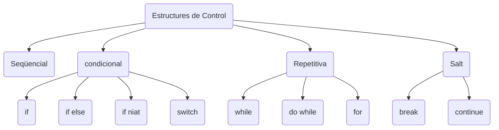

## Estructura Seqüencial

!!! success "Criteris d'avaluació associats"
    - [x] RA3.0. S'ha escrit i provat codi que faci ús d'estructures seqüencials.

Les ordres d'un programa s'executen per defecte en ordre seqüencial. El que significa que les instruccions s'executen, com hem comentat abans, una darrere de l'altra en el mateix ordre que apareixen escrites al programa.

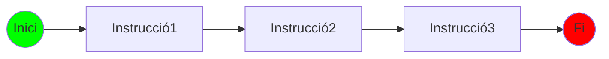

L'estructura seqüencial és l'ordre natura d'execució. Les instruccions que formen part d'aquesta estructura s'executen en ordre una a continuació de l'altra. Al final de cada instrucció hi ha un punt i coma per indicar-li al compilador el final de la sentència individual.

Les instruccions dintre d'una estructura seqüencial es solen agrupar en blocs ( {...} ) i es codifica de la següent manera:

!!!example "Estructura seqüencial"
    ```java linenums="1"
    // Exemple de bloc - estructura seqüencial
    {
        Instrucció1;
        Instrucció2;
        ...
        InstruccióN;
    }
    ```
Abans de passar a l'Activitat 301 en la que treballarem l'estructura seqüencial, caldria recordar que **Processing IDE**, l'entorn de desenvolupament que estem utilitzant, és un entorn de programació orientat a la programació d'imatges, animacions, sò i dibuix des d'un punt de vista experimental. Per tant les llibreries de les que disposa aquesta eina, tenen un munt de funcions relacionades amb el camp artístic i matemàtic. Veiem-ne un breu resum de les més utilitzades:

???info "Funcions de dibuix de Processing IDE"
    | Prototip                         | Descripció                                                                 | Exemple d'ús                             |
    |--------------------------------------|--------------------------------------------------------------------------------|----------------------------------------------|
    | `point(x, y)`                        | Dibuixa un punt en la posició `(x, y)`                                        | `point(100, 100);`                           |
    | `line(x1, y1, x2, y2)`               | Dibuixa una línia des de `(x1, y1)` fins a `(x2, y2)`                         | `line(50, 50, 150, 150);`                    |
    | `rect(x, y, w, h)`                   | Dibuixa un rectangle amb cantonada superior esquerra `(x, y)`                | `rect(100, 100, 80, 60);`                    |
    | `square(x, y, s)`                    | Dibuixa un quadrat de costat `s` en la posició `(x, y)`                       | `square(50, 50, 40);`                        |
    | `ellipse(x, y, w, h)`                | Dibuixa una el·lipse centrada en `(x, y)`                                     | `ellipse(120, 120, 60, 80);`                 |
    | `circle(x, y, d)`                    | Dibuixa un cercle centrat en `(x, y)` amb diàmetre `d`                        | `circle(200, 200, 50);`                      |
    | `arc(x, y, w, h, start, stop)`       | Dibuixa un arc dins d’una el·lipse                                            | `arc(100, 100, 80, 80, 0, PI);`              |
    | `triangle(x1, y1, x2, y2, x3, y3)`   | Dibuixa un triangle amb els tres punts especificats                          | `triangle(30, 75, 58, 20, 86, 75);`          |
    | `quad(x1, y1, x2, y2, x3, y3, x4, y4)`| Dibuixa un quadrilàter amb quatre punts                                       | `quad(38, 31, 86, 20, 69, 63, 30, 76);`       |
    | `beginShape()` / `endShape()`        | Defineix una forma complexa personalitzada amb vèrtexs                        | `beginShape(); vertex(30, 20); ... endShape();` |
    | `vertex(x, y)`                       | Defineix un punt en una forma personalitzada                                  | `vertex(60, 40);` (dins de `beginShape`)     |
    | `fill(r, g, b)`                      | Defineix el color de farciment per a les formes                               | `fill(255, 0, 0);`                           |
    | `stroke(r, g, b)`                    | Defineix el color del contorn de les formes                                   | `stroke(0, 0, 255);`                         |
    | `noFill()`                           | Elimina el color de farciment                                                 | `noFill();`                                  |
    | `noStroke()`                         | Elimina el contorn de les figures                                             | `noStroke();`                                |
    | `background(r, g, b)`                | Estableix el color de fons del canvas                                         | `background(240, 240, 240);`                 |
    | `text(str, x, y)`                    | Mostra text en la posició especificada                                        | `text("Hola món", 100, 200);`                |
    | `textSize(size)`                     | Defineix la mida del text                                                     | `textSize(32);`                              |
    | `textAlign(alignX, alignY)`          | Alineació horitzontal i vertical del text                                     | `textAlign(CENTER, CENTER);`                |
    | `image(img, x, y)`                   | Mostra una imatge a la posició `(x, y)`                                       | `image(myImage, 0, 0);`                      |


Veiem a continuació un exemple codificat en Java amb l'IDE de Processing en el que s'usen algunes de les funcions vistes a la taula anterior.

```java linenums="1"
void setup () {
        size(320,320);   // Estableix les dimensions de la nostra pantalla principal
        background(255); // Estableix el fons de la pantalla
        fill(0);         // Color amb el que es dibuixaran les figures.
    }

    void draw () {
        point(10,10);            // Dibuixa un punt
        line(20,20,40,40);       // Dibuixa una línia
        ellipse(100,100,80,80);  // Dibuixa una el·lipse
        square(200,200,50);      // Dibuixa un quadrat
    }
```

Per finalitzar veure'm també un exemple de l'ús de les funcios de Processing IDE beginShape, endShape i vertex. Quan alguna de les figures que volem dibuixar no són una figura bàsica (cercle, triangle, rectangle, etc..) sino una figura lliure podem utilitzar les funcions abans esmentades. Però veja'm un exemple:


```java linenums="1"
void setup () {
  size (200, 200);
}
void draw() {
  background(51);
    fill(255, 0, 0);
    stroke(255);
    strokeWeight(2);
    translate (100, 100);
    beginShape();
    vertex(0, -50);
    vertex(14, -20);
    vertex(47, -15);
    vertex(23, 7);
    vertex(29, 40);
    vertex(0, 25);
    vertex(-29, 40);
    vertex(-23, 7);
    vertex(-47, -15);
    vertex(-14, -20);
  endShape(CLOSE);
}
```

??? question "Activitat 301. Dibuixa amb Processing IDE"
    === "Enunciat"
        Si copies el següent codi a un esbós de Processing IDE i l'executes, veuràs que es mostra una pantalla de 320 píxels per 320 píxels amb fons blanc i després un punt, una línia, una elipse i un quadrat.

        ```java linenums="1"
        void setup () {
            size (320, 320);   // Estableix les dimensions de la nostra pantalla principal
            background (255);  // Estableix el fons de la pantalla
            fill (0);          // Color amb el que es dibuixaran les figures.
        }

        void draw () {
            point (10, 10);              // Dibuixa un punt
            line (20, 20, 40, 40);       // Dibuixa una línia
            ellipse (100, 100, 80, 80);  // Dibuixa una el·lipse
            square (200, 200, 50);       // Dibuixa un quadrat
        }
        ```

        Explica què són els números que hi ha entre parentesi a les sentències: point, line, ellipse i square.
        Redacta una conclusió a mode de comentari al codi amb el que creus haver entès.

        A continuació crea un sketch en Processing amb almenys:

            - 2 rectangles
            - 2 Cercles
            - 1 línia
    
        Restriccions:

            - Usa coordenades diferents
            - Modifica colors i gruixos

        Objectius: 
            - Familiaritzar-se amb el canvas.
            - Coordenades
            - Primitives gràfiques
    === "Rúbrica"
        | Ítem d'avaluació | 4 - Excel·lent | 3 - Correcte | 2 - Parcial | 1 - Incorrecte | 0 - Inexistent o incoherent |
        |---|---|---|---|---|---|
        | Funcionament del programa (.pde) | El codi compila i dibuixa correctament punt, línia, el·lipse i quadrat. Inclou modificacions pròpies correctes  | Tot funciona però modificacions mínimes o poc clares.  |Funciona parcialment o alguna figura incorrecta.   | No funciona, errors de sintaxi o no dibuixa res.  | Apartat no realitzat  |
        | Comentaris de documentació i comentaris dins del codi  | Té Javadoc a l’inici del fitxer, comentaris de documentació als mètodes (setup() i draw()) + comentaris funcionals clars i útils.  |Té comentaris però falta algun Javadoc o algun comentari és massa breu.   | Comentaris minsos o poc útils.  |No té comentaris o són incorrectes.   |  Apartat no realitzat |
        | Identació i estil del codi  | Identació perfecta: blocs alineats, espais coherents, salts de línia correctes. Codi 100% llegible.  | Alguna errada menor d’identació.  | Identació irregular però encara llegible.  | Codi desordenat, difícil de llegir.  |  Apartat no realitzat |
        | Nomenclatura d’identificadors  | Ús impecable: camelCase per variables, PascalCase per possibles classes, MAJÚSCULES per constants.  | Un error puntual però generalment correcte.  | Diversos errors però entén el concepte.  | No segueix cap convenció d’estil.  |  Apartat no realitzat |
        | Simplicitat i eficiència del codi  | Codi net i concís, sense línies innecessàries; només el que cal.  | Quatre línies sobrants però poca cosa.  |Codi redundant o massa llarg per a l’activitat.   | Codi innecessàriament complex o difícil de seguir.  | Apartat no realitzat  |
        | Modificació pròpia dels paràmetres | L’alumne modifica paràmetres de totes les figures i ho observa correctament.  | Modifica alguns paràmetres però no tots.  | Modifica mínimament una figura.  | No modifica res.  | Apartat no realitzat  |

    === "Solució"
        
        <center>📦 **Fitxer ZIP amb la solució completa**</center>

    	<center>[📥 Descarrega la solució](./assets/Tema3/act301.zip){ .md-button .md-button--secondary }</center>
        
        Encara no disponible
        

Ara que ja has vist algunes de les funcions que ens ofereix l'**API de Processing** per tal de dibuixar, investiga quines altres funcions permet i aplica-les a la següent activitat.

??? question "Activitat 302. Dibuix lliure amb Processing IDE."
    === "Enunciat"
        Utilitzant altres primitives de dibuix que ens proporciona l'API de Processing IDE, dibuixa alguna cosa concreta. Has de tindre en compte que la majoria de primitives (funcions) són geomètriques, per tant, et podries inspirar en algun dibuix geomètric. Pots buscar per Internet.

        Restriccions:

            - Mínim 5 primitives diferents
            - Almenys 3 colors
            - Composició recgnoscible

    === "Rúbrica"
        | Ítem d'avaluació | 4 - Excel·lent | 3 - Correcte | 2 - Parcial | 1 - Incorrecte | 0 - Inexistent o incoherent |
        |---|---|---|---|---|---|
        | Originalitat i creativitat del dibuix  | Has fet un dibuix clarament inspirat en formes geomètriques, combinant diverses primitives de manera estètica i creativa.  | Bon ús de primitives, però amb una composició relativament simple.  | Dibuix acceptable però molt bàsic (poc variat en formes).  | El dibuix és molt senzill o no mostra inspiració geomètrica clara.  | Apartat no realitzat  |
        | Ús de primitives de Processing  | Utilitza múltiples primitives (p. ex. ellipse(), rect(), triangle(), arc(), line()) i les combina amb lògica seqüencial coherent.  | Utilitza diverses primitives, però no una gran varietat o combinació sofisticada.  | Fa servir només un nombre limitat de primitives (2-3).  | Fa ús molt limitat (una o dues primitives) o mal us.  | Apartat no realitzat  |
        | Codi net i estil (indentació, salts de línia, espais)  | Codi molt ben indentat, amb salts de línia coherents, espais ben col·locats i llegibilitat excel·lent.  | Bona legibilitat amb algun petit desordre d’espais o salts.  | Llegible però amb indentació irregular o massa compacta.  | Desordenat, difícil de llegir o sense estructura clara.   | Apartat no realitzat  |
        | Identificadors i convenció de noms  | Si hi ha variables (ex. coordenades, grandàries), utilitza camelCase; capçalera o constants en majúscules si cal, i segueix les convencions vistos a classe.  | Alguns identificadors no segueixen completament les convencions, però és coherent en general.  | Identificadors poc significatius o amb errors d’estil consistent.  | Identificadors confusos o incorrectes, sense atenció al estil.  | Apartat no realitzat  |
        | Comentaris i documentació  | Inclou un comentari de documentació al principi (/** … */) que explica el que dibuixa, a més d’explicacions dins del codi per parts clau.  | Comentari inicial + alguns comentaris interns, però no explica tot.  | Pocs comentaris, just el necessari per entendre alguna part.  | Sense comentaris o molt escassos, codi difícil d’entendre sense llegir tot.  | Apartat no realitzat  |
        | Funcionalitat i correcció  | El codi es compila, s’executa i el dibuix es veu correctament segons el que l’alumne ha definit. No hi ha errors visibles ni parts que no es mostren.  | S'executa i es veu la majoria del dibuix, pot haver-hi petites imprecisions.  | S'executa però hi ha errors gràfics, primitives que no es veuen o parts mal posicionades.  | No es dibuixa correctament, errors de compilació o execució.  | Apartat no realitzat  |
        | Respecte de l’estructura seqüencial (no ús d’if, for, while, switch...)  | Tot el codi és 100% seqüencial, sense cap estructura alternativa o iterativa.  | Apareix algun if o estructura semblant però no afecta el dibuix principal.  | Ús parcial d’estructures que no pertoquen.  | El dibuix depén d’estructures de selecció o repetitives → trenca l’objectiu de l’activitat.  | Apartat no realitzat  |

    === "Solució"
        
        <center>📦 **Possibles Dibuixos**</center>

    	<center>[📥 Exemple 1](./assets/Tema3/act301.zip){ .md-button .md-button--secondary }
        [📥 Exemple 2](./assets/Tema3/act301b.zip){ .md-button .md-button--secondary }</center>
        
        Encara no disponible
        

## Estructures de selecció

!!! success "Criteris d'avaluació associats"
    - [x] RA3.1. S'ha escrit i provat codi que faci ús d'estruc
    tures de selecció.

És una de les estructures que permeten modificar l'ordre d'execució de les instruccions del programa. Una estructura condicional determina si s'executen unes accions o altres segons es compleixi o no una determinada condició. La condició que es comprova per decidir si unes instruccions s'executen o no deu ser una expressió booleana, és a dir, ha de donar com a resultat un valor booleà true o false. 

Com varem explicar al tema anterior, ens podem trobar les següents variants d'estructura de selecció:

- Selecció simple
- Selecció doble
- Selecció multiple
- Operador condicional ?
  
### Selecció Simple - if

És l'estructura condicional més simple en programació estructurada. S'utilitza per determinar si una instrucció o bloc d'instruccions s'executa basat en una condició. S'avalua la condició i si es true, s'executa la instrucció o bloc d'instruccions associat a la condició.

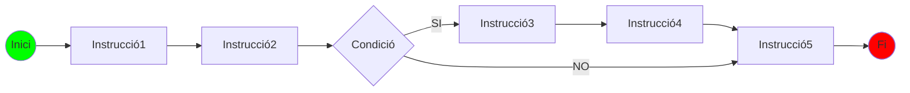

El seu codi en Java seria:

```java linenums="1"
Instrucció1();
Instrucció2();

if (condicio) {
    instrucció3;
    Instrucció4;
}
Instrucció5;
```

Al codi anterior s'executarien sempre les instruccions 1 i 2 abans d'avaluar-se la condició, en cas que la condició fora avaluada com a **true**, s'executaria l'estructura seqüencial que conté les instruccions 3 i 4 i finalment s'executaria la instrucció 5 en tot cas. 

Pel contrari si la condició s'avalua a **false** no s'executarien les instruccions que conté, és a dir, 3 i 4 i passaria directament a l'instrucció 5.

!!! example "Aplicació que detecte números senars"

    ```java linenums="1"
    int num = (int) random(100);

    if (num % 2 == 0)
        println(num + " és parell");

    println("S'ha acabat l'aplicació");
    ```

### Selecció doble - if .. else

Amb aquesta estructura condicional de la programació estructurada es poden seguir **camins distints** depenent de si l'avaluació de la condició és **true o false**. En altres paraules, si la condició és true, executaria una instrucció o bloc d'instruccions mentre que si s'avalua a false executaria una altra instrucció o bloc d'instruccions.

Observa el diagrama de flux següent:

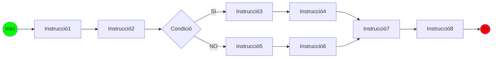

El seu codi en Java seria

```java linenums="1"
instruccio1;
instruccio2;
if (condicio) {
    instruccio3;
    instruccio4;
}
else {
    instruccio5;
    instruccio6;
}
instruccio7;
instruccio8;
```

Si ens fixem en el codi anterior, podem trobar dues seqüències d'execucio d'instruccions depenent si la condició del **'if'** s'avalua **'true'** o **'false'**. En el primer cas, amb la condició a **'true'**, s'executarien: instrucció1, instrucció2, instrucció3, instrucció4, instrucció7 i instrucció8. Mentre que si la condició del 'if' s'avaluara a **'false'**, les instruccions a executar serien: instrucció1, instrucció2, instrucció5, instrucció6, instrucció7 i instrucció8.

```java linenums="1"
    int hora;

    void setup () {
        size (640,480);
    }

    void draw () {
        hora = (int)random(0,24);

        if ( hora >= 12)
            println("Encara és de matí");

        else
            println("Ja és de vesprada");
    }
```

??? question "Activitat 303. Nombres parells i senars amb la funció random()"
    === "Enunciat"
        Seguint l'exemple de l'aplicació que detecta números senars, fes que també ens indique en cas contrari, si no és parell, que es tracta d'un número senar.

        Restriccions:

            - El rang de nombres possibles va del 0 al 100
            - Mostra el valor i el resultat.
            - Es valorarà el layout de l'aplicació.

    === "Rúbrica"
        | Ítem d'avaluació | 4 - Excel·lent | 3 - Correcte | 2 - Parcial | 1 - Incorrecte | 0 - Inexistent o incoherent |
        |---|---|---|---|---|---|
        | Compliment de l'enunciat  |  El programa genera correctament un número aleatori, aplica l’operació modular i determina si és parell o senar, mostrant el resultat sense errors. | Fa tot el que es demana amb alguna imprecisió menor.  | Compleix parcialment: genera nombre però la comprovació o la impressió és incorrecta o incompleta.  |  No compleix el que demana l’activitat. | Apartat no realitzat  |
        | Ús correcte de random() per generar un nombre.  | Ús correcte de random(). El resultat és un enter obtingut de forma adequada (int(random(...))).  | Ús de random vàlid però millorable (rang incoherent o conversió poc clara).  | Errors en l’ús de random() però el programa funciona.  | No sap usar random() o no el fa servir.  | Apartat no realitzat  |
        | Ús de l'estructura condicional doble (if else)  |  L’estructura if–else és correcta, clara i ben plantejada. | If–else correcte però amb algun detall menor.  | If–else funcional però mal estructurat o amb redundàncies.  | No usa if–else, o l’usa de manera incorrecta.  | Apartat no realitzat  |
        | Impressió del resultat: println o text()  | Mostra el resultat clarament. Si usa text(), està ben posicionat.  | Missatge correcte però poc clar o mal ubicat.  | Missatge confús o poc complet.  | No mostra el resultat.  | Apartat no realitzat  |
        | Comentaris de documentació i comentaris explicatius  | Inclou comentari de documentació a l’inici i comentaris útils al codi.  | Té comentaris però falten alguns.  | Comentaris insuficients o poc clars.  | No hi ha comentaris.  | Apartat no realitzat  |
        | Estil i qualitat del codi (identació, camelCase, ordre, simplicitat)  | Identació impecable, codi simple i ben estructurat, identificadors correctes en camelCase.  | Pocs errors d’estil o identificació.  | Bastants errades o codi poc net.  | Codi desordenat, difícil de llegir o sense normes d’estil.  | Apartat no realitzat  |
        | Simplicitat i adequació al codi.  | Codi simple i directe. No conté línies sobrants.  | Un poc de codi innecessari però acceptable.  | Massa passos per una tasca simple.  | Codi confús, sobrecarregat o excessivament llarg.  | Apartat no realitzat  |
    
    === "Solució"
        
        ```java linenums="1"

            int num = (int)random(100);

            if (num % 2 == 0)
                println(num + " és un número parell");

            else
                println(num + " és un número senar");

            println("Ja s'ha acabat l'aplicació");

        ```
        
        Encara no disponible
        

### Selecció niada - if else if else

Si volem avaluar **més d'una condició** al nostre codi, estariem parlant d'una estructura condicional múltiple que bàsicament consisteix en encadenar diversos if..else. A continuació es pot veure com seria un exemple de condicional múltiple en diagrama de flux.

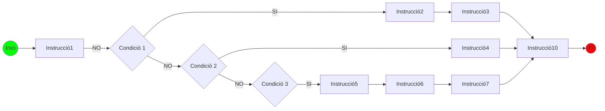

El mateix exemple en Java que teniu a la imatge anterior seria:

```java linenums="1"
instruccio1;

if (condicio1) {
    instruccio2;
    instruccio3;
}
else if (condicio2) {
    instruccio4;
}
else if (condicio3) {
    instruccio5;
    instruccio6;
    instruccio7;
}
else {
    instruccio8;
    instruccio9;
}
instruccio10;
```

Al codi anterior l'únic que sí sabem cert és que s'executaran les instruccions 1 i 2 i depenent de quina condició s'avalua a true s'executarà algun bloc d'instruccions que estan dins de l'estructura condicional. Seguint amb l'exemple de l'hora que hem utilitzat als apartats anteriors veiem com es podria usar una condició múltiple amb if else:

??? question "Activitat 304. Condicional niada. Copia i executa a Processing IDE."
    === "Enunciat"
        ```java linenums="1"
        void setup () {
            size(640,480);
        }

        void draw() {
            int hora = (int)random(0,24);

            if (hora >= 7 && hora <= 9)
                println("Eres matiner");

            else if (hora > 9 && hora <= 12)
                println("Deuries haver esmorzat ja");

            else if (hora > 12 && hora <= 15)
                println("Es hora de dinar si no has dinat");

            else if (hora > 15 && hora <= 18)
                println("Si no has fet una migdiada oblidat");

            else
                println("Hora de la cervesa");
        }
        ```

        Copia i executa el codi a Processing IDE. Al final de cada cicle de la funció **draw** posa un delay de 1 segon per tal que ens done temps a veure el resultat. Recorda també de fer un **background (255)** al principi de cada cicle de draw.

        Modifica el codi per tal d'afegir-li més opcions. Per exemple podries afegir-li que passa entre les 18:00 i les 20:00 o també entre les 20:00 i les 22:00...


        <center>
            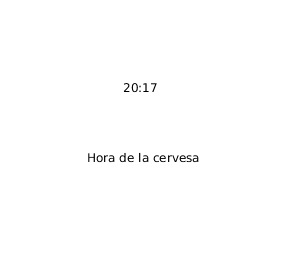            
        </center>

    === "Rúbrica"
        | Ítem d'avaluació | 4 - Excel·lent | 3 - Correcte | 2 - Parcial | 1 - Incorrecte | 0 - Inexistent o incoherent |
        |---|---|---|---|---|---|
        | Compliment de l’enunciat  |  Ha copiat i executat el codi base, ha afegit delay(1000) i clear() correctament, i ha ampliat l’algoritme amb nous intervals i nous missatges de forma coherent. | Compleix tot el que es demana però falta algun detall (clear mal posat, delay incorrecte, un interval mal definit…).  | Ha fet part de l'activitat però no tota (no ha afegit intervals nous, o no ha posat delay, o no ha posat clear).  |  L’activitat no compleix els objectius mínims. |  Apartat no realitzat |
        |  Ús correcte del condicional niat (if – else if – else) |  Estructura perfecta, condicions coherents, no solapades i ordenades de forma lògica. | Condicions correctes però amb alguna redundància o interval poc justificat.  |  Algunes condicions incorrectes o mal ordenades, tot i que funciona parcialment. | Error greu: intervals solapats, mal estructurat, o no usa condicional niat.  |  Apartat no realitzat |
        | Ús adequat de random() i conversió a int  | Usa random() correctament amb rang 0–24 i conversió adequada a int.  | Random funciona però el rang o la conversió són millorable.  |  Error parcial (rang incorrecte però funcional). |  No usa random o ho usa malament. | Apartat no realitzat  |
        |  Claredat del missatge mostrat (println o text) | Els missatges són clars, coherents, ben escrits i representen bé cada franja horària.  | Missatges correctes però millorables.  |  Missatges poc clars o que no concorden amb les condicions. | No mostra cap informació.  |  Apartat no realitzat |
        | Comentaris de documentació + comentaris al codi  |  Té comentari de documentació al principi, comentaris útils als mètodes i comentaris explicatius dins del codi. | Comentaris correctes però incomplets.   |  Molt pocs comentaris o poc útils. | Sense comentaris.  | Apartat no realitzat  |
        | Estil i qualitat del codi (identació, camelCase, salts de línia, simplicitat)  |  Identació impecable, identificadors correctes, codi ordenat i simple. | Algunes errades menors però el codi és llegible.  |  Codi desordenat o amb errors d’estil visibles. | Codi mal organitzat, difícil de llegir o desalineat.  | Apartat no realitzat  |
        | Simplicitat i adequació del codi  | Codi ben reduït, directe i adequat a l’activitat.  | Algunes línies innecessàries.   |  Massa codi per a una tasca simple. | Codi sobrecarregat, artificiós o confús.  |  Apartat no realitzat |
    
    === "Solució"
        
        <center>📦 **Fitxer ZIP amb la solució completa**</center>

    	<center>[📥 Descarrega la solució](./assets/Tema3/act304.zip){ .md-button .md-button--secondary }</center>
        
        Encara no disponible
        

### Activitats sobre estructures de selecció

Mira i fes les següents activitats per tal de reforçar els conceptes vistos sobre les diferents estructures de selecció de la programació estructurada.

??? question "Activitat 305. Divisió de dos enters"
    === "Enunciat"
        Escriu un programa en Processing IDE que genere aleatòriament dos nombres enters i que calcule la seua divisió. El programa ens haurà d'indicar si la divisió és exacta qui és el resultat i si no és exacta quin és el resultat i el residu.

        Fes que el resultat es mostre el més amigable possible. És a dir, intenta no utilitzar el println i utilitza la funció **text** de l'API de Processing per mostrar el resultat per pantalla enlloc de pel terminal.

        <center>
                
        </center>

        Com a apartat d'ampliació, podries fer que el grandaria de la font fos un poc més gran. A banda si veus algun detall que no t'agrada com funciona, ho pots modificar.

        No sé si s'haurà donat el cas no no però si el divisor és menor que el dividend el resultat sempre és zero. Seria interessant que es controlara que sempre es dividira el número major pel menor.

        També si s'ha dona el cas, hauràs pogut comprovar que si el divisor és 0 el programa dona error.
        
        Millora el programa anterior controlant el que passa quan es vol dividir per zero, mostrant un missatge en el cas que el número pel qual s'intenta dividir siga zero. I assegurat també que el divisor és sempre el número major.

        Compte perquè segurament hauràs d'usar estructures de selecció niades.

        <center>
            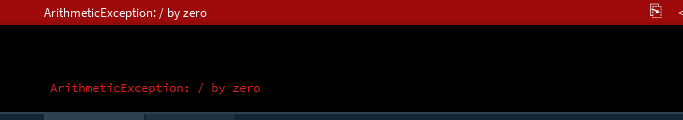    
        </center>

        <center>
            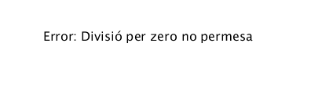
        </center>

    === "Rúbrica"
        | Ítem d'avaluació | 4 - Excel·lent | 3 - Correcte | 2 - Parcial | 1 - Incorrecte | 0 - Inexistent o incoherent |
        |---|---|---|---|---|---|
        | Compliment de l’enunciat | L'activitat suposa que fa el que ha de fer exactament i coincidint plenament amb el que posa a l'enunciat comprovant que el dividend és major sempre | Compleix tot el que es demana però falta algun detall menor. | Ha fet part de l'activitat però no tota | L’activitat no compleix els objectius mínims. | Apartat no realitzat |
        | Ús correcte del condicional doble (if – else) | Estructura perfecta, condicions coherents, no solapades i ordenades de forma lògica. | Condicions correctes però amb alguna redundància o interval poc justificat. | Algunes condicions incorrectes o mal ordenades, tot i que funciona parcialment. | Error greu: intervals solapats, mal estructurat, o no usa condicional niat. | Apartat no realitzat |
        | Ús adequat de random() i conversió a int | Usa random() correctament amb rang 0–24 i conversió adequada a int. | Random funciona però el rang o la conversió són millorable. | Error parcial (rang incorrecte però funcional). | No usa random o ho usa malament. | Apartat no realitzat |
        | Claredat del missatge mostrat (println o text) | Els missatges són clars, coherents, ben escrits i representen bé cada cas possible. | Missatges correctes però millorables. | Missatges poc clars o que no concorden amb les condicions. | No mostra cap informació. | Apartat no realitzat |
        | Comentaris de documentació + comentaris al codi | Té comentari de documentació al principi, comentaris útils als mètodes i comentaris explicatius dins del codi. | Comentaris correctes però incomplets. | Molt pocs comentaris o poc útils. | Sense comentaris. | Apartat no realitzat |
        | Estil i qualitat del codi (identació, camelCase, salts de línia, simplicitat) | Identació impecable, identificadors correctes, codi ordenat i simple. | Algunes errades menors però el codi és llegible. | Codi desordenat o amb errors d’estil visibles. | Codi mal organitzat, difícil de llegir o desalineat. | Apartat no realitzat |
        | Simplicitat i adequació del codi | Codi ben reduït, directe i adequat a l’activitat. | Algunes línies innecessàries. | Massa codi per a una tasca simple. | Codi sobrecarregat, artificiós o confús. | Apartat no realitzat |
        
    === "Solució"
        
        <center>📦 **Fitxer ZIP amb la solució completa**</center>

    	<center>[📥 Descarrega la solució](./assets/Tema3/act305.zip){ .md-button .md-button--secondary }</center>
        
        Encara no disponible
        
    
??? question "Activitat 306. Major, menor o igual"
    === "Enunciat"
        Escriu un programa en Processing que genere aleatòriament dos números i que diga quin és el major, quin és el menor o si són iguals.
        És a dir, l'aplicació ha de generar dos números aleatoris, des del 0 fins al 100 per exemple i comprovar la següent casuística:

        - Són els dos números iguals?
        - És el primer número major que el segon?
        - És el segon número major que el segon?

        <center>
            
        </center>

    === "Rúbrica"
        | Ítem d'avaluació | 4 - Excel·lent | 3 - Correcte | 2 - Parcial | 1 - Incorrecte | 0 - Inexistent o incoherent |
        |---|---|---|---|---|---|
        | Compliment de l’enunciat  | Genera tres nombres aleatoris i fa les comprovacions pertinents de forma perfecta  |Compleix tot el que es demana però falta algun detall menor.   |Ha fet part de l'activitat però no tota   | L’activitat no compleix els objectius mínims.  |  Apartat no realitzat |
        | Ús correcte del condicional niada (if – else)  | Estructura perfecta, condicions coherents, no solapades i ordenades de forma lògica.  | Condicions correctes però amb alguna redundància o interval poc justificat.  | Algunes condicions incorrectes o mal ordenades, tot i que funciona parcialment.  | Error greu: intervals solapats, mal estructurat, o no usa condicional niat.  | Apartat no realitzat  |
        | Claredat del missatge mostrat (println o text)  |Els missatges són clars, coherents, ben escrits i representen bé cada cas possible.   | Missatges correctes però millorables.  |  Missatges poc clars o que no concorden amb les condicions. | No mostra cap informació.  | Apartat no realitzat  |
        | Comentaris de documentació + comentaris al codi  |Té comentari de documentació al principi, comentaris útils als mètodes i comentaris explicatius dins del codi.   |  Comentaris correctes però incomplets. |  Molt pocs comentaris o poc útils. | Sense comentaris.  | Apartat no realitzat |
        | Estil i qualitat del codi (identació, camelCase, salts de línia, simplicitat)  | Identació impecable, identificadors correctes, codi ordenat i simple.  | Algunes errades menors però el codi és llegible.  | Codi desordenat o amb errors d’estil visibles.  | Codi mal organitzat, difícil de llegir o desalineat.  |  Apartat no realitzat |
        | Simplicitat i adequació del codi  | Codi ben reduït, directe i adequat a l’activitat.  | Algunes línies innecessàries.  | Massa codi per a una tasca simple.  | Codi sobrecarregat, artificiós o confús.  | Apartat no realitzat  |

    === "Solució"
        
        <center>📦 **Fitxer ZIP amb la solució completa**</center>

    	<center>[📥 Descarrega la solució](./assets/Tema3/act306.zip){ .md-button .md-button--secondary }</center>
        
        Encara no disponible
        

??? question "Activitat 307. Diferència d'anys"
    === "Enunciat"
        Escriu un programa en Processing que donat l'any actual(2023) i un any qualsevol que es genere de forma aleatòria amb la funció random entre l'any 0 i l'any 2500 i escriga quants anys han passat des d'eixe any o quants anys falten per arribar a eixe any. Per exemple, imagina que l'any aleatori que genera la teua aplicació és l'any 2123, en aquest cas hauria de mostrar el següent missatge: "Falten 100 anys per arribar a l'any 2123", si per exemple l'any aleatori fos 2001, el missatge que hauria de mostrar és: "Han passat 22 anys des de l'any 2001". Si finalment l'any aleatori és igual a l'any actual, el missatge podria ser: "L'any aleatori i l'actual són el mateix any".

        Es podrien utilitzar constants en aquesta activitat. Quina?

        <center>
            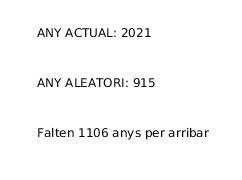
        </center>

        Igual en les proves que has fet no t'ha passat però, t'has preguntat que passa si l'any aleatori és exactament un any menys o un any més que l'actual?
        Si has fet bé l'activitat anterior i si l'any aleatori fora per exemple 2022, el teu programa deuria mostrar: "Han passat un anys des del 2022", que és incorrecte ja que deuria posar: "Ha passat un any des del 2022".

        Millora el programa anterior fent que quan la diferència siga exactament un any, mostre una frase concreta: "Només queda un any per al 2023" o "Ha passat un any des del 2002". En la resta de casos ha de funcionar igual que abans.

        <center>
            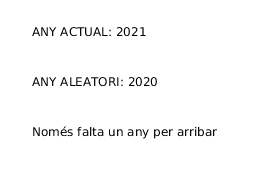
        </center>

    === "Rúbrica"
        | Ítem d'avaluació | 4 - Excel·lent | 3 - Correcte | 2 - Parcial | 1 - Incorrecte | 0 - Inexistent o incoherent |
        |---|---|---|---|---|---|
        | Compliment de l’enunciat | Molt bé, has fet les comprovacions dels anys, crea una constant anyActual amb totes les opcions controlades. | Compleix tot el que es demana però falta algun detall menor. | Ha fet part de l'activitat però no tota | L’activitat no compleix els objectius mínims. | Apartat no realitzat |
        | Ús correcte del condicional niada (if – else if – else) | Estructura perfecta, condicions coherents, no solapades i ordenades de forma lògica. | Condicions correctes però amb alguna redundància o interval poc justificat. | Algunes condicions incorrectes o mal ordenades, tot i que funciona parcialment. | Error greu: intervals solapats, mal estructurat, o no usa condicional niat. | Apartat no realitzat |
        | Claredat del missatge mostrat (println o text) | Els missatges són clars, coherents, ben escrits i representen bé cada cas possible. | Missatges correctes però millorables. | Missatges poc clars o que no concorden amb les condicions. | No mostra cap informació. | Apartat no realitzat |
        | Comentaris de documentació + comentaris al codi | Té comentari de documentació al principi, comentaris útils als mètodes i comentaris explicatius dins del codi. | Comentaris correctes però incomplets. | Molt pocs comentaris o poc útils. | Sense comentaris. | Apartat no realitzat |
        | Estil i qualitat del codi (identació, camelCase, salts de línia, simplicitat) | Identació impecable, identificadors correctes, codi ordenat i simple. | Algunes errades menors però el codi és llegible. | Codi desordenat o amb errors d’estil visibles. | Codi mal organitzat, difícil de llegir o desalineat. | Apartat no realitzat |
        | Simplicitat i adequació del codi | Codi ben reduït, directe i adequat a l’activitat. | Algunes línies innecessàries. | Massa codi per a una tasca simple. | Codi sobrecarregat, artificiós o confús. | Apartat no realitzat |
        
    === "Solució"
        
        <center>📦 **Fitxer ZIP amb la solució completa**</center>

    	<center>[📥 Descarrega la solució](./assets/Tema3/act307.zip){ .md-button .md-button--secondary }</center>
        
        Encara no disponible
        

??? question "Activitat 308. Nombres múltiples"
    === "Enunciat"
        Escriu un programa que genere dos números aleatoris entre el 0 i el 100 i escriga si el número major és multiple del menor. Per exemple, imagina que el nostre genera els números 6 i 60. Com que 60 és major que 6, hem de comprovar si hi ha algun número que al multiplicar-lo per 6 done 60. Dit d'una altra manera, si dividim 60 entre 6 el residu és zero? En tal cas, si existeix un número natural que al multiplicar-lo per 6 dona 60, aleshores podem dir que 60 és múltiple de 6.

        <center>
            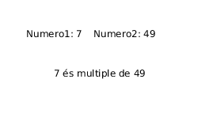
        </center>

    === "Rúbrica"
        | Ítem d'avaluació | 4 - Excel·lent | 3 - Correcte | 2 - Parcial | 1 - Incorrecte | 0 - Inexistent o incoherent |
        |---|---|---|---|---|---|
        | Compliment de l’enunciat | Molt bé, has creat dos números aleatoris entre 0 i 100. Has comprovat quin és menor i finalment si era múltiple. | Compleix tot el que es demana però falta algun detall menor. | Ha fet part de l'activitat però no tota. | L’activitat no compleix els objectius mínims. | Apartat no realitzat |
        | Ús correcte de l'estructura o estructures condicionals correctament. | Estructura perfecta, condicions coherents, no solapades i ordenades de forma lògica. | Condicions correctes però amb alguna redundància o interval poc justificat. | Algunes condicions incorrectes o mal ordenades, tot i que funciona parcialment. | Error greu: intervals solapats, mal estructurat, o no usa condicional niat (if – else if -else). | No has usat cap estructura condicional. |
        | Claredat del missatge mostrat amb la funció text | Els missatges són clars, coherents, ben escrits i representen bé cada cas possible. | Missatges correctes però millorables. | Missatges poc clars o que no concorden amb les condicions o esteticament millorable. | No mostra cap informació. | Apartat no realitzat |
        | Comentaris de documentació + comentaris al codi | Té comentari de documentació al principi, comentaris útils als mètodes i comentaris explicatius dins del codi. | Comentaris correctes però incomplets. | Molt pocs comentaris o poc útils. | No has posat comentaris de documentació. | Apartat no realitzat |
        | Estil i qualitat del codi (identació, camelCase, salts de línia) | Identació impecable, identificadors correctes, codi ordenat i simple. | Algunes errades menors però el codi és llegible. | Codi desordenat o amb errors d’estil visibles. | Codi mal organitzat, difícil de llegir o desalineat. | Apartat no realitzat |
        | Simplicitat i adequació del codi | Codi ben reduït, directe i adequat a l’activitat. | Algunes línies innecessàries. | Massa codi per a una tasca simple. | Codi sobrecarregat, artificiós o confús. | Apartat no realitzat |
    
    === "Solució"
        
        <center>📦 **Fitxer ZIP amb la solució completa**</center>

    	<center>[📥 Descarrega la solució](./assets/Tema3/act308.zip){ .md-button .md-button--secondary }</center>
        
        Encara no disponible
        
        
??? question "Activitat 309. Nombre múltiples amb negatius i zeros"
    === "Enunciat"
        A l'activitat anterior, quan generem els nombres de forma aleatòria, els resultats podien estar entre 0 i 100, però que passaria si quan generem nombres de forma aleatòria el resultat pogués ser negatiu? Com funcionen els múltiples tenint en compte els números negatius?  
        
        Veiem un exemple: numero1 (-30), num2 (-6). És -30 múltiple de -6? Què dona el residu de l'operació de dividir -30 entre -6? -30 % -6 = 0. Per tant podem concloure que -6 i -30 són múltiples.

        Millora el programa anterior fent que el programa avise quan s'escriguen valors negatius encara que realitze el càlcul de la mateixa forma que ho feia abans.

        Què passa si algun dels números generats aleatòriament són zero? I si els dos números aleatoris són zero?

    === "Rúbrica"
        | Ítem d'avaluació | 4 - Excel·lent | 3 - Correcte | 2 - Parcial | 1 - Incorrecte | 0 - Inexistent o incoherent |
        |---|---|---|---|---|---|
        | Compliment de l’enunciat | Compleix exactament el que es demana l'enunciat amb cura de tot detall. | Compleix tot el que es demana però falta algun detall menor o hagués pogut estar fet de forma més eficient. | Ha fet part de l'activitat però no tota. | L’activitat no compleix els objectius mínims. | No compleix per a res l'enunciat proposat. |
        | Ús correcte de l'estructura o estructures condicionals correctament. | Estructura perfecta, condicions coherents, no solapades i ordenades de forma lògica. | Condicions correctes però amb alguna redundància o interval poc justificat. | Algunes condicions incorrectes o mal ordenades, tot i que funciona parcialment. | Error greu: intervals solapats, mal estructurat, o no usa condicional niat (if – else if -else). | No has usat cap estructura condicional. |
        | Claredat del missatge mostrat amb la funció text | Els missatges són clars, coherents, ben escrits i representen bé cada cas possible. | Missatges correctes però millorables. | Missatges poc clars o que no concorden amb les condicions o esteticament millorable. | No mostra cap informació o la mostra pel terminal. | No mostra cap informació a cap lloc. Ni pel terminal. |
        | Comentaris de documentació + comentaris al codi | Té comentari de documentació al principi, comentaris útils als mètodes i comentaris explicatius dins del codi. | Comentaris correctes però incomplets. | Molt pocs comentaris o poc útils. | Els comentaris són molt pobres. | No has posat cap comentari de documentació. |
        | Estil i qualitat del codi (identació, camelCase, salts de línia) | Identació impecable, identificadors correctes, codi ordenat i simple. | Algunes errades menors però el codi és llegible. | Codi desordenat o amb errors d’estil visibles. | Codi mal organitzat, difícil de llegir o desalineat. | No segueixes cap de les convencions ni res acordat a classe. |
        | Simplicitat i adequació del codi | Codi ben reduït, directe i adequat a l’activitat. | Algunes línies innecessàries. | Massa codi per a una tasca simple. | Codi sobrecarregat, artificiós o confús. | Pràcticament il·legible |
    
    === "Solució"
        
        <center>📦 **Fitxer ZIP amb la solució completa**</center>

    	<center>[📥 Descarrega la solució](./assets/Tema3/act309.zip){ .md-button .md-button--secondary }</center>
        
        Encara no disponible
        

??? question "Activitat 310. Comparador de tres números"
    === "Enunciat"
        Escriu un programa que donats 3 números (creats aleatòriament) ens diga si són els tres iguals, dos són iguals o cap és igual. Analitzem amb més profunditat el problema. Quants són els escenaris que ens podem trobar amb tres números aleatoris?

            - Els tres números són iguals.
            - El primer número i el segon són iguals.
            - El primer número i el tercer són iguals.
            - El segon número i el tercer són iguals.
            - Cap nombre és igual.

        <center> 
            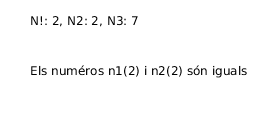   
        </center>

    === "Rúbrica"
        | Ítem d'avaluació | 4 - Excel·lent | 3 - Correcte | 2 - Parcial | 1 - Incorrecte | 0 - Inexistent o incoherent |
        |---|---|---|---|---|---|
        | Compliment de l’enunciat  | Molt bé, has creat tres números aleatoris entre 0 i 100 i has fet les comprovacions correctament. | Compleix tot el que es demana però falta algun detall menor o hagués pogut estar fet de forma més eficient.  | Ha fet part de l'activitat però no tota.  | L’activitat no compleix els objectius mínims.  | No compleix per a res l'enunciat proposat.  |
        | Ús correcte de l'estructura o estructures condicionals correctament.  | Estructura perfecta, condicions coherents, no solapades i ordenades de forma lògica.  | Condicions correctes però amb alguna redundància o interval poc justificat.  | Algunes condicions incorrectes o mal ordenades, tot i que funciona parcialment.  |  Error greu: intervals solapats, mal estructurat, o no usa condicional niat (if – else if -else). | No has usat cap estructura condicional.  |
        | Claredat del missatge mostrat amb la funció text  |Els missatges són clars, coherents, ben escrits i representen bé cada cas possible.   |Missatges correctes però millorables.   | Missatges poc clars o que no concorden amb les condicions o esteticament millorable.  | No mostra cap informació o la mostra pel terminal.  | No mostra cap informació a cap lloc. Ni pel terminal.     |
        | Comentaris de documentació + comentaris al codi  |  Té comentari de documentació al principi, comentaris útils als mètodes i comentaris explicatius dins del codi. | Comentaris correctes però incomplets.  | Molt pocs comentaris o poc útils.  | Els comentaris són molt pobres.  | No has posat cap comentari de documentació.  |
        | Estil i qualitat del codi (identació, camelCase, salts de línia)  | Identació impecable, identificadors correctes, codi ordenat i simple.  | Algunes errades menors però el codi és llegible.  | Codi desordenat o amb errors d’estil visibles.  | Codi mal organitzat, difícil de llegir o desalineat.  |No segueixes cap de les convencions ni res acordat a classe.   |
        | Simplicitat i adequació del codi  | Codi ben reduït, directe i adequat a l’activitat.  | Algunes línies innecessàries.  | Massa codi per a una tasca simple.  | Codi sobrecarregat, artificiós o confús.  | Pràcticament il·legible  |
    
    === "Solució"
        
        <center>📦 **Fitxer ZIP amb la solució completa**</center>

    	<center>[📥 Descarrega la solució](./assets/Tema3/act310.zip){ .md-button .md-button--secondary }</center>
        
        Encara no disponible
        

??? question "Activitat 311. Any bixest"
    === "Enunciat"
        Escriu un programa que genere un any aleatori de 0 a 2021 i ens diga si aquest és bixest o no. Cal recordar que els anys bixests són múltiples de 4, però no són múltiples de 100 i sí són múltiples de 400. Per exemple: 2012 és bixest, 2010 no ho és, 2000 sí que ho es però 1900 no ho és. Pots basar-te en el següent codi.

        <center>
            
        </center>
        <center>
            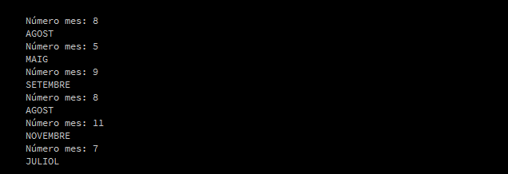
        </center>

    === "Rúbrica"
        | Ítem d'avaluació | 4 - Excel·lent | 3 - Correcte | 2 - Parcial | 1 - Incorrecte | 0 - Inexistent o incoherent |
        |---|---|---|---|---|---|
        | Compliment de l’enunciat  | Molt bé, fet tot el que demana l'enunciat.  | Compleix tot el que es demana però falta algun detall menor o hagués pogut estar fet de forma més eficient.  | Ha fet part de l'activitat però no tota.  | L’activitat no compleix els objectius mínims.  | No compleix per a res l'enunciat proposat.  |
        | Ús correcte de l'estructura o estructures condicionals correctament.  | Estructura perfecta, condicions coherents, no solapades i ordenades de forma lògica.  |  Condicions correctes però amb alguna redundància o interval poc justificat. | Algunes condicions incorrectes o mal ordenades, tot i que funciona parcialment.  | Error greu: intervals solapats, mal estructurat, o no usa condicional niat (if – else if -else).  | No has usat cap estructura condicional.  |
        | Claredat del missatge mostrat amb la funció text  | Els missatges són clars, coherents, ben escrits i representen bé cada cas possible.  | Missatges correctes però millorables.  | Missatges poc clars o que no concorden amb les condicions o esteticament millorable.  | No mostra cap informació o la mostra pel terminal.  | No mostra cap informació a cap lloc. Ni pel terminal.  |
        | Comentaris de documentació + comentaris al codi  | Té comentari de documentació al principi, comentaris útils als mètodes i comentaris explicatius dins del codi.  | Comentaris correctes però incomplets.  | Molt pocs comentaris o poc útils.  | Els comentaris són molt pobres.  |  No has posat cap comentari de documentació. |
        |Estil i qualitat del codi (identació, camelCase, salts de línia)   |  Identació impecable, identificadors correctes, codi ordenat i simple. | Algunes errades menors però el codi és llegible.  | Codi desordenat o amb errors d’estil visibles.  |Codi mal organitzat, difícil de llegir o desalineat.   |  No segueixes cap de les convencions ni res acordat a classe. |
        |  Simplicitat i adequació del codi | Codi ben reduït, directe i adequat a l’activitat.  | Algunes línies innecessàries.  |  Massa codi per a una tasca simple. |  Codi sobrecarregat, artificiós o confús. | Pràcticament il·legible  |
    
    === "Solució"
        
        <center>📦 **Fitxer ZIP amb la solució completa**</center>

    	<center>[📥 Descarrega la solució](./assets/Tema3/act311.zip){ .md-button .md-button--secondary }</center>
        
        Encara no disponible
        

### Selecció múltiple - switch case

La sentència de control 'switch' és una altra forma de codificar la condició múltiple que hem vist a l'apartat anterior però més senzilla de visualitzar a primer cop d'ull. Fixa't en la imatge següent:

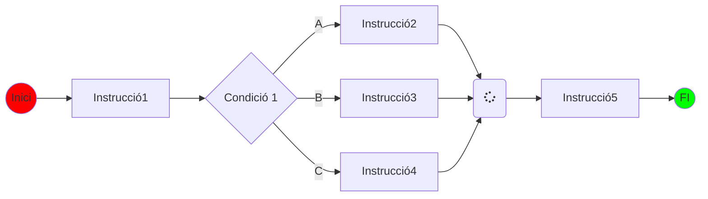

I el codi en Java seria:

```java linenums="1"
switch (condicio) {
    case 1:
        // Instruccions
    break;

    case 2:
        // INstruccions 2
    break;
    
    default:
        // Instruccions per defecte
    break;
}
```

Un altre exemple més clar que diu el nom del mes a partir d'un número entre 1 i 12

```java linenums="1"
    //Programa que demana un numero i diu quin mes és

    int mes;
    void setup () {
        size(640,480);
    }
    
    void draw () {
        mes = (int)random(1,13);

        switch (mes) {  //inicio del switch
            case 1:  println ("GENER"    ); break;
            case 2:  println ("FEBRER"   ); break;
            case 3:  println ("MARÇ"     ); break;
            case 4:  println ("ABRIL"    ); break;
            case 5:  println ("MAIG"     ); break;
            case 6:  println ("JUNY"     ); break;
            case 7:  println ("JULIOL"   ); break;
            case 8:  println ("AGOST"    ); break;
            case 9:  println ("SETEMBRE" ); break;
            case 10: println ("OCTUBRE"  ); break;
            case 11: println ("NOVEMBRE" ); break;
            case 12: println ("DESEMBRE" ); break;
            default: println ("No vàlid" );                      
        }
    }
```

??? question "Activitat 312. Copia i adapta el codi anterior"
    === "Enunciat"
        Escriu el programa anterior per a Processing i comprova que funciona. Afegeix el codi necessari per tal que a banda de dir-te quin mes és, et diga també a quina estació de l'any estem.

        <center>
                
        </center>

        En l'exemple anterior el que s'ha fet ha sigut generar aleatòriament un número enter entre 1 i 12 i després mostrar per pantalla: primer el número del mes i després el nom.

        Restriccions:
        
            - Canvia almenys quatre casos.
            - Afegeix el cas per defecte.

    === "Rúbrica"
        | Ítem d'avaluació | 4 - Excel·lent | 3 - Correcte | 2 - Parcial | 1 - Incorrecte | 0 - Inexistent o incoherent |
        |---|---|---|---|---|---|
        | Compliment de l’enunciat | Molt bé, fet tot el que demana l'enunciat. | Compleix tot el que es demana però falta algun detall menor o hagués pogut estar fet de forma més eficient. | Ha fet part de l'activitat però no tota. | L’activitat no compleix els objectius mínims. | No compleix per a res l'enunciat proposat. |
        | Ús de l'estructura switch | Les dues estructures switch són correctes | S'usen estructures switch amb lleugers errors | Alguna estructura switch no és correcta o té errades de cos. | Error greu o falta alguna estructura switch | No has afegit l'estructura switch adicional. |
        | Claredat del missatge mostrat amb la funció text | Els missatges són clars, coherents, ben escrits i representen bé cada cas possible. | Missatges correctes però millorables. | Missatges poc clars o que no concorden amb les condicions o esteticament millorable. | No mostra cap informació o la mostra pel terminal. | No mostra cap informació a cap lloc. Ni pel terminal. |
        | Comentaris de documentació + comentaris al codi | Té comentari de documentació al principi, comentaris útils als mètodes i comentaris explicatius dins del codi. | Comentaris correctes però incomplets. | Molt pocs comentaris o poc útils. | Els comentaris són molt pobres. | No has posat cap comentari de documentació. |
        | Estil i qualitat del codi (identació, camelCase, salts de línia) | Identació impecable, identificadors correctes, codi ordenat i simple. | Algunes errades menors però el codi és llegible. | Codi desordenat o amb errors d’estil visibles. | Codi mal organitzat, difícil de llegir o desalineat. | No segueixes cap de les convencions ni res acordat a classe. |
        | Simplicitat i adequació del codi | Codi ben reduït, directe i adequat a l’activitat. | Algunes línies innecessàries. | Massa codi per a una tasca simple. | Codi sobrecarregat, artificiós o confús. | Pràcticament il·legible |

    === "Solució"
        
        <center>📦 **Fitxer ZIP amb la solució completa**</center>

    	<center>[📥 Descarrega la solució](./assets/Tema3/act312.zip){ .md-button .md-button--secondary }</center>
        
        Encara no disponible
        

??? question "Activitat 313. Dies de la setmana"
    === "Enunciat"
        Escriu un programa que donat un número entre 1 i 7 generat de forma aleatòria, et diga quin dia de la setmana és. 1 Dilluns, 2 Dimarts etc..

        <center>
            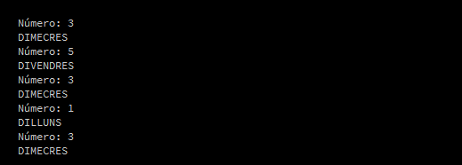
        </center>

    === "Rúbrica"
        | Ítem d'avaluació | 4 - Excel·lent | 3 - Correcte | 2 - Parcial | 1 - Incorrecte | 0 - Inexistent o incoherent |
        |---|---|---|---|---|---|
        | Compliment de l’enunciat | Molt bé, fet tot el que demana l'enunciat. | Compleix tot el que es demana però falta algun detall menor o hagués pogut estar fet de forma més eficient. | Ha fet part de l'activitat però no tota. | L’activitat no compleix els objectius mínims. | No compleix per a res l'enunciat proposat. |
        | Ús de l'estructura switch | Ús correcte de l'estructura switch. | S'usa l'estructura switch però amb lleugers errors. | L'estructura switch té errades considerables. | Error greu o falta alguna estructura switch | No has afegit l'estructura switch i has usat alguna altra estructura alternativa. |
        | Claredat del missatge mostrat amb la funció text | Els missatges són clars, coherents, ben escrits i representen bé cada cas possible. | Missatges correctes però millorables. | Missatges poc clars o que no concorden amb les condicions o esteticament millorable. | No mostra cap informació o la mostra pel terminal. | No mostra cap informació a cap lloc. Ni pel terminal. |
        | Comentaris de documentació + comentaris al codi | Té comentari de documentació al principi, comentaris útils als mètodes i comentaris explicatius dins del codi. | Comentaris correctes però incomplets. Falten comentaris de documentació. | Molt pocs comentaris o poc útils. | Els comentaris són molt pobres. | No has posat cap comentari de documentació. |
        | Estil i qualitat del codi (identació, camelCase, salts de línia) | Identació impecable, identificadors correctes, codi ordenat i simple. | Algunes errades menors però el codi és llegible. | Codi desordenat o amb errors d’estil visibles. | Codi mal organitzat, difícil de llegir o desalineat. | No segueixes cap de les convencions ni res acordat a classe. |
        | Simplicitat i adequació del codi | Codi ben reduït, directe i adequat a l’activitat. | Algunes línies innecessàries. | Massa codi per a una tasca simple. | Codi sobrecarregat, artificiós o confús. | Pràcticament il·legible |
    
    === "Solució"
        
        <center>📦 **Fitxer ZIP amb la solució completa**</center>

    	<center>[📥 Descarrega la solució](./assets/Tema3/act313.zip){ .md-button .md-button--secondary }</center>
        
        Encara no disponible
        

??? question "Activitat 314. Passar d'if a switch"
    === "Enunciat"
        Observa el codi a continuació que explica com es passa de if - else a switch - case i passa l'activitat 310 de l'apartat if..else a switch..case

        ```java linenums="1"
        // Exemple de switch convertit a if
        switch(variable) {
            case valor1:
                // Accions 1
                break;
            case valor2:
                // Accions 2
                break;
            case valor3:
                // Accions 3
                break;
            default:
                // Accions default
        }

        // El codi anterior utilitzant if
        if (variable == valor1 )
            // Accions 1
        else if (variable == valor2)
            // Accions 2
        else if (variable == valor3)
            // Accions 3
        else
            //Accions default
        ```

    === "Rúbrica"
        | Ítem d'avaluació | 4 - Excel·lent | 3 - Correcte | 2 - Parcial | 1 - Incorrecte | 0 - Inexistent o incoherent |
        |---|---|---|---|---|---|
        | Compliment de l’enunciat | Molt bé, fet tot el que demana l'enunciat. | Compleix tot el que es demana però falta algun detall menor o hagués pogut estar fet de forma més eficient. | Ha fet part de l'activitat però no tota. | L’activitat no compleix els objectius mínims. | No compleix per a res l'enunciat proposat. |
        | Ús de l'estructura switch | Traducció perfecta de l'if al switch | Traducció entre estructures amb errors lleugers | L'estructura switch té errades considerables. | Error greu en la traducció. | No has fet bé la traducció. |
        | Claredat del missatge mostrat | Els missatges són clars, coherents, ben escrits i representen bé cada cas possible. | Missatges correctes però millorables tant estèticament com de comprensió. | Missatges poc clars o que no concorden amb les condicions o esteticament millorable. | No mostra cap informació o la mostra pel terminal o estèticament és massa bàsica | No mostra cap informació a cap lloc. Ni pel terminal. |
        | Comentaris | Té comentari de documentació al principi, comentaris útils als mètodes i comentaris explicatius dins del codi. | Comentaris correctes però incomplets. Falten comentaris de documentació. | Molt pocs comentaris o poc útils. | Els comentaris són molt pobres. | No has posat cap comentari de documentació. |
        | Estil i qualitat del codi (identació, camelCase, salts de línia) | Identació impecable, identificadors correctes, codi ordenat i simple. | Algunes errades menors però el codi és llegible. | Codi desordenat o amb errors d’estil visibles. | Codi mal organitzat, difícil de llegir o desalineat. | No segueixes cap de les convencions ni res acordat a classe. |
        | Simplicitat del codi | Codi ben reduït, directe i adequat a l’activitat. | Algunes línies innecessàries. | Massa codi per a una tasca simple. | Codi sobrecarregat, artificiós o confús. | Pràcticament il·legible |
    
    === "Solució"
        
        <center>📦 **Fitxer ZIP amb la solució completa**</center>

    	<center>[📥 Descarrega la solució](./assets/Tema3/act314.zip){ .md-button .md-button--secondary }</center>
        
        Encara no disponible
        
        
??? question "Activitat 315. Quants dies té el mes"
    === "Enunciat"
        Escriu un programa que genere de forma aleatòria el mes i ens mostre per pantalla el total de dies que té eixe mes.

        <center>
            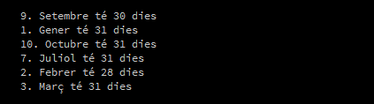
        </center>

    === "Rúbrica"
        | Ítem d'avaluació | 4 - Excel·lent | 3 - Correcte | 2 - Parcial | 1 - Incorrecte | 0 - Inexistent o incoherent |
        |---|---|---|---|---|---|
        | Compliment de l’enunciat | Molt bé, fet tot el que demana l'enunciat. | Compleix tot el que es demana però falta algun detall menor o hagués pogut estar fet de forma més eficient. | Ha fet part de l'activitat però no tota. | L’activitat no compleix els objectius mínims. | No compleix per a res l'enunciat proposat. |
        | Ús de l'estructura switch | Traducció perfecta de l'if al switch | Traducció entre estructures amb errors lleugers | L'estructura switch té errades considerables. | Error greu en la traducció. | No has fet bé la traducció. |
        | Claredat del missatge mostrat | Els missatges són clars, coherents, ben escrits i representen bé cada cas possible. | Missatges correctes però millorables tant estèticament com de comprensió. | Missatges poc clars o que no concorden amb les condicions o esteticament millorable. | No mostra cap informació o la mostra pel terminal o estèticament és massa bàsica | No mostra cap informació a cap lloc. Ni pel terminal. |
        | Comentaris | Té comentari de documentació al principi, comentaris útils als mètodes i comentaris explicatius dins del codi. | Comentaris correctes però incomplets. Falten comentaris de documentació. | Molt pocs comentaris o poc útils. | Els comentaris són molt pobres. | No has posat cap comentari de documentació. |
        | Estil i qualitat del codi (identació, camelCase, salts de línia) | Identació impecable, identificadors correctes, codi ordenat i simple. | Algunes errades menors però el codi és llegible. | Codi desordenat o amb errors d’estil visibles. | Codi mal organitzat, difícil de llegir o desalineat. | No segueixes cap de les convencions ni res acordat a classe. |
        | Simplicitat del codi | Codi ben reduït, directe i adequat a l’activitat. | Algunes línies innecessàries. | Massa codi per a una tasca simple. | Codi sobrecarregat, artificiós o confús. | Pràcticament il·legible |
        
    === "Solució"
        
        <center>📦 **Fitxer ZIP amb la solució completa**</center>

    	<center>[📥 Descarrega la solució](./assets/Tema3/act315.zip){ .md-button .md-button--secondary }</center>
        
        Encara no disponible
        

??? question "Activitat 316. Figures geomètriques"
    === "Enunciat"
        Escriure un programa que demane primer de quina figura geomètrica es vol calcular el perimetre. Triangle (t), Quadrat (q), Cercle (c) o rectangle (r) i després mostre el càlcul corresponent. Totes aquelles dades necessàries per poder realitzar els diferents càlculs es generaran de forma aleatòria quan s'haja escollit de quina figura es vol calcular el perimetre. 

        Per exemple, imagina que l'usuari tria el triangle, per saber el perimetre del triangle necessitem saber quant mesura el seu costat i multiplicar-lo per 3, per tant, serà la mesura del costat el que es generarà de forma aleatòria.

    === "Rúbrica"
        | Ítem d'avaluació | 4 - Excel·lent | 3 - Correcte | 2 - Parcial | 1 - Incorrecte | 0 - Inexistent o incoherent |
        |---|---|---|---|---|---|
        | Compliment de l’enunciat | Molt bé, fet tot el que demana l'enunciat. | Compleix tot el que es demana però falta algun detall menor o hagués pogut estar fet de forma més eficient. | Ha fet part de l'activitat però no tota. | L’activitat no compleix els objectius mínims. | No compleix per a res l'enunciat proposat. |
        | Ús de l'estructura switch | Ús perfecte de l'estructura switch per aquest cas | Has usat l'estructura switch amb algun error menor. | L'estructura switch té errades considerables. | Error greu a l'estructura switch. | No has utilitzat una estructura switch. |
        | Claredat del missatge mostrat | Els missatges són clars, coherents, ben escrits i representen bé cada cas possible. | Missatges correctes però millorables tant estèticament com de comprensió. | Missatges poc clars o que no concorden amb les condicions o esteticament millorable. | No mostra cap informació o la mostra pel terminal o estèticament és massa bàsica | No mostra cap informació a cap lloc. Ni pel terminal. |
        | Comentaris | Té comentari de documentació al principi, comentaris útils als mètodes i comentaris explicatius dins del codi. | Comentaris correctes però incomplets. Falten comentaris de documentació. | Molt pocs comentaris o poc útils. | Els comentaris són molt pobres. | No has posat cap comentari de documentació. |
        | Estil i qualitat del codi (identació, camelCase, salts de línia) | Identació impecable, identificadors correctes, codi ordenat i simple. | Algunes errades menors però el codi és llegible. | Codi desordenat o amb errors d’estil visibles. | Codi mal organitzat, difícil de llegir o desalineat. | No segueixes cap de les convencions ni res acordat a classe. |
        | Simplicitat del codi | Codi ben reduït, directe i adequat a l’activitat. | Algunes línies innecessàries. | Massa codi per a una tasca simple. | Codi sobrecarregat, artificiós o confús. | Pràcticament il·legible |
    
    === "Solució"
        
        <center>📦 **Fitxer ZIP amb la solució completa**</center>

    	<center>[📥 Descarrega la solució](./assets/Tema3/act316.zip){ .md-button .md-button--secondary }</center>
        
        Encara no disponible
        
        
## Estructures de repetició

!!! success "Criteris d'avaluació associats"
    - [x] RA3.2. S'han utilitzat estructures de repetició.

Imaginem que tenim un vector d'enters de 100 elements i volem trobar un nombre concret. Usant les estructures condicionals ho podríem fer.

```java linenums="1"
int [] arrayNumeros;               // Declarem un array d'enters
arrayNumeros = new int [100];      // Reservem espai en memòria per 100 elements
inicialitzaNumeros(arrayNumeros);  // Emplenem de forma aleatòria l'array

// Comencem la recerca del número 10 per exemple
if ( array[0] == 10 )
    println("Número trobat a la posició 0");

else if (array[1] == 10)
    println("Número trobat a la posició 1");

else if (array[2] == 10)
    println("Número trobat a la posició 2");

else if (array[3] == 10)
    println("Número trobat a la posició 3");

else if (array[4] == 10)
    println("Número trobat a la posició 4");

else if (array[5] == 10)
    println("Número trobat a la posició 5");    

// I així fins 100 ... 

```

Com podeu observar, només he necessitat escriure codi per als 5 primers elements del nostre array per adondar-me que aquest codi és totalment ineficient i té un manteniment molt complicat. Imagineu un array amb 1000 elements i que ho haurem de codificar com hem fet abans.

Les estructures repetitives permetrien recórrer l'array de principi a final sense necessitat d'escriure tant de codi.

Veiem els següents exemples.

### while

Mentre la **condició** (també anomenada condició d'eixida) siga avaluada com a true, s'executarien les instruccions que hi ha dins del bucle while. 

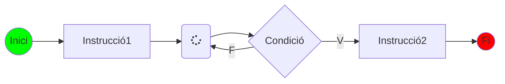

En aquest tipus de bucle, el bloc d'instruccions del bucle while, es poden executar zero o més vegades.

Els passos que representen el diagrama anterior són:
1. S'executa la instrucció 1
2. S'avalua la condició 
3. Si la condició és true, s'executa el bloc d'instruccions del bucle i es torna a avaluar la condició.
4. En cas que la condició s'avalue com a false, passaríem a executar la instrucció 2.

Com faríem el codi necessari per recórrer el nostre array de 100 elements fins trobar el número que busquem?. Mira el codi següent:

```java linenums="1"
int i = 0;   // Inicialitzem una variable que ens servirà de comptador.
while (i < 100) {
    if (arrayNumeros[i] == 10)
        println("Número trobat a la posició " + i);
    i ++; // Important incrementar el comptador o entraríem en un bucle infinit.
}
```

#### do .. while

Molt semblant al bucle while però amb la diferència que el bloc s'instruccions que conté l'estructura s'executaria almenys una vegada ja que la condició d'eixida s'avalua després d'executar les instruccions.

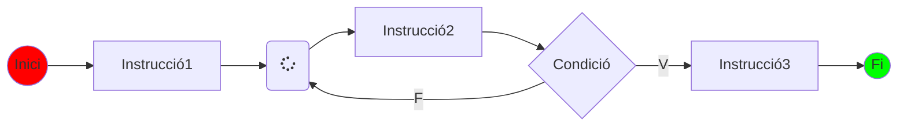

Els passos que representen el diagrama anterior són:

1. S'executa la instrucció 1
2. S'executen les instruccions que conté el bloc 
3. S'avalua la condició 
4. Si la condició és true, s'executa el bloc d'instruccions del bucle i es torna a avaluar la condició.
5. En cas que la condició s'avalue com a false, passaríem a executar la instrucció 2.

A l'exemple següent podem veure el codi necessari per buscar un número dins d'un array d'enters (Ja veurem més endavant que és un array).

```java linenums="1"
int i = 0;   // Inicialitzem una variable que ens servirà de comptador.
do {
    if (arrayNumeros[i] == 10)
        println("Número trobat a la posició " + i);
    i ++; // Important incrementar el comptador o entraríem en un bucle infinit.
}
while (i < 100);

```

### bucle for

La més complicada de comprendre però també possiblement la més utilitzada. Mirem un exemple.

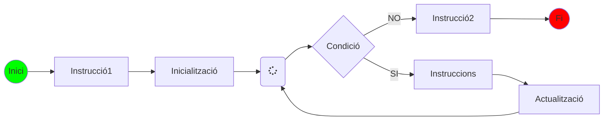

I els passos serien:

1. Executem instrucció 1 (aliena al bucle for)
2. Inicialització
3. Avaluació de la condició
4. Si la condició és true
   1. Executem les instruccions del bucle for
   2. Actualitzem índex
5. Si la condició es false eixim del bucle i executem instrucció 2

```java linenums="1"
for (int i = 0; i < 100; i ++ ) { 
    if (arrayNumeros[i] == 10)
        println("Número trobat a la posició " + i);
}

```

Al codi anterior:

1. Inicialització: int i = 0;
2. Avaluació de la condició: és i < 100 ?
3. Actualització: i ++

??? example "Dibuixar amb bucles"
    Observa el següent codi i raona'l

    ```java linenums="1"
    void setup() {
        size(320,240);
    }

    void draw () {
        for (int i = 0; i < 10; i ++) {
            for (int j = 0; j < i; j++ )
                circle (10+j*20, 10+i*20, 20);
        }
    }
    ```

    El resultat d'aquest codi seria:

    <center>
        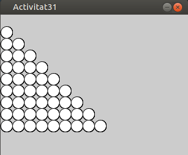

??? question "Activitat 317. Dibuixa la piràmide i la piràmide invertida"
    === "Enunciat"
        Fes un programa semblant al de l'activitat anterior però a la inversa, és a dir, cinc cercles a la primera línia, quatre a la segona, tres a la tercera, dos a la quarta i, finalment, un a la cinquena línia.

        <center>
            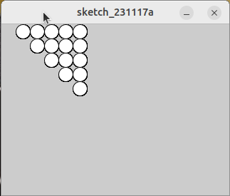
        </center>

    === "Rúbrica"
        | Ítem d'avaluació | 4 - Excel·lent | 3 - Correcte | 2 - Parcial | 1 - Incorrecte | 0 - Inexistent o incoherent |
        |---|---|---|---|---|---|
        | Compliment de l’enunciat | Molt bé, fet tot el que demana l'enunciat. | Compleix tot el que es demana però falta algun detall menor o hagués pogut estar fet de forma més eficient. | Ha fet part de l'activitat però no tota. | L’activitat no compleix els objectius mínims. | No compleix per a res l'enunciat proposat. |
        | Ús de l'estructura iterativa | Has escollit perfectament el bucle necessari. | Has usat l'estructura iterativa amb alguna errada menor. | El bucle té errades considerables. | Error greu al bucle. | No has utilitzat una estructura bucle o has usat massa estructures innecessàries. |
        | Claredat del missatge mostrat | Els missatges són clars, coherents, ben escrits i representen bé cada cas possible. | Missatges correctes però millorables tant estèticament com de comprensió. | Missatges poc clars o que no concorden amb les condicions o esteticament millorable. | No mostra cap informació o la mostra pel terminal o estèticament és massa bàsica | No mostra cap informació a cap lloc. Ni pel terminal. |
        | Comentaris | Té comentari de documentació al principi, comentaris útils als mètodes i comentaris explicatius dins del codi. | Comentaris correctes però incomplets. Falten comentaris de documentació. | Molt pocs comentaris o poc útils. | Els comentaris són molt pobres. | No has posat cap comentari de documentació. |
        | Estil i qualitat del codi (identació, camelCase, salts de línia) | Identació impecable, identificadors correctes, codi ordenat i simple. | Algunes errades menors però el codi és llegible. | Codi desordenat o amb errors d’estil visibles. | Codi mal organitzat, difícil de llegir o desalineat. | No segueixes cap de les convencions ni res acordat a classe. |
        | Simplicitat del codi | Codi ben reduït, directe i adequat a l’activitat. | Algunes línies innecessàries. | Massa codi per a una tasca simple. | Codi sobrecarregat, artificiós o confús. | Pràcticament il·legible |
    
    === "Solucio"
        
        <center>📦 **Fitxer ZIP amb la solució completa**</center>

    	<center>[📥 Descarrega la solució](./assets/Tema3/act317.zip){ .md-button .md-button--secondary }</center>
        
        Encara no disponible
        
        
??? question "Activitat 318. Dibuixa les dues diagonals (500x500)"
    === "Enunciat" 
        Fes un programa en Processing IDE que dibuixe les dues diagonals sobre una pantalla de 500 pixels per 500 pixels. Des del punt (0,0) fins al (500,500) i l'altra que va des del punt (500,0) fins al (0,500). Si a una diagonal li dibuixes quadrats, a l'altra dibuixa-li cercles.

        <center>
            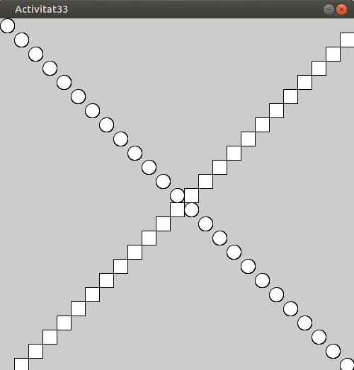    
        </center>

    === "Rúbrica"
        | Ítem d'avaluació | 4 - Excel·lent | 3 - Correcte | 2 - Parcial | 1 - Incorrecte | 0 - Inexistent o incoherent |
        |---|---|---|---|---|---|
        | Compliment de l’enunciat | Molt bé, fet tot el que demana l'enunciat. | Compleix tot el que es demana però falta algun detall menor o hagués pogut estar fet de forma més eficient. | Ha fet part de l'activitat però no tota. | L’activitat no compleix els objectius mínims. | No compleix per a res l'enunciat proposat. |
        | Ús de les estructures iteratives | Has escollit perfectament els bucles necessari. | Has usat les estructures iteratives amb alguna errada menor. | El bucle o bucles tenen errades considerables. | Error greu als bucles | No has utilitzat una estructura bucle o has usat massa estructures innecessàries. |
        | Claredat del missatge mostrat | Els missatges són clars, coherents, ben escrits i representen bé cada cas possible. | Missatges correctes però millorables tant estèticament com de comprensió. | Missatges poc clars o que no concorden amb les condicions o esteticament millorable. | No mostra cap informació o la mostra pel terminal o estèticament és massa bàsica | No mostra cap informació a cap lloc. Ni pel terminal. |
        | Comentaris | Té comentari de documentació al principi, comentaris útils als mètodes i comentaris explicatius dins del codi. | Comentaris correctes però incomplets. Falten comentaris de documentació. | Molt pocs comentaris o poc útils. | Els comentaris són molt pobres. | No has posat cap comentari de documentació. |
        | Estil i qualitat del codi (identació, camelCase, salts de línia) | Identació impecable, identificadors correctes, codi ordenat i simple. | Algunes errades menors però el codi és llegible. | Codi desordenat o amb errors d’estil visibles. | Codi mal organitzat, difícil de llegir o desalineat. | No segueixes cap de les convencions ni res acordat a classe. |
        | Simplicitat del codi | Codi ben reduït, directe i adequat a l’activitat. | Algunes línies innecessàries. | Massa codi per a una tasca simple. | Codi sobrecarregat, artificiós o confús. | Pràcticament il·legible |
    
    === "Solució"
        
        <center>📦 **Fitxer ZIP amb la solució completa**</center>

    	<center>[📥 Descarrega la solució](./assets/Tema3/act318.zip){ .md-button .md-button--secondary }</center>
        
        Encara no disponible
        

??? question "Activitat 319. Dues diagonals 640x480"
    === "Enunciat"
        Millora l'activitat anterior i dibuixa les dues diagonals però a una pantalla de 640 pixels per 480 pixels.

    === "Rúbrica"
        | Ítem d'avaluació | 4 - Excel·lent | 3 - Correcte | 2 - Parcial | 1 - Incorrecte | 0 - Inexistent o incoherent |
        |---|---|---|---|---|---|
        | Compliment de l’enunciat | Molt bé, el resultat final és com diu l'enunciat. | Compleix tot el que es demana però falta algun detall menor o hagués pogut estar fet de forma més eficient. | Ha fet part de l'activitat però no tota. | L’activitat no compleix els objectius mínims. | No compleix per a res l'enunciat proposat. |
        | Ús de l'estructura iterativa | Has escollit perfectament els bucles necessaris. | Has usat l'estructura iterativa amb alguna errada menor. | El bucle té errades considerables. | Error greu al bucle. | No has utilitzat una estructura bucle o has usat massa estructures innecessàries. |
        | Resultat final mostrat i millores | Perfecte has fet el que es demanava i li has afegit més valor estètic | Has millorat encara que siga poc el resultat inicial plantejat a l'enunciat. | Ni més ni menys el que demanava l'enunciat sense afegir res | No és igual encara que li semble un poc a la imatge de l'enunciat. | No mostra res o el que mostra no té res a veure. |
        | Comentaris | Té comentari de documentació al principi, comentaris útils als mètodes i comentaris explicatius dins del codi. | Comentaris correctes però incomplets. Falten comentaris de documentació. | Pocs comentaris o poc utils. | Els comentaris són molt pobres. | No has posat cap comentari de documentació. |
        | Estil i qualitat del codi (identació, camelCase, salts de línia) | Identació impecable, identificadors correctes, codi ordenat i simple. | Algunes errades menors però el codi és llegible. Algun salt de línia extra o espais innecessaris. | Codi desordenat o amb errors d’estil visibles i considerablement millorable. | Codi mal organitzat, difícil de llegir o desalineat. | No segueixes cap de les convencions ni res acordat a classe. |
        | Simplicitat del codi | Codi ben reduït, directe i adequat a l’activitat. Cada instrucció està al lloc (semàntic) que li pertoca. | Algunes línies de codi innecessàries. | Massa codi per a una tasca simple o codi fora del lloc que es suposa ha d'estar. | Codi sobrecarregat, artificiós o confús. | Totalment ineficient. |
    
    === "Solució"
        
        <center>📦 **Fitxer ZIP amb la solució completa**</center>

    	<center>[📥 Descarrega la solució](./assets/Tema3/act319.zip){ .md-button .md-button--secondary }</center>
        
        Encara no disponible
        

??? question "Activitat 320. whiles i for"
    === "Enunciat"
        Fes l'activitat anterior canviant els bucles while per for i a l'inrevés.

    === "Rúbrica"
        | Ítem d'avaluació | 4 - Excel·lent | 3 - Correcte | 2 - Parcial | 1 - Incorrecte | 0 - Inexistent o incoherent |
        |---|---|---|---|---|---|
        | Compliment de l’enunciat  | Molt bé, el resultat final és com diu l'enunciat. | Compleix tot el que es demana però falta algun detall menor o hagués pogut estar fet de forma més eficient.  | Ha fet part de l'activitat però no tota.  | L’activitat no compleix els objectius mínims.  |  No compleix per a res l'enunciat proposat. |
        | Ús de les estructures iteratives  | Has escollit perfectament els bucles necessari.  |  Has usat les estructures iteratives amb alguna errada menor. |  El bucle o bucles tenen errades considerables. | Error greu als bucles  |  No has utilitzat una estructura bucle o has usat massa estructures innecessàries. |
        | Resultat final mostrat i millores  | Perfecte has fet el que es demanava i li has afegit més valor estètic  | Has millorat encara que siga poc el resultat inicial plantejat a l'enunciat.  |  Ni més ni menys el que demanava l'enunciat sense afegir res | No és igual encara que li semble un poc a la imatge de l'enunciat.  | No mostra res o el que mostra no té res a veure.  |
        | Comentaris  | Té comentari de documentació al principi, comentaris útils als mètodes i comentaris explicatius dins del codi.  | Comentaris correctes però incomplets. Falten comentaris de documentació.  | Pocs comentaris o poc utils.  | Els comentaris són molt pobres.  | No has posat cap comentari de documentació.  |
        | Estil i qualitat del codi (identació, camelCase, salts de línia)  | Identació impecable, identificadors correctes, codi ordenat i simple.  | Algunes errades menors però el codi és llegible. Algun salt de línia extra o espais innecessaris.  | Codi desordenat o amb errors d’estil visibles i considerablement millorable.  |  Codi mal organitzat, difícil de llegir o desalineat. |  No segueixes cap de les convencions ni res acordat a classe. |
        | Simplicitat del codi  | Codi ben reduït, directe i adequat a l’activitat. Cada instrucció està al lloc (semàntic) que li pertoca.  |  Algunes línies de codi innecessàries. | Massa codi per a una tasca simple o codi fora del lloc que es suposa ha d'estar.  | Codi sobrecarregat, artificiós o confús.  |  Totalment ineficient. |
    
    === "Solució"
        
        <center>📦 **Fitxer ZIP amb la solució completa**</center>

    	<center>[📥 Descarrega la solució](./assets/Tema3/act320.zip){ .md-button .md-button--secondary }</center>
        
        Encara no disponible
        

??? question "Activitat 321. Optimització del codi"
    === "Enunciat"
        Seria possible fer l'Activitat 319 però només utilitzant un bucle?

    === "Rúbrica"
        | Ítem d'avaluació | 4 - Excel·lent | 3 - Correcte | 2 - Parcial | 1 - Incorrecte | 0 - Inexistent o incoherent |
        |---|---|---|---|---|---|
        | Compliment de l’enunciat  |  Molt bé, el resultat final és com diu l'enunciat. | Compleix tot el que es demana però falta algun detall menor o hagués pogut estar fet de forma més eficient.  |  Ha fet part de l'activitat però no tota. |  L’activitat no compleix els objectius mínims. | No compleix per a res l'enunciat proposat.  |
        |  Ús de les estructures iteratives | Has escollit perfectament els bucles necessari.  | Has usat les estructures iteratives amb alguna errada menor.  | El bucle o bucles tenen errades considerables.  |  Error greu als bucles |  No has utilitzat una estructura bucle o has usat massa estructures innecessàries. |
        |  Resultat final mostrat i millores | Perfecte has fet el que es demanava i li has afegit més valor estètic  |  Has millorat encara que siga poc el resultat inicial plantejat a l'enunciat. |  Ni més ni menys el que demanava l'enunciat sense afegir res |  No és igual encara que li semble un poc a la imatge de l'enunciat. |  No mostra res o el que mostra no té res a veure. |
        | Comentaris  | Té comentari de documentació al principi, comentaris útils als mètodes i comentaris explicatius dins del codi.  | Comentaris correctes però incomplets. Falten comentaris de documentació.  | Pocs comentaris o poc utils.  |  Els comentaris són molt pobres. | No has posat cap comentari de documentació.  |
        |  Estil i qualitat del codi (identació, camelCase, salts de línia) |  Identació impecable, identificadors correctes, codi ordenat i simple. | Algunes errades menors però el codi és llegible. Algun salt de línia extra o espais innecessaris.  |  Codi desordenat o amb errors d’estil visibles i considerablement millorable. | Codi mal organitzat, difícil de llegir o desalineat.  | No segueixes cap de les convencions ni res acordat a classe.  |
        |  Simplicitat del codi | Codi ben reduït, directe i adequat a l’activitat. Cada instrucció està al lloc (semàntic) que li pertoca.  | Algunes línies de codi innecessàries.  | Massa codi per a una tasca simple o codi fora del lloc que es suposa ha d'estar.  |  Codi sobrecarregat, artificiós o confús. |  Totalment ineficient. |
    
    === "Solució"
        
        <center>📦 **Fitxer ZIP amb la solució completa**</center>

    	<center>[📥 Descarrega la solució](./assets/Tema3/act321.zip){ .md-button .md-button--secondary }</center>
        
        Encara no disponible
        

## Estructures de salt

!!! success "Criteris d'avaluació associats"
    - [x] RA3.3. S'han reconegut les possibilitats de les sentències de salt.

En java finalment ens podem trobar amb les instruccions **break i continue** que són sentències que modifiquen el flux normal d'execució en bucles i estructures de control. Poden ser útils per a eixir d'un bucle prematurament en casos particulars o per ometre una iteració en particular.

### break

La sentència **break** s'utilitza per sortir immediatament d'un bucle (for, while o do-while). Quan s'executa una sentència break, el control del programa surt del bucle i continua amb l'execució del codi que hi ha després del bucle.

Quan utilitzar break:
- Quan es compleix una condició específica i ja no és necessari seguir iterant.
- Per evitar iteracions innecessàries quan ja s'ha trobat el que es busca.

```java linenums="1"
int [] numeros = {1, 2, 3, 4, 5, 6, 7, 8, 9, 10};

for (int i=0; i < 9; i ++) {
    if (numeros[i] == 7) {
        println("S'ha trobat el número 7!");
        break;  // Eixim del bucle perquè ja hem trobat el número 7
    }
    println(numeros[i]);
}
```

En aquest exemple, el bucle s'atura quan es troba el número 7, evitant iteracions innecessàries sobre la resta dels números.

### continue

La sentència continue s'utilitza per saltar l'iteració actual d'un bucle i continuar amb la següent iteració. Quan s'executa una sentència continue, el control del programa torna al començament del bucle per a la següent iteració, sense executar les línies de codi restants de l'iteració actual.

Quan utilitzar continue:
- Quan es compleix una condició específica i es vol saltar a la següent iteració del bucle.
- Per ometre certes iteracions basades en una condició.

```java linenums="1"
// Suposem que tenim una llista de números i volem imprimir tots els números excepte el 7
int [] numeros = {1, 2, 3, 4, 5, 6, 7, 8, 9, 10};

for (int i=0; i < 9; i++) {
    if (numeros[i] == 7)
        continue;  // Saltem aquesta iteració perquè no volem imprimir el número 7
    println(numeros[i]);
}

```
En aquest exemple, quan el número és 7, la sentència continue fa que el bucle salti directament a la següent iteració, evitant que es mostre el número 7.
Conclusió

!!! tip "En resum"
    - **`break`** s'utilitza per sortir completament d'un bucle quan es compleix una condició específica.
    - **`continue`** s'utilitza per saltar l'iteració actual i passar a la següent quan es compleix una condició específica.

??? question "Activitat 322. Analitzar una llista de nombres"
    === "Enunciat"
        Crear un programa en Java que itere sobre una llista de nombres sencers i faça diferents operacions utilitzant les sentències break i continue.  

        Al codi següent tens un programa en Processing IDE que conté una llista de 20 nombres que s'han generat de forma aleatòria. 

        - **Part 1 (break):** Escriu el codi que busque el número 15 a la llista, si el troba mostra per pantalla un missatge i ix del bucle.
        - **Part 2 (continue):** Escriu el codi necessari per tal que es mostren tots els números menys els parells.
        - **Part 3.** Escriure un codi que busqui el primer nombre parell major que 10. Utilitzar continue per saltar els números senars. Utilitzar break per sortir del bucle quan es trobi el primer nombre parell major que 10 i imprimir-lo.

        ```java linenums="1"
            int [] arrayNumeros;

            void setup () {
                arrayNumeros = new int [20];
                for (int i=0; i < 20; i ++) 
                    arrayNumeros[i] = (int)random(1,100);
            }

            void draw () {
            
            }
        ```

        Restriccions:
            - Ús obligatori del break.
            - Ús obligatori del continue.

    === "Rúbrica"
        | Ítem d'avaluació | 4 - Excel·lent | 3 - Correcte | 2 - Parcial | 1 - Incorrecte | 0 - Inexistent o incoherent |
        |---|---|---|---|---|---|
        | Compliment de l’enunciat | Molt bé, el resultat final és com diu l'enunciat. | Compleix tot el que es demana però falta algun detall menor o hagués pogut estar fet de forma més eficient. | Ha fet part de l'activitat però no tota. | L’activitat no compleix els objectius mínims. | No compleix per a res l'enunciat proposat. |
        | Ús de break i continue | Ús correcte i justificat de break i continue dins del bucle, sense errors lògics. | Has usat bé break i continue amb alguna errada menor. | L'ús de break i continue tenen errades considerables. | Ús de break/continue innecessari o forçat. | No has usat break i continue. |
        | Resultat final mostrat i millores | Perfecte has fet el que es demanava i li has afegit més valor estètic | Has millorat encara que siga poc el resultat inicial plantejat a l'enunciat. | Ni més ni menys el que demanava l'enunciat sense afegir res | No és igual encara que li semble un poc a la imatge de l'enunciat. | No mostra res o el que mostra no té res a veure. |
        | Comentaris | Té comentari de documentació al principi, comentaris útils als mètodes i comentaris explicatius dins del codi. | Comentaris correctes però incomplets. Falten comentaris de documentació. | Pocs comentaris o poc utils. | Els comentaris són molt pobres. | No has posat cap comentari de documentació. |
        | Estil i qualitat del codi | Identació impecable, identificadors correctes, codi ordenat i simple. | Algunes errades menors però el codi és llegible. Algun salt de línia extra o espais innecessaris. | Codi desordenat o amb errors d’estil visibles i considerablement millorable. | Codi mal organitzat, difícil de llegir o desalineat. | No segueixes cap de les convencions ni res acordat a classe. |
        | Simplicitat del codi i semàntica | Codi ben reduït, directe i adequat a l’activitat. Cada instrucció està al lloc (semàntic) que li pertoca. | Algunes línies de codi innecessàries. |  Massa codi per a una tasca simple o codi fora del lloc que es suposa ha d'estar. | Codi sobrecarregat, artificiós o confús. | Totalment ineficient. |
    
    === "Solució"
        
        <center>📦 **Fitxer ZIP amb la solució completa**</center>

    	<center>[📥 Descarrega la solució](./assets/Tema3/act322.zip){ .md-button .md-button--secondary }</center>
        
        Encara no disponible
        

??? question "Activitat 323. Combinació d'estructures"
    === "Enunciat"
        Crear un programa en Processing que dibuixi un patró de cercles en una graella, però que ometi certs cercles segons unes condicions específiques utilitzant les sentències break i continue.

        **Configuració Inicial:**

        - Configurar la mida de la finestra.
        - Definir el diàmetre dels cercles i la separació entre ells.

        **Dibuix de la Graella de Cercles:**

        - Utilitzar dos bucles for imbricats per dibuixar una graella de cercles.
        - Utilitzar una estructura de selecció per decidir si es dibuixa o no un cercle segons la seva posició.

        **Condicions per Ometre Cercles:**

        - Si la suma dels índexs dels bucles (x, y) és un múltiple de 5, ometre el cercle (utilitzar continue).
        - Si s'arriba al cercle de la posició (7, 7), aturar el dibuix completament (utilitzar break).

        Restriccions

            - Ús obligatori d'if
            - Ús obligatori de switch
            - Ús obligatori for o while
            - Ús obligatori break o continue

    === "Rúbrica"
        | Ítem d'avaluació | 4 - Excel·lent | 3 - Correcte | 2 - Parcial | 1 - Incorrecte | 0 - Inexistent o incoherent |
        |---|---|---|---|---|---|
        | Compliment de l’enunciat | Molt bé, el resultat final és com diu l'enunciat. | Compleix tot el que es demana però falta algun detall menor o hagués pogut estar fet de forma més eficient. | Ha fet part de l'activitat però no tota. | L’activitat no compleix els objectius mínims. | No compleix per a res l'enunciat proposat. |
        | Ús correcte dels bucles imbricats | Ús correcte de dos bucles for per generar la graella, amb index clars i coherents. | Has usat bé dels bucles imbricats amb alguna errada menor. | Els bucles existeixen però la graella no és clara o està mal construïda. | Ús incorrecte o confús dels bucles. | No utilitza bucles imbricats. |
        | Ús de continue per ometre cercles | Utilitzes continue de forma clarar i correcta per ometre els cercles quan (x+y) és múltiple de 5 | Utilitzes continue, però la condició és correcta només parcialment o poc clara. | Omets cercles, però sense fer servir continue. | Ús incorrecte o confús del continue | No utlitzes continue. |
        | Ús del break per aturar el dibuix. | Utilitzes break correctament per aturar completament el dibuix quan s’arriba a la posició (7,7) (controlant adequadament bucles imbricats). | Utilitzes break, però l’aturada no és total o la lògica és poc clara. | Intentes aturar el dibuix amb altres mecanismes (flags, condicions), però no amb break. | ús incorrecte o confús del break | No utilitzes break |
        | Estil i qualitat del codi | Identació impecable, identificadors correctes, codi ordenat i simple. | Algunes errades menors però el codi és llegible. Algun salt de línia extra o espais innecessaris. | Codi desordenat o amb errors d’estil visibles i considerablement millorable. | Codi mal organitzat, difícil de llegir o desalineat. | No segueixes cap de les convencions ni res acordat a classe. |
        | Documentació i comentaris | Capçalera completa (autor, versió, data) i comentaris clars que expliquen la lògica sense redundàncies. | Comentaris suficients però amb excés o alguna imprecisió. | Comentaris escassos o poc útils. | Comentaris incorrectes o confusos. | Sense comentaris. |
        
    === "Solució"
        
        <center>📦 **Fitxer ZIP amb la solució completa**</center>

    	<center>[📥 Descarrega la solució](./assets/Tema3/act323.zip){ .md-button .md-button--secondary }</center>
        
        Encara no disponible
        

## Control d'excepcions

!!! success "Criteris d'avaluació associats"
    - [x] RA3.4. S'ha escrit codi utilitzant control d'excepcions.
    - [x] RA3.5. S'han creat programes executables utilitzant diferents estructures de control.
    - [x] RA3.6. S'han provat i depurat programes.
    - [x] RA3.7. S'ha comentat i documentat el codi.

Un dels grans reptes en el desenvolupament del programari és la gestió de les errades. No importa com de ben planificat estiga un projecte ni com d’eficient siga l’equip de desenvolupament: sempre poden apareixer errors, especialment en **temps d’execució**. Alguns exemples típics són:

- Divisions per zero
- Accés fora dels límits d'un array
- Fitxers inexistents o bloquejats
- Esgotament de memòria
- Errors lògics en condicions o bucles

Java proporciona un mecanisme robust anomenat **gestió d’excepcions**, que permet capturar i controlar aquests errors de forma segura i estructurada, evitant que el programa es tanque sobtadament.

### Què són les excepcions?

En Java, les **excepcions** són errors que poden apareixer durant l'execució del programa. Quan ocorre una situació inesperada (com dividir per zero, accedir a una posició inexistent d'un array, o llegir un fitxer que no existeix), Java genera una **excepció**.

Una **excepció** és un objecte que representa una situació anòmala que ocorre durant l’execució d’un programa. Quan es produeix un error, Java pot **llençar (throw)** una excepció i, si està previst, el codi pot **capturar-la (catch)** i actuar en conseqüència.

Aquest mecanisme ens permet:

- Interrompre l'execució normal
- Tractar l’error amb codi específic
- Recuperar-se del problema sense que el programa falle completament

Per evitar que el programa es tanque sobtadament, podem capturar i gestionar aquests errors amb les estructures `try`, `catch` i opcionalment `finally`.

!!!example "Sintaxi bàsica"
    ```java
    try {
        // Codi que pot provocar un error
    } 
    catch (Exception e) {
        // Codi per gestionar l'error
    } 
    finally {
        // (Opcional) Codi que sempre s'executa
    }
    ```

!!!info "Resum"
    - **`try`**: conté el codi que es susceptible de provocar una excepció.
    - **`catch`**: captura i gestiona l'excepció en cas que es produisca.
    - **`finally`**: s'executa sempre, hi haja o no excepció (tancar fitxers, alliberar memòria)
    - **`throw`**: llença una excepció de forma manual
    - **`throws`**: declara que un mètode pot llençar una excepció.
    - Les excepcions permeten capturar i gestiona errors de forma controlada.
    - Utilitzem **try-catch-finally** per evitar que un programa falle sobtadament.
    - Podem crear excepcions pròpies per controlar situacions específiques.
    - És fonamental en programes robustos i fiables.
    
!!!example "Exemple"
    ```java linenums="1"
    int [] numeros = {1, 2, 3};

    try {
        println(numeros[3]);  // Accés incorrecte: índex fora de límits
    }
    catch (ArrayIndexOutOfBoundException e) {
        println("Error: has intentat accedir a una posició inexistent de l'array");
    }
    ```

### Cicle de funcionament d'una excepció
1. El bloc `try`s'executa
2. Si hi ha un error, es genera (throw) una excepció.
3. El control passa al bloc `catch`que la pot capturar
4. Finalment, si existeix, s'executa el bloc `finally`

!!! example "Exemple avançat amb `throws` i `throw`
    ```java linenums="1"
    public void escolta() throws Exception {
        // Simula una situació que genera una excepció
        throw new Exception("Error detectat en escolta()");
    }

    void setup() {
        try {
            escolta();
        } catch (Exception e) {
            println("Excepció capturada: " + e.getMessage());
        }
    }
    ```

### Excepcions niades
És possible tindre blocs `try`dins d'altres blocs `try`, útil per a controlar errors en diferents nivells.

!!!example "Exemple"
    ```java linenums="1"
    void setup() {
        try {
            escolta();

            try {
                tornaAEscoltar();
            } catch (Exception e) {
                println("Excepció interna");
            }
        } catch (Exception e) {
            println("Excepció externa");
        }
    }
    ```

### Classes d'excepcions en Java
Totes les excepcions hereten de la classe Throwable. Les que són derivades de Exception poden ser gestionades; les de Error (com OutOfMemoryError) no solen ser tractades pel programador.

<center>
    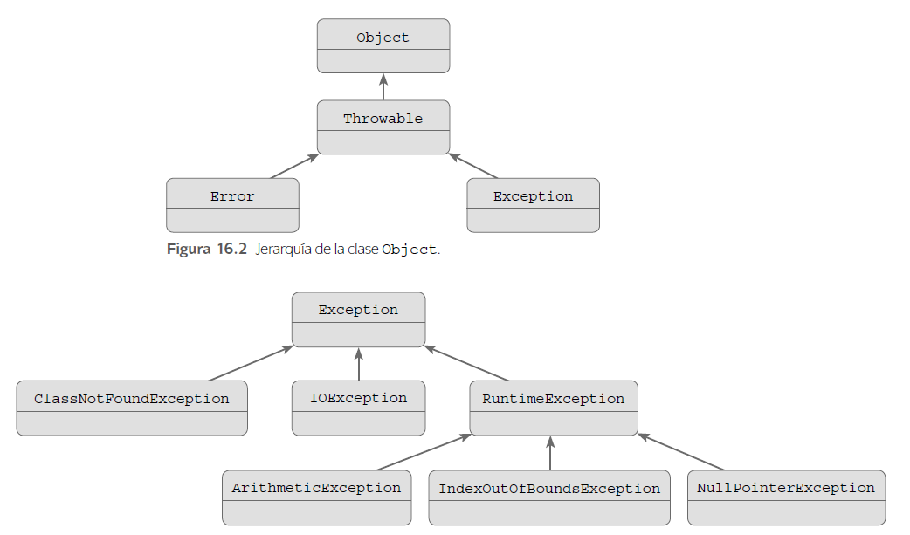
</center>

### Creació d'excepcions
Java permet la creació d’excepcions noves que deriven de la classe base Exception per controlar errors específics:

!!!example "Excepció personalitzada"
    ```java linenums="1"
    class NumeroNegatiuException extends Exception {
        public NumeroNegatiuException(String missatge) {
            super(missatge);
        }
    }

    void verificarNumero(int n) throws NumeroNegatiuException {
        if (n < 0) {
            throw new NumeroNegatiuException("No s'admeten nombres negatius.");
        }
    }

    // Ús de l'excepció
    try {
        verificarNumero(-5);
    } 
    catch (NumeroNegatiuException e) {
        println("Error personalitzat: " + e.getMessage());
    }
    ```

??? question "Activitat 324. Ús d'excepcions a Java"
    === "Enunciat"
        Tens la següent excepció personalitzada ja creada:

        ```java linenums="1"
        // Excepció personalitzada
        class NumeroNegatiuException extends Exception {
            NumeroNegatiuException(String missatge) {
                super(missatge);
            }   
        }

        ```

        El que has de fer és copiar el codi de l'excepció a un programa per a Processing IDE (al final després del keyPressed) i programar les següents accions:

        - Declara una variable int valor = -5;
        - Intenta mostrar el seu quadrat arrel (Math.sqrt(valor)), però:
            - Si valor és negatiu, llança un throw new NumeroNegatiuException("Missatge d'error...").
            - Captura l’error amb try–catch i mostra el missatge amb println() i text().

    === "Rúbrica"
        | Ítem d'avaluació | 4 - Excel·lent | 3 - Correcte | 2 - Parcial | 1 - Incorrecte | 0 - Inexistent o incoherent |
        |---|---|---|---|---|---|
        | Compliment de l’enunciat  | Molt bé, el resultat final és com diu l'enunciat.  |  Compleix tot el que es demana però falta algun detall menor o hagués pogut estar fet de forma més eficient. | Ha fet part de l'activitat però no tota. | L’activitat no compleix els objectius mínims.  | No compleix per a res l'enunciat proposat.  |
        | Ús del mecanisme d'excepcions | Ús correcte i justificat de les excepcions sense errors lògics | Has usat bé les excepcions amb alguna errada menor. | L'ús de les excepcions té errades i no ho entens del tot. | Ús de les excepcions forçades o innecessàries. | No has usat excepcions. |
        | Resultat final mostrat i millores | Perfecte has fet el que es demanava i li has afegit més valor estètic | Has millorat encara que siga poc el resultat inicial plantejat a l'enunciat. | El resultat és correcte però molt bàsic, sense cap millora ni cura estètica. | No acompleix els objectius míinims. | No mostra res o el que mostra no té res a veure. |
        | Comentaris | Té comentari de documentació al principi, comentaris útils als mètodes i comentaris explicatius dins del codi. | Comentaris correctes però incomplets. Falten comentaris de documentació. | Pocs comentaris o poc utils. | Els comentaris són molt pobres. | No hi ha cap tipus de comentari. |
        | Estil i qualitat del codi | Identació impecable, identificadors correctes, codi ordenat i simple. | Algunes errades menors però el codi és llegible. Algun salt de línia extra o espais innecessaris. | Codi desordenat o amb errors d’estil visibles i considerablement millorable. | Codi mal organitzat, difícil de llegir o desalineat. | No segueixes cap de les convencions ni res acordat a classe. |
        | Simplicitat del codi i semàntica | Codi ben reduït, directe i adequat a l’activitat. Cada instrucció està al lloc (semàntic) que li pertoca. | Algunes línies de codi innecessàries. | Massa codi per a una tasca simple o codi fora del lloc que es suposa ha d'estar. | Codi sobrecarregat, artificiós o confús. | Totalment ineficient. |

    === "Solució"
        Encara no disponible
    
<!--    === "Solució"
        
        <center>📦 **Fitxer ZIP amb la solució completa**</center>

    	<center>[📥 Descarrega la solució](./assets/Tema3/act324.zip){ .md-button .md-button--secondary }</center>
        
        Encara no disponible
        -->
        

## Procés de compilació

!!! success "Criteris d'avaluació associats"
    - [x] RA3.6. S'han provat i depurat els programes.
    - [x] RA3.7. S'ha comentat i documentat el codi.

És el procés pel qual es tradueixen les instruccions escrites en un determinat llenguatge de programació a llenguatge màquina. A més d'un  traductor, es poden necessitar altres programes per crear un programa  objecte executable. Un programa font es pot dividir en mòduls emmagatzemats en arxius diferents. La tasca de reunir el programa font sovint es confia a un programa diferent, anomenat preprocessador. El preprocessador també pot expandir abreviatures, crides a macros, a proposicions del llenguatge font.

Normalment la creació d'un programa executable (un típic.exe per a Microsoft Windows o DOS) comporta dos passos. El primer pas es diu **compilació** ( pròpiament dit) i tradueix el codi font escrit en un llenguatge de programació emmagatzemat en un arxiu a codi de baix nivell (normalment en codi objecte, no directament a llenguatge màquina). El segon pas es diu **enllaçat** en el qual s'enllaça el codi de baix nivell generat de tots els fitxers i subprogrames que s'han enviat compilar i s'afegeix el codi de les funcions que hi ha a les biblioteques del compilador perquè l'executable pugui comunicar-se directament amb el sistema operatiu, traduint així finalment el codi objecte a codi màquina, i generant un mòdul executable.

Aquests dos passos es poden fer per separat, emmagatzemant el resultat de la fase de compilació en arxius objectes (un típic .obj per a Microsoft Windows, DOS o per a Unix ), per a enllaçar-los en fases posteriors, o crear directament l'executable, amb la qual cosa la fase de compilació s'emmagatzema només temporalment. Un programa podria tenir parts escrites en diversos llenguatges (per exemple C, C + + i Asm), que es podrien compilar de forma independent i després enllaçar juntes per formar un únic mòdul executable. 

<center>
    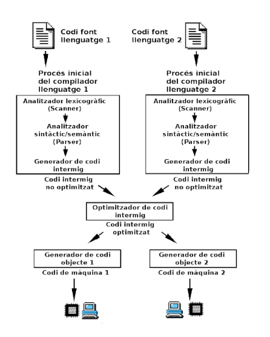
</center>

### El depurador de Processing IDE

Ha arribat el moment que aprengues com funciona el depurador que és una eina molt important per a desenvolupar codi. El depurador o **debugger** és una eina molt important i necessària que porten tots els entorns de desenvolupament integrat com Processing. Aquesta eina ens permet executar el codi pas a pas al mateix temps que podem monitoritzar el valor de les variables, l'estat dels diferent objectes que formen part de la nostra aplicació. 

<center>
    
</center>

Per poder activar el depurador hem de fer clic al botó redó que es troba dalt a la dreta de l'editor com es mostra a la imatge anterior. Una vegada tenim el depurador activat, se'ns obre el **monitor de variables** que ens permetrà controlar com canvien les variables de valor. 

A la part esquerra ens apareixeran els controls que ens habilitaran per poder navegar pas a pas o entrar en funcions i mètodes del codi.

Finalment és molt important també per a la depuració de codi el terme **breakpoint** per fer que el depurador pare en un lloc específic del nostre codi, li ho hem d'indicar amb punts de ruptura o breakpoints. Per poder posar un breakpoint només hem de fer clic sobre el número de la línia sobre la que volem que s'apare l'execució del programa.  Per tal de llevar-lo tornem a punxar sobre la mateixa línia.

Una vegada hages provat el depurador de Processing IDE i tingues més o menys clar com funciona, fes l'activitat següent.

??? question "Activitat 325. Depurar el codi"
    === "Enunciat"
        L'objectiu d'aquesta activitat és que utilitzeu el depurador (**debugger**) de Processing IDE.
        
        Copia el següent codi a un projecte nou de Processing IDE i segueix les isntruccions.

        ```java linenums="1"
            int a = 5;
            int b = 10;
            int c;

            void setup() {
                size(400, 400);
                
                c = a + b;
                println("C després de sumar: " + c);
                
                a = a * 2;
                println("A després de multiplicar: " + a);
                
                b = b - 3;
                println("B després de restar: " + b);
                
                c = a + b;
                println("C després de sumar de nou: " + c);
            }

        ```

        1. Posar un breakpoint a la línia c = a + b; (la primera vegada que es fa la suma).
        2. Executar el programa en mode depuració. Quan s’aturi:
            - Mirar els valors de a, b i c.
            - Provar a avançar pas a pas (step over) i veure com canvien els valors.
        3. Posar un breakpoint a b = b - 3; i observar novament les variables.
        4. Provar a modificar el valor de a o b mentre el programa està aturat i continuar l’execució. Com canvia la suma final?

        Preguntes per a la reflexió:

        1. Quin valor tenen les variables en cada breakpoint?
        2. Què passa quan canvies el valor d’una variable des del depurador?
        3. Quin avantatge té usar el depurador en lloc de només println()?

        **Entregar un vídeo gravat de l'escriptori amb l'activitat realitzada i comentada (amb veu)**

    === "Rúbrica"
        | Ítem d'avaluació | 4 - Excel·lent | 3 - Correcte | 2 - Parcial | 1 - Incorrecte | 0 - Inexistent o incoherent |
        |---|---|---|---|---|---|
        | Compliment de l’enunciat | Molt bé, el resultat final és exactament com diu l'enunciat. | Compleix tot el que es demana però falta algun detall menor o hagués pogut estar fet de forma més eficient. | Dibuixa una graella i aplica alguna condició, però no totes o no amb el comportament demanat. | El dibuix no respon a l’enunciat o no utilitza correctament les estructures demanades. | No compleix per a res l'enunciat proposat. |
        | Ús correcte del depurador | Ús correcte i conscient del depurador: breakpoints, step over i inspecció de variables ben explicats. | Usa el depurador correctament però amb explicacions incompletes o poc clares. | Ús molt superficial del depurador o confusió en el seu funcionament. | Ús incorrecte del depurador o només teòric. | No utilitza el depurador. |
        | Anàlisi dels valors de les variables | Indica correctament els valors de a, b i c en tots els breakpoints i explica els canvis. | Indica els valors correctament però amb poca explicació. | Indica alguns valors però amb errors o sense context. | Valors incorrectes o molt confusos. | No analitza els valors de les variables. |
        | Modificació de variables en temps d'execució | Modifica variables durant la depuració i explica clarament com afecta el resultat final. | Modifica variables però l’explicació és incompleta. | Modificació poc clara o sense reflexió sobre el resultat. | Intenta modificar però no ho aconsegueix o no ho entén. | No modifica cap variable. |
        | Reflexió sobre l’ús del depurador | Respon correctament i de manera raonada totes les preguntes de reflexió. | Respostes correctes però molt breus o poc elaborades. | Respostes parcials o amb confusions. | Respostes molt pobres o fora de context. | No hi ha reflexió. |
        | Presentació i claredat del lliurament | Informació clara, ordenada i fàcil de seguir. Bona presentació. | Presentació correcta però millorable. | Informació desordenada o difícil d’entendre. | Presentació molt pobra. | No es pot seguir el treball. |

    === "Solució"
        Encara no disponible

    <!--    === "Solució"
        
        <center>📦 **Fitxer ZIP amb la solució completa**</center>

    	<center>[📥 Descarrega la solució](./assets/Tema3/act325.zip){ .md-button .md-button--secondary }</center>
        
        Encara no disponible
        -->


        