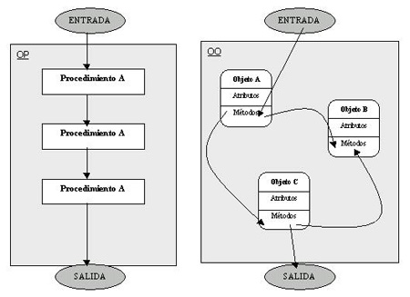
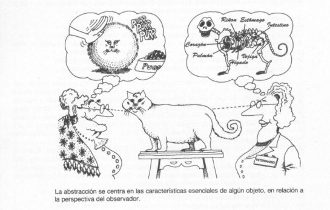
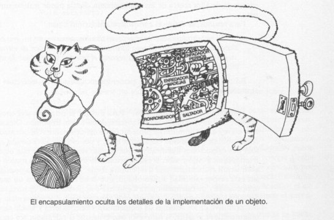
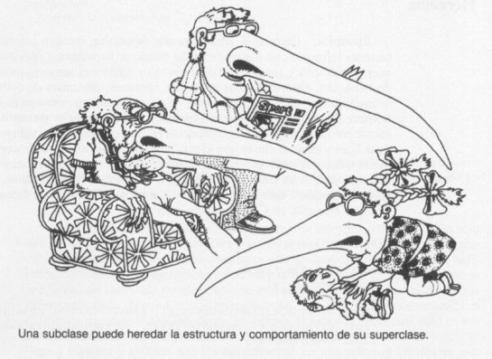
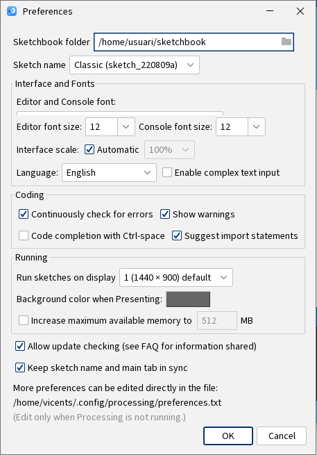
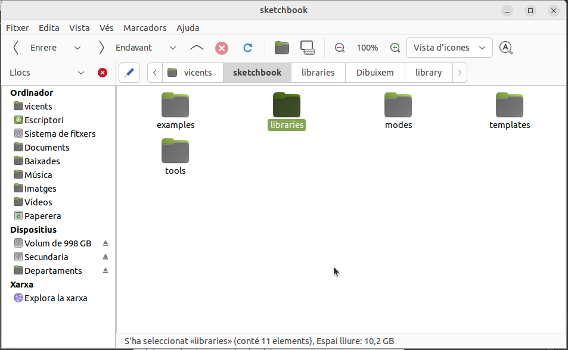
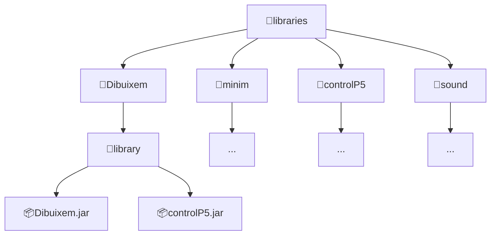
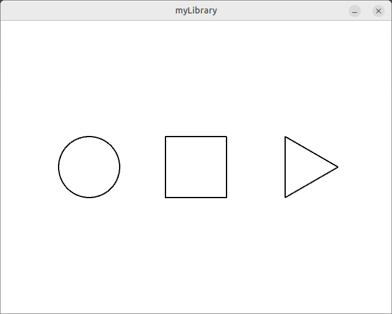
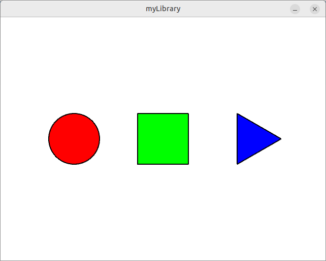

# Tema 4. Programació Orientada a Objectes.

!!! danger "Resultat d'aprenentatge associat"
	<strong>RA2. Escriu i prova programes senzills, reconeixent i aplicant els fonaments de la programació orientada a objectes.</strong>
    
	### Criteris d'avaluació
	- [x] RA2.1. S'han identificat els fonaments de la programació orientada a objectes.
	- [x] RA2.2. S'han escrit programes simples.
	- [x] RA2.3. S'han instanciat objectes a partir de classes predefinides.
	- [x] RA2.4. S'han utilitzat mètodes i propietats dels objectes.
	- [x] RA2.5. S'han escrit trucades a mètodes estàtics.
	- [x] RA2.6. S'han utilitzat paràmetres en la crida a mètodes.
	- [x] RA2.7. S'han incorporat i utilitzat llibreries d'objectes.
	- [x] RA2.8. S'han utilitzat constructors.
	- [x] RA2.9. S'ha utilitzat l'entorn integrat de desenvolupament en la creació i compilació de programes simples.

## Introducció
La **programació orientada a objectes** també coneguda com **POO** és el paradigma de programació que més s’utilitza hui en dia i que permet **modelar** de manera més eficient la realitat des del punt de vista del programari.

La programació orientada a objectes intenta proporcionar un **model de programació basat en objectes que contenen dades i procediments associats** coneguts com a mètodes a diferència del disseny procedimental que s'utilitzava en la programació estructurada. Aquests **objectes**, que són instàncies de les **classes**, són tipus abstractes de dades que encapsulen (amaguen) tant les dades com les funcions per accedir-hi.

Un dels **objectius** de la programació orientada a objectes és reflectir la realitat, de forma que els elements d’un programa s’ajusten a elements de la vida quotidiana. 

Al contrari de la programació estructurada procedimental clàssica, en **POO** es dona prioritat a la **modelació de les dades** i no als procediments. En un escenari de programació orientada a objectes, a la fase d'anàlisi es determinen els diferents actors del programa (objectes) i a partir d'ací se li assignen els diferents atributs i accions que pot realitzar.

Doncs bé, a diferència del paradigma de programació estructurada, ací **primer programem els objectes** (definirem les classes) amb totes les seues característiques derivades de la fase d'anàlisi **atributs** i també el seu **comportament** (mètodes) i finalment utilitzariem aquestes classes en forma d'objectes al programa principal.

<center>
	
</center>

En conclusió, en **programació orientada a objectes** el que veurem serà com crear classes d'objectes diversos per després poder utilitzar-los en altres programes però... pas a pas.

Veiem primer un poc de teoria...

## Característiques principals

!!! success "Criteris d'avaluació associats"
    - [x] RA2.1. S'han identificat els fonaments de la programació orientada a objectes.

La programació orientada a objectes permet la creació de programari cada vegada més complexe a partir d’unitats o blocs de codi reutilitzables. Les propietats principals o característiques fonamentals del paradigma de programació orientada a objectes són:

### Abstracció
Abstraure's és **aïllar mentalment**, considerar separadament (un o diversos atributs o qualitats) d'una cosa. Per exemple abstraure els conceptes més importants d'un discurs, és a dir, **quedar-se amb allò important.**

En programació orientada a objectes abstraure’s, l’abstracció, seria mostrar únicament les característiques essencials, que fa l’objecte i per a que es crea, deixant de banda elements com la implementació.

L’abstracció permet representar les característiques essencials d’un objecte, deixant enrere aquelles que no tenen tanta importància. A més a més, es centra en l’objecte tal i com el coneixem en la vida real, de forma que ens centrem en allò que es capaç de fer però no en com ho fa. Bàsicament, definiríem l’abstracció com la forma de descriure una entitat del món real sense importar la complexitat que està present i el poder utilitzar aquesta en qualsevol aplicació.

<center>
	
</center>

### Encapsulament
L’encapsulament és, en altres paraules, **l’ocultació d’informació**, de forma que les dades internes d’un objecte estan ocultes al món exterior, només es coneix d’ell la seua essència, és a dir, què podem fer amb ell.

Per exemple, amb freqüència es desenvolupa codi font o projectes en els que utilitzem la classe out, més concretament el mètode println. Out es troba dins de l’espai de noms (namespace) System i no és més que una classe d’aquest paquet. Dit en altres paraules. Out és una classe i println() és un mètode de la classe Out.

<center>
	
</center>

### Modularitat
Aquesta propietat fa referència a la forma en la que els elements en programació orientada a objectes es troben **organitzats en mòduls**, facilitant així l’encapsulament i abstracció de la informació.

La modularitat permet **dividir una aplicació en parts.** Aquestes parts han de ser tan independents com puguen de la resta de mòduls així com també de l’aplicació principal. El motiu pel qual els mòduls han de ser el més independents possibles de l’aplicació és perquè així es podran reutilitzar en altres aplicacions més endavant.

Tots i cadascun d'aquestos elements seran definits en fitxers diferents.

### Jerarquia i herència
La **jerarquia** és la propietat de la programació orientada a objectes respecte de la relació o ordre existent entre les distintes classes i objectes. El mecanisme principal per tal d’ordenar les classes als nostres projectes és l’herència. Podem parlar d’herència entre classes quan elements d’una classe (superclasse) son heretats per una altra o inclòs els seus mètodes poden ser sobrecarregats.

<center>
	
</center>

### Polimorfisme
Polimorfisme és una paraula grega que significa **«moltes formes»**. Aquesta paraula és ideal per definir aquesta característica de la programació orientada a objectes ja que en POO podem tindre objectes amb el **mateix nom** que realitzen **funcions distintes** o implementen codi diferent.

El polimorfisme és un mecanisme que s’utilitza molt en POO juntament amb l’herència tal que quan una classe deriva d’una altra hereta les seues característiques i operacions. A la classe que hereta es pot redefinir qualsevol mètode heretat, de forma que en funció de la referència a objectes que usem a cada moment s’estarà executant un mètode o un altre.
text
text
Un mateix missatge enviat a objectes diferents donarà com a resposta eixides diferents, és a dir, si tenim diversos objectes amb mètodes similars, segons es referencie l’un o l’altre objecte el resultat final serà diferent. 

## Classes i Objectes

!!! success "Criteris d'avaluació associats"
    - [x] RA2.1. S'han identificat els fonaments de la programació orientada a objectes.
	- [x] RA2.2. S'han escrit programes simples.
	- [x] RA2.3. S'han instanciat objectes a partir de classes predefinides.
	- [x] RA2.4. S'han utilitzat mètodes i propietats dels objectes.
	- [x] RA2.6. S'han utilitzat paràmetres en la crida a mètodes.
	- [x] RA2.9. S'ha utilitzat l'entorn integrat de desenvolupament en la creació i compilació de programes simples.

Una **classe és la definició d’un objecte**, és l’element que descriu els components d’un objecte de forma general. Diem que hem creat un objecte quan donem valors i utilitzem els components definits a la classe.  Per fer una analogia més "biologia", una classe és l'ADN d'una espècie concreta d'objectes, és a dir, si creem diversos objectes d'una mateixa classe podriem dir que eixos objectes comparteixen el mateix ADN.

Per exemple, a Processing IDE existeix la classe [**PVector**](https://processing.org/reference/PVector.html) que és una classe per descriure vectors de 2 o 3 dimensions. Un vector és una entitat que té magnitud i direcció. mentre que la posició es guarda en forma d'atributs x, y en dues dimensions i x,y i z per als vectors tridimensionals.

Aquesta classe és molt útil a Processing IDe per representar posició, velocitat, direcció o acceleració entre d'altres.

En definitiva, un PVector es caracteritza per:

- **Tindre una x:** Coordenada x de la posició de l'objecte PVector.
- **Tindre una y:** Coordenada y de la posició de l'objecte PVector.
- **Tindre una z (3D):** Coordenada z de la posició de l'objecte PVector.

Ara bé, si al nostre programa mostrem informació d'un objecte PVector concret, les característiques abans esmentades adopten certs valors. 

Per exemple: **v1** (
- **x:** 320
- **y:** 240
- **z:** 0 )

Un altre PVector podria ser el seguent: **v2** (
- **x:** 50
- **y:** 50
- **z:** 10 )

Així per un costat tenim la **classe** PVector i per l'altre els dos objectes **v1 i v2**.

### Els constructors: creació d'objectes
Arribats a aquest punt ja sabem qué és una classe i les seues característiques principals i també sabem que d'una mateixa classe es poden crear tants objectes com necessitem, però com es creen els objectes en POO?. Per tal de crear objectes o **instanciar objectes**, utilitzem un mètode especial que tenen les classes ne POO que es diu **constructor**.

Un **constructor** és un mètode especial d'una classe que s'executa automaticament quan es  crea un objecte. S'utilitza per inicialitzar les propietats de l'objecte i establir el seu estat inicial.  Les seues **característiques principals** són:

 - Té el mateix nom que la classe.
 - No retorna cap valor, ni tan sols un void.
 - Pot tenir paràmetres per proporcionar valors inicials a les propietats.
 - Pot haver-hi més d'un constructor per classe (constructors sobrecarregats)
 - Si no es defineix cap constructor, el compilador pot generar-ne un per defecte.

Però vejam un exemple amb els nostres PVectors

```java linenums="1"
// Instanciació d'un objecte de la classe PVector
// PVector idPVector = new PVector();

PVector v1 = new PVector ();         // Creem un objecte PVector v1 amb coordenades (0, 0)
PVector v2 = new PVector (100, 20);  // Creem un objecte PVector v2 amb coordenades (100, 20)
```

Al crear un objecte d'una classe qualsevol tindrem accés al que denominem **propietats o atributs i mètodes** de classe.

### Atributs
Els atributs són les característiques individuals que diferencien un objecte d’un altre i determinen la seua aparença, estat o altres qualitats. Els atributs es desen en variables anomenades **variables d’instància** (un objecte és l'instància d'una classe) i cada objecte particular pot tindre valors distints per a aquestes variables.  

En definitiva, un atribut és una característica concreta d’un objecte de la vida quotidiana. Quan s’estableix un atribut a una classe, es defineix com quan creàvem variables als nostres programes estructurats, indicant tipus de dades i nom amb el que el reconeixem. 

Les **variables d’instància o atributs** també anomenades membres són declarades a la classe però els seus valors son canviats i fixats a l’objectes ja que una classe no és més que un esquema que defineix com seran les persones al nostre programa.

A més de les variables d’instància hi ha **variables de classe**, les quals s’apliquen a la classe i a totes les instàncies. 

En resum, un atribut en programació orientada a objectes ve a ser el mateix que una variable en programació estructurada. Per tal de poder accedir a una propietat d'un objecte concret d'una classe, primer hem d'assegurar-nos que la propietat és pública (ho deuria posar a la documentació de la classe) i després només hem de escriure l'identificador de l'objecte seguit d'un punt i finalment l'identificador de l'atribut.

```java linenums="1"
// Accés a un atribut d'un objecte
// idObjecte.idAtribut [= valor];

v2.x = 20;   // Canviem el valor de la coordenada x de l'objecte v2
v1.y = 30;   // Canviem el valor de la coordenada y de l'objecte v1
println("V2.X: " + v2.x);  // Mostre el valor de la coordenada x de l'objecte v2
```

!!! warning "Estat d'un objecte"
	L'**estat** d'un objecte en la Programació Orientada a Objectes (POO) representa la condició o conjunt de dades d'un objecte en un moment concret. Es defineix pel valor actual dels seus atributs (o propietats) i emmagatzema les característiques que el diferencien d'altres instàncies de la mateixa classe.

### Mètodes
Els mètode són aquelles **accions que pot realitzar la classe** que estem definint. Bàsicament el que fa un mètode és modificar l’estat de l’objecte mitjançant el canvi del valor dels seus atributs. De fet la definició dels mètodes dins d'una classe és identica a la creació de funcions en programació estructurada.  

En gran part del bibliografia al respecte de la crida a mètodes d'objectes de qualsevol classe també se li diu **enviament de missatges**, és a dir, quan cridem a un mètode associat a un objecte concret, el que s'està fent realment és enviar un missatge a l'objecte en qüestió.

Els **Mètodes de la classe** donen funcionalitat a la classe, és a dir, reflecteixen les **operacions** que aquesta pot fer sobre els atributs. Els mètodes són similars a les **funcions** o procediments de la programació estructurada però orientats a modificar i actuar sobre les propietats d’una classe o millor dit, sobre l'estat d'un objecte concret. 

Un objecte dona valors concrets als atributs que defineix la classe i utilitza els seus mètodes. Quan un objecte utilitza un mètode concret es diu que està **enviant un missatge** a l'objecte. D’alguna manera açò té lògica ja que estem donant una ordre a un component que reflecteix la realitat. 

La classe **PVector** té mètodes com: 

- **mag():** que calcula la magnitud del vector. 
- **add(PVector):** que ens permet sumar objectes de la classe PVector. 
- **dist(PVector):** que ens dona la distància entre dos vectors
- **rotate(int):** que gira el vector l'angle que es passa per paràmetre.
- **etc..**

Igual que passava amb els atributs, per tal de cridar a un mètode d'un objecte (enviar-li un missatge), primer ens hem d'assegurar que el mètode és públic 

```java linenums="1"
// Accés a un mètode. Enviament de missatges
// idObjecte.metode([parametres]);

float d = v2.dist(v1);     // Calcula la distància entre v2 i v1
v1.add(v2);                // Suma al vector v1 el vector v2
```

!!! warning "Comportament d'un objecte"
	En la Programació Orientada a Objectes (POO), el comportament d'un objecte és la manera com aquest interactua amb el seu entorn, rep ordres i modifica el seu estat. Es defineix mitjançant els mètodes (les funcions o accions que l'objecte és capaç de realitzar) i els missatges que pot rebre o enviar.

Però millor vegem tot açò amb un exemple concret i repassem tots els conceptes.

Primer agafem l'estructura d'un projecte de Processing IDE vist al [Tema 01. Introducció a la programació](Tema%2001.%20Introducció%20a%20la%20programació.md#estructura-en-processing-ide) i deixem només el codi que necessitarem.

El següent pas ja seria començar a utilitzar objectes de la classe PVector al nostre projecte:

1. Declarem dos objectes de tipus PVector al bloc de variables globals.
2. Instanciem els dos objectes de la classe PVector al mètode setup()
3. Utilitzem els objectes al mètode draw

Observa el codi a continuació:

??? example "Ús d'objectes de la classe PVector"
	```java linenums="1"
	// Variables globals
	PVector v1, v2;       // Declaració de dos objectes (v1, v2) de la classe PVector

	// Funció setup: només s'executa una vegada a l'inici de l'execució.
	void setup () {  
		size(640,480);       // Configura les dimensions de l'aplicació
		v1 = new PVector();  // Instanciació de l'objecte v1
		v1.x = 320;          // Accés a l'atribut x de l'objecte v1
		v1.y = 240;          // Accés a l'atribut y de l'objectes v2

		v2 = new PVector(140, 140); // Instanciació de l'objecte v2
	}

	// Funció draw: s'executa 60 vegades per segon (60Hz freqüència del monitor)
	void draw () { 
		background(255);  // Pinta el fons de blanc
		// Per mostrar el que passa amb els PVectors dibuixarem un punt a cada vector
		stroke(255,0,0);
		strokeWeight(10);
		// Dibuixem els punts al seu lloc
		point(v1.x, v1.y);
		point(v2.x, v2.y);

		// Dibuixem una línia que els uneixca
		stroke(0);
		strokeWeight(2);
		line(v1.x, v1.y, v2.x, v2.y);
	}

	// Declaració d'altres funcions. Opcional

	// Esedeveniments
	void mouseClicked  () {}
	void mouseReleased () {}
	void mousePressed  () {}
	void keyPressed    () {}
	void keyReleased   () {}
	void mouseDragged  () {}
	void mouseMoved    () {}
	```

??? question "Activitat 401. La classe PVector" 
	=== "Enunciat"
		Copia el codi anterior a un projecte nou de Processing (act401) i executa'l.
		Modifica els valors x i y dels objectes PVector per tal que es dibuixen un al mig de la meitat esquerra de la pantalla i l'altre al mig de la meitat dreta. Els dos han d'estar a la mateixa altura. Fixa't que les dimensions de l'esbós són 640 per 480.
		Crea una variable **distancia** i utilitza la funció dist de la classe PVector per saber quina distància hi ha entre els dos punts.
		Afegeix el codi següent al teu esbós:

		```java linenums="1"
		textSize (25);
  		fill (0);
  		text (distancia, 50, 50);
		```

		Investiga el manual de referència de Processing IDE i posa la informació de la distància que has afegit abans, al mig de la línia i dins d'un requadre amb la vora de color negra.

	=== "Rúbrica"
        | Ítem d'avaluació | 4 - Excel·lent | 3 - Correcte | 2 - Parcial | 1 - Incorrecte | 0 - Inexistent o incoherent |
        |---|---|---|---|---|---|
        | Identificació i ús de classes i objectes (Pvector) | Declara correctament els objectes PVector i reconeix clarament què són les classes i els objectes. Fa servir els atributs (x, y) i el mètode dist() amb criteri. | Declara correctament els objectes i usa els atributs, però no reflexiona o explica bé el seu significat. | Declara o utilitza parcialment els objectes (p. ex. només un vector o atributs incorrectes). | No utilitza PVector o el fa incorrectament. | Apartat no realitzat |
		| Instanciació i assignació d’atributs | Crea correctament els dos objectes (v1, v2) i ajusta els valors de x i y per situar-los exactament al centre de cada meitat de la pantalla, a la mateixa altura. | Crea els dos objectes i els col·loca aproximadament correctes. | Crea un o dos objectes però amb errors en la seva posició o coordenades. | No aconsegueix instanciar ni posicionar correctament els vectors. | Apartat no realitzat |
		| Ús del mètode dist() i visualització del resultat | Calcula la distància amb PVector.dist(v1, v2) o equivalent, l’emmagatzema en una variable i la mostra correctament en pantalla, centrada dins d’un requadre. | Calcula i mostra la distància però no centrada o sense requadre. | Fa el càlcul però no el mostra o el mostra incorrectament. | No calcula ni mostra la distància. | Apartat no realitzat |
		| Presentació gràfica i coherència visual | Els punts, línia, text i requadre estan correctament posicionats i el resultat és net i entenedor. | La majoria d’elements estan ben ubicats, però amb petits desajustos. | Mostra els elements però amb errors clars de posició o proporció. | No es veu clarament la relació entre els punts o el text. | Apartat no realitzat |
		| Comentaris, claredat i format del codi (.pde) | Codi clar, ben estructurat, amb comentaris explicatius i format de fitxer correcte (act301.pde). | Codi llegible i correcte, amb alguns comentaris. | Pocs comentaris o codi desordenat. | Sense comentaris o fitxer incorrecte. | Apartat no realitzat |
        
	=== "Solucio"
		
		<center>📦 **Fitxer ZIP amb la solució completa**</center>

    	<center>[📥   Descarrega la solució](./assets/Tema4/act401.zip){ .md-button .md-button--secondary }</center>
		
		No disponible
		

Com pots observar el que passa quan executem el codi és que al nostre esbós es dibuixen dos punts de color roig i una línia que els uneix i el codi que has afegit mostra la distància en píxels entre els dos punts.

??? question "Activitat 402. Afegeix més vectors"
	=== "Enunciat"
		Modifica els valors dels vectors com has fet a l'activitat anterior i canvia les posicions.
		Fes que la línia només es vega quan fem clic al ratoli escrivint el codi necessari al mètode mouseClicked.
		Afegeix un tercer PVector amb identificador v3 i dibuixa les línies entre tots els punts.
		Ara posa un quart PVector i uneix també les línies.

		Mostra per a cada línia entre els punts mostra la informació relativa a la distància que existeix entre ells.

		També es valoraran qüestions estètiques del resultat final així com també l'ús d'altres funcions o objectes que estiguen disponibles en Processing IDE.
	
	=== "Rúbrica"
        | Ítem d'avaluació | 4 - Excel·lent | 3 - Correcte | 2 - Parcial | 1 - Incorrecte | 0 - Inexistent o incoherent |
        |---|---|---|---|---|---|
        | Declaració i ús de diversos objectes Pvector | Declara i instancia correctament quatre vectors (v1, v2, v3, v4) i entén clarament la relació classe–objecte–atribut. Utilitza correctament x, y i el mètode dist() entre totes les combinacions necessàries. | Declara els quatre vectors i en fa ús parcial (alguna línia o càlcul falta). | Declara tres vectors o més però amb errors d’instanciació o valors. | No declara correctament els objectes ni els fa servir adequadament. | Apartat no realitzat |
		| Implementació de la interacció amb el ratolí (mouseClicked) | Implementa correctament la funció mouseClicked() per mostrar o amagar les línies segons l’acció de l’usuari. El comportament és clar i funcional. | La línia apareix o desapareix, però amb comportament parcial o inconsistent. | Mostra la línia però no depèn realment del clic. | No implementa l’esdeveniment o no funciona. | Apartat no realitzat |
		| Càlcul i visualització de distàncies | Calcula i mostra correctament totes les distàncies entre els punts connectats (per exemple: v1–v2, v2–v3, v3–v4). Presenta el text prop de les línies o d’una forma ordenada i llegible. | Calcula i mostra la majoria de distàncies, amb algun error menor o presentació poc clara. | Calcula una o dues distàncies però no totes. | No calcula o no mostra distàncies. | Apartat no realitzat |
		| Presentació gràfica i disseny visual | Resultat estèticament cuidat: punts i línies clares, text llegible, colors ben triats, ús adequat de fill(), stroke(), textSize(), etc. Pot incloure millores creatives (formes, color dinàmic, moviment…). | Resultat funcional i clar, però millorable visualment o amb disseny simple. | Resultat acceptable però poc atractiu o desorganitzat. | Presentació desordenada o difícil de llegir. | Apartat no realitzat |
		| Ús de funcions o elements extra de l’API de Processing | Afegeix funcionalitats o elements addicionals de Processing no exigits (p. ex. color dinàmic, animacions, mouseOver(), ús de map(), random(), etc.) de forma coherent i integrada. | Utilitza alguna funció extra però sense gran impacte en el resultat. | Inclou intents d’usar funcions extra, però amb errors o sense coherència. | No utilitza cap funció o element extra. | Apartat no realitzat |
		| Comentaris, claredat i format del codi (.pde) | Codi estructurat, amb comentaris explicatius, seccions clares, i fitxer lliurat correctament en format .pde. | Codi llegible però amb comentaris escassos o poc clars. | Codi poc estructurat o sense comentaris útils. | Codi desordenat o amb format incorrecte. | Apartat no realitzat |

	=== "Solucio"
		
		<center>📦 **Fitxer ZIP amb la solució completa**</center>

    	<center>[📥   Descarrega la solució](./assets/Tema4/act402.zip){ .md-button .md-button--secondary }</center>
		
		No disponible
		

L'API de Processing IDE disposa de diversos objectes que ens poden ajudar a millorar les nostres aplicacions com poden ser:

- PImage
- PShape
- PFont
- etc..

Ara es tracta que basan-te en el que hem vist amb la classe PVector, investigues com funcionen la resta d'objectes abans esmentats i fages ús d'ells. Tin en compte que es pot combinar l'ús de diverses classes d'objectes.

??? question "Activitat 403. PVector & PImage"
	=== "Enunciat"
		Com ja hem vist anteriorment l'objecte PVector ens serveix per a poder guardar posicions entre altres funcionalitats i fàcilment podriem combinar PImage i PVector. Amb la primera classe podem carregar imatges del nostre projecte i amb PVector assignar-li la posició en la que es poden dibuixar.

	=== "Rúbrica"
        | Ítem d'avaluació | 4 - Excel·lent | 3 - Correcte | 2 - Parcial | 1 - Incorrecte | 0 - Inexistent o incoherent |
        |---|---|---|---|---|---|
        | Instancia correctament la classe Pvector | Instancia diversos Pvector correctament | Instancia un objecte Pvector | Declara però no instancia el Pvector | Instancia de forma incorrecta | Apartat no realitzat |
		| Instancia correctament la classe Pimage | Instancia diversos PImage correctament | Instancia un objecte PIMage | Declara però no instancia el Pimage | Instancia de forma incorrecta | Apartat no realitzat |
		| Combina els dos objectes de forma correcta | Combina els vectors amb les images perfectament | Comgina un vector amb una image | No combina correctament els vectors | Utilitza un altre mecanisme sense fer cas als vectors | Apartat no realitzat |
		| Assigna la posició en la qual es mostrarà la imatge d'alguna manera | Utilitza diversos mètodes per assignar posició | Utilitza un mètode per assignar la posició | La posició no sembla canviar | No hi ha cap mecanisme | Apartat no realitzat |
		| Comentaris, claredat i format del codi (.pde) | Codi estructurat, amb comentaris explicatius, seccions clares, i fitxer lliurat correctament en format .pde. | Codi llegible però amb comentaris escassos o poc clars. | Codi poc estructurat o sense comentaris útils. | Codi desordenat o amb format incorrecte. | Apartat no realitzat |

	=== "Solucio"
		
		<center>📦 **Fitxer ZIP amb la solució completa**</center>

    	<center>[📥   Descarrega la solució](./assets/Tema4/act403.zip){ .md-button .md-button--secondary }</center>
		
		No disponible
		

## Projecte figures geomètriques

!!! success "Criteris d'avaluació associats"
	- [x] RA2.2. S'han escrit programes simples.
	- [x] RA2.3. S'han instanciat objectes a partir de classes predefinides.
	- [x] RA2.4. S'han utilitzat mètodes i propietats dels objectes.
	- [x] RA2.7. S'han incorporat i utilitzat llibreries d'objectes.
	- [x] RA2.8. S'han utilitzat constructors.
	- [x] RA2.9. S'ha utilitzat l'entorn integrat de desenvolupament en la creació i compilació de programes simples.

Per tal de veure les aplicacions pràctiques del que hem explicat en els punts anteriors, desenvoluparem un xicotet projecte en Processing IDE basant-nos en el paradigma de la programació orientada a objectes. El nostre projecte va a tindre  només tres figures geomètriques: el cercle, el triangle i el quadrat, que podrem dibuixar en qualsevol lloc de l'aplicació que desenvoluparem. Al crear els objectes els indicarem la posició i grandaria entre altres i mentre l'aplicació estiga executant-se, podrem moure-los per la pantalla, canviar el color i convertir en 3D.

**1. <ins>Quins elements de la nostra aplicació han de ser desats o s'han de tenir en compte?</ins>**

- El cercle
- El quadrat
- El triangle

**2. <ins>De cada element, quines dades ens interessen?</ins>**

- **Cercle:** color, posició (x,y), diametre, vora, color de la vora.
- **Quadrat:** color, posició (x,y), ample i alt, vora, color de la vora.
- **Triangle:** color, posició (x,y), costat, vora, color de la vora.

**3. <ins>A cada element, quines operacions associarem?</ins>**

- **Cercle:** canviar de color, convertir en esfera i moure de lloc, mostar opcions
- **Quadrat:** canviar de color, convertir en cub i moure de lloc, mostrar opcions
- **Triangle:** canviar de color, convertir en piràmide i moure de lloc, mostrar opcions

!!! info  "Diagrama de classes"
	En el món de l'enginyeria de programari un **diagrama de classes** en UML (Unified Modeling Language) és un tipus de diagrama estàtic que descriu l'estructura d'un sistema mostrant les seves classes, atributs i les relacions entre ells.
	
	El **diagrama de classes** que deduiríem de les especificacions anteriors podria ser el següent:

<div style="margin:0px auto;">
	<center>
		<pre class="forest">
			```mermaid
				classDiagram
				direction TB
				Figura <|-- Triangle
				Figura <|-- Quadrat
				Figura <|-- Cercle
				Figura: PApplet parent
				Figura: float x
				Figura: float y
				Figura: int ample
				Figura: int color
				Figura: vora
				Figura: colorVora
				Figura: triDim
				Figura: opcions
				Figura: mostraOp
				Figura: nom
				Figura: Figura(PApplet, float, float, String)
				Figura: display ()
				Figura: canviaColor ()
				Figura: setPosicio (float, float)
				Figura: getX ()
				Figura: getY ()
				Figura: getAmpleVora ()
				Figura: canvia2D ()
				Figura: canvia3D ()
				Figura: mostraOpcions ()
				Figura: ocultaOpcions ()
				Figura: activaOpcions () 
				Figura: getWidth ()
				Figura: setColor (int)
				Figura: setAmpleVora (int)
				Figura: setWidth (float)
				Cercle: Cercle (PApplet, float, float, float)
				Cercle: clicSobre (float, float)
				Quadrat: front
				Quadrat: back
				Quadrat: right
				Quadrat: left
				Quadrat: top
				Quadrat: bottom
				Quadrat: Quadrat (PApplet, float, float, float)
				Quadrat: clicSobre (float, float)
				Quadrat: setPosicio()
				Quadrat: setAmpleVora()
				Quadrat: canvia2D()
				Quadrat: canvia3D()
				Quadrat: activaOpcions()
				Quadrat: clicSobre()
				Quadrat: incialitzaColors()
				Quadrat: dibuixaCub3D ()
				Triangle: left
				Triangle: right
				Triangle: Triangle (PApplet, float, float, float)
				Triangle: drawTriangle (PVector, PVector, PVector)
				Triangle: clicSobre ()
				Triangle: puntsDinsTriangle(PVector, PVector, PVector, PVector)
				
			```
		</pre>
	</center>
</div>


Primer hem de preparar el nostre Processing per tal que es puga u sar aquesta llibreria. Obre Processing IDE i ves a **File --> Preferences**
 
<center>
	
</center>

Com pots observar al diàleg que s'obre, a la seua part superior es pot saber quina és la carpeta dels sketch. Normalment **/home/usuari/sketchbook**. Seguidament has d'anar a aquesta carpeta i obrir la carpeta **libraries** que hi trobaràs com mostra la següent imatge:

<center>
	
</center>

Finalment descarrega la [llibreria Dibuixem](assets/Tema4/Dibuixem/library/Dibuixem.jar) i copia-la a la carpeta abans indicada. Si tot ha anat bé a la carpeta libraries trobaràs una estructura molt semblant a la següent. Les carpetes controlP5, sound i mínim són llibreries i utilitats instal·lades des del Processing IDE. No et preocupes si no t'apareixen.

<center>

</center>

!!! danger "Manual de referència package Dibuixem"
	Abans de començar amb les activitats associades al **Projecte Figures Geomètriques**, revisa la documentació de la llibreria:
	<center>[📚 Manual de Referència Dibuixem](assets/dibuixem/index.html){target="_blank" rel="noopener" .md-button .md-button--secondary }</center>

	<center>📦 **Fitxer ZIP amb la llibreria Dibuixem**</center>

   	<center>[📥   Descarrega la llibreria](./assets/Tema4/Dibuixem.zip){ .md-button .md-button--secondary }</center>


??? question "Activitat 404. Crea el projecte Figures Geometriques"
	=== "Enunciat"
		Copia el codi base d'un projecte en Processing IDE i desa'l com a act303.pde.
		Afegeix la llibreria dibuixem al projecte a la secció de llibreries amb la línia de codi: 
		
		```java linenums="1"
		import Dibuixem.*;
		```

		A la secció de variables globals declara un objecte amb identificador c1 de la classe Cercle. 

		```java linenums="1"
		Cercle c1;
		```

		Al mètode setup() has de crear l'objecte c1 de la classe Cercle utilitzant el seu constructor. I no oblides de donar-li dimensions a l'aplicació amb size.

		```java linenums="1"
		size (640, 480);
		c1 = new Cercle (this, 320, 240, 40); // Creem un cercle a la posició 320, 240,
		```

		Al mètode draw() fes que es mostre el cercle.

		```java linenums="1"
		c1.display();
		```
		
		Utilitza el mètode setPosicio de l'objecte de la classe Cercle per tal que el cercle es puga moure per la pantalla. Pots utilitzar algun esdeveniment de ratolí.

		```java linenums="1"
		c1.setPosicio(mouseX, mouseY);
		```

		Ampliació: Per què quan mous el cercle no s'esborra l'anterior? Com es pot arreglar?

	=== "Rúbrica"
        | Ítem d'avaluació | 4 - Excel·lent | 3 - Correcte | 2 - Parcial | 1 - Incorrecte | 0 - Inexistent o incoherent |
        |---|---|---|---|---|---|
        | Instal·lació i importació de la llibreria Dibuixem.jar | Instal·la correctament la llibreria i l’importa al projecte. El programa compila i s’executa sense errors. | La llibreria està instal·lada i funciona, però hi ha hagut algun problema menor d’importació o ruta. | Instal·lació parcial o amb errors puntuals (necessita ajuda per fer-la funcionar). | No aconsegueix incorporar la llibreria o el programa no s’executa. | Apartat no realitzat |
		| Declaració i instanciació de l’objecte Cercle | Declara i crea correctament un objecte de la classe Cercle amb la sintaxi adequada i el nom d’identificador coherent. | Declara i instancia l’objecte però amb algun error menor de sintaxi o tipus. | Declara l’objecte però no l’instancia o l’instancia incorrectament. | No declara ni instancia cap objecte de tipus Cercle. | Apartat no realitzat |
		| Funcionament del programa (el cercle segueix el punter del ratolí) | El cercle es dibuixa i es mou correctament seguint el ratolí en temps real. | El cercle apareix i respon parcialment al moviment del ratolí. | El cercle es dibuixa però no es mou o mostra errors intermitents. | El cercle no es mostra o no funciona. | Apartat no realitzat |
		| Comprensió bàsica de l’ús de la llibreria i dels objectes | L’alumne mostra comprensió sobre què aporta la llibreria (classe Cercle, mètodes, atributs) i ho pot explicar o comentar breument al codi. | Entén parcialment el paper de la llibreria o dels objectes. | Ús mecànic (copia el codi sense mostrar comprensió). | No entén què fa la llibreria ni què és l’objecte creat. | Apartat no realitzat |
		| Presentació i format del codi (.pde) | Fitxer lliurat correctament en format .pde, amb comentaris mínims però clars, codi net i indentat. | Fitxer correcte però amb pocs comentaris o algun desordre. | Codi funcional però desorganitzat o amb errors menors de format. | No lliura el fitxer .pde o està incomplet/desordenat. | Apartat no realitzat |

	=== "Solucio"
		
		<center>📦 **Fitxer ZIP amb la solució completa**</center>

    	<center>[📥   Descarrega la solució](./assets/Tema4/act404.zip){ .md-button .md-button--secondary }</center>
		
		No disponible
		

Com pots observar la part més complicada de l'activitat anterior has sigut configurar el sistema per poder utilitzar la llibreria Dibuixem. Una vegada tens aquesta llibreria instal·lada ja és relativament senzill la seua utilització. I el resultat final és prou tangible.

??? question "Activitat 405. Afegeix la resta de figures"
	=== "Enunciat"
		Crea un projecte que utilitze les tres figures de les quals disposa la nostra llibreria dibuixem.
		
		<center>
			
		</center>

		Revisa la documentació de referència de la llibreria **Dibuixem** i escriu el codi necessari al lloc adequat per tal que les figures tinguen inicialment els colors: roig, groc i verd respectivament.  Has de tindre en compte la funció color() de Processing IDE per cridar al mètode que canvia el color de la figura.

		<center>
			
		</center>

	=== "Rúbrica"
        | Ítem d'avaluació | 4 - Excel·lent | 3 - Correcte | 2 - Parcial | 1 - Incorrecte | 0 - Inexistent o incoherent |
        |---|---|---|---|---|---|
        | Instal·lació i ús correcte de la llibreria Dibuixem.jar | Llibreria ben instal·lada i importada. Cap error de compilació. El programa s’executa correctament. | Instal·lació correcta amb algun advertiment o pas dubtós. | Llibreria instal·lada però amb problemes menors (no sempre funciona). | No aconsegueix importar o fer servir la llibreria. | Apartat no realitzat |
		| Creació i instanciació de les tres figures geomètriques (cercle, rectangle i triangle) | Les tres figures estan correctament instanciades, visibles i ben posicionades segons la imatge del model. | Les tres figures estan creades però hi ha petites errades d’alineació o dimensions. | Falta alguna figura o està creada incorrectament. | No es mostren les figures o el codi és incomplet. | Apartat no realitzat |
		| Aplicació correcta de colors (roig, groc i verd) | Cada figura mostra el color correcte inicial fent ús de la funció color() i del mètode apropiat de la classe. | Els colors s’apliquen correctament però amb petits errors de codi o diferències visuals. | Almenys una figura no mostra el color esperat o s’utilitza malament la funció color(). | No s’aplica cap color o el codi no funciona. | Apartat no realitzat |
		| Ús adequat de mètodes i propietats dels objectes (POO) | S’utilitzen correctament mètodes i atributs de la llibreria (per ex., canvi de color, posició, mida...). Cap error conceptual. | S’utilitzen els mètodes principals amb alguna confusió menor. | Ús parcial o incorrecte dels mètodes o atributs. | No s’utilitzen mètodes de la llibreria o es confon la seva finalitat. | Apartat no realitzat |
		| Qualitat del codi i bones pràctiques (camelCase, comentaris, claredat) | Identificadors significatius i en camelCase, comentaris de documentació i de línia ben col·locats, codi net i llegible. | Bona estructura general amb algun detall menor a millorar (indentació o falta d’algun comentari). | Codi funcional però amb identificadors genèrics o sense comentaris clars. | Codi desordenat, sense comentaris o amb noms inadequats. | Apartat no realitzat |
		| Presentació i execució del projecte (.pde funcional) | Lliura correctament el fitxer .pde, s’executa sense errors i mostra clarament les tres figures amb els seus colors. | Fitxer lliurat i funcional amb petits detalls visuals o de format. | Programa incomplet o amb errors ocasionals d’execució. | No s’executa o no es lliura el fitxer .pde. | Apartat no realitzat |

	=== "Solucio"
		
		<center>📦 **Fitxer ZIP amb la solució completa**</center>

    	<center>[📥   Descarrega la solució](./assets/Tema4/act405.zip){ .md-button .md-button--secondary }</center>
		
			No disponbile
		

Ara ha arribat el moment de combinar diferents classes d'objectes en un mateix projecte i comprovar tot el que hem aprés fins ara. Preparats?

??? question "Activitat 406. Combina Dibuixem amb PVectors"
	=== "Enunciat"
		Com has pogut observar a l'activitat anterior, quan cridavem al constructor de les figures geomètriques els passavem dos valors numèrics. Com que ja saps utilitzar la classe PVector. Crea un objecte PVector per a cada figura geomètrica i utilitza'ls com a paràmetres per establir la posició de les figures al seus constructors.

	=== "Rúbrica"
        | Ítem d'avaluació | 4 - Excel·lent | 3 - Correcte | 2 - Parcial | 1 - Incorrecte | 0 - Inexistent o incoherent |
        |---|---|---|---|---|---|
        | Instal·lació i ús correcte de la llibreria Dibuixem.jar | Llibreria ben instal·lada i importada. Cap error de compilació. El programa s’executa correctament. | Instal·lació correcta amb algun advertiment o pas dubtós. | Llibreria instal·lada però amb problemes menors (no sempre funciona). | No aconsegueix importar o fer servir la llibreria. | Apartat no realitzat |
		| Creació i instanciació de les tres figures geomètriques (cercle, rectangle i triangle) | Les tres figures estan correctament instanciades, visibles i ben posicionades segons la imatge del model. | Les tres figures estan creades però hi ha petites errades d’alineació o dimensions. | Falta alguna figura o està creada incorrectament. | No es mostren les figures o el codi és incomplet. | Apartat no realitzat |
		| Creació i instanciació dels Pvector | Crea un objecte Pvector per a cada figura i les instancia amb les posicions de cadascuna de les figures. | Crea els tres Pvectors però no els inicialitza usant el constructor. | Crea els tres Pvectors però no els inicialitza al setup | No crea Pvectors o falten Pvectors o no estan inicialitzats. | Apartat no realitzat |
		| Ús dels Pvectors com a paràmetres. | Usa correctament els tres Pvectors per a inicialitzar les figures. | Utilitza parcialment els Pvectors per a inicialitzar les figures. | Ús parcial | No s’utilitzen mètodes de la llibreria o es confon la seva finalitat. | Apartat no realitzat |
		| Qualitat del codi i bones pràctiques (camelCase, comentaris, claredat) | Identificadors significatius i en camelCase, comentaris de documentació i de línia ben col·locats, codi net i llegible. | Bona estructura general amb algun detall menor a millorar (indentació o falta d’algun comentari). | Codi funcional però amb identificadors genèrics o sense comentaris clars. | Codi desordenat, sense comentaris o amb noms inadequats. | Apartat no realitzat |
		| Presentació i execució del projecte (.pde funcional) | Lliura correctament el fitxer .pde, s’executa sense errors i mostra clarament les tres figures amb els seus colors. | Fitxer lliurat i funcional amb petits detalls visuals o de format. | Programa incomplet o amb errors ocasionals d’execució. | No s’executa o no es lliura el fitxer .pde. | Apartat no realitzat |

	=== "Solucio"
		
		<center>📦 **Fitxer ZIP amb la solució completa**</center>

    	<center>[📥   Descarrega la solució](./assets/Tema4/act406.zip){ .md-button .md-button--secondary }</center>
		
			No disponbile
		

Si has realitzat de forma correcta les activitats anteriors i has interactuat amb el resultat, hauràs pogut observar com al fer clic sobre una de les figures apareix un xicotet control en el que es pot canviar el color, la grandària i el format (3D o 2D) de la figura etc... Revisa la documentació de la llibreria Dibuixem i fes la següent activitat.

??? question "Activitat 407. Maximitza la llibreria Dibuixem"
	=== "Enunciat"
		En aquesta activitat hauràs de fer ús de les tres figures que proporciona la llibreria **Dibuixem** (Cercle, Quadrat i Triangle) i fer que mostren tot el seu potencial.

		Has d'utilitzar **com a mínim dues instàncies** de cada tipus de figura, i has de fer-les diferents entre elles. Pots variar:

		- "La seua posició en pantalla"
		- "El seu tamany (mitjançant el constructor o el tauler de controls)"
		- "El color"
		- "Si es mostren en 2D o en 3D"
		- Si tenen o no el tauler de control activat"

		Pots crear la composició que més t'agrade, sempre que:

		- Tinga almenys 6 figures.
		- Totes siguen objectes diferents entre si.
		- Mostres l'ús de constructors, mètodes i atributs públics
		- No cal modificar cap classe de la llibreria.

		**IMPORTANT:** Modifica l'inici del mètode setup (). Si no la llibreria Dibuixem no es veurà bé. Has de substituir el size per el següent codi:
		```java linenums="1"
		size (640, 480, P3D);
		ortho();
		```
	=== "Rúbrica"
        | Ítem d'avaluació | 4 - Excel·lent | 3 - Correcte | 2 - Parcial | 1 - Incorrecte | 0 - Inexistent o incoherent |
        |---|---|---|---|---|---|
        | Creació i instanciació de les sis figures geomètriques (cercle, rectangle i triangle) | Les sis figures estan correctament instanciades, visibles i ben posicionades segons la imatge del model. | Les tres figures estan creades però hi ha petites errades d’alineació o dimensions. | Falta alguna figura o està creada incorrectament. | No es mostren les figures o el codi és incomplet. | Apartat no realitzat. |
		| Com es mostren les figures. | Cada figura es mostra d'una forma diferent (color, 3D, posició, grandaria, controls..) | Les figures es creen però no explota al màxim les possibilitats de display. | Canvia estat de les figures però són totes molt semblants. | No canvia cap característica. | Apartat no realitzat. |
		| Creació, instanciació i ús dels Pvector | Crea un objecte Pvector per a cada figura i les instancia amb les posicions de cadascuna de les figures. | Crea els sis Pvectors però no els inicialitza usant el constructor. |  Crea els sis Pvectors però no els inicialitza al setup | No crea Pvectors o falten Pvectors o no estan inicialitzats. | Apartat no realitzat. |
		| interacció amb les figures. | Es pot interactuar amb les figures: movent-les, canviat característiques (controls). | Només és poden usar els controls o moure la figura. | No hi ha molta interacció. | No hi ha interacció ninguna. | Apartat no realitzat. |
		| Qualitat del codi i bones pràctiques (camelCase, comentaris, claredat) | Identificadors significatius i en camelCase, comentaris de documentació i de línia ben col·locats, codi net i llegible. | Bona estructura general amb algun detall menor a millorar (indentació o falta d’algun comentari). | Codi funcional però amb identificadors genèrics o sense comentaris clars. | Codi desordenat, sense comentaris o amb noms inadequats. | Apartat no realitzat. |
		| Presentació i execució del projecte (.pde funcional) | Lliura correctament el fitxer .pde, s’executa sense errors i mostra clarament les tres figures amb els seus colors. | Fitxer lliurat i funcional amb petits detalls visuals o de format. | Programa incomplet o amb errors ocasionals d’execució. | No s’executa o no es lliura el fitxer .pde. | Apartat no realitzat. |
	

	=== "Solucio"
		
		<center>📦 **Fitxer ZIP amb la solució completa**</center>

    	<center>[📥   Descarrega la solució](./assets/Tema4/act407.zip){ .md-button .md-button--secondary }</center>
		
		No disponbile
		

??? question "Activitat 408. Reseteja les figures"
	=== "Enunciat"
		Si has copiat bé el codi base en Processing IDE per als teus projectes, hauràs observat que existeix un mètode que es diu **KeyPressed** i si has revisat la documentació de la **llibreria Dibuixem** hauràs vist que hi ha un mètode per restablir l'estat inicial de les figures. 
		
		Has de vincular al mètode keyPressed que quan es premi la tecla 'R' les figures (totes) tornen a l'estat inicial.

	=== "Rúbrica"
        | Ítem d'avaluació | 4 - Excel·lent | 3 - Correcte | 2 - Parcial | 1 - Incorrecte | 0 - Inexistent o incoherent |
        |---|---|---|---|---|---|
        | Vinculació correcta de la tecla ‘R’ al mètode keyPressed() | El mètode keyPressed() està ben implementat, i en prémer ‘R’ s’executa exactament el codi necessari per restablir totes les figures. | El mètode funciona però la detecció de la tecla no és del tot precisa (per exemple, diferencia majúscules/minúscules o falla de vegades). | Té implementat keyPressed() però no respon correctament a la tecla ‘R’. | No implementa el mètode o no respon al teclat. | Apartat no realitzat |
		| Ús del mètode de la llibreria per restablir l’estat inicial de les figures (reset(), o equivalent) | Aplica correctament el mètode de reset a totes les figures del projecte. | Fa servir el mètode de reset però a només una part de les figures. | Intenta fer un reset amb errors o sense usar el mètode de la llibreria. | No aplica cap mètode de restabliment. | Apartat no realitzat |
		| Funcionament general del programa | El programa s’executa correctament: mostra les figures, permet interactuar-hi i restablir-les amb la tecla ‘R’. | El programa funciona amb algun error menor o retard en l’actualització. | El programa compila però no restableix l’estat correctament. | El programa no funciona o no s’executa. | Apartat no realitzat |
		| Ús adequat dels mètodes i propietats d’objectes (POO) | Utilitza correctament els mètodes display(), setColor(), setPosicio(), reset() o equivalents. Comprèn la relació objecte–mètode. | Fa ús bàsic dels mètodes de la llibreria amb algun error menor. | Ús parcial o confús dels mètodes (duplicats o fora de lloc). | No empra correctament els mètodes de la llibreria. | Apartat no realitzat |
		| Qualitat del codi i bones pràctiques (camelCase, comentaris, indentació) | Codi net, indentat correctament, identificadors en camelCase, i comentaris clars sobre què fa cada secció. | Estructura general bona, amb petits detalls a millorar (indentació o comentaris breus). | Codi funcional però desordenat o sense comentaris explicatius. | Codi poc llegible, sense comentaris o amb errors de format. | Apartat no realitzat |
		| Presentació i execució del projecte (.pde) | Fitxer .pde complet, funcional, i lliurat amb nom correcte i sense errors de compilació. | Lliurat i funcional, però amb algun detall de format o nom incorrecte. | Fitxer incomplet o amb errors menors d’execució. | No lliura el fitxer o no és executable. | Apartat no realitzat |
	
	=== "Solucio"
		
		<center>📦 **Fitxer ZIP amb la solució completa**</center>

    	<center>[📥   Descarrega la solució](./assets/Tema4/act408.zip){ .md-button .md-button--secondary }</center>

		
		No disponbile
		
	
## Propietats i mètodes estàtics

!!! success "Criteris d'avaluació associats"
	- [x] RA2.5. S'han escrit trucades a mètodes estàtics.

La paraula reservada «static» en Java és un modificador que en Java es pot aplicar a variables, mètodes, classes i blocs de codi

### Variables estàtiques

Una variable estàtica (static) és una variable que pertany a la classe en la que va ser declarada i s’inicialitza només una vegada a l’inici de l’execució del programa, la característica principal d’aquest tipus de variables és que es pot accedir directament amb el nom de la classe sense necessitat d’instanciar un objecte. A banda també:

- És una variable que pertany a la classe (variable de classe) i no a l’objecte.
- Les variables static s’inicialitzen només una vegada, a l’inici de l’execució. Aquestes variables s’inicialitzaran primer abans de la inicialització de qualsevol variable d’instància.

### Mètodes estàtics
Un mètode estàtic només pot accedir a les variables o tipus de dades estàtiques i no pot accedir a les dades no estàtiques.

- Un mètode estàtic només pot accedir a dades estàtiques. No pot accedir a dades no estàtiques (variables d’instància)
- Un mètode estàtic pot cridar només a mètodes estàtics i no pot invocar un mètode no estàtic a partir d’ell.
- Un mètode estàtic es pot accedir directament pel nom de la classe i no es necessita crear un objecte per accedir al mètode.
- Un mètode estàtic no pot fer referència a «this» o «super»

### Blocs estàtics
El bloc estàtic és un bloc d’instruccions dins de la classe (static { ... }) que s’executa quan una classe es carrega per primera vegada en la màquina virtual de Java (JVM). Bàsicament un bloc estàtic inicialitza variables de tipus estàtic dins d’una classe, de la mateixa forma que un constructor de classe ajuden a inicialitzar les variables d’instància, un bloc estàtic inicialitza les variables tipus static de la classe.

### Ús
Aquest tipus de classe estàtica és útil quan tens funcions que no necessiten informació específica d'instàncies de la classe. Un exemple comú són les funcions utilitàries (com en el cas de la calculadora), les quals s'utilitzen de manera global i no depenen d'objectes particulars.

Aquesta estructura també s'utilitza per a altres casos com:

- **Classes amb constants** (per exemple, una classe amb constants com PI o altres valors fixos).
- **Patrons de disseny com el Singleton**, on una classe té només una instància.
- Accions globals, com el registre de logs, que es volin mantenir a tot el sistema sense crear múltiples instàncies.

??? question "Activitat 409. Ús de mètodes i atributs estàtics"
	=== "Enunciat"
		La classe Figura de la llibreria Dibuixem disposa d'una sèrie de mètodes estàtics: un que ens diu el total de figures creades i un altre que crea una figura de forma aleatòria. 
		
		En aquesta activitat has d'aconseguir que es creen 10 figures aleatòries i que aquestes figures fagen ús de tote les seues funcionalitats igual que a les activitats anteriors, en altres paraules, que quan es faja clic sobre alguna de les figures creades aleatòriament, aparega el tauler d'opcions i siguen  manipulables.

		Per exemple pots fer que a l'inici de l'aplicació la pantalla aparega buida i cada vegada que premes la tecla barra d'espai, aparega una figura nova i així fins a que estiguen les 10 figures sobre la pantalla.

		D'una altra banda cada vegada que es cree una figura aleatòria, s'ha de mostrar per terminal que s'ha creat una figura, quin tipus de figura és i el nombre total de figures creades de moment.

		Finalment tin en compte que el nombre total de figures fa que necessites una aplicació de dimensions més grans.

	=== "Rúbrica"
        | Ítem d'avaluació | 4 - Excel·lent | 3 - Correcte | 2 - Parcial | 1 - Incorrecte | 0 - Inexistent o incoherent |
        |---|---|---|---|---|---|
        | Ús correcte dels mètodes i atributs estàtics de la classe Figura | Invoca correctament els mètodes estàtics (Figura.creaFiguraAleatoria(), Figura.getTotalFigures() o equivalents), entenent-ne el propòsit. | Utilitza almenys un dels mètodes estàtics correctament. | Usa els mètodes però amb errors conceptuals o de sintaxi. | No empra ni entén el concepte de mètode o atribut estàtic. | Apartat no realitzat |
		| Creació i gestió de 10 figures aleatòries | Genera 10 figures aleatòries de tipus variat i totes es mostren correctament a la pantalla. | Genera 10 figures però amb repeticions o errors visuals menors. | Genera menys de 10 figures o amb errades de posició o instanciació. | No genera les figures o el programa no funciona. | Apartat no realitzat |
		| Interacció amb les figures (clic per mostrar el tauler d’opcions) | Totes les figures responen correctament a l’esdeveniment de clic i mostren el tauler d’opcions de la llibreria. | Només algunes figures responen correctament. | Només mostra el tauler en casos puntuals o amb errors. | No hi ha cap interacció amb les figures. | Apartat no realitzat |
		| Impressió per terminal de la informació de creació | Mostra per consola, cada vegada que es crea una figura, el tipus de figura i el total de figures creades fins al moment. | Mostra part de la informació (només el total o només el tipus). | Missatges incomplets o mal formats. | No mostra cap informació o missatges erronis. | Apartat no realitzat |
		| Comprensió i ús correcte dels objectes i mètodes (POO) | Ús correcte dels mètodes d’instància (display(), setColor(), setPosicio(), etc.) conjuntament amb els mètodes estàtics. | Ús correcte general amb alguna errada menor de lògica o d’ordre. | Ús parcial o incomplet dels mètodes o atributs. | No empra els mètodes o ho fa incorrectament. | Apartat no realitzat |
		| Qualitat del codi i presentació (.pde) | Codi clar, ben comentat i indentat, amb identificadors camelCase i comentaris de documentació adequats. |  Codi correcte amb petits detalls d’estil o comentaris minsos.	| Codi funcional però sense gaire comentari o amb desordre visual. | Codi desordenat o poc llegible, amb errors de format o sintaxi. | Apartat no realitzat |

	=== "Solucio"
		
		<center>📦 **Fitxer ZIP amb la solució completa**</center>

    	<center>[📥   Descarrega la solució](./assets/Tema4/act409.zip){ .md-button .md-button--secondary }</center>
		
		No disponbile
		

??? question "Activitat 410. Combinació amb altres llibreries"
	=== "Enunciat"
		Instal·la la llibreria **Ani** que té disponible Processing IDE i combina-la amb la llibreria Dibuixem.

		Per exemple pots fer que un cercle de la llibreria dibuixem, canvie gradualment el seu ample durant l'execució de l'aplicació.

		```java linenums="1"
		import de.looksgood.ani.*;
		import Dibuixem.*;

		Cercle c;

		void setup () {
			size (640, 480, P3D);
			ortho ();
			Ani.init (this);
			c = new Cercle (this, width/2, height/2, 80);
			Ani.to (c, 5, "ample", 220); 
			// On c és el cercle, 
			// 5 és el temps que ha de tardar en fer la transició, 
			// ample és l'atribut a modificar 
			// 220 l'ample final de la figura en acabar la transició
		}

		void draw () {
			background (255);
			c.display();
		}
		```

		També pots combinar el mètode keyPressed amb la llibreria per tal que a diferents tecles diferents accions.

	=== "Rúbrica"
        | Ítem d'avaluació | 4 - Excel·lent | 3 - Correcte | 2 - Parcial | 1 - Incorrecte | 0 - Inexistent o incoherent |
        |---|---|---|---|---|---|
        | Instal·lació i ús de la llibreria Ani | Instal·la correctament Ani, la importa i el codi d’exemple funciona sense errors. | Llibreria instal·lada amb algun detall menor (recarregar, recompilar). | Instal·lació parcial o funcionament inestable. | No aconsegueix instal·lar-la o no funciona. | Apartat no realitzat. |
		| Integració de Dibuixem + Ani | Utilitza objectes de Dibuixem i mètodes d’Ani de manera combinada (animació fluida de posició, color, mida o altres efectes). | Combina les llibreries però només amb animacions simples o inconsistents. | Ús parcial o només una llibreria funciona correctament. | No integra les llibreries o l’aplicació no funciona. | Apartat no realitzat. |
		| Ús correcte del mètode keyPressed() | Diverses tecles (3 o més) activen animacions o canvis diferenciats utilitzant Ani. Interacció fluida i ben programada. | 2 tecles interactuen amb la figura de manera funcional. | Només 1 tecla fa una acció o funciona irregularment. | No s’implementa keyPressed() o no fa res. | Apartat no realitzat. |
		| Funcionament global del projecte (.pde) | El programa és estable, fluït, les figures responen a les tecles i les animacions són visibles i coherents. | Funcionament general correcte però amb algun retard, parpelleig o error menor. | Funcionament parcial, errors ocasionals o animacions incorrectes. | El programa no funciona o mostra errors greus. | Apartat no realitzat. |
		| Ús de principis POO i llibreries externes | Ús correcte de constructors, mètodes d’instància, paràmetres, i ús adequat dels mètodes disponibles (Ani.to, AniProperty, etc.). | Comprensió bàsica amb algun detall incorrecte. | Ús superficial o confús. | No entén el funcionament ni de les llibreries ni de POO. | Apartat no realitzat. |
		| Qualitat del codi i presentació | Codi net, ben indentat, comentaris descriptius, camelCase correcte i documentació mínima ben feta. | Bona estructura general amb petits errors de forma. | Codi funcional però desordenat o amb pocs comentaris. | Codi confús, mala indentació, identificadors incorrectes o sense comentaris. | Apartat no realitzat. |

	=== "Solucio"
		
		<center>📦 **Fitxer ZIP amb la solució completa**</center>

    	<center>[📥   Descarrega la solució](./assets/Tema4/act410.zip){ .md-button .md-button--secondary }</center>
		
			No disponbile
		
	


