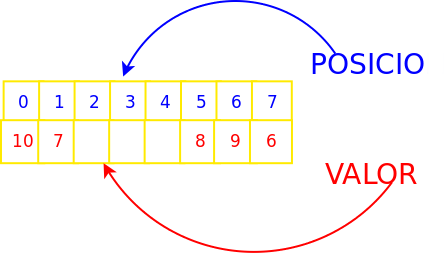
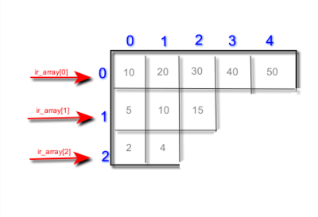
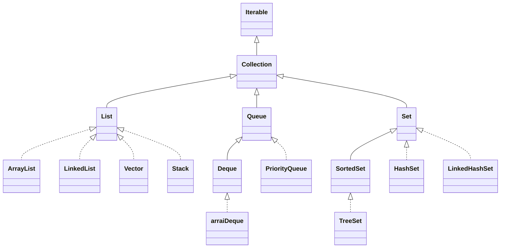
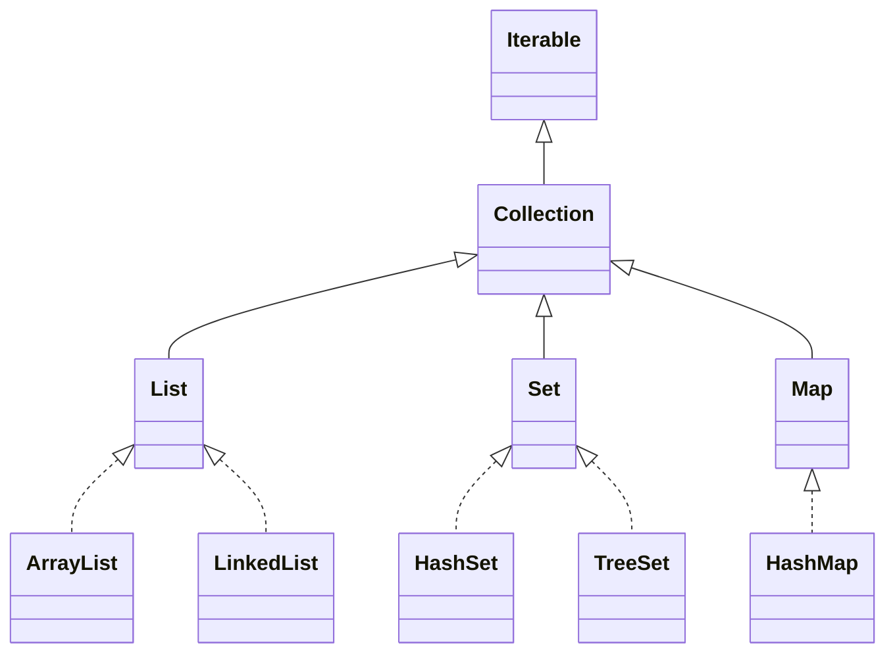
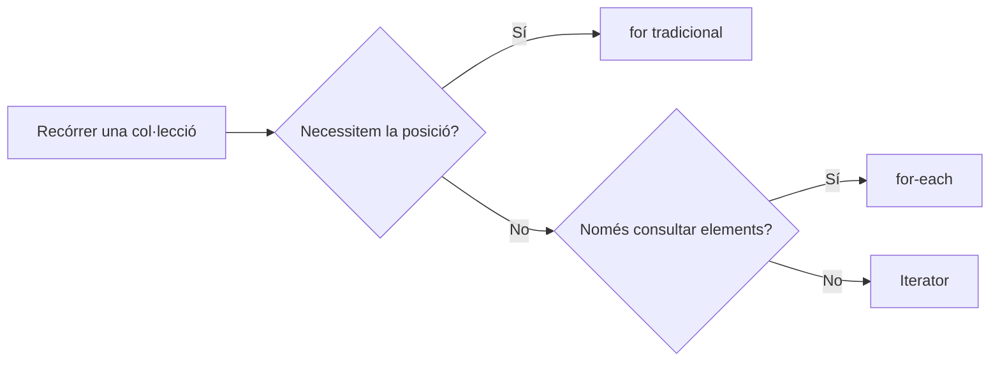

# Tema 5. Arrais i col·leccions

!!! danger "Resultat d'aprenentatge associat"
	<strong>RA6. Escriu programes que manipulin informació seleccionant i utilitzant tipus avançats de dades.</strong>
	### Criteris d'avaluació
	- [x] RA6.1. S'han escrit programes que utilitzin arrais.
	- [x] RA6.2. S'han reconegut les llibreries de classes relacionades amb tipus de dades avançats.
	- [x] RA6.3. S'han utilitzat llistes per emmagatzemar i processar informació.
	- [x] RA6.4. S'han utilitzat iteradors per recórrer els elements de les llistes.
	- [x] RA6.5. S'han reconegut les característiques i avantatges de cadascuna de les col·leccions de dades disponibles.
	- [x] RA6.6. S'han creat classes i mètodes genèrics.
	- [x] RA6.7. S'han utilitzat expressions regulars en la recerca de patrons en cadenes de text.
	- [x] RA6.8. S'han identificat les classes relacionades amb el tractament de documents XML.
	- [x] RA6.9. S'han realitzat programes que realitzin manipulacions sobre documents XML.

## Introducció
Fins ara havíem treballat amb tipus de **dades simples:** int, char, double, float, bool...  però que passa si necessitarem guardar un **conjunt de dades** o informació relativa a una persona? Nom, cognoms, DNI, adreça postal, data de naixement etc? Amb els tipus de dades simples ens seria impossible representar aquesta informació. Es per això que s’utilitzen els **tipus de dades compostos** que ens permetran agrupar de diverses maneres aquesta informació.

Ens podem trobar diversos tipus de dades compostos i en aquest tema veurem: 

- **arrais:** també coneguts com vectors o _arreglos_, contenen elements d'un mateix tipus base o objectes de la mateixa classe i poden tindre vàries dimensions.
- **Estructures:** conjunt d'elements heterogenis, no tenen per què ser del mateix tipus base.
- **Col·leccions:** Objectes predefinits al framework amb múltiples funcionalitats diferents.

## Arrais
!!! success "Criteris d'avaluació associats"
    - [x] RA6.1. S'han escrit programes que utilitzin arrais.

Comencem per veure l'estructura **més simple** de totes, l'arrai. Un **arrai** és una estructura de dades que permet emmagatzemar un nombre fix d'elements del **mateix tipus**. Cada element ocupa una posició determinada i s'hi accedeix mitjançant un **índex**. Amb un únic identificador podem tenir accés a un **conjunt de valors** agrupats. Aquestes agrupacions o arrais poden bé ser de tipus simples o també de tipus compostos.

Per tal d’accedir a cadascun dels elements del arrai s’utilitza un **índex o posició.** La primera posició de tot arrai és la 0 mentre que la segona seria la que té índex 1. Açò pot marejar un poc al principi.

- **Arrai d’enters:** {8,2,14,55,3,7}
- **Arrai de caràcters:** {‘n’,’a’,’t’,’o’}
- **Arrai de cadenes:** {"hola", "ciao", "hi", "allo"}
- **Arrai d'objectes:** PVector [] punts = new PVector[10];
  

### Posició vs valor
És molt important distingir entre **valor i posició.** Mentre que el valor és el contingut de l’arrai en una posició determinada la posició és l’índex que ens permet recorres l’arrai i tot el seu contingut.

<center>
	
</center>

A l’exemple anterior tenim un arrai de 8 enters, la part superior de color blau ens indica les posicions que van de la 0 a la 7, 8 posicions ens total. Mentre que a la fila inferior trobarem el valor que conté cadascuna de les posicions. Per exemple en la posició 5 (la sisena) de l’arrai tindríem emmagatzemat un valor de 8.

L'índex no és el valor. L'índex indica on està situat un element; el valor és la dada que hi ha en aquella posició.

```java linenums="0"
int [] edats = {18, 20, 19, 21};
// index:  0,  1,  2,  3
// valor: 18, 20, 19, 21
```

Un altre concepte a tenir en compte és la grandària de l’arrai que ens determina el total d’elements que es poden guardar en aquest. En el nostre cas la mida seria de 8.

Però com podem escriure en Java el mateix esquema que es mostra a la figura anterior?

### Declaració i creació
Un arrai en Java és una estructura de dades que ens permet emmagatzemar un conjunt de dades del mateix tipus. La grandària de l’arrai es determina en la seua **creació** i no es permet la seua modificació posterior

```java linenums="1"
tipusBase [] nomArrai;
nomaArrai = new tipusBase[grandària];
```

Alguns exemples:

```java linenums="1"
int [] mes;             // Declarem un arrai mes d'enters (sense espai)
mes = new int [30];     // Creem espai per a 30 elements a l'arrai mes
char [] grups;          // Declarem un arrai de caracters (sense espai assignat)
grups = new char [5];   // Creem espai per a 5 elements
```

Aquesta forma de declarar i inicialitzar arrais es pot fer en una sola línia de la següent forma:

```java linenums="1"
int [] agendaMensual = new int [30];  // Declarem un arrai d'enters i reservem 30 posicions de memòria
```

### Inicialització d'un arrai
Per tal d’accedir a les dades que conté un arrai necessitem l’identificador d’aquest així com també la posició concreta a la qual volem accedir. Per exemple, imaginem un arrai d’enters que es diu números.

```java linenums="1"
int [] parells = new int [5];   // Declarem un arrai d'enters de cinc posicions
parells [] = {2,4,6,8,10};  // Inicialització dels cinc valors

int [] enters = {1, 2, 3, 4, 5};

int [] senars = new int [5];
senars[0] = 1;
senars[1] = 3;
senars[2] = 5;
senars[3] = 7;
senars[4] = 9;
```

A l'exemple anterior hauríem creat un arrai de 5 enters que contindria els nombres parells fins al 10.

!!! danger "Diferència entre declaració creació i inicialització"
	És molt important que coneixeu bé aquests conceptes:

	- **Declaració:** assignació de nom i tipus.
	- **Creació:** reserva d'espai necessari.
	- **Inicialització:** assignació de valors.

Fins ara tots aquests conceptes anaven lligats quan només utilitzavem tipus de dades bàsics, per exemple, quan creavem en un programa nostre una variable de tipus enter, en la mateixa línia anava la declaració (donem nom a la variable), la creació (automaticament es reserva l'espai necessari per al tipus de dades que hem creat) i la inicialització (ja que per defecte i segons el tipus bàsic s'assignava un valor inicial). Però ara amb els arrais la cosa és un poc més complexa. Vegem algun exemple.

```java linenums="1"
int a; 
int [] arrai; 
arrai = new int [10]; 
```

Repassem el codi anterior. A la línia 1 de codi i només amb aquesta línia hem aconseguit:

1. **Declaració:** es declara una variable amb identificador 'a' i de tipus enter
2. **Creació:** automaticament el compilador li reserva l'espai necessari.
3. **Inicialització:** per defecte se li dona valor 0.

Ara si mirem les línies següents podrem observar que:

1. A la línia 2 del codi es produeix la **declaració de l'arrai**. Hem creat l'arrai i li hem assignat identificador però, quants elements pot emmagatzemar?
2. A la línia 3 del codi és on es **crea l'arrai**, és a dir, es reserva espai en memòria.
3. En aquest cas com que el tipus base de l'arrai és enter, la **inicialització** d'aquest vindria implicita en la reserva de memòria assignant-se valor 0 a tots els elements.

Però com poden inicialitzar cadascun dels elements del nostre arrai de forma manual?

### Accés als elements d'un arrai
Una vegada ja tenim la declaració de l’arrai i la seua inicialització, si volem bé accedir al seu contingut o modificar-ho, necessitaríem l’identificador de l’arrai i l’índex al qual volem accedir. És molt important tenir en compte que el primer element d’un arrai en Java està a la posició (índex) 0 i no a la posició 1 com ens indicaria la lògica.

```java linenums="1"
int primerNumero = números [0]; // primerNumero valdria 2
números [0] = 12;  // Canviem el  primer numero de l’arrai
```

I abans de passar al següent apartat introduirem l'atribut **lenght** dels arrais. En principi com que la declaració i creació dels arrais es fa de forma manual, en tot moment sabem quina és la longitud dels arrais que anem creant però no cal oblidar que també podem accedir a aquesta característica de la segÜent forma:

```java linenums="1"
int [] numeros = new int [10];
println(numeros.length);

for (int i = 0; i < numeros.lenght; i ++) 
	println(numeros[i]);
```

### Recórrer un arrai
Recórrer un arrai element a element és tan senzill com usar qualsevol de les estructures iteratives que varem veure al Tema 3. Per exemple:

```java linenums="1"
int [] numeros = new int [10];

// Bucle for
for (int i=0; i < 10; i++) {
	prinlnt(numeros[i]);
}

// Amb un bucle while
int i = 0;
while (i < 10){
	println(numeros[i]);
	i ++;
}

// Recorrem l'arrai amb un do while
int j = 0;
do {
	arraiEnters[j] = i*10;
	j++;
}
while(j < TAM);
```

??? question "Activitat 501. Declara, crea i inicialitza"
	=== "Enunciat"
		Escriu un programa en Java utilitzant Processing IDE que cree un arrai 10 enters. Aquest arrai s'inicialitzarà element a element amb el valor retornat per la funció de Processing API, **random**. El valor amb el que s'inicialitzarà cada element de l'arrai estarà entre 0 i 100.

		Has de tindre en compte que la inicialització de l'arrai s'ha de fer al mètode **setup** i no al **draw**.

		Per què creus que la inicialització no s'ha de fer dins de **draw()**?

	=== "Rúbrica"
		| Ítem d'avaluació | 4 - Excel·lent | 3 - Correcte | 2 - Parcial | 1 - Incorrecte | 0 - Inexistent o incoherent |
		|---|---|---|---|---|---|
		| Declaració i creació de l'arrai | Declara l'arrai com a variable global i el crea amb `new int[10]` dins de `setup()`. | Declara l'arrai com a variable global i el crea correctament, però fora de `setup()`. | Declara l'arrai correctament, però presenta algun error en la seua creació o grandària. | La declaració o creació de l'arrai és incorrecta. | No declara ni crea l'arrai. |
		| Ús de `random()` | Utilitza correctament `random()` per generar valors entre 0 i 100 per a tots els elements. | Utilitza `random()` correctament, però presenta un xicotet error en els límits del rang. | Utilitza `random()`, però només inicialitza alguns elements o presenta diversos errors en el rang. | Utilitza `random()` de manera incorrecta i els valors generats no corresponen al que es demana. | No utilitza `random()`. |
		| Inicialització de l'arrai | Inicialitza els 10 elements dins de `setup()` amb valors generats per `random()`. | Inicialitza els 10 elements correctament, però presenta algun problema menor relacionat amb la ubicació o l'estructura del codi. | Inicialitza només una part dels elements o necessita modificacions per funcionar correctament. | La inicialització és incorrecta o es realitza en un lloc inadequat, com ara `draw()`. | No inicialitza l'arrai. |
		| Recorregut de l'arrai | Recorre correctament tots els elements de l'arrai sense accedir a posicions fora dels seus límits. | Recorre correctament l'arrai amb algun error menor que no impedeix entendre el procediment. | El recorregut és parcial o presenta errors en la variable de control o en els límits. | El recorregut és incorrecte i impedeix accedir adequadament als elements. | No recorre l'arrai. |
		| Visualització de l'arrai | Mostra correctament tots els elements de l'arrai de manera clara. | Mostra els elements de l'arrai correctament, però la presentació és poc clara o presenta algun detall menor. | Només mostra una part dels elements o la visualització presenta errors. | Intenta mostrar l'arrai però el resultat és incorrecte o poc funcional. | No mostra els elements de l'arrai. |
		| Organització i comentaris del codi | El codi està ben organitzat, és fàcil de llegir i incorpora comentaris útils quan són necessaris. | El codi està ben organitzat i és llegible, encara que els comentaris podrien millorar-se. | El codi presenta certa desorganització o manca de comentaris en parts rellevants. | El codi és difícil de seguir per una organització deficient i/o per la manca de comentaris. | El codi és desorganitzat, incoherent o pràcticament incomprensible. |

	=== "Solució"
		
		<center>📦 **Fitxer ZIP amb la solució completa**</center>

		<center>[📥   Descarrega la solució](./assets/Tema4/actxxx.zip){ .md-button .md-button--secondary }</center>
		
		No disponible
		

??? question "Activitat 502. Estadístiques d'un arrai"
    === "Enunciat"

        Crea un arrai de 20 nombres enters i inicialitza'l amb valors aleatoris entre 0 i 100 utilitzant la funció `random()` de Processing.

        Recorre l'arrai i calcula les estadístiques següents:

        - la suma de tots els elements;
        - la mitjana dels valors;
        - el valor màxim;
        - el valor mínim;
        - la quantitat de nombres parells.

        Finalment, mostra per pantalla l'arrai i els resultats obtinguts.

        **Important:** calcula les estadístiques recorrent l'arrai. No utilitzes funcions o mètodes que calculen directament aquests valors.

    === "Rúbrica"
        | Ítem d'avaluació | 4 - Excel·lent | 3 - Correcte | 2 - Parcial | 1 - Incorrecte | 0 - Inexistent o incoherent |
		|---|---|---|---|---|---|
		| Creació i inicialització de l'arrai | Crea un arrai de 20 enters i inicialitza correctament tots els elements amb valors aleatoris entre 0 i 100. | Crea i inicialitza correctament l'arrai, però presenta algun error menor en la grandària o en el rang dels valors. | L'arrai està creat, però només inicialitza una part dels elements o presenta diversos errors en la inicialització. | La creació o inicialització de l'arrai és incorrecta i impedeix el funcionament esperat del programa. | No crea ni inicialitza l'arrai. |
		| Recorregut de l'arrai | Recorre correctament tots els elements de l'arrai amb un bucle adequat, sense omissions ni accessos fora dels límits. | Recorre correctament l'arrai, però presenta algun error menor que no afecta significativament el resultat. | Recorre l'arrai de manera parcial o presenta errors en la variable de control o en els límits. | El recorregut és incorrecte i impedeix calcular adequadament les estadístiques. | No recorre l'arrai. |
		| Càlcul de la suma i la mitjana | Calcula correctament la suma de tots els elements i la mitjana, utilitzant un tipus de dada adequat per conservar els decimals. | Calcula correctament la suma i la mitjana, però presenta algun error menor en el tipus de dada o en la presentació del resultat. | Calcula correctament només una de les dues estadístiques o presenta errors en el càlcul de la mitjana. | Els càlculs són incorrectes i els resultats obtinguts no són coherents amb l'arrai. | No calcula ni la suma ni la mitjana. |
		| Càlcul del màxim i el mínim | Determina correctament el valor màxim i el valor mínim de l'arrai mitjançant el seu recorregut. | Determina correctament el màxim i el mínim, però presenta algun error menor en la implementació. | Calcula correctament només un dels dos valors o necessita modificacions per funcionar en tots els casos. | El càlcul del màxim i el mínim és incorrecte. | No calcula el màxim ni el mínim. |
		| Comptatge dels nombres parells | Compta correctament tots els nombres parells de l'arrai mitjançant una condició adequada. | Compta correctament els nombres parells, però presenta algun error menor en la implementació. | El comptatge funciona només en alguns casos o presenta errors en la condició utilitzada. | El comptatge és incorrecte i no reflecteix la quantitat real de nombres parells. | No compta els nombres parells. |
		| Visualització dels resultats | Mostra de manera clara l'arrai i totes les estadístiques calculades, identificant cada resultat. | Mostra l'arrai i les estadístiques, però alguna informació no està clarament identificada o presentada. | Mostra només una part de l'arrai o de les estadístiques calculades. | La visualització és incorrecta o no permet identificar adequadament els resultats. | No mostra els resultats. |
		| Organització i comentaris del codi | El codi està ben estructurat, és llegible i incorpora comentaris útils per explicar les parts més rellevants. | El codi està ben organitzat i és llegible, encara que els comentaris podrien millorar-se. | El codi presenta certa desorganització o manca comentaris en parts rellevants. | El codi és difícil de seguir per una organització deficient i/o per la manca de comentaris. | El codi és desorganitzat, incoherent o pràcticament incomprensible. |

	=== "Solució"
		
		<center>📦 **Fitxer ZIP amb la solució completa**</center>

		<center>[📥   Descarrega la solució](./assets/Tema4/act5xx.zip){ .md-button .md-button--secondary }</center>
		
		No disponible
		

### Arrais de caracters
Un arrai que conté caràcters en lloc de números funciona d’una forma molt semblant al que s’ha explicat en els apartats anteriors. Es pot veure de forma senzilla a l’exemple que vos mostrem a continuació.

```java linenums="1"
// Declaració de l’arrai vocals que contindrà un total de 5 posicions en memòria
char vocals = new char [5];

// Inicialització de l'arrai amb les vocals de l'alfabet.
vocals [] = {‘a’,’e’,’i’,’o’,’u’} 

// Accés a l'element primer (0) de l'arrai per modificar el seu valor
vocals [0] = ‘z’;
```

??? question "Activitat 503. Arrai de caracters"
	=== "Enunciat"
		Crea un arrai de 10 caracters. Inicialitza'l amb caracters aleatoris i mostra'l per pantalla. Després recorre l'arrai i compta quantes vocals té.

	=== "Rúbrica"
		| Ítem d'avaluació | 4 - Excel·lent | 3 - Correcte | 2 - Parcial | 1 - Incorrecte | 0 - Inexistent o incoherent |
		|---|---|---|---|---|---|
		| Creació i inicialització de l'arrai | Crea correctament un arrai de 10 caràcters i inicialitza tots els elements amb caràcters aleatoris. | Crea i inicialitza correctament l'arrai, però presenta algun error menor que no afecta el funcionament general. | Crea l'arrai però només inicialitza una part dels elements o presenta diversos errors en la inicialització. | La creació o inicialització de l'arrai és incorrecta i impedeix el funcionament esperat. | No crea ni inicialitza l'arrai. |
		| Generació de caràcters aleatoris | Genera correctament caràcters aleatoris i els assigna als 10 elements de l'arrai. | Genera caràcters aleatoris correctament, però presenta algun error menor en el procés. | Genera alguns caràcters correctament, però el procés presenta errors o no cobreix tots els elements. | Intenta generar caràcters aleatoris, però el resultat no correspon al que es demana. | No genera caràcters aleatoris. |
		| Recorregut de l'arrai | Recorre correctament tots els elements de l'arrai amb un bucle adequat. | Recorre correctament l'arrai, però presenta algun error menor que no afecta significativament el resultat. | Recorre l'arrai de manera parcial o presenta errors en la variable de control o en els límits. | El recorregut és incorrecte i impedeix processar adequadament els caràcters. | No recorre l'arrai. |
		| Comptatge de vocals | Identifica correctament les vocals i compta totes les que apareixen a l'arrai. | Compta correctament les vocals, però presenta algun error menor en la condició utilitzada. | Identifica i compta només una part de les vocals o presenta diversos errors en la condició. | El comptatge és incorrecte i no reflecteix la quantitat real de vocals. | No compta les vocals. |
		| Visualització de l'arrai i del resultat | Mostra clarament l'arrai de caràcters i la quantitat de vocals trobades. | Mostra correctament l'arrai i la quantitat de vocals, però la presentació podria ser més clara. | Mostra només una part de la informació o presenta errors en la visualització. | La visualització és incorrecta o no permet identificar els resultats. | No mostra l'arrai ni el resultat. |
		| Organització i comentaris del codi | El codi està ben estructurat, és llegible i incorpora comentaris útils quan són necessaris. | El codi està ben organitzat i és llegible, encara que els comentaris podrien millorar-se. | El codi presenta certa desorganització o manca comentaris en parts rellevants. | El codi és difícil de seguir per una organització deficient i/o per la manca de comentaris. | El codi és desorganitzat, incoherent o pràcticament incomprensible. |

	=== "Solució"
		
		<center>📦 **Fitxer ZIP amb la solució completa**</center>

		<center>[📥   Descarrega la solució](./assets/Tema4/act5xx.zip){ .md-button .md-button--secondary }</center>
		
		No disponible
		

### Arrais com a paràmetres
Un arrai es pot passar com a paràmetre d'un mètode. El mètode rep una referència al mateix array, de manera que pot consultar-ne o modificar-ne els elements.

```java linenums="1"
void mostraArray(int[] dades) {

    for (int i = 0; i < dades.length; i++) {
        println(dades[i]);
    }
}
```

```java linenums="1"
int[] numeros = {4, 8, 15, 16, 23, 42};

mostraArray(numeros);
```

No passa el mateix si passem un element concret de l’arrai, en aquest cas a l’igual que amb els altres paràmetres, aquests es passen per valor, per tant les  modificacions o canvis que es produeixen dins del mètode no afectaran fora d’aquest.

??? question "Activitat 504. Mostra arrai amigablement"
	=== "Enunciat"
		Seguint amb el codi anterior, fes dos mètodes per la nostra aplicació que mostre, de forma amigable, l’arrai de números i l’arrai de caràcters. Els mètodes es podrien dir mostraEnters i mostraCaracters. Utilitza totes les funcions que conegues de Processing IDE per tal que mostre els arrais de la forma més estètica possible.

		```java linenums="1"
		void mostraEnters (int [] arrai) {
			// Codi per mostrar el vector d'enters
		}

		void mostraCaracters (char [] arrai) {
			// Codi per mostrar el vector de caracters
		}
		```

		Igual podria ser útil que li afegires coordenades (x,y) com a paràmetres a la funció de mostrar arrais per tal de poder indicar-li on vols que es mostren.

		```java linenums="1"
		void mostraEnters(int[] array, float x, float y) {
			// Codi per mostrar enters amb coordenades
		}
		void mostraCaracters(char[] array, float x, float y) {
			// Codi per mostrar caracters amb coordenades
		}
		```
		
	=== "Rúbrica"
		| Ítem d'avaluació | 4 - Excel·lent | 3 - Correcte | 2 - Parcial | 1 - Incorrecte | 0 - Inexistent o incoherent |
		|---|---|---|---|---|---|
		| Mètode `mostraEnters` | Defineix i implementa correctament el mètode `mostraEnters(int[] array, float x, float y)` i mostra tots els elements de l'arrai de manera clara i ordenada. | Defineix i implementa correctament el mètode i mostra els elements de l'arrai, amb algun error menor en la presentació. | El mètode està definit però només mostra una part de l'arrai o presenta errors en els paràmetres o en el recorregut. | La definició o implementació del mètode és incorrecta i no permet mostrar adequadament l'arrai. | No crea ni implementa el mètode. |
		| Mètode `mostraCaracters` | Defineix i implementa correctament el mètode `mostraCaracters(char[] array, float x, float y)` i mostra tots els caràcters de manera clara i ordenada. | Defineix i implementa correctament el mètode i mostra els caràcters, amb algun error menor en la presentació. | El mètode està definit però només mostra una part dels caràcters o presenta errors en els paràmetres o en el recorregut. | La definició o implementació del mètode és incorrecta i no permet mostrar adequadament l'arrai. | No crea ni implementa el mètode. |
		| Paràmetres dels mètodes | Utilitza correctament l'arrai i les coordenades `x` i `y` com a paràmetres, permetent decidir on es mostra cada arrai. | Utilitza correctament els paràmetres, però presenta algun error menor en l'ús de les coordenades. | Utilitza els paràmetres de manera parcial o les coordenades no tenen l'efecte esperat en tots els casos. | Els paràmetres estan mal definits o s'utilitzen de manera incorrecta. | No utilitza paràmetres adequadament. |
		| Recorregut i accés als elements | Recorre correctament tots els elements dels arrais i accedeix a cadascun mitjançant el seu índex. | Recorre correctament els arrais, però presenta algun error menor que no afecta significativament el resultat. | El recorregut és parcial o presenta errors en els índexs o en els límits. | El recorregut és incorrecte i impedeix mostrar adequadament els elements. | No recorre els arrais. |
		| Presentació gràfica | Utilitza adequadament les funcions de Processing per crear una presentació clara, ordenada i visualment cuidada dels dos arrais. | La presentació és clara i utilitza diverses funcions de Processing, encara que podria millorar-se estèticament. | La presentació permet veure els elements, però és poc clara, repetitiva o aprofita poc les possibilitats de Processing. | La presentació és confusa o dificulta la visualització dels elements. | No presenta els arrais gràficament. |
		| Reutilització i organització del codi | Els mètodes són independents, reutilitzables i estan ben organitzats, evitant repetir codi innecessàriament. | Els mètodes estan ben organitzats i són reutilitzables, amb alguna repetició menor. | Els mètodes funcionen però presenten certa repetició o una organització millorable. | El codi presenta molta repetició o una organització deficient que dificulta la reutilització. | El codi és desorganitzat, incoherent o no permet reutilitzar els mètodes. |
		| Organització i comentaris del codi | El codi està ben estructurat, és llegible i incorpora comentaris útils per explicar les parts més rellevants. | El codi està ben organitzat i és llegible, encara que els comentaris podrien millorar-se. | El codi presenta certa desorganització o manca comentaris en parts rellevants. | El codi és difícil de seguir per una organització deficient i/o per la manca de comentaris. | El codi és desorganitzat, incoherent o pràcticament incomprensible. |

	=== "Solució"
		
		<center>📦 **Fitxer ZIP amb la solució completa**</center>

		<center>[📥   
		Descarrega la solució](./assets/Tema4/act5xx.zip){ .md-button .md-button--secondary }
		<!--[Descarrega la solució al problema de mostrar arrais amigablement](assets/Tema8/act503.pde)-->
		</center>
		
		No disponible
		


??? question "Activitat 505. Fes una traça"
	=== "Enunciat"
		Fes una traça al codi anterior i observa com els diferents bucles recorren l'arrai. Escriu la teua conclusió a un comentari de documentació al codi.

		Coses que has de tindre en compte per fer una bona traça:
		- Identificar el valor de i en cada iteració.
		- Indicar quin element arrai[i] s'està consultant.
		- Observar quan acaba el bucle.
		- comparar diferents bucles si en el codi anterior m'hi ha més d'un.

		Pots utilitzar **println** per mostrar missatges per consola a mode de depuaració.

	=== "Rúbrica"
		| Ítem d'avaluació | 4 - Excel·lent | 3 - Correcte | 2 - Parcial | 1 - Incorrecte | 0 - Inexistent o incoherent |
		|---|---|---|---|---|---|
		| Traça del recorregut | Realitza una traça completa i ordenada del recorregut de l'arrai, indicant el valor de `i` en cada iteració i l'element `array[i]` consultat. | Realitza correctament la traça, però presenta alguna omissió o error menor. | Realitza la traça només parcialment o presenta diversos errors en els valors de `i` o en els elements consultats. | La traça és majoritàriament incorrecta i no permet entendre el recorregut del bucle. | No realitza la traça o la informació aportada és incoherent. |
		| Finalització del bucle | Identifica correctament la condició que fa finalitzar el bucle i explica quan i per què deixa de recórrer l'arrai. | Identifica correctament quan finalitza el bucle, però l'explicació és poc detallada. | Identifica el final del bucle, però presenta errors en l'explicació de la condició o de l'última iteració. | No identifica correctament quan o per què finalitza el bucle. | No analitza la finalització del bucle. |
		| Comparació dels bucles | Compara correctament els diferents bucles del codi i explica les diferències en la manera de recórrer l'arrai. | Compara els bucles i identifica les diferències principals, amb algun error menor. | Fa una comparació parcial, però no explica amb claredat les diferències entre els recorreguts. | La comparació és incorrecta o no permet identificar les diferències entre els bucles. | No compara els bucles. |
		| Ús de `println()` per a la depuració | Utilitza `println()` de manera adequada per comprovar i comprendre els valors de les variables i els elements consultats durant l'execució. | Utilitza `println()` correctament per comprovar el recorregut, encara que podria mostrar informació més útil. | Utilitza `println()` però els missatges aporten poca informació o no permeten seguir clarament l'execució. | Utilitza `println()` de manera inadequada o sense relació clara amb la depuració del programa. | No utilitza `println()` quan és necessari per comprovar el funcionament del programa. |
		| Conclusió | Escriu una conclusió clara i correcta en un comentari de documentació, relacionant-la amb el comportament observat durant la traça. | Escriu una conclusió correcta relacionada amb la traça, encara que podria estar més desenvolupada. | La conclusió és parcial o presenta alguna interpretació incorrecta del recorregut. | La conclusió és incorrecta o no està relacionada adequadament amb la traça realitzada. | No escriu cap conclusió o aquesta és incoherent. |
		| Organització i comentaris del codi | La traça i les proves de depuració estan ben organitzades i el comentari de documentació és clar i està correctament situat. | El codi està ben organitzat i el comentari és adequat, amb algun aspecte menor millorable. | El codi presenta certa desorganització o el comentari és poc clar. | El codi és difícil de seguir i els comentaris són insuficients o inadequats. | El codi és desorganitzat, incoherent o pràcticament incomprensible. |

	=== "Solució"
		
		<center>📦 **Fitxer ZIP amb la solució completa**</center>

		<center>
		[📥   Descarrega la solució](./assets/Tema4/act5xx.zip){ .md-button .md-button--secondary }
		<!--[Descarrega la solució al problema dels diferents tipus de bucle](assets/Tema/act504.pde)-->
		</center>
		
		No disponible
		
		
## Arrais multidimensionals

!!! success "Criteris d'avaluació associats"
    - [x] RA6.1. S'han escrit programes que utilitzin arrais.

Fins ara hem estan utilitzant arrais d’una sola dimensió, coneguts també com vectors. Aquests arrais es recorren amb ajuda d’un sol índex (tenen una sola dimensió). En aquest apartat estudiarem arrais de més d’una dimensió per als que necessitarem més d’un índex a l’hora de ser recorreguts. 

Els arrais multidimensionals més comuns són els de dues dimensions o bidimensionals, també coneguts com matrius. És comú representar aquest tipus de dades com una taula composta per una sèrie de files i columnes:

|     |     |     |     |     |     |
| --- | --- | --- | --- | --- | --- |
| 0,0 | 0,1 | 0,2 | 0,3 | ... | 0,N |
| 1,0 | 1,1 | 1,2 | 1,3 | ... | 1,N |
| 2,0 | 2,1 | 2,2 | 2,3 | ... | 2,N |
| ... | ... | ... | ... | ... | ... |
| N,0 | N,1 | N,2 | N,3 | ... | N,N |

Al contrari del que passava amb els arrais d’una sola dimensió on només necessitavem un índex per accedir al valor, en els arrais de dues dimensions com el de l’exemple anterior, necessitarem dos índex per accedir al valor de l’arrai.

Les matrius, com es coneixen els arrais bidimensionals es forme per files i columnes.

### Declaració i creació d'un arrai multidimensional

Per tal de declarar una matriu en java, és a dir, un arrai de dues dimensions, ho farem de la següent forma:Ç

```java linenums="1"
tipusBase [][] matriu;
```

Si es fixeu, mentre quan declaravem un arrai d’una sola dimensió utilitzavem només un parell de claudàtors: 

```java linenums="1"
tipusBase [] arrai;
```
Ara que volem crear una matriu (arrai de dues dimensions) utilitzarem dos parells de claudàtors.

És fàcil deduir que si volguerem declarar un arrai de tres dimensions, hauriem d’utilitzar tres parells de claudàtors.

Amb aquesta instrucció el que estem fent es declarar la matriu però no li hem dit quina grandària tindrà. Eixa és la diferència entre declaració i creació. Per tal de crear, és a dir, reservar espai per a la nostra matriu, hem de fer el següent:

```java linenums="1"
tipusBase [][] matriu = new tipusBase[n][m];
```

On n i m són valors enters que ens indiquen la grandària de cada dimensió. 
Per exemple, per declarar i crear una matriu d’enters de 5 files i 10 columnes fariem el següent:

```java linenums="1"
int [][] matriuEnters;
matriuEnters = new int [5][10];
// També ho podriem fer en una sola instrucció
int [][] matriuEnters = new int [5][10];
```

!!! warning "Què és cada índex?"
	Quan fem una declaració com la següent en Java:

	```java linenums="1"
	int [] matriu = new int [3][9];
	```

	El primer índex, el 3, indica el nombre total de files mentre que el 9 ens indica el nombre total de columnes que té la nostra matriu.

### Inicialització d'un arrai multidimensional
El procés d’inicialització d’un arrai, dona igual les dimensions que tinga, consisteix en donar-li valor a les cel·les que inicialment estarien inicialitzades amb tipus per defecte del tipus base escollit. Per exemple, amb les matrius que estem declarant i creant, que són matrius amb tipus base **enter**, el seu valor inicial seria zero i no buit.

Per tal d’inicialitzar-la element a element hauriem d’executar les següents sentències:

```java linenums="1"
for (int i = 0; i < FILES; i ) {
	for (int j=0; j< COLUMNES; j++ ) {
		arrai [i][j] = 0;
	}
}
```

### Accés als elements d'un arrai multidimensional
Per accedir a una dada en un arrai multidimensional hem de coneixer els índex de posició d’aquest. En un arrai de dues dimensions, per accedir a una dada s’ha d’indicar la fila i la columna d’on es troba aquesta informació.

Per exemple, imaginem que tenim la següent taula (arrai de dues dimensions)

|    |    |    |    |    |    |
|----|----|----|----|----|----|
| 12 | 13 |  5 |  9 | 22 | 14 |
| 21 | 11 |  8 | 56 | 23 |  7 |
|  6 | 10 | 32 | 36 | 24 | 99 |
| 78 | 55 | 57 | 79 | 18 | 14 |

I volem que em mostre per pantalla els elements que formen part de la segona fila. Mira el següent codi:

```java linenums="1"
for (int i=0; i < COLUMNES; i ++)
	println(matriuEnters[1][i]);
```

### Recórrer un arrai multidimensional
Si et fixes en el codi anterior, veuràs que existeix una constant **COLUMNES** que ens indicaria el total de columnes amb el que hem inicialitzat la matriu d'enters, però igual que passava amb els arrais d'una sola dimensió, seria més professional usar l'atribut **length** com es mostra a continuació:

```java linenums="1"
for (int i=0; i < matriu[1].length; i ++)
	println(matriuEnters[1][i]);
```

Finalment si volem usar l'atribut **length** per recórrer tota la matriu de dues dimensions, també podriem fer el següent:

```java linenums="1"
for (int i=0; i < matriu.length; i ++)
	for (int j=0; j < matriu[i].length; j ++)
		println(matriuEnters[i][i]);
```
Igual que varem fer amb els arrais d'una dimensió, farem una traça per consoldiar coneixements i abans de passar a activitats amb més entitat.

??? question "Activitat 506. Fes una traça d'una matriu"
	=== "Enunciat"
		Declara, crea i inicialitza una matriu com la del exemple anterior, fes una traça i observa com els diferents bucles recorren la matriu. Escriu la teua conclusió a un comentari de documentació al codi.

		Coses que has de tindre en compte per fer una bona traça:
		- Identificar el valor dels índex en cada iteració.
		- Indicar quin element matriu[i][j] s'està consultant.
		- Observar quan acaba el bucle.
		- comparar diferents bucles si en el codi anterior m'hi ha més d'un.

		Pots utilitzar **println** per mostrar missatges per consola a mode de depuaració.

	=== "Rúbrica"
		| Ítem d'avaluació | 4 - Excel·lent | 3 - Correcte | 2 - Parcial | 1 - Incorrecte | 0 - Inexistent o incoherent |
		|---|---|---|---|---|---|
		| Traça dels índexs | Realitza una traça completa i ordenada, indicant correctament els valors de `i` i `j` en cada iteració. | Realitza correctament la traça, però presenta alguna omissió o error menor en els índexs. | Realitza la traça només parcialment o presenta diversos errors en els valors de `i` i `j`. | La traça és majoritàriament incorrecta i no permet entendre el recorregut de la matriu. | No realitza la traça o la informació aportada és incoherent. |
		| Accés als elements de la matriu | Identifica correctament en cada iteració l'element `matriu[i][j]` que s'està consultant. | Identifica correctament la majoria dels elements, amb algun error menor. | Identifica només una part dels elements o confon alguns índexs amb els valors de la matriu. | L'accés als elements és majoritàriament incorrecte i no permet seguir el recorregut. | No identifica els elements consultats. |
		| Finalització dels bucles | Identifica correctament quan finalitza cada bucle i explica la relació entre els límits dels índexs i les dimensions de la matriu. | Identifica correctament la finalització dels bucles, però l'explicació és poc detallada. | Identifica el final dels bucles, però presenta errors en l'explicació dels límits o de les iteracions. | No identifica correctament quan o per què finalitzen els bucles. | No analitza la finalització dels bucles. |
		| Comparació dels bucles | Compara correctament els diferents bucles del codi i explica les diferències en la manera de recórrer la matriu. | Compara els bucles i identifica les diferències principals, amb algun error menor. | Fa una comparació parcial, però no explica amb claredat les diferències entre els recorreguts. | La comparació és incorrecta o no permet identificar les diferències entre els bucles. | No compara els bucles. |
		| Conclusió | Escriu una conclusió clara i correcta en un comentari de documentació, relacionant-la amb el comportament observat durant la traça. | Escriu una conclusió correcta relacionada amb la traça, encara que podria estar més desenvolupada. | La conclusió és parcial o presenta alguna interpretació incorrecta del recorregut de la matriu. | La conclusió és incorrecta o no està relacionada adequadament amb la traça realitzada. | No escriu cap conclusió o aquesta és incoherent. |
		| Organització i comentaris del codi | La traça, les proves de depuració i el comentari de documentació estan ben organitzats i faciliten la comprensió del recorregut. | El codi està ben organitzat i el comentari és adequat, amb algun aspecte menor millorable. | El codi presenta certa desorganització o el comentari és poc clar. | El codi és difícil de seguir i els comentaris són insuficients o inadequats. | El codi és desorganitzat, incoherent o pràcticament incomprensible. |

	=== "Solució"
		
		<center>📦 **Fitxer ZIP amb la solució completa**</center>

		<center>
		[📥   Descarrega la solució](./assets/Tema4/act5xx.zip){ .md-button .md-button--secondary }
		<!--[Descarrega la solució al problema dels diferents tipus de bucle](assets/Tema/act504.pde)-->
		</center>
		
		No disponible
		

??? question "Activitat 507. Recorre i mostra una matriu"
	=== "Enunciat"
		Seguint amb la matriu anterior, fes un algorisme que mostre la matriu per pantalla de la forma més elegatn que consideres. Podries per exemple:
		- Representar cada element de la matriu com un quadrat
		- canviar el color segons el valor
		- etc..

		D'altra banda i de forma transparent a l'usuari, el teu algoritme ha de:
		- sumar tots els elements.
		- trobar el màxim
		- comptar parells.
		- calcular la suma de les columnes.

	=== "Rúbrica"
		| Ítem d'avaluació | 4 - Excel·lent | 3 - Correcte | 2 - Parcial | 1 - Incorrecte | 0 - Inexistent o incoherent |
		|---|---|---|---|---|---|
		| Recorregut de la matriu | Recorre correctament tots els elements de la matriu mitjançant els índexs adequats, sense omissions ni accessos fora dels límits. | Recorre correctament la matriu, però presenta algun error menor que no afecta significativament el resultat. | Recorre la matriu de manera parcial o presenta diversos errors en els índexs o en els límits. | El recorregut és majoritàriament incorrecte i impedeix processar adequadament la matriu. | No recorre la matriu. |
		| Representació gràfica | Representa tots els elements de la matriu de manera clara, elegant i coherent, utilitzant adequadament formes, posicions i/o colors. | Representa correctament la matriu i els seus elements, amb algun aspecte gràfic millorable. | La representació permet reconèixer la matriu, però presenta errors de posició, escala, colors o alguns elements no es mostren correctament. | La representació és poc clara o presenta errors importants que dificulten identificar la matriu. | No representa la matriu gràficament. |
		| Càlcul de la suma i del màxim | Calcula correctament la suma de tots els elements i determina el valor màxim durant el recorregut de la matriu. | Calcula correctament la suma i el màxim, però presenta algun error menor en la implementació o presentació. | Calcula correctament només una de les dues operacions o presenta errors que afecten alguns casos. | Els càlculs són majoritàriament incorrectes i els resultats no són fiables. | No calcula ni la suma ni el màxim. |
		| Comptatge dels nombres parells | Compta correctament tots els elements parells de la matriu mitjançant una condició adequada. | Compta correctament els nombres parells, amb algun error menor en la implementació. | El comptatge funciona només en alguns casos o presenta errors en la condició utilitzada. | El comptatge és incorrecte i no reflecteix la quantitat real de nombres parells. | No compta els nombres parells. |
		| Suma de les columnes | Calcula correctament la suma de cada columna i conserva els resultats de manera diferenciada. | Calcula correctament les sumes de les columnes, amb algun error menor en la implementació o presentació. | Calcula correctament només algunes columnes o presenta errors en els índexs utilitzats. | La suma de les columnes és majoritàriament incorrecta. | No calcula la suma de les columnes. |
		| Integració de les operacions | Integra de manera eficient el recorregut, la representació i totes les operacions sol·licitades, evitant recorreguts innecessaris. | Integra correctament les diferents operacions, encara que podria millorar l'organització del recorregut. | Les operacions funcionen, però estan poc integrades o es realitzen de manera poc eficient. | Les diferents parts funcionen de manera desconnectada o presenten errors d'integració importants. | No aconsegueix integrar les operacions requerides. |
		| Organització i qualitat del codi | El codi està molt ben estructurat, és llegible i separa adequadament la lògica de càlcul de la representació gràfica. | El codi està ben organitzat i és llegible, amb algun aspecte menor millorable. | El codi presenta certa desorganització, duplicitats o dificultats de lectura. | El codi és difícil de seguir per una organització deficient o per errors estructurals. | El codi és desorganitzat, incoherent o pràcticament incomprensible. |

	=== "Solució"
		
		<center>📦 **Fitxer ZIP amb la solució completa**</center>

		<center>
		[📥   Descarrega la solució](./assets/Tema4/act5xx.zip){ .md-button .md-button--secondary }
		<!--[Descarrega la solució al problema dels diferents tipus de bucle](assets/Tema/act504.pde)-->
		</center>
		
		No disponible
		

Finalment per tal d’entendre i assolir perfectament el concepte de matriu o arrai bidimensional, realitzarem un exercici on treballarem amb les típiques matrius matemàtiques, realitzant les operacions pròpies d’aquestes.

??? question "Activitat 508. Treballa amb dues matrius"
	=== "Enunciat"
		Crea un algorisme en el que es declaren dues matrius d'enters de 3 files i 3 columnes cadascuna. Fes que aquestes matrius s'inicialitzen de forma aleatoria al principi del programa i després has d'agonseguir que l'usuari puga realitzar les següents accions amb les matrius:
		1. Mostrar matrius per pantalla.
		2. Inicialitzar les matrius de forma aleatòria.
		3. Resultat de la suma de les matrius.
		4. Producte de les matrius per un escalar.
		5. Producte de les dues matrius.
		6. Transposada de les matrius

	=== "Rúbrica"
		| Ítem d'avaluació | 4 - Excel·lent | 3 - Correcte | 2 - Parcial | 1 - Incorrecte | 0 - Inexistent o incoherent |
		|---|---|---|---|---|---|
		| Declaració i inicialització de les matrius | Declara correctament dues matrius d'enters de 3 × 3 i les inicialitza adequadament, incloent la inicialització aleatòria a l'inici del programa. | Declara i inicialitza correctament les dues matrius, amb algun error menor en la implementació. | Les matrius estan declarades i creades, però presenta errors en la grandària o en la inicialització. | La declaració o inicialització és majoritàriament incorrecta i impedeix treballar adequadament amb les matrius. | No declara ni crea les matrius. |
		| Menú i interacció amb l'usuari | Implementa un sistema d'interacció clar que permet seleccionar i executar correctament totes les operacions sol·licitades. | Permet seleccionar i executar les operacions, amb algun error menor en la interacció. | La interacció funciona només parcialment o algunes opcions no es gestionen correctament. | La interacció presenta errors importants i dificulta l'ús del programa. | No implementa cap mecanisme d'interacció. |
		| Visualització de les matrius | Mostra correctament les dues matrius, de manera clara i diferenciada, permetent identificar fàcilment tots els seus elements. | Mostra correctament les matrius, encara que la presentació podria millorar-se. | Mostra les matrius parcialment o amb problemes de format que en dificulten la lectura. | La visualització és incorrecta o no permet identificar adequadament les matrius. | No mostra les matrius. |
		| Suma de matrius | Calcula correctament la suma de les dues matrius, element a element, i mostra el resultat. | Calcula correctament la suma, amb algun error menor en la implementació o presentació. | La suma és parcialment correcta o presenta errors en alguns elements. | El càlcul de la suma és majoritàriament incorrecte. | No implementa la suma de les matrius. |
		| Producte per un escalar | Multiplica correctament tots els elements d'una matriu per l'escalar indicat i mostra el resultat. | Realitza correctament el producte per un escalar, amb algun error menor. | Multiplica només una part dels elements o presenta errors en el càlcul. | El producte per un escalar és majoritàriament incorrecte. | No implementa el producte per un escalar. |
		| Producte de les matrius | Calcula correctament el producte matricial de les dues matrius, aplicant la combinació adequada de files i columnes. | Calcula correctament el producte matricial, amb algun error menor en la implementació. | El producte és parcialment correcte, però presenta errors en alguns elements o en els índexs. | El càlcul del producte matricial és majoritàriament incorrecte. | No implementa el producte de les matrius. |
		| Matriu transposada | Calcula correctament la transposada de les matrius, intercanviant files i columnes, i mostra els resultats. | Calcula correctament les transposades, amb algun error menor en la implementació o presentació. | La transposada és parcialment correcta o presenta errors en alguns elements. | La transposada és majoritàriament incorrecta. | No implementa la transposada. |
		| Organització i qualitat del codi | El codi està molt ben estructurat, separa les diferents operacions en mètodes adequats, és llegible i evita repeticions innecessàries. | El codi està ben organitzat i és llegible, encara que podria millorar la separació de responsabilitats o la reutilització. | El codi funciona però presenta certa desorganització, repeticions o mètodes poc adequats. | El codi és difícil de seguir per una organització deficient o per errors estructurals. | El codi és desorganitzat, incoherent o pràcticament incomprensible. |

	=== "Solució"
		
		<center>📦 **Fitxer ZIP amb la solució completa**</center>

		<center>
		[📥   Descarrega la solució](./assets/Tema4/act5xx.zip){ .md-button .md-button--secondary }
		<!--[Descarrega la solució al problema dels diferents tipus de bucle](assets/Tema/act504.pde)-->
		<!--[Descarrega la solució a l'activitat 519](assets/Tema5/act519.pde)-->
		</center>
		
		No disponible
		

## Arrays de tres dimensions

!!! success "Criteris d'avaluació associats"
    - [x] RA6.1. S'han escrit programes que utilitzin arrais.

Fins ara hem treballat amb arrays d'una i dues dimensions. En un array d'una dimensió necessitàvem un índex per accedir a cada element, mentre que en un array de dues dimensions necessitàvem dos índexs: un per indicar la fila i un altre per indicar la columna.

També podem crear arrays de més dimensions. En aquest apartat veurem breument els **arrays de tres dimensions**, que necessiten tres índexs per accedir a cadascun dels seus elements.

Podem imaginar un array de tres dimensions com un conjunt de matrius bidimensionals superposades. Per exemple, podríem tenir diverses taules, i cada taula estaria formada per files i columnes.

En un array de tres dimensions, els tres índexs poden representar:

* la matriu o capa,
* la fila,
* la columna.

Per exemple, en `dades[2][3][4]`:

* `2` indica la tercera capa o matriu;
* `3` indica la quarta fila;
* `4` indica la cinquena columna.

Recorda que, igual que en els arrays d'una i dues dimensions, els índexs comencen sempre en `0`.

### Declaració i creació

Per declarar un array de tres dimensions utilitzarem tres parells de claudàtors:

```java linenums="1"
tipusBase[][][] nomArray;

// Per exemple:

int[][][] dades;
```

Aquesta instrucció declara la variable `dades`, però encara no crea l'array. Per crear-lo, hem d'indicar la grandària de cadascuna de les tres dimensions:

```java linenums="1"
int[][][] dades = new int[3][4][5];
```

En aquest cas tenim:

* `3` capes o matrius;
* `4` files en cada capa;
* `5` columnes en cada fila.

Per tant, l'array conté:

```text
3 × 4 × 5 = 60 elements
```

També podem separar la declaració i la creació:

```java linenums="1"
int[][][] dades;
dades = new int[3][4][5];
```

### Inicialització i accés

Podem inicialitzar un array de tres dimensions indicant els seus valors directament:

```java linenums="1"
int[][][] dades = {
    {
        {1, 2, 3},
        {4, 5, 6}
    },
    {
        {7, 8, 9},
        {10, 11, 12}
    }
};
```

En aquest exemple tenim:

* 2 capes;
* 2 files en cada capa;
* 3 columnes en cada fila.

Per accedir a un element necessitem tres índexs:

```java linenums="1"
int valor = dades[0][1][2];
```

En aquest cas estem accedint a:

* la capa `0`;
* la fila `1`;
* la columna `2`.

El valor obtingut és `6`.

També podem modificar un element de la mateixa manera:

```java linenums="1"
dades[1][0][1] = 20;
```

Ara el valor de la posició `[1][0][1]` serà `20`.

### Recorregut d'un array de tres dimensions

Per recórrer tots els elements d'un array de tres dimensions necessitarem tres bucles, un per cadascuna de les dimensions:

```java linenums="1"
for (int i = 0; i < dades.length; i++) {
    for (int j = 0; j < dades[i].length; j++) {
        for (int k = 0; k < dades[i][j].length; k++) {
            println(dades[i][j][k]);
        }
    }
}
```

El primer bucle recorre les capes, el segon les files i el tercer les columnes.

Podem representar el recorregut de la manera següent:

```text
i → capa
 j → fila
  k → columna

dades[i][j][k]
```

Per exemple, per a:

```java
int[][][] dades = new int[2][3][4];
```

el recorregut serà:

```text
capa 0
    fila 0 → columnes 0, 1, 2, 3
    fila 1 → columnes 0, 1, 2, 3
    fila 2 → columnes 0, 1, 2, 3

capa 1
    fila 0 → columnes 0, 1, 2, 3
    fila 1 → columnes 0, 1, 2, 3
    fila 2 → columnes 0, 1, 2, 3
```

### Grandària de les dimensions
Igual que en els arrays bidimensionals, podem utilitzar la propietat `length` per conèixer la grandària de cada dimensió.

```java linenums="1"
dades.length; // Indica el nombre de capes.
dades[i].length // Indica el nombre de files de la capa `i`.
dades[i][j].length // Indica el nombre de columnes de la fila `j` de la capa `i`.
```

Per això, quan recorrem un array de tres dimensions, és preferible utilitzar `length`:

```java linenums="1"
for (int i = 0; i < dades.length; i++) {
    for (int j = 0; j < dades[i].length; j++) {
        for (int k = 0; k < dades[i][j].length; k++) {
            println(dades[i][j][k]);
        }
    }
}
```

D'aquesta manera, els bucles s'adapten a la grandària real de l'array.

!!! danger "Important" 
	Els arrays de tres dimensions són una extensió del mateix concepte que ja coneixem. La diferència principal és que ara necessitem **tres índexs** i, per recórrer-los, normalment utilitzarem **tres bucles niats**.

??? question "Activitat 509. Fes una traça a una matriu de tres dimensions"
	=== "Enunciat"
		Declara, crea i inicialitza una matriu de tres dimensions, fes una traça i observa com els diferents bucles recorren la matriu. Escriu la teua conclusió a un comentari de documentació al codi.

		Coses que has de tindre en compte per fer una bona traça:

		- Identificar el valor dels índex en cada iteració.
		- Indicar quin element matriu[i][j][k] s'està consultant.
		- Observar quan acaba el bucle.
		- comparar diferents bucles si en el codi anterior m'hi ha més d'un.

		Pots utilitzar **println** per mostrar missatges per consola a mode de depuaració.

	=== "Rúbrica"
		| Ítem d'avaluació | 4 - Excel·lent | 3 - Correcte | 2 - Parcial | 1 - Incorrecte | 0 - Inexistent o incoherent |
		|---|---|---|---|---|---|
		| Traça dels índexs | Realitza una traça completa i ordenada, indicant correctament els valors de `i`, `j` i `k` en cada iteració. | Realitza correctament la traça, però presenta alguna omissió o error menor en els índexs. | Realitza la traça només parcialment o presenta diversos errors en els valors de `i`, `j` o `k`. | La traça és majoritàriament incorrecta i no permet entendre el recorregut de la matriu. | No realitza la traça o la informació aportada és incoherent. |
		| Accés als elements de la matriu | Identifica correctament en cada iteració l'element `matriu[i][j][k]` que s'està consultant. | Identifica correctament la majoria dels elements, amb algun error menor. | Identifica només una part dels elements o confon alguns índexs amb els valors de la matriu. | L'accés als elements és majoritàriament incorrecte i no permet seguir el recorregut. | No identifica els elements consultats. |
		| Finalització dels bucles | Identifica correctament quan finalitza cada bucle i explica la relació entre els límits dels índexs i les dimensions de la matriu. | Identifica correctament la finalització dels bucles, però l'explicació és poc detallada. | Identifica el final dels bucles, però presenta errors en l'explicació dels límits o de les iteracions. | No identifica correctament quan o per què finalitzen els bucles. | No analitza la finalització dels bucles. |
		| Comparació dels bucles | Compara correctament els diferents bucles del codi i explica les diferències en la manera de recórrer la matriu tridimensional. | Compara els bucles i identifica les diferències principals, amb algun error menor. | Fa una comparació parcial, però no explica amb claredat les diferències entre els recorreguts. | La comparació és incorrecta o no permet identificar les diferències entre els bucles. | No compara els bucles. |
		| Conclusió | Escriu una conclusió clara i correcta en un comentari de documentació, relacionant-la amb el comportament observat durant la traça. | Escriu una conclusió correcta relacionada amb la traça, encara que podria estar més desenvolupada. | La conclusió és parcial o presenta alguna interpretació incorrecta del recorregut de la matriu. | La conclusió és incorrecta o no està relacionada adequadament amb la traça realitzada. | No escriu cap conclusió o aquesta és incoherent. |
		| Organització i comentaris del codi | La traça, les proves de depuració i el comentari de documentació estan ben organitzats i faciliten la comprensió del recorregut. | El codi està ben organitzat i el comentari és adequat, amb algun aspecte menor millorable. | El codi presenta certa desorganització o el comentari és poc clar. | El codi és difícil de seguir i els comentaris són insuficients o inadequats. | El codi és desorganitzat, incoherent o pràcticament incomprensible. |

	=== "Solució"
		
		<center>📦 **Fitxer ZIP amb la solució completa**</center>

		<center>
		[📥   Descarrega la solució](./assets/Tema4/act5xx.zip){ .md-button .md-button--secondary }
		<!--[Descarrega la solució al problema dels diferents tipus de bucle](assets/Tema/act504.pde)-->
		</center>
		
		No disponible
		


## Arrais irregulars

!!! success "Criteris d'avaluació associats"
    - [x] RA6.1. S'han escrit programes que utilitzin arrais.

Una matriu irregular o escalonada no és més que un arrai d'arrais, on cadascuna de les taules que formen l’arrai no necessàriament han de tenir la mateixa grandària.

<center>
	
</center>

La declaració d’un arrai irregular en java seria de la següent manera:

```java linenums="1"
// Declaració d’una matriu (files)
int [][] mat;

// Primer creem la quantitat de files deixant les columnes buit
mat = new int[3][];

// Després creem cada fila indicant la quantitat d’elements
mat[0] = new int[5];
mat[1] = new int[3];
mat[2] = new int[2];
```

És en aquest tipus de matrius en les que l'atribut **length** pren realment importància, ja que amb aquest atribut podem en temps d'execució saber quina és la longitud exacta de cada fila.

```java linenums="1"
for (int i = 0; i < mat.length; i++) {
    for (int j = 0; j < mat[i].length; j++) {
        println(mat[i][j]);
    }
}
```

??? question "Activitat 510. Alumnes i assignatures"
	=== "Enunciat"
		Una acadèmia ofereix diferents assignatures, però no totes tenen el mateix nombre d'alumnes. A l'assignatura de matemàtiques s'accepten un total de 10 alumnes, a la de biologia un total de 15 i a la de informàtica només 7.

		Dissenya una matriu de dades que s'adapte al que demanen a l'acadèmia segons les especificacions anteriors.

		Introdueix les dades que considieres necessàries i després recorre la matriu i mostra la informació per pantalla de la forma més elegant que consideres.

	=== "Rúbrica"
		| Ítem d'avaluació | 4 - Excel·lent | 3 - Correcte | 2 - Parcial | 1 - Incorrecte | 0 - Inexistent o incoherent |
		|---|---|---|---|---|---|
		| Disseny de la matriu irregular | Dissenya correctament una matriu irregular que permet emmagatzemar 10 alumnes de Matemàtiques, 15 de Biologia i 7 d'Informàtica, adaptant la longitud de cada fila a les necessitats de cada assignatura. | Dissenya correctament la matriu irregular, però presenta algun error menor en la grandària d'una de les files. | Identifica la necessitat de diferents longituds, però la matriu presenta errors en diverses files o en la seua estructura. | Utilitza una estructura inadequada o no aconsegueix adaptar correctament les files a les necessitats de les assignatures. | No dissenya una estructura de dades funcional per al problema. |
		| Creació i inicialització de la matriu | Crea correctament la matriu d'arrays i inicialitza totes les posicions necessàries amb dades coherents. | Crea i inicialitza correctament la matriu, amb algun error menor que no afecta significativament el funcionament. | La matriu està creada però només inicialitza una part de les posicions o presenta diversos errors. | La creació o inicialització és majoritàriament incorrecta i impedeix treballar adequadament amb les dades. | No crea ni inicialitza la matriu. |
		| Introducció de les dades | Introdueix dades coherents per als alumnes de les tres assignatures i respecta correctament la capacitat establida per a cadascuna. | Introdueix correctament les dades, amb algun error menor en alguna assignatura. | Introdueix només una part de les dades o presenta errors en diverses assignatures. | Les dades introduïdes són majoritàriament incorrectes o no respecten les capacitats indicades. | No introdueix dades. |
		| Recorregut de la matriu irregular | Recorre correctament totes les files i adapta el recorregut a la longitud específica de cadascuna, sense accessos fora dels límits. | Recorre correctament la matriu, amb algun error menor en els límits d'una de les files. | El recorregut és parcial o presenta errors en la gestió de les diferents longituds. | El recorregut és majoritàriament incorrecte i provoca accessos inadequats o dades sense consultar. | No recorre la matriu. |
		| Visualització de la informació | Mostra tota la informació de manera clara, ordenada i elegant, diferenciant adequadament les tres assignatures i els seus alumnes. | Mostra correctament la informació i les assignatures, encara que la presentació podria millorar-se. | Mostra la informació parcialment o amb problemes de format que en dificulten la lectura. | La visualització és poc clara o presenta errors importants en les dades mostrades. | No mostra la informació. |
		| Comprensió de les matrius irregulars | Utilitza correctament el fet que cada fila pot tindre una longitud diferent i ho reflecteix tant en l'estructura com en el recorregut. | Comprén i aplica correctament el funcionament d'una matriu irregular, amb algun error menor. | Mostra una comprensió parcial del concepte i necessita modificacions per gestionar correctament les files de diferent longitud. | Tracta la matriu com si totes les files tingueren la mateixa longitud o mostra una comprensió insuficient del concepte. | No mostra comprensió del concepte de matriu irregular. |
		| Organització i qualitat del codi | El codi està molt ben estructurat, és llegible, utilitza noms significatius i separa adequadament la gestió de les dades i la seua visualització. | El codi està ben organitzat i és llegible, amb algun aspecte menor millorable. | El codi funciona però presenta certa desorganització, noms poc clars o repeticions innecessàries. | El codi és difícil de seguir per una organització deficient o per errors estructurals. | El codi és desorganitzat, incoherent o pràcticament incomprensible. |

	=== "Solució"
		
		<center>📦 **Fitxer ZIP amb la solució completa**</center>

		<center>[📥   Descarrega la solució](./assets/Tema4/act5xx.zip){ .md-button .md-button--secondary }</center>
		
		No disponible
		

<!--[Descarrega la solució a l'activitat 520](assets/Tema5/act520.pde)-->

??? question "Activitat 511. Un sudoku simple"
	=== "Enunciat"
		El següent codi és un mètode que s'encarrega d'emplenar una matriu de 9x9 seguint la lògica del sudoku

		```java linenums="1"
		void inicialitzaArraiSudoku (int [][] arraiSudoku ) {
			// Primera fase: inicialitzem la matriu
			for(int fil=0; fil < 9; fil ++) {
				for(int col=0; col < 9; col ++) {
				if (fil == 0 || fil == 3 || fil == 6) 
					arraiSudoku[fil][col] = (col + fil/3)%9+1;
				else if ((fil > 0 && fil < 3) || (fil > 3 && fil < 6) || (fil > 6 && fil < 9))
					arraiSudoku[fil][col] = (arraiSudoku[(fil/3)*3][col]+3*fil-1)%9+1;
				}
			}
			
			// Segona fase: barallem files
			for(int fil = 0; fil < 9; fil += 3) {
				int f1, f2;
				do {
				f1 = (int)random(fil,fil+3);
				f2 = (int)random(fil,fil+3);
				}
				while(f1 == f2);
				
				for (int col=0; col < 9; col ++) {
				int aux = arraiSudoku[f1][col];
				arraiSudoku[f1][col] = arraiSudoku[f2][col];
				arraiSudoku[f2][col] = aux;
				}
			}
			
			// Tercera fase: barallem les columnes
			for(int col = 0; col < 9; col += 3) {
				int c1, c2;
				do {
				c1 = (int)random(col,col+3);
				c2 = (int)random(col,col+3);
				}
				while(c1 == c2);
				
				for (int fil=0; fil < 9; fil ++) {
				int aux = arraiSudoku[fil][c1];
				arraiSudoku[fil][c1] = arraiSudoku[fil][c2];
				arraiSudoku[fil][c2] = aux;
				}
			}
			
			// Quarta fase: interncanviem dues files de submatrius 
			int sm1, sm2;
			do {
				sm1 = (int)random(0,3);
				sm2 = (int)random(0,3);
			}
			while(sm1 == sm2);
			
			for (int i = 0; i < 3; i ++) {
				for(int j = 0; j < 9; j ++) {
				int val1 = 3*sm1+i;
				int val2 = 3*sm2+i;
				int aux = arraiSudoku[val1][j];
				arraiSudoku[val1][j] = arraiSudoku[val2][j];
				arraiSudoku[val2][j] = aux;
				}
			}
		}
		```

		Escriu un programa utilitzant Processing IDE que et mostre un Sudoku per pantalla, que permeta al jugador emplenar les cel·les buides i que comprove si el número escollit es vàlid o no.

	=== "Rúbrica"
		| Ítem d'avaluació | 4 - Excel·lent | 3 - Correcte | 2 - Parcial | 1 - Incorrecte | 0 - Inexistent o incoherent |
        |---|---|---|---|---|---|
        | Ús correcte de la matriu 9x9 | Utilitza correctament la matriu bidimensional, amb recorreguts eficients i sense errors d’índex | La matriu funciona correctament amb petits errors no crítics | Hi ha errors puntuals en accessos o recorreguts | La matriu presenta errors greus de funcionament | No utilitza correctament una matriu 9x9 |
		| Generació del Sudoku | El Sudoku es genera correctament i sempre compleix les regles | El Sudoku funciona quasi sempre correctament | La generació és parcialment funcional | El Sudoku presenta errors freqüents | No genera un Sudoku vàlid |
		| Representació gràfica | El tauler és clar, alineat i fàcil d’utilitzar | La representació és funcional amb detalls millorables | La interfície és poc clara però usable | La representació dificulta el joc | No hi ha representació funcional |
		| Interacció amb l'usuari | Permet seleccionar i editar cel·les correctament amb bona resposta visual | La interacció funciona amb errors menors | Només permet algunes interaccions bàsiques | La interacció és incorrecta o molt limitada | No hi ha interacció funcional |
		| Validació de moviments | Comprova correctament files, columnes i submatrius | Detecta la majoria d’errors | La validació és incompleta | La validació és incorrecta | No valida moviments |
		| Modularització del codi | El programa està ben estructurat en funcions reutilitzables i coherents | Existeix una estructura acceptable amb certa modularitat | La modularització és limitada | El codi està poc organitzat | Tot el codi és incoherent o desorganitzat |
		| Resultat final | Excel·lent | Notable | Bé | Insuficient | Inexistent o Incoherent |
		| Qualitat i legibilitat | Variables clares, comentaris útils i bona indentació | El codi és majoritàriament llegible | El codi és difícil de seguir en alguns punts | El codi és confús i poc llegible | El codi és incomprensible o incorrecte |

	=== "Solució"
		
		<center>📦 **Fitxer ZIP amb la solució completa**</center>

		<center>[📥   Descarrega la solució](./assets/Tema4/act5xx.zip){ .md-button .md-button--secondary }</center>
		
		No disponible
		

<!--[Descarrega la solució a l'activitat 521](assets/Tema5/act521.zip)-->

## Collections Framework

!!! success "Criteris d'avaluació associats"
    - [x] RA6.2. S'han reconegut les llibreries de classes relacionades amb tipus de dades avançats.
	- [X] RA6.5. S'han reconegut les característiques i avantatges de cadascuna de les col·leccions de dades disponibles.

Java Collections Framework es el framework de Java que s'encarrega de gestionar tots els tipus de col·leccions que suporta el llenguatge Java. A les seues primeres versions tenia una estructura bastant senzilla però amb el pas del temps s'han anat ampliant els elements. 

En aquest apartat veurem una part significativa del framework.

### Dels arrays a les col·leccions
Fins ara hem treballat amb **arrais**, una estructura de dades que ens permet emmagatzemar diversos elements del mateix tipus.  Els arrays són molt útils quan coneixem per endavant la quantitat d'elements que necessitem. Per exemple:

```java linenums="1"
int[] temperatures = new int[7];
```

En aquest cas hem creat un array amb espai per a 7 valors enters. Però què passa si **no sabem quants elements necessitarem?.** Una de les principals característiques dels arrays és que la seua **grandària queda determinada quan es creen**. Per exemple:

```java linenums="1"
int[] numeros = new int[10];  // Aquest arrai pot contenir 10 elements.
```

Una vegada creat, no podem simplement ampliar-lo perquè necessitem 11 elements:

```java
numeros.length = 11; // Això no és possible
```

Si necessitem un array més gran, hem de crear-ne un de nou i copiar-hi els elements de l'antic.

```java linenums="1"
int[] numeros = new int[10];

// ... tenim els 10 elements ocupats ...

int[] nousNumeros = new int[20];

for (int i = 0; i < numeros.length; i++) {
    nousNumeros[i] = numeros[i];
}
```

Aquesta operació és possible, però resulta poc còmoda si necessitem afegir o eliminar elements sovint. Però, **i si necessitem afegir i eliminar elements?**

Imaginem un programa que manté una llista de persones inscrites a una activitat. Al principi podem tenir:

```text
Anna
Pau
Maria
```

Posteriorment s'hi pot afegir Joan i també pot abandonar l'activitat Maria. Doncs amb un array, la grandària està fixada i hem de gestionar nosaltres aquestes situacions. Necessitem, per tant, estructures de dades que ens permeten treballar de manera més flexible amb conjunts d'elements i és ací on apareixen les **col·leccions**.

### Què és una col·lecció?

Una col·lecció és una estructura que permet **agrupar i gestionar diversos objectes**. Les col·leccions de Java proporcionen operacions per treballar amb els elements que contenen, com ara:

* Afegir elements;
* Eliminar elements;
* Consultar elements;
* Comprovar si contenen un determinat element;
* Conèixer quants elements contenen;
* Recórrer els elements.

A diferència dels arrays, moltes col·leccions poden **canviar de grandària durant l'execució del programa**. Per exemple, conceptualment podem tenir una col·lecció que comença buida:

```text
[]                  // Creem una llista buida
[Anna]              // Afegim a Anna a la llista
[Anna, Pau]         // Afegim a Pau a la llista
[Anna, Pau, Maria]  // I a Maria a la llista
```

No hem hagut de decidir inicialment quants elements tindrà.

### Arrays i col·leccions

Els arrays i les col·leccions no són exactament el mateix i cadascun té les seues característiques.

| Arrays                                   | Col·leccions                                           |
| ---------------------------------------- | ------------------------------------------------------ |
| Grandària fixa                           | Normalment grandària variable                          |
| Poden contenir tipus primitius           | Treballen amb objectes                                 |
| Sintaxi pròpia de Java                   | Formen part del Collections Framework                  |
| Accés mitjançant índex                   | Depén del tipus de col·lecció                          |
| Molt adequats quan coneixem la grandària | Molt adequades quan la quantitat d'elements pot variar |

!!! danger "Important"
	Les col·leccions no substitueixen sempre els arrays. Hi ha situacions en què un array és una opció adequada.

### Una qüestió important: els tipus primitius
Les col·leccions de Java treballen amb **objectes**, no directament amb tipus primitius com `int`, `double` o `char`. Per això, quan necessitem emmagatzemar enters en una col·lecció, utilitzarem la classe `Integer` en lloc del tipus primitiu `int`.

Per exemple:

```java linenums="1"
int numero = 10;
Integer altreNumero = 20;
```

Java facilita aquesta conversió automàticament en molts casos mitjançant l'**autoboxing** i l'**unboxing**. No aprofundirem encara en aquest mecanisme. El treballarem quan comencem a utilitzar les col·leccions. Però sembla prou intuitiu el que fa.

### Per què necessitem diferents tipus de col·leccions?
No totes les dades s'organitzen de la mateixa manera ja que en alguns casos ens interessa mantenir els elements **en un ordre determinat** i poder accedir-hi segons la seua posició mentre que en altres casos ens interessa principalment evitar elements duplicats. També podem necessitar una estructura on cada element estiga associat a una **clau**. Per això Java no proporciona una única col·lecció, sinó diferents estructures amb característiques i comportaments diferents. En el següent apartat veurem com Java organitza aquestes estructures.

### Col·leccions disponibles a Java
Java proporciona un conjunt de classes i interfícies per treballar amb col·leccions d'objectes. Aquest conjunt rep el nom de **Java Collections Framework**. El Collections Framework proporciona estructures de dades preparades per emmagatzemar, consultar i manipular grups d'elements. Entre les estructures més importants trobem:



Aquesta representació és només una aproximació per entendre les principals famílies. El Collections Framework conté moltes més interfícies i implementacions. Cada tipus respon a unes necessitats diferents.

### List
Una `List` representa una col·lecció **ordenada** d'elements. Els elements mantenen una posició i poden existir elements repetits. Per exemple:

```text
[Anna, Pau, Maria, Pau]
```

En aquesta llista `Pau` apareix dues vegades. Una de les implementacions més utilitzades de `List` és `ArrayList`. Més endavant treballarem aquesta estructura amb detall.

### Set

Un `Set` representa una col·lecció en què **no es permeten elements duplicats**. Per exemple, si intentem afegir:

```text
Anna
Pau
Anna
Maria
```

el conjunt contindrà:

```text
Anna
Pau
Maria
```

Els `Set` són útils quan ens interessa treballar amb elements únics. Algunes implementacions de `Set` són `HashSet` i `TreeSet`. No les estudiarem encara en profunditat.

### Queue

Una `Queue` representa una estructura pensada per gestionar elements que esperen ser processats. Un exemple habitual és una cua de persones:

```text
[Anna, Pau, Maria, Joan]
```

Anna és la primera persona de la cua i Joan l'última. Les cues són especialment útils en situacions en què els elements s'han de processar seguint un determinat ordre. Entre les implementacions i interfícies relacionades amb les cues trobem `Queue` i `Deque`.

### Map

Un `Map` és diferent de les col·leccions anteriors. En lloc de treballar simplement amb una seqüència d'elements, un `Map` associa **claus amb valors**. Per exemple:

```text
"DNI001" → "Anna"
"DNI002" → "Pau"
"DNI003" → "Maria"
```

Podem utilitzar la clau per localitzar el valor associat. Una implementació molt habitual és `HashMap`.

!!! danger "Important" 
	`Map` forma part del Collections Framework, però no és una subinterfície de `Collection`. Té una estructura basada en parelles **clau-valor**.

### Quina col·lecció utilitzarem?

No existeix una col·lecció que siga la millor per a totes les situacions. La decisió depén de les operacions que necessitem fer.

| Necessitat                                  | Estructura |
| ------------------------------------------- | ---------- |
| Elements ordenats i amb posició             | `List`     |
| Elements sense duplicats                    | `Set`      |
| Elements que s'han de processar com una cua | `Queue`    |
| Relacionar claus i valors                   | `Map`      |

En aquest tema començarem per les `List` i, concretament, per `ArrayList`. A partir d'aquest moment aprendrem a crear una `ArrayList`, afegir-hi elements, consultar-los, modificar-los, eliminar-los i recórrer-la.

??? question "Activitat 512. Quina estructura necessites?"
	=== "Enunciat"
		Fins ara has treballat amb arrays i acabes de conéixer les principals famílies del **Collections Framework**. 		En aquesta activitat hauràs de decidir quina estructura de dades utilitzaries en diferents situacions. Per a cada cas, indica quina de les estructures següents consideres més adequada:

		- **Array**
		- **List**
		- **Set**
		- **Queue**
		- **Map**

		Justifica breument la teua resposta.

		| Situació | |  |
		|---|---|---|
		| 1 | Un programa ha d'emmagatzemar les temperatures registrades durant els 7 dies de la setmana. Sempre hi haurà exactament 7 valors. |  |
		| 2 | Una aplicació manté una llista d'usuaris connectats. Els usuaris poden entrar i eixir de l'aplicació en qualsevol moment. |  |
		| 3 | Un programa ha de guardar els noms dels alumnes matriculats en un curs. Un mateix alumne no pot aparéixer dues vegades. |  |
		| 4 | Una aplicació gestiona les persones que esperen per ser ateses. La primera persona que arriba ha de ser la primera a ser atesa. |  |
		| 5 | Un programa ha de relacionar el DNI d'una persona amb el seu nom. |  |
		| 6 | Un programa ha d'emmagatzemar les notes de 30 alumnes. El nombre d'alumnes està fixat en 30. |  |
		| 7 | Una aplicació rep una sèrie de paraules i vol conservar només les paraules diferents, eliminant les repetides. |  |
		| 8 | Un programa ha de guardar els productes d'un carret de compra. Els productes poden afegir-se o eliminar-se i poden aparéixer diversos productes iguals. |  |		

	=== "Rúbrica"
		| Ítem d'avaluació | 4 - Excel·lent | 3 - Correcte | 2 - Parcial | 1 - Incorrecte | 0 - Inexistent o incoherent |
		|---|---|---|---|---|---|
		| Elecció de l'estructura | Identifica correctament l'estructura adequada en tots o quasi tots els casos | Identifica correctament la majoria d'estructures | Identifica aproximadament la meitat | Presenta moltes eleccions incorrectes | No identifica les estructures |
		| Justificació | Justifica les eleccions relacionant-les amb les característiques de cada estructura | Justifica adequadament la majoria de les eleccions | Les justificacions són parcials o poc precises | Les justificacions són molt limitades | No justifica les eleccions |
		| Conceptes | Diferencia clarament array, `List`, `Set`, `Queue` i `Map` | Diferencia la majoria de les estructures | Presenta algunes confusions | Presenta moltes confusions | No diferencia les estructures |
		| Presentació | Respostes clares, ordenades i ben redactades | Presentació correcta | Presentació millorable | Presentació poc clara | Treball incomplet o incoherent |

	=== "Solució"
		
		**Orientació de les respostes:**

		| Situació | Estructura |
		|---|---|
		| 1 | Array |
		| 2 | `List` |
		| 3 | `Set` |
		| 4 | `Queue` |
		| 5 | `Map` |
		| 6 | Array |
		| 7 | `Set` |
		| 8 | `List` |

		Les justificacions s'han de basar en les característiques de cada estructura i no únicament en la memorització del nom.
		
		No disponible
		

??? question "Activitat 513. Array o col·lecció?"
	=== "Enunciat"

		En aquesta activitat hauràs d'analitzar diferents situacions i decidir quina estructura de dades utilitzaries.

		Per a cada cas, respon les preguntes següents:

		1. La quantitat d'elements és fixa o pot variar?
		2. Necessitem accedir als elements mitjançant una posició?
		3. Es poden repetir els elements?
		4. Necessitem associar una clau amb un valor?
		5. Quin tipus d'estructura utilitzaries?
		6. Explica breument el motiu de la teua elecció.

		| Cas | Descripció |
		|---|---|
		| 1 | Una classe té exactament 25 alumnes i volem guardar la nota de cadascun d'ells. |
		| 2 | Un torneig permet inscriure participants fins al moment de començar. Els participants es poden inscriure i també poden cancel·lar la inscripció. |
		| 3 | Una botiga necessita guardar els codis dels productes disponibles. Cada codi ha de ser únic i no es poden repetir. |
		| 4 | Una aplicació ha de gestionar una cua de persones que esperen ser ateses. La primera persona que arriba és la primera que s'atén. |
		| 5 | Una agenda ha de relacionar el nom d'una persona amb el seu número de telèfon. |
		| 6 | Un programa permet introduir paraules mentre l'usuari vulga. Posteriorment les ha de mostrar en el mateix ordre en què han estat introduïdes. |
		| 7 | Un programa realitza 100 llançaments d'un dau i vol guardar tots els resultats obtinguts. |
		| 8 | Un programa rep una seqüència de paraules i vol saber quantes paraules diferents s'han introduït. |

		### Reflexió final

		Respon també les preguntes següents:

		**a)** Quina és la principal diferència entre un array i una col·lecció?

		**b)** Per què no existeix una única col·lecció que servisca per a tots els casos?

		**c)** En quins casos continuaries utilitzant un array?

	=== "Rúbrica"
		| Ítem d'avaluació | 4 - Excel·lent | 3 - Correcte | 2 - Parcial | 1 - Incorrecte | 0 - Inexistent o incoherent |
		|---|---|---|---|---|---|
		| Anàlisi de la situació | Identifica correctament les necessitats de cada cas | Identifica la majoria de necessitats | Identifica només algunes necessitats | L'anàlisi presenta moltes errades | No analitza les situacions |
		| Elecció de l'estructura | Tria l'estructura adequada i la relaciona amb les necessitats | La majoria de les eleccions són adequades | Algunes eleccions són adequades | La majoria són incorrectes | No realitza les eleccions |
		| Justificació | Justifica les decisions de manera clara i relacionant-les amb les propietats de les estructures | Les justificacions són correctes però poc desenvolupades | Les justificacions són parcials | Les justificacions són insuficients | No justifica les decisions |
		| Reflexió sobre arrays i col·leccions | Explica amb claredat les diferències i els casos d'ús | Explica les diferències principals | Explicació parcial | Presenta confusions importants | No respon o respon de manera incoherent |
		| Presentació | Treball complet, ordenat i clar | Treball correcte | Presentació millorable | Presentació poc clara | Treball incomplet |

	=== "Solució"
		
		**Orientació de les respostes:**

		| Cas | Estructura habitual |
		|---|---|
		| 1 | Array |
		| 2 | `List` |
		| 3 | `Set` |
		| 4 | `Queue` |
		| 5 | `Map` |
		| 6 | `List` |
		| 7 | Array |
		| 8 | `Set` |

		Les respostes s'han de justificar a partir de les necessitats de cada situació.

		En alguns casos poden existir diverses solucions tècniques possibles. L'important és justificar la decisió a partir de les característiques de l'estructura escollida.
		
		No disponible
		

## ArrayList

!!! success "Criteris d'avaluació associats"
    - [x] RA6.3. S'han utilitzat llistes per emmagatzemar i processar informació.

En l'apartat anterior hem vist que les col·leccions permeten gestionar conjunts d'elements de manera més flexible que els arrais. Ara estudiarem una de les col·leccions més utilitzades de Java: `ArrayList`.

Un `ArrayList` és una implementació de la interfície `List` que permet emmagatzemar una seqüència d'elements i modificar-ne la grandària durant l'execució del programa. A diferència d'un arrai, no cal conéixer per endavant quants elements tindrà la llista.

### Crear un ArrayList

Per utilitzar `ArrayList` hem d'importar la classe del paquet `java.util`:

```java linenums="1"
import java.util.ArrayList;

// Per crear un `ArrayList` indiquem entre `< >` el tipus d'elements que volem emmagatzemar:
ArrayList<String> noms = new ArrayList<String>();

// També podem utilitzar la sintaxi més compacta amb l'operador diamant:
ArrayList<String> noms = new ArrayList<>();
```

En aquest exemple, `noms` és una llista que només pot contenir objectes de tipus `String`. Podem crear llistes d'altres tipus:

```java
ArrayList<Integer> edats = new ArrayList<>();
ArrayList<Double> preus = new ArrayList<>();
ArrayList<Boolean> respostes = new ArrayList<>();
```

#### Tipus primitius i classes embolcalladores
Les col·leccions treballen amb objectes, no amb tipus primitius. Per això no escrivim:

```java
ArrayList<int> numeros;       // ❌
ArrayList<Integer> numeros;   // ✅
```

Java facilita aquesta conversió mitjançant l'**autoboxing** i l'**unboxing**:

```java
ArrayList<Integer> numeros = new ArrayList<>();

numeros.add(10);      // int → Integer
int n = numeros.get(0); // Integer → int
```

De moment no és necessari aprofundir en el funcionament intern de l'autoboxing. Ens interessa saber que podem treballar amb `Integer`, `Double`, `Boolean`, etc., de manera pràcticament transparent.

### Afegir elements
Per afegir un element utilitzem `add()`:

```java
ArrayList<String> noms = new ArrayList<>();

noms.add("Anna");
noms.add("Pau");
noms.add("Joan");
```

La llista contindrà:

```text
[Anna, Pau, Joan]
```

Cada element ocupa una posició i els índexs comencen en `0`, igual que en els arrays. Podem afegir també un element en una posició concreta:

```java
noms.add(1, "Maria");
```

Ara tindrem:

```text
[Anna, Maria, Pau, Joan]
```

Quan inserim un element en una posició, els elements que hi havia a partir d'aquella posició es desplacen.

??? example "Practica-ho tu mateix!"
	### La meua primera llista
	Crea un programa que:

	1. Cree un `ArrayList<String>` anomenat `fruites`.
	2. Afegisca les fruites:

	* `"Poma"`
	* `"Plàtan"`
	* `"Taronja"`
	3. Mostre la llista per pantalla.
	4. Afegisca `"Maduixa"` al final.
	5. Afegisca `"Kiwi"` en la posició `1`.
	6. Torne a mostrar la llista.

	**Pregunta:** Quina diferència observes entre afegir un element al final i inserir-lo en una posició determinada?

### Consultar la grandària
En un array utilitzàvem la propietat `length` mentre que en un `ArrayList` utlitzem el mètode `size()`:

```java
numeros.length
noms.size()

// Per exemple
ArrayList<String> noms = new ArrayList<>();

noms.add("Anna");
noms.add("Pau");
noms.add("Joan");

println(noms.size());

// El resultat serà: 3
```

### Accedir als elements
Per consultar un element utilitzem `get()`:

```java linenums="1"
String nom = noms.get(0);

// Per exemple:

ArrayList<String> noms = new ArrayList<>();

noms.add("Anna");
noms.add("Pau");
noms.add("Joan");

println(noms.get(0));
println(noms.get(1));
println(noms.get(2));
```

Obtindrem:

```text
Anna
Pau
Joan
```

Per tant, podem establir aquesta correspondència:

| Array          | ArrayList       |
| -------------- | --------------- |
| `array.length` | `llista.size()` |
| `array[i]`     | `llista.get(i)` |


??? example "Practica-ho tu mateix!"
	### Consultem una llista
	Crea un `ArrayList<Integer>` amb deu nombres.

	El programa haurà de mostrar:

	* el primer element;
	* l'últim element;
	* el nombre d'elements;
	* l'element que ocupa la posició `4`.

	**Pregunta:** Què passaria si intentàrem consultar una posició que no existeix?

### Modificar elements
Per substituir un element d'una posició concreta utilitzem `set()`:

```java
noms.set(1, "Maria");

//Per exemple:
ArrayList<String> noms = new ArrayList<>();

noms.add("Anna");
noms.add("Pau");
noms.add("Joan");

noms.set(1, "Maria");
```

La llista passa de:

```text
[Anna, Pau, Joan]
```

a:

```text
[Anna, Maria, Joan]
```

`set()` substitueix l'element que ja existia en aquella posició; no n'afegeix un de nou.

??? example "Practica-ho tu mateix!"
	### Corregim dades
	Crea una llista amb els noms de cinc alumnes.

	Després:

	1. Mostra la llista.
	2. Substitueix el nom que ocupa la posició `2`.
	3. Torna a mostrar la llista.
	4. Comprova que el nombre d'elements no ha canviat.


### Eliminar elements
Podem eliminar un element indicant-ne la posició:

```java
noms.remove(2);

// També podem eliminar un element indicant el seu valor:
noms.remove("Pau");

// Per exemple:
ArrayList<String> noms = new ArrayList<>();

noms.add("Anna");
noms.add("Pau");
noms.add("Joan");

noms.remove(1);
```

La llista quedarà:

```text
[Anna, Joan]
```

També podem fer:

```java
noms.remove("Joan");
```

En aquest cas s'elimina la primera aparició del valor indicat.

??? danger "Una qüestió important amb ArrayList<Integer>"
	Amb `Integer`, la sobrecàrrega de `remove()` pot provocar confusió:

	```java
	ArrayList<Integer> numeros = new ArrayList<>();

	numeros.add(10);
	numeros.add(20);
	numeros.add(30);

	numeros.remove(1);
	```

	Ací s'elimina **l'element de la posició 1**, és a dir, `20`.

	Si volem eliminar el valor `1`, podem utilitzar:

	```java
	numeros.remove(Integer.valueOf(1));
	```

	Aquesta qüestió és interessant com a curiositat, però no cal aprofundir-hi en la primera activitat.

??? example "Practica-ho tu mateix!"
	### Afegim i eliminem
	Crea una llista amb els noms de sis ciutats.

	El programa haurà de:

	1. Mostrar la llista.
	2. Afegir una ciutat nova.
	3. Eliminar una ciutat indicant-ne la posició.
	4. Eliminar una altra ciutat pel seu nom.
	5. Mostrar la llista final.
	6. Mostrar quants elements conté.

### Comprovar si un element existeix
El mètode `contains()` permet comprovar si un element forma part de la llista:

```java linenums="1"
if (noms.contains("Anna")) {
    println("Anna està en la llista");
}

// El resultat de `contains()` és un `boolean`:
boolean existeix = noms.contains("Anna");

// També podem utilitzar `indexOf()` per saber en quina posició apareix un element:
int posicio = noms.indexOf("Anna");
```

Si l'element no existeix, `indexOf()` retorna `-1`.

??? example "Practica-ho tu mateix!"
	### Cerca d'un nom
	Crea una llista amb els noms de deu persones.

	Demana a l'usuari un nom i indica:

	* si el nom apareix en la llista;
	* en quina posició apareix, si existeix.

	**Ampliació:** comprova què passa quan el nom apareix més d'una vegada.


### Recórrer un ArrayList
Com que un `ArrayList` té índexs, podem recórrer-lo amb un bucle `for`.

```java
ArrayList<String> noms = new ArrayList<>();

noms.add("Anna");
noms.add("Pau");
noms.add("Joan");

for (int i = 0; i < noms.size(); i++) {
    println(noms.get(i));
}
```

Observa que utilitzem:

```java
i < noms.size()

// i no:

i <= noms.size()

// L'últim índex sempre és:

noms.size() - 1
```

??? example "Practica-ho tu mateix!"
	###  Recorregut i estadístiques
	Crea un `ArrayList<Integer>` amb 20 nombres aleatoris entre `0` i `100`.

	Recorre la llista i calcula:

	* la suma;
	* la mitjana;
	* el valor màxim;
	* el valor mínim;
	* quants nombres són parells;
	* quants nombres són majors que `50`.

	Mostra tots els resultats.

	**Condició:** no pots utilitzar funcions que calculen directament aquestes estadístiques. Has de recórrer la llista amb un bucle.

### ArrayList i mètodes
Un `ArrayList` es pot passar com a paràmetre d'un mètode.

Per exemple:

```java linenums="1"
void mostraNoms(ArrayList<String> noms) {
    for (int i = 0; i < noms.size(); i++) {
        println(noms.get(i));
    }
}
```

Podem cridar el mètode així:

```java linenums="1"
ArrayList<String> alumnes = new ArrayList<>();

alumnes.add("Anna");
alumnes.add("Pau");
alumnes.add("Joan");

mostraNoms(alumnes);
```

Això permet separar el programa en mètodes amb responsabilitats diferents.

??? example "Practica-ho tu mateix!"
	###  Mètodes per gestionar una llista
	Crea un programa amb un `ArrayList<Integer>` i els mètodes següents:

	```java
	void mostraLlista(ArrayList<Integer> numeros)
	```

	Mostra tots els elements.

	```java
	int suma(ArrayList<Integer> numeros)
	```

	Retorna la suma dels elements.

	```java
	int comptaParells(ArrayList<Integer> numeros)
	```

	Retorna quants elements són parells.

	```java
	int maxim(ArrayList<Integer> numeros)
	```

	Retorna el valor màxim.

	Prova els quatre mètodes amb una mateixa llista.

### Eliminar tots els elements
El mètode `clear()` elimina tots els elements:

```java
noms.clear();

// Després d'executar-lo:
noms.size() // retornarà `0`.

// També podem comprovar si la llista està buida amb:
noms.isEmpty()
```

??? example "Practica-ho tu mateix!"
	### Gestionem una llista
	Crea una llista de tasques pendents.

	El programa haurà de permetre:

	1. Afegir una tasca.
	2. Eliminar una tasca.
	3. Mostrar totes les tasques.
	4. Indicar quantes tasques queden.
	5. Comprovar si no queda cap tasca.

### ArrayList i bucles
Una de les principals utilitats d'`ArrayList` és combinar-lo amb les estructures de control que ja coneixem.

Per exemple:

```java
ArrayList<Integer> numeros = new ArrayList<>();

for (int i = 0; i < 10; i++) {
    numeros.add((int) random(1, 101));
}

// Després podem recórrer la llista:
for (int i = 0; i < numeros.size(); i++) {
    println(numeros.get(i));
}
```

D'aquesta manera, el nombre d'elements no està determinat necessàriament en el moment de declarar la llista.

??? question "Activitat 514. Gestor de tasques"
	=== "Enunciat"
		Crea un programa que gestione una llista de tasques pendents utilitzant:

		```java
		ArrayList<String>
		```

		El programa haurà d'oferir un menú:

		```text
		1. Afegir una tasca
		2. Mostrar les tasques
		3. Completar una tasca
		4. Buscar una tasca
		5. Eliminar una tasca
		6. Eliminar totes les tasques
		0. Eixir
		```

		#### Requisits

		**1. Afegir una tasca:**  Demana el text de la tasca i afegeix-la a la llista.
		**2. Mostrar les tasques:** Mostra cada tasca amb la seua posició:

		```text
		0 - Fer els exercicis
		1 - Estudiar Java
		2 - Preparar l'examen
		```

		**3. Completar una tasca:** Demana la posició de la tasca i elimina-la de la llista.
		**4. Buscar una tasca:** Demana un text i indica si apareix en la llista.
		**5. Eliminar una tasca:** Permet eliminar una tasca indicant-ne el nom.
		**6. Eliminar totes les tasques:** Buida completament la llista.
		**0. Eixir:** Finalitza el programa.

		#### Condicions

		* Utilitza `ArrayList<String>`.
		* Utilitza mètodes per organitzar el programa.
		* Utilitza un bucle per mantenir el menú actiu.
		* Utilitza `add()`, `get()`, `size()`, `remove()`, `contains()` i `clear()`.
		* Evita repetir codi.
		* Controla les situacions en què la llista està buida.
		* Comprova que els índexs introduïts siguen vàlids.

		#### Ampliació

		Afegeix una opció:

		```text
		7. Inserir una tasca en una posició concreta
		```

		i una altra:

		```text
		8. Modificar una tasca
		```

		Per a això hauràs d'utilitzar:

		```java
		add(index, element)
		```

		i:

		```java
		set(index, element)
		```

	=== "Rúbrica"
		| Ítem d'avaluació | 4 - Excel·lent | 3 - Correcte | 2 - Parcial | 1 - Incorrecte | 0 - Inexistent o incoherent |
		|---|---|---|---|---|---|
		| Creació i ús de `ArrayList<String>` | Crea i utilitza correctament una `ArrayList<String>` com a estructura principal del gestor de tasques. | Utilitza correctament una `ArrayList<String>`, amb algun error menor que no afecta significativament el funcionament. | Utilitza una `ArrayList`, però presenta errors en la declaració, el tipus o la gestió de les dades. | L'ús de l'`ArrayList` és incorrecte i dificulta el funcionament del programa. | No utilitza `ArrayList<String>`. |
		| Menú i control del programa | Implementa un menú complet, clar i funcional, manté el programa actiu amb un bucle i gestiona correctament l'opció d'eixida. | El menú funciona correctament i manté el programa actiu, amb algun error menor. | El menú funciona parcialment, però presenta errors en alguna opció o en el control del bucle. | El menú presenta errors importants i no permet utilitzar correctament el programa. | No implementa el menú ni el control principal del programa. |
		| Afegir i mostrar tasques | Afegeix correctament les tasques i mostra totes les tasques amb la seua posició i en un format clar. | Afegeix i mostra correctament les tasques, amb algun error menor de presentació. | Afegeix o mostra les tasques parcialment, o presenta errors en les posicions mostrades. | Les operacions d'afegir o mostrar són majoritàriament incorrectes. | No implementa aquestes funcionalitats. |
		| Completar i eliminar tasques | Implementa correctament l'eliminació per posició i per nom, diferenciant adequadament les dues operacions i utilitzant `remove()` de manera apropiada. | Implementa correctament les dues formes d'eliminació, amb algun error menor. | Només una de les dues formes d'eliminació funciona correctament o presenta diversos errors. | Les operacions d'eliminació són majoritàriament incorrectes. | No permet eliminar tasques. |
		| Buscar i buidar la llista | Implementa correctament la cerca amb `contains()` i l'eliminació de totes les tasques amb `clear()`, informant adequadament de cada resultat. | Implementa correctament la cerca i el buidatge, amb algun error menor. | Una de les dues operacions funciona correctament o presenta errors en alguns casos. | Les operacions de cerca o buidatge són incorrectes. | No implementa aquestes funcionalitats. |
		| Ús dels mètodes de `ArrayList` | Utilitza adequadament `add()`, `get()`, `size()`, `remove()`, `contains()` i `clear()` en les operacions corresponents, entenent la funció de cadascun. | Utilitza correctament la majoria dels mètodes, amb algun error menor. | Utilitza alguns dels mètodes, però confon o aplica incorrectament diversos mètodes. | Fa un ús inadequat dels mètodes i no aconsegueix implementar correctament les operacions requerides. | No utilitza els mètodes requerits. |
		| Validació i gestió de la llista buida | Controla correctament les situacions en què la llista està buida i valida els índexs abans d'accedir o eliminar elements. | Controla adequadament la majoria de situacions, amb algun cas límit no contemplat. | Controla només algunes situacions i permet algun accés o operació no vàlida. | No controla adequadament les situacions d'error i el programa pot fallar durant l'execució. | No implementa cap validació ni control d'errors. |
		| Organització mitjançant mètodes | Divideix el programa en mètodes coherents per gestionar les diferents funcionalitats, evitant repetir codi. | Utilitza mètodes adequadament i evita la major part de les repeticions. | Utilitza alguns mètodes, però manté funcionalitats massa grans o repeteix part del codi. | Concentra pràcticament tota la funcionalitat en un únic bloc o repeteix molt de codi. | No utilitza mètodes per organitzar el programa. |
		| Ampliació: inserir i modificar tasques | Implementa correctament les opcions d'inserir i modificar, utilitzant `add(index, element)` i `set(index, element)` i validant els índexs corresponents. | Implementa correctament les dues ampliacions, amb algun error menor. | Implementa només una ampliació o presenta errors en la gestió de les posicions. | Les ampliacions són majoritàriament incorrectes o provoquen errors en el programa. | No implementa cap de les ampliacions. |

	=== "Solució"
		
		<center>📦 **Fitxer ZIP amb la solució completa**</center>

		<center>[📥   Descarrega la solució](./assets/Tema4/act5xx.zip){ .md-button .md-button--secondary }</center>
		
		No disponible
		


### Array o ArrayList?
Ara que coneixem `ArrayList`, podem comparar-lo amb els arrays.

| Característica                | Array            | ArrayList       |
| ----------------------------- | ---------------- | --------------- |
| Grandària                     | Fixa             | Variable        |
| Índexs                        | Sí               | Sí              |
| Accés per posició             | `array[i]`       | `llista.get(i)` |
| Grandària                     | `length`         | `size()`        |
| Afegir elements               | No directament   | `add()`         |
| Eliminar elements             | No directament   | `remove()`      |
| Substituir elements           | `array[i] = ...` | `set()`         |
| Comprovar si conté un element | Cal programar-ho | `contains()`    |
| Tipus primitius               | Sí               | No directament  |
| Objectes                      | Sí               | Sí              |

??? question "Activitat 515. Quin utilitzaries?"
	=== "Enunciat"
		Indica si en cada situació utilitzaries un **array** o un **ArrayList** i justifica la resposta.

		1. Guardar les temperatures dels set dies d'una setmana.
		2. Guardar els noms dels participants que es van inscrivint en una activitat.
		3. Guardar els resultats de 100 tirades de dau.
		4. Gestionar una llista de tasques pendents.
		5. Guardar les notes d'una classe que sempre té exactament 25 alumnes.
		6. Gestionar una llista de productes d'un carret de compra.
		7. Guardar les coordenades de 20 punts que ja coneixem per endavant.
		8. Gestionar els usuaris connectats a una aplicació, que poden entrar i eixir.

		En cada cas, indica:

		* estructura escollida;
		* si la grandària és fixa o variable;
		* si cal afegir o eliminar elements;
		* justificació.

	=== "Rúbrica"
		| Ítem d'avaluació | 4 - Excel·lent | 3 - Correcte | 2 - Parcial | 1 - Incorrecte | 0 - Inexistent o incoherent |
		|---|---|---|---|---|---|
		| Elecció de l'estructura | Identifica correctament en els vuit casos si és més adequat utilitzar un array o un `ArrayList`. | Identifica correctament l'estructura en la majoria dels casos, amb algun error menor. | Encerta aproximadament la meitat dels casos, però presenta diverses confusions entre arrays i `ArrayList`. | L'elecció és majoritàriament incorrecta i mostra una comprensió insuficient de les dues estructures. | No identifica adequadament l'estructura en cap dels casos. |
		| Anàlisi de la grandària | Identifica correctament en cada situació si la grandària de l'estructura és fixa o variable i relaciona aquesta característica amb l'elecció realitzada. | Identifica correctament la grandària en la majoria dels casos, amb algun error menor. | Identifica alguns casos correctament, però presenta diverses confusions entre grandària fixa i variable. | La classificació és majoritàriament incorrecta. | No analitza la grandària de les estructures. |
		| Necessitat d'afegir i eliminar elements | Determina correctament en cada cas si cal afegir o eliminar elements durant l'execució i utilitza aquesta informació per justificar l'elecció. | Determina correctament la majoria dels casos, amb algun error menor. | Identifica només part de les situacions d'afegir o eliminar elements. | Presenta errors importants en l'anàlisi de les operacions necessàries. | No té en compte si cal afegir o eliminar elements. |
		| Justificació de les decisions | Justifica de manera clara i coherent totes les decisions, relacionant l'estructura amb la grandària i les operacions necessàries. | Justifica correctament la majoria de les decisions, encara que alguna explicació és poc detallada. | Les justificacions són parcials o poc precises i no sempre estan relacionades amb les característiques de l'estructura. | Les justificacions són majoritàriament incorrectes o no expliquen realment l'elecció. | No justifica les decisions. |
		| Comprensió d'array i `ArrayList` | Demostra una comprensió clara de les diferències fonamentals entre arrays i `ArrayList`, especialment pel que fa a la grandària i a la gestió d'elements. | Demostra una comprensió adequada de les diferències principals, amb alguna confusió menor. | Coneix algunes diferències, però confon diverses característiques o les aplica incorrectament. | Mostra una comprensió molt limitada de les diferències entre les dues estructures. | No mostra comprensió de les diferències. |
		| Presentació i argumentació | Presenta les vuit situacions de manera ordenada, indicant l'estructura, la grandària, les operacions i la justificació amb arguments clars i precisos. | Presenta la informació de manera ordenada i comprensible, amb algun aspecte menor millorable. | La informació està incompleta, poc ordenada o presenta dificultats de lectura. | La resposta és desordenada i dificulta relacionar les decisions amb les seues justificacions. | No presenta una resposta estructurada o aquesta és incoherent. |

	=== "Solució"
		
		<center>📦 **Fitxer ZIP amb la solució completa**</center>

		<center>[📥   Descarrega la solució](./assets/Tema4/act5xx.zip){ .md-button .md-button--secondary }</center>
		
		No disponible
		


??? question "Activitat 516. Gestor de puntuacions"
	=== "Enunciat"
		Crea un programa que gestione les puntuacions d'un joc.

		El programa utilitzarà:

		```java
		ArrayList<Integer> puntuacions;
		```

		Cada vegada que un jugador aconseguisca una puntuació, aquesta s'afegirà a la llista.

		El menú serà:

		```text
		1. Afegir puntuació
		2. Mostrar puntuacions
		3. Mostrar puntuació màxima
		4. Mostrar puntuació mínima
		5. Calcular mitjana
		6. Buscar una puntuació
		7. Eliminar una puntuació
		0. Eixir
		```

		El programa haurà d'estar dividit en mètodes.

		Per exemple:

		```java
		void afegeixPuntuacio(ArrayList<Integer> puntuacions)
		```

		```java
		void mostraPuntuacions(ArrayList<Integer> puntuacions)
		```

		```java
		int calculaMaxim(ArrayList<Integer> puntuacions)
		```

		```java
		int calculaMinim(ArrayList<Integer> puntuacions)
		```

		```java
		float calculaMitjana(ArrayList<Integer> puntuacions)
		```

		#### Reptes

		El programa haurà de controlar:

		* què passa si no hi ha cap puntuació;
		* puntuacions negatives;
		* puntuacions repetides;
		* eliminació d'una puntuació que no existeix;
		* opcions de menú incorrectes.

		#### Ampliació

		Afegeix una opció que permeta ordenar les puntuacions de menor a major.

		Investiga el mètode `sort()` de `List` i aplica'l a la llista.

	=== "Rúbrica"
		| Ítem d'avaluació | 4 - Excel·lent | 3 - Correcte | 2 - Parcial | 1 - Incorrecte | 0 - Inexistent o incoherent |
		|---|---|---|---|---|---|
		| Creació i ús de `ArrayList<Integer>` | Crea i utilitza correctament una `ArrayList<Integer>` per emmagatzemar totes les puntuacions, gestionant adequadament els valors enters. | Utilitza correctament una `ArrayList<Integer>`, amb algun error menor que no afecta significativament el funcionament. | Utilitza una `ArrayList`, però presenta errors en la declaració, el tipus o la gestió de les puntuacions. | L'ús de l'`ArrayList` és incorrecte i dificulta el funcionament del programa. | No utilitza `ArrayList<Integer>`. |
		| Menú i funcionalitats | Implementa un menú complet i funcional amb totes les opcions sol·licitades i gestiona correctament l'opció d'eixida. | Implementa correctament la majoria de les opcions, amb algun error menor. | Implementa només una part de les opcions o presenta diversos errors en el menú. | El menú és majoritàriament incorrecte i no permet utilitzar adequadament el programa. | No implementa el menú ni les funcionalitats principals. |
		| Gestió de les puntuacions | Permet afegir, mostrar, buscar i eliminar puntuacions correctament, incloent la gestió adequada de puntuacions repetides. | Les operacions funcionen correctament, amb algun error menor en algun cas concret. | Algunes operacions funcionen, però presenta errors en una o més funcionalitats. | Les operacions de gestió són majoritàriament incorrectes. | No permet gestionar les puntuacions. |
		| Càlcul del màxim, mínim i mitjana | Calcula correctament el màxim, el mínim i la mitjana de les puntuacions, utilitzant tipus adequats per al resultat de la mitjana. | Calcula correctament les tres estadístiques, amb algun error menor. | Calcula correctament només part de les estadístiques o presenta errors en alguns casos. | Els càlculs són majoritàriament incorrectes i els resultats no són fiables. | No implementa els càlculs estadístics. |
		| Organització mitjançant mètodes | Implementa les funcionalitats mitjançant mètodes ben definits i amb responsabilitats clares, evitant repetir codi. | Utilitza mètodes adequadament i evita la major part de les repeticions. | Utilitza alguns mètodes, però manté funcionalitats massa grans o repeteix part del codi. | Organitza deficientment el programa i concentra o repeteix massa funcionalitat. | No utilitza mètodes per organitzar el programa. |
		| Gestió de casos especials | Controla correctament la llista buida, les puntuacions negatives, les puntuacions repetides, l'eliminació d'una puntuació inexistent i les opcions de menú incorrectes. | Controla correctament la majoria dels casos especials, amb alguna situació límit no contemplada. | Controla només alguns casos especials i presenta diversos errors de validació. | No controla adequadament els casos especials i el programa pot produir resultats incorrectes o errors durant l'execució. | No implementa cap control dels casos especials. |
		| Ús dels mètodes de `ArrayList` | Utilitza adequadament els mètodes de la llista necessaris per implementar les diferents funcionalitats i mostra una comprensió clara del seu funcionament. | Utilitza correctament els mètodes principals, amb algun error menor. | Utilitza alguns mètodes correctament, però presenta confusions en l'aplicació d'altres. | Fa un ús inadequat dels mètodes de `ArrayList` i això afecta el funcionament del programa. | No utilitza adequadament els mètodes de la col·lecció. |
		| Ampliació: ordenar les puntuacions | Implementa correctament l'opció d'ordenar les puntuacions de menor a major utilitzant `sort()` de `List` i la integra adequadament en el menú. | Implementa correctament l'ordenació amb `sort()`, amb algun error menor. | Implementa l'ordenació parcialment o presenta errors en l'ús de `sort()` o en la integració amb el menú. | L'ordenació és incorrecta o no utilitza adequadament el mètode requerit. | No implementa l'ampliació. |
		| Qualitat i llegibilitat del codi | El codi està molt ben estructurat, és llegible, utilitza noms significatius i facilita el manteniment i la comprensió del programa. | El codi està ben organitzat i és llegible, amb algun aspecte menor millorable. | El codi funciona però presenta certa desorganització, noms poc clars o repeticions innecessàries. | El codi és difícil de seguir per una organització deficient o per errors estructurals. | El codi és desorganitzat, incoherent o pràcticament incomprensible. |

	=== "Solució"
		
		<center>📦 **Fitxer ZIP amb la solució completa**</center>

		<center>[📥   Descarrega la solució](./assets/Tema4/act5xx.zip){ .md-button .md-button--secondary }</center>
		
		No disponible
		


### Resum
Els mètodes fonamentals d'`ArrayList` que hem treballat són:

| Mètode        | Funció                                   |
| ------------- | ---------------------------------------- |
| `add(e)`      | Afig un element al final                 |
| `add(i, e)`   | Insereix un element en una posició       |
| `get(i)`      | Consulta un element                      |
| `set(i, e)`   | Substitueix un element                   |
| `remove(i)`   | Elimina l'element de la posició indicada |
| `remove(e)`   | Elimina la primera aparició d'un element |
| `size()`      | Retorna el nombre d'elements             |
| `contains(e)` | Comprova si un element existeix          |
| `indexOf(e)`  | Busca la posició d'un element            |
| `clear()`     | Elimina tots els elements                |
| `isEmpty()`   | Comprova si la llista està buida         |

La idea fonamental és que un `ArrayList` manté una seqüència d'elements amb índexs, però permet modificar-ne la grandària durant l'execució.

A partir d'ací ja podem estudiar altres tipus de col·leccions, com `HashSet`, `HashMap` i `Queue`, i veure quin problema resol cadascuna.

## Hashset

!!! success "Criteris d'avaluació associats"
    - [x] RA6.5. S'han reconegut les característiques i avantatges de cadascuna de les col·leccions de dades disponibles.

En l'apartat anterior hem estudiat `ArrayList`, una col·lecció que manté els elements en una seqüència i permet accedir-hi mitjançant una posició.

Ara estudiarem una altra col·lecció: `HashSet`.

Un `HashSet` implementa la interfície `Set` i s'utilitza quan volem emmagatzemar elements **sense duplicats**.

La diferència fonamental és:

!!! info "Diferència fonamental"
	Un `ArrayList` permet elements repetits i manté una posició per a cada element. Un `HashSet` no permet elements duplicats i no està pensat per accedir als elements mitjançant un índex.

### Crear un HashSet
Per utilitzar `HashSet` hem d'importar la classe:

```java linenums="1"
import java.util.HashSet;

// Per crear un `HashSet` indiquem entre `< >` el tipus d'elements que volem emmagatzemar:
HashSet<String> noms = new HashSet<>();
```

També podem crear conjunts d'altres tipus:

```java linenums="1"
HashSet<Integer> numeros = new HashSet<>();
HashSet<Double> preus = new HashSet<>();
HashSet<Character> lletres = new HashSet<>();
```

Com en el cas d'`ArrayList`, les col·leccions utilitzen tipus objecte, no tipus primitius. Per exemple:

```java linenums="1"
HashSet<int> numeros;       // ❌
HashSet<Integer> numeros;   // ✅
```

Java s'encarrega de fer automàticament les conversions entre `int` i `Integer` quan és necessari.

### Afegir elements
Per afegir elements utilitzem `add()`:

```java linenums="1"
HashSet<String> noms = new HashSet<>();

noms.add("Anna");
noms.add("Pau");
noms.add("Joan");
```

Podem afegir tots els elements que necessitem, però hi ha una diferència fonamental respecte d'`ArrayList`.

Si intentem afegir un element que ja existeix:

```java linenums="1"
noms.add("Anna");
```

el conjunt continuarà contenint una única aparició d`"Anna"`.

A més, `add()` retorna un `boolean` que indica si l'element s'ha afegit realment:

```java linenums="1"
boolean afegit = noms.add("Anna");
```

Si `"Anna"` no estava en el conjunt, `afegit` serà `true`.

Si ja hi estava, serà `false`.

Aquesta característica ens permet saber si un element ja existia.

??? example "Practica-ho tu mateix!"
	###  Elements sense repetir
	Crea un `HashSet<String>` anomenat `colors`.

	Afegeix els colors següents:

	```text
	roig
	verd
	blau
	groc
	roig
	blau
	negre
	verd
	```

	Després mostra:

	* tots els elements;
	* el nombre d'elements del conjunt.

	**Preguntes:**

	1. Quants elements hi ha?
	2. Per què no coincideix el nombre d'elements amb el nombre de crides a `add()`?
	3. Què passa quan intentem afegir un element que ja existeix?

### La grandària d'un HashSet
Igual que en `ArrayList`, utilitzem `size()` per saber quants elements conté:

```java linenums="1"
HashSet<String> noms = new HashSet<>();

noms.add("Anna");
noms.add("Pau");
noms.add("Joan");

println(noms.size());

// El resultat serà: 3
// Si intentem afegir `"Anna"` de nou:

noms.add("Anna");

// la grandària continuarà sent: 3

// Això ens permet comprovar una de les característiques principals de HashSet: no conté elements duplicats.
// També podem comprovar si està buit:

noms.isEmpty()
```

### Comprovar si existeix un element

El mètode `contains()` també està disponible en `HashSet`:

```java linenums="1"
if (noms.contains("Anna")) {
    println("Anna està en el conjunt");
}

// Podem guardar el resultat en una variable:

boolean existeix = noms.contains("Anna");
```

Aquesta operació és especialment important en un `HashSet`, perquè sovint utilitzarem els conjunts precisament per saber si un element ja existeix.

??? example "Practica-ho tu mateix!"
	###  El control d'accés
	Crea un `HashSet<String>` amb els noms de les persones que tenen autorització per entrar a una activitat.

	Demana a l'usuari un nom i comprova si està autoritzat.

	El programa haurà de mostrar:

	```text
	Accés autoritzat
	```

	o:

	```text
	Accés denegat
	```

	**Ampliació:** fes que el programa permeta afegir nous noms a la llista d'autoritzats.

### Eliminar elements

Per eliminar un element utilitzem `remove()`:

```java linenums="1"
noms.remove("Pau");

// Si `"Pau"` existeix, serà eliminat.
// Si no existeix, el conjunt no canviarà.
// També podem comprovar si l'eliminació s'ha produït realment:

boolean eliminat = noms.remove("Pau");
```

El resultat serà:

* `true` si l'element existia i s'ha eliminat;
* `false` si l'element no existia.

Podem eliminar tots els elements amb:

```java linenums="1"
noms.clear();
```

??? example "Practica-ho tu mateix!"
	###  Gestionem un conjunt
	Crea un `HashSet<String>` amb els noms de deu ciutats.

	El programa haurà de:

	1. Mostrar el nombre de ciutats.
	2. Afegir una ciutat.
	3. Intentar afegir una ciutat que ja existeix.
	4. Eliminar una ciutat.
	5. Comprovar si una ciutat concreta existeix.
	6. Mostrar el nombre final de ciutats.

	Utilitza el valor retornat per `add()` i `remove()` per informar l'usuari del que ha passat.

### Recórrer un HashSet

Com que un `HashSet` no utilitza índexs, no podem fer:

```java linenums="1"
noms.get(0);       // ❌
noms[0];           // ❌
```

Per recórrer tots els elements podem utilitzar un bucle `for-each`:

```java linenums="1"
for (String nom : noms) {
    println(nom);
}
```

Aquest tipus de bucle és especialment útil per treballar amb conjunts.

Per exemple:

```java linenums="1"
HashSet<String> noms = new HashSet<>();

noms.add("Anna");
noms.add("Pau");
noms.add("Joan");

for (String nom : noms) {
    println(nom);
}
```

!!! danger "Important"
	No hem d'assumir que els elements apareixeran en l'ordre en què els hem introduït.

Un `HashSet` no garanteix un ordre determinat dels seus elements.

Per tant, si afegim:

```text
Anna
Pau
Joan
```

no hem de suposar que en mostrar el conjunt obtindrem exactament:

```text
Anna
Pau
Joan
```

??? example "Practica-ho tu mateix!"
	###  Recorrem un conjunt
	Crea un `HashSet<Integer>` amb 20 nombres.

	Recorre'l i mostra tots els elements.

	Després calcula:

	* la suma dels elements;
	* el nombre d'elements parells;
	* el nombre d'elements majors que `50`.

	**Pregunta:** Per què no podem utilitzar `get(i)` per recórrer el conjunt?

### HashSet i duplicats

La principal utilitat de `HashSet` és evitar elements repetits.

Això és especialment interessant quan les dades inicials poden contenir duplicats.

Per exemple, imagina que tenim els resultats d'una activitat:

```java linenums="1"
ArrayList<String> paraules = new ArrayList<>();

paraules.add("casa");
paraules.add("arbre");
paraules.add("casa");
paraules.add("cotxe");
paraules.add("arbre");
```

La llista conté:

```text
casa
arbre
casa
cotxe
arbre
```

Si volem obtindre les paraules diferents, podem utilitzar un `HashSet`:

```java linenums="1"
HashSet<String> paraulesUnica = new HashSet<>(paraules);
```

Ara el conjunt només contindrà una vegada cada paraula. Aquesta és una de les situacions en què un `Set` resulta especialment útil.

??? example "Practica-ho tu mateix!"
	###  Paraules repetides
	Crea un `ArrayList<String>` amb una frase formada per diverses paraules, incloent-hi algunes repetides.
	Per exemple:

	```text
	java és fàcil i java és potent
	```

	Converteix la llista en un `HashSet<String>` i mostra les paraules diferents.

	Calcula també quantes paraules diferents hi ha.

	**Ampliació:** compara el nombre total de paraules amb el nombre de paraules diferents.

### ArrayList o HashSet?

Ara podem comparar les dues col·leccions que coneixem.

| Característica                       | `ArrayList`           | `HashSet`      |
| ------------------------------------ | --------------------- | -------------- |
| Permet duplicats                     | Sí                    | No             |
| Té índexs                            | Sí                    | No             |
| Accés per posició                    | `get(i)`              | No             |
| Grandària                            | Variable              | Variable       |
| Afegir                               | `add()`               | `add()`        |
| Eliminar                             | `remove()`            | `remove()`     |
| Comprovar existència                 | `contains()`          | `contains()`   |
| Recorregut                           | Sí                    | Sí             |
| Manté un ordre d'inserció determinat | Sí                    | No             |
| Ús principal                         | Seqüències d'elements | Elements únics |

!!! info "La pregunta principal que ens de fer és"
	Necessite conservar els elements com una seqüència o necessite assegurar que no hi haja duplicats?

Si necessitem una seqüència on els elements puguen repetir-se, `ArrayList` és una opció adequada. Si pel contrari necessitem un conjunt d'elements únics i no ens importa la posició, `HashSet` és una opció adequada.

### Convertir entre ArrayList i HashSet

Podem crear un `HashSet` a partir d'un `ArrayList`:

```java linenums="1"
ArrayList<String> noms = new ArrayList<>();

noms.add("Anna");
noms.add("Pau");
noms.add("Anna");
noms.add("Joan");

HashSet<String> nomsUnics = new HashSet<>(noms);
```

Ara:

```text
noms
[Anna, Pau, Anna, Joan]
```

i:

```text
nomsUnics
[Anna, Pau, Joan]
```

Aquesta conversió és útil quan volem eliminar duplicats.

També podem convertir un `HashSet` en un `ArrayList`:

```java linenums="1"
ArrayList<String> llista = new ArrayList<>(nomsUnics);
```

Ara disposem d'una estructura amb índexs.

??? example "Practica-ho tu mateix!"
	### Eliminem duplicats
	Crea una llista de números que continga diversos elements repetits. Per exemple:

	```text
	4, 7, 2, 4, 9, 7, 2, 2, 8, 9
	```

	El programa haurà de:

	1. Mostrar la llista original.
	2. Crear un `HashSet` a partir de la llista.
	3. Mostrar els elements diferents.
	4. Mostrar quants elements diferents hi ha.
	5. Tornar a convertir el conjunt en un `ArrayList`.

	**Pregunta:** Quina informació hem perdut en convertir l'`ArrayList` en `HashSet`?

### Conjunts d'elements generats aleatòriament

Els `HashSet` són especialment interessants quan volem generar valors sense repetir.

Per exemple:

```java linenums="1"
HashSet<Integer> numeros = new HashSet<>();

while (numeros.size() < 10) {
    int numero = (int) random(1, 101);
    numeros.add(numero);
}
```

El bucle continua fins que el conjunt té deu elements diferents.

Observa que no necessitem comprovar manualment si el número ja existia:

```java
if (!numeros.contains(numero)) {
    numeros.add(numero);
}
```

`HashSet` ja s'encarrega de no introduir duplicats.

??? example "Practica-ho tu mateix!"
	###  Deu nombres diferents
	Genera deu nombres aleatoris entre `1` i `50`.

	Els deu nombres han de ser diferents.

	Utilitza un:

	```java
	HashSet<Integer>
	```

	i un bucle `while`.

	Quan el conjunt tinga deu elements, mostra els nombres.

	**Pregunta:** Per què el nombre d'iteracions del `while` pot ser superior a deu?

### ArrayList i HashSet en un mateix programa

Ara podem utilitzar les dues estructures per resoldre un mateix problema. Imagina un programa que rep les puntuacions obtingudes en un joc.

Volem conservar:

1. totes les puntuacions i el seu ordre d'arribada;
2. les puntuacions diferents.

Podem utilitzar:

```java linenums="1"
ArrayList<Integer> puntuacions;
HashSet<Integer> puntuacionsDiferents;
```

Cada vegada que rebem una puntuació:

```java linenums="1"
int puntuacio = 75;

puntuacions.add(puntuacio);
puntuacionsDiferents.add(puntuacio);
```

L'`ArrayList` conserva totes les puntuacions mentre que el `HashSet` conserva només els valors diferents.

??? question "Activitat 517. Puntuacions"
	=== "Enunciat"
		Crea un programa que genere 30 puntuacions aleatòries entre `0` i `10`.

		Guarda les puntuacions en:

		```java
		ArrayList<Integer>
		```

		i, al mateix temps, en:

		```java
		HashSet<Integer>
		```

		El programa haurà de mostrar:

		* totes les puntuacions;
		* les puntuacions diferents;
		* quantes puntuacions s'han generat;
		* quantes puntuacions diferents hi ha;
		* quantes vegades s'ha obtingut cada puntuació.

		**Ampliació:** determina quina puntuació s'ha obtingut més vegades.

	=== "Rúbrica"
		| Ítem d'avaluació | 4 - Excel·lent | 3 - Correcte | 2 - Parcial | 1 - Incorrecte | 0 - Inexistent o incoherent |
		|---|---|---|---|---|---|
		| Generació de les puntuacions | Genera exactament 30 puntuacions aleatòries enteres dins del rang `0`–`10` i les processa correctament. | Genera 30 puntuacions dins del rang indicat, amb algun error menor en la implementació. | Genera una quantitat incorrecta de puntuacions o presenta errors en el rang dels valors. | La generació és majoritàriament incorrecta i no compleix les condicions de l'activitat. | No genera les puntuacions. |
		| Ús d'`ArrayList<Integer>` | Emmagatzema correctament totes les puntuacions generades en una `ArrayList<Integer>` i conserva les repeticions. | Utilitza correctament l'`ArrayList`, amb algun error menor. | Utilitza l'`ArrayList`, però presenta errors en l'emmagatzematge o no conserva correctament totes les repeticions. | L'ús de l'`ArrayList` és incorrecte i no permet obtenir totes les puntuacions generades. | No utilitza `ArrayList<Integer>`. |
		| Ús de `HashSet<Integer>` | Emmagatzema correctament les puntuacions en un `HashSet<Integer>`, eliminant automàticament les repeticions. | Utilitza correctament el `HashSet`, amb algun error menor. | Utilitza el `HashSet`, però presenta errors en l'emmagatzematge o en la interpretació dels elements únics. | L'ús del `HashSet` és incorrecte i no permet obtenir les puntuacions diferents. | No utilitza `HashSet<Integer>`. |
		| Comparació entre `ArrayList` i `HashSet` | Mostra correctament totes les puntuacions i les puntuacions diferents, fent evident la diferència entre conservar repeticions i eliminar-les. | Mostra correctament les dues col·leccions, amb algun error menor de presentació o interpretació. | Mostra només una de les col·leccions correctament o presenta confusions entre els seus continguts. | La comparació és majoritàriament incorrecta. | No mostra ni compara les dues col·leccions. |
		| Comptatge de puntuacions | Mostra correctament el nombre total de puntuacions generades i el nombre de puntuacions diferents. | Calcula correctament els dos comptatges, amb algun error menor. | Calcula correctament només un dels dos comptatges o presenta errors en algun cas. | Els comptatges són incorrectes i no reflecteixen les dades generades. | No calcula els comptatges. |
		| Comptatge de cada puntuació | Determina correctament quantes vegades apareix cadascuna de les puntuacions possibles i mostra els resultats de manera clara. | Determina correctament la majoria de les freqüències, amb algun error menor. | Calcula només part de les freqüències o presenta diversos errors en els comptatges. | Els comptatges són majoritàriament incorrectes. | No determina quantes vegades apareix cada puntuació. |
		| Ampliació: puntuació més repetida | Determina correctament quina puntuació s'ha obtingut més vegades i gestiona adequadament possibles empats. | Determina correctament la puntuació més repetida, però no contempla algun cas d'empat. | Intenta determinar la puntuació més repetida, però presenta errors en el càlcul o en la comparació. | El resultat obtingut és incorrecte. | No implementa l'ampliació. |
		| Organització i qualitat del codi | El codi està molt ben estructurat, és llegible, utilitza mètodes adequats i separa clarament la generació, l'emmagatzematge i el processament de les dades. | El codi està ben organitzat i és llegible, amb algun aspecte menor millorable. | El codi funciona però presenta certa desorganització, repeticions o poca separació de responsabilitats. | El codi és difícil de seguir per una organització deficient o per errors estructurals. | El codi és desorganitzat, incoherent o pràcticament incomprensible. |

	=== "Solució"
		
		<center>📦 **Fitxer ZIP amb la solució completa**</center>

		<center>[📥   Descarrega la solució](./assets/Tema4/act5xx.zip){ .md-button .md-button--secondary }</center>
		
		No disponible
		

??? question "Activitat 518. Control d'assistència"
	=== "Enunciat"
		Crea un programa que gestione l'assistència d'un grup d'alumnes.

		Utilitza:

		```java linenums="1"
		HashSet<String> assistents;
		```

		Cada vegada que un alumne entra a classe, el seu nom s'afegeix al conjunt.

		El programa haurà d'oferir un menú:

		```text
		1. Registrar alumne
		2. Comprovar assistència
		3. Mostrar assistents
		4. Mostrar nombre d'assistents
		5. Eliminar alumne
		6. Esborrar l'assistència
		0. Eixir
		```

		### Requisits

		**1. Registrar alumne**

		Demana el nom i intenta afegir-lo.

		Si ja estava registrat, informa l'usuari:

		```text
		L'alumne ja estava registrat.
		```

		Si és nou:

		```text
		Alumne registrat correctament.
		```

		**2. Comprovar assistència**

		Demana un nom i comprova si està en el conjunt.

		**3. Mostrar assistents**

		Recorre el `HashSet` i mostra tots els noms.

		**4. Mostrar nombre d'assistents**

		Utilitza `size()`.

		**5. Eliminar alumne**

		Demana el nom i utilitza `remove()`.

		**6. Esborrar l'assistència**

		Utilitza `clear()`.

		### Condicions

		* Utilitza un `HashSet<String>`.
		* Utilitza mètodes per organitzar el programa.
		* Utilitza un bucle per mantenir el menú actiu.
		* Utilitza `add()`, `remove()`, `contains()`, `size()` i `clear()`.
		* Controla els casos en què el conjunt està buit.
		* Informa l'usuari quan intenta registrar una persona que ja està registrada.

		### Ampliació

		Afig una segona estructura:

		```java
		ArrayList<String> ordreEntrada;
		```

		Utilitza-la per conservar l'ordre en què els alumnes han anat arribant.

		Ara el programa podrà mostrar:

		* els alumnes presents;
		* els alumnes en l'ordre d'arribada.

		Reflexiona sobre per què necessitem dues estructures de dades diferents.

	=== "Rúbrica"
		| Ítem d'avaluació | 4 - Excel·lent | 3 - Correcte | 2 - Parcial | 1 - Incorrecte | 0 - Inexistent o incoherent |
		|---|---|---|---|---|---|
		| Creació i ús de `HashSet<String>` | Crea i utilitza correctament un `HashSet<String>` per emmagatzemar els noms dels alumnes, evitant duplicats. | Utilitza correctament el `HashSet`, amb algun error menor que no afecta significativament el funcionament. | Utilitza un `HashSet`, però presenta errors en la declaració o en la gestió dels noms. | L'ús del `HashSet` és incorrecte i no permet gestionar adequadament els assistents. | No utilitza `HashSet<String>`. |
		| Menú i control del programa | Implementa un menú complet i funcional amb totes les opcions sol·licitades, manté el programa actiu amb un bucle i gestiona correctament l'eixida. | El menú funciona correctament, amb algun error menor en alguna opció. | El menú funciona parcialment o presenta errors en diverses opcions. | El menú presenta errors importants i dificulta l'ús del programa. | No implementa el menú ni el control principal del programa. |
		| Registre d'alumnes i control de duplicats | Registra correctament els alumnes i informa adequadament si el nom ja estava registrat o si s'ha afegit correctament. | Registra els alumnes i controla els duplicats, amb algun error menor en els missatges o en la implementació. | El registre funciona, però el control dels duplicats o els missatges són incomplets o incorrectes en alguns casos. | El registre presenta errors importants o no detecta adequadament els duplicats. | No permet registrar alumnes. |
		| Consulta i visualització dels assistents | Comprova correctament l'assistència amb `contains()` i mostra tots els alumnes registrats de manera clara. | Implementa correctament la consulta i la visualització, amb algun error menor. | Una de les dues funcionalitats és parcial o presenta errors en alguns casos. | Les consultes o la visualització són majoritàriament incorrectes. | No implementa aquestes funcionalitats. |
		| Recompte, eliminació i buidatge | Utilitza correctament `size()`, `remove()` i `clear()` per comptar els assistents, eliminar un alumne i esborrar tot el conjunt. | Implementa correctament les tres operacions, amb algun error menor. | Només algunes operacions funcionen correctament o presenten errors en casos concrets. | Les operacions són majoritàriament incorrectes i no gestionen adequadament el conjunt. | No implementa aquestes operacions. |
		| Gestió del conjunt buit | Detecta i gestiona adequadament les situacions en què no hi ha assistents, evitant missatges confusos o operacions inadequades. | Gestiona correctament la majoria de situacions en què el conjunt està buit, amb algun cas no contemplat. | Controla algunes situacions, però presenta errors quan el conjunt no conté elements. | No gestiona adequadament el conjunt buit i dificulta l'ús del programa. | No contempla aquesta situació. |
		| Organització mitjançant mètodes | Divideix el programa en mètodes amb responsabilitats clares, evita repetir codi i facilita el manteniment. | Utilitza mètodes adequadament i evita la major part de les repeticions. | Utilitza alguns mètodes, però manté funcionalitats massa grans o repeteix part del codi. | Organitza deficientment el programa i concentra o repeteix massa funcionalitat. | No utilitza mètodes per organitzar el programa. |
		| Ampliació: ordre d'arribada amb `ArrayList<String>` | Utilitza correctament una `ArrayList<String>` addicional per conservar i mostrar l'ordre d'arribada, mantenint la coherència amb els alumnes presents quan es registra o elimina algú. | Conserva i mostra correctament l'ordre d'arribada, amb algun error menor en la sincronització de les dues estructures. | Implementa l'ordre d'arribada, però presenta errors en la sincronització o en la visualització de les dades. | L'ampliació és majoritàriament incorrecta i no conserva adequadament l'ordre d'arribada. | No implementa l'ampliació. |
		| Reflexió sobre les estructures de dades | Explica clarament per què el `HashSet` evita duplicats i l'`ArrayList` conserva l'ordre d'arribada, relacionant les característiques de cada estructura amb la seua funció. | Explica correctament la funció de les dues estructures, amb algun aspecte poc desenvolupat. | Identifica alguna diferència entre les estructures, però la justificació és parcial o imprecisa. | La reflexió mostra confusions importants sobre les característiques de les estructures. | No presenta cap reflexió o aquesta és incoherent. |
		| Qualitat i llegibilitat del codi | El codi està molt ben estructurat, utilitza noms significatius i presenta una lògica clara i fàcil de seguir. | El codi està ben organitzat i és llegible, amb algun aspecte menor millorable. | El codi funciona, però presenta certa desorganització, noms poc clars o repeticions innecessàries. | El codi és difícil de seguir per una organització deficient o per errors estructurals. | El codi és desorganitzat, incoherent o pràcticament incomprensible. |

	=== "Solució"
		
		<center>📦 **Fitxer ZIP amb la solució completa**</center>

		<center>[📥   Descarrega la solució](./assets/Tema4/act5xx.zip){ .md-button .md-button--secondary }</center>
		
		No disponible
		

??? question "Activitat 519. Paraules diferents"
	=== "Enunciat"
		Crea un programa que permeta introduir paraules fins que l'usuari escriga:

		```text
		fi
		```

		Les paraules s'han d'emmagatzemar en un:

		```java
		HashSet<String>
		```

		El programa haurà de:

		* afegir cada paraula;
		* evitar automàticament les repeticions;
		* indicar si la paraula ja havia estat introduïda;
		* mostrar el nombre de paraules diferents;
		* mostrar totes les paraules diferents.

		### Exemple

		Si l'usuari introdueix:

		```text
		casa
		arbre
		casa
		cotxe
		arbre
		sol
		fi
		```

		el conjunt contindrà les paraules:

		```text
		casa
		arbre
		cotxe
		sol
		```

		i el nombre de paraules diferents serà:

		```text
		4
		```

		### Ampliació

		Utilitza també un `ArrayList<String>` per conservar **totes** les paraules introduïdes.

		El programa haurà de mostrar:

		```text
		Paraules introduïdes: 6
		Paraules diferents: 4
		```

		Aquesta ampliació permet comparar directament el comportament d'`ArrayList` i `HashSet`.

	=== "Rúbrica"
		| Ítem d'avaluació | 4 - Excel·lent | 3 - Correcte | 2 - Parcial | 1 - Incorrecte | 0 - Inexistent o incoherent |
		|---|---|---|---|---|---|
		| Entrada de paraules i finalització | Permet introduir paraules successivament i finalitza correctament quan l'usuari escriu `fi`, sense afegir aquesta paraula al conjunt. | Gestiona correctament l'entrada i la finalització, amb algun error menor. | L'entrada funciona, però presenta errors en la detecció de `fi` o en el tractament de l'última paraula. | El programa no detecta correctament la paraula de finalització o presenta errors importants en l'entrada. | No implementa l'entrada de paraules ni la finalització. |
		| Ús de `HashSet<String>` | Utilitza correctament un `HashSet<String>` per emmagatzemar les paraules diferents i evitar automàticament les repeticions. | Utilitza correctament el `HashSet`, amb algun error menor en la gestió de les paraules. | Utilitza el `HashSet`, però presenta errors en l'emmagatzematge o en el tractament de les repeticions. | L'ús del `HashSet` és incorrecte i no permet obtindre el conjunt de paraules diferents. | No utilitza `HashSet<String>`. |
		| Detecció de paraules repetides | Detecta correctament si cada paraula ja estava introduïda i informa l'usuari de manera adequada. | Detecta les repeticions correctament, amb algun error menor en els missatges o en la implementació. | Detecta només algunes repeticions o presenta errors en el tractament dels resultats. | No detecta adequadament les paraules repetides. | No comprova si les paraules ja havien estat introduïdes. |
		| Recompte de paraules diferents | Calcula correctament el nombre de paraules diferents utilitzant el nombre d'elements del conjunt. | Calcula correctament el recompte, amb algun error menor en la presentació. | El recompte és parcial o presenta errors en el càlcul o en la interpretació del resultat. | El recompte és incorrecte i no reflecteix el nombre real de paraules diferents. | No calcula el nombre de paraules diferents. |
		| Visualització de les paraules | Mostra totes les paraules diferents emmagatzemades en el conjunt, de manera clara i llegible. | Mostra correctament les paraules diferents, amb algun aspecte menor millorable. | Mostra només una part de les paraules o presenta problemes de format. | La visualització és incorrecta o no permet identificar les paraules emmagatzemades. | No mostra les paraules. |
		| Ampliació: conservació de totes les paraules | Utilitza correctament un `ArrayList<String>` per conservar totes les paraules introduïdes, incloent-hi les repeticions, sense afegir `fi`. | Conserva correctament les paraules en l'`ArrayList`, amb algun error menor. | Utilitza l'`ArrayList`, però no conserva totes les entrades o gestiona incorrectament alguna repetició. | L'ampliació és majoritàriament incorrecta i no conserva adequadament les paraules introduïdes. | No implementa l'ampliació. |
		| Ampliació: comparació dels recomptes | Mostra correctament el nombre total de paraules introduïdes i el nombre de paraules diferents, i els diferencia clarament. | Mostra correctament els dos recomptes, amb algun error menor de presentació. | Mostra només un recompte correctament o presenta errors en algun dels resultats. | Els recomptes són incorrectes i no permeten comparar les dues estructures. | No mostra els recomptes de l'ampliació. |
		| Organització i qualitat del codi | El codi està ben estructurat, és llegible, utilitza noms significatius i separa adequadament l'entrada, el tractament i la visualització de les dades. | El codi està ben organitzat i és llegible, amb algun aspecte menor millorable. | El codi funciona, però presenta certa desorganització, repeticions o dificultats de lectura. | El codi és difícil de seguir per una organització deficient o per errors estructurals. | El codi és desorganitzat, incoherent o pràcticament incomprensible. |
		
	=== "Solució"
		
		<center>📦 **Fitxer ZIP amb la solució completa**</center>

		<center>[📥   Descarrega la solució](./assets/Tema4/act5xx.zip){ .md-button .md-button--secondary }</center>
		
		No disponible
		

### Resum

Els mètodes fonamentals de `HashSet` que hem treballat són:

| Mètode        | Funció                           |
| ------------- | -------------------------------- |
| `add(e)`      | Afig un element si no existeix   |
| `remove(e)`   | Elimina un element               |
| `contains(e)` | Comprova si existeix             |
| `size()`      | Retorna el nombre d'elements     |
| `isEmpty()`   | Comprova si el conjunt està buit |
| `clear()`     | Elimina tots els elements        |

!!! info "Característica fonamental"
	Un `HashSet` no permet elements duplicats.

Per això és especialment útil quan volem representar un conjunt d'elements únics i no necessitem accedir-hi mitjançant una posició.

En canvi, quan necessitem conservar una seqüència, accedir als elements per índex o permetre duplicats, podem utilitzar `ArrayList`.

La comparació fonamental és:

```text
ArrayList → seqüència d'elements
HashSet   → conjunt d'elements únics
```

La següent col·lecció que estudiarem serà `HashMap`, que ens permetrà relacionar **una clau amb un valor**.

## HashMap

!!! success "Criteris d'avaluació associats"
    - [x] RA6.5. S'han reconegut les característiques i avantatges de cadascuna de les col·leccions de dades disponibles.

Un **HashMap** permet emmagatzemar informació en forma de **parelles clau-valor**.

Cada element del `HashMap` està format per:

```text
clau → valor
```

Per exemple:

```text
DNI → nom
```

```text
12345678A → Anna
87654321B → Pau
```

La clau permet identificar unívocament el valor associat. A diferència d'un `ArrayList`, no accedim als elements mitjançant una posició. En un `HashMap`, utilitzem la **clau**.

### Crear un HashMap

Per utilitzar `HashMap` hem d'importar la classe:

```java linenums="1"
import java.util.HashMap;
```

Per crear un `HashMap` indiquem dos tipus:

```java linenums="1"
HashMap<String, String> agenda = new HashMap<>();
```

El primer tipus correspon a la **clau** i el segon al **valor**.

En aquest cas:

```text
String → clau
String → valor
```

Podem crear `HashMap` amb diferents tipus:

```java linenums="1"
HashMap<String, Integer> edats = new HashMap<>();
HashMap<Integer, String> alumnes = new HashMap<>();
HashMap<String, Double> productes = new HashMap<>();
```

Per exemple `edats` podria contenir:

```text
Anna → 18
Pau  → 19
Joan → 18
```

### Afegir elements

Per afegir una parella clau-valor utilitzem `put()`:

```java linenums="1"
HashMap<String, Integer> edats = new HashMap<>();

edats.put("Anna", 18);
edats.put("Pau", 19);
edats.put("Joan", 18);
```

Ara tenim:

```text
Anna → 18
Pau  → 19
Joan → 18
```

La clau identifica el valor.

Podem pensar en `put()` com:

```text
put(clau, valor)
```

Per exemple:

```java linenums="1"
edats.put("Anna", 18);
```

!!! info "Què significa"
	Associa la clau `"Anna"` amb el valor `18`.

### Les claus no es poden repetir

En un `HashMap`, les claus han de ser úniques.

Podem fer:

```java linenums="1"

edats.put("Anna", 18);
edats.put("Pau", 19);
```

Però si tornem a utilitzar la clau `"Anna"`:

```java linenums="1"
edats.put("Anna", 20);
```

no tindrem dues Annas. El valor associat a `"Anna"` passarà a ser `20`. Per tant:

```text
Anna → 18
es converteix en:
Anna → 20
```

Això és diferent d'`ArrayList` i `HashSet`. En un `HashMap`, la clau identifica el valor associat.

??? example "Practica-ho tu mateix!"
	###  La meua primera taula d'associacions
	Crea un:

	```java linenums="1"
	HashMap<String, Integer>
	```

	que associe el nom d'una persona amb la seua edat.

	Afegeix:

	```text
	Anna → 18
	Pau → 20
	Joan → 19
	Maria → 21
	```

	Després:

	1. Mostra el nombre de parelles.
	2. Canvia l'edat de `"Anna"` a `19`.
	3. Torna a mostrar el nombre de parelles.
	4. Explica per què no hi ha dues entrades amb la clau `"Anna"`.

### Consultar un valor amb get()
Per obtenir el valor associat a una clau utilitzem `get()`:

```java linenums="1"
int edat = edats.get("Anna");
```

Si tenim:

```text
Anna → 18
Pau → 20
Joan → 19
```

podem fer:

```java linenums="1"
println(edats.get("Pau"));
```

i obtindrem:

```text
20
```

La diferència respecte d'`ArrayList` és important:

```java linenums="1"
llista.get(2);
```

utilitza una **posició**.

En canvi:

```java linenums="1"
edats.get("Pau");
```

utilitza una **clau**.

Podem resumir-ho així:

```text
ArrayList → índex → element
HashMap   → clau → valor
```

### Comprovar si existeix una clau

Abans de consultar una dada pot ser interessant comprovar si la clau existeix. Utilitzem:

```java linenums="1"
edats.containsKey("Anna");
```

El resultat és un `boolean`. Per exemple:

```java linenums="1"
if (edats.containsKey("Anna")) {
    println("Anna està en el mapa");
}
```

També podem comprovar si existeix un valor:

```java linenums="1"
edats.containsValue(18);
```

Però és important distingir les dues operacions:

```text
containsKey()   → busca una clau
containsValue() → busca un valor
```

Normalment, en un `HashMap`, la clau és l'element que utilitzem per identificar una dada.

??? example "Practica-ho tu mateix!"
	###  Busquem una persona
	Crea un `HashMap<String, Integer>` amb els noms i edats de diversos alumnes.

	Demana a l'usuari un nom.

	El programa haurà de:

	1. Comprovar si el nom existeix.
	2. Si existeix, mostrar la seua edat.
	3. Si no existeix, informar l'usuari.

	**Ampliació:** comprova també si existeix algun alumne amb una edat determinada.

### Modificar un valor
Per modificar el valor associat a una clau tornem a utilitzar `put()`. Si tenim:

```java linenums="1"
edats.put("Anna", 18);
```

podem modificar-lo:

```java linenums="1"
edats.put("Anna", 19);
```

Ara:

```text
Anna → 19
```

Per tant, `put()` té dos comportaments:

* si la clau no existeix, crea una nova associació;
* si la clau ja existeix, substitueix el valor associat.

??? example "Practica-ho tu mateix!"
	###  Actualitzem dades
	Crea un `HashMap<String, Double>` que associe el nom d'un producte amb el seu preu.

	Afegeix cinc productes.

	Després:

	1. Mostra el preu d'un producte concret.
	2. Modifica el preu d'un producte.
	3. Torna a mostrar el preu.
	4. Intenta modificar un producte que no existisca.

	**Pregunta:** Què passa en l'últim cas?

### Eliminar elements

Per eliminar una parella clau-valor utilitzem `remove()`:

```java linenums="1"
edats.remove("Anna");
```

S'eliminarà la clau `"Anna"` i el seu valor associat.

Podem comprovar si una clau existeix abans d'eliminar-la:

```java linenums="1"
if (edats.containsKey("Anna")) {
    edats.remove("Anna");
}
```

També podem utilitzar el valor retornat per `remove()`:

```java linenums="1"
Integer edat = edats.remove("Anna");
```

Si la clau existia, obtindrem el valor que hi havia associat.

Podem eliminar totes les associacions amb:

```java linenums="1"
edats.clear();
```

??? example "Practica-ho tu mateix!"
	###  Afegim i eliminem
	Crea un `HashMap<String, String>` que associe:

	```text
	codi de producte → nom del producte
	```

	Per exemple:

	```text
	A01 → Teclat
	A02 → Ratolí
	A03 → Monitor
	```

	El programa haurà de permetre:

	1. Afegir un producte.
	2. Consultar un producte pel seu codi.
	3. Modificar un producte.
	4. Eliminar un producte.
	5. Comprovar si existeix un codi.

### Grandària del HashMap

Utilitzem `size()` per saber quantes parelles clau-valor conté:

```java linenums="1"
println(edats.size());
```	

Si tenim:

```text
Anna → 18
Pau → 20
Joan → 19
```

el resultat serà:

```text
3
```

També podem comprovar si està buit:

```java
edats.isEmpty();
```

Recorda que `size()` compta **parelles clau-valor**, no només claus o només valors.

### Recórrer un HashMap
Un `HashMap` no té índexs, de manera que no podem fer:

```java linenums="1"
edats.get(0);       // ❌
```

Per recórrer totes les parelles podem utilitzar `entrySet()`:

```java linenums="1"
for (Map.Entry<String, Integer> entrada : edats.entrySet()) {
    println(entrada.getKey() + " → " + entrada.getValue());
}
```

Per utilitzar `Map.Entry` necessitem importar `Map`:

```java linenums="1"
import java.util.Map;
```

El mètode `entrySet()` ens permet obtenir totes les parelles clau-valor.

Cada `Entry` conté:

```text
getKey()   → clau
getValue() → valor
```

També podem recórrer només les claus:

```java linenums="1"
for (String nom : edats.keySet()) {
    println(nom);
}
```

O només els valors:

```java linenums="1"
for (Integer edat : edats.values()) {
    println(edat);
}
```

En aquesta primera aproximació, però, recomanaria centrar-se sobretot en `entrySet()`, perquè mostra clarament la naturalesa del `HashMap`: **parelles clau-valor**.

??? example "Practica-ho tu mateix!"
	###  Recorrem el mapa
	Crea un `HashMap<String, Integer>` amb el nom i l'edat de deu persones.

	Recorre el `HashMap` i mostra:

	```text
	Anna → 18
	Pau → 20
	Joan → 19
	...
	```

	Després calcula:

	* quantes persones hi ha;
	* la suma de les edats;
	* l'edat mitjana;
	* l'edat màxima;
	* l'edat mínima.

### keySet() i values()
A més d'`entrySet()`, tenim:

```java linenums="1"
keySet()
```

que retorna el conjunt de claus.

Per exemple:

```java linenums="1"
for (String nom : edats.keySet()) {
    println(nom);
}
```

També tenim:

```java linenums="1"
values()
```

que permet recórrer els valors:

```java linenums="1"
for (Integer edat : edats.values()) {
    println(edat);
}
```

Finalment:

```java linenums="1"
entrySet()
```

permet treballar amb les dues parts simultàniament:

```java linenums="1"
for (Map.Entry<String, Integer> entrada : edats.entrySet()) {
    println(entrada.getKey());
    println(entrada.getValue());
}
```

??? example "Practica-ho tu mateix!"
	###  Claus, valors i parelles
	Crea un `HashMap<String, Double>` amb productes i preus.

	Mostra tres informes diferents:

	1. Només els noms dels productes.
	2. Només els preus.
	3. Producte i preu junts.

	Utilitza en cada cas:

	* `keySet()`;
	* `values()`;
	* `entrySet()`.

### HashMap i mètodes
Podem passar un `HashMap` com a paràmetre d'un mètode.

Per exemple:

```java linenums="1"
void mostraMapa(HashMap<String, Integer> dades) {
    for (Map.Entry<String, Integer> entrada : dades.entrySet()) {
        println(entrada.getKey() + " → " + entrada.getValue());
    }
}
```

Podem cridar-lo:

```java linenums="1"
mostraMapa(edats);
```

També podem crear mètodes que retornen informació del mapa.

Per exemple:

```java linenums="1"
boolean existeix(HashMap<String, Integer> dades, String nom) {
    return dades.containsKey(nom);
}
```

??? example "Practica-ho tu mateix!"
	###  Mètodes per gestionar un HashMap
	Crea un `HashMap<String, Integer>` i implementa aquests mètodes:

	```java linenums="1"
	void mostraDades(HashMap<String, Integer> dades)
	```

	Mostra totes les parelles.

	```java linenums="1"
	boolean existeix(HashMap<String, Integer> dades, String clau)
	```

	Indica si existeix la clau.

	```java linenums="1"
	int consulta(HashMap<String, Integer> dades, String clau)
	```

	Retorna el valor associat.

	```java linenums="1"
	void elimina(HashMap<String, Integer> dades, String clau)
	```

	Elimina l'associació.

	Utilitza els quatre mètodes des del programa principal.

### Un HashMap per comptar elements
Una aplicació molt interessant de `HashMap` és utilitzar-lo per comptar quantes vegades apareix cada element.

Suposem que tenim:

```text
poma
pera
poma
taronja
pera
poma
```

Podem guardar:

```text
poma → 3
pera → 2
taronja → 1
```

El programa pot comprovar si la paraula ja existeix:

```java linenums="1"
if (comptador.containsKey(paraula)) {
    int quantitat = comptador.get(paraula);
    comptador.put(paraula, quantitat + 1);
} else {
    comptador.put(paraula, 1);
}
```

Aquesta és una aplicació molt habitual dels `HashMap`.

??? example "Practica-ho tu mateix!"
	###  Comptador de paraules
	Demana a l'usuari una sèrie de paraules fins que escriga:

	```text
	fi
	```

	Utilitza:

	```java linenums="1"
	HashMap<String, Integer>
	```

	per comptar quantes vegades apareix cada paraula.

	Per exemple, si l'usuari introdueix:

	```text
	casa
	arbre
	casa
	cotxe
	casa
	arbre
	fi
	```

	el programa haurà de mostrar:

	```text
	casa → 3
	arbre → 2
	cotxe → 1
	```

	**Ampliació:** ignora les diferències entre majúscules i minúscules.

#### getOrDefault()
El problema de l'activitat anterior es pot simplificar utilitzant `getOrDefault()`.

Aquest mètode permet obtenir el valor associat a una clau o un valor per defecte si la clau encara no existeix.

Per exemple:

```java
int quantitat = comptador.getOrDefault(paraula, 0);
comptador.put(paraula, quantitat + 1);
```

Si la paraula no existia:

```text
getOrDefault() → 0
```

Si ja existia:

```text
getOrDefault() → nombre actual
```
??? example "Practica-ho tu mateix!"
	###  Comptador simplificat
	Reescriu l'activitat anterior utilitzant:

	```java linenums="1"
	getOrDefault()
	```

	El comportament del programa ha de ser el mateix.

	Compara les dues solucions i explica quina et sembla més senzilla i per què.

### HashMap amb dades generades
Els `HashMap` també poden combinar-se amb les estructures de control que ja coneixem.

Per exemple, podem generar les puntuacions de diversos jugadors:

```java linenums="1"
HashMap<String, Integer> puntuacions = new HashMap<>();

puntuacions.put("Anna", (int) random(0, 101));
puntuacions.put("Pau", (int) random(0, 101));
puntuacions.put("Joan", (int) random(0, 101));
```

Després podem recórrer el mapa i analitzar les dades.

??? example "Practica-ho tu mateix!"
	###  Puntuacions dels jugadors
	Crea un `HashMap<String, Integer>` amb deu jugadors.

	Genera una puntuació aleatòria entre `0` i `100` per a cada jugador.

	El programa haurà de mostrar:

	* totes les puntuacions;
	* la puntuació més alta;
	* la puntuació més baixa;
	* la puntuació mitjana;
	* els jugadors que han aprovat (`>= 50`).

	**Ampliació:** indica el nom del jugador que ha obtingut la puntuació més alta.

### ArrayList, HashSet o HashMap?
Ara ja coneixem tres estructures de dades.

| Necessitat                       | Estructura  |
| -------------------------------- | ----------- |
| Seqüència d'elements             | `ArrayList` |
| Elements sense duplicats         | `HashSet`   |
| Relacionar una clau amb un valor | `HashMap`   |

Per exemple:

#### Llista de tasques

```java linenums="1"
ArrayList<String> tasques;
```

#### Conjunt de codis de producte

```java linenums="1"
HashSet<String> codis;
```

#### Codi de producte i nom

```java linenums="1"
HashMap<String, String> productes;
```

??? question "Activitat 520. Quina estructura necessites?"
	=== "Enunciat"
		Indica si utilitzaries `ArrayList`, `HashSet` o `HashMap` en cadascun dels casos:

		1. Noms dels alumnes ordenats per ordre d'arribada.
		2. Codis de producte que no es poden repetir.
		3. DNI associat al nom d'una persona.
		4. Llista de tasques pendents.
		5. Paraules diferents d'un text.
		6. Matrícula associada a la nota final.
		7. Resultats de 50 tirades de dau.
		8. Usuaris d'una aplicació identificats pel seu nom d'usuari.

		En cada cas, justifica la resposta.

	=== "Rúbrica"
		| Ítem d'avaluació | 4 - Excel·lent | 3 - Correcte | 2 - Parcial | 1 - Incorrecte | 0 - Inexistent o incoherent |
		|---|---|---|---|---|---|
		| **Elecció de l'estructura de dades** | Selecciona correctament `ArrayList`, `HashSet` o `HashMap` en els huit casos, d'acord amb les necessitats de cada situació. | Selecciona correctament l'estructura en set casos. | Selecciona correctament l'estructura en cinc o sis casos. | Selecciona correctament l'estructura en un, dos, tres o quatre casos. | No selecciona cap estructura adequada o no respon. |
		| **Comprensió de les característiques de cada estructura** | Diferencia clarament les llistes ordenades, els conjunts sense duplicats i les associacions entre claus i valors. | Comprén les diferències principals, amb alguna imprecisió menor. | Identifica algunes característiques, però confon parcialment les estructures. | Mostra una comprensió molt limitada de les característiques de les estructures. | No demostra comprendre les característiques de les estructures. |
		| **Justificació de les respostes** | Justifica tots els casos relacionant l'estructura triada amb les necessitats de guardar, ordenar, evitar repeticions o associar dades. | Justifica adequadament la majoria dels casos, amb alguna explicació poc precisa. | Justifica alguns casos, però les explicacions són incompletes o massa generals. | Dona justificacions mínimes, incorrectes o que no expliquen l'elecció. | No justifica les respostes. |
		| **Identificació de claus i valors en `HashMap`** | Identifica correctament quina dada actua com a clau i quina com a valor en els casos d'associació, com ara DNI i nom, matrícula i nota, o nom d'usuari i dades associades. | Identifica correctament les claus i els valors en la majoria dels casos. | Identifica algunes claus i valors, però presenta confusions. | Confón habitualment les claus i els valors o no explica l'associació. | No identifica les claus ni els valors. |
		| **Precisió i claredat de les respostes** | Presenta les huit respostes de manera ordenada, clara i amb terminologia adequada. | Les respostes són comprensibles, amb alguna imprecisió menor. | La presentació és irregular o algunes respostes són ambigües. | Les respostes són difícils d'entendre o estan desordenades. | No presenta respostes comprensibles. |
		
	=== "Solució"
		
		<center>📦 **Fitxer ZIP amb la solució completa**</center>

		<center>[📥   Descarrega la solució](./assets/Tema4/act5xx.zip){ .md-button .md-button--secondary }</center>
		
		No disponible
		

??? question "Activitat 521. Agenda de contactes"
	=== "Enunciat"
		Crea una agenda utilitzant:

		```java linenums="1"
		HashMap<String, String> agenda;
		```

		La clau serà el nom de la persona i el valor serà el seu número de telèfon.

		El programa haurà d'oferir el menú:

		```text
		1. Afegir contacte
		2. Consultar contacte
		3. Modificar contacte
		4. Eliminar contacte
		5. Mostrar contactes
		6. Comprovar si existeix un contacte
		7. Eliminar tots els contactes
		0. Eixir
		```

		### Requisits

		**1. Afegir contacte**

		Demana el nom i el telèfon.

		**2. Consultar contacte**

		Demana el nom i mostra el telèfon associat.

		**3. Modificar contacte**

		Canvia el número de telèfon d'un contacte existent.

		**4. Eliminar contacte**

		Elimina el contacte a partir del nom.

		**5. Mostrar contactes**

		Recorre totes les parelles clau-valor.

		**6. Comprovar contacte**

		Utilitza `containsKey()`.

		**7. Eliminar tots**

		Utilitza `clear()`.

		### Condicions

		El programa haurà d'estar dividit en mètodes.

		Haurà de controlar:

		* contactes inexistents;
		* noms repetits;
		* agenda buida;
		* opcions de menú incorrectes.

		### Ampliació

		Afig una opció que permeta buscar tots els contactes que tinguen un determinat prefix en el nom.

	=== "Rúbrica"
		| Ítem d'avaluació | 4 - Excel·lent | 3 - Correcte | 2 - Parcial | 1 - Incorrecte | 0 - Inexistent o incoherent |
		|---|---|---|---|---|---|
		| **Ús de `HashMap<String, String>`** | Declara, inicialitza i utilitza correctament el `HashMap`, amb el nom com a clau i el telèfon com a valor en totes les operacions. | Utilitza correctament el `HashMap`, amb alguna errada puntual que no afecta el funcionament general. | Utilitza el `HashMap`, però presenta diverses errades en la gestió de les claus o els valors. | L'ús del `HashMap` és incorrecte i impedeix executar la majoria de les operacions. | No utilitza `HashMap` o no implementa una estructura funcional. |
		| **Menú i control del programa** | Implementa totes les opcions del menú, manté el programa en execució fins a triar eixir i gestiona les opcions incorrectes. | Implementa totes les opcions, però presenta alguna errada menor en el menú o en el seu control. | Implementa només una part de les opcions o el control del menú és incomplet. | El menú presenta errors importants i permet executar poques operacions. | No implementa un menú funcional. |
		| **Afegir contactes i gestionar noms repetits** | Afig correctament els contactes i controla els noms repetits, informant clarament si el contacte ja existeix i evitant substitucions accidentals. | Afig contactes correctament i detecta els noms repetits, amb alguna errada menor en els missatges o el control. | Permet afegir contactes, però gestiona incorrectament alguns noms repetits o substitueix telèfons sense informar-ne. | L'operació d'afegir presenta errors freqüents o no respecta la gestió de noms repetits. | No implementa correctament l'operació d'afegir contactes. |
		| **Consultar i modificar contactes** | Consulta el telèfon associat al nom i modifica el número només si el contacte existeix, informant adequadament dels resultats. | Les dues operacions funcionen, amb alguna errada menor en la validació o els missatges. | Només una operació funciona correctament o hi ha errors en la gestió de contactes inexistents. | Les operacions presenten errors importants i no gestionen adequadament els contactes. | No implementa les operacions de consulta i modificació. |
		| **Eliminar un contacte** | Elimina correctament el contacte seleccionat pel nom i informa si no existeix. | Elimina correctament els contactes, però la gestió dels casos inexistents és parcial. | L'eliminació funciona en alguns casos, però presenta errors de validació. | L'operació elimina contactes incorrectes o no funciona habitualment. | No implementa l'eliminació de contactes. |
		| **Mostrar contactes i comprovar-ne l'existència** | Recorre i mostra correctament totes les parelles clau-valor i utilitza `containsKey()` per comprovar si un nom existeix. | Implementa les dues operacions correctament, amb alguna errada menor de presentació o validació. | Implementa només una operació correctament o mostra informació incompleta. | Les operacions presenten errors importants o no utilitzen adequadament les claus. | No implementa cap de les dues operacions. |
		| **Eliminar tots els contactes i gestionar l'agenda buida** | Utilitza `clear()` per buidar l'agenda i gestiona correctament l'agenda buida en les operacions pertinents, informant l'usuari quan cal. | Buida correctament l'agenda i gestiona la majoria dels casos en què no hi ha contactes. | L'operació de buidatge funciona, però no controla adequadament diversos casos d'agenda buida. | El buidatge o la gestió de l'agenda buida presenten errors importants. | No implementa el buidatge ni controla l'agenda buida. |
		| **Organització en mètodes** | Divideix les operacions en mètodes diferenciats, ben definits i reutilitzables, amb una responsabilitat clara per a cadascun. | Utilitza mètodes per a les operacions principals, amb alguna responsabilitat poc definida. | Divideix parcialment el programa en mètodes, però concentra massa funcionalitat en un únic mètode. | La major part del programa està concentrada en un únic mètode o la divisió dificulta la comprensió. | No organitza el programa en mètodes. |
		| **Ampliació: cerca per prefix** | Implementa la cerca per prefix i mostra tots els contactes el nom dels quals comença pel text indicat, incloent-hi els telèfons associats i gestionant els resultats buits. | La cerca per prefix funciona correctament, amb alguna limitació menor en la presentació o els casos sense coincidències. | La cerca funciona parcialment, però omet coincidències o gestiona malament alguns casos. | La cerca està implementada de manera incorrecta i ofereix resultats poc fiables. | No implementa l'ampliació. |
		| **Qualitat i claredat del codi** | El codi és clar, coherent i fàcil de mantindre, amb noms significatius, indentació correcta i missatges comprensibles. | El codi és comprensible i està ben organitzat, amb algunes deficiències menors. | El codi presenta problemes d'organització o claredat que dificulten parcialment la lectura. | El codi és desordenat i difícil de seguir, amb errors que compliquen el manteniment. | El codi és inintel·ligible o no presenta una estructura funcional. |
		
	=== "Solució"
		
		<center>📦 **Fitxer ZIP amb la solució completa**</center>

		<center>[📥   Descarrega la solució](./assets/Tema4/act5xx.zip){ .md-button .md-button--secondary }</center>
		
		No disponible
		

??? question "Activitat 522. Inventari d'una botiga"
	=== "Enunciat"
		Crea un programa per gestionar l'inventari d'una botiga.

		Utilitza:

		```java linenums="1"
		HashMap<String, Integer> inventari;
		```

		La clau serà el **codi del producte** i el valor serà la **quantitat disponible**.

		Per exemple:

		```text
		A001 → 15
		A002 → 7
		A003 → 23
		```

		El programa haurà d'oferir:

		```text
		1. Afegir producte
		2. Consultar existències
		3. Reposar producte
		4. Vendre producte
		5. Eliminar producte
		6. Mostrar inventari
		7. Mostrar productes sense existències
		8. Mostrar nombre de productes
		0. Eixir
		```

		### 1. Afegir producte

		Demana:

		* codi;
		* quantitat inicial.

		No permetes crear un producte amb un codi que ja existisca.

		### 2. Consultar existències

		Demana un codi i mostra la quantitat disponible.

		### 3. Reposar producte

		Demana un codi i una quantitat.

		Augmenta les existències.

		### 4. Vendre producte

		Demana un codi i una quantitat.

		Abans de fer la venda comprova que hi haja prou existències.

		### 5. Eliminar producte

		Elimina el producte del mapa.

		### 6. Mostrar inventari

		Mostra totes les parelles:

		```text
		A001 → 15 unitats
		A002 → 7 unitats
		A003 → 23 unitats
		```

		### 7. Productes sense existències

		Recorre el mapa i mostra els productes amb quantitat `0`.

		### 8. Nombre de productes

		Mostra el nombre de codis diferents emmagatzemats.

		### Condicions

		El programa haurà d'utilitzar:

		* `put()`;
		* `get()`;
		* `getOrDefault()`;
		* `containsKey()`;
		* `remove()`;
		* `size()`;
		* `clear()`;
		* `entrySet()`.

		A més, haurà d'utilitzar mètodes per separar les diferents operacions.

		### Ampliació

		Modifica el programa perquè utilitze dues estructures:

		```java linenums="1"
		HashMap<String, String> productes;
		HashMap<String, Integer> existencies;
		```

		La primera associarà:

		```text
		codi → nom
		```

		i la segona:

		```text
		codi → quantitat
		```

		D'aquesta manera, un codi de producte permetrà consultar tant el seu nom com les existències.

	=== "Rúbrica"
		| Ítem d'avaluació | 4 - Excel·lent | 3 - Correcte | 2 - Parcial | 1 - Incorrecte | 0 - Inexistent o incoherent |
		|---|---|---|---|---|---|
		| **Funcionament de l'inventari i opcions** | Implementa correctament totes les opcions del menú de gestió de l'inventari, incloent-hi validacions (com evitar codis duplicats o comprovar existències abans de vendre). | Implementa la majoria de les opcions i validacions requerides, amb errors menors de lògica. | Implementa algunes opcions bàsiques, però falla en validacions clau o en operacions importants. | Presenta moltes opcions incompletes o amb errors greus de funcionament. | No implementa pràcticament cap opció del programa o no respon. |
		| **Ús de mètodes de `HashMap`** | Utilitza correctament i de manera rigorosa tots els mètodes requerits (`put`, `get`, `getOrDefault`, `containsKey`, `remove`, `size`, `clear`, `entrySet`). | Utilitza la majoria dels mètodes de manera adequada, amb alguna petita errada en la sintaxi o lògica. | Utilitza alguns mètodes de `HashMap`, però comet errors freqüents o en deixa molts sense emprar. | Utilitza de manera molt limitada o incorrecta els mètodes del mapa. | No utilitza els mètodes de `HashMap` sol·licitats. |
		| **Modularitat i estructura del codi** | Organitza el codi de manera exemplar mitjançant mètodes independents per separar cada operació i responsabilitat. | El codi empra mètodes per separar les operacions, tot i que podria estar millor modularitzat en algun punt. | La modularitat és escassa; concentra massa lògica en el mètode principal o pocs mètodes. | Estructura el codi sense gaire criteri modular, amb codi repetitiu o excessivament llarg. | No utilitza mètodes per estructurar el programa. |
		| **Gestió de l'ampliació** | Resol correctament l'ampliació utilitzant de forma coherent les dues estructures (`productes` i `existencies`) sincronitzades. | Intenta l'ampliació amb bon criteri, tot i presentar algun petit desajust en la sincronització de les dades. | Implementa parcialment l'ampliació però amb confusions importants en el maneig dels dos mapes. | Intenta l'ampliació però no aconsegueix relacionar correctament ambdós mapes. | No realitza l'ampliació ni demostra comprendre-la. |
		| **Qualitat, neteja i llegibilitat** | El codi és net, ben comentat, amb noms de variables/mètodes clars i segueix les bones pràctiques de programació en Java. | El codi és clar i entenedor, amb detalls menors millorables quant a format o nomenclatura. | Presenta problemes de llegibilitat, nomenclatures poc descriptives o absència de comentaris útils. | El codi és desorganitzat, difícil d'entendre i presenta errors greus d'estil. | El codi no és funcional o no presenta un format acceptable. |
		
	=== "Solució"
		
		<center>📦 **Fitxer ZIP amb la solució completa**</center>

		<center>[📥   Descarrega la solució](./assets/Tema4/act5xx.zip){ .md-button .md-button--secondary }</center>
		
		No disponible
		

### Resum
Els principals mètodes de `HashMap` que hem treballat són:

| Mètode                      | Funció                                |
| --------------------------- | ------------------------------------- |
| `put(clau, valor)`          | Afig o modifica una associació        |
| `get(clau)`                 | Obtén el valor associat a una clau    |
| `getOrDefault(clau, valor)` | Obtén el valor o un valor per defecte |
| `containsKey(clau)`         | Comprova si existeix una clau         |
| `containsValue(valor)`      | Comprova si existeix un valor         |
| `remove(clau)`              | Elimina una associació                |
| `size()`                    | Retorna el nombre de parelles         |
| `isEmpty()`                 | Comprova si està buit                 |
| `clear()`                   | Elimina totes les associacions        |
| `keySet()`                  | Permet recórrer les claus             |
| `values()`                  | Permet recórrer els valors            |
| `entrySet()`                | Permet recórrer les parelles          |

La idea fonamental és:

```text
ArrayList → índex → element

HashSet   → element únic

HashMap   → clau → valor
```

Un `HashMap` és especialment útil quan tenim una dada que serveix per **identificar** una altra dada.

Per exemple:

```text
DNI       → persona
matrícula → nota
codi      → producte
usuari    → contrasenya
paraula   → freqüència
jugador   → puntuació
```

A partir d'ací ja tenim les tres estructures fonamentals treballades:

```text
ArrayList
    ↓
seqüències

HashSet
    ↓
elements únics

HashMap
    ↓
relacions clau → valor
```
### TreeSet i LinkedList
Ja coneixem les principals col·leccions de Java:

* `ArrayList`: llista d'elements amb accés per índex.
* `HashSet`: conjunt d'elements sense duplicats.
* `HashMap`: associació entre claus i valors.

Ara estudiarem dues col·leccions més:

* `TreeSet`: un conjunt que, a més de no permetre duplicats, manté els elements ordenats.
* `LinkedList`: una llista que també pot utilitzar-se com a cua o com a doble cua.

Aquestes dues col·leccions ens permetran veure que diferents implementacions poden oferir comportaments diferents encara que compartisquen una mateixa interfície.

## TreeSet

!!! success "Criteris d'avaluació associats"
    - [x] RA6.5. S'han reconegut les característiques i avantatges de cadascuna de les col·leccions de dades disponibles.

Un `TreeSet` és una implementació de `Set` que **no permet elements duplicats i manté els elements ordenats**.

A diferència de `HashSet`, que no garanteix cap ordre d'iteració, `TreeSet` manté els elements segons el seu ordre natural o segons un `Comparator` proporcionat en crear-lo.

Per exemple:

```java linenums="1"
HashSet<Integer> numeros = new HashSet<>();

numeros.add(40);
numeros.add(10);
numeros.add(30);
numeros.add(20);
```

No hem de suposar cap ordre concret en recórrer el `HashSet`.

Amb un `TreeSet`:

```java linenums="1"
TreeSet<Integer> numeros = new TreeSet<>();

numeros.add(40);
numeros.add(10);
numeros.add(30);
numeros.add(20);
```

en recórrer-lo obtindrem els elements ordenats:

```text
10
20
30
40
```

Per tant:

```text
HashSet → elements únics
TreeSet → elements únics i ordenats
```

??? example "Practica-ho tu mateix!"
	###  HashSet o TreeSet?
	Crea dos conjunts:

	```java
	HashSet<Integer> hashSet = new HashSet<>();
	TreeSet<Integer> treeSet = new TreeSet<>();
	```

	Afig als dos conjunts els nombres:

	```text
	45, 12, 78, 3, 45, 21, 12, 90, 34
	```

	Recorre els dos conjunts i mostra els seus elements.

	Després respon:

	1. Quants elements conté cada conjunt?
	2. Què ha passat amb els duplicats?
	3. Quina diferència observes en l'ordre dels elements?
	4. En quin cas seria més interessant utilitzar `TreeSet`?

### Crear un TreeSet
Importem la classe:

```java linenums="1"
import java.util.TreeSet;
```

Podem crear un conjunt de nombres:

```java linenums="1"
TreeSet<Integer> numeros = new TreeSet<>();
```

O de cadenes:

```java linenums="1"
TreeSet<String> noms = new TreeSet<>();
```

Per exemple:

```java linenums="1"
TreeSet<String> noms = new TreeSet<>();

noms.add("Joan");
noms.add("Anna");
noms.add("Pau");
noms.add("Maria");
```

Quan recorrem el conjunt, els noms apareixen ordenats segons l'ordre natural de `String`.

```text
Anna
Joan
Maria
Pau
```

L'ordre natural depén del tipus d'element. En tipus com `Integer` o `String`, Java ja disposa d'un criteri d'ordenació natural. Per a un `TreeSet` sense `Comparator`, els elements han de ser comparables entre ells.

### Afegir i eliminar elements

Els mètodes bàsics són molt semblants als de `HashSet`:

```java linenums="1"
TreeSet<String> noms = new TreeSet<>();

noms.add("Anna");
noms.add("Pau");
noms.add("Joan");

noms.remove("Pau");
```

També podem comprovar si existeix un element:

```java linenums="1"
noms.contains("Anna");
```

I consultar la grandària:

```java linenums="1"
noms.size();
```

Per tant:

| `HashSet`          | `TreeSet`                   |
| ------------------ | --------------------------- |
| `add()`            | `add()`                     |
| `remove()`         | `remove()`                  |
| `contains()`       | `contains()`                |
| `size()`           | `size()`                    |
| `clear()`          | `clear()`                   |
| No garanteix ordre | Manté els elements ordenats |

??? example "Practica-ho tu mateix!"
	###  Conjunt ordenat de noms
	Crea un `TreeSet<String>` que continga els noms de deu alumnes.

	Afig els noms en un ordre qualsevol.

	Després:

	1. Mostra tots els noms.
	2. Comprova si existeix un alumne concret.
	3. Elimina un alumne.
	4. Mostra la grandària.
	5. Afig un alumne nou.
	6. Torna a mostrar el conjunt.

	**Pregunta:** Per què no necessitem implementar nosaltres un algorisme d'ordenació?

### Primer i últim element
Una de les principals diferències respecte de `HashSet` és que `TreeSet` coneix l'ordre dels seus elements.

Per això podem consultar el primer i l'últim:

```java linenums="1"
numeros.first();
numeros.last();
```

Per exemple:

```java linenums="1"
TreeSet<Integer> numeros = new TreeSet<>();

numeros.add(40);
numeros.add(10);
numeros.add(30);
numeros.add(20);

println(numeros.first());
println(numeros.last());
```

Obtindrem:

```text
10
40
```

També disposem de:

```java
numeros.pollFirst();
numeros.pollLast();
```

que obtenen i eliminen, respectivament, el primer i l'últim element.

??? example "Practica-ho tu mateix!"
	###  Extrems d'un conjunt
	Genera un `TreeSet<Integer>` amb 20 nombres aleatoris entre `1` i `100`.

	Mostra:

	* el nombre més menut;
	* el nombre més gran;
	* el nombre d'elements diferents.

	Després elimina el més menut i el més gran i torna a mostrar els resultats.

### Buscar elements propers
`TreeSet` ofereix algunes operacions especialment interessants perquè els elements estan ordenats.

Les principals són:

```java linenums="1"
lower()
floor()
ceiling()
higher()
```

Suposem que tenim:

```text
10  20  30  40  50
```

Si busquem el `30`:

```text
lower(30)   → 20
floor(30)   → 30
ceiling(30) → 30
higher(30)  → 40
```

La diferència és:

| Mètode       | Significat                                                     |
| ------------ | -------------------------------------------------------------- |
| `lower(x)`   | Major que? No: el major element **estrictament menor** que `x` |
| `floor(x)`   | Element menor o igual que `x`                                  |
| `ceiling(x)` | Element major o igual que `x`                                  |
| `higher(x)`  | Element estrictament major que `x`                             |

Aquestes operacions formen part de `NavigableSet`, que amplia les possibilitats de navegació d'un conjunt ordenat.

??? example "Practica-ho tu mateix!"
	###  El nombre més pròxim
	Crea un `TreeSet<Integer>` amb les puntuacions d'una competició.

	Demana una puntuació de referència.

	El programa haurà de mostrar:

	* la puntuació immediatament inferior;
	* la puntuació inferior o igual;
	* la puntuació superior o igual;
	* la puntuació immediatament superior.

	Controla els casos en què no existeix un element que complisca la condició.

### Recorregut en ordre invers
Podem recórrer un `TreeSet` en ordre descendent amb:

```java linenums="1"
for (Integer numero : numeros.descendingSet()) {
    println(numero);
}
```

També existeix:

```java linenums="1"
descendingIterator()
```

però de moment ens quedarem amb `descendingSet()` perquè resulta més senzill d'entendre.

??? example "Practica-ho tu mateix!"
	###  Classificació
	Crea un `TreeSet<String>` amb els noms dels participants d'una activitat.

	Mostra:

	1. els participants en ordre alfabètic;
	2. els participants en ordre alfabètic invers.

### Ordenació personalitzada
Fins ara hem utilitzat l'ordre natural dels elements.

Però podem indicar un criteri d'ordenació diferent mitjançant un `Comparator`.

Per exemple, podem ordenar nombres de major a menor:

```java linenums="1"
TreeSet<Integer> numeros =
    new TreeSet<>((a, b) -> b - a);
```

Ara els elements apareixeran:

```text
90
70
50
20
10
```

En aquesta primera aproximació no és necessari aprofundir en la sintaxi de les expressions lambda. L'objectiu és entendre que un `TreeSet` pot rebre un criteri que determine l'ordre.

??? example "Practica-ho tu mateix!"
	###  De major a menor
	Crea un `TreeSet<Integer>` que mantinga els nombres de major a menor.

	Afig:

	```text
	12, 45, 7, 89, 34, 45, 12, 3
	```

	Mostra el resultat.

	Després respon:

	1. Hi ha duplicats?
	2. Quin és el primer element?
	3. Quin és l'últim?
	4. Quin criteri d'ordenació s'està utilitzant?

### TreeSet i rangs
Com que els elements estan ordenats, podem treballar amb intervals.

Per exemple:

```java linenums="1"
TreeSet<Integer> numeros = new TreeSet<>();

numeros.add(10);
numeros.add(20);
numeros.add(30);
numeros.add(40);
numeros.add(50);
numeros.add(60);
```

Podem obtenir els elements menors que `40`:

```java linenums="1"
numeros.headSet(40);
```

Els elements majors o iguals que `40`:

```java linenums="1"
numeros.tailSet(40);
```

I també podem treballar amb un interval:

```java linenums="1"
numeros.subSet(20, 50);
```

Aquesta última operació inclou `20` però no `50` en la forma de dos arguments.

??? example "Practica-ho tu mateix!"
	###  Classifiquem puntuacions
	Crea un `TreeSet<Integer>` amb les puntuacions obtingudes en una prova.

	Mostra:

	* puntuacions inferiors a `50`;
	* puntuacions entre `50` i `80`;
	* puntuacions superiors o iguals a `80`.

	**Ampliació:** permet que els límits els introduïsca l'usuari.

## LinkedList

!!! success "Criteris d'avaluació associats"
    - [x] RA6.3. S'han utilitzat llistes per emmagatzemar i processar informació.
	- [X] RA6.5. S'han reconegut les característiques i avantatges de cadascuna de les col·leccions de dades disponibles.

`LinkedList` és una implementació de `List` basada en una estructura d'enllaços entre elements. En Java també implementa `Queue` i `Deque`, per la qual cosa es pot utilitzar com una llista, una cua o una doble cua.

Això fa que `LinkedList` siga especialment interessant per estudiar diferents formes de gestionar una seqüència d'elements.

Podem crear-la així:

```java linenums="1"
import java.util.LinkedList;

LinkedList<String> noms = new LinkedList<>();
```

A diferència de `HashSet` i `TreeSet`, una `LinkedList`:

* permet elements repetits;
* manté l'ordre dels elements;
* permet accedir als elements mitjançant índex;
* permet treballar fàcilment amb el principi i el final de la llista.

La documentació de Java defineix `LinkedList` com una llista doblement enllaçada.

### Operacions bàsiques
Podem utilitzar molts dels mètodes que ja coneixem d'`ArrayList`:

```java linenums="1"
LinkedList<String> noms = new LinkedList<>();

noms.add("Anna");
noms.add("Pau");
noms.add("Joan");

println(noms.get(1));
println(noms.size());

noms.set(1, "Maria");
noms.remove(0);
```

Per tant, `LinkedList` implementa `List` i comparteix moltes operacions amb `ArrayList`.

??? example "Practica-ho tu mateix!"
	###  La meua primera LinkedList
	Crea una `LinkedList<String>` amb cinc noms.

	El programa haurà de:

	1. Mostrar la llista.
	2. Mostrar el primer element.
	3. Mostrar l'últim element.
	4. Substituir un element.
	5. Eliminar un element.
	6. Mostrar la grandària final.

	Compara el codi amb el que utilitzaries amb `ArrayList`.

### Afegir al principi i al final
Una de les característiques més interessants de `LinkedList` és que podem afegir elements directament al principi o al final.

```java linenums="1"
noms.addFirst("Anna");
noms.addLast("Pau");
```

També podem utilitzar:

```java linenums="1"
noms.getFirst();
noms.getLast();
```

i:

```java linenums="1"
noms.removeFirst();
noms.removeLast();
```

Aquestes operacions formen part de les funcionalitats de `Deque` que proporciona `LinkedList`.

??? example "Practica-ho tu mateix!"
	###  Principi i final
	Crea una `LinkedList<Integer>` buida.

	Realitza les operacions següents:

	1. Afig `10` al final.
	2. Afig `20` al final.
	3. Afig `5` al principi.
	4. Afig `1` al principi.
	5. Mostra la llista.
	6. Elimina el primer element.
	7. Elimina l'últim element.
	8. Mostra la llista final.

	Fes una traça de totes les modificacions.

### LinkedList com a Queue
Una cua segueix habitualment el principi:

!!! info "FIFO"
	**FIFO — First In, First Out**

És a dir, el primer element que entra és el primer que ix.

Podem utilitzar una `LinkedList` com a cua:

```java linenums="1"
LinkedList<String> cua = new LinkedList<>();

cua.addLast("Anna");
cua.addLast("Pau");
cua.addLast("Joan");
```

Ara tenim:

```text
Anna → Pau → Joan
```

Per traure el primer:

```java linenums="1"
cua.removeFirst();
```

Ara:

```text
Pau → Joan
```

També podem utilitzar els mètodes de `Queue`:

```java linenums="1"
cua.offer("Maria");
String persona = cua.poll();
```

`poll()` retorna i elimina el primer element de la cua, o retorna `null` si la cua està buida.

??? example "Practica-ho tu mateix!"
	###  La cua del menjador
	Crea una cua de persones que esperen per entrar al menjador.

	El programa haurà de permetre:

	1. Afegir una persona al final de la cua.
	2. Atendre la primera persona.
	3. Mostrar la persona que està esperant primera.
	4. Mostrar totes les persones que esperen.
	5. Indicar quantes persones hi ha a la cua.

	Utilitza:

	```java linenums="1"
	offer()
	peek()
	poll()
	size()
	```

	**Pregunta:** Per què una `Queue` no s'hauria de gestionar accedint arbitràriament als índexs?

### LinkedList com a Deque
Una `Deque` és una cua de doble extrem.

Això significa que podem afegir i eliminar elements tant pel principi com pel final.

Amb `LinkedList` podem utilitzar:

```java linenums="1"
addFirst()
addLast()

removeFirst()
removeLast()
```

Per exemple:

```java linenums="1"
LinkedList<String> deque = new LinkedList<>();

deque.addFirst("A");
deque.addLast("B");
deque.addFirst("C");
deque.addLast("D");
```

Tenim:

```text
C → A → B → D
```

Podem eliminar pels dos extrems:

```java linenums="1"
deque.removeFirst();
deque.removeLast();
```

Ara queda:

```text
A → B
```

??? example "Practica-ho tu mateix!"
	### Cua de doble extrem
	Simula una cua de persones que poden entrar tant per la porta principal com per una porta lateral.

	El programa haurà de permetre:

	* afegir una persona al principi;
	* afegir una persona al final;
	* eliminar la primera persona;
	* eliminar l'última persona;
	* mostrar totes les persones.

	Utilitza una `LinkedList<String>`.

### LinkedList com a pila
Una pila segueix el principi:

!!! info "LIFO"
	**LIFO — Last In, First Out**

L'últim element que entra és el primer que ix.

Amb `LinkedList` podem utilitzar:

```java linenums="1"
push()
pop()
peek()
```

Per exemple:

```java linenums="1"
LinkedList<String> pila = new LinkedList<>();

pila.push("A");
pila.push("B");
pila.push("C");
```

La pila serà:

```text
C
B
A
```

Si fem:

```java linenums="1"
pila.pop();
```

obtindrem `"C"`.

??? example "Practica-ho tu mateix!"
	###  Historial d'accions
	Crea una pila d'accions utilitzant:

	```java
	LinkedList<String>
	```

	Cada vegada que l'usuari realitze una acció, afegeix-la amb `push()`.

	El programa haurà de permetre:

	1. Registrar una acció.
	2. Consultar l'última acció.
	3. Desfer l'última acció.
	4. Mostrar les accions pendents.

	Utilitza:

	```java
	push()
	peek()
	pop()
	```

	**Pregunta:** Per què aquest comportament és LIFO?

### ArrayList o LinkedList?
Ara podem comparar les dues implementacions de `List`.

```text
ArrayList
    ↓
llista basada en un array redimensionable

LinkedList
    ↓
llista doblement enllaçada
```

Les dues permeten:

* duplicats;
* índexs;
* `get()`;
* `set()`;
* `add()`;
* `remove()`;
* recorregut.

Però `LinkedList` ofereix, a més, operacions específiques per treballar amb els extrems i amb les interfícies `Queue` i `Deque`.

Per a l'alumnat és important no transmetre la idea que `LinkedList` és simplement «una `ArrayList` més ràpida».

En realitat són implementacions diferents de `List` i tenen característiques de rendiment diferents. La documentació de Java assenyala que les operacions indexades d'una `LinkedList` recorren la llista des de l'extrem més proper, mentre que `ArrayList` proporciona accés directe per índex.

## Comparativa

!!! success "Criteris d'avaluació associats"
    - [x] RA6.5. S'han reconegut les característiques i avantatges de cadascuna de les col·leccions de dades disponibles.

Ja coneixem cinc estructures importants:

| Estructura   | Característica principal                        |
| ------------ | ----------------------------------------------- |
| `ArrayList`  | Llista redimensionable amb accés per índex      |
| `LinkedList` | Llista que també funciona com `Queue` i `Deque` |
| `HashSet`    | Conjunt sense duplicats i sense ordre garantit  |
| `TreeSet`    | Conjunt sense duplicats i ordenat               |
| `HashMap`    | Relació entre claus i valors                    |

Podem representar-les així:



Recorda que `HashMap` és diferent de les altres perquè no implementa `Collection`: representa associacions entre claus i valors. `List` és una col·lecció ordenada amb accés posicional; `Set` representa elements sense duplicats.

??? question "Activitat 523. Tria la col·lecció"
	=== "Enunciat"
		Per a cada situació, escull una estructura:

		* `ArrayList`
		* `LinkedList`
		* `HashSet`
		* `TreeSet`
		* `HashMap`

		#### Situacions

		1. Guardar els alumnes d'una classe i consultar-los per posició.
		2. Guardar codis de producte sense permetre duplicats.
		3. Guardar els codis de producte sense duplicats i sempre ordenats.
		4. Relacionar el DNI d'una persona amb el seu nom.
		5. Gestionar una cua de persones que esperen.
		6. Guardar les paraules d'un text sense repeticions i ordenades.
		7. Gestionar una pila d'accions que es poden desfer.
		8. Guardar una llista de tasques on poden aparéixer tasques repetides.
		9. Associar cada jugador amb la seua puntuació.
		10. Gestionar una estructura on necessitem inserir i eliminar elements pels dos extrems.

		Per a cada resposta, escriu una justificació d'una o dues frases.

	=== "Rúbrica"
		| Ítem d'avaluació | 4 - Excel·lent | 3 - Correcte | 2 - Parcial | 1 - Incorrecte | 0 - Inexistent o incoherent |
		|---|---|---|---|---|---|
		| **Elecció de l'estructura de dades** | Selecciona correctament l'estructura (`ArrayList`, `LinkedList`, `HashSet`, `TreeSet` o `HashMap`) en els deu casos d'acord amb la seua eficiència i característiques. | Selecciona correctament l'estructura en vuit o nou casos. | Selecciona correctament l'estructura entre sis i set casos. | Selecciona correctament l'estructura en cinc casos o menys. | No selecciona cap estructura adequada o no respon. |
		| **Diferenciació entre conjunts i llistes** | Distingueix amb total claredat quan cal utilitzar col·leccions lineals amb elements repetits o ordenats per posició enfront de conjunts sense duplicats. | Distingeix correctament la majoria de vegades, amb alguna imprecisió menor. | Confon ocasionalment l'ús de llistes i conjunts segons les necessitats de la situació. | Mostra una confusió generalitzada entre llistes i conjunts. | No distingeix entre estructures lineals i conjunts. |
		| **Diferenciació entre elements ordenats i no ordenats** | Identifica a la perfecció quan s'exigeix un ordre específic (com `TreeSet`) en comparació amb conjunts o mapes no ordenats (`HashSet`, `HashMap`). | Identifica l'ordenació adequadament en la majoria de casos. | Té dubtes o confon l'ús d'estructures ordenades (`TreeSet`) amb les no ordenades. | No té en compte el requisit d'ordenació en cap dels casos pertinents. | No comprèn el concepte d'ordenació d'elements. |
		| **Ús de mapes i cues/piles** | Assigna amb precisió els mapes per a associacions clau-valor i les estructures adequades per a cues, piles o insercions per extrems (`LinkedList`). | Assigna correctament mapes i cues/piles en la majoria dels casos. | Presenta errades en la distinció entre mapes i altres estructures lineals especials. | Confon greument l'ús de mapes o estructures de tipus FIFO/LIFO. | No identifica l'ús de mapes ni estructures especials. |
		| **Justificació de les respostes** | Justifica de manera concisa (1-2 frases) tots els casos relacionant l'estructura triada amb les propietats tècniques necessàries. | Justifica adequadament la majoria dels casos amb explicacions breus i correctes. | Les justificacions són incompletes, massa generals o poc precises. | Dona justificacions mínimes o incorrectes que no avalen l'elecció. | No justifica les respostes. |
		
	=== "Solució"
		
		<center>📦 **Fitxer ZIP amb la solució completa**</center>

		<center>[📥   Descarrega la solució](./assets/Tema4/act5xx.zip){ .md-button .md-button--secondary }</center>
		
		No disponible
		

??? question "Activitat 524. Sistema de classificació"
	=== "Enunciat"
		Crea un programa que gestione la classificació d'una competició.

		Utilitza:

		```java
		TreeSet<Integer> puntuacions;
		```

		Cada vegada que un jugador aconsegueix una puntuació, aquesta s'afig al conjunt.

		El programa haurà d'oferir:

		```text
		1. Afegir puntuació
		2. Mostrar classificació
		3. Mostrar millor puntuació
		4. Mostrar pitjor puntuació
		5. Mostrar puntuacions pròximes a una quantitat
		6. Eliminar una puntuació
		7. Mostrar puntuacions dins d'un rang
		0. Eixir
		```

		### Requisits

		Utilitza:

		* `add()`;
		* `remove()`;
		* `contains()`;
		* `first()`;
		* `last()`;
		* `lower()`;
		* `floor()`;
		* `ceiling()`;
		* `higher()`;
		* `subSet()`.

		### Condició especial

		Si dos jugadors aconsegueixen la mateixa puntuació, només apareixerà una vegada en el `TreeSet`.

		**Pregunta final:** Quina informació no podem representar amb aquest programa?

	=== "Rúbrica"
		| Ítem d'avaluació | 4 - Excel·lent | 3 - Correcte | 2 - Parcial | 1 - Incorrecte | 0 - Inexistent o incoherent |
		|---|---|---|---|---|---|
		| **Implementació del `TreeSet` i operacions bàsiques** | Utilitza correctament el `TreeSet<Integer>` i implementa de manera impecable les opcions d'afegir, eliminar i comprovar existències mitjançant `add()`, `remove()` i `contains()`. | Implementa el conjunt i les operacions bàsiques amb alguna errada menor o menyspreable. | Presenta dificultats en l'ús de les operacions bàsiques o en la gestió del conjunt. | Mostra un ús molt deficient o erroni de les operacions bàsiques del `TreeSet`. | No utilitza el `TreeSet` ni implementa les operacions bàsiques. |
		| **Utilització de mètodes de navegació i extrems** | Empra amb total precisió els mètodes de navegació i extrems (`first()`, `last()`, `lower()`, `floor()`, `ceiling()`, `higher()`) per obtindre la millor, pitjor i pròximes puntuacions. | Utilitza correctament la majoria de mètodes de navegació, amb alguna confusió puntual. | Confon alguns mètodes de navegació pròxims (per exemple, `floor` amb `lower` o `ceiling` amb `higher`). | Utilitza els mètodes de navegació de manera totalment errònia o no els empra. | No empra cap mètode de navegació. |
		| **Gestió de rangs (`subSet`)** | Aplica correctament el mètode `subSet()` per extraure i mostrar rangs de puntuacions amb precisió. | Utilitza `subSet()` adequadament, tot i que pot presentar alguna imprecisió en els límits. | Intenta utilitzar rangs però amb errors conceptuals o sintàctics importants. | Mostra una comprensió molt limitada de com acotar o filtrar subconjunts. | No implementa la gestió de rangs. |
		| **Comprensió de les limitacions estructurals** | Respon de manera raonada i precisa a la pregunta final, identificant clarament que no es pot representar qui ha obtingut cada puntuació ni quants jugadors tenen una puntuació repetida. | Identifica la limitació principal (la pèrdua de l'associació jugador-puntuació o duplicats), amb alguna explicació millorable. | Dona una resposta parcial o vaga sobre la informació que es perd. | Respon de forma incorrecta o superficial a la pregunta final. | No respon a la pregunta final o la resposta és incoherent. |
		| **Estructura del programa i modularitat** | Presenta un codi net, ben estructurat, amb un menú funcional i una bona separació en mètodes per a cada operació. | El programa funciona correctament i està ordenat, tot i que podria millorar la modularitat. | El codi té problemes d'estructura, falta de modularitat o algunes opcions no funcionen del tot. | El programa presenta errors greus de compilació o lògica en múltiples opcions. | No presenta un programa funcional o no respon. |
		
	=== "Solució"
		
		<center>📦 **Fitxer ZIP amb la solució completa**</center>

		<center>[📥   Descarrega la solució](./assets/Tema4/act5xx.zip){ .md-button .md-button--secondary }</center>
		
		No disponible
		

??? question "Activitat 525. Gestor de cua"
	=== "Enunciat"
		Crea un programa per gestionar una cua d'atenció al públic.

		Utilitza:

		```java
		LinkedList<String> cua;
		```

		El menú serà:

		```text
		1. Afegir persona
		2. Atendre persona
		3. Consultar qui serà la següent
		4. Mostrar cua
		5. Mostrar nombre de persones
		6. Afegir persona amb prioritat
		7. Atendre l'última persona
		0. Eixir
		```

		### Funcionament

		**1. Afegir persona**

		Afig la persona al final.

		**2. Atendre persona**

		Elimina la primera persona de la cua.

		**3. Consultar**

		Mostra la primera persona sense eliminar-la.

		**4. Mostrar cua**

		Mostra totes les persones en ordre.

		**5. Nombre**

		Mostra quantes persones estan esperant.

		**6. Prioritat**

		Afig la persona al principi.

		**7. Atendre l'última**

		Elimina la persona que està al final.

		### Mètodes

		Utilitza les operacions adequades de `LinkedList`:

		```java
		addLast()
		addFirst()

		getFirst()
		getLast()

		removeFirst()
		removeLast()

		size()
		```

		### Condicions

		Controla:

		* cua buida;
		* intents d'atendre quan no hi ha ningú;
		* consulta de la primera persona quan la cua està buida.

		### Ampliació

		Implementa el programa utilitzant les referències de tipus:

		```java
		Queue<String> cua;
		```

		i després:

		```java
		Deque<String> cua;
		```

		Explica què guanyem i què perdem en declarar la variable amb cadascun d'aquests tipus.

	=== "Rúbrica"
		| Ítem d'avaluació | 4 - Excel·lent | 3 - Correcte | 2 - Parcial | 1 - Incorrecte | 0 - Inexistent o incoherent |
		|---|---|---|---|---|---|
		| **Implementació de la cua amb `LinkedList`** | Utilitza correctament el `LinkedList<String>` i implementa de manera impecable totes les operacions bàsiques de tipus cua (FIFO) i afegits especials. | Implementa la cua i les operacions bàsiques amb alguna errada menor o menyspreable. | Presenta dificultats en l'ús de les operacions o en la gestió general de la llista enllaçada com a cua. | Mostra un ús molt deficient o erroni de les operacions de la `LinkedList`. | No utilitza el `LinkedList` ni implementa la cua. |
		| **Ús de mètodes específics d'extrems** | Empra amb total precisió els mètodes requerits (`addLast()`, `addFirst()`, `getFirst()`, `getLast()`, `removeFirst()`, `removeLast()`, `size()`) per gestionar ambdós extrems. | Utilitza correctament la majoria dels mètodes de la llista per als extrems, amb alguna confusió puntual. | Confon algun mètode d'inserció o eliminació entre el principi i el final. | Utilitza els mètodes d'extrems de manera totalment errònia o no els empra. | No empra cap mètode específic d'extrems. |
		| **Control de casos límit (Errors i cua buida)** | Controla de manera robusta i elegant tots els casos límit (cua buida, intents d'atendre o consultar sense ningú esperant) evitant excepcions incontrolades. | Controla la majoria de casos límit, tot i que algun pot fallar o mostrar missatges poc clars. | Controla de manera molt bàsica o incompleta algunes situacions de cua buida. | No comprova si la cua està buida abans de consultar o eliminar elements. | No implementa cap control de límits ni errors. |
		| **Ampliació amb `Queue` i `Deque`** | Implementa correctament l'ampliació declarant la variable amb `Queue` i `Deque`, i explica amb rigor i claredat què es guanya i es perd amb cadascun d'aquests tipus (restricció d'interfícies). | Implementa l'ampliació de tipus i raona les diferències de manera acceptable, amb alguna imprecisió menor. | Intenta l'ampliació o la reflexió teòrica però amb errors conceptuals o explicacions molt vagues. | Mostra una comprensió molt limitada de les interfícies `Queue` i `Deque`. | No realitza l'ampliació ni respon a la reflexió final. |
		| **Estructura del programa i modularitat** | Presenta un codi net, ben estructurat, amb un menú funcional i una bona separació en mètodes per a cada operació. | El programa funciona correctament i està ordenat, tot i que podria millorar la modularitat. | El codi té problemes d'estructura, falta de modularitat o algunes opcions no funcionen del tot. | El programa presenta errors greus de compilació o lògica en múltiples opcions. | No presenta un programa funcional o no respon. |
		
	=== "Solució"
		
		<center>📦 **Fitxer ZIP amb la solució completa**</center>

		<center>[📥   Descarrega la solució](./assets/Tema4/act5xx.zip){ .md-button .md-button--secondary }</center>
		
		No disponible
		

??? question "Activitat 526. Les col·leccions davant d'un problema"
	=== "Enunciat"
		Ara hauràs de resoldre un problema utilitzant més d'una col·lecció.

		Una aplicació rep informació dels participants d'un torneig.

		De cada participant tenim:

		* nom;
		* puntuació.

		El programa haurà de permetre:

		1. Registrar participants.
		2. Evitar que un mateix participant es registre dues vegades.
		3. Consultar la puntuació d'un participant.
		4. Mostrar tots els participants.
		5. Mostrar les puntuacions diferents.
		6. Mostrar les puntuacions ordenades.
		7. Actualitzar la puntuació d'un participant.

		### Proposta

		Utilitza almenys dues de les estructures següents:

		```java linenums="1"
		HashMap<String, Integer>
		HashSet<Integer>
		TreeSet<Integer>
		ArrayList<String>
		```

		Decideix quina estructura utilitzes per a cada necessitat i justifica la decisió.

		**Important:** no hi ha una única combinació obligatòria. El més important és justificar per què cada estructura resol la necessitat concreta.

	=== "Rúbrica"
		| Ítem d'avaluació | 4 - Excel·lent | 3 - Correcte | 2 - Parcial | 1 - Incorrecte | 0 - Inexistent o incoherent |
		|---|---|---|---|---|---|
		| **Selecció de les estructures de dades** | Tria i combina amb total encert almenys dues estructures de les proposades (`HashMap`, `HashSet`, `TreeSet`, `ArrayList`) per cobrir totes les funcionalitats del torneig amb màxima eficiència. | Selecciona i combina estructures adequades per a la majoria de necessitats, amb alguna opció millorable. | Utilitza algunes estructures correctes, però la combinació o elecció presenta ineficiències evidents. | Tria estructures totalment inadequades per al problema plantejat. | No utilitza les estructures de dades demanades o no respon. |
		| **Implementació de registres i evasió de duplicats** | Resol impecablement el registre de participants evitant duplicats (per exemple, emprant les claus d'un `HashMap` o un conjunt auxiliar) i permet consultar puntuacions ràpidament. | Implementa el registre i l'evasió de duplicats correctament, amb alguna petita imperfecció lògica. | Presenta dificultats per evitar registres repetits o per associar correctament els participants amb les dades. | L'evasió de duplicats o el registre fallen de manera recurrent. | No implementa el registre ni controla els duplicats. |
		| **Gestió de puntuacions (diferents i ordenades)** | Aprofita amb precisió col·leccions com `HashSet` o `TreeSet` per mostrar les puntuacions úniques i ordenades, i manté actualitzades les dades davant dels canvis. | Mostra les puntuacions diferents i ordenades de manera correcta, tot i que la gestió de l'actualització podria ser més neta. | Té problemes per ordenar les puntuacions o per filtrar les puntuacions úniques. | No aconsegueix ordenar ni filtrar les puntuacions de la competició. | No implementa la gestió de puntuacions. |
		| **Justificació de les decisions d'allotjament** | Justifica de manera rigorosa i coherent per què s'ha triat cada estructura per a cada necessitat específica, demostrant un domini profund de les col·leccions. | Justifica adequadament la combinació d'estructures, amb alguna explicació poc precisa o general. | Les justificacions són molt bàsiques, incompletes o no relacionen bé l'estructura amb el problema. | Dona justificacions errònies o que no avalen l'elecció de les col·leccions. | No justifica les decisions preses. |
		| **Estructura del programa i modularitat** | Presenta un codi net, ben estructurat, amb un menú funcional i una bona separació en mètodes per a cada operació del torneig. | El programa funciona correctament i està ordenat, tot i que podria millorar la modularitat. | El codi té problemes d'estructura, falta de modularitat o algunes opcions no funcionen del tot. | El programa presenta errors greus de compilació o lògica en múltiples opcions. | No presenta un programa funcional o no respon. |
		
	=== "Solució"
		
		<center>📦 **Fitxer ZIP amb la solució completa**</center>

		<center>[📥   Descarrega la solució](./assets/Tema4/act5xx.zip){ .md-button .md-button--secondary }</center>
		
		No disponible
		

### Resum final de les col·leccions

Ja coneixem les principals col·leccions treballades en aquest tema:

#### ArrayList

```text
Seqüència d'elements
        +
Accés per índex
        +
Grandària variable
```

#### LinkedList

```text
Seqüència d'elements
        +
Accés per índex
        +
Operacions pels extrems
        +
Queue / Deque
```

#### HashSet

```text
Elements únics
        +
No depén d'un ordre determinat
```

#### TreeSet

```text
Elements únics
        +
Elements ordenats
        +
Operacions de navegació
```

#### HashMap

```text
Clau → Valor
        +
Una clau identifica una dada
```

La pregunta que ens hem de fer davant d'un problema és:

```text
Necessite una seqüència?
        ↓
    ArrayList / LinkedList

Necessite elements únics?
        ↓
    HashSet

Necessite elements únics i ordenats?
        ↓
    TreeSet

Necessite relacionar una clau amb una dada?
        ↓
    HashMap
```

No existeix una col·lecció que siga «la millor» en tots els casos. L'estructura adequada depén de les operacions que necessitem fer amb les dades.

## Recórrer col·leccions

!!! success "Criteris d'avaluació associats"
    - [x] RA6.3. S'han utilitzat llistes per emmagatzemar i processar informació.
	- [x] RA6.4. S'han utilitzat iteradors per recórrer els elements de les llistes.
	- [x] RA6.5. S'han reconegut les característiques i avantatges de cadascuna de les col·leccions de dades disponibles.

Una vegada coneixem les principals col·leccions de Java, necessitem saber com podem **recórrer els elements que contenen** per consultar-los, mostrar-los o modificar-los.

La manera de recórrer una col·lecció depén del tipus de col·lecció i de l'operació que vulguem realitzar. Les formes més habituals són:

* el bucle `for` tradicional;
* el bucle `for-each`;
* els **iteradors** (`Iterator`).

En aquest apartat veurem aquestes tres possibilitats i quan és convenient utilitzar cadascuna.

### Recórrer una `List` amb `for`
Quan treballem amb una `List`, com ara un `ArrayList`, podem utilitzar un bucle `for` tradicional i accedir als elements mitjançant la seua posició.

A diferència dels arrays, les col·leccions utilitzen el mètode `size()` per conéixer el nombre d'elements.

```java linenums="1"
ArrayList<String> noms = new ArrayList<String>();

noms.add("Anna");
noms.add("Pau");
noms.add("Joan");
noms.add("Maria");

for (int i = 0; i < noms.size(); i++) {
  println(noms.get(i));
}
```

En aquest cas:

* `noms.size()` retorna el nombre d'elements de la llista.
* `i` representa la posició de l'element.
* `noms.get(i)` permet obtindre l'element que ocupa aquella posició.

Aquesta forma de recorregut és especialment útil quan **necessitem conéixer la posició de cada element**.

!!! infor "length vs size"
	En els arrays utilitzem `length`, mentre que en les col·leccions utilitzem habitualment `size()`.

| Estructura  | Nombre d'elements |
| ----------- | ----------------- |
| Array       | `array.length`    |
| `ArrayList` | `llista.size()`   |


### Recórrer una col·lecció amb `for-each`
Quan no necessitem conéixer la posició dels elements, podem utilitzar el bucle `for-each`.

Per exemple:

```java linenums="1"
ArrayList<String> noms = new ArrayList<String>();

noms.add("Anna");
noms.add("Pau");
noms.add("Joan");
noms.add("Maria");

for (String nom : noms) {
  println(nom);
}
```

Aquest bucle recorre tots els elements de la col·lecció i, en cada iteració, assigna l'element actual a la variable `nom`.

La sintaxi general és:

```java
for (Tipus element : col·leccio) {
  // instruccions
}
```

Per exemple, amb una col·lecció d'enters:

```java
ArrayList<Integer> numeros = new ArrayList<Integer>();

numeros.add(10);
numeros.add(25);
numeros.add(7);
numeros.add(18);

for (Integer numero : numeros) {
  println(numero);
}
```

El `for-each` és habitualment la forma **més senzilla i llegible** de recórrer una col·lecció quan només necessitem consultar els seus elements.

### Comparació entre `for` i `for-each`

```java linenums="1"
for (int i = 0; i < noms.size(); i++) {
  println(i + ": " + noms.get(i));
}
```

Ací tenim accés tant a la posició com a l'element.

Amb `for-each`:

```java linenums="1"
for (String nom : noms) {
  println(nom);
}
```

tenim directament l'element, però no disposem de la seua posició.

Per tant:

| Necessitat                                        | Recorregut recomanat |
| ------------------------------------------------- | -------------------- |
| Necessitem la posició                             | `for`                |
| Només necessitem l'element                        | `for-each`           |
| Necessitem eliminar elements durant el recorregut | `Iterator`           |


### Iteradors
Java proporciona la interfície `Iterator` per recórrer els elements d'una col·lecció.

Un iterador funciona com un **cursor que va avançant pels elements de la col·lecció**.

Per utilitzar-lo, podem obtenir un iterador a partir de la col·lecció mitjançant el mètode `iterator()`.

```java linenums="1"
ArrayList<String> noms = new ArrayList<String>();

noms.add("Anna");
noms.add("Pau");
noms.add("Joan");

Iterator<String> it = noms.iterator();
```

Ara `it` és un iterador que ens permet recórrer la llista.

### `hasNext()` i `next()`

Els dos mètodes fonamentals que utilitzarem són:

* `hasNext()` indica si encara queda algun element per recórrer.
* `next()` retorna el següent element.

Per exemple:

```java linenums="1"
Iterator<String> it = noms.iterator();

while (it.hasNext()) {
  String nom = it.next();
  println(nom);
}
```

El funcionament és:

1. `hasNext()` comprova si queda algun element.
2. `next()` obté el següent element.
3. El cos del `while` treballa amb aquest element.
4. El procés es repeteix fins que no queden elements.

Visualment:

```text
Col·lecció

[Anna] [Pau] [Joan] [Maria]
   ↑
   |
Iterator

hasNext() → sí
next()    → Anna

hasNext() → sí
next()    → Pau

hasNext() → sí
next()    → Joan

hasNext() → sí
next()    → Maria

hasNext() → no
```

#### Eliminar elements amb un iterador
Una situació especialment interessant és quan volem **eliminar elements mentre recorrem una col·lecció**.

Per exemple, suposem que volem eliminar de la llista totes les persones anomenades `"Pau"`.

```java linenums="1"
Iterator<String> it = noms.iterator();

while (it.hasNext()) {
  String nom = it.next();

  if (nom.equals("Pau")) {
    it.remove();
  }
}
```

El mètode `remove()` de l'iterador elimina de la col·lecció l'últim element retornat per `next()`.

Això permet eliminar elements de manera controlada durant el recorregut.

!!! danger "Eliminació controlada"
	Quan necessitem eliminar elements mentre recorrem una col·lecció, és important utilitzar l'iterador de manera adequada i evitar modificar directament la col·lecció durant un `for-each`.

### Recórrer diferents tipus de col·leccions
Les diferents col·leccions que hem estudiat poden recórrer-se amb `for-each` i, quan és apropiat, amb `Iterator`.

Per exemple, un `HashSet`:

```java linenums="1"
HashSet<String> noms = new HashSet<String>();

noms.add("Anna");
noms.add("Pau");
noms.add("Joan");

for (String nom : noms) {
  println(nom);
}
```

En aquest cas no podem utilitzar un `for` basat en posicions perquè un `HashSet` **no proporciona accés als elements mitjançant un índex**.

També podem utilitzar un iterador:

```java linenums="1"
Iterator<String> it = noms.iterator();

while (it.hasNext()) {
  println(it.next());
}
```

Amb un `TreeSet`, el recorregut respectarà l'ordre que proporciona el conjunt:

```java linenums="1"
TreeSet<Integer> numeros = new TreeSet<Integer>();

numeros.add(25);
numeros.add(7);
numeros.add(18);
numeros.add(12);

for (Integer numero : numeros) {
  println(numero);
}
```

El recorregut mostrarà els elements ordenats segons l'ordre del `TreeSet`.

### Recórrer un `HashMap`
Els `Map` són una mica diferents de les altres col·leccions que hem vist perquè emmagatzemen **parelles clau-valor**.

Per això, podem decidir si volem recórrer les claus, els valors o les parelles.

Per recórrer les claus:

```java linenums="1"
HashMap<String, Integer> edats = new HashMap<String, Integer>();

edats.put("Anna", 20);
edats.put("Pau", 21);
edats.put("Joan", 19);

for (String nom : edats.keySet()) {
  println(nom);
}
```

Per recórrer els valors:

```java linenums="1"
for (Integer edat : edats.values()) {
  println(edat);
}
```

I si necessitem tant la clau com el valor, podem recórrer les entrades amb `entrySet()`:

```java linenums="1"
for (Map.Entry<String, Integer> entrada : edats.entrySet()) {
  println(entrada.getKey() + " → " + entrada.getValue());
}
```

Aquesta última forma és especialment útil quan necessitem treballar amb la informació completa de cada parella.

### Resum dels recorreguts

| Estructura   | Recorregut habitual                    | Observacions                        |
| ------------ | -------------------------------------- | ----------------------------------- |
| `ArrayList`  | `for` / `for-each`                     | Pot accedir per posició             |
| `LinkedList` | `for-each`                             | També permet treballar pels extrems |
| `HashSet`    | `for-each`                             | No té índex                         |
| `TreeSet`    | `for-each`                             | Recorregut ordenat                  |
| `HashMap`    | `keySet()` / `values()` / `entrySet()` | Treballem amb claus i valors        |

En general, podem seguir aquesta idea:



L'objectiu no és memoritzar diferents formes de fer el mateix, sinó **saber triar la forma de recorregut més adequada segons el problema**.

??? question "Activitat 527. Recórrer un col·leccions"
	=== "Enunciat"
		### ArrayList
		Crea un `ArrayList<Integer>` amb 10 nombres enters.

		El programa haurà de:

		1. Mostrar tots els elements utilitzant un `for` tradicional.
		2. Mostrar-los de nou utilitzant un `for-each`.
		3. Mostrar la posició i el valor de cada element utilitzant un `for` tradicional.
		4. Calcular la suma de tots els elements utilitzant un `for-each`.
		5. Calcular quants elements són parells.

		Finalment, explica amb un comentari en el codi **quina diferència hi ha entre el `for` tradicional i el `for-each` en aquest exercici**.

		### HashSet
		Crea un `HashSet<String>` que continga els noms de 10 alumnes.

		El programa haurà de:

		1. Afegir els noms al conjunt.
		2. Mostrar tots els noms amb un `for-each`.
		3. Comprovar si existeix un nom determinat.
		4. Comptar quants noms conté el conjunt.
		5. Explicar per què no podem utilitzar `get(i)` per accedir als seus elements.

		Comprova també què ocorre quan intentes afegir dues vegades el mateix nom.

		### TreeSet
		Crea un `TreeSet<Integer>` amb diferents puntuacions.

		El programa haurà de:

		1. Afegir les puntuacions.
		2. Mostrar-les amb un `for-each`.
		3. Comprovar l'ordre en què apareixen.
		4. Mostrar la puntuació mínima i màxima.
		5. Afegir puntuacions repetides i comprovar què ocorre.

		Comenta quina diferència observes entre el recorregut d'un `HashSet` i el d'un `TreeSet`.

	=== "Rúbrica"
		| Ítem d'avaluació | 4 - Excel·lent | 3 - Correcte | 2 - Parcial | 1 - Incorrecte | 0 - Inexistent o incoherent |
		|---|---|---|---|---|---|
		| **Recorregut i operacions amb `ArrayList`** | Implementa correctament l'`ArrayList`, utilitza amb precisió el `for` tradicional (amb índexs i valors) i el `for-each`, i calcula amb èxit sumes i nombres parells. | Realitza les operacions i recorreguts de l'llista amb alguna errada menor o menyspreable. | Presenta dificultats en algun tipus de bucle o en els càlculs associats a l' `ArrayList`. | Mostra un ús molt deficient o erroni dels bucles i operacions sobre l'llista. | No utilitza l'`ArrayList` ni implementa els recorreguts demanats. |
		| **Ús i gestió del `HashSet`** | Crea el conjunt de noms, l'itera amb `for-each`, comprova existències, compta elements, gestiona correctament els duplicats i explica clarament per què no es pot usar `get(i)`. | Gestiona el `HashSet` i les seues comprovacions correctament, tot i que l'explicació sobre l'accés per índex pot ser millorable. | Presenta confusió en el tractament del conjunt o no justifica adequadament la prohibició de l'accés indexat. | Mostra una comprensió molt limitada de les propietats del `HashSet`. | No utilitza el `HashSet` ni realitza les comprovacions. |
		| **Ús i gestió del `TreeSet`** | Implementa el `TreeSet` de puntuacions, comprova l'ordre automàtic, extrau correctament el mínim i màxim, i comprova el comportament davant de duplicats. | Utilitza el `TreeSet` i obté els valors extrems correctament, amb alguna imprecisió menor. | Té dificultats amb l'obtenció d'extrems o en la comprensió del comportament del conjunt ordenat. | Mostra un ús erroni o confús del `TreeSet`. | No implementa el `TreeSet`. |
		| **Anàlisi conceptual i comentaris tècnics** | Respon de manera rigorosa a totes les qüestions teòriques sol·licitades mitjançant comentaris (diferència entre `for` i `for-each`, impossibilitat de `get(i)` i diferència de recorregut entre `HashSet` i `TreeSet`). | Inclou els comentaris i explicacions teòriques de manera adequada, amb algun matís poc precís. | Els comentaris són molt superficials, incomplets o presenten errors conceptuals parcials. | Dona explicacions incorrectes o no inclou pràcticament comentaris teòrics. | No inclou cap explicació ni comentari teòric. |
		| **Qualitat i estructura del codi** | Presenta un codi net, ben estructurat, organitzat per blocs clars (ArrayList, HashSet, TreeSet) i amb una sintaxi impecable. | El codi funciona i està ordenat, tot i que podria presentar una millor organització o presentació general. | El codi té problemes d'estructura, desordre o dificultats de compilació parcials. | El programa presenta errors greus de compilació o lògica en múltiples parts. | No presenta un programa funcional o no respon. |
		
	=== "Solució"
		
		<center>📦 **Fitxer ZIP amb la solució completa**</center>

		<center>[📥   Descarrega la solució](./assets/Tema4/act5xx.zip){ .md-button .md-button--secondary }</center>
		
		No disponible
		

??? question "Activitat 528. Utilitzar un `Iterator`"
	=== "Enunciat"
		### ArrayList d'enters
		Crea un `ArrayList<Integer>` amb 15 nombres aleatoris entre 0 i 100.

		Utilitza un `Iterator<Integer>` per recórrer la llista.

		Durant el recorregut:

		* mostra cada nombre;
		* elimina els nombres menors que 50.

		Quan finalitze el recorregut, mostra la llista resultant.

		**Important:** la eliminació dels elements s'ha de fer mitjançant `it.remove()`.

		### ArrayList d'Strings
		Crea un `ArrayList<String>` amb diferents paraules.

		Utilitza un `Iterator<String>` per eliminar totes les paraules que tinguen menys de 5 caràcters.

		Per exemple:

		```text
		Abans:
		["casa", "programació", "sol", "Java", "ordinador", "mar"]

		Després:
		["programació", "ordinador"]
		```

		El programa haurà de mostrar la llista abans i després de l'eliminació.

	=== "Rúbrica"
		| Ítem d'avaluació | 4 - Excel·lent | 3 - Correcte | 2 - Parcial | 1 - Incorrecte | 0 - Inexistent o incoherent |
		|---|---|---|---|---|---|
		| **Ús de l'`Iterator` amb enters** | Crea correctament l'`ArrayList<Integer>` amb nombres aleatoris i empra l'`Iterator` de manera impecable per recórrer la llista i mostrar els valors. | Utilitza l'`Iterator` per als enters de manera correcta, amb alguna petita imprecisió en la generació o visualització. | Presenta dificultats en la configuració o el recorregut amb l'`Iterator` per a l'exercici d'enters. | Mostra un ús molt deficient o erroni de l'`Iterator`. | No utilitza l'`Iterator` per recórrer la llista d'enters. |
		| **Eliminació segura d'elements (`it.remove()`)** | Aplica rigorosament `it.remove()` per eliminar els nombres menors de 50 i les paraules curtes, evitant l'excepció `ConcurrentModificationException`. | Realitza l'eliminació amb `it.remove()` correctament en la majoria dels casos, amb algun petit error de lògica en la condició. | Intenta eliminar elements mentre recorre la llista però comet errors (com usar `remove()` de la llista directament) o no aplica bé el mètode. | Utilitza mètodes d'eliminació incorrectes que provoquen errors en execució. | No elimina elements o no utilitza el mètode de l'iterador. |
		| **Recorregut i filtratge d'Strings** | Crea correctament l'`ArrayList<String>`, mostra l'estat inicial i final amb precisió, i filtra les paraules segons la longitud especificada (< 5 caràcters). | Mostra correctament el procés amb cadenes i filtra segons la longitud, amb alguna errada menor en la visualització o la condició. | Té problemes per aplicar el filtre basat en la longitud de les paraules utilitzant l'iterador. | Mostra un filtratge erroni o no mostra l'abans i el després demanat. | No realitza l'exercici d'Strings. |
		| **Domini del patró iterador** | Demana i utilitza els mètodes de l'iterador (`hasNext()`, `next()`, `remove()`) de forma coherent i idiomàtica per a Java. | Utilitza els mètodes bàsics de l'iterador adequadament, tot i que pot presentar alguna confusió menor. | Mostra una comprensió parcial de com interactuen `hasNext()` i `next()`. | Confon el funcionament bàsic de l'iterador. | No empra el patró iterador de manera correcta. |
		| **Qualitat i estructura del codi** | Presenta un codi net, ben estructurat, dividit en els dos blocs demanats (enters i Strings) i amb una sintaxi impecable. | El codi funciona i està ordenat, tot i que podria presentar una millor organització general. | El codi té problemes d'estructura, desordre o dificultats de compilació parcials. | El programa presenta errors greus de compilació o lògica en múltiples parts. | No presenta un programa funcional o no respon. |
		
	=== "Solució"
		
		<center>📦 **Fitxer ZIP amb la solució completa**</center>

		<center>[📥   Descarrega la solució](./assets/Tema4/act5xx.zip){ .md-button .md-button--secondary }</center>
		
		No disponible
		

??? question "Activitat 529. Recórrer un `HashMap`"
	=== "Enunciat"
		Crea un `HashMap<String, Integer>` que associe el nom d'un alumne amb la seua nota.

		El programa haurà de:

		1. Mostrar totes les claus.
		2. Mostrar totes les notes.
		3. Mostrar cada alumne juntament amb la seua nota.
		4. Calcular la nota mitjana.
		5. Mostrar els alumnes que han aprovat.

		Per a l'últim apartat hauràs de recórrer les entrades mitjançant `entrySet()`.

	=== "Rúbrica"
		| Ítem d'avaluació | 4 - Excel·lent | 3 - Correcte | 2 - Parcial | 1 - Incorrecte | 0 - Inexistent o incoherent |
		|---|---|---|---|---|---|
		| **Creació i configuració del `HashMap`** | Crea correctament el `HashMap<String, Integer>` i l'ompli amb dades coherents d'alumnes i notes. | Crea el mapa i l'ompli adequadament, amb alguna petita imprecisió en les dades. | Presenta dificultats en la inicialització o inserció de dades al mapa. | Mostra un ús molt deficient o erroni en la declaració del `HashMap`. | No utilitza el `HashMap`. |
		| **Extracció de claus i valors** | Utilitza amb precisió els mètodes `keySet()` i `values()` per mostrar de manera independent i clara totes les claus i totes les notes. | Mostra correctament les claus i els valors, amb alguna errada menor en el format o recorregut. | Té problemes per separar correctament la visualització de claus i valors. | Mostra un recorregut incorrecte de claus o valors. | No mostra les claus ni els valors de manera independent. |
		| **Recorregut de parelles alumne-nota** | Mostra de forma impecable i llegible cada alumne amb la seua nota associada recorrent el mapa. | Mostra correctament l'associació alumne-nota, amb algun detall estètic o menor millorable. | Mostra confusió a l'hora de vincular cada clau amb el seu valor corresponent. | El recorregut per mostrar parelles és erroni o inexistent. | No mostra l'associació entre alumnes i notes. |
		| **Càlcul de la nota mitjana** | Recorre els valors del mapa de manera eficient per calcular i mostrar amb exactitud la nota mitjana de la classe. | Calcula correctament la mitjana, amb alguna petita imprecisió en el càlcul o tipus de dades. | Intenta calcular la mitjana però comet errors aritmètics o de recorregut dels valors. | El càlcul de la mitjana és totalment erroni. | No calcula la nota mitjana. |
		| **Filtratge d'aprovats amb `entrySet()`** | Aplica rigorosament `entrySet()` per recórrer les entrades del mapa i mostrar exclusivament els alumnes que han aprovat. | Utilitza `entrySet()` correctament per filtrar aprovats, amb alguna imprecisió menor en la condició o format. | Intenta usar `entrySet()` però presenta errors en la seva sintaxi o recorregut de les parelles. | Utilitza mètodes inadequats o no aconsegueix filtrar els aprovats. | No utilitza `entrySet()` ni mostra els aprovats. |
		
	=== "Solució"
		
		<center>📦 **Fitxer ZIP amb la solució completa**</center>

		<center>[📥   Descarrega la solució](./assets/Tema4/act5xx.zip){ .md-button .md-button--secondary }</center>
		
		No disponible
		

??? question "Activitat 530. Quin recorregut utilitzaries?"
	=== "Enunciat"
		Per a cadascuna de les situacions següents, indica quin recorregut utilitzaries i justifica la resposta:

		1. Mostrar tots els elements d'un `ArrayList`.
		2. Mostrar la posició i el valor de cada element d'un `ArrayList`.
		3. Eliminar durant el recorregut els nombres negatius d'un `ArrayList`.
		4. Mostrar els elements d'un `HashSet`.
		5. Mostrar les claus i els valors d'un `HashMap`.
		6. Mostrar ordenadament els elements d'un `TreeSet`.

		L'objectiu és justificar si utilitzaries:

		* `for`
		* `for-each`
		* `Iterator`
		* `keySet()`
		* `values()`
		* `entrySet()`

	=== "Rúbrica"
		| Ítem d'avaluació | 4 - Excel·lent | 3 - Correcte | 2 - Parcial | 1 - Incorrecte | 0 - Inexistent o incoherent |
		|---|---|---|---|---|---|
		| **Elecció del mètode de recorregut** | Selecciona de manera òptima i rigorosa el mètode de recorregut adequat (`for`, `for-each`, `Iterator`, `keySet()`, `values()`, `entrySet()`) per a cadascun dels sis casos plantejats. | Selecciona correctament el mètode de recorregut en cinc dels sis casos. | Selecciona correctament el mètode de recorregut en tres o quatre casos. | Selecciona correctament el mètode de recorregut en un o dos casos. | No selecciona cap mètode adequat o no respon. |
		| **Distinció entre llistes indexades i conjunts** | Identifica clarament quan cal emprar un bucle `for` tradicional (accés per índex) enfront del `for-each` o l'iterador en estructures lineals com l'`ArrayList`. | Distingeix correctament la necessitat d'índexs en la majoria dels casos pertinents, amb alguna imprecisió menor. | Confon ocasionalment l'ús del bucle tradicional amb el `for-each` en llistes. | Mostra una confusió generalitzada sobre com accedir als elements segons l'estructura. | No distingeix entre els diferents tipus de recorreguts lineals. |
		| **Seguretat en l'eliminació d'elements** | Justifica encertadament l'ús obligatori de l'`Iterator` (amb `it.remove()`) per eliminar elements de l'`ArrayList` durant el recorregut, evitant excepcions de concurrència. | Identifica la necessitat de l'iterador per eliminar, amb alguna explicació breu o poc detallada. | Intenta justificar l'eliminació però confon el mecanisme o no menciona el risc de concurrència. | Dona justificacions errònies sobre l'eliminació d'elements. | No explica com s'ha de fer l'eliminació segura. |
		| **Recorregut de mapes (`HashMap`)** | Relaciona a la perfecció l'extracció de claus, valors o parelles amb els mètodes específics (`keySet()`, `values()`, `entrySet()`) segons els requisits del mapa. | Utilitza i justifica correctament els mètodes del mapa en la situació proposada, amb algun matís menor millorable. | Presenta dubtes o confon quin mètode de mapes cal emprar per recórrer claus o valors conjunts. | Confon sistemàticament els mètodes d'accés del `HashMap`. | No identifica els mètodes de recorregut de mapes. |
		| **Justificació tècnica de les respostes** | Justifica de manera clara, concisa i amb terminologia tècnica adequada per què cada mètode és el més eficient o l'únic possible per a cada situació. | Justifica adequadament la majoria dels casos, amb alguna explicació poc precisa. | Les justificacions són incompletes, massa generals o superficials. | Dona justificacions mínimes o que no avalen l'elecció del mètode. | No justifica les respostes. |
		
	=== "Solució"
		
		<center>📦 **Fitxer ZIP amb la solució completa**</center>

		<center>[📥   Descarrega la solució](./assets/Tema4/act5xx.zip){ .md-button .md-button--secondary }</center>
		
		No disponible
		

??? question "Activitat 531. Gestor de dades"
	=== "Enunciat"
		Crea un petit programa que gestione una col·lecció de persones.

		Utilitza:

		* un `ArrayList<String>` per emmagatzemar els noms;
		* un `HashSet<String>` per controlar que no hi haja noms repetits;
		* un `HashMap<String, Integer>` per associar cada nom amb una edat.

		El programa haurà de permetre:

		1. Afegir una persona.
		2. Mostrar totes les persones.
		3. Buscar una persona.
		4. Eliminar les persones que complisquen una determinada condició utilitzant un `Iterator`.
		5. Mostrar el nom i l'edat de totes les persones mitjançant `entrySet()`.

		Aquest exercici serveix per integrar les diferents formes de recorregut treballades en aquest apartat.

	=== "Rúbrica"
		| Ítem d'avaluació | 4 - Excel·lent | 3 - Correcte | 2 - Parcial | 1 - Incorrecte | 0 - Inexistent o incoherent |
		|---|---|---|---|---|---|
		| **Integració i sincronització de múltiples col·leccions** | Gestiona amb total coherència i precisió les tres estructures (`ArrayList`, `HashSet` i `HashMap`) de manera sincronitzada per registrar, evitar duplicats i associar edats. | Utilitza correctament les tres estructures i manté la coherència entre elles, amb alguna petita imperfecció menor. | Presenta dificultats per sincronitzar la informació entre la llista, el conjunt i el mapa. | L'ús combinat de les estructures és totalment erroni o inconsistent. | No utilitza les estructures demanades. |
		| **Control de duplicats i afegit de dades** | Implementa correctament l'addició de persones assegurant-se que s'actualitzen les tres estructures evitant duplicitats mitjançant el `HashSet`. | Afig dades i controla duplicats adequadament, tot i que el mètode d'inserció podria ser més robust. | Presenta errors en el control de duplicats o deixa alguna estructura desactualitzada al afegir. | No controla els duplicats ni gestiona bé l'afegit. | No implementa l'opció d'afegir dades. |
		| **Cerca i visualització de persones** | Permet cercar eficientment persones i mostrar totes les dades requerides tant en llistes simples com a través del recorregut per parelles amb `entrySet()`. | Mostra i cerca correctament les dades, amb alguna errada menor en el format de visualització. | Té problemes en la cerca o en la visualització de la informació de les persones. | Mostra un funcionament erroni en les consultes. | No implementa la cerca ni la visualització. |
		| **Eliminació segura amb `Iterator`** | Aplica rigorosament l'`Iterator` per recórrer i eliminar de manera segura les persones que compleixen la condició establerta, evitant excepcions de concurrència. | Realitza l'eliminació amb l'iterador correctament, amb alguna petita imprecisió en la condició o en la neteja de les altres estructures. | Intenta eliminar amb l'iterador però comet errors en el procés o afecta només a una estructura. | Utilitza mètodes d'eliminació incorrectes que provoquen errors. | No implementa l'eliminació amb iterador. |
		| **Estructura global, menú i modularitat** | Presenta un codi net, ben estructurat, amb un menú funcional complet i una excel·lent modularitat que separa clarament cada operació. | El programa funciona correctament i està ordenat, tot i que podria millorar la modularitat de les funcions. | El codi té problemes d'estructura, falta de modularitat o algunes opcions del menú fallen. | El programa presenta errors greus de compilació o lògica en múltiples opcions. | No presenta un programa funcional o no respon. |
		
	=== "Solució"
		
		<center>📦 **Fitxer ZIP amb la solució completa**</center>

		<center>[📥   Descarrega la solució](./assets/Tema4/act5xx.zip){ .md-button .md-button--secondary }</center>
		
		No disponible
		

??? question "Activitat 532. Síntesi: tria la col·lecció i el recorregut"
	=== "Enunciat"
		Resol el problema següent:

		> Una aplicació necessita gestionar les dades dels participants d'un concurs. Cada participant té un nom i una puntuació. No es poden repetir els noms i les puntuacions han de poder consultar-se associades a cada participant.

		Decideix:

		1. Quina o quines col·leccions utilitzaries.
		2. Com emmagatzemaries la informació.
		3. Com recorreries les dades.
		4. En quin cas utilitzaries un `Iterator`.
		5. Quina diferència hi hauria entre utilitzar un `for-each` i un `Iterator`.

		No es tracta només d'escriure el programa: **cal justificar les decisions preses**.

	=== "Rúbrica"
		| Ítem d'avaluació | 4 - Excel·lent | 3 - Correcte | 2 - Parcial | 1 - Incorrecte | 0 - Inexistent o incoherent |
		|---|---|---|---|---|---|
		| **Elecció de la col·lecció adequada** | Selecciona de manera òptima i rigorosa el `HashMap<String, Integer>` (o combinació equivalent) per resoldre el problema, complint tots els requisits (nom únic com a clau i puntuació associada com a valor). | Tria una col·lecció correcta per al problema, amb alguna justificació o matís menor millorable. | Proposa una estructura parcialment correcta però poc eficient o que no resol completament tots els requisits. | Tria estructures totalment inadequades per al problema plantejat. | No selecciona cap col·lecció o no respon. |
		| **Justificació de l'emmagatzematge** | Explica detalladament com s'organitza la informació, garantint la no repetició de noms i l'associació directa amb les puntuacions. | Justifica l'emmagatzematge adequadament, tot i que amb alguna explicació poc precisa. | Les explicacions sobre com guardar les dades són incompletes o generals. | Dona justificacions errònies o que no avalen l'elecció de l'estructura. | No justifica l'emmagatzematge. |
		| **Proposta i justificació dels recorreguts** | Proposa mètodes de recorregut precisos (com `entrySet()` o `keySet()`) i justifica amb claredat per què s'utilitzen per consultar o mostrar les dades del concurs. | Proposa recorreguts correctes per a la majoria de casos, amb alguna petita imprecisió. | Té problemes per determinar com recórrer eficientment les dades emmagatzemades. | Proposa mètodes de recorregut erronis o no els especifica. | No indica ni justifica com recorrerà les dades. |
		| **Identificació del cas d'ús de l'`Iterator`** | Identifica i justifica amb exactitud en quina situació exacta caldria emprar un `Iterator` (per exemple, per eliminar participants durant el recorregut evitant errors de concurrència). | Identifica correctament el propòsit de l'iterador, tot i que l'exemple o justificació podria ser més precisa. | Confon el propòsit de l'iterador o dóna un cas d'ús poc adequat per al problema. | Dona una explicació errònia sobre l'ús de l'iterador. | No menciona l'`Iterator`. |
		| **Diferència teòrica entre `for-each` i `Iterator`** | Diferencia amb total rigor tècnic el comportament d'ambdós mecanismes, destacant la impossibilitat de modificar estructures de forma segura amb el `for-each` enfront de l'ús de `it.remove()`. | Explica les diferències principals de manera correcta, amb alguna imprecisió menor. | Les explicacions sobre les diferències són superficials o incompletes. | Dona explicacions incorrectes o confon ambdós conceptes. | No explica la diferència entre `for-each` i `Iterator`. |
		
	=== "Solució"
		
		<center>📦 **Fitxer ZIP amb la solució completa**</center>

		<center>[📥   Descarrega la solució](./assets/Tema4/act5xx.zip){ .md-button .md-button--secondary }</center>
		
		No disponible
		

## Generics

!!! success "Criteris d'avaluació associats"
    - [x] RA6.2. CA3. S'han reconegut les llibreries de classes relacionades amb tipus de dades avançats.
	- [X] RA6..6. S'han creat classes i mètodes genèrics.

Fins ara hem treballat amb col·leccions com `ArrayList`, `HashSet` i `HashMap`. En els exemples hem escrit expressions com:

```java linenums="1"
ArrayList<String> noms;
HashSet<Integer> numeros;
HashMap<String, Integer> edats;
```

Però, què significa el tipus que apareix entre els símbols `<` i `>`?

Aquesta sintaxi forma part dels **generics** de Java.

Els generics permeten indicar **quin tipus de dades pot contenir una classe o col·lecció**, de manera que el compilador puga comprovar que els elements que hi afegim són del tipus correcte.

### Per què són necessaris?

Imaginem que tenim una llista sense especificar el tipus dels seus elements:

```java linenums="1"
ArrayList llista = new ArrayList();

llista.add("Anna");
llista.add("Pau");
llista.add(25);
```

Aquesta llista pot contenir dades de tipus diferents.

Això pot provocar problemes quan recuperem els elements:

```java linenums="1"
String nom = (String) llista.get(0);
```

Hem hagut d'indicar explícitament que l'element recuperat és un `String`.

Però:

```java linenums="1"
String nom = (String) llista.get(2);
```

provocaria un error en temps d'execució, perquè l'element que ocupa la posició 2 és un `Integer`.

Els generics permeten evitar aquest tipus de situació.


### Especificar el tipus d'una col·lecció

Podem indicar el tipus d'elements que volem emmagatzemar entre `<` i `>`.

Per exemple:

```java linenums="1"
ArrayList<String> noms = new ArrayList<String>();
```

Aquesta declaració indica que `noms` és una llista que només pot contenir objectes de tipus `String`.

Per tant:

```java linenums="1"
noms.add("Anna");
noms.add("Pau");
noms.add("Joan");
```

és correcte.

En canvi:

```java linenums="1"
noms.add(25);
```

no és correcte.

El compilador detectarà que estem intentant afegir un `Integer` a una col·lecció que només admet `String`.

Això ens permet detectar errors **durant la compilació**, abans d'executar el programa.

### Avantatges dels generics

L'ús de generics proporciona principalment tres avantatges:

#### Seguretat de tipus

Indiquem quin tipus d'elements pot contenir una col·lecció.

```java linenums="1"
ArrayList<Integer> notes = new ArrayList<Integer>();
```

Aquesta llista només pot contenir `Integer`.

#### Detecció d'errors durant la compilació

Si intentem afegir un tipus incorrecte:

```java linenums="1"
notes.add("nou");
```

el compilador ens indicarà que l'operació no és correcta.

#### No cal fer conversions explícites

Quan recuperem un element, Java ja coneix el seu tipus:

```java linenums="1"
Integer nota = notes.get(0);
```

No necessitem fer:

```java linenums="1"
Integer nota = (Integer) notes.get(0);
```

Per tant, els generics fan que el codi siga **més segur, més clar i més fàcil de mantenir**.

### Tipus genèrics i col·leccions

Hem estat utilitzant generics sense haver-los estudiat explícitament.

Per exemple:

```java linenums="1"
ArrayList<String> noms = new ArrayList<String>();
HashSet<String> ciutats = new HashSet<String>();
TreeSet<Integer> puntuacions = new TreeSet<Integer>();
```

En tots aquests casos, `<String>` o `<Integer>` indica el tipus d'elements que pot contenir la col·lecció.

Amb un `HashMap` tenim dos tipus:

```java linenums="1"
HashMap<String, Integer> edats = new HashMap<String, Integer>();
```

El primer tipus correspon a la **clau** i el segon al **valor**.

Per tant:

```text
HashMap<String, Integer>
        │          │
        │          └── tipus del valor
        │
        └───────────── tipus de la clau
```

En aquest cas:

```java linenums="1"
edats.put("Anna", 20);
```

`"Anna"` és un `String` i `20` és un `Integer`.

### Els generics treballen amb classes

Una qüestió important és que els generics no poden utilitzar directament els tipus primitius de Java.

Per exemple, això **no és correcte**:

```java linenums="1"
ArrayList<int> numeros;
```

En canvi, utilitzem la classe equivalent:

```java linenums="1"
ArrayList<Integer> numeros;
```

Algunes equivalències habituals són:

| Tipus primitiu | Classe equivalent |
| -------------- | ----------------- |
| `int`          | `Integer`         |
| `double`       | `Double`          |
| `float`        | `Float`           |
| `boolean`      | `Boolean`         |
| `char`         | `Character`       |
| `long`         | `Long`            |
| `short`        | `Short`           |
| `byte`         | `Byte`            |

Aquestes classes s'anomenen habitualment **classes embolcalladores** (*wrapper classes*).

### Autoboxing i unboxing

Encara que les col·leccions utilitzen classes com `Integer`, Java ens permet treballar de manera còmoda amb valors primitius.

Per exemple:

```java linenums="1"
ArrayList<Integer> numeros = new ArrayList<Integer>();

numeros.add(10);
numeros.add(20);
numeros.add(30);
```

El valor `10` és un `int`, però Java el converteix automàticament en un `Integer` quan l'afegim a la col·lecció.

Aquest procés s'anomena **autoboxing**.

També podem recuperar un `Integer` i assignar-lo a una variable `int`:

```java linenums="1"
int numero = numeros.get(0);
```

Java realitza automàticament la conversió inversa. Aquest procés s'anomena **unboxing**.

En aquest nivell no és necessari aprofundir en el funcionament intern d'aquestes conversions. És suficient saber que Java les realitza automàticament en moltes situacions.

### La sintaxi diamant `<>`

Quan creem una col·lecció, sovint podem evitar repetir el tipus.

Per exemple:

```java linenums="1"
ArrayList<String> noms = new ArrayList<String>();
```

es pot escriure com:

```java linenums="1"
ArrayList<String> noms = new ArrayList<>();
```

Els símbols `<>` buits s'anomenen **operador diamant**.

Java pot deduir el tipus a partir de la declaració de la variable.

Per exemple:

```java linenums="1"
ArrayList<Integer> numeros = new ArrayList<>();
HashSet<String> noms = new HashSet<>();
TreeSet<Double> temperatures = new TreeSet<>();
```

Aquesta és la forma que utilitzarem habitualment en els nostres programes.

??? example "Practica-ho tu!\n El diamant `<>`"
	Transforma les declaracions següents perquè utilitzen l'operador diamant:

	```java linenums="1"
	ArrayList<String> noms = new ArrayList<String>();

	HashSet<Integer> numeros = new HashSet<Integer>();

	TreeSet<Double> temperatures = new TreeSet<Double>();

	HashMap<String, Integer> edats =
		new HashMap<String, Integer>();
	```

	Després explica quin tipus dedueix Java en cada cas.

### Classes genèriques

Els generics no són exclusius de les col·leccions.

Una classe pot estar definida perquè treballe amb un tipus que es determinarà quan la utilitzem.

Per exemple, podem imaginar una classe `Capsa` que puga contenir qualsevol tipus d'objecte:

```java linenums="1"
Capsa<String> capsaText = new Capsa<>();
Capsa<Integer> capsaNumero = new Capsa<>();
```

En aquest cas, `Capsa` és una **classe genèrica** i el tipus concret s'indica quan creem l'objecte.

No és necessari que en aquest tema l'alumnat aprenga encara a crear classes genèriques. L'objectiu és entendre que **les classes i interfícies de Java poden utilitzar tipus genèrics** i que les col·leccions que hem estudiat en són un exemple molt habitual.

### Mètodes genèrics

De la mateixa manera que una classe pot ser genèrica, també podem trobar mètodes que treballen amb tipus genèrics.

Per exemple, algunes funcionalitats de les biblioteques de Java estan dissenyades per poder treballar amb diferents tipus de dades.

En aquest curs no és necessari aprofundir en la sintaxi per crear mètodes genèrics. Ens centrarem en saber **utilitzar correctament les classes i mètodes genèrics que proporciona Java**.

### Resum

Els generics permeten indicar el tipus de dades amb què treballarà una classe, interfície o mètode.

En les col·leccions, els utilitzem constantment:

```java linenums="1"
ArrayList<String> noms;
HashSet<Integer> numeros;
TreeSet<Double> temperatures;
HashMap<String, Integer> edats;
```

Els principals avantatges són:

* permeten indicar el tipus d'elements que admet una col·lecció;
* ajuden el compilador a detectar errors de tipus;
* eviten moltes conversions explícites;
* fan que el codi siga més clar i segur;
* permeten reutilitzar classes i mètodes amb diferents tipus.

!!! info "Idea fonamental"
	**Un tipus genèric permet indicar amb quin tipus de dades volem treballar.**

??? question "Activitat 533. Abans i després dels generics"
	=== "Enunciat"
		Analitza el següent programa:

		```java linenums="1"
		ArrayList llista = new ArrayList();

		llista.add("Anna");
		llista.add("Pau");
		llista.add(25);

		String nom = (String) llista.get(0);
		println(nom);
		```

		1. Quin tipus d'elements pot contenir `llista`?
		2. Per què podem afegir tant `String` com `Integer`?
		3. Per què és necessari fer una conversió `(String)` quan recuperem un element?
		4. Què ocorreria si intentàrem convertir el tercer element en `String`?

		Després, modifica el programa perquè utilitze generics i només permeta emmagatzemar noms.

	=== "Rúbrica"
		| Ítem d'avaluació | 4 - Excel·lent | 3 - Correcte | 2 - Parcial | 1 - Incorrecte | 0 - Inexistent o incoherent |
		|---|---|---|---|---|---|
		| **Anàlisi del tipus d'elements** | Respon amb total precisió que la llista pot contenir qualsevol tipus d'objecte (qualsevol classe que heretie de `Object`), degut a l'absència de tipus genèrics. | Identifica correctament que accepta objectes de qualsevol tipus, amb alguna explicació millorable. | Dona una resposta parcial o confusa sobre els tipus d'elements permesos. | Respon de manera incorrecta o superficial. | No respon a la primera pregunta. |
		| **Comprensió de la heterogeneïtat** | Explica amb rigor per què es poden barrejar `String` i `Integer` (polimorfisme i herència de `Object` en les col·leccions antigues). | Comprén la raó de poder afegir diferents tipus, amb alguna imprecisió menor. | Intenta explicar-ho però presenta errors conceptuals importants sobre el comportament sense generics. | Dona una explicació errònia o no sap justificar-ho. | No respon a la segona pregunta. |
		| **Necessitat del *casting* explícit** | Justifica impecablement que el *casting* `(String)` és obligatori perquè el compilador només sap que l'element recuperat és un `Object` genèric. | Explica correctament la necessitat del *casting*, tot i que amb algun matís poc precís. | Mostra una comprensió incompleta de per què cal realitzar la conversió de tipus. | Dona una justificació errònia sobre la conversió de tipus. | No respon a la tercera pregunta. |
		| **Predicció d'errors en execució** | Identifica i explica amb claredat que es produirà una excepció en temps d'execució (`ClassCastException`) en intentar convertir un enter a `String`. | Preveuen correctament l'error d'execució, amb alguna petita imprecisió en el nom tècnic de l'excepció. | Intenta predir el resultat però no s'explica correctament l'error o la seua causa. | Respon de forma errònia sobre el que succeiria. | No respon a la quarta pregunta. |
		| **Implementació de genèrics** | Modifica el programa de manera impecable afegint els genèrics (`ArrayList<String>`), eliminant la necessitat de *castic* i assegurant la seguretat de tipus en compilació. | Realitza la modificació amb genèrics correctament, amb alguna petita imperfecció menor en el codi. | Intenta utilitzar genèrics però el codi presenta errors de sintaxi o no elimina correctament el *casting*. | Utilitza els genèrics de manera errònia. | No modifica el programa amb genèrics. |
		
	=== "Solució"
		
		<center>📦 **Fitxer ZIP amb la solució completa**</center>

		<center>[📥   Descarrega la solució](./assets/Tema4/act5xx.zip){ .md-button .md-button--secondary }</center>
		
		No disponible
		

??? question "Activitat 534. Genèrics en col·leccions"
	=== "Enunciat"
		Una acadèmia vol gestionar les dades i les notes dels seus alumnes. Utilitza les col·leccions següents:

		* Un `ArrayList<String>` per emmagatzemar els noms dels alumnes.
		* Un `HashSet<Integer>` per emmagatzemar les notes obtingudes, evitant que una mateixa nota aparega més d'una vegada.
		* Un `HashMap<String, Double>` per associar cada alumne amb la seua nota.

		El programa haurà de:

		1. Crear les tres col·leccions.
		2. Afegir almenys 10 alumnes a l'`ArrayList`.
		3. Afegir les notes corresponents al `HashMap`, associant cada alumne amb la seua nota.
		4. Afegir aquestes notes al `HashSet`.
		5. Mostrar tots els noms dels alumnes.
		6. Mostrar totes les notes diferents que s'han obtingut.
		7. Mostrar el nom de cada alumne juntament amb la seua nota.
		8. Calcular i mostrar la nota mitjana.
		9. Mostrar la nota més alta i la més baixa.
		10. Comptar quants alumnes han aprovat.

		Per recórrer les col·leccions:

		* Utilitza `for-each` per recórrer l'`ArrayList` i el `HashSet`.
		* Utilitza `entrySet()` i `for-each` per recórrer el `HashMap`.

	=== "Rúbrica"
		| Ítem d'avaluació | 4 - Excel·lent | 3 - Correcte | 2 - Parcial | 1 - Incorrecte | 0 - Inexistent o incoherent |
		|---|---|---|---|---|---|
		| **Creació i tipat correcte de col·leccions** | Declara i inicialitza impecablement les tres col·leccions amb els tipus genèrics requerits (`ArrayList<String>`, `HashSet<Integer>`, `HashMap<String, Double>`). | Crea les tres col·leccions amb els tipus genèrics adequats, amb alguna errada menor en la declaració. | Presenta dificultats en la tipació correcta d'alguna de les col·leccions amb genèrics. | Utilitza col·leccions sense tipar o amb genèrics erronis. | No crea les col·leccions demanades. |
		| **Ompliment i sincronització de dades** | Afig correctament almenys 10 alumnes a la llista, relaciona de manera coherent cada alumne amb la seua nota al mapa i aboca les notes al conjunt de manera automàtica o manual. | Ompli les estructures correctament amb les dades demanades, amb alguna petita imperfecció en la relació. | Presenta errors a l'hora d'omplir les dades o no manté la coherència entre llista, mapa i conjunt. | L'ompliment de les dades és totalment erroni o incomplet. | No introdueix dades a les col·leccions. |
		| **Recorreguts amb `for-each` i `entrySet()`** | Utilitza rigorosament i de manera idònia el bucle `for-each` per a l'ArrayList i el HashSet, i la combinació `entrySet()` amb `for-each` per al HashMap. | Realitza els recorreguts demanats correctament, amb alguna imprecisió menor en la sintaxi d'algún bucle. | Té problemes per aplicar el `for-each` en alguna estructura o confon el mètode de recorregut del mapa. | Utilitza mètodes de recorregut inadecuats o no segueix les instruccions. | No realitza els recorreguts demanats. |
		| **Càlculs estadístics i extrems** | Calcula amb total precisió la nota mitjana, extrau correctament la nota més alta i la més baixa (aprofitant l'estructura o recorregut adequat) i compta els aprovats. | Realitza els càlculs estadístics i extrems correctament, amb alguna petita imprecisió en el tipus de dada o format. | Intenta calcular la mitjana o els extrems però comet errors aritmètics o de lògica. | Els càlculs i recomptes són totalment erronis. | No calcula ni mostra cap estadística. |
		| **Estructura i neteja del codi** | Presenta un codi net, ben organitzat, modular (si escau) i amb una sintaxi impecable que compleix tots els apartats de l'enunciat. | El programa funciona correctament i està ordenat, tot i que podria presentar una millor presentació general. | El codi té problemes d'estructura, desordre o dificultats de compilació parcials. | El programa presenta errors greus de compilació o lògica en múltiples parts. | No presenta un programa funcional o no respon. |
		
	=== "Solució"
		
		<center>📦 **Fitxer ZIP amb la solució completa**</center>

		<center>[📥   Descarrega la solució](./assets/Tema4/act5xx.zip){ .md-button .md-button--secondary }</center>
		
		No disponible
		

#### Reflexiona

Una vegada finalitzat el programa, respon les preguntes següents:

* Per què utilitzem un `ArrayList` per als noms?
* Per què el `HashSet` no conserva les notes repetides?
* Per què necessitem un `HashMap` per relacionar cada alumne amb la seua nota?
* Què passaria si intentàrem guardar els noms en un `HashSet`?
* Quina informació perdríem si només utilitzàrem el `HashSet` de notes?

??? question "Activitat 535. Autoboxing i unboxing"
	=== "Enunciat"
		Analitza el següent codi:

		```java linenums="1"
		ArrayList<Integer> numeros = new ArrayList<>();

		int a = 10;
		numeros.add(a);

		Integer b = numeros.get(0);

		int c = numeros.get(0);
		```

		Indica:

		1. Quin valor es converteix automàticament en `Integer`?
		2. En quina instrucció es produeix l'autoboxing?
		3. En quina instrucció es produeix l'unboxing?
		4. Per què podem escriure `numeros.add(a)` encara que `a` siga un `int`?

	=== "Rúbrica"
		| Ítem d'avaluació | 4 - Excel·lent | 3 - Correcte | 2 - Parcial | 1 - Incorrecte | 0 - Inexistent o incoherent |
		|---|---|---|---|---|---|
		| **Identificació del valor convertit** | Identifica amb total claredat que el valor primitiu `int` (el nombre 10 assignat a `a`) és el que es converteix automàticament a l'objecte `Integer`. | Identifica correctament el valor convertit, amb alguna petita imprecisió en la descripció. | Dona una resposta parcial o vaga sobre quin element experimenta la transformació. | Respon de manera errònia o confon els valors. | No respon a la primera pregunta. |
		| **Reconeixement de l'*autoboxing*** | Assenyala amb precisió i justifica que l'*autoboxing* es produeix en la instrucció `numeros.add(a);` en passar de tipus primitiu a objecte. | Localitza correctament la instrucció d'autoboxing, amb algun matís breu o millorable. | Confon la instrucció on s'amaga l'*autoboxing* o dona una explicació incompleta. | Assenyala una instrucció completament errònia. | No respon a la segona pregunta. |
		| **Reconeixement de l'*unboxing*** | Identifica amb exactitud on es produeix l'*unboxing* (tant en l'assignació a `int c` com de manera implícita segons el context) en passar d'objecte `Integer` a primitiu. | Localitza correctament l'*unboxing*, amb alguna explicació poc precisa dels casos possibles. | Presenta dubtes o confon la instrucció on s'inicia l'*unboxing*. | Assenyala una instrucció errònia per a l'*unboxing*. | No respon a la tercera pregunta. |
		| **Explicació tècnica de la compatibilitat** | Explica amb rigor conceptual per què Java permet `numeros.add(a)` gràcies a la conversió automàtica que realitza el compilador entre tipus primitius i la seua classe embolcall (*wrapper*). | Explica correctament la compatibilitat gràcies a l'embolcall, amb alguna imprecisió menor en el terme. | Dona una explicació molt superficial o incompleta de per què no dona error de tipus. | Ofereix una justificació errònia o incoherent. | No respon a la quarta pregunta. |
		| **Precisió i claredat en el vocabulari** | Utilitza correctament i amb propietat els termes tècnics de Java (*autoboxing*, *unboxing*, tipus primitius i classes *wrapper*). | Utilitza els termes tècnics adequadament, amb algun petit error menor de vocabularis. | Mostra una comprensió confusa o barreja els conceptes d'*autoboxing* i *unboxing*. | Utilitza un vocabulari incorrecte o demostra desconeixement dels termes. | Les respostes són incoherents. |
		
	=== "Solució"
		
		<center>📦 **Fitxer ZIP amb la solució completa**</center>

		<center>[📥   Descarrega la solució](./assets/Tema4/act5xx.zip){ .md-button .md-button--secondary }</center>
		
		No disponible
		

??? question "Activitat 536. Dissenya una col·lecció"
	=== "Enunciat"
		Crea un programa que gestione la informació d'un grup d'alumnes.

		Per a cada alumne necessitem emmagatzemar:

		* el seu nom;
		* la seua edat;
		* la seua nota final.

		Utilitza les col·leccions i els tipus genèrics que consideres adequats.

		El programa haurà de permetre:

		1. Afegir alumnes.
		2. Mostrar-los.
		3. Consultar la informació d'un alumne.
		4. Modificar la seua nota.
		5. Calcular la nota mitjana.
		6. Mostrar els alumnes aprovats.

		Finalment, indica quins tipus genèrics has utilitzat i què representa cadascun.

	=== "Rúbrica"
		| Ítem d'avaluació | 4 - Excel·lent | 3 - Correcte | 2 - Parcial | 1 - Incorrecte | 0 - Inexistent o incoherent |
		|---|---|---|---|---|---|
		| **Disseny i elecció de les col·leccions** | Selecciona i dissenya de manera òptima i rigorosa l'estructura de dades (com ara un `HashMap<String, Alumne>` o combinació equivalent amb tipus genèrics) per emmagatzemar nom, edat i nota sense redundàncies. | Tria una estructura i tipus genèrics adequats per al problema, amb alguna petita imperfecció menor. | Proposa una estructura parcialment correcta però poc eficient o mal tipada. | Tria estructures i genèrics totalment inadequats per al problema plantejat. | No selecciona cap col·lecció ni tipus genèric. |
		| **Implementació de les operacions (Afegir, Consultar, Modificar)** | Implementa de manera impecable l'afegit d'alumnes, la consulta ràpida per nom i la modificació de la nota final actualitzant les dades correctament. | Realitza les operacions bàsiques de gestió de manera correcta, amb alguna errada menor en la modificació o consulta. | Presenta dificultats en la modificació de dades o en l'accés a la informació de l'alumne. | El funcionament de les operacions és erroni o incomplet. | No implementa les operacions de gestió. |
		| **Càlculs estadístics i filtratge d'aprovats** | Calcula amb total precisió la nota mitjana de la classe i filtra/mostra correctament només els alumnes aprovats recorrent les dades de manera eficient. | Realitza la mitjana i el filtratge d'aprovats correctament, amb alguna imprecisió menor en el format o càlcul. | Intenta calcular la mitjana o filtrar aprovats però comet errors de lògica o en el recorregut. | Els càlculs i filtratges són totalment erronis. | No calcula ni mostra cap estadística ni aprovats. |
		| **Explicació dels tipus genèrics** | Justifica i descriu amb total claredat quins tipus genèrics s'han utilitzat (per exemple, classes *wrapper* com `Integer` o `Double`, o classes pròpies) i què representa cadascun en el programa. | Explica correctament els tipus genèrics emprats, amb algun matís breu o millorable. | Dona una explicació molt superficial o incompleta dels tipus genèrics utilitzats. | Ofereix una justificació errònia o confon els tipus genèrics. | No explica els tipus genèrics utilitzats. |
		| **Qualitat, neteja i estructura del codi** | Presenta un codi net, ben estructurat, amb un menú funcional complet i una excel·lent modularitat que separa clarament cada operació. | El programa funciona correctament i està ordenat, tot i que podria millorar la modularitat de les funcions. | El codi té problemes d'estructura, falta de modularitat o algunes opcions del menú fallen. | El programa presenta errors greus de compilació o lògica en múltiples opcions. | No presenta un programa funcional o no respon. |
		
	=== "Solució"
		
		<center>📦 **Fitxer ZIP amb la solució completa**</center>

		<center>[📥   Descarrega la solució](./assets/Tema4/act5xx.zip){ .md-button .md-button--secondary }</center>
		
		No disponible
		

??? question "Activitat 537. Error de tipus"
	=== "Enunciat"
		El següent programa conté diversos errors relacionats amb els tipus genèrics:

		```java linenums="1"
		ArrayList<String> noms = new ArrayList<>();

		noms.add("Anna");
		noms.add("Pau");

		Integer numero = noms.get(0);

		noms.add(25);

		HashMap<String, Integer> edats = new HashMap<>();

		edats.put("Anna", "20");
		edats.put(25, 30);
		```

		Localitza tots els errors i explica **quin tipus espera Java en cada cas**.

		Després escriu una versió corregida del programa.

	=== "Rúbrica"
		| Ítem d'avaluació | 4 - Excel·lent | 3 - Correcte | 2 - Parcial | 1 - Incorrecte | 0 - Inexistent o incoherent |
		|---|---|---|---|---|---|
		| **Localització i explicació dels errors** | Identifica amb total precisió tots els errors del codi (assignació de `String` a `Integer`, addició d'un `int` a un `ArrayList<String>`, i tipus incorrectes de clau/valor al `HashMap`) i explica encertadament quin tipus esperava Java en cada cas. | Localitza la majoria dels errors i explica els tipus esperats correctament, amb alguna petita imprecisió menor. | Identifica només alguns errors o no explica amb claredat quin tipus esperava el compilador. | Dona una explicació molt superficial o errònia dels errors de tipus. | No localitza els errors ni explica res. |
		| **Correcció del codi** | Reescriu el programa de manera impecable corregint tots els errors de tipus genèric i assegurant la compilació correcta sense advertències. | Proposa un codi corregit adequadament, amb alguna petita imperfecció menor en la sintaxi. | Intenta corregir el programa però manté algun error de tipus o de sintaxi. | El codi corregit continua presentant errors greus de compilació. | No presenta el programa corregit. |
		| **Comprensió de la seguretat de tipus (*Type Safety*)** | Mostra un domini profund de com el compilador de Java garanteix la seguretat de tipus gràcies als genèrics i bloqueja incompatibilitats en temps de compilació. | Comprén la seguretat de tipus correctament, amb algun matís breu o millorable. | Mostra una comprensió incompleta o confusa de per què saltarien aquests errors al compilar. | Ofereix una justificació errònia sobre la comprovació de tipus. | No explica res sobre la seguretat de tipus. |
		| **Precisió en els tipus de dades** | Distingeix amb claredat absoluta entre tipus primitius, classes *wrapper* (`Integer`) i tipus d'objectes (`String`). | Utilitza i distingeix els tipus de dades correctament, amb algun petit error menor de vocabulari. | Presenta confusió ocasional entre els tipus de dades bàsics i les col·leccions. | Utilitza un vocabulari o tipus incorrectes de manera sistemàtica. | No mostra cap domini dels tipus de dades. |
		| **Claredat i estructura de la resposta** | Presenta les explicacions i el codi corregit de forma ordenada, clara i amb una estructura de text molt fàcil de llegir. | Presenta les respostes de manera correcta, tot i que podria millorar l'organització visual. | L'estructura de la resposta és una mica desordenada o difícil de seguir. | Les respostes són desordenades i poc comprensibles. | No presenta respostes comprensibles. |
		
	=== "Solució"
		
		<center>📦 **Fitxer ZIP amb la solució completa**</center>

		<center>[📥   Descarrega la solució](./assets/Tema4/act5xx.zip){ .md-button .md-button--secondary }</center>
		
		No disponible
		

## Expressions regulars en Java

!!! success "Criteris d'avaluació associats"
    - [x] RA6.7. S'han utilitzat expressions regulars en la recerca de patrons en cadenes de text.

Les **expressions regulars** són patrons que permeten descriure determinats formats de text.

En Java podem utilitzar-les, entre altres coses, per:

* comprovar si un text compleix un format determinat;
* buscar una part d'un text que compleix un patró;
* substituir parts d'un text que compleixen un patró.

Per exemple, podem utilitzar una expressió regular per comprovar si un text té el format d'un codi concret:

```text
12345678A
```

o per buscar dins d'un text totes les seqüències que contenen tres dígits consecutius.

Les expressions regulars són especialment útils quan treballem amb **textos que segueixen patrons previsibles**.

#### Metacaràcters bàsics

Les expressions regulars utilitzen alguns caràcters amb un significat especial.

| Expressió | Significat                                     |
| --------- | ---------------------------------------------- |
| `[ ]`     | Conjunt de caràcters                           |
| `[^ ]`    | Qualsevol caràcter que no estiga en el conjunt |
| `( )`     | Agrupar una part de l'expressió                |
| `{n}`     | Exactament `n` repeticions                     |
| `{n,m}`   | Entre `n` i `m` repeticions                    |
| `?`       | Zero o una aparició                            |
| `+`       | Una o més aparicions                           |
| `*`       | Zero o més aparicions                          |
| `.`       | Qualsevol caràcter                             |
| `^`       | Inici del text                                 |
| `$`       | Final del text                                 |
| `\|`      | Una alternativa o una altra                    |
| `\`       | Caràcter d'escapament                          |

Per exemple:

```text
[AEIOU]
```

indica qualsevol vocal majúscula.

```text
[0-9]
```

indica qualsevol dígit.

```text
[0-9]{4}
```

indica quatre dígits consecutius.

```text
[A-Z]+
```

indica una o més lletres majúscules consecutives.

```text
(DAW|DAM)
```

indica que ha d'aparéixer `DAW` o `DAM`.

#### Classes de caràcters predefinides

Les expressions regulars també proporcionen algunes classes de caràcters habituals:

| Expressió | Significat                       |
| --------- | -------------------------------- |
| `\d`      | Un dígit                         |
| `\D`      | Un caràcter que no és un dígit   |
| `\s`      | Un espai o caràcter d'espaiat    |
| `\S`      | Un caràcter que no és d'espaiat  |
| `\w`      | Un caràcter de paraula           |
| `\W`      | Un caràcter que no és de paraula |

Per exemple:

```text
\d{8}
```

representa una seqüència de vuit dígits.

```text
\d{3}-\d{3}-\d{3}
```

representa un format com:

```text
123-456-789
```

### Expressions regulars en Java

Java proporciona el paquet `java.util.regex` per treballar amb expressions regulars.

Les classes principals que utilitzarem són:

* `Pattern`: representa una expressió regular compilada.
* `Matcher`: permet aplicar aquesta expressió sobre un text.

Per exemple:

```java linenums="1"
import java.util.regex.Pattern;
import java.util.regex.Matcher;

String regex = "\\d{8}[A-Z]";
Pattern pattern = Pattern.compile(regex);

String nif = "12345678A";

Matcher matcher = pattern.matcher(nif);

if (matcher.matches()) {
  println("El format és correcte.");
} else {
  println("El format no és correcte.");
}
```

En aquest exemple:

```text
\d{8}[A-Z]
```

significa:

* `\d` → un dígit;
* `{8}` → exactament vuit vegades;
* `[A-Z]` → una lletra majúscula.

Per tant, l'expressió espera un text amb **vuit dígits seguits d'una lletra majúscula**.

### Escapament en Java
Quan escrivim una expressió regular dins d'un `String` de Java, hem de tindre en compte que intervenen **dos nivells d'escapament**:

1. l'escapament dels `String` de Java;
2. l'escapament propi de les expressions regulars.

Per això, una expressió regular que conté:

```text
\d
```

s'escriu en un `String` de Java com:

```java
"\\d"
```

De la mateixa manera, per buscar un punt literal:

```text
\.
```

escrit dins d'un `String` de Java serà:

```java
"\\."
```

Aquesta diferència és important perquè és una de les principals dificultats inicials quan treballem amb expressions regulars en Java.

### Validar un text

El mètode `matches()` permet comprovar si **tot el text** compleix l'expressió regular.

Per exemple:

```java
String regex = "\\d{4}";
Pattern pattern = Pattern.compile(regex);

String text = "1234";

if (pattern.matcher(text).matches()) {
  println("Correcte");
} else {
  println("Incorrecte");
}
```

En aquest cas només serà vàlid un text format exactament per quatre dígits.

Així:

```text
1234    → correcte
123     → incorrecte
12345   → incorrecte
12A4    → incorrecte
```

Aquesta diferència és important: **no és el mateix buscar un patró dins d'un text que comprovar que tot el text compleix el patró**.

### Buscar un patró dins d'un text

També podem utilitzar `find()` del `Matcher` per buscar coincidències dins d'un text.

Per exemple:

```java
String regex = "\\d{3}";
Pattern pattern = Pattern.compile(regex);

String text = "El codi és 123 i el número és 456.";

Matcher matcher = pattern.matcher(text);

while (matcher.find()) {
  println("Trobada: " + matcher.group());
}
```

En aquest cas es buscaran totes les seqüències de tres dígits que apareguen dins del text.

El mètode:

```java
matcher.group()
```

permet obtindre el text que ha coincidit amb el patró.

### Substituir coincidències

Les expressions regulars també es poden utilitzar per substituir parts d'un text.

Per exemple:

```java
String text = "Java és un llenguatge. Java és multiplataforma.";

String resultat = text.replaceAll("Java", "Java SE");

println(resultat);
```

El resultat serà:

```text
Java SE és un llenguatge. Java SE és multiplataforma.
```

`replaceAll()` substitueix totes les coincidències del patró.

També podem utilitzar `replaceFirst()` quan només volem substituir la primera coincidència:

```java
String resultat = text.replaceFirst("Java", "Java SE");
```

### Exemple complet

Podem combinar aquestes possibilitats per validar un codi amb el format:

```text
AB-1234
```

on:

* les dues primeres posicions són lletres majúscules;
* després apareix un guió;
* finalment apareixen quatre dígits.

```java linenums="1"
import java.util.regex.Pattern;

String regex = "[A-Z]{2}-\\d{4}";

Pattern pattern = Pattern.compile(regex);

String[] codis = {
  "AB-1234",
  "XY-9876",
  "A-1234",
  "abc-1234",
  "AB1234"
};

for (String codi : codis) {

  if (pattern.matcher(codi).matches()) {
    println(codi + " és vàlid.");
  } else {
    println(codi + " no és vàlid.");
  }
}
```

Aquest exemple és més interessant per a l'alumnat que un patró complex de correu electrònic perquè permet entendre clarament **com es construeix una expressió regular a partir de les característiques del format**.

??? question "Activitat 538. Construir expressions regulars"
	=== "Enunciat"
		Escriu una expressió regular per a cadascun dels formats següents:

		1. Exactament cinc dígits.
		2. Una lletra majúscula seguida de tres dígits.
		3. Entre 4 i 6 lletres minúscules.
		4. Exactament dues lletres majúscules, un guió i quatre dígits.
		5. Una paraula que comence per `A`.
		6. Una paraula que acabe en `java`.
		7. El text `DAW` o `DAM`.

		Per a cada cas, indica quina part de l'expressió representa cada element del format.

	=== "Rúbrica"
		| Ítem d'avaluació | 4 - Excel·lent | 3 - Correcte | 2 - Parcial | 1 - Incorrecte | 0 - Inexistent o incoherent |
		|---|---|---|---|---|---|
		| **Construcció d'expressions regulars** | Escriu amb total precisió i rigor les expressions regulars per als set formats sol·licitats, utilitzant correctament els quantificadors, classes de caràcters i límits. | Construeix correctament les expressions regulars per a la majoria dels casos, amb alguna errada menor o menyspreable. | Presenta dificultats en l'ús de quantificadors o classes de caràcters en diversos casos. | Les expressions regulars construïdes són majoritàriament errònies. | No respon ni construeix cap expressió regular. |
		| **Utilització de quantificadors i classes** | Domina i aplica de forma impecable els quantificadors exactes (`{n}`), rangs (`{min,max}`), i classes de caràcters (`\d`, `[a-z]`, `[A-Z]`). | Utilitza els quantificadors i classes adequadament, amb alguna imprecisió puntual. | Té problemes per acotar quantitats o seleccionar correctament els conjunts de caràcters. | Utilitza els quantificadors i classes de manera totalment incorrecta. | No empra quantificadors ni classes de caràcters. |
		| **Gestió d'àncores i alternatives** | Utilitza encertadament les àncores d'inici/final de cadena o paraula (com `^`, `$`, `\b`) així com l'operador d'alternativa (`\|`) en els casos que ho requereixen. | Aplica les àncores i alternatives correctament, amb algun petit error menor en la sintaxi. | Presenta confusió en l'ús d'àncores o en l'operador d'alternativa. | Utilitza les àncores i alternatives de forma errònia. | No utilitza àncores ni alternatives. |
		| **Justificació i desglossament de l'expressió** | Desglossa i explica amb total claredat quina part de cada expressió regular representa cada element del format sol·licitat. | Explica el desglossament de manera correcta en la majoria dels casos, amb alguna explicació poc precisa. | Les explicacions dels components de les expressions són incompletes o massa generals. | Dona explicacions mínimes o que no corresponen a l'expressió. | No desglossa ni explica les expressions. |
		| **Precisió formal i sintaxi** | Presenta les expressions regulars amb una sintaxi formalment impecable i llesta per ser utilitzada en mètodes de Java (com `matches()`). | Presenta la sintaxi correcta en general, amb algun petit error tipogràfic o de barres invertegudes. | El format o la sintaxi presenten errors d'escrits que dificulten la seva validació. | La sintaxi és completament errònia. | No presenta expressions vàlides. |
		
	=== "Solució"
		
		<center>📦 **Fitxer ZIP amb la solució completa**</center>

		<center>[📥   Descarrega la solució](./assets/Tema4/act5xx.zip){ .md-button .md-button--secondary }</center>
		
		No disponible
		

??? question "Activitat 539. Validar codis"
	=== "Enunciat"
		Crea un programa que valide codis amb el format:

		```text
		XX-9999
		```

		on `X` representa una lletra majúscula i `9` un dígit.

		Per exemple:

		```text
		AB-1234    → vàlid
		XY-9876    → vàlid
		A1-1234    → no vàlid
		abc-1234   → no vàlid
		AB-123      → no vàlid
		```

		Utilitza `Pattern`, `matcher()` i `matches()`.

	=== "Rúbrica"
		| Ítem d'avaluació | 4 - Excel·lent | 3 - Correcte | 2 - Parcial | 1 - Incorrecte | 0 - Inexistent o incoherent |
		|---|---|---|---|---|---|
		| **Disseny de l'expressió regular per al codi** | Construeix amb total precisió l'expressió regular exacta per validar el format requerit (`XX-9999`, lletres majúscules, guió i dígits). | Construeix una expressió regular correcta, amb alguna imprecisió menor que pot afectar casos límits. | Presenta una expressió regular parcialment correcta però amb errors en els quantificadors o tipus de caràcters. | L'expressió regular és totalment errònia o no s'ajusta al format demanat. | No defineix cap expressió regular. |
		| **Ús de `Pattern` i `Matcher`** | Importa, declara i utilitza de manera impecable les classes `Pattern` i `Matcher` per compilar i avaluar les cadenes de text. | Utilitza correctament `Pattern` i `Matcher`, amb alguna petita imperfecció en la instanciació o mètodes. | Presenta dificultats en la configuració o ús conjunt de `Pattern` i `Matcher`. | Utilitza les classes de manera errònia o no les empra. | No utilitza `Pattern` ni `Matcher`. |
		| **Aplicació correcta de `matches()`** | Empra encertadament el mètode `matches()` (ja siga a través del `Matcher` o directament amb l'optimització de la cadena) per comprovar la validesa global del codi. | Aplica el mètode de validació correctament, tot i que podria optimitzar millor el flux del programa. | Intenta validar amb `matches()` però comet errors d'invocació o lògica en l'avaluació. | Utilitza mètodes no adequats per a la comprovació. | No comprova la validació. |
		| **Proves amb casos d'ús (Valids i invàlids)** | Implementa un conjunt de proves clar que demostra el funcionament correcte tant amb codis vàlids (`AB-1234`) com amb els diferents casos invàlids plantejats. | Inclou proves adequades per a la majoria dels casos d'ús de l'enunciat, amb algun cas oblidat. | Les proves són escasses o no comproven correctament tant els casos vàlids com els erronis. | Realitza proves molt limitades o incorrectes. | No inclou cap prova ni exemples d'execució. |
		| **Estructura, neteja i modularitat del codi** | Presenta un codi net, ben estructurat, modular i amb una sintaxi impecable que llegeix i valida els codis de manera eficient. | El programa funciona correctament i està ordenat, tot i que podria presentar una millor organització general. | El codi té problemes d'estructura, desordre o dificultats de compilació parcials. | El programa presenta errors greus de compilació o lògica en múltiples parts. | No presenta un programa funcional o no respon. |
		
	=== "Solució"
		
		<center>📦 **Fitxer ZIP amb la solució completa**</center>

		<center>[📥   Descarrega la solució](./assets/Tema4/act5xx.zip){ .md-button .md-button--secondary }</center>
		
		No disponible
		

??? question "Activitat 540. Buscar i substituir informació"
	=== "Enunciat"
		Donat el text:

		```text
		"Els codis 123, 456 i 789 són vàlids."
		```

		utilitza una expressió regular per trobar totes les seqüències de tres dígits.

		El programa haurà de mostrar:

		```text
		123
		456
		789
		```

		```text
		"El curs DAW és interessant. DAW és un cicle de programació."
		```

		utilitza una expressió regular per substituir totes les aparicions de `DAW` per `1DAW`.

		Després modifica el programa perquè només es substituïsca la primera aparició.

		Utilitza:
		* `Matcher` i `find()`.
		* `replaceAll()`;
		* `replaceFirst()`.

	=== "Rúbrica"
		| Ítem d'avaluació | 4 - Excel·lent | 3 - Correcte | 2 - Parcial | 1 - Incorrecte | 0 - Inexistent o incoherent |
		|---|---|---|---|---|---|
		| **Cerca de patrons amb `find()`** | Construeix l'expressió regular adequada i utilitza impecablement `Pattern`, `Matcher` i el mètode `find()` en un bucle per extreure i mostrar totes les seqüències de tres dígits. | Utilitza `find()` i l'expressió regular correctament per trobar els dígits, amb alguna petita imprecisió menor. | Presenta dificultats en l'ús del bucle amb `find()` o en l'extracció de les coincidències. | L'ús del `find()` o de l'expressió regular és totalment erroni. | No implementa la cerca amb `find()`. |
		| **Substitució global amb `replaceAll()`** | Aplica correctament `replaceAll()` per substituir totes les aparicions de `DAW` per `1DAW` en el text proporcionat, mostrant el resultat esperat. | Realitza la substitució global correctament, amb alguna imprecisió menor en la impressió del resultat. | Intenta utilitzar `replaceAll()` però comet errors en la sintaxi del patró o del mètode. | Utilitza mètodes incorrectes per a la substitució global. | No empra `replaceAll()`. |
		| **Substitució puntual amb `replaceFirst()`** | Utilitza encertadament `replaceFirst()` per modificar exclusivament la primera aparició de `DAW` per `1DAW`, justificant la diferència respecte al mètode global. | Aplica `replaceFirst()` de manera correcta, amb algun petit detall millorable en la comparació de resultats. | Presenta problemes per distingir el comportament de `replaceFirst()` front a `replaceAll()`. | Utilitza `replaceFirst()` de manera errònia. | No implementa `replaceFirst()`. |
		| **Domini dels mètodes de Regex en Java** | Demana i demostra un domini profund de les classes i mètodes de l'API de Java per a expressions regulars (`Pattern`, `Matcher`, `find()`, `replaceAll()`, `replaceFirst()`). | Utilitza els mètodes de l'API adequadament, amb algun matís menor o explicació breu. | Mostra una comprensió parcial de com interactuen el `Matcher` i els mètodes de substitució de cadenes. | Confon els mètodes i el seu funcionament bàsic. | No mostra cap domini de l'API de regex. |
		| **Qualitat, neteja i estructura del codi** | Presenta un codi net, ben estructurat, dividit clarament en els dos blocs demanats (cerca i substitució) i amb una sintaxi impecable. | El programa funciona correctament i està ordenat, tot i que podria presentar una millor organització general. | El codi té problemes d'estructura, desordre o dificultats de compilació parcials. | El programa presenta errors greus de compilació o lògica en múltiples parts. | No presenta un programa funcional o no respon. |
		
	=== "Solució"
		
		<center>📦 **Fitxer ZIP amb la solució completa**</center>

		<center>[📥   Descarrega la solució](./assets/Tema4/act5xx.zip){ .md-button .md-button--secondary }</center>
		
		No disponible
		

??? question "Activitat 541. Validador de contrasenyes"
	=== "Enunciat"
		Crea una expressió regular per validar una contrasenya que complisca les condicions següents:

		* tinga entre 8 i 12 caràcters;
		* comence per una lletra;
		* continga almenys un dígit;
		* només utilitze lletres i dígits.

		Prova-la amb diferents contrasenyes.

		> En aquesta activitat l'objectiu és practicar la construcció de patrons. No es pretén crear un sistema de seguretat real.

	=== "Rúbrica"
		| Ítem d'avaluació | 4 - Excel·lent | 3 - Correcte | 2 - Parcial | 1 - Incorrecte | 0 - Inexistent o incoherent |
		|---|---|---|---|---|---|
		| **Disseny de l'expressió regular** | Construeix amb total precisió i rigor l'expressió regular que integra totes les condicions sol·licitades (longitud, inici amb lletra, presència d'almenys un dígit i caràcters exclusivament alfanumèrics). | Construeix una expressió regular correcta que compleix la majoria de condicions, amb alguna imprecisió menor. | Presenta una expressió regular parcialment correcta però amb errors en alguna de les restriccions (com el control de dígits o l'inici). | L'expressió regular és totalment errònia o incompleta. | No defineix cap expressió regular. |
		| **Control de longitud i caràcters permesos** | Aplica correctament els quantificadors de longitud (`{8,12}`) i restringeix el conjunt de caràcters exclusivament a lletres i dígits sense errors. | Controla la longitud i els caràcters permesos adequadament, amb alguna petita imperfecció en els límits. | Té dificultats per acotar correctament el rang de longitud o permet caràcters no autoritzats. | El control de longitud o caràcters és totalment incorrecte. | No valida la longitud ni els caràcters. |
		| **Restriccions d'inici i presència de dígits** | Resol de manera impecable l'inici amb lletra i l'obligatorietat de contenir almenys un dígit (emprant àncores o *lookaheads* adequats). | Resol les restriccions d'inici i dígits de manera correcta, amb algun matís breu millorable. | Presenta problemes per obligar a la presència d'almenys un dígit o per restringir el primer caràcter a una lletra. | No aconseguix implementar aquestes restriccions específiques. | No té en compte aquestes condicions. |
		| **Proves amb casos d'ús variats** | Implementa un conjunt de proves exhaustiu amb contrasenyes vàlides i invàlides que comproven cadascuna de les restriccions de l'enunciat. | Inclou proves adequades per a la majoria dels casos d'ús, amb algun cas oblidat. | Les proves són escasses o no comproven correctament tots els criteris de validació. | Realitza proves molt limitades o incorrectes. | No inclou cap prova ni exemples d'execució. |
		| **Qualitat, neteja i estructura del codi** | Presenta un codi net, ben estructurat, modular i amb una sintaxi impecable que executa les validacions de manera eficient. | El programa funciona correctament i està ordenat, tot i que podria presentar una millor organització general. | El codi té problemes d'estructura, desordre o dificultats de compilació parcials. | El programa presenta errors greus de compilació o lògica en múltiples parts. | No presenta un programa funcional o no respon. |
		
	=== "Solució"
		
		<center>📦 **Fitxer ZIP amb la solució completa**</center>

		<center>[📥   Descarrega la solució](./assets/Tema4/act5xx.zip){ .md-button .md-button--secondary }</center>
		
		No disponible
		


## Tractament de documents XML

!!! success "Criteris d'avaluació associats"
    - [x] RA6.8. S'han identificat les classes relacionades amb el tractament de documents XML. 
	- [x] RA6.9. S'han realitzat programes que realitzin manipulacions sobre documents XML.

XML és un format de text que permet **emmagatzemar i intercanviar informació estructurada**. Per exemple, podem representar la informació d'un alumne mitjançant:

```xml
<alumne>
    <nom>Anna</nom>
    <edat>20</edat>
    <nota>8.5</nota>
</alumne>
```

En aquest cas:

* `alumne` és l'element principal;
* `nom`, `edat` i `nota` són elements fills;
* el contingut dels elements és informació que podem consultar i modificar.

Java proporciona diverses API per treballar amb documents XML. En aquest apartat utilitzarem principalment **DOM (Document Object Model)**.

DOM representa el document XML com una **estructura d'arbre** formada per nodes. Això permet recórrer els elements del document, consultar-ne la informació, modificar-la i crear-ne de nous.

### Classes principals

Les classes que utilitzarem formen part principalment dels paquets:

```java linenums="1"
javax.xml.parsers
org.w3c.dom
javax.xml.transform
```

Les més importants són:

| Classe                   | Funció                                                              |
| ------------------------ | ------------------------------------------------------------------- |
| `DocumentBuilderFactory` | Crea una fàbrica de constructors de documents XML                   |
| `DocumentBuilder`        | Analitza un XML i obté un `Document`                                |
| `Document`               | Representa tot el document XML                                      |
| `Node`                   | Representa un node de l'arbre XML                                   |
| `Element`                | Representa un element XML                                           |
| `NodeList`               | Representa una col·lecció de nodes                                  |
| `TransformerFactory`     | Crea objectes per transformar o guardar documents                   |
| `Transformer`            | Permet escriure el document XML en un fitxer o una altra destinació |

`DocumentBuilderFactory` permet obtenir un `DocumentBuilder`, que és el responsable de construir un objecte `Document` a partir d'un document XML.

Per guardar les modificacions podem utilitzar `TransformerFactory` i `Transformer`.

### Llegir un document XML

Suposem que tenim el fitxer `alumnes.xml`:

```xml
<?xml version="1.0" encoding="UTF-8"?>

<alumnes>
    <alumne>
        <nom>Anna</nom>
        <edat>20</edat>
        <nota>8.5</nota>
    </alumne>

    <alumne>
        <nom>Pau</nom>
        <edat>19</edat>
        <nota>6.75</nota>
    </alumne>
</alumnes>
```

Per llegir-lo podem crear un `DocumentBuilderFactory`, obtenir un `DocumentBuilder` i utilitzar-lo per analitzar el fitxer.

```java linenums="1"
import java.io.File;
import javax.xml.parsers.DocumentBuilder;
import javax.xml.parsers.DocumentBuilderFactory;
import org.w3c.dom.Document;

File fitxer = new File("alumnes.xml");

DocumentBuilderFactory factory =
    DocumentBuilderFactory.newInstance();

DocumentBuilder builder =
    factory.newDocumentBuilder();

Document document = builder.parse(fitxer);
```

Després d'executar:

```java linenums="1"
document = builder.parse(fitxer);
```

tenim en memòria una representació DOM de tot el document XML.

Podem imaginar-la com un arbre:

```text
Document
   │
   └── alumnes
        │
        ├── alumne
        │    ├── nom
        │    │    └── Anna
        │    ├── edat
        │    │    └── 20
        │    └── nota
        │         └── 8.5
        │
        └── alumne
             ├── nom
             │    └── Pau
             ├── edat
             │    └── 19
             └── nota
                  └── 6.75
```

A partir d'aquest arbre podem consultar i modificar els diferents nodes.

### Obtenir elements
La classe `Document` proporciona diferents mètodes per accedir als elements del document. Per exemple:

```java linenums="1"
NodeList alumnes = document.getElementsByTagName("alumne");
```

`getElementsByTagName()` retorna una `NodeList` amb els elements que tenen el nom indicat.

Podem recórrer aquesta llista amb un `for`:

```java linenums="1"
for (int i = 0; i < alumnes.getLength(); i++) {

    Node node = alumnes.item(i);

    println(node.getNodeName());
}
```

En aquest cas:

* `getLength()` indica quants nodes hi ha;
* `item(i)` permet obtindre el node que ocupa la posició `i`;
* `getNodeName()` retorna el nom del node.

### Treballar amb elements

Quan sabem que un node és un element XML, podem convertir-lo a `Element`.

Per exemple:

```java
Node node = alumnes.item(0);

Element alumne = (Element) node;
```

A partir d'ací podem buscar els seus elements fills:

```java
NodeList noms =
    alumne.getElementsByTagName("nom");

String nom =
    noms.item(0).getTextContent();

println(nom);
```

El resultat serà:

```text
Anna
```

Podem fer el mateix amb l'edat i la nota:

```java
String edat =
    alumne.getElementsByTagName("edat")
          .item(0)
          .getTextContent();

String nota =
    alumne.getElementsByTagName("nota")
          .item(0)
          .getTextContent();

println(edat);
println(nota);
```

Cal recordar que el contingut obtingut d'un XML és **text**. Si necessitem utilitzar-lo com un número, haurem de convertir-lo:

```java linenums="1"
int edat = Integer.parseInt(
    alumne.getElementsByTagName("edat")
          .item(0)
          .getTextContent()
);

double nota = Double.parseDouble(
    alumne.getElementsByTagName("nota")
          .item(0)
          .getTextContent()
);
```

### Recórrer tots els elements
Podem combinar el que hem après amb els bucles per mostrar tota la informació dels alumnes:

```java linenums="1"
NodeList alumnes =
    document.getElementsByTagName("alumne");

for (int i = 0; i < alumnes.getLength(); i++) {

    Element alumne =
        (Element) alumnes.item(i);

    String nom =
        alumne.getElementsByTagName("nom")
              .item(0)
              .getTextContent();

    String edat =
        alumne.getElementsByTagName("edat")
              .item(0)
              .getTextContent();

    String nota =
        alumne.getElementsByTagName("nota")
              .item(0)
              .getTextContent();

    println(nom + " - " + edat + " anys - " + nota);
}
```

Aquesta és una de les operacions més habituals quan treballem amb documents XML: **llegir el document i convertir-ne la informació en dades que el programa puga utilitzar**.

### Modificar un document XML

DOM no només permet consultar informació. També podem modificar els nodes de l'arbre.

Per exemple, podem canviar la nota d'Anna:

```java
Element alumne =
    (Element) alumnes.item(0);

Element nota =
    (Element) alumne
        .getElementsByTagName("nota")
        .item(0);

nota.setTextContent("9.5");
```

El document que tenim en memòria passarà a representar:

```xml
<alumne>
    <nom>Anna</nom>
    <edat>20</edat>
    <nota>9.5</nota>
</alumne>
```

És important entendre que aquesta modificació s'ha fet **sobre el document que tenim en memòria**.

Perquè el canvi quede guardat al fitxer XML, haurem d'escriure posteriorment el document.

### Crear nous elements

També podem crear nous elements mitjançant el mètode `createElement()` del `Document`.

Per exemple, per crear un nou alumne:

```java linenums="1"
Element nouAlumne =
    document.createElement("alumne");

Element nom =
    document.createElement("nom");

nom.setTextContent("Maria");

Element edat =
    document.createElement("edat");

edat.setTextContent("21");

Element nota =
    document.createElement("nota");

nota.setTextContent("7.8");
```

Ara hem creat els elements, però encara no formen part de l'arbre.

Hem d'afegir-los mitjançant `appendChild()`:

```java linenums="1"
nouAlumne.appendChild(nom);
nouAlumne.appendChild(edat);
nouAlumne.appendChild(nota);
```

I finalment afegim el nou alumne a l'element `alumnes`:

```java linenums="1"
document
    .getDocumentElement()
    .appendChild(nouAlumne);
```

Ara el document conté un nou alumne.

### Eliminar elements

També podem eliminar un element de l'arbre.

Per exemple:

```java
Element alumne =
    (Element) alumnes.item(0);

alumne.getParentNode()
      .removeChild(alumne);
```

En aquest cas s'elimina el primer alumne del document.

Per tant, amb DOM podem realitzar les principals operacions sobre un document:

```text
             DOCUMENT XML
                  │
        ┌─────────┼─────────┐
        ↓         ↓         ↓
     Consultar  Modificar  Crear
                            │
                            ↓
                         Eliminar
```

### Guardar els canvis

Les modificacions que fem amb DOM es realitzen en memòria. Si volem conservar-les, hem d'escriure el document en un fitxer.

Per fer-ho podem utilitzar `TransformerFactory` i `Transformer`.

```java linenums="1"
import java.io.File;
import javax.xml.transform.Transformer;
import javax.xml.transform.TransformerFactory;
import javax.xml.transform.dom.DOMSource;
import javax.xml.transform.stream.StreamResult;

TransformerFactory transformerFactory =
    TransformerFactory.newInstance();

Transformer transformer =
    transformerFactory.newTransformer();

DOMSource source =
    new DOMSource(document);

StreamResult result =
    new StreamResult(new File("alumnes_modificat.xml"));

transformer.transform(source, result);
```

En aquest cas:

* `DOMSource` representa el document DOM que volem guardar;
* `StreamResult` indica on volem escriure'l;
* `Transformer` realitza l'operació.

La `TransformerFactory` és precisament la fàbrica que proporciona els objectes `Transformer` utilitzats per a aquestes transformacions.

### Esquema general de treball

Quan treballem amb un document XML mitjançant DOM, el procés habitual és:

```text
       Fitxer XML
           │
           ↓
DocumentBuilderFactory
           │
           ↓
    DocumentBuilder
           │
           ↓
        Document
           │
      ┌────┼────┐
      ↓    ↓    ↓
   Llegir Modificar Crear
           │
           ↓
       Document
           │
           ↓
   Transformer
           │
           ↓
    Fitxer XML
```

Per tant, podem resumir el procés en quatre passos:

1. **Llegir** el document XML.
2. **Consultar o recórrer** els seus elements.
3. **Modificar** l'arbre DOM.
4. **Guardar** el document modificat.

### Activitats

??? question "Activitat 542. Llegir i connsultar un document XML"
	=== "Enunciat"
		Crea el fitxer `alumnes.xml` següent:

		```xml
		<?xml version="1.0" encoding="UTF-8"?>

		<alumnes>
			<alumne>
				<nom>Anna</nom>
				<edat>20</edat>
				<nota>8.5</nota>
			</alumne>

			<alumne>
				<nom>Pau</nom>
				<edat>19</edat>
				<nota>6.75</nota>
			</alumne>

			<alumne>
				<nom>Maria</nom>
				<edat>21</edat>
				<nota>9.0</nota>
			</alumne>
		</alumnes>
		```

		Crea un programa Java que:

		1. Llegisca el document XML.
		2. Obtinga tots els elements `alumne`.
		3. Mostre el nom, l'edat i la nota de cada alumne.

		Utilitza el document anterior.

		Modifica el programa perquè:

		1. Mostre només els noms.
		2. Mostre només els alumnes amb una nota superior o igual a 5.
		3. Calcule la nota mitjana.
		4. Mostre l'alumne amb la nota més alta.
		5. Mostre quants alumnes hi ha.

		Converteix les notes de text a `double` abans de realitzar els càlculs.

	=== "Rúbrica"
		| Ítem d'avaluació | 4 - Excel·lent | 3 - Correcte | 2 - Parcial | 1 - Incorrecte | 0 - Inexistent o incoherent |
		|---|---|---|---|---|---|
		| **Creació i format del fitxer XML** | Construeix correctament el fitxer `alumnes.xml` amb l'estructura d'etiquetes adequada (`alumnes`, `alumne`, `nom`, `edat`, `nota`) i codificació vàlida. | Crea el fitxer XML demanat amb algun petit error de format menor o en l'estructura d'etiquetes. | El fitxer XML presenta errors de sintaxi o no respecta l'estructura bàsica proposada. | El format del fitxer XML és completament erroni. | No crea el fitxer XML. |
		| **Lectura i extracció d'elements XML** | Llegeix el document XML amb precisió utilitzant les API de Java adequades (com DOM o SAX) i obté correctament tots els elements `alumne`. | Llegeix el fitxer i extreu els elements de manera correcta, amb alguna imprecisió menor en el recorregut. | Presenta dificultats en la càrrega del fitxer o en la selecció dels nodes `alumne`. | L'accés i lectura del document XML és erroni o inexistent. | No llegeix ni processa el document XML. |
		| **Visualització bàsica (Nom, edat i nota)** | Mostra de forma impecable i clara el nom, l'edat i la nota de cada alumne extret del fitxer XML. | Mostra la informació bàsica correctament, amb algun detall estètic o de format millorable. | Té problemes per recuperar o mostrar algun dels camps específics de cada alumne. | Mostra informació incorrecta o confon els camps. | No mostra la informació bàsica dels alumnes. |
		| **Consultes i filtres avançats** | Resol amb exactitud totes les modificacions sol·licitades: filtratge de noms, selecció d'aprovats (nota $\ge$ 5), càlcul de la mitjana, nota més alta i recompte total. | Realitza les consultes i filtres correctament, amb alguna petita imperfecció en la condició o format. | Presenta errors en algun dels càlculs (mitjana, màxim) o en els filtres condicionals. | Els filtres i càlculs realitzats sobre el XML són majoritàriament erronis. | No realitza cap de les consultes addicionals. |
		| **Conversió de tipus i gestió de dades** | Converteix rigorosament i de manera segura les notes obtingudes com a text (String) a tipus numèrics (`double`) abans de realitzar cap operació aritmètica. | Realitza la conversió de tipus correctament, amb algun petit oblit menor en la gestió d'excepcions. | Intenta operar amb les notes com a cadenes o comet errors en la conversió de tipus. | Realitza operacions aritmètiques directament sobre cadenes de text. | No converteix les notes a tipus numèric. |
		
	=== "Solució"
		
		<center>📦 **Fitxer ZIP amb la solució completa**</center>

		<center>[📥   Descarrega la solució](./assets/Tema4/act5xx.zip){ .md-button .md-button--secondary }</center>
		
		No disponible
		

??? question "Activitat 543. Modificar un XML"
	=== "Enunciat"
		Utilitza el mateix document.

		Crea un programa que:

		1. Busque un alumne pel seu nom.
		2. Modifique la seua nota.
		3. Mostre el document modificat.
		4. Guarde el resultat en un nou fitxer anomenat `alumnes_modificat.xml`.

		Per exemple:

		```text
		Anna → 9.5
		```

	=== "Rúbrica"
		| Ítem d'avaluació | 4 - Excel·lent | 3 - Correcte | 2 - Parcial | 1 - Incorrecte | 0 - Inexistent o incoherent |
		|---|---|---|---|---|---|
		| **Cerca de l'alumne objectiu** | Implementa de manera precisa la lògica per cercar un alumne concret dins de l'estructura XML a partir del seu nom. | Cerca i localitza l'alumne correctament, amb alguna imprecisió menor en el recorregut o condició. | Presenta dificultats en la cerca del node específic dins del document DOM. | La cerca del nom al fitxer XML és errònia o no funciona. | No implementa la cerca de l'alumne. |
		| **Modificació de dades (Nota)** | Modifica amb exactitud la nota de l'alumne seleccionat actualitzant correctament el valor del node corresponent en l'arbre DOM. | Modifica la nota correctament, amb alguna petita imperfecció en la selecció del node fill. | Intenta modificar la dada però comet errors en l'assignació o persistència del nou valor al node. | La modificació de la nota és totalment incorrecta. | No modifica la nota de l'alumne. |
		| **Visualització del document modificat** | Mostra de forma clara i estructurada per pantalla el contingut del document XML complet un pic aplicada la modificació. | Mostra el document modificat correctament, amb algun petit detall de format millorable. | Mostra només la dada modificada però no tot el document o presenta errors en la serialització temporal. | Mostra el document de manera confusa o errònia. | No mostra el document modificat. |
		| **Escriptura i emmagatzematge en nou fitxer** | Serialitza i guarda rigorosament el resultat en un nou fitxer anomenat `alumnes_modificat.xml` utilitzant les classes i transformacions adequades de Java (com `Transformer`). | Guarda el fitxer modificat correctament, amb alguna imprecisió menor en la configuració del transformador. | Presenta problemes en l'escriptura o en la creació del nou fitxer XML en disc. | L'emmagatzematge del nou fitxer és erroni o no s'arriba a crear. | No desa el fitxer resultant. |
		| **Qualitat, neteja i estructura del codi** | Presenta un codi net, ben estructurat, amb una gestió adequada de les excepcions pròpies de l'API DOM/JAXP i una sintaxi impecable. | El programa funciona correctament i està ordenat, tot i que podria presentar una millor organització general. | El codi té problemes d'estructura, desordre o dificultats de compilació parcials. | El programa presenta errors greus de compilació o lògica en múltiples parts. | No presenta un programa funcional o no respon. |
		
	=== "Solució"
		
		<center>📦 **Fitxer ZIP amb la solució completa**</center>

		<center>[📥   Descarrega la solució](./assets/Tema4/act5xx.zip){ .md-button .md-button--secondary }</center>
		
		No disponible
		

??? question "Activitat 544. Gestor d'alumnes XML"
	=== "Enunciat"
		Crea una aplicació que utilitze un document XML per emmagatzemar els alumnes d'un grup.

		El programa haurà de mostrar un menú:

		```text
		1. Mostrar alumnes
		2. Buscar alumne
		3. Afegir alumne
		4. Modificar nota
		5. Eliminar alumne
		6. Mostrar nota mitjana
		7. Guardar canvis
		8. Eixir
		```

		Totes les dades hauran d'estar emmagatzemades en el document XML.

		El programa haurà de llegir el document en iniciar-se i guardar les modificacions quan l'usuari seleccione l'opció corresponent.

		Aquesta activitat integra:

		* lectura d'un XML;
		* recorregut del DOM;
		* consulta d'elements;
		* conversió de dades;
		* creació de nodes;
		* modificació de nodes;
		* eliminació de nodes;
		* escriptura del document XML.

	=== "Rúbrica"
		| Ítem d'avaluació | 4 - Excel·lent | 3 - Correcte | 2 - Parcial | 1 - Incorrecte | 0 - Inexistent o incoherent |
		|---|---|---|---|---|---|
		| **Estructura general del programa i menú** | Implementa un menú complet amb totes les opcions demanades (1 a 8) de manera robusta, organitzada i amb un control de flux impecable. | Implementa el menú amb les opcions bàsiques funcionals, amb alguna petita imperfecció en la navegació. | El menú presenta opcions incompletes o fallades de flux en algunes de les opcions. | L'estructura del menú és deficient o no funciona. | No presenta cap menú interactiu. |
		| **Càrrega inicial i persistència final (`Guardar canvis`)** | Llegeix el document XML correctament a l'inici del programa per carregar l'estat i desa eficaçment els canvis realitzats en seleccionar l'opció de guardar. | Gestiona la càrrega i el desament correctament, amb alguna imprecisió menor en la ruta o en el transformador. | Presenta problemes per persistir els canvis en disc o no carrega bé el fitxer inicial. | No carrega ni guarda el document XML adequadament. | No gestiona fitxers XML. |
		| **Operacions CRUD sobre el DOM (Mostrar, Buscar, Afegir, Modificar, Eliminar)** | Executa amb total precisió totes les operacions sol·licitades sobre l'arbre DOM: creació, modificació, cerca i eliminació de nodes de manera coherent. | Realitza la majoria de les operacions CRUD correctament, amb algun petit error menor en alguna d'elles. | Té dificultats en alguna de les operacions complexes com l'eliminació o la creació de nous nodes fill. | Les operacions sobre el DOM són majoritàriament errònies. | No implementa les operacions de gestió. |
		| **Càlculs estadístics (Nota mitjana)** | Converteix rigorosament les dades de text a tipus numèrics (`double`) i calcula amb total precisió la nota mitjana a partir dels elements del document XML. | Calcula la mitjana correctament, amb alguna petita imprecisió en el format o conversió de tipus. | Intenta calcular la mitjana però comet errors en la conversió o en el recorregut dels nodes. | El càlcul de la mitjana és totalment erroni. | No calcula la nota mitjana. |
		| **Qualitat, neteja i robustesa del codi** | Presenta un codi net, modular, ben estructurat i amb una gestió adequada de les excepcions pròpies del tractament de fitxers i l'API DOM. | El programa funciona correctament i està ordenat, tot i que podria presentar una millor modularització. | El codi té problemes d'estructura, desordenat o amb gestió deficient d'excepcions. | El programa presenta errors greus de compilació o lògica generalitzada. | No presenta un programa funcional o no respon. |
		
	=== "Solució"
		
		<center>📦 **Fitxer ZIP amb la solució completa**</center>

		<center>[📥   Descarrega la solució](./assets/Tema4/act5xx.zip){ .md-button .md-button--secondary }</center>
		
		No disponible
		

??? question "Activitat 545. Analitzador d'un XML"
	=== "Enunciat"
		Crea un programa que reba un document XML d'alumnes i genere un informe per pantalla.

		L'informe haurà d'indicar:

		```text
		Nombre d'alumnes: 25
		Nota mitjana: 7.34
		Nota més alta: 9.8
		Nota més baixa: 3.2
		Alumnes aprovats: 21
		Alumnes suspesos: 4
		```

		El programa haurà de funcionar amb qualsevol document que mantinga la mateixa estructura XML.

	=== "Rúbrica"
		| Ítem d'avaluació | 4 - Excel·lent | 3 - Correcte | 2 - Parcial | 1 - Incorrecte | 0 - Inexistent o incoherent |
		|---|---|---|---|---|---|
		| **Lectura i processament genèric de l'XML** | Llegeix i processa de manera robusta i genèrica qualsevol document XML que respecte l'estructura establerta, recorrent correctament tots els nodes `alumne`. | Processa l'XML correctament, amb alguna petita rigidesa menor en la cerca d'etiquetes. | Presenta dificultats per llegir de manera genèrica l'estructura o depèn excessivament d'un fitxer concret. | La lectura del document XML és errònia. | No llegeix l'XML. |
		| **Càlculs estadístics (Mitjana, Màxim i Mínim)** | Converteix rigorosament les notes a tipus numèric (`double`) i calcula amb total precisió la nota mitjana, la nota més alta i la nota més baixa. | Realitza els càlculs estadístics correctament, amb alguna imprecisió menor en el format o arrodoniment. | Intenta calcular les estadístiques però comet errors aritmètics o en la conversió de tipus. | Els càlculs estadístics són totalment erronis. | No calcula cap estadística. |
		| **Comptatge d'aprovats i suspesos** | Determina i compta amb exactitud el nombre total d'alumnes aprovats ($\ge$ 5) i suspesos ($< 5$) a partir de les dades del document. | Realitza el recompte d'aprovats i suspesos correctament, amb algun petit error en la condició lògica. | Presenta errors en el filtratge o en el recompte de les qualificacions. | El recompte d'aprovats i suspesos és erroni. | No compta aprovats ni suspesos. |
		| **Format i generació de l'informe** | Genera per pantalla un informe net, estructurat i que coincideix exactament amb el format de sortida sol·licitat en l'enunciat. | Mostra l'informe de manera correcta, amb algun petit detall estètic o de format millorable. | L'informe mostra la informació de manera desorganitzada o li falta alguna de les dades demanades. | El format de l'informe és totalment incorrecte. | No genera cap informe. |
		| **Qualitat, neteja i estructura del codi** | Presenta un codi net, modular, ben estructurat i amb una gestió adequada de les excepcions pròpies del tractament de l'API DOM/XML. | El programa funciona correctament i està ordenat, tot i que podria presentar una millor organització general. | El codi té problemes d'estructura, desordre o dificultats de compilació parcials. | El programa presenta errors greus de compilació o lògica en múltiples parts. | No presenta un programa funcional o no respon. |
		
	=== "Solució"
		
		<center>📦 **Fitxer ZIP amb la solució completa**</center>

		<center>[📥   Descarrega la solució](./assets/Tema4/act5xx.zip){ .md-button .md-button--secondary }</center>
		
		No disponible
		

??? question "Activitat 546. Activitat final: gestor de dades XML"
	=== "Enunciat"
		Desenvolupa una aplicació completa que utilitze XML com a sistema d'emmagatzematge.

		Pots utilitzar, per exemple, un catàleg de videojocs:

		```xml
		<videojocs>
			<videojoc>
				<titol>...</titol>
				<genere>...</genere>
				<preu>...</preu>
				<valoracio>...</valoracio>
			</videojoc>
		</videojocs>
		```

		L'aplicació haurà de permetre:

		1. Mostrar tots els videojocs.
		2. Buscar un videojoc.
		3. Afegir un videojoc.
		4. Modificar-ne les dades.
		5. Eliminar un videojoc.
		6. Calcular estadístiques.
		7. Guardar els canvis en el document XML.

		El programa haurà d'utilitzar DOM per manipular el document.

		L'objectiu final és que l'alumnat siga capaç de passar de:

		```text
		XML → Document DOM → dades del programa
		```

		i també de fer el camí invers:

		```text
		dades del programa → Document DOM → XML
		```

		Aquesta activitat permet demostrar conjuntament els criteris **RA6.8** i **RA6.9**.

	=== "Rúbrica"
		| Ítem d'avaluació | 4 - Excel·lent | 3 - Correcte | 2 - Parcial | 1 - Incorrecte | 0 - Inexistent o incoherent |
		|---|---|---|---|---|---|
		| **Estructura i disseny del document XML** | Construeix i utilitza un fitxer XML impecable i ben estructurat (com el catàleg de videojocs o similar) amb totes les etiquetes i jerarquies necessàries. | Crea l'estructura XML correctament, amb algun petit error menor en el nom o organització d'etiquetes. | L'estructura XML és parcialment correcta però presenta inconsistències en els camps o dades. | L'estructura XML és errònia o no s'ajusta al model demanat. | No crea ni utilitza cap document XML. |
		| **Càrrega i mapeig bidireccional (XML $\leftrightarrow$ DOM $\leftrightarrow$ Dades)** | Implementa amb total precisió el flux complet de lectura del fitxer a l'arbre DOM, així com la conversió i sincronització bidireccional entre les dades del programa i els nodes DOM. | Realitza la càrrega i el mapeig correctament, amb alguna imprecisió menor en el recorregut o transformació. | Presenta dificultats en la conversió o en la sincronització entre l'arbre DOM i les estructures de dades. | El mapeig i la càrrega de dades són majoritàriament erronis. | No realitza la càrrega ni la conversió de dades. |
		| **Operacions CRUD completes sobre el DOM** | Desenvolupa de manera robusta i impecable totes les operacions de gestió (CRUD): llistat complet, cerca eficient, creació, modificació i eliminació de nodes al DOM. | Implementa la majoria d'operacions CRUD correctament, amb algun petit error puntual en alguna d'elles. | Té dificultats en operacions complexes com l'eliminació o la creació de nous elements fills al DOM. | Les operacions de gestió són molt incompletes o errònies. | No implementa les operacions CRUD. |
		| **Càlcul d'estadístiques** | Converteix rigorosament les dades de text a tipus numèrics (`double` / `int`) i calcula amb total precisió les estadístiques del catàleg (mitjanes, extrems, etc.). | Realitza els càlculs estadístics correctament, amb alguna petita imprecisió en el format o conversió de tipus. | Intenta calcular les estadístiques però comet errors de tipus o aritmètics durant el processament. | Els càlculs estadístics són totalment erronis. | No calcula cap estadística. |
		| **Persistència i escriptura final del document XML** | Serialitza i desa eficaçment els canvis realitzats en el fitxer XML en disc mitjançant l'API de transformació JAXP de manera impecable i neta. | Desa el fitxer XML correctament, amb alguna imprecisió menor en la configuració del transformador o la ruta. | Presenta problemes en l'escriptura o en la persistència final dels canvis en disc. | L'emmagatzematge del fitxer resultant és erroni o inexistent. | No desa els canvis al document XML. |
		
	=== "Solució"
		
		<center>📦 **Fitxer ZIP amb la solució completa**</center>

		<center>[📥   Descarrega la solució](./assets/Tema4/act5xx.zip){ .md-button .md-button--secondary }</center>
		
		No disponible
		

## Enumeracions (Extra)

Una enumeració és un tipus especial de ‘classe’ que representa un grup de constants. Cada element d’aquesta estructura està associada a un valor de un tipus de dades concret (normalment enter) on el primer element de l’enumeració sol agafar el valor 0

```java linenums="1"
// Exemple 1. Dies de la setmana
enum Dies {
	Dilluns,
	Dimarts,
	Dimecres,
	Dijous,
	Divendres,
	Dissabte,
	Diumenge
}

// Exemple 2. Talles de roba
enum Talles {
	XXL,
	XL,
	L,
	M,
	S,
	XS
}
```

??? example "Com usar una enumeració"

	```java linenums="1"
		enum Colors {
      		RED,
      		BLUE,
      		YELLOW,
      		GREEN
		}

		Colors myColor = Colors.YELLOW;

		switch(myColor) {
			case RED:
				System.out.println("The color is red");
			break;

			case BLUE:
				System.out.println("The color is blue");
			break;

			case YELLOW:
				System.out.println("The color is yellow");
			break;

			case GREEN:
				System.out.println("The color is green");
			break;
		}
	```