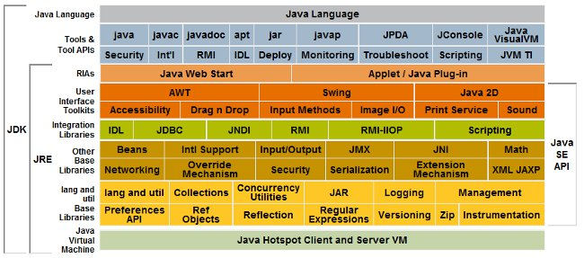

# Tema 6. Programació Modular

!!! danger "Resultat d'aprenentatge associat"
    <strong>RA4. Desenvolupa programes organitzats a classes analitzant i aplicant els principis de la programació orientada a objectes.</strong>

    ### Criteris d'avaluació
    - [x] RA4.3. S'han definit propietats i mètodes.
    - [x] RA4.5. S'han desenvolupat programes que instancien i utilitzin objectes de les classes creades anteriorment.
    - [x] RA4.8. S'han creat i utilitzat mètodes estàtics.

## Introducció
Abans de començar a parlar de classes i de com les podem desenvolupar en un llenguatge de programació com és Java, caldria primer explicar un dels orígens del paradigma de programació orientada a objectes: **la programació modular**

Anem a entrar en un món que es basa en la màxima: **"Divideix i venceràs"**. Si fem una analogia amb l'estratègia bèl·lica, podriem dir que en aquells casos que l'enemic és molt gran per a les nostres possibilitats, seria interessant poder, d'alguna forma, dividir-lo en trossos més xicotets de tal forma que el podem afrontar.

En conclusió, quan un programa comença a créixer, resulta cda vegada més difícil entendre'l, mantindre'l i modificar-lo. Una manera d'afrontar aquest problema és dividirl-lo en parts més menudes, cadascuna de les quals s'encarrega d'una tasca concreta.

Aquesta manera d'organitzar el codi s'anomena programació modular i es basa en la idea de «divideix i venceràs»: dividir un problema complex en problemes més senzills que puguem resoldre per separat.
    
!!! info "Què és?"
    La **programació modular** és una tècnica d'organització del programari que consisteix a dividir un programa en **mòduls** o parts més menudes, cadascuna de les quals resol una tasca concreta.

    L'objectiu és aconseguir programes més fàcils de comprendre, desenvolupar, provar i mantindre.

En l'aplicar la programació modular, un **problema complex** ha de ser dividit en **diversos subproblemes més simples**, i aquests al seu torn en altres subproblemes més simples encara. Això s'ha de fer fins a obtenir subproblemes prou simples com per poder ser resolts fàcilment amb algun llenguatge de programació. Aquesta tècnica es diu **refinament successiu, divideix i venceràs o anàlisi descendent (Top-Down).**

Un **mòdul** és una part diferenciada d'un programa que s'encarrega de realitzar una tasca concreta. Un programa pot estar format per diversos mòduls que col·laboren entre si per aconseguir un objectiu comú.

Cada mòdul hauria de tindre una responsabilitat ben definida i, sempre que siga possible, hauria de poder modificar-se sense haver de canviar la resta del programa.

Si bé un mòdul es pot entendre com una part d'un programa en qualsevol de les seves formes i variats contextos, en la pràctica se'ls sol prendre com a sinònims **de procediments i funcions**. Però no necessària ni estrictament un mòdul és una funció o un procediment, ja que el mateix pot contenir molts d'ells. No s'ha de confondre el terme "mòdul" (en el sentit de programació modular) amb termes com "funció" o "procediment", propis de l'llenguatge que ho suporte.

### Característiques
   - Divisió de responsabilitats: cada mòdul s'encarrega d'una tasca concreta.
   - Independència: els mòduls han de dependre el mínim possible els uns dels altres.
   - Reutilització: un mòdul pot utilitzar-se en diferents parts del programa.
   - Mantenibilitat: els canvis en un mòdul no haurien d'obligar a modificar-ne molts altres.

### Avantatges
  - El codi resultant és més net i fàcil d'entendre.
  - Facilita la detecció i correcció d'errors.
  - Permet reutiltzar parts del programa.
  - Facilita el treball en equip, ja que diferents persones poden treballar en parts diferents.
  - Facilita el manteniment i l'ampliació del programa.

###  Tipus de modularitat
En Java podem organitzar el codi de diferents maneres. En aquest tema començarem treballant amb els mètodes, que ens permeten agrupar instruccions relacionades amb una mateixa tasca i executar-les quan siga necessari.

Més avant, quan estudiem les classes i els objectes, veurem com podem utilitzar aquestes eines per organitzar programes més complexos.

Depenent del nivell de detall amb el que es tracten els mòduls, podem distingir tres tipus:

- **Llibreries:** conjunt de mètodes o de mòduls que comparteixen una finalitat.
- **Classes:** les classes són definicions de possibles objectes. Ja ho veurem amb més detall al tema de programació orientada a objectes.
- **Mètodes:** codi que realitza un funció concreta. Un mètode pot estar associat tant a una llibreria com a un classe.

## Mètodes en Java
En Java, una de les eines que ens permet organitzar el codi són els mètodes. Un mètode és un bloc d'instruccions que realitza una tasca concreta i que podem executar quan el necessitem mitjançant una crida.

Els mètodes ens permeten dividir un programa en parts més menudes, evitar repetir codi i facilitar-ne la lectura i el manteniment.

En aquest tema treballarem amb mètodes utilitzant Processing IDE. Encara que en els nostres esbossos els definim directament, en Java els mètodes formen part d'una classe.

Des del punt de vista tècnic els mètodes en Java:

- Tenen un nom que permet identificar-los i cridar-los.
- Poden agrupar diverses instruccions per resoldre una tasca concreta.
- Tenen **un tipus de retorn** (el valor que tornen, o void si no en retornen cap).
- Poden **rebre paràmetres**, que són dades d'entrada necessàries per executar l'acció.

### Sintaxi d'un mètode en Java
Però com s'escriu un mètode en Java:

```java linenums="1"
[acces] [modificador] tipusRetorn nomMetode([tipus nomArgument,[tipus nomParametre]...]) {

    /*
        * Bloc d'instruccions
    */

    return valor;
}
```

Veiem i expliquem que significa cadascun dels elements que formen el codi anterior.

!!! info "Què és què"
    Tots aquells elements que estan entre claudators són opcionals.<br>
    On: 

    - **accés:** public, protected, private o package
    - **modificador:** static o final
    - **tipusRetorn:** int, boolean, float o qualsevol tipus predefinit per l'usuari. void si no retorna res.
    - **nomMetode:** cadena alfanumèrica significativa que indique el que fa el mètode.
    - **nomParametre:** paràmetres que se li passen al mètode. Aquestos paràmetres funcionaran com variables locals al mètode.
    - **Cos:** Conjunt d'instruccions que executa el mètode.
    - **return:** retorna un valor del tipus indicat a la capçalera del mètode i finalitza l'execució del mètode.
    - Si el tipus de retorn del mètode és void, return no ha de retornar res.

Per acabar veiem exemples concrets de com s'implementen els mètodes en Java. El primer mètode el que fa és saludar dient "Hola món" cada vegada que s'utilitza. El segon diu "Hola" junt amb el nom que es passa com **argument** i finalment el tercer mètode el que fa és agafar la cadena de caracters que se li passa per **paràmetre** i la inverteix. Si no entens el que són paràmetres i arguments, no et preocupes, ho veurem al punt següent. 

Mira el següent exemple:

```java linenums="1"
// Mètode simple 
void diguesHola () {
    println("Hola Mon");
}

// Mètode amb paràmetres
void saludaAlMon (String strNom) {
    println("Hola Mon: " + strNom);
}

// Mètode que torna algun valor
String canviaNom (String text) {
    return strNom.reverse(text);
}
```

Un mètode pot executar instruccions sense retornar cap valor (void) o pot calcular un resultat i retornar-lo mitjançant return. En tots dos casos pot rebre paràmetres.

??? question "Activitat 601. Modularitza la taula de billar"
    === "Enunciat"
        El següent codi per a Processing IDE dibuixa una taula de billar amb dues boles negres, dues banques i dues roges. Modularitza el codi de tal forma que al mètode draw només hi haurà crides a mètodes definits per tu, concretament els següents mètodes: 
        
        - dibuixarTaula.
        - dibuixarBolesRoges.
        - dibuixarBolesNegres.
        - dibuixarBolesBlanques.

        Aquestos mètodes, al tractar-se de mètodes auxiliars, es deurien posar just a continuació del mètode draw.

        Al codi teniu també el **prototip** del mètode dibuixarTaula() com a exemple.

        ```java linenums="1"

            void setup () {
                size(640, 480);
                background(255);
            }

            void draw () {
                strokeWeight(20);
                stroke(170,120,20);
                fill(0,255,0);
                rect(30,30,500,330);
                
                fill(0);
                strokeWeight(1);
                stroke(200);
                circle(200,200,35);
                circle(400,60,35);
                
                stroke(0);
                fill(255,0,0);
                circle(100,100,35);
                circle(350,330,35);
                
                fill(255,255,255);
                circle(300,150,35);
                circle(150,300,35); 
            }

            void dibuixarTaula() {
                // Posa ací el codi que dibuixaria la taula de billar.
            }
        ```

    === "Rúbrica"
        | Ítem d'avaluació | 4 - Excel·lent | 3 - Correcte | 2 - Parcial | 1 - Incorrecte | 0 - Inexistent o incoherent |
		|---|---|---|---|---|---|
        | Compliment de l’enunciat | El programa compleix exactament l’enunciat: el draw() només conté crides als mètodes indicats i el resultat visual és correcte. | El resultat és correcte però queda alguna instrucció de dibuix fora dels mètodes o algun detall menor. | Modularitza parcialment el codi, però no segueix completament l’estructura demanada. | ntenta modularitzar però no compleix els requisits mínims. | No compleix l’enunciat. |
        | Definició i ús correcte de mètodes | Defineix correctament tots els mètodes demanats i els utilitza de forma clara i coherent. | Mètodes correctes però amb algun error menor (nom, ordre o redundància). | Mètodes incomplets o mal definits. | Ús incorrecte dels mètodes. | No defineix mètodes. | 
        | Organització del codi. Modularització. | Cada mètode fa exactament la funció que li pertoca (taula, boles per color). | Bona modularització però amb alguna barreja de responsabilitats. | Organització confusa o poc clara. | Modularització artificial o incorrecta. | Codi totalment desorganitzat. | 
        | Comentaris i documentació. | Comentari de documentació inicial i comentaris clars en cada mètode. | Comentaris correctes però incomplets. | Pocs comentaris o poc útils. | Comentaris molt pobres. | No hi ha comentaris. | 
        | Estil i qualitat del codi | Identació impecable, codi net, llegible i ben ordenat. | Algunes errades menors (espais, salts de línia, etc.). | Estil clarament millorable. | Codi difícil de llegir o mal alineat. | No segueix cap convenció. | 
        | Simplicitat del codi i semàntica | Codi simple i directe. Cada instrucció està al lloc que li correspon. | Algunes línies innecessàries o repetides. | Massa codi per a una tasca simple. | Codi artificiós o confús. | Totalment ineficient. | 

    === "Solució" 
        
        <center>📦 **Fitxer ZIP amb la solució completa**</center>

    	<center>[📥 Descarrega la solució](./assets/Tema5/act501.zip){ .md-button .md-button--secondary }</center>
        
        Encara no disponible
        
    
### Declaració i crida
Hem vist ja la gran part tècnica de com funcionen els mètodes en Java pel que fa a la part de sintaxis i les diferents paraules claus que s'utilitzen. En altres paraules, ja sabem construir mètodes tant des del **punt de vista tècnic** (com és construeixen), com des del **punt de vista semàntic** (què signifiquen) però, com fem ús d'aquestos mètodes?

Primer cal que distingim entre la declaració d'un mètode i la crida a aquest.

  - **Declaració d'un mètode:** definició del mètode on s'inclou tant la capçalera (interfície o prototip) i el cos (codi del mètode).
  - **Crida a un mètode:** ús del mètode per mitjà d'una crida a aquest utilitzant el prototip i els paràmetres en cas de tenir-los.
  - **Prototip, interfície o signatura:** la signatura d'un mètode és la combinació de nom, tipus de paràmetres, nom d'aquestos i ordre.

Per tal d'utilitzar un mètode en Java hem de **cridar** a aquest. Un mètode en Java es crida utilitzant el nom del mètode i entre parentesi s'han de passar els paràmetres que s'indica a la declaració del mètode. Aquestos paràmetres que es passen han de coincidir en número, si la declaració del mètode té 3 paràmetres s'hauran de passar tres paràmetres, i també han de coincidir en el títol.  Però millor vegem un exemple:

```java linenums="1"

/**
 * Mètode holaMon 
 * Mostra per pantalla hola + el nom que es passa com a argument
 * @param strNom cadena de caracters que representa el nom d'una persona
 * @return void
 */
void holaMon (String strNom) {
  println("Hola: " + strNom);
}
/**
 * Mètode suma
 * Retorna el valor de la suma dels elements que es passen com a arguments.
 * @param a primer element de la suma de tipus enter.
 * @param b segon element de la suma de tipus enter.
 * @return el resultat de la suma en forma entera
 */
int suma (int a, int b) {
  int res = a + b;
  return res;
}

// Crides a la funció holaMon
holaMon("Batiste");          
holaMon();                   
holaMon("Batiste","Ceba");   

// Crides a la funció suma
int resultat = suma(10,5);
suma(10,5);

int resultat = suma();
suma();
int res = suma (10,3,10);

```

Basat en el codi anterior, a continuació vos mostraré alguns errors típics de crides a mètodes.

```java linenums="1"
holaMon();             // Falta un argument
holaMon("Batiste", 2); // Sobra un argument
suma(10);              // Falta un argument
suma();                // Falten els dos arguments

```

??? question "Activitat 602. Resol problemes del codi anterior"
    === "Enunciat"
        Còpia el codi anterior, executa'l i raona el que està passant. Modifica el codi per tal que funcione correctament i mostre un resultat per pantalla.

    === "Rúbrica"
        | Ítem d'avaluació | 4 - Excel·lent | 3 - Correcte | 2 - Parcial | 1 - Incorrecte | 0 - Inexistent o incoherent |
		|---|---|---|---|---|---|
        | Compliment de l’enunciat | Identifica tots els errors, els corregeix i el programa funciona mostrant resultats correctes. | Corregeix els errors principals però queda algun cas sense resoldre. | Corregeix només una part dels errors o el programa funciona parcialment. | Intenta corregir però el programa continua sense funcionar. | No corregeix el codi o no funciona gens. |
        | Comprensió de les signatures dels mètodes | Entén perfectament el nombre i tipus de paràmetres, el valor de retorn i per què algunes crides són incorrectes. | Entén les signatures però té alguna confusió menor (ex. retorn no usat). | Confusió clara entre paràmetres, retorns i crides als mètodes. | Correccions fetes per prova-error, sense comprensió real. | No entén el funcionament dels mètodes ni les seues crides. | 
        | Correcció tècnica del codi | El codi és coherent, ben estructurat i sense redundàncies. | Codi correcte amb algun detall millorable. | Funciona però amb solucions poc netes o redundants. | Codi confús o amb errors potencials. | El codi no és executable. | 
        | Raonament i comentaris explicatius | Explica clarament per què fallava cada crida i com s’ha corregit. | Hi ha comentaris, però incomplets o poc clars. | Comentaris mínims o molt superficials. | Comentaris poc útils o incorrectes. | No hi ha cap explicació. | 
        | Estil i qualitat del codi | Codi net, ben indentat i amb identificadors correctes. | Algunes errades menors d’estil. | Estil irregular o poc cuidat. | Codi difícil de llegir. | No segueix cap convenció. | 
        | Simplicitat i adequació semàntica | Solucions simples, adequades i ben plantejades. | Alguna línia innecessària però correcte. | Solució artificiosa o massa complicada. | Solució confusa o poc coherent. | Totalment ineficient. | 

    === "Solució"
        
        <center>📦 **Fitxer ZIP amb la solució completa**</center>

    	<center>[📥 Descarrega la solució](./assets/Tema5/act502.zip){ .md-button .md-button--secondary }</center>
        
        Encara no disponible
        
        
??? question "Activitat 603. Crida als mètodes de forma correcta"
    === "Enunciat"
        Copia el codi que trobaràs a continuació. Aquest codi té quatre mètodes i el que has de fer és:
        
        - Escriu un mètode propi i crida'l des del draw.
        - Fes que el mètode quatre mostre el resultat per terminal.
        - Habilita el codi per tal que accepte caracters i numeros diferents a cada frame.
        - Observeu-les i després feu ús de totes elles des del mètode draw.

        ```java linenums="1"

        void setup () {
            size(640,480);
        }
        void draw () {
            // Escriu el codi dels mètodes ací.
        }

        void fesAlgo() {
            println("Algo faré");
        }

        void f2(int a) {
            if (a%2==0)
                println("El nombre és parell");
            else
                println("El nombre no és parell");
        }

        void metode3(int a, char c) {
            println("El caracter és " + c + " mentre que el número és: " + a);
        }
        int metode4(int c) {
            int a = 0;
            for (int i=0; i < c; i ++)
                a = a + 1 + 2*a;

            return a;
        }
        String metode5(String str) {
            if (str == "" )
                return "Buida";

            return str.toUpperCase();
        }

        ```
    === "Rúbrica"
        | Ítem d'avaluació | 4 - Excel·lent | 3 - Correcte | 2 - Parcial | 1 - Incorrecte | 0 - Inexistent o incoherent |
		|---|---|---|---|---|---|
        | Compliment de l’enunciat | Identifica tots els errors, els corregeix i el programa funciona mostrant resultats correctes. | Corregeix els errors principals però queda algun cas sense resoldre. | Corregeix només una part dels errors o el programa funciona parcialment. | Intenta corregir però el programa continua sense funcionar. | No corregeix el codi o no funciona gens. | 
        | Comprensió. Ús correcte de mètodes | Fa totes les crides correctament, respectant paràmetres, tipus i retorns. | Crides correctes amb algun error menor corregit posteriorment. | Diverses crides incorrectes o confusió amb els paràmetres. | Crides majoritàriament incorrectes. | No sap cridar els mètodes. | 
        | Correcció tècnica del codi | El codi és coherent, ben estructurat i sense redundàncies. | Codi correcte amb algun detall millorable. | Funciona però amb solucions poc netes o redundants. | Codi confús o amb errors potencials. | El codi no és executable. | 
        | Estil i qualitat del codi | Codi net, ben indentat i amb identificadors correctes. | Algunes errades menors d’estil. | Estil irregular o poc cuidat. | Codi difícil de llegir. | No segueix cap convenció. | 
        | Simplicitat i adequació semàntica | Solucions simples, adequades i ben plantejades. | Alguna línia innecessària però correcte. | Solució artificiosa o massa complicada. | Solució confusa o poc coherent. | Totalment ineficient. | 

    === "Solució"
        
        <center>📦 **Fitxer ZIP amb la solució completa**</center>

    	<center>[📥 Descarrega la solució](./assets/Tema5/act503.zip){ .md-button .md-button--secondary }</center>
        
        Encara no disponible
        
        
#### Detalls per cridar mètodes
- El **nom ha de coincidir** exactament al moment de cridar, és l’única forma d’identificar-lo.
- **L’ordre dels paràmetres** i el tipus ha de coincidir. 
- Cal tindre cura en el moment d'enviar els paràmetres, hem de fer-ho en el **mateix ordre** en que varen ser declarats i han de ser del **mateix tipus**.
- Cada paràmetre enviat també va separat per comes.
- Si un mètode **no rep paràmetres**, simplement no posem res a l'interior de la parèntesi, però sempre deguem posar la parèntesi.
- Invocar un mètode segueix sent **una sentència normal** i corrent en Java, així que ha de finalitzar amb ';' com sempre.
- El **valor retornat** per un mètode pot ser assignat a una variable del **mateix tipus**.
- Si es tracta d'un **procediment** no es pot retornar valor algú.
- Un mètode pot **cridar a una altra dins** de sí mateixa o fins i tot pot ser enviada com a paràmetre a una altra (mira el següent exemple).

??? question "Activitat 604. Modularitza el següent codi"
    === "Enunciat"
        Escriu el següent codi en Processing i executa'l. 

        ```java linenums="1"
        // Variables globals
        int x, y;
        void setup () {
            size(320,240);
            x = 150;
            y = 120;
        }

        void draw () {
            background(255);
            stroke(0);
            
            // Dibuixem la cara cercle
            strokeWeight(2);
            fill(255,255,0);
            circle(x,y,100);
            
            // Dibuixem ulls
            strokeWeight(2);
            fill(255);
            circle(130,110,20);
            circle(165,110,20);
            strokeWeight(5);
            point(133,110);
            point(168,110);
            
            // Dibuixem la boca
            noFill();
            strokeWeight(2);
            arc(150, 135, 40, 30, 0, PI);
        ```
        Aquest codi mostra el següent dibuix

        

        Separa el codi en mètodes, has d'afegir els mètodes dibuixaCara, dibuixaUlls i dibuixaBoca seguint els prototips que et mostre a continuació.

        ```java linenums="1"
            // Prototips de funcions
            void dibuixaCara();
            void dibuixaUlls();
            void dibuixaBoca();
        ```
    === "Rúbrica"
        | Ítem d'avaluació | 4 - Excel·lent | 3 - Correcte | 2 - Parcial | 1 - Incorrecte | 0 - Inexistent o incoherent |
		|---|---|---|---|---|---|
        | Compliment de l’enunciat | El codi final està totalment modularitzat tal com s’indica a l’enunciat; totes les parts estan correctament separades en mètodes. | Compleix la majoria del que es demana però falta algun mètode o detall menor. | Només explica parcialment què passa o oblida algun dels punts demanats. | Modularització mínima, incompleta o incorrecta. | No hi ha modularització. | 
        | Definició i ús de mètodes | Tots els mètodes definits correctament amb noms clars, paràmetres i retorns correctes; s’utilitzen adequadament al draw o a setup. | Alguns mètodes correctes amb errors menors en paràmetres, retorns o crides. | Múltiples errors en definició o ús dels mètodes. | Ús molt incorrecte o confús de mètodes. | No s’utilitzen mètodes. | 
        | Resultat final mostrat i millores | El programa mostra correctament el resultat final i, si s’escau, millores estètiques respecte al codi original. | El resultat és correcte amb petites millores. | Mostra només el resultat bàsic. | El resultat és incorrecte o incomplet. | No es mostra res rellevant. | 
        | Comentaris  | Comentaris útils a cada mètode i documentació clara al principi. | Hi ha comentaris, però incomplets o poc clars. | Comentaris mínims o molt superficials. | Comentaris poc útils o incorrectes. |  No hi ha cap explicació.| 
        | Estil i qualitat del codi | Codi net, ben indentat i amb identificadors correctes. | Algunes errades menors d’estil. | Estil irregular o poc cuidat. | Codi difícil de llegir. | No segueix cap convenció. | 
        | Simplicitat i adequació semàntica | Solucions simples, adequades i ben plantejades. | Alguna línia innecessària però correcte. | Solució artificiosa o massa complicada. | Solució confusa o poc coherent. | Totalment ineficient. | 

    === "Solució"
        
        <center>📦 **Fitxer ZIP amb la solució completa**</center>

    	<center>[📥 Descarrega la solució](./assets/Tema5/act505.zip){ .md-button .md-button--secondary }</center>
        
        Encara no disponible
        

### Sobre el return
Com ja hauràs vist, hi ha alguns mètodes que comencen per **void** i altres que tenen altres tipus... açò **el que torna** el mètode. Bàsicament la diferència entre una **funció i un procediment** des del punt de vista conceptual és si el mètode torna o no algun valor. Si torna és una funció sino és un procediment, però aquesta és només un qüestió conceptual ja que des del punt de vista tècnic (del codi) no hi practicament cap diferència entre funció i procediment a banda del fet que retornen un valor, en definitiva, **en Java tot són mètodes.**

Has de tenir en compte dues coses importants amb la sentència return:

- Qualsevol instrucció que es trobe després de l'execució de return, **NO serà executada.**
- És comú trobar mètodes amb **múltiples sentències return** al seu codi, com per exemple en sentencies condicionals, però una vegada el codi execute una sentència return allò que vinga després no s'executarà.
- El **tipus de valor que es torna** en un mètode ha de coincidir amb el tipus declarat al mateix, és a dir, si es declara int, el valor que ha de tornar ha de ser un nombre enter.
- En el cas dels mètodes que no tornen res **(void)**, també conegues com a procediments, poden usar la sentència **return però sense cap valor** i només s'usaria per acabar amb l'execució del mètode. 

### Funcions i procediments

```java linenums="1"
void setup () {
    size(640,480);        
}

void draw () {
    dibuixaSol();
    int abs = calculaAbsolut(-10);
    println("Abs: " + abs);
}

void dibuixaSol() {
    fill(255,0,0);
    stroke(0);
    strokeWeight(1);
    circle(320,240,40);
}

int calculaAbsolut (int a) {
    if (a < 0)
        a = a * -1;

    return a;
}
```

## Paràmetres a un mètode
Els **mètodes** en Java no només serveixen per poder dividir i simplificar el codi sino que també es poden **parametritzar**, és a dir, se li poden passar **arguments** que bé utilitzen en la seua lògica interna o bé modifiquen el comportament del mètode en qüestió.

Els mètodes no només permeten dividir un programa en parts més menudes, sinó que també poden rebre dades per adaptar el seu comportament a cada situació.

Aquestes dades es passen al mètode mitjançant els arguments de la crida, que són rebuts pels paràmetres definits en la declaració del mètode.

!!! info "Què és un paràmetre ?"
    Un paràmetre és una variable que es declara en la capçalera d'un mètode i que permet rebre una dada quan es fa una crida a aquest mètode.

    Els paràmetres permeten que un mateix mètode puga treballar amb dades diferents en cada crida, sense haver de modificar-ne el codi.

    Hi ha alguns detalls al respecte dels paràmetres d'un mètode:

```java linenums="1"
void saluda(String nom) {
    println("Hola " + nom);
}

void draw() {
    saluda("Anna");
    saluda("Pere");
}
```

### Característiques dels paràmetres
- Un mètode pot tindre zero, un o diversos paràmetres.
- Si té més d'un paràmetre, se separen amb comes.
- Cada paràmetre té un tipus i un nom.
- Els arguments proporcionats en la crida han de ser compatibles amb els tipus dels paràmetres corresponents.
- L'ordre dels arguments ha de correspondre amb l'ordre dels paràmetres.
- Dins del mètode, cada paràmetre es comporta com una variable local.

Si un mètode necessita una quantitat excessiva de paràmetres, pot ser un senyal que convé revisar-ne la responsabilitat o la manera com està organitzat.

### Un mètode amb paràmetres en Java
```java linenums="1"
void dibuixaCor (int posX, int posY, int tam, int col) {
  noStroke();
  fill(col);
  
  // Primer calculem els punts del triangle que formarà part del cor
  int t1x, t1y, t2x, t2y, t3x, t3y;
  t1x = posX-tam-1;
  t1y = posY-tam/2+2;
  t2x = posX+tam+1;
  t2y = posY-tam/2+2;
  t3x = posX;
  t3y = posY+tam;
  triangle (t1x, t1y, t2x, t2y, t3x, t3y);
  
  // Després  hem de calcular els centres dels dos cercles que formaran el nostre cor
  int c1x, c1y, c2x, c2y;
  c1x = posX-tam/2;
  c1y = posY-tam/2;
  c2x = posX+tam/2;
  c2y = posY-tam/2;
  circle(c1x, c1y, tam+3);
  circle(c2x, c2y, tam+3); 
  
  // Finalment dibuixem dos linies adicionals al triangle per que quede bé.
  stroke(255,0,0);
  strokeWeight(7);
  line(posX-tam+6, posY-tam/2+20, posX, posY+tam-5);
  line(posX+tam-6, posY-tam/2+20, posX, posY+tam-5);
}
```

El mètode anterior és un mètode, que si fem cas al nom, s'encarrega de dibuixar un cor. Aquest mètode té **quatre paràmetres:** 

- Un enter anomenat **posX** que representa la posició x on es dibuixarà el cor.
- Un enter amb nom **posY** que indica la posició y en la que es dibuixarà el cor.
- Un últim enter que es diu **tam** que li dirà al mètode quin serà el grandària del cor.
- UN últim enter que ens indica el **color** que tindrà el cor en format RGB.

Quan es crida un mètode, els valors que s'hi proporcionen s'anomenen arguments. Els arguments s'assignen als paràmetres corresponents segons l'ordre en què apareixen.

Els paràmetres es declaren entre els parèntesis de la capçalera del mètode i, dins del seu cos, es poden utilitzar com qualsevol altra variable local.

Un **paràmetre** està dins de l'abast del seu mètode, i a banda de la seva tasca especial de rebre un argument, actua com qualsevol altra **variable local**.

### Diferència entre paràmetre i argument
Ací hi ha un exemple simple de l'ús de paràmetres. Dins del programa següent podem observar com tenim un mètode 

```java linenums="1"
// Un exemple per diferenciar paràmetre d'argument

void setup () {
    size(640,480);
}

void draw () {
    int a = (int)random(-1000,1000);
    aboslut (a);
}

void absolut (int num) {
    int aux = num;
    if ( aux < 0)
        aux = aux*(-1);

    println("El valor absolut de " + num + " és: " + aux);
}

```

Com ja s'ha comentat anteriorment un mètode pot tenir **més d'un paràmetre.** Simplement declare cada paràmetre, separant un el següent amb una coma. Per exemple, la classe Divisor defineix un mètode anomenat esDivisor () que determina si el primer paràmetre és divisor de el segon.

### Mètodes amb més d'un paràmetre

```java linenums="1"
void setup () {
    size(640,480);
}

void draw() {
    int divisor = 5;
    int nombre = 20;

    if (esDivisor(divisor, nombre)) {
        println(divisor + " és divisor de " + nombre);
    } else {
        println(divisor + " no és divisor de " + nombre);
    }
}

boolean esDivisor(int divisor, int nombre) {
    return divisor != 0 && nombre % divisor == 0;
}
```

Comprova el codi anterior amb atenció i digues si hi ha algun mètode amb paràmetres. Quina i quins paràmetres.

Finalment dir que els arguments poden ser **literals**, que corresponguen amb el tipus del paràmetre, o també poden ser **variables**, però que passa amb les variables que es passen com a **argument** si el paràmetre al qual s'assignen és modificat en temps d'execució? Es modifiquen també? Mirem la diferència entre valor i referència.

??? question "Activitat 605. Modularitza dibuix lliure"
    === "Enunciat"
        Al tema anterior, quan estavem estudiant l'estructura seqüencial, a l'activitat 402 varem fer un dibuix lliure. Basant-te en aquesta activitat, modularitza codi seguint el que hem vist fins ara.

        Has de tindre en compte que arribats a aquest punt, hem vist mètodes parametritzables, per tant, és valorarà també en aquesta activitat l'ús de paràmetres i arguments.

    === "Rúbrica"
        | Ítem d'avaluació | 4 - Excel·lent | 3 - Correcte | 2 - Parcial | 1 - Incorrecte | 0 - Inexistent o incoherent |
		|---|---|---|---|---|---|
        | Compliment de l’enunciat | El dibuix està clarament modularitzat, s’han creat mètodes propis i s’han utilitzat paràmetres tal com es demana. | La modularització és correcta però incompleta o millorable (massa codi al draw o pocs mètodes). | S’ha intentat modularitzar però el resultat és parcial o confús. | Modularització mínima o incorrecta. | No hi ha modularització. | 
        | Definició i ús de mètodes | Mètodes ben definits, amb responsabilitats clares i cridats correctament des de draw o setup. | Mètodes correctes però amb alguna responsabilitat mal separada. | Mètodes poc clars, massa grans o poc coherents. | Ús incorrecte o artificial de mètodes. | No hi ha mètodes definits. | 
        | Ús de paràmetres i arguments | Ús adequat i significatiu de paràmetres (posició, color, mida, etc.). Reutilització clara del codi. | Paràmetres correctes però poc explotats o redundants. | Paràmetres mal escollits o poc útils. | Paràmetres innecessaris o incorrectes. | No s’utilitzen paràmetres. | 
        | Organització i semàntica del codi | Cada mètode fa exactament el que ha de fer. Bona separació entre configuració, dibuix i lògica. | Alguna responsabilitat fora de lloc, però globalment correcte. | Codi confús amb barreja de responsabilitats. | Codi mal organitzat i difícil d’entendre. | Total desordre semàntic. | 
        | Comentaris i documentació | Comentaris útils a cada mètode i documentació clara al principi. | Hi ha comentaris, però incomplets o poc clars. | Comentaris mínims o molt superficials. | Comentaris poc útils o incorrectes. | No hi ha cap explicació. | 
        | Estil i qualitat del codi | Codi net, indentació impecable, identificadors clars i sense soroll visual. | Alguna errada menor (salts de línia, espais, etc.). | Estil millorable amb errors visibles. | Codi difícil de llegir. | No segueix cap convenció. | 

    === "Solució"
        
        <center>📦 **Fitxer ZIP amb la solució completa**</center>

    	<center>[📥 Descarrega la solució](./assets/Tema6/act606.zip){ .md-button .md-button--secondary }</center>
        
        Encara no disponible
        

## Pas d'arguments en Java
Quan cridem un mètode, li podem passar dades mitjançant arguments. El mecanisme que determina com es transmeten aquestes dades s'anomena pas de paràmetres.

En alguns llenguatges de programació existeixen diferents mecanismes, com ara el pas per valor i el pas per referència.

En Java, tots els arguments es passen per valor. Això significa que el mètode rep una còpia del valor de cada argument.

El comportament depén del tipus de dada:
- **Tipus primitius:** es copia el valor de la variable. Els canvis que fem sobre el paràmetre no modifiquen la variable original.
- **Objectes:** es copia el valor de la referència a l'objecte. El mètode pot modificar l'estat de l'objecte original, però no pot canviar la referència que conserva la variable original.

!!! warning "Important"
    Que un mètode puga modificar un objecte rebut com a argument no significa que Java utilitze el pas per referència. El que es copia continua sent el valor de la referència.
        
### Pas per valor amb tipus primitius
Fixa't en el següent codi:

```java linenums="1"
    void setup () {
        size (640,480);
    }
    void draw () {
		
		int a = 1;
		int b = 2;
		print("Valors de a i b abans de la modificació: ");
		println(" a = " + a + " ; b = " + b );
		modificaTipusPrimitius(a,b);
		print("Valors de a i b després de la modificació: ");
		println(" a = " + a + " ; b = " + b );
	}
 

    void modificaTipusPrimitius(int x, int y) {
		x = 5;
		y = 10;
	}
```

??? question "Activitat 606. Comprendre funcions amb tipus primitius"
    === "Enunciat"
        Copia el codi anterior en Processing IDE i respon a les següents qüestions:

        1. Quins són els paràmetres i de quin tipus són els del mètode modificaTipusPrimitius?
        2. Quantes vegades es crida al mètode modificaTipusPrimitius?
        3. Quins argument es passen a cada crida?
        4. Què passa i per què a l'executar-se el codi anterior?
        5. Com es passen els arguments en Java? Explica què passa amb els valors de les variables originals i per què.
        6. Dibuixa un diagrama on s'explique que està passant a la pila de crides (stack).

    === "Rúbrica"
        | Ítem d'avaluació | 4 - Excel·lent | 3 - Correcte | 2 - Parcial | 1 - Incorrecte | 0 - Inexistent o incoherent |
		|---|---|---|---|---|---|
        | Quins són els paràmetres i tipus del mètode? | Perfecte | Notable | Bé | Insuficient | Apartat no realitzat | 
        | Quantes vegades es crida al mètode? | Perfecte | Notable | Bé | Insuficient | Apartat no realitzat | 
        | Quins arguments es passen en cada crida? | Perfecte | Notable | Bé | Insuficient | Apartat no realitzat | 
        | Què passa i per què a l'executar-se el codi anterior? | Perfecte | Notable | Bé | Insuficient | Apartat no realitzat | 
        | Com es passen els arguments en Java? Explica què passa amb els valors de les variables originals i per què. | Perfecte | Notable | Bé | Insuficient | Apartat no realitzat | 
        | Dibuixa un diagrama on s'explique que està passant a la pila de crides (stack). | Perfecte | Notable | Bé | Insuficient | Apartat no realitzat | 

    === "Solució"
        
        1. Els paràmetres són x i y i el seu tipus és int
        2. Es crida una sola vegada al draw
        3. A la crida es passen els arguments a i b que són variables locals al mètode draw.
        4. Passa que els valors originals d'a i b no es modifiquen ja que són tipus bàsics.
        5. Per valor, si es passaren per referència es mantindrien els canvis.
        
        Encara no disponible
        


??? question "Activitat 607. Comprendre el pas d'arrays com a arguments"
    === "Enunciat"
        Passa el següent codi a processing, executa'l i raona el que està passant. Quin altre nom alternatiu li podriem posar al mètode per tal que aquest siga més significatiu?

        Per què canvia el contingut de l'array, però no el valor de la variable i, si tots dos s'han passat per valor?

        ```java linenums="1"
        void setup () {
            size(640,480);
            int i = 10;
            int [] array = new int[10];
            for (int a = 0; a < i; a ++ )
                array[a] = 0;

            println("Abans de la crida a la funció:");
            println("i=" + i );
            println("array[5]=" + array[5] );
            metode(i,array);
            println("Després de la crida a la funció:");
            println("i=" + i );
            println("array[5]=" + array[5] );
        }

        void draw () {
            noLoop();
        }

        void metode(int i, int [] array) {
            i = 5;
            array[i] = 15;
        }
        ```
    === "Rúbrica"
        | Ítem d'avaluació | 4 - Excel·lent | 3 - Correcte | 2 - Parcial | 1 - Incorrecte | 0 - Inexistent o incoherent |
		|---|---|---|---|---|---|
        | Compliment de l’enunciat | Ha executat el codi, ha raonat correctament el comportament, ha explicat el pas per valor i referència i ha proposat un nom alternatiu coherent per a la funció. | Compleix quasi tot: explicació correcta però incompleta o nom alternatiu millorable. | Només explica parcialment què passa o oblida algun dels punts demanats. | Explicació molt superficial o incorrecta. | No respon a l’activitat o no hi ha raonament. | 
        | Comprensió del pas per valor i per referència | Explica clarament que i no canvia perquè es passa perquè és un tipus primitiu. L’array sí canvia perquè es passa la referència a aquest. Relaciona el canvi amb la memòria i els efectes laterals. | Entén la diferència però amb alguna explicació imprecisa o poc profunda. | Intueix què passa però confon conceptes o no els justifica bé. | Explicació errònia del mecanisme. | No entén ni explica el pas per valor ni per referència. | 
        | Proposta de nom alternatiu per a la funció | El nou nom és molt significatiu i descriu clarament l’efecte de la funció | Nom correcte però millorable semànticament. | Nom massa genèric o poc clar. | Nom inadequat o confús. | No proposa cap nom alternatiu. | 
        | Comentaris i raonament escrit | Comentari clar, ben estructurat, explica què passa abans i després de la crida i el perquè. | Hi ha comentaris, però incomplets o poc clars. | Comentaris mínims o molt superficials. | Comentaris poc útils o incorrectes. | No hi ha cap explicació. | 
        | Estil i qualitat del codi | Codi net, ben indentat i amb identificadors correctes. | Algunes errades menors d’estil. | Estil irregular o poc cuidat. | Codi difícil de llegir. | No segueix cap convenció. | 
        | Simplicitat i adequació semàntica | Solucions simples, adequades i ben plantejades. | Alguna línia innecessària però correcte. | Solució artificiosa o massa complicada. | Solució confusa o poc coherent. | Totalment ineficient. | 

    === "Solució"
        
        <center>📦 **Fitxer ZIP amb la solució completa**</center>

    	<center>[📥 Descarrega la solució](./assets/Tema5/act504.zip){ .md-button .md-button--secondary }</center>
        
        Encara no disponible
        

??? question "Activitat 608. Modifica dibuixaCor"
    === "Enunciat"
        Crea un projecte en Processing on s'utilitze el mètode dibuixaCor on uns dels paràmetres són dos float que ens indiquen la posició central del cor. Modifica el mètode canviant els dos float (posX i posY) per un objecte de la classe PVector.

        Una vegada hages fet el canvi, modifica els components x i y del PVector rebut com a paràmetre. Observa què passa amb la posició del cor i explica per què els canvis també es reflecteixen en l'objecte utilitzant en la crida.

        Què és el que passa? Et recomane que uses el depurador per tal que pugues seguir amb més detall el que està passant.
    
    === "Rúbrica"
        | Ítem d'avaluació | 4 - Excel·lent | 3 - Correcte | 2 - Parcial | 1 - Incorrecte | 0 - Inexistent o incoherent |
		|---|---|---|---|---|---|
        | Compliment de l'enunciat | El mètode s’ha modificat correctament per usar un PVector, el projecte compila i funciona tal com es demana. | El canvi a PVector està fet però amb algun detall menor incorrecte o poc elegant. | El codi està parcialment modificat però no compleix tot l’enunciat. | La modificació és incorrecta o incompleta. | No s’ha fet la modificació demanada. | 
        | Ús correcte de Pvector com a paràmetre | El PVector s’utilitza correctament per accedir a les coordenades i substituir totalment els antics paràmetres posX i posY. | Ús correcte del PVector, però amb alguna redundància o ús poc òptim. | Ús confús o parcial del Pvector. | El PVector s’utilitza de manera incorrecta. | No s'ha fet aquest apartat | 
        | Modificació del PVector dins del mètode i resultat observat | Es modifica el PVector dins del mètode i es mostra clarament l’efecte d’aquesta modificació en el programa. | El PVector es modifica, però l’efecte no està del tot clar o no s’explota completament. | Es modifica el PVector però el resultat és confús o incorrecte. | La modificació no té efecte observable. | No es modifica el Pvector. | 
        | Raonament i explicació del que passa | L’alumne explica correctament què passa i per què, fent referència al pas de paràmetres per referència. | Explicació correcta però superficial o poc precisa. | Explicació parcial o amb errades conceptuals. | Explicació molt pobra o incorrecta. | No hi ha cap explicació. | 
        | Comentaris i documentació | Comentaris útils a cada mètode i documentació clara al principi. | Hi ha comentaris, però incomplets o poc clars. | Comentaris mínims o molt superficials. | Comentaris poc útils o incorrectes. | No hi ha cap explicació. | 
        | Estil i qualitat del codi | Codi net, indentació impecable, identificadors clars i sense soroll visual. | Alguna errada menor (salts de línia, espais, etc.). | Estil millorable amb errors visibles. | Codi difícil de llegir. | No segueix cap convenció. | 

    === "Solució"
        
        <center>📦 **Fitxer ZIP amb la solució completa**</center>

    	<center>[📥 Descarrega la solució](./assets/Tema5/act508.zip){ .md-button .md-button--secondary }</center>
        
        Encara no disponible
        

Ara mira el següent codi:

```java linenums="1"
    Persona juan;

    void setup () {
        size(640,480);

        juan = new Persona ();
        modificarPersona(juan);
    }

    void draw () {
        
        println("Nom: "    + juan.strNom);
        println("Cognom: " + juan.strCognom);
        println("Edat: "   + juan.edat);
        noLoop ();
    }

    void modificarPersona (Persona p) {
        p.strNom    = "Manolo";
        p.strCognom = "Unodos";
        p.edat      = 18;
    }

    public class Persona {
        public String strNom;
        public String strCognom;
        public int edat;
    }
```

??? question "Activitat 609. Raona les següents qüestions"
    === "Enunciat"
        Copia el codi anterior i respon a les següents qüestions:

        1. Quins són els paràmetres i de quin tipus són els de la funció modificaPersona?
        2. Quantes vegades es crida a la funció modificaPersona?
        3. Quins argument es passen a cada crida?
        4. Què passa i per què a l'executar-se el codi anterior?
        5. Com es passa l'argument juan al mètode? Per què els canvis que es fan sobre els atributs de p es reflecteixen en juan?

    === "Rúbrica"
        | Ítem d'avaluació | 4 - Excel·lent | 3 - Correcte | 2 - Parcial | 1 - Incorrecte | 0 - Inexistent o incoherent |
		|---|---|---|---|---|---|
        | Compliment de l'enunciat | Ha copiat, executat el codi i ha respost totes les qüestions plantejades. | Ha respost totes les qüestions però amb algun detall menor incorrecte o incomplet. | Ha respost només part de les qüestions. | Les respostes són molt incompletes o no s’ajusten al codi. | No ha realitzat l’activitat o no respon les qüestions. | 
        | Identificació de paràmetres i arguments | Identifica correctament el paràmetre (Persona p), el seu tipus i l’argument passat a la crida. | Identificació correcta però amb explicació superficial. | Identificació parcial o amb errades conceptuals. | Confusió clara entre paràmetres i arguments. | No identifica correctament paràmetres ni arguments. | 
        | Anàlisi del nombre de crides al mètode | Indica correctament quantes vegades es crida el mètode i ho justifica pel comportament de draw(). | Indica correctament el nombre però sense justificar-lo. | Nombre incorrecte o justificació errònia. | Resposta molt confusa. | No respon la qüestió. | 
        | Explicació del comportament del programa | Explica clarament què passa en executar-se el programa i per què es modifiquen els atributs de l’objecte. | Explicació correcta però incompleta o poc precisa. | Explicació parcial amb errades conceptuals. | Explicació molt pobra o incorrecta. | No hi ha cap explicació. | 
        | Comprensió del pas de paràmetres | Identifica correctament que es passa una referència a un objecte i ho explica adequadament. | Identifica correctament el tipus de pas però amb una explicació superficial. | Resposta amb confusions parcials. | Confusió clara en el pas d'arguments en Java | No respon o la resposta és incorrecta. | 
        | Qualitat de l'expressió i ús de comentaris | Respostes clares, ben redactades i comentaris ben integrats al codi. | Respostes correctes però poc desenvolupades. | Expressió confusa o comentaris molt breus. | Comentaris pobres o difícils d’entendre. | No hi ha comentaris ni explicacions. | 

    === "Solució"
        
        1. Es passa un paràmetre amb identificador p de tipus Persona.
        2. Una vegada al draw
        3. En la crida al mètode es passa l'argument juan
        4. Al tractar-se d'un objecte el paràmetre de la funció, els canvis que es produeixen dins del mètode es mantenen.
        5.  Per referència ja que les modificacions dins del codi del mètode es mantenen després de l'execució d'aquest.
        
        Encara no disponible
        

### Pas d'objectes a funcions
Quan passem un objecte com a argument d'un mètode, Java en copia el valor de la referència. Això significa que el paràmetre i la variable utilitzada com a argument contenen referències al mateix objecte.

Per tant, si dins del mètode modifiquem els atributs de l'objecte, aquests canvis també es reflectiran en l'objecte original. En canvi, si assignem un objecte diferent al paràmetre, aquesta assignació no modificarà la referència de la variable original.

Quan creem una variable d'un tipus de classe, declarem una variable que pot emmagatzemar una referència a un objecte. L'objecte es crea quan utilitzem l'operador new. Quan passem aquesta variable com a argument a un mètode, es copia el valor de la referència.

!!! warning "Important"  
    Java sempre passa els arguments per valor. Quan passem un objecte, es copia el valor de la referència. Això permet modificar l'estat de l'objecte des del mètode, però no modificar la referència de la variable original.

Però vejam un exemple per tal que quede més clar:

```java linenums="1"
// Programa Java per demostrar el pas d'objectes a funcions

void setup() {
    size(640, 480);

    Demo ob1 = new Demo(100, 22);
    Demo ob2 = new Demo(100, 22);
    Demo ob3 = new Demo(-1, -1);

    println("ob1 == ob2: " + ob1.equalTo(ob2));
    println("ob1 == ob3: " + ob1.equalTo(ob3));

    ob1.modifica(ob2);

    println("Després de modificar ob2:");
    println("ob1 == ob2: " + ob1.equalTo(ob2));
    println("ob2.a: " + ob2.a);
    println("ob2.b: " + ob2.b);

    noLoop();
}

class Demo {
    public int a;
    public int b;
    
    // Constructor de la classe
    Demo (int i, int j) {
        a = i;
        b = j;
    }

    // Torna true si els valors són els mateixos
    boolean equalTo(Demo obj) {
        return (obj.a == this.a && obj.b == this.b);
    }

    void modifica (Demo obj) {
        obj.a = 2*obj.a;
        obj.b = 2*obj.b;
    }
}
```

Eixida

```java linenums="1"
obj1 == obj2: true
obj1 == obj3: false
```

Explicació en imatges:

**1.Primer:** S'instancien els tres objectes ob1, ob2 i ob3.

```java linenums="1"
Demo ob1 = new Demo(100, 22);
Demo ob2 = new Demo(100, 22);
Demo ob3 = new Demo(-1, -1);
```

<center></center>

**2. Segon:** En declarar el mètode equalTo, definim el paràmetre obj, de tipus Demo. Aquest paràmetre rebrà una còpia de la referència de l'objecte que es proporcione com a argument en cada crida.

<center></center>

**3. Tercer:** Quan executem ob1.equalTo(ob2), es copia el valor de la referència continguda en ob2 al paràmetre obj. Per tant, tant ob2 com obj permeten accedir al mateix objecte.

```java linenums="1"
System.out.println("ob1 == ob2: " + ob1.equalTo(ob2));
```

<center></center>

**4. Quart:** Ara com podem observar, es crida al mètode equalTo sobre 'ob1' i 'obj' fa referència a 'ob2'. Donat que els valors 'a' i 'b' són els mateixos per ambdues referències, aleshores si la condició és veritat, tornarà **true**.

```java linenums="1"
if(obj.a == a && obj.b == b)
```

**5. Cinquè:** De nou 'obj' es reassignarà a 'ob3' quan s'executa la següent sentència com s'ha fet al pas tercer.
  
```java linenums="1"
System.out.println("ob1 == ob3: " + ob1.equalTo(ob3));
```

<center></center>

**6. Sisè:** Ara, com podem observar, el mètode equalTo es crida en 'ob1', i 'obj' fa referència a 'ob3'. Com que els valors 'a' i 'b' no són els mateixos per a les dues referències, aleshores torna false.

## Mètodes amb i sense valor de retorn

```java linenums="1"
void setup() {
  size(600, 400);

  println("----- EXEMPLES DE MÈTODES SENSE VALOR DE RETORN -----");

  // Procediment sense paràmetres
  saluda();

  // Procediment amb paràmetres
  dibuixaPunt(100, 100);

  println("----- EXEMPLES DE MÈTODES AMB VALOR DE RETORN -----");

  // Funció sense paràmetres que retorna un valor
  int nombreAleatori = generaNumero();
  println("Nombre aleatori: " + nombreAleatori);

  // Funció amb paràmetres que retorna un valor
  int suma = sumaDosNumeros(3, 5);
  println("Suma de 3 + 5 = " + suma);

  // Funció amb paràmetres que retorna un booleà
  boolean esMajor = esMajorEdat(20);
  println("És major d'edat? " + esMajor);

  // Ús del valor retornat per prendre decisions
  if (esMajorEdat(15)) {
    println("Pot entrar");
  } else {
    println("No pot entrar");
  }

  noLoop();
}

void draw() {
  // No fem servir draw en aquest exemple
}

/*-------------------------------------------------
 PROCEDIMENTS (Mètodes que no retornen valor)
-------------------------------------------------*/

// Procediment sense paràmetres
void saluda() {
  println("Hola! Açò és un procediment sense paràmetres.");
}

// Procediment amb paràmetres
void dibuixaPunt(int x, int y) {
  stroke(0);
  strokeWeight(10);
  point(x, y);
  println("He dibuixat un punt en (" + x + ", " + y + ")");
}

/*-------------------------------------------------
 FUNCIONS (Mètodes que retornen un valor)
-------------------------------------------------*/

// Funció sense paràmetres
int generaNumero() {
  return int(random(1, 11)); // Retorna un número entre 1 i 10
}

// Funció amb paràmetres
int sumaDosNumeros(int a, int b) {
  int resultat = a + b;
  return resultat;
}

// Funció amb paràmetres que retorna un booleà
boolean esMajorEdat(int edat) {
  return edat >= 18;
}

```

En Java, tots aquests blocs són mètodes. Segons el valor que retornen, podem distingir entre:
- Mètodes sense valor de retorn: utilitzen void i no retornen cap resultat. Tradicionalment, també s'anomenen procediments.
- Mètodes amb valor de retorn: indiquen el tipus de dada que retornen (int, boolean, float, String, etc.) i utilitzen return per proporcionar el resultat. Tradicionalment, també s'anomenen funcions.

El valor retornat es pot guardar en una variable, utilitzar en una expressió o emprar directament en una condició.

??? question "Activitat 610. Analitza els mètodes"
    === "Enunciat"
        És el moment de revisar tots els conceptes vistos fins ara que no són pocs. Revisa el codi anterior i respon a les següents qüestions:

        1. Quants mètodes hi han al codi? (draw i setup no compten)
        2. Identifica el nom de cadascun tenen?
        3. Escriu la declaració de cada mètode, indicant-ne el tipus de retorn, el nom i els paràmetres.
        4. Classifica cada mètode segon si retorna valor o no.
        5. Completa una taula com aquesta:
        
        | Mètode | Tipus de retorn | Paràmetres | Classificació |
        |--------|-----------------|------------|---------------|
        | ** | ** | ** | ** |

    === "Rúbrica"
        | Ítem d'avaluació | 4 - Excel·lent | 3 - Correcte | 2 - Parcial | 1 - Incorrecte | 0 - Inexistent o incoherent |
		|---|---|---|---|---|---|
        | Quants mètodes hi ha al codi? | Perfecte | Imprecís | Parcial | Incorrecte | No respon | 
        | Quin identificador tenen? | Perfecte | Imprecís | Parcial | Incorrecte | No respon | 
        | Escriu el prototip o interfície | Perfecte | Imprecís | Parcial | Incorrecte | No respon | 
        | Quants paràmetres tenen els mètodes? Quin identificador tenen? Quin tipus són? | Perfecte | Imprecís | Parcial | Incorrecte | No respon | 
        | Quins són funcions i quins procediments | Perfecte | Imprecís | Parcial | Incorrecte | No respon | 
        | Classificació | Perfecte | Imprecís | Parcial | Incorrecte | No respon | 

    === "Solució"
        
        1. Dos.
        2. dibuixaSol i calculaAbsolut
        3. void dibuixaSol() i int calculaAbsolut(int a).
        4. Mètode dibuixaSol té zero paràmetres mentre que calculaAbsolut té un paràmetre amb identificador a de tipus int
        5. dibuixaSol és un procediment (no retorna res) mentre que calculaAbsolut és una funció que retorna un enter.
        
        Encara no disponible
        

??? question "Activitat 611. Paràmetres coordenades"
    === "Enunciat"
        Modifica el codi de l'activitat 605 per tal que tant el codi que dibuixa els ulls com el codi que dibuixa la boca, estiguen en dos mètodes: dibuixaUlls i dibuixaBoca. A aquestes funcions se'ls passarà com a paràmetres les coordenades x i y i a partir d'aquestos ha de dibuixar els ulls i la boca on corresponga.

        ```java linenums="1"
            // Prototips de les funcions
            void dibuixaCara(int x, int y);
            void dibuixaUlls(int x, int y);
            void dibuixaBoca(int x, int y);
        ```

        **Important:** Les funcions no han de dependre de variables globals i aquestes s'haurien d'eliminar.

    === "Rúbrica"
        | Ítem d'avaluació | 4 - Excel·lent | 3 - Correcte | 2 - Parcial | 1 - Incorrecte | 0 - Inexistent o incoherent |
		|---|---|---|---|---|---|
        | Compliment de l'enunciat | El codi està correctament modularitzat amb dibuixaUlls(x,y) i dibuixaBoca(x,y) i funciona com s’espera. | El codi funciona però falta algun detall menor de modularització o precisió. | Només una part està correctament modularitzada. | La modularització és incorrecta o incompleta. | No compleix l’enunciat. | 
        | Ús correcte de paràmetres i arguments | Les funcions utilitzen correctament els paràmetres x i y per calcular totes les coordenades de manera relativa. | Ús correcte dels paràmetres però amb alguna coordenada fixa o poc general. | Els paràmetres s’usen parcialment; encara hi ha dependències implícites. | Els paràmetres quasi no s’usen o s’usen malament. | No hi ha ús real de paràmetres. | 
        | Independència de les funcions (no ús de variables globals) | Les funcions són totalment independents i no depenen de cap variable global. | Hi ha alguna dependència menor però el funcionament és correcte. | Dependència clara de variables globals. | Les funcions no poden funcionar sense globals. | No s’han creat funcions independents. | 
        | Organització i modularització del codi | Codi ben estructurat: draw() només crida mètodes, responsabilitats ben separades. | Bona estructura però amb alguna responsabilitat mal situada. | Modularització millorable o confusa. | Codi desorganitzat. | No hi ha cap estructura modular clara. | 
        | Comentaris i documentació | Comentaris clars que expliquen què fa cada funció i com usa les coordenades. | Comentaris correctes però incomplets. | Pocs comentaris o poc útils. | Comentaris molt pobres. | No hi ha comentaris. | 
        | Estil i qualitat del codi | Identació impecable, noms clars, codi net i llegible. | Algunes errades menors d’estil. | Estil irregular i clarament millorable. | Codi desordenat o difícil de llegir. | No segueix cap convenció. | 

    === "Solució"
        
        <center>📦 **Fitxer ZIP amb la solució completa**</center>

    	<center>[📥 Descarrega la solució](./assets/Tema5/act511.zip){ .md-button .md-button--secondary }</center>
        
        Encara no disponible
        

??? question "Activitat 612. Dibuixar cares - Ampliació"
    === "Enunciat"
        Amplia el programa anterior per a dibuixar les tres cares que es mostren en la imatge. Cada cara tindrà una forma exterior diferent, però compartirà els mateixos mètodes per a dibuixar els ulls i la boca.

        Modifica el programa perquè draw() s'encarregue de coordinar el dibuix de les tres cares, cridant els mètodes corresponents i passant-los les coordenades de cada cara.

        <center></center>

        ```java linenums="1"        
        void setup () {
            size(640,300);
        }

        void draw () {
            background(255);
            int cercleX, cercleY, triangleX, triangleY, quadratX, quadratY;
            // Coordenades del cercle
            cercleX = 150;
            cercleY = 150;

            // Coordenades del primer punt del triangle
            triangleX = 320;
            triangleY = 150;

            // Coordenades del quadrat
            quadratX = 470;
            quadratY = 150;

            // Codi per dibuixar el cercle
            // Escriu el codi necessari per dibuixar el cercle a cercleX i cercleY ací
            dibuixaUlls(cercleX,cercleY);
            dibuixaBoca(cercleX,cercleY);

            // Codi per dibuixar el triangle
            // Escriu el codi necessari per dibuixar el cercle a triangleX i triangleY ací
            dibuixaUlls(triangleX,triangleY);
            dibuixaBoca(triangleX,triangleY);

            // Codi per dibuixar el quadrat
            // Escriu el codi necessari per dibuixar el cercle a quadratX i quadratY ací
            dibuixaUlls(quadratX,quadratY);
            dibuixaBoca(quadratX,quadratY);
        }
        ```

    === "Rúbrica"
        | Ítem d'avaluació | 4 - Excel·lent | 3 - Correcte | 2 - Parcial | 1 - Incorrecte | 0 - Inexistent o incoherent |
		|---|---|---|---|---|---|
        | Compliment de l'enunciat | Es dibuixen correctament les tres cares: cercle groc, triangle morat i quadrat blau, amb ulls i boca. | Es dibuixen totes les cares però amb algun detall incorrecte (forma, color o posició). | Només es dibuixen correctament una o dues cares. | El resultat no s’ajusta clarament a l’enunciat. | No compleix l’enunciat. | 
        | Definició i ús correcte de funcions | Les funcions dibuixaUlls, dibuixaBoca, dibuixaCercle, dibuixaTriangle i dibuixaQuadrat estan ben definides i s’utilitzen correctament. | Totes les funcions existeixen però alguna és millorable o massa específica. | Falten funcions o hi ha codi duplicat. | Modularització molt deficient. | No hi ha ús real de funcions. | 
        | Ús correcte de paràmetres (coordenades) | Totes les funcions treballen amb coordenades passades per paràmetre de manera relativa. | Ús correcte dels paràmetres però amb algun valor fix innecessari. | Dependència parcial de variables globals. | Ús incorrecte dels paràmetres. | No es fan servir paràmetres de manera efectiva. | 
        | Reutilització i coherència del codi | Les funcions d’ulls i boca s’utilitzen de manera coherent per a totes les cares. | Reutilització correcta però amb algun detall redundant. | Reutilització limitada o inconsistent. | Poc o cap reaprofitar del codi. | Tot el codi està duplicat. | 
        | Comentaris i documentació | Comentaris clars que expliquen què fa cada funció i com usa les coordenades. | Comentaris correctes però incomplets. | Pocs comentaris o poc útils. | Comentaris molt pobres. | No hi ha comentaris. | 
        | Estil i qualitat del codi | Identació impecable, noms clars, codi net i llegible. | Algunes errades menors d’estil. | Estil irregular i clarament millorable. | Codi desordenat o difícil de llegir. | No segueix cap convenció. | 

    === "Solució"
        
        <center>📦 **Fitxer ZIP amb la solució completa**</center>

    	<center>[📥 Descarrega la solució](./assets/Tema5/act512.zip){ .md-button .md-button--secondary }</center>
        
        Encara no disponible
        
        
??? question "Activitat 613. Dibuixar peça domino"
    === "Enunciat"
        Emplena el codi de la funció dibuixaDomino(int,int) per tal que mostre la imatge següent.

        ```java linenums="1"
        void setup() {
            size(640,480);
        }
        void draw  () {
            dibuixaDomino(5,4);
        }

        void dibuixaDomino(int a, int b) {   
            // Codi per dibuixar la peça de dominó amb la puntuació que es passa per paràmetre.
        }
        ```

        <center></center>

        **Restricció:** has d'utilitzar bucles per a dibuixar els punts de cada meitat de la peça. No pots dibuixar cada punt mitjançant una crida independent a ellipse().

    === "Rúbrica"
        | Ítem d'avaluació | 4 - Excel·lent | 3 - Correcte | 2 - Parcial | 1 - Incorrecte | 0 - Inexistent o incoherent |
		|---|---|---|---|---|---|
        | Implementació funcional del dominó | La fitxa de dominó es dibuixa correctament: dos quadres diferenciats, separació clara i nombre de punts exacte segons a i b. | El dominó es dibuixa quasi correctament, amb algun detall visual menor (alineació, proporció, separació). | Es reconeix la fitxa però hi ha errors clars en la distribució o nombre de punts. | El dibuix és incomplet o no representa una fitxa de dominó funcional. | No es dibuixa el dominó o el codi no funciona. | 
        | Ús correcte de paràmetres | Els valors a i b s’utilitzen correctament per determinar els punts del quadre superior i inferior. | Els paràmetres s’utilitzen però amb alguna confusió menor. | Només s’utilitza correctament un dels paràmetres. | Els paràmetres quasi no s’utilitzen o s’ignoren. | No s’utilitzen els paràmetres. | 
        | Ús obligatori de bucles | S’utilitzen bucles de manera clara i correcta per dibuixar tots els punts del dominó. | S’utilitzen bucles però amb algun ús redundant o millorable. | Ús parcial de bucles (alguns punts amb codi repetit). | Ús mínim o inadequat de bucles. | No s’utilitzen bucles (incompliment de la restricció). | 
        | Organització i modularització del codi | Tot el codi de dibuix està correctament encapsulat dins de dibuixaDomino. | Lleugera dispersió del codi, però estructura clara. | Part del codi està fora del mètode sense justificació. | Mala organització del codi. | No es respecta l’estructura modular. |
        | Comentaris i documentació | Comentaris clars que expliquen què fa cada funció i com usa les coordenades. | Comentaris correctes però incomplets. | Pocs comentaris o poc útils. | Comentaris molt pobres. | No hi ha comentaris. | 
        | Estil i qualitat del codi | Identació impecable, noms clars, codi net i llegible. | Algunes errades menors d’estil. | Estil irregular i clarament millorable. | Codi desordenat o difícil de llegir. | No segueix cap convenció. | 

    === "Solució"
        
        <center>📦 **Fitxer ZIP amb la solució completa**</center>

    	<center>[📥 Descarrega la solució](./assets/Tema5/act513.zip){ .md-button .md-button--secondary }</center>
        
        Encara no disponible
        

??? question "Activitat 614. Dibuixar peça dominó parametritzada"
    === "Enunciat"
        Què passa si en lloc de 5 i 4 passarem 6 i 6 per paràmetre? Dibuixa el que esperes que dibuixe? 

        Fes les modificacions necessàries al codi per tal que funcione com s'espera. 

        **Ampliació:** fes que el teu algorisme mostre totes les peces del dominó ordenades en files i columnes.

    === "Rúbrica"
        | Ítem d'avaluació | 4 - Excel·lent | 3 - Correcte | 2 - Parcial | 1 - Incorrecte | 0 - Inexistent o incoherent |
		|---|---|---|---|---|---|
        | Compliment de l'enunciat | El programa dibuixa totes les peces del dominó correctament, ordenades i sense repeticions. | Es dibuixen quasi totes les peces o hi ha algun petit error d’ordre. | Es dibuixen algunes peces però no totes. | Modularització molt pobra o artificial. | No compleix l’enunciat. | 
        | Modularització del codi | Codi clarament modularitzat: funcions ben definides, reutilitzables i amb responsabilitats clares. | Bona modularització, però amb alguna funció massa gran o amb codi duplicat. | Modularització parcial o poc clara. | Els paràmetres quasi no s’utilitzen o s’ignoren. | No hi ha modularització. | 
        | Ús de paràmetres i generalització | Les funcions són totalment parametritzades i independents de valors concrets. | Parametrització correcta però amb alguna dependència innecessària. | Paràmetres mal utilitzats o poc generals. | Ús testimonial dels paràmetres. | No s’utilitzen paràmetres correctament. | 
        | Ús d’estructures de control | Ús correcte i eficient de bucles per generar totes les peces. | Bucles correctes però amb alguna redundància. | Ús limitat o confús dels bucles. | Bucles incorrectes. | No s’utilitzen bucles. | 
        | Organització visual i disposició en pantalla | Peces ben alineades en files i columnes, amb espaiat coherent. | Disposició correcta però millorable. | Disposició poc clara. | Peces solapades o mal distribuïdes. | No hi ha una disposició coherent. | 
        | Estil, comentaris i qualitat del codi | Identació impecable, bons noms d’identificadors i comentaris útils. | Codi llegible amb algun detall d’estil millorable. | Estil inconsistent o comentaris escassos. | Codi difícil de llegir. | No segueix cap convenció. | 

    === "Solució"
        
        <center>📦 **Fitxer ZIP amb la solució completa**</center>

    	<center>[📥 Descarrega la solució](./assets/Tema5/act514.zip){ .md-button .md-button--secondary }</center>
        
        Encara no disponible
        


## Recursivitat

!!! info "Definició"
    La recursivitat és una tècnica de programació en què un mètode es crida a si mateix per a resoldre un problema.

    Perquè un mètode recursiu funcione correctament, necessita dos elements:

    - Condició de base: determina quan ha d'acabar la recursivitat. En aquest cas, el mètode retorna un resultat sense tornar-se a cridar.
    - Crida recursiva: el mètode es torna a cridar amb uns arguments que apropen el problema a la condició de base.

    Si no s'arriba mai a la condició de base, les crides poden continuar fins que es produïsca un desbordament de la pila (Stack Overflow).

    L'exemple clàssic de recursivitat és el càlcul del **factorial** d'un nombre. El factorial d'un nombre N és el producte de tots els nombres enters que es troben entre 1 i N. Per exemple, el factorial de 3 és 1 × 2 × 3, és a dir, és de 6.

    El següent programa mostra una forma recursiva de calcular el factorial d'un nombre. Per a propòsits de comparació, també s'inclou un equivalent no recursiu (iteratiu).

```java linenums="1"
void setup () {
    size(640,480);
}

void draw () {
    println("Factorial utilitzant un mètode recursiu:");
    println("El factorial de 3 és: "+factorialRecursiu(3));
    println("El factorial de 6 és: "+factorialRecursiu(6));
    println();
    println("Factorial utilitzant un mètode iteratiu:");
    println("El factorial de 3 és: "+factorialIteratiu(3));
    println("El factorial de 6 és: "+factorialIteratiu(6));
    println();

}

int factorialRecursiu (int n) {
    int res;

    if (n == 0) 
        return 1;

    res = factorialRecursiu(n-1)*n;

    return res;

}

int factorialIteratiu (int n) {
    int t, res;

    res=1;
    for (t=1; t<=n; t++) 
        res *=t;
        
    return res;
}
```

Eixida

```java linenums="1"
Factorial utilitzant un mètode recursiu:
El factorial de 3 és: 6
El factorial de 6 és: 720

Factorial utilitzant un mètode iteratiu:
El factorial de 3 és: 6
El factorial de 6 és: 720
```

!!! danger "Stack Overflow"
    Cada vegada que un mètode es crida, es reserva un espai en la pila d'execució per a guardar informació de la crida, com ara els paràmetres i les variables locals.

    En un mètode recursiu, cada nova crida necessita un nou espai en aquesta pila. Si es fan massa crides sense arribar a la condició de base, la pila pot esgotar la capacitat disponible i Java provocarà un error anomenat StackOverflowError.

    Per això, és fonamental que tot mètode recursiu tinga una condició de base i que cada crida recursiva avance cap a aquesta condició.

Com l'emmagatzematge per als paràmetres i les variables locals està a la pila i cada trucada nova crea una nova còpia d'aquestes variables, és possible que **la pila s'acabe esgotant**. Si això passa, el sistema de temps d'execució (run-time) de Java causarà una **excepció**. No obstant això, probablement no hauràs de preocupar-te per això a menys que una rutina recursiva es torne boja.

### Avantatges de la recursivitat

La recursivitat permet expressar alguns algorismes d'una manera més clara i natural. És especialment útil quan un problema es pot dividir en problemes més menuts de la mateixa naturalesa.

No obstant això, la recursivitat no sempre és la millor solució. En alguns casos, una versió iterativa pot ser més eficient i consumir menys memòria, ja que no necessita acumular tantes crides a la pila.

```java linenums="1"
int fact(int n)
{
    // Condició de base equivocada (provoca Stack Overflow)
    if (n == 100) 
        return 1;
    else
        return n*fact(n-1);
}
```

Si cridem fact(10), les crides successives seran fact(9), fact(8), fact(7)... El valor de n cada vegada és més menut, de manera que mai arribarà a 100.

Com que no s'assoleix la condició de base, el mètode continuarà fent crides recursives fins que s'esgote la pila d'execució i es produïsca un StackOverflowError.

## La API de Java

L'API Java és una interfície de programació d'aplicacions (API, per les seves sigles de l'anglès: Application Programming Interface) proveïda pels creadors de el llenguatge de programació Java, que dóna als programadors els mitjans per desenvolupar aplicacions Java.

Com el llenguatge Java és un llenguatge orientat a objectes, l'API de Java proveeix d'un conjunt de classes utilitàries per a efectuar tota mena de tasques necessàries dins d'un programa.

L'API Java està organitzada en paquets lògics, on cada paquet conté un conjunt de classes relacionades semànticament.

<center>
    
</center>

## La API de Processing IDE
Com ja varem explicar als temes anteriors, Processing IDE és un entorn de desenvolupament dissenyat per l'experimentació artística des d'un punt de vista tecnològic, per tant, la API de Processing o les llibreries de Processsing IDE són una amalgama de funcions de dibuix, múltimèdia i altres. Algunes d'aquestes funcions les podeu veure a la següent taula o també podeu accedir directament al [Manual de referència de Processing IDE](https://processing.org/reference/)


| Prototip                         | Descripció                                                                 | Exemple d'ús                             |
|--------------------------------------|--------------------------------------------------------------------------------|----------------------------------------------|
| `point(x, y)`                        | Dibuixa un punt en la posició `(x, y)`                                        | `point(100, 100);`                           |
| `line(x1, y1, x2, y2)`               | Dibuixa una línia des de `(x1, y1)` fins a `(x2, y2)`                         | `line(50, 50, 150, 150);`                    |
| `rect(x, y, w, h)`                   | Dibuixa un rectangle amb cantonada superior esquerra `(x, y)`                | `rect(100, 100, 80, 60);`                    |
| `square(x, y, s)`                    | Dibuixa un quadrat de costat `s` en la posició `(x, y)`                       | `square(50, 50, 40);`                        |
| `ellipse(x, y, w, h)`                | Dibuixa una el·lipse centrada en `(x, y)`                                     | `ellipse(120, 120, 60, 80);`                 |
| `circle(x, y, d)`                    | Dibuixa un cercle centrat en `(x, y)` amb diàmetre `d`                        | `circle(200, 200, 50);`                      |
| `arc(x, y, w, h, start, stop)`       | Dibuixa un arc dins d’una el·lipse                                            | `arc(100, 100, 80, 80, 0, PI);`              |
| `triangle(x1, y1, x2, y2, x3, y3)`   | Dibuixa un triangle amb els tres punts especificats                          | `triangle(30, 75, 58, 20, 86, 75);`          |
| `quad(x1, y1, x2, y2, x3, y3, x4, y4)`| Dibuixa un quadrilàter amb quatre punts                                       | `quad(38, 31, 86, 20, 69, 63, 30, 76);`       |
| `beginShape()` / `endShape()`        | Defineix una forma complexa personalitzada amb vèrtexs                        | `beginShape(); vertex(30, 20); ... endShape();` |
| `vertex(x, y)`                       | Defineix un punt en una forma personalitzada                                  | `vertex(60, 40);` (dins de `beginShape`)     |
| `fill(r, g, b)`                      | Defineix el color de farciment per a les formes                               | `fill(255, 0, 0);`                           |
| `stroke(r, g, b)`                    | Defineix el color del contorn de les formes                                   | `stroke(0, 0, 255);`                         |
| `noFill()`                           | Elimina el color de farciment                                                 | `noFill();`                                  |
| `noStroke()`                         | Elimina el contorn de les figures                                             | `noStroke();`                                |
| `background(r, g, b)`                | Estableix el color de fons del canvas                                         | `background(240, 240, 240);`                 |
| `text(str, x, y)`                    | Mostra text en la posició especificada                                        | `text("Hola món", 100, 200);`                |
| `textSize(size)`                     | Defineix la mida del text                                                     | `textSize(32);`                              |
| `textAlign(alignX, alignY)`          | Alineació horitzontal i vertical del text                                     | `textAlign(CENTER, CENTER);`                |
| `image(img, x, y)`                   | Mostra una imatge a la posició `(x, y)`                                       | `image(myImage, 0, 0);`                      |

