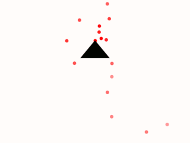
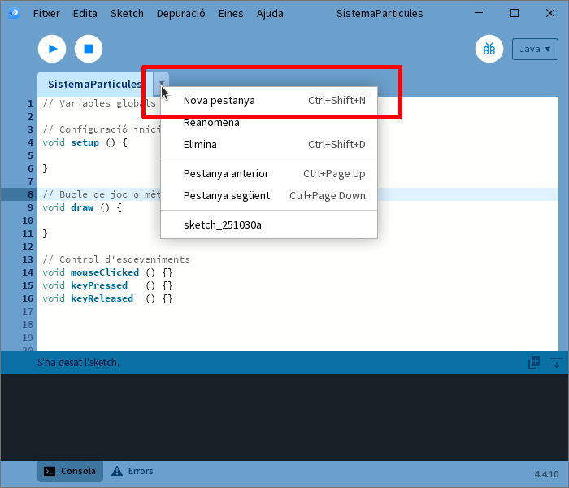
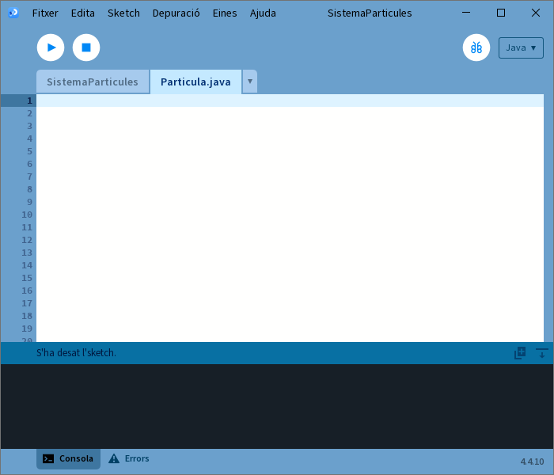
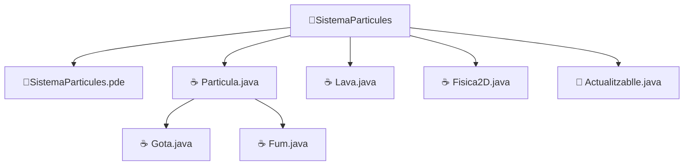

# Tema 7. Desenvolupament de classes

!!! danger "Resultat d'aprenentatge associat"
    <strong>RA4. Desenvolupa programes organitzats a classes analitzant i aplicant els principis de la programació orientada a objectes.</strong>

    ### Criteris d'avaluació
    - [x] RA4.1. S'ha reconegut la sintaxi, estructura i components típics d'una classe.
    - [x] RA4.2. S'han definit classes.
    - [x] RA4.3. S'han definit propietats i mètodes.
    - [x] RA4.4. S'han creat constructors.
    - [x] RA4.5. S'han desenvolupat programes que instancien i utilitzin objectes de les classes creades anteriorment.
    - [x] RA4.6. S'han utilitzat mecanismes per controlar la visibilitat de les classes i dels seus membres.
    - [x] RA4.7. S'han definit i utilitzat classes heretades.
    - [x] RA4.8. S'han creat i utilitzat mètodes estàtics.
    - [x] RA4.9. S'han definit i utilitzat interfícies.
    - [x] RA4.10. S'han creat i utilitzat conjunts i llibreries de classes.
    
## Introducció 
Una vegada hem vista la sintaxi de Java, l'ús (instanciació) d'objectes i  com funcionen els mètodes, funcions, procediments, crides etc.. ja tenim tot el necessari per poder començar a desenvolupar les nostres pròpies classes a Java.

## Radiografia d'una classe Java

!!! success "Criteris d'avaluació associats"
    - [x] RA4.1. S'ha reconegut la sintaxi, estructura i components típis d'una classe.

Una **classe és la definició d’un objecte**, és l’element que descriu els components d’un objecte de forma general. Diem que hem creat un objecte quan donem valors i utilitzem els components definits a la classe. Dit d'una altra forma, una classe és el model o plantilla que defineix com seran els objectes que en derivem. És a dir, estableix què saben (atributs) i què poden fer (mètodes). Els objectes són, doncs, instàncies concretes d’una classe.

Per entendre la sintaxi i estructura d’una classe en Java (i també a Processing), convé distingir les seues parts principals:

- **Nom de la classe:** s'escriu amb majúscula inicial per convenció.
- **Atributs:** variables que defineixen l'estat de la classe.
- **Constructor (s):** mètode especial que permet crear (instanciar) objectes inicialitzant atributs.
- **Mètodes:** accions que poden fer els objectes de la classe.
- **Comentaris i documentació:** és bona pràctica descriure què fa cada part de la classe.

Veien un exemple genèric de com seria una classe en notació **UML**

<center>
    ```mermaid
        classDiagram
        direction TB

        class Cotxe {
            - String color atribut1
            - int velocitat
            + Cotxe(String c, int v)
            + void arrancar()
            + void accelerar()
            + void frenar()
        }
            
    ```
</center>

A l'esquema anterior hem definit una classe amb nom **Cotxe** que té dos **atributs**: color i velocitat; un **constructor**: Cotxe i tres **mètodes**: arrancar, accelerar i frenar.

Però estudiem un exemple més concret. Per tal de veure com és el desenvolupament de classes en programació orientada a objectes, quina és la seua sintaxi, estructura i components típics, el que farem serà un xicotet projecte amb un **sistema de partícules** en forma de volcà com mostra la imatge:

<center>
    
</center>

Un **sistema de partícules** és una tècnica de programació gràfica utilitzada per simular fenòmens formats per molts  elements petits i independents (anomenats partícules) que, en conjunt, generen un efecte visual complex.

Cada **partícula** és un objecte amb propietats pròpies (posició, velocitat, color, vida, etc.) que determinen **l'estat** de l'objecte i regles de funcionament general (com es mou, com es dissipa, com canvia al llarg del temps) que determinen el **comportament** de la classe.

Un **sistema de partícules** gestiona un conjunt d’aquestes partícules:

- **Creació:** genera noves partícules segons unes condicions (per exemple, cada frame).
- **Actualització:** calcula l’estat de cada partícula (moure’s, canviar d’opacitat, reduir vida...).
- **Dibuix:** mostra totes les partícules a la pantalla.
- **Eliminació:** descarta les partícules que ja han “mort” o superat la seua vida útil.

Els exemples més típics de sistemes de partícules són: foc, fum, nuvols, pluja, neu, focs d'artifici...

En definitiva un **sistema de partícules** és, doncs, un algorisme orientat a objectes que permet simular fenòmens complexos mitjançant la suma de molts elements simples, gestionats de manera conjunta però amb comportament individual.

Però abans de passar a la implementació del nostre sistema de partícules, unes quantes pinzellades breus de com es desenvolupa un projecte de programació orientada a objectes.

### Realització de programes orientats a objectes
A partir d’ara, quan hajam de resoldre un problema hem de començar a **pensar d’una forma diferent** a la que estàvem fent fins ara. En programació orientada a objectes seguirem usant els mecanismes de programació estructurada com ara sentències repetitives, alternatives, etc.. tanmateix hem de plantejar un sistema on les dades presenten una major importància.

**L’objectiu de l’orientació a objectes** és plasmar la realitat de manera que programem els elements el més pròxim possible a com els veiem al seu entorn natural. Així, quan hajam d’encarar un problema d’aquest tipus:

- Ens preguntarem sobre aquells elements dels que realment es interessant emmagatzemar informació, és a dir, **localitzarem els possibles objectes** del nostre programa.
- De cada element hem de conèixer quines són les seues **característiques** o quines són les característiques que el representen.
- De cada element hem de conèixer les **operacions a realitzar**, accions que hi poden fer,  ja que cada conjunt de dades permetrà la realització d’un conjunt d’operacions.
- Finalment, desenvoluparem un entorn on utilitzarem els elements configurats.

??? question "Activitat 601. Dissenya la teua partícula"
    === "Problema"
        Dissenya una classe partícula seguint les indicacions dels apunts i l'exemple anterior. Si o saps per on començar pots basar-te en l'exemple de partícula del volcà ja que al final són molt semblants.

        **Entregar:** Document pdf que continga el disseny UML de la classe i una breu reflexió de les motivacions.

    === "Rúbrica"
        | Ítem d'avaluació                                | 4 (Excel·lent)                                                                 | 3 (Adequat)                                          | 2 (Bàsic)                       | 1 (Insuficient)               | 0 (No assolit)      | Pes     |
        | ----------------------------------------------- | ------------------------------------------------------------------------------ | ---------------------------------------------------- | ------------------------------- | ----------------------------- | ------------------- | ------- |
        | **Identificació d'atributs** | Identifica tots els atributs clau d’una partícula, ben triats i coherents amb el problema  | Identifica la majoria d’atributs necessaris, amb alguna absència menor | Identifica pocs atributs o alguns no són rellevants | No identifica correctament els atributs o són incoherents | No hi ha atributs | **20%** |
        | **Identificació de mètodes** | Proposa mètodes adequats que descriuen clarament el comportament de la partícula | Proposa mètodes bàsics correctes, encara que incomplets | Proposa algun mètode però amb poca claredat o adequació | No identifica mètodes o no corresponen al comportament | No els identifica per a res | **20%** |
        | **Distinció entre atributs i mètodes** | Diferencia clarament i correctament entre informació (atributs) i comportament (mètodes) | Diferencia correctament en general, amb algun error puntual | Confusió parcial entre atributs i mètodes | No diferencia atributs i mètodes | No hi ha diferència | **20%** |
        | **Coherència del disseny** | El disseny és lògic, complet i representa bé una classe Particula | El disseny és coherent però millorable o incomplet | El disseny és poc coherent o poc realista | El disseny no representa correctament una classe | No té coherència amb l'especificació | **20%** |
        | **Ús del vocabulari POO** | Utilitza correctament i amb precisió termes com classe, atribut, mètode | Utilitza el vocabulari bàsic amb algun error menor | Ús molt limitat o incorrecte del vocabulari | No utilitza vocabulari propi de la POO | No hi ha res al respecte | **20%** |

    === "Solució"
        
        <center>
        ```mermaid
            classDiagram
            direction TB

            class Particula {
                posicio;
                direccio;
                velocitat;
                velocitatEscalar;
                profunditat;
                llarg;
                pinta;
                
                mostrar()
                actualitzar()
            }
                
        ```
        </center>
        
        Aquesta solució s'activarà **quan acabem el tema**.

        👉 Ara és el moment de:
    
        - Pensar 🧠  
        - Provar 💻  
        - Equivocar-se (i aprendre!) 🔁  

        Quan dominem el contingut, **el bloqueig desapareixerà** 🚀
        


## Definició de classes en Java

!!! success "Criteris d'avaluació associats"
    - [x] RA4.2. S'han definit classes

Per poder definir una classe ens hem de basar en l'esquema general de classe vist a l'apartat **Radiografia d'una classe en Java** per poder construir-la i d'una altra banda, ens hem de fixar també en l'apartat de **Realització de programes orientats a objectes**. Com haviem dit, hem de localitzar primer quines són les característiques que representen l'objecte que es vol implementar així com les operacions o accions que hi pot realitzar.

Al sistema de particules la classe que pretenem modelar inicialment és la classe **particula**. Per tal de modelar des del punt de vista de la programació orientada a objectes i com varem a veure en apartats anteriors, consistiria en quedar-nos amb aquells detalls que siguen rellevants i desestimar els que no tenen importància. Des del meu punt de vista una particula tindria les següents característiques:

- Té dimensions.
- Té una velocitat inicial.
- Té color.
- Està en una posició.
- Va en una direcció.

Respecte de les accions que una particula pot realitzar són:

- S'ha de mostrar per pantalla
- Actualitza la seua posició en el temps, en altres paraules, es mou.
- Li afecta la gravetat i les lleis de la física general.

Una vegada hem fet aquest procés d'abstracció i hem decidit què es representarà al nostre sistema i què no, hem de dissenyar la nostra classe usant UML, concretament diagrama de classes:

<center>
    ```mermaid
        classDiagram
        direction TB

        class Particula {
            posicio;
            direccio;
            velocitat;
            grandaria;
            pinta;
            
            mostrar()
            actualitzar()
        }
            
    ```
</center>

D'aquest disseny de la classe **particula** ja podem començar a picar el codi del nostre projecte, però abans algunes consideracions prèvies associades a l'entorn integrat de desenvolupament escollit (Processing IDE) i les seues particularitats.

L'anàlisi i el disseny formen part del procés de desenvolupament abans de començar a codificar. Una vegada tenim l'abstracció feta i el diagrama UML, passem a la fase d'implementació.

Tot projecte desenvolupat amb Processing IDE (igual que altres IDEs) necessita d'un punt d'entrada, fitxer principal o **main**. Aquest fitxer principal o main és el que conté els mètodes setup, draw, i tots els controladors d'esdeveniments i també serà el lloc des del qual es farà ús de les classes i objectes que formaran part del projecte. En altres paraules, el que hem estat fent fins ara amb les activitats realitzades en Processing IDE. Per últim i no menys important, és en aquest fitxer en el que s'executen totes les ordres de dibuix a l'sketch.

```java linenums="1"
    // Variables globals

    // Configuració inicial de l'aplicació
    void setup () {

    }

    // Bucle de joc o mètode draw
    void draw () {

    }

    // Control d'esdeveniments
    void mouseClicked () {}
    void keyPressed   () {}
    void keyReleased  () {}
    // Altres esdeveniments
    
```
    
Aquest codi és el que conté el punt d'entrada principal a l'aplicació és el que donarà nom al projecte, per tant tindrà el mateix nom que la carpeta que el conté. Crea el teu projecte de particules i guarda'l amb el nom **SistemaParticules**.

Una vegada ja tenim el nostre projecte creat s'afegirien les classes necessàries. En el nostre cas tindrem una unica classe que es diu **Particula**. Aquesta acció resultarà en un nou fitxer dins del projecte que s'acaba de crear. Per tal de crear aquesta classe realitza les següents accions:

<center>
    
</center>

Si es fa clic amb el ratolí el que es marca a la imatge anterior ens apareixeran les següents opcions: "Nova pestanya", "Reanomena", "Elimina", "Pestanya Anterior", "Pestanya següent" ... Hem d'escollir l'opció **Nova Pestanya** i al diàleg que apareixerà li posarem **Particula.java**, el nom de la classe que volem crear. El resultat final serà que el nostre editor del Processing IDE tindrà dues pestanyes: el main que hem anomenat SistemaParticules i la classe Particula.java. 

<center>
    
</center>

!!! danger "Compte amb l'extensió de la classe Partícula"
    Fixa't que el nom de la classe partícula té extensió java i no pde. Això és molt important.
    
    Veiem-ho amb més detall. Processing IDE usa un tipus de classe que fa ús dels PApplets (o Applets de Processing IDE) per poder dibuixar per exemple amb les funcions de dibuix que ens ofereix l'API de Processing IDE. Per tant té algunes limitacions.

    El problema que tenim és que si la nostra classe Particula és .pde no podrem treballar amb mètodes i atributs estàtics sense convertir tota la classe en estàtica cosa no que no seria viable. Però si l'opció que escollim finalment és guardar la nostra particual com a "Particula.java" ens trobarem en que ja no podem usar mètodes de dibuix de Processing IDE. 

    Convertir la classe Particula.pde a Particula.java. Sí que podem posar atributs i mètodes estàtics però no poden fer ús de les funcionalitat de la llibreria de Processing IDE com les de dibuix, per tant el mètode mostrar ja no funcionaria.

    Pareix ser que hem arribat a un carreró sense eixida, però encara ens queda una última opció que és passar-li l'sketch (PApplet) a la classe partícula quan ho necessitem.

A partir d'ara ja podem començar a escriure el codi de la nostra classe Particula basant-nos en les fases d'anàlisi i disseny anteriors. Però primer vegem quina és la sintaxi del llenguatge Java per a implementar classes.

```java linenums="1"
    // Imports a altres llibreries

    class NomClasse {
        // Atributs: característiques que defineixen l’estat de la classe
        // Constructor: mètode que s'executa quan es crea un nou objecte de la classe
        // Mètodes: accions que defineixen el comportament de la classe
    }
``` 

Al nostre cas la nostra classe inicial en Java podria ser la següent:

```java linenums="1"
    // Aquestes llibreries seran necessàries per poder usar elements de la llibreria de Processing IDE
    import processing.core.PApplet; 
    import processing.core.PVector;

    class Particula {
        
    }
```

??? question "Activitat 602. Crea un projecte en Processing IDE"
    === "Problema"
        Crea un projecte amb Processing IDE com s'ha explicat en aquest apartat amb nom **"SistemaParticules"**. Aquest projecte ha de tindre dos fitxers: el principal o main de l'entorn de desenvolupament i un altre que contindrà la futura classe **"Particula.java"**  que havies dissenyat a l'activitat anterior. 

        Per tal de no repetir el mateix resultat del volcà que farem com a exemple el resultat que obtindreu serà una pluja. Les particules en el vostre cas seran gotes de pluja que cauen des des totes les posicions de l'eix y superior en diferents direccions, velocitats i tamanys.

    === "Rúbrica"
        | Ítem d'avaluació                                | 4 (Excel·lent)                                                                 | 3 (Adequat)                                          | 2 (Bàsic)                       | 1 (Insuficient)               | 0 (No assolit)      | Pes     |
        | ----------------------------------------------- | ------------------------------------------------------------------------------ | ---------------------------------------------------- | ------------------------------- | ----------------------------- | ------------------- | ------- |
        | **Creació del projecte** | Projecte creat correctament en Processing IDE amb el nom indicat | Projecte creat amb algun detall menor incorrecte | Projecte creat però no segueix completament les indicacions | Projecte incorrecte | No hs'ha creat cap projecte | **10%** |
        | **Estructura de fitxers** | Conté exactament SistemaParticules.pde i Particula.java | Conté els fitxers amb alguna incorrecció menor | Falta algun fitxer o hi ha fitxers incorrectes | Estructura incorrecta | No hi ha estructura de projecte | **15%** |
        | **Definició inicial de la classe Particula** | La classe està creada i reflecteix fidelment el disseny de l’activitat 601 | La classe està creada però amb petites incoherències | Classe incompleta o poc coherent amb el disseny | Classe incorrecta | No existeix la classe | **15%** |
        | **Separació entre main i classe** | Separació clara de responsabilitats | Separació correcta amb confusions puntuals | Confusions freqüents | Tot el codi està barrejat | No es diferencia cap responsabilitat | **20%** |
        | **Estil del codi** | Codi net, ben indentat i amb noms correctes | Estil generalment correcte | Estil irregular | Estil incorrecte | Codi il·legible o inexistent | **15%** |
        | **Comentaris** | Javadoc correcte en classe i mètodes i combinat amb comentaris pel codi | Javadoc incomplet però present. Només principal i mètodes | Només a la classe però no al main o a l'inrevés | Comentaris poc útils | No hi ha comentaris | **15%** |
        | **Coherència amb el sistema de partícules (pluja)** | Sistema clarament orientat a gotes de pluja | Idea de pluja recognoscible | Plantejament confús | No s’entén el sistema | No hi ha cap intent de sistema | **15%** |

    === "Solució"
        
        <center>📦 **Fitxer ZIP amb la solució completa**</center>

    	<center>[📥 Descarrega la solució](./assets/Tema6/act602.zip){ .md-button .md-button--secondary }</center>
        
        Aquesta solució s'activarà **quan acabem el tema**.

        👉 Ara és el moment de:
    
        - Pensar 🧠  
        - Provar 💻  
        - Equivocar-se (i aprendre!) 🔁  

        Quan dominem el contingut, **el bloqueig desapareixerà** 🚀
        

## Propietats i mètodes de les classes

!!! success "Criteris d'avaluació associats"
    - [x] RA4.3. S'han definit propietats i mètodes.

Però com pot veure aquesta definició de classe és un poc pobra i falten encara moltes coses, concretament falten **atributs** i **mètodes**.

!!! info "Recordatori"
    Un **atribut** és una característica de l'entitat que es vol representar i **determinen l'estat** dels objectes de la classe.
    
    Els **metodes** són els procediments o funcions que **condicionen el comportament** dels objectes de la classe.

### Atributs

Els atributs en **Programació Orientada a Objectes** l'atribut d'una classe és (salvant les distàncies) en programació orientada a objectes com una variable en programació procedimental.  Per tant ja podem intuir que definir atributs a una classe en java és com declarar, en certa manera, una variable en programació estructurada clàssica. Recordeu que una varible en java es fa de la següent forma:

```java linenums="1"
    // Declaració d'una variable en Java
    // tipusBase identificador [= valorInicial];

    int i;
    float b = 0f;
    String nom;
```

Tornem al nostre sistema de particules. Segons el diagrama de classes de l'apartat anterior, la nostra particula tenia les següents característiques: posicio, direccio, velocitat, pinta, grandaria. Ara es tracta de convertir aquestes característiques en atributs de la classe **Particula** i com que hem dit que un atribut és molt semblant a la declaració d'una variable en programació procedimental, el que hem de fer primer és trobar-los un tipus de dades adequat a cada identificador. 

Sembla prou evident que posició serà un PVector, direcció també (encara que aquest no siga tan evident), velocitat podria ser un float, pinta pot ser de tipus **color**, un tipus que ens proporciona l'API de Processing IDE i finalment grandaria pot ser un enter.

Una vegada decidits els tipus de dades que s'associaran a les propietats de la nostra classe ja podem començar a escriure el codi dels atributs de la classe **Particula**

```java linenums="1"
    import processing.core.PApplet; 
    import processing.core.PVector;

    class Particula {
        PVector posicio;     // Vector de posició de la partícula (on està)
        PVector direccio;    // Direcció en la que s'està movent la partícula (normalitzat)
        PVector vel;         // Vector de velocitat
        float   velocitat;   // Velocitat escalar (magnitud) de la partícula
        int     pinta;       // Color amb que es pinta la partìcula (format ARGB 0xFFFFFFF)
        int     grandaria;   // Diametre de la partícula (al volcà seran cercles)
    }
```

!!! warning "Full d'estils"
    Fixa't que en la declaració dels atributs i referent a l'estil en el que s'intentarà escriure codi en aquest curs, no hi ha sempre un sol espai entre tipus de dades i identificador sino que s'escriuen en dos columnes diferent.

    Recorda que també encara que no estiguen, s'han de posar comentaris de documentació als atributs per tal que en cas de ésser necessari poder generar el manual de referència de la classe amb javadoc.

??? question "Activitat 603. Atributs de les partícules"
    === "Problema"
        Igual que hem fet amb la partícula del nostre sistema (volcà). Has de definir els atributs o propietats de la classe partícula del teu sistema (pluja). Analitza detingudament que és el que esperes que passe amb el teu sistema pluja i quines han de ser les característiques que haurien de tindre les gotes (particules) de la pluja (sistema de partícules).

        Recorda que has de posar comentaris de documentació als atributs. Pots aprofitar per explicar la justificació del perquè consideres importants els atributs o propietats que has escollit.

    === "Rúbrica"
        | Ítem d'avaluació                                | 4 (Excel·lent)                                                                 | 3 (Adequat)                                          | 2 (Bàsic)                       | 1 (Insuficient)               | 0 (No assolit)      | Pes     |
        | ----------------------------------------------- | ------------------------------------------------------------------------------ | ---------------------------------------------------- | ------------------------------- | ----------------------------- | ------------------- | ------- |
        | **Identificació dels atributs** | Defineix tots els atributs necessaris per a una gota de pluja, ben triats i complets | Defineix la majoria d’atributs necessaris | Defineix pocs atributs o alguns poc rellevants | Atributs mal plantejats o incoherents | No defineix atributs | **30%** |
        | **Coherència amb el sistema de pluja** | Els atributs reflecteixen clarament el comportament d’una pluja | En general són coherents amb la pluja | Coherència parcial | Atributs genèrics o poc relacionats | No hi ha coherència | **20%** |
        | **Tipus de dades adequats** | Tots els atributs usen tipus correctes (PVector, float, int…) | Quasi tots els tipus són correctes | Alguns tipus incorrectes | Molts errors de tipus | Tipus incorrectes o inexistents | **15%** |
        | **Comentaris i documentació** | Comentari de documentació inicial i comentaris clars en cada mètode. | Comentaris correctes però incomplets. | Pocs comentaris o poc útils. | Comentaris molt pobres. | No hi ha comentaris. | **20%** |
        | **Estil i qualitat del codi** | Identació impecable, codi net, llegible i ben ordenat. | Algunes errades menors (espais, salts de línia, etc.). | Estil clarament millorable. | Codi difícil de llegir o mal alineat. | No segueix cap convenció. | **5%** |
        | **Justificació del disseny** | Explica clarament per què cada atribut és important | Justifica la majoria | Justificació mínima | Justificació confusa | No hi ha justificació | **10%** |

    === "Solució"
        
        <center>📦 **Fitxer ZIP amb la solució completa**</center>

    	<center>[📥 Descarrega la solució](./assets/Tema6/act603.zip){ .md-button .md-button--secondary }</center>
        
        Aquesta solució s'activarà **quan acabem el tema**.

        👉 Ara és el moment de:
    
        - Pensar 🧠  
        - Provar 💻  
        - Equivocar-se (i aprendre!) 🔁  

        Quan dominem el contingut, **el bloqueig desapareixerà** 🚀
        

### Els Constructors de classe

!!! success "Criteris d'avaluació associats"
    - [x] RA4.4. S'han creat constructors

Una vegada ja tenim definida a la nostra classe **Particula**, almenys els seus atributs o propietats, el que hem de fer és definir un dels mètodes principals de tota classe: **el constructor de classe**.

Un **Constructor** és un mètode o funció però amb una sèrie de característiques especials.

1. No retorna res
2. Té exactament el mateix identificador que l'identificador de la classe
3. S'executa de forma automàtica en crear un nou objecte amb la paraula reservada **new**

Hi han dos tipus de constructors: el constructor per defecte i els constructors parametritzats. 

Es poden escriure tants constructors com siga necessari però lo normal és crear un constructor per defecte sense paràmetres i un parametritzat.

En cas que el programador no definisca cap constructor al codi de la seua classe, és el compilador de java el que el genera automàticament.

A la nostra classe **Particula** el constructor quedaria de la següent manera:

```java linenums="1"
    import processing.core.PApplet;
    import processing.core.PVector;

    class Particula {
        PVector posicio;
        PVector direccio;
        PVector vel;
        float   velocitat;
        int     pinta;
        int     grandaria;

        // Constructor de la classe Particula (per defecte)
        Particula () {
            this.posicio   = new PVector (20,20); 
            this.direccio  = new PVector (0,-1);  // Cap amunt.
            this.velocitat = 5;
            this.pinta     = 0xFFFF0000;          // Escrit en format ARGB (el primer parell de simbols és l'alpha)
            this.grandaria = 30;

            // Calculem la velocitat vectorial
            this.vel = this.direccio.copy();
            this.vel.normalize();
            this.vel.mult(this.velocitat);
        }

        // Constructor parametritzat
        Particula (PVector pos, PVector dir, float vel, int gran) {
            this.posicio   = pos;
            this.direccio  = dir;
            this.velocitat = vel;
            this.grandaria = gran;

            // Calculem la velocitat vectorial
            this.vel = this.direccio.copy();
            this.vel.normalize();
            this.vel.mult(this.velocitat);
        }
    }
```

??? question "Activitat 604. Constructor de partícules"
    === "Problema"
        Igual que a l'exemple del sistema de partícules, crea dos constructors de la classe partícula del teu sistema de partícules pluja. Un serà el constructor per defecte (sense paràmetres) i l'altre seria el constructor parametritzat que inicialitza els valors del nostre objecte particula (de pluja).

        Després declara dos objectes de la classe Particula al main del teu projecte, concretament a la secció de variables globals i al mètode setup fer que es cride als dos constructors que acabes d'implementar.

    === "Rúbrica"
        | Ítem d'avaluació                                | 4 (Excel·lent)                                                                 | 3 (Adequat)                                          | 2 (Bàsic)                       | 1 (Insuficient)               | 0 (No assolit)      | Pes     |
        | ----------------------------------------------- | ------------------------------------------------------------------------------ | ---------------------------------------------------- | ------------------------------- | ----------------------------- | ------------------- | ------- |
        | **Constructor per defecte** | Constructor sense paràmetres correctament definit i funcional | Definició correcta amb algun detall menor | Constructor incomplet | Definició incorrecta | No existeix la classe | **20%** |
        | **Constructor parametritzat** | Inicialitza correctament tots els atributs necessaris | Inicialitza la majoria d’atributs | Inicialització parcial | Inicialització errònia | No existeix | **30%** |
        | **Diferenciació entre constructors** | Es veu clarament l’ús diferenciat de cada constructor | Diferenciació correcta però poc clara | Diferència mínima | Constructors redundants | No diferenciats | **15%** |
        | **Coherència amb el sistema de pluja** | Valors inicials pensats per a una gota de pluja | Coherència general | Coherència limitada | Valors incoherents  | Sense relació | **15%** |
        | **Estil del codi** | Codi net, ben indentat i amb noms correctes | Estil generalment correcte | Estil irregular | Estil incorrecte | Codi il·legible o inexistent | **10%** |
        | **Comentaris** | Javadoc correcte en classe i mètodes i combinat amb comentaris pel codi | Javadoc incomplet però present. Només principal i mètodes | Només a la classe però no al main o a l'inrevés | Comentaris poc útils | No hi ha comentaris | **10%** |

    === "Solució"
        
        <center>📦 **Fitxer ZIP amb la solució completa**</center>

    	<center>[📥 Descarrega la solució](./assets/Tema6/act604.zip){ .md-button .md-button--secondary }</center>
        
        Aquesta solució s'activarà **quan acabem el tema**.

        👉 Ara és el moment de:
    
        - Pensar 🧠  
        - Provar 💻  
        - Equivocar-se (i aprendre!) 🔁  

        Quan dominem el contingut, **el bloqueig desapareixerà** 🚀
        

Una vegada tenim creats els constructors de la classe, cal recordar que un constructor de classe serveix per a crear **instàncies** d'eixa classe. Recordeu que un objecte al final és una instància d'una classe.

## Instàncies 

!!! success "Criteris d'avaluació associats"
    - [x] RA4.5. S'han desenvolupat programes que instancien i utilitzin objectes de les classes creades anteriorment

Encara que segurament ja ho hauràs fet per comprovar que els mètodes de les classes que has definit funcionen i també ho varem començar a utilitzar al tema 3 sobre programació orientada a objectes, ha arribat el moment **d'instanciar** objectes a partir de les classes dissenyades utilitzant els constructors de classe.

!!! info "Definició d'instanciar"
    Mecanisme mitjançat el qual el programador (usuari d'una llibreria de classes) pot crear objectes d'una classe concreta usant algun dels seus constructors. 

Instanciar un objecte d'una classe (aka: crear un objecte a partir d'una classe) és relativament simple i molt semblant a quan declaravem variables amb els tipus bàsics de java. Per exemple, si voliem declarar una variable 'contador' de tipus entera ho feiem així:

```java linenums="1"
    int contador;
    contador = 0;
```

El procés per crear objectes a partir d'una classe (instanciar) és molt semblant però en lloc d'usar tipus bàsics utilitzem el nom de la classe. Mira l'exemple següent on declarem dos objectes p1 i p2 de la classe Particula i els instanciem amb els dos constructors a les línies següent:

```java linenums="1"
    // Instància d'una particula p1 amb el constructor per defecte
    Particula p1 = new Particula (); 
    
    // Instància d'una particula p1 amb el constructor parametritzat
    PVector pos = new PVector(320, 240);
    PVector dir = new PVector (0,-1);

    Particula p2 = new Particula (pos, dir, 3, 20);
```

Però si et fixes bé p1 i p2 no són les úniques instàncies. Quantes creacions d'objectes (instàncies) i de quina classe són els objectes de l'exemple anterior?

- **p1** objecte de la classe Particula.
- **pos** objecte de la classe PVector.
- **dir** objecte de la classe PVector.
- **p2** objecte de la classe Particula.

!!! warning "Identficadors significatius"
    Recorda que és molt important que tries bé els identificadors dels elements que formen part dels teus projectes, ja que ajuden a poder seguir i llegir millor el codi desenvolupat.

??? question "Activitat 605. Les gotes de pluja"
    === "Problema"
        Al final al teu sistema de partícules de la pluja el que acabaràs instanciant són gotes de pluja. Crea almenys cinc gotes de pluja diferents entre elles utilitzant els constructors de la classe Particula. Encara que no es mostren de moment les parícules per pantalla, hauries d'aconseguir que foren diferents entre elles. Quan més automatizada tinques la diferència entre gotes millor.

    === "Rúbrica"
        | Ítem d'avaluació                                | 4 (Excel·lent)                                                                 | 3 (Adequat)                                          | 2 (Bàsic)                       | 1 (Insuficient)               | 0 (No assolit)      | Pes     |
        | ----------------------------------------------- | ------------------------------------------------------------------------------ | ---------------------------------------------------- | ------------------------------- | ----------------------------- | ------------------- | ------- |
        | **Instanciació d'objectes** | Es creen correctament 5 o més gotes | Es creen 5 gotes | Es creen menys de 5 | Instanciació incorrecta | No hi ha instàncies | **20%** |
        | **Ús dels constructors** | Ús clar i correcte dels constructors | Mètodes correctes però amb algun error menor (nom, ordre o redundància). | Ús limitat | Ús incorrecte | No s'utilitzen | **15%** |
        | **Diferenciació entre gotes** | Totes les gotes són clarament diferents | La majoria són diferents | Diferències mínimes | Gotes quasi iguals | Totes iguals | **20%** |
        | **Automatització de les diferències** | Diferències generades automàticament | Automatització parcial | Valors manuals repetitius | Sense automatització | No hi ha variació | **20%** |
        | **Comentaris** | Javadoc correcte en classe i mètodes i combinat amb comentaris pel codi | Javadoc incomplet però present. Només principal i mètodes | Només a la classe però no al main o a l'inrevés | Comentaris poc útils | No hi ha comentaris | **15%** |
        | **Organització del codi** | Codi clar, ordenat i fàcil de seguir | Alguna errada menor | Codi poc clar | Codi desordenat | Codi inintel·ligible | **10%** |

    === "Solució"
        
        <center>📦 **Fitxer ZIP amb la solució completa**</center>

    	<center>[📥 Descarrega la solució](./assets/Tema6/act605.zip){ .md-button .md-button--secondary }</center>
        
        Aquesta solució s'activarà **quan acabem el tema**.

        👉 Ara és el moment de:
    
        - Pensar 🧠  
        - Provar 💻  
        - Equivocar-se (i aprendre!) 🔁  

        Quan dominem el contingut, **el bloqueig desapareixerà** 🚀
        

### Els mètodes
Abans d’implementar el comportament de les nostres partícules (com es mouen, com canvien de color o com desapareixen), hem d’aprendre com expressar aquestes accions mitjançant funcions i mètodes. Aquest apartat servirà per entendre la base sobre la qual construirem els comportaments del sistema de partícules.

Continuant amb les classes anteriors, caldria que ens férem les següents qüestions: 
1. Quines accions són les que pot realitzar el nostre piroclast? 
2. En que afecta eixes accions als atributs que hem escollit per definir-la?

Un **mètode** és una **funció definida dins d'una classe** que descriu una **acció o comportament** que poden realitzar els objectes d'aquella classe.

Els mètodes són els que determinen com interactua un objecte amb si mateix o amb altres objectes, és a dir, el seu comportament, i permeten modificar o consultar el seu estat (els seus atributs)

```java linenums="1"
// Funció simple 
void mostraEstat () {
    println("Soc una particula i estic viva");
}

// Funció amb paràmetres
void sayMyName (String strNom) {
    println("Hola Món, soc la partícula " + strNom);
}

// Funció que torna algun valor
String canviaNom (String strNom) {
    return strNom.reverse();
}
```

??? question "Activitat 606. Mètodes a les classes"
    === "Problema"
        Escriu un mètode que retorne l'identificador dels objectes. De la mateixa forma que als mètodes anteriors, afegirem un mètode a la classe Particula que salude i ens diga el nom de la següent forma: "Hola soc pluja$Particula@13e68b75"

        El nom d'un objecte (o identificador) es pot obtindre cridant a:
        ```java linenums="1"
            this.toString();
        ```

        Per comprovar si tot funciona correctament has de cridar al mètode **diguesHola** just després de crear els objectes al mètode setup del main.

        **Reflexiona:** Què ha de tornar aquest mètode? Quí s'ha d'encarregar de fer el println?

    === "Rúbrica"
        | Ítem d'avaluació                                | 4 (Excel·lent)                                                                 | 3 (Adequat)                                          | 2 (Bàsic)                       | 1 (Insuficient)               | 0 (No assolit)      | Pes     |
        | ----------------------------------------------- | ------------------------------------------------------------------------------ | ---------------------------------------------------- | ------------------------------- | ----------------------------- | ------------------- | ------- |
        | **Definció del mètode diguesHola** | Mètode ben definit, amb signatura correcta i clara | Definició correcta amb algun detall menor | Definició parcial | Definició incorrecta | No existeix | **15%** |
        | **Ús correcte de this.toString()** | Ús correcte i ben integrat en el mètode | Ús correcte però poc justificat | Ús superficial | Ús incorrecte | No s’utilitza | **10%** |
        | **Valor de retorn del mètode** | Retorna correctament un String amb el missatge complet | Retorna un String funcional | Retorn incomplet | Retorn incorrecte | No retorna res | **20%** |
        | **Separació lògica (retornar vs imprimir)** | El mètode només retorna i el println està fora | Separació correcta amb alguna confusió menor | Separació poc clara | Barreja lògica i E/S | No hi ha separació | **20%** |
        | **Crida al mètode des del setup()** | Crida correcta després de crear els objectes | Crida correcta amb detalls menors | Crida parcial | Crida incorrecta | No es crida | **15%** |
        | **Documentació i comentaris al codi** | Classe i mètode documentats amb Javadoc correcte, comentaris clars i útils | Documentació present però incompleta o poc detallada | Alguns comentaris molt bàsics o poc clars | Comentaris mínims, confusos o incorrectes | Cap tipus de documentació ni comentaris | **10%** |
        | **Estil i legibilitat del codi** | Codi clar, ben indentat i nomenclatura correcta | Algunes errades lleus | Diverses errades | Codi confús | Codi inintel·ligible | **10%** |

    === "Solucio"
        
        <center>📦 **Fitxer ZIP amb la solució completa**</center>

    	<center>[📥 Descarrega la solució](./assets/Tema6/act606.zip){ .md-button .md-button--secondary }</center>
        
        Aquesta solució s'activarà **quan acabem el tema**.

        👉 Ara és el moment de:
    
        - Pensar 🧠  
        - Provar 💻  
        - Equivocar-se (i aprendre!) 🔁  

        Quan dominem el contingut, **el bloqueig desapareixerà** 🚀
        

Continuant amb el nostre sistema de partícules del volcà podriem fer un mètode que s'encarregue de mostrar els objectes particula del sistema. Però al tractar-se d'un fitxer .java i no un .pde no podem fer ús d'algunes de les funcionalitats de l'API de Processing IDE com: fill, stroke, ellipse, circle etc.. és per tant necessari que la interfícies del nostre mètode mostrar tina un paràmetre de la classe PApplet.  Ja veurem després quin argument usarem quan cridem al mètode mostrar.

```java linenums="1"
    class Particula {
        PVector posicio;
        PVector direccio;
        PVector vel;
        float   velocitat;
        int     pinta;
        int     grandaria;

        // Constructor de la classe Particula (per defecte)
        Particula () {
            this.posicio   = new PVector (20,20); // Pots substituir el (20,20) per randoms
            this.direccio  = new PVector (0,-1);  // Cap amunt. 
            this.velocitat = 5;
            this.pinta     = #0xF00;
            this.grandaria = 30;

            // Calculem la velocitat vectorial
            this.vel = this.direccio.copy();
            this.vel.normalize();
            this.vel.mult(this.velocitat);
        }

        // Constructor parametritzat
        Particula (PVector pos, PVector dir, float vel, int gran) {
            this.posicio   = pos;
            this.direccio  = dir;
            this.velocitat = vel;
            this.grandaria = gran;

            // Calculem la velocitat vectorial
            this.vel = this.direccio.copy();
            this.vel.normalize();
            this.vel.mult(this.velocitat);
        }

        // És necessari que el mètode mostrar tinga l'sketch on dibuixar-se com a paràmetre
        void mostrar (PApplet app) {
            app.fill (pinta);
            app.circle (this.posicio.x, this.posicio.y, this.grandaria);
        }
    }
```

La forma d'usar aquest mètode de la classe partícula des del main i seguint amb el que hem estat fins ara al projecte del volcà, seria la següent:

```java linenums="1"
// Variables globals
Particula p1;

// Mètode setup
void setup () {
    size (500,500);
    p1 = new Particula ();
}

void draw () {
    background(255);
    p1.mostrar(this);   // Al fitxer principal el PApplet és ell mateix (this) this seria l'sketch on dibuixar-se la partícula
}
```

??? question "Activitat 607 Mètode mostrar de la classe partícula"
    === "Problema"
        A la classe partícula crear un mètode mostrar que dibuixe segons les seues propietats: posicio, grandaria i color. Compte amb reutilitzar el codi de l'anterior sistema de partícules perquè mentre les particules del sistema volcà són cercles de color roig, les gotes de pluja quan cauen es podrien representar (dibuixar) d'una altra manera.

        Utilitza aquest mètode mostrar fes que les cinc particules que has creat a l'activitat anterior es mostren per pantalla.

    === "Rúbrica"
        | Ítem d'avaluació                                | 4 (Excel·lent)                                                                 | 3 (Adequat)                                          | 2 (Bàsic)                       | 1 (Insuficient)               | 0 (No assolit)      | Pes     |
        | ----------------------------------------------- | ------------------------------------------------------------------------------ | ---------------------------------------------------- | ------------------------------- | ----------------------------- | ------------------- | ------- |
        | **Definició del mètode mostrar()** | Mètode ben definit i funcional | Definició correcta amb algun detall menor | Definició parcial | Definició incorrecta | No existeix | **15%** |
        | **Ús dels atributs de la partícula** | Utilitza correctament posició, mida i color | Utilitza la majoria correctament | Ús superficial | Ús incorrecte | No s’utilitza | **20%** |
        | **Representació gràfica de la pluja** | Dibuix adequat i diferent al volcà | Dibuix coherent però simple | Dibuix poc representatiu | Dibuix incoherent | No dibuixa | **20%** |
        | **Reutilització i adaptació del codi** | Reutilitza i adapta correctament el codi anterior | Reutilitza amb poca adaptació | Adaptació mínima | Copia sense adaptar | No reutilitza | **20%** |
        | **Crida al mètode mostrar()** | Mostra correctament totes les partícules | Mostra la majoria | Mostra algunes | Mostra incorrectament | No es mostren | **15%** |
        | **Coherència amb el sistemaPluja** | La representació transmet clarament “pluja” | Coherència general | Coherència limitada | Poc realista | Sense relació | **10%** |
        | **Estil, legibilitat del codi i documentació** | Codi clar, ben indentat i nomenclatura correcta | Algunes errades lleus | Diverses errades | Codi confús | Codi inintel·ligible | **10%** |

    === "Solucio"
        
        <center>📦 **Fitxer ZIP amb la solució completa**</center>

    	<center>[📥 Descarrega la solució](./assets/Tema6/act607.zip){ .md-button .md-button--secondary }</center>
        
        Aquesta solució s'activarà **quan acabem el tema**.

        👉 Ara és el moment de:
    
        - Pensar 🧠  
        - Provar 💻  
        - Equivocar-se (i aprendre!) 🔁  

        Quan dominem el contingut, **el bloqueig desapareixerà** 🚀
        

Com has pogut observar, les partícules que has creat no es mouen, estan estàtiques. Això és perquè no tenen implementat el **mètode actualitzar**. El nostre sistema de partícules està influenciat bàsicament per les lleis de la física, és a dir, bàsicament a les partícules del nostres sistema les afecta: la gravetat, la fricció amb l'aire, la direcció i la velocitat inicial i a cada frame haurà d'actualitzar la seua posició, però no patisques, et deixe ací la fórmula física necessària per actualitzar la posició de la partícula agafant els frames com a unitat de temps.

```java linenums="1"
    void actualitzar () {
        PVector gravetat = new PVector (0, 0.3);
        PVector friccio  = vel.copy();
        friccio.mult(-1);
        friccio.normalize();
        friccio.mult(0.02);

        PVector acceleracio = new PVector (0,0);
        acceleracio.add(gravetat);
        acceleracio.add(friccio);

        vel.add(acceleracio);
        pos.add(vel);
    }
```

??? question "Activitat 608. Mètode actualitzar de la classe partícula"
    === "Problema"
        Al teu sistema de partícules de la pluja, implementa el mètode actualitzar en base a les lleis de la física com em fet a l'exemple anterior.
        
        **Algunes idees:** si imagines que l'aplicació que estàs creant és una finestra per la que veus la pluja caure has de tindre en compte el factor profunditat. No és igual una gota de pluja que cau prop de la finestra que la que cau lluny. 

        Qualsevol altra cosa que aportes a l'activitat i estiga degudament justificada també puntuarà.

        Finalment, ara és el moment de rectificar qualsevol cosa del mètode mostrar, ja que una cosa és mostrar la gota d'aigua estàtica i l'altra en moviment. Si el resultat no t'agrada pots modificar coses com: el rang de direcció aleatòria, la llargaria, com afecta la profunditat a la velocitat i grandaria de la gota etc..

    === "Rúbrica"
        | Ítem d'avaluació                                | 4 (Excel·lent)                                                                 | 3 (Adequat)                                          | 2 (Bàsic)                       | 1 (Insuficient)               | 0 (No assolit)      | Pes     |
        | ----------------------------------------------- | ------------------------------------------------------------------------------ | ---------------------------------------------------- | ------------------------------- | ----------------------------- | ------------------- | ------- |
        | **Mètode actualitzar()** | El mètode està correctament implementat, encapsulat dins la classe i actualitza l’estat de la partícula de forma clara i coherent. | El mètode funciona correctament però és millorable en claredat o estructura. | El mètode existeix però només actualitza parcialment l’estat. | Implementació incorrecta o incompleta. | No s’ha implementat el mètode. | **25%** |
        | **Aplicació del moviment segons les lleis físiques** | El moviment és coherent amb una caiguda realista (velocitat, acceleració, gravetat). | El moviment és coherent però simplificat. | Moviment molt bàsic o poc realista. | Moviment erràtic o inconsistent. | No hi ha moviment. | **25%** |
        | **Ús del factor profunditat** | La profunditat afecta clarament el moviment (velocitat, grandària, acceleració o altre paràmetre) de manera justificada. | Es té en compte la profunditat, encara que de manera simple. | Profunditat definida però poc aplicada. | Ús incorrecte o confús de la profunditat. | No es té en compte la profunditat. | **20%** |
        | **Ús correcte dels atributs de la classe** | El mètode utilitza correctament els atributs dissenyats (posició, velocitat, profunditat, etc.). | Ús correcte amb alguna redundància o detall millorable. | Ús parcial dels atributs. | Ús incorrecte o poc clar. | No utilitza els atributs. | **15%** |
        | **Creativitat i aportacions personals** | Aporta millores pròpies (variacions, comportaments extra) ben justificades. | Aporta alguna millora senzilla. | Intenta aportar alguna idea però no està ben integrada. | No aporta millores rellevants. | Cap aportació. | **10%** |
        | **Documentació i comentaris** | El mètode està ben documentat amb Javadoc i comentaris clars que expliquen la lògica. | Documentació correcta però millorable. | Documentació mínima. | Documentació pobra o confusa. | Sense comentaris ni documentació. | **5%** |

    === "Solució"
        
        <center>📦 **Fitxer ZIP amb la solució completa**</center>

    	<center>[📥 Descarrega la solució](./assets/Tema6/act608.zip){ .md-button .md-button--secondary }</center>
        
        Aquesta solució s'activarà **quan acabem el tema**.

        👉 Ara és el moment de:
    
        - Pensar 🧠  
        - Provar 💻  
        - Equivocar-se (i aprendre!) 🔁  

        Quan dominem el contingut, **el bloqueig desapareixerà** 🚀
        

## Modificadors de visibilitat

!!! success "Criteris d'avaluació associats"
    - [x] RA4.6. S'han utilitzat mecanismes per controlar la visibilitat de les classes i dels seus membres.

Un **principi fonamental** en la programació orientada a objectes  és l’ocultació de la informació, açò significa que no es pot accedir per mètodes externs de la classe a determinada informació interna. El mecanisme principal per aconseguir-ho és posar-los dins d’una classe i fer-los privats i així només es podrà accedir a aquests des de dins de la classe

Existeixen tres diferents especificacions d’accés o modificadors de visibilitat:

- **public (+):** un mètode o atribut té una visibilitat pública quan totes les demès classes poden accedir a ells, bé siga una altra classe o una subclasse.
- **Private (-):** sols es pot accedir a ells des del propi codi de la classe.
- **Protected (#):** només des del propi codi de la classe o de les seues subclasses es pot accedir.
- **Package (~):** només accessible per membres del paquet.


<center>
    ```mermaid
        classDiagram
        direction TB

        class Particula {
            - posicio;
            - direccio;
            - vel;
            - velocitat;
            - pinta;
            - grandaria;
            
            + Particula()
            + Particula(PVector pos, PVector dir, float vel, int gran)
            + mostrar()
            + actualitzar()
        }
            
    ```
</center>

Aquest diagrama de classes UML s'implementaria de la següent forma:

```java linenums="1"
public class Particula {
        private PVector posicio;
        private PVector direccio;
        private PVector vel;
        private float   velocitat;
        private int     pinta;
        private int     grandaria;

        // Constructor de la classe Particula (per defecte)
        public Particula () {
            this.posicio   = new PVector (20,20); // Pots substituir el (20,20) per randoms
            this.direccio  = new PVector (0,-1);  // Cap amunt. 
            this.velocitat = 5;
            this.pinta     = color (255, 0, 0);
            this.grandaria = 30;

            // Calculem la velocitat vectorial
            this.vel = this.direccio.copy();
            this.vel.normalize();
            this.vel.mult(this.velocitat);
        }

        // Constructor parametritzat
        public Particula (PVector pos, PVector dir, float vel, int gran) {
            this.posicio   = pos;
            this.direccio  = dir;
            this.velocitat = vel;
            this.grandaria = gran;

            // Calculem la velocitat vectorial
            this.vel = this.direccio.copy();
            this.vel.normalize();
            this.vel.mult(this.velocitat);
        }

        public void mostrar (PApplet app) {
            app.fill (pinta);
            app.circle (this.posicio.x, this.posicio.y, this.grandaria);
        }

        public void actualitzar () {
            PVector gravetat = new PVector (0, 0.3);
            PVector friccio  = vel.copy();
            friccio.mult(-1);
            friccio.normalize();
            friccio.mult(0.02);

            PVector acceleracio = new PVector (0,0);
            acceleracio.add(gravetat);
            acceleracio.add(friccio);

            vel.add(acceleracio);
            pos.add(vel);
        }
    }
```

!!! danger "Quan usar private i quan public"
    Per norma els atributs solen tindre un modificador de visibilitat **privat** i tant els mètodes com les classes solen ser **public**

??? question "Activitat 609. Modificadors de visibilitat"
    === "Problema"
        Aplica la norma dels modificadors de visibilitat al teu projecte pluja i adapta les classes que ja tens implementades.
        **Recorda:** les classes són publiques, els atributs private o protected i els mètodes depén...
    
    === "Rúbrica"
        | Ítem d'avaluació                                | 4 (Excel·lent)                                                                 | 3 (Adequat)                                          | 2 (Bàsic)                       | 1 (Insuficient)               | 0 (No assolit)      | Pes     |
        | ----------------------------------------------- | ------------------------------------------------------------------------------ | ---------------------------------------------------- | ------------------------------- | ----------------------------- | ------------------- | ------- |
        | **Aplicació dels modificadors als atributs** | Tots els atributs tenen un modificador coherent (private o protected) seguint criteris d’encapsulació. | La majoria dels atributs tenen el modificador correcte. | Alguns atributs tenen modificadors incoherents. | Ús molt inconsistent dels modificadors. | Sense modificadors o tots incorrectes. | **30%** |
        | **Aplicació dels modificadors als mètodes** | Els mètodes públics i auxiliars estan correctament diferenciats (public / private). | En general l’ús és correcte amb algun detall millorable. | Diferenciació parcial entre mètodes públics i auxiliars. | Ús incorrecte dels modificadors als mètodes. | No s’apliquen modificadors. | **25%** |
        | **Criteri i coherència de disseny** | L’elecció dels modificadors respon a un criteri clar i coherent amb la POO. | El criteri és correcte encara que no sempre consistent. | Es nota un intent de criteri però és superficial. | Decisions arbitràries sense criteri clar. | Cap criteri aplicat. | **20%** |
        | **Funcionament del programa després dels canvis** | El programa funciona correctament sense errors d’accés. | Funciona amb algun ajust menor necessari. | Funciona parcialment. | Errors freqüents d’accés als membres. | El programa no funciona. | **15%** |
        | **Estil del codi** | Estil de codi impecable i molt senzill de llegir | Algun salt de línia i/o espai en blanc innecessari | Correcte però millorable | Necessites millorar la legibilitat del teu codi. | Inintel·ligible | **5%** |
        | **Documentació i comentaris** | El mètode està ben documentat amb Javadoc i comentaris clars que expliquen la lògica. | Documentació correcta però millorable. | Documentació mínima. | Documentació pobra o confusa. | Sense comentaris ni documentació. | **5%** |

    === "Solució"
        
        <center>📦 **Fitxer ZIP amb la solució completa**</center>

    	<center>[📥 Descarrega la solució](./assets/Tema6/act609.zip){ .md-button .md-button--secondary }</center>
        
        Aquesta solució s'activarà **quan acabem el tema**.

        👉 Ara és el moment de:
    
        - Pensar 🧠  
        - Provar 💻  
        - Equivocar-se (i aprendre!) 🔁  

        Quan dominem el contingut, **el bloqueig desapareixerà** 🚀
        


### Get i Sets
Com ja hauràs pogut advertir ara els atributs al ser privats no són accessibles des de fora. Per això estan els **gets** i **sets**
Avantatge fonamental l'assignació de valors als atributs està controlada pel programador i no per l'ususari evitant un munt de possibles problemes. 

Imagina que l'atribut velocitat de la nostra partícula del sistema (float) és pública, això permetria a qualsevol usuari del nostre sistema de partìcules fer algo així:

```java linenums="1"
    Particula p = new Particula();
    p.vel = 10f;
```

La qual cosa aparentment no estaria mal i funcionaria de forma correcta, però que passaria si l'ususari/programador del nostre sistema de partícules escrivira un codi com el següent:

```java linenums="1"
    Particula p = new Particula();
    p.vel = 10000f;
```

El codi continuaria siguen correcte i no donaria errades de compilació però faria el nostre sistema de partícules insostenible i molt inestable. Per aquest tipus de casos serveixen per una banda els modificadors de visibilitat i els get i sets dels atributs.

Mira el següent codi:

```java linenums="1"
public class Particula {
    private float vel;

    public Particula () {
        this.vel = 0f;
    }

    public setVelocitat (float v) {
        if (v < 0 || v > 15) {
            println("Error de configuració. Velocitat massa alta o negativa");
            return;
        }
        this.vel = v;
    }
}
```

D'aquesta forma ens assegurem que tot ususari de la nostra particula del sistema de particules no podrà assignar mai una velocitat superior a 15 ni inferior a 0 a els elements del sistema.

Els sets per contra, serveixen per tal que només aquells valors dels atributs que el programador desitje siguen accessibles des de fora de la classe.

Un altre avantatge que ens donen els gets i sets és la possibilitat d'usar **excepcions** al codi de comprovació. Mira el codi següent:

```java linenums="1"
public class Particula {
    private float vel;

    public Particula () {
        this.vel = 0f;
    }

    public setVelocitat (float v) {
        if (v < 0 || v > 15) {
            throw new IllegalArgumentException ("La velocitat ha d'estar entre 0 i 15");
        }
        this.vel = v;
    }
}
```

Aquest tipus d'excepció, **IllegalArgumentException** té l'avantatge que si el volem usar per exemple als constructors parametritzats, no faja falta posar la creació d'objectes de la classe partícula dins d'un bloc try .. catch. Però l'inconvenient més gran és que quan la particula llence qualsevol excepció, el programa es detindrà automàticament. És per això important que valorem bé si realment l'excepció és necessària.

??? question "Activitat 610. Gets i sets"
    === "Problema"
        Per aquells atributs susceptibles de ser modificats per l'usuari de la classe, fer els gets i sets pertinents. Mínim hauràs d'afegir el mètode **setColor** que tindrà paràmetres: r, g i b de tipus enters i amb rang de valors entre 0 i 255. El mètode setColor s'haurà d'encarregar de traduir els tres números enters a un número hexadecimal amb format ARGB. Exemple: 0xFF33BBAA on les primeres dues F són les que indiquen opacitat total.

        Com que has de usar els mètodes **set** per controlar que l'usuari no puga introduir dades incorrectes als atributs de les classes, deuries fer una cosa semblant al **constructor parametritzat** que ja ten creat.

        Contempla la possibilitat d'usar excepcions del tipus **IllegalArgumentException** als mètodes i constructors.

    === "Rúbrica"
        | Ítem d'avaluació                                | 4 (Excel·lent)                                                                 | 3 (Adequat)                                          | 2 (Bàsic)                       | 1 (Insuficient)               | 0 (No assolit)      | Pes     |
        | ----------------------------------------------- | ------------------------------------------------------------------------------ | ---------------------------------------------------- | ------------------------------- | ----------------------------- | ------------------- | ------- |
        | **Identificació d’atributs amb accés controlat** | Es defineixen gets i sets només per als atributs realment modificables des de fora, amb criteri clar. | Es defineixen correctament encara que amb algun atribut dubtós. | S’afegeixen getters/setters sense criteri clar. | Ús incorrecte o incomplet. | No s’afegeixen. | **20%** |
        | **Implementació correcta dels getters** | Tots els getters retornen el valor correcte i tenen sentit dins del disseny. | La majoria són correctes. | Alguns errors menors. | Errors freqüents. | No funcionen o no existeixen. | **15%** |
        | **Implementació del mètode setColor(int r, int g, int b)** | El mètode està correctament definit i funcional. | Funciona però amb algun detall millorable. | Funciona parcialment. | Implementació incorrecta. | No implementat. | **20%** |
        | **Control del rang de valors (0–255)** | Es comprova correctament el rang i es gestionen valors fora de rang. | Es controla el rang de manera parcial. | Control mínim o implícit. | Sense cap control. | No aplicable / no fet. | **15%** |
        | **Conversió correcta a format ARGB hexadecimal** | Conversió correcta (0xFFRRGGBB) i coherent amb Processing. | Conversió correcta amb algun detall menor. | Format correcte però amb errors puntuals. | Format incorrecte. | No es realitza la conversió. | **20%** |
        | **Documentació i comentaris** | Documentació clara del funcionament dels getters/setters i del setColor. | Documentació correcta però millorable. | Documentació mínima. | Documentació pobra. | Sense documentació. | **10%** |

    === "Solucio"
        
        <center>📦 **Fitxer ZIP amb la solució completa**</center>

    	<center>[📥 Descarrega la solució](./assets/Tema6/act610.zip){ .md-button .md-button--secondary }</center>
        
        Aquesta solució s'activarà **quan acabem el tema**.

        👉 Ara és el moment de:
    
        - Pensar 🧠  
        - Provar 💻  
        - Equivocar-se (i aprendre!) 🔁  

        Quan dominem el contingut, **el bloqueig desapareixerà** 🚀
        

## Mètodes i atributs estàtics

!!! success "Criteris d'avaluació associats"
    - [x] RA4.8. S'han creat i utilitzat mètodes estàtics

En el desenvolupament d’aplicacions orientades a objectes hi ha situacions en què determinades dades o comportaments no pertanyen a cap objecte concret, sinó que són comuns a tot el sistema. En aquests casos, Java permet definir atributs i mètodes estàtics, associats a la classe i no a les seues instàncies. Veurem tres exemples d'ús d'atributs i mètodes estàtics: un comptador global, un mètode factory i una classe estàtica.

### Comptador global de partícules
Un ús molt comú que se li sol donar als atributs estàtics són els **comptadors globals** o les **Factory o granges**. Si per exemple al nostre sistema de partícules vullgurem portar un comptador amb totes les partícules que ha expulsat el volcà, podriem usar un atribut estàtic. Esta vegada sí a la mateixa classe partícula. I hauriem de modificar els constructors per tal que incrementen aquesta mena de variable estàtica global cada vegada que es crea una partícula.

```java linenums="1"
public class Particula {
    private static  int totalParticules;
    
    // Constructor de la classe Particula (per defecte)
    public Particula () {
        totalParticules ++;
    }

    public int getTotalParticules () {
        return totalParticules;
    }
}

// Al fitxer main del projecte
println(Particula.getTotalParticules());
```

En el sistema de partícules desenvolupat en aquest tema, les lleis de la física que governen el moviment de les partícules (com la gravetat o la fricció de l’aire) no són una propietat individual de cada partícula, sinó que són compartides per totes elles. Per aquest motiu, aquestes lleis s’han encapsulat en una classe auxiliar anomenada Fisica2D, que fa ús exclusiu d’atributs i mètodes estàtics.

??? question "Activitat 611. Crea un atribut estàtic al sistema de partícules"
    === "Enunciat"
        En aquesta activitat es tracta de crear un comptador global estàtic per a les gotes de pluja que es generen al nostre sistema de partícules. Però abans necessitarem fer algunes cosetes. 

        - Crea un constructor de particules al qual se li passarà la regió en la que es vol que aparega la partícula.

        ```java linenums="1"
            // Prototip
            Particula (int x, int y, int ample, int alt);
        ```

        - Crea un mètode aleatori que encapsule **Math.random** i substitueix el codi que ho necessite

        ```java linenums="1"
            // Prototip
            int aleatori (int min, int max);
        ```

        A continuació crea el comptador de partícules com a atribut estàtic de la classe i fer que es mostre per pantalla el total de gotes creades (no pel terminal)

        Finalment fixa't que al tindre tres constructors hi ha part del codi que és redundant. Açò s'ha d'evitar al màxim. Seria interessant que **refactoritzares** el teu codi. Per exemple: si hi ha codi als constructors que genera valors als atributs per defecte igual a dos o més constructors, podries crear un mètode **private void setDefaultValues()** que s'encarregara d'aquesta part del codi. Aprofita que estàs refactoritzant per revisar tot el codi i si necessites crear més mètodes auxiliars, ara és bon moment.

    === "Rúbrica"
        | Ítem d’avaluació                                | 4 (Excel·lent)                                                                 | 3 (Adequat)                                          | 2 (Bàsic)                       | 1 (Insuficient)               | 0 (No assolit)      | Pes     |
        | ----------------------------------------------- | ------------------------------------------------------------------------------ | ---------------------------------------------------- | ------------------------------- | ----------------------------- | ------------------- | ------- |
        | **Creació de l’atribut estàtic comptador**      | L’atribut estàtic està ben definit, justificat i correctament declarat.        | Correctament declarat però amb poca justificació.    | Declarat amb algun error menor. | Mal declarat o mal utilitzat. | No existeix.        | **20%** |
        | **Actualització correcta del comptador**        | El comptador s’incrementa automàticament en crear cada partícula.              | S’incrementa però amb alguna limitació.              | Increment parcial o manual.     | Increment incorrecte.         | No s’incrementa.    | **15%** |
        | **Constructor amb regió (`x, y, ample, alt`)**  | Constructor ben definit que inicialitza correctament la posició dins la regió. | Funciona correctament amb algun detall menor.        | Inicialització parcial.         | Errors conceptuals clars.     | No implementat.     | **20%** |
        | **Mètode `aleatori(int min, int max)`**         | Encapsula correctament `Math.random` i retorna valors coherents.               | Funciona correctament però sense encapsulació clara. | Funciona amb errors puntuals.   | Errors freqüents.             | No implementat.     | **20%** |
        | **Ús del mètode aleatori dins del constructor** | El constructor utilitza el mètode aleatori de forma clara i reutilitzable.     | Ús correcte però poc net.                            | Ús parcial.                     | Ús incorrecte.                | No s’utilitza.      | **15%** |
        | **Documentació i comentaris**                   | Atribut estàtic, constructor i mètode estan ben documentats.                   | Documentació correcta però millorable.               | Documentació mínima.            | Documentació pobra.           | Sense documentació. | **10%** |

    === "Solucio"
        
        <center>📦 **Fitxer ZIP amb la solució completa**</center>

    	<center>[📥 Descarrega la solució](./assets/Tema6/act611.zip){ .md-button .md-button--secondary }</center>
        
        Aquesta solució s'activarà **quan acabem el tema**.

        👉 Ara és el moment de:
    
        - Pensar 🧠  
        - Provar 💻  
        - Equivocar-se (i aprendre!) 🔁  

        Quan dominem el contingut, **el bloqueig desapareixerà** 🚀
        

### Mètodes estàtics
De la mateixa manera que es poden crear atributs estàtics també hi podem crear mètodes estàtics. Per il·lustrar-ho  veurem un tipus de mètode anomenat **Factory Method** o també **Factory Pattern** que es un patró de disseny creacional que: encapsula la creació d'objectes, evita usar new directament des de fora i permet centralitzar la lògica de construcció.

En el nostre cas del sistema de partícules, aquest patró s’implementa mitjançant mètodes estàtics dins de la pròpia classe Particula, que actuen com una **fàbrica de partícules.**

**Per què utilitzar una fàbrica?**
Fins ara, la creació d’una partícula podria fer-se així:

```java linenums="1"
Particula p = new Particula(posicio);
p.setColorRGB(255, 120, 0);
p.setVelocitat(5);
```

Aquest enfocament presenta alguns inconvenients: la lògica de construcció queda repartida pel codi, qualsevol canvi obliga a modificar molts llocs, i el codi principal es torna menys llegible.

Amb una fàbrica, tota aquesta lògica queda centralitzada en un únic lloc.

**Factory method a la classe Partícula**

```java linenums="1"
 public static Particula crearParticula (PVector origen) {
    Particula p = new Particula(origen.copy());
    p.setColorRGB(255, 120, 0);
    p.vel = PVector.random2D();
    p.vel.mult(Math.Random(3, 6));
    return p;
}
```

Des del programa principal, ja no és necessari usar new, sinó que simplement es demana a la fàbrica que cree la partícula:

```java linenums="1"
Particula p1 = Particula.crearParticula (origen);
```

??? question "Activitat 612. Crear una fàbrica al teu sistema de partícules"
    === "Problema"
        En el projecte del tema 6 hem desenvolupat un sistema de partícules que simula un volcà.

        A partir d’aquest exemple, cada alumne haurà de desenvolupar un sistema de partícules propi que simule la pluja, reutilitzant la classe Particula i els coneixements sobre mètodes i atributs estàtics.

        Per a facilitar la creació de partícules i centralitzar la seua configuració, utilitzarem el patró de disseny Factory Method.

        Utlitza aquest mètode des de l'aplicació principal.

    === "Rúbrica"
        | Ítem d’avaluació                            | 4 (Excel·lent)                                                                          | 3 (Adequat)                                           | 2 (Bàsic)                       | 1 (Insuficient)                        | 0 (No assolit)         | Pes     |
        | ------------------------------------------- | --------------------------------------------------------------------------------------- | ----------------------------------------------------- | ------------------------------- | -------------------------------------- | ---------------------- | ------- |
        | **Definició del mètode estàtic fàbrica**    | Mètode estàtic ben definit, amb nom clar i responsabilitat correcta.                    | Mètode correcte però amb nom o estructura millorable. | Mètode funcional però poc clar. | Definició incorrecta.                  | No existeix.           | **20%** |
        | **Encapsulació de la creació d’objectes**   | La creació de partícules està totalment centralitzada a la fàbrica.                     | Centralització majoritària.                           | Centralització parcial.         | Encara s’usa `new` fora de la fàbrica. | No hi ha encapsulació. | **20%** |
        | **Configuració coherent de les partícules** | La fàbrica inicialitza posició, velocitat, mida i color de forma coherent amb la pluja. | Configuració correcta amb detalls millorables.        | Configuració mínima.            | Configuració errònia.                  | No configura.          | **20%** |
        | **Ús correcte del mètode des del main**     | El `main` utilitza exclusivament la fàbrica per crear partícules.                       | Ús correcte però no exclusiu.                         | Ús parcial.                     | Ús incorrecte.                         | No s’utilitza.         | **15%** |
        | **Reutilització de codi existent**          | Reutilitza constructors, mètodes i utilitats (aleatori, Fisica2D…).                     | Reutilitza part del codi.                             | Reutilització mínima.           | Duplica codi innecessàriament.         | No reutilitza.         | **15%** |
        | **Documentació i comentaris**               | Mètode fàbrica i decisions ben documentades.                                            | Documentació correcta però millorable.                | Documentació mínima.            | Documentació pobra.                    | Sense documentació.    | **10%** |

    === "Solució"
        
        <center>📦 **Fitxer ZIP amb la solució completa**</center>

    	<center>[📥 Descarrega la solució](./assets/Tema6/act612.zip){ .md-button .md-button--secondary }</center>
        
        Aquesta solució s'activarà **quan acabem el tema**.

        👉 Ara és el moment de:
    
        - Pensar 🧠  
        - Provar 💻  
        - Equivocar-se (i aprendre!) 🔁  

        Quan dominem el contingut, **el bloqueig desapareixerà** 🚀
        

### Classe Fisica2D
La classe Fisica2D és una **classe estàtica** representa un conjunt de lleis físiques globals aplicables a qualsevol partícula del sistema. Com que no té sentit crear objectes d’aquesta classe, tots els seus membres són estàtics.

Entre els elements definits en aquesta classe trobem:

- **Atributs** estàtics que representen constants físiques globals, com ara la gravetat o el coeficient de fricció de l’aire.
- **Mètodes** estàtics que calculen forces físiques a partir de l’estat d’una partícula, com la força de fricció en funció de la seua velocitat.

Aquests mètodes poden ser utilitzats directament des d’altres classes sense necessitat de crear cap objecte Fisica2D.

```java linenums="1"
import processing.core.PVector;

public class Fisica2D {

  // Constants físiques globals
  public static final float GRAVETAT = 0.3f;
  public static final float FRICCIO_AIRE = 0.02f;

  // Aplica la gravetat
  public static PVector gravetat() {
    return new PVector(0, GRAVETAT);
  }

  // Calcula força de fricció
  public static PVector friccio(PVector velocitat) {
    PVector f = velocitat.copy();
    f.mult(-1);
    f.normalize();
    f.mult(FRICCIO_AIRE);
    return f;
  }
}
```

!!! warning "Classes estàtiques a Processing IDE"
    Per tal que es puguen utilitzar classes amb atributs i mètodes estàtics a Processing IDE és necessari que les classes estàtiques tinguen extensió .java i no .pde. I el problema que té aquesta opció és que els arxius (classes) amb extensió .java no poden fer ús de les funcions de l'API de Processing IDE.

#### Ús de la classe estàtica
La classe Particula utilitza els mètodes estàtics de Fisica2D per aplicar les forces físiques durant l’actualització del seu moviment. D’aquesta manera, la lògica de la física queda desacoblada del comportament individual de la partícula, millorant la claredat del codi i afavorint la reutilització.

Aquest enfocament permet:

- **Diferenciar** clarament entre estat individual (posició, velocitat) i comportament global (lleis físiques).
- **Utilitzar** correctament el concepte de static en Java.
- **Centralitzar** les constants i càlculs físics en una única classe.

Amb aquesta nova classe Fisica2D, la classe partícula també es veuria afectada al seu mètode **actualitzar** com es pot veure a continuació.

```java linenums="1"
public void actualitzar () {
    PVector acceleracio = new PVector (0,0);
    acceleracio.add(Fisica2D.gravetat());
    acceleracio.add(Fisica2D.friccio(vel));
    vel.add(acceleracio);
    posicio.add(vel);
}
```

Com es pot obaservar si compareu el mètode actualitzar modificat amb el mètode anterior, ara és molt més simple i fàcil de llegir a primera vista. En aquest cas la classe estàtica ens serveix per ocultar **(Principi d'ocultació - POO)** el funcionament intern de diversos càlculs físics que no necessàriament tenen a veure amb la classe Partícula. És a dir, a l'usuari de les classes els importa com fan els mètodes sino què fan els mètodes.

??? question "Activitat 613. Adapta la classe Fisica2D"
    === "Problema"
        Per tal d’adaptar el sistema de partícules al fenomen de la pluja, caldrà modificar o ampliar la classe Fisica2D, fent ús d’atributs i mètodes estàtics.

        1. Analitza el funcionament de la classe Fisica2D utilitzada en el sistema de partícules del volcà.
        2. Modifica o amplia aquesta classe per tal que puga ser utilitzada també en un sistema de partícules que simule la pluja.
        3. Afegeix nous atributs i/o mètodes estàtics que permeten representar adequadament el comportament físic de la pluja.
        4. Utilitza els nous mètodes estàtics de Fisica2D dins de la teua classe ParticulaPluja (o equivalent).

        **Requsits mínmis**

        - Un atribut estàtic que represente la gravetat adequada per a la pluja
        - Un mètode estàtic que retorne la força de la gravetat aplicada a una partícula de pluja.
        - Un mètode estàtic que calcule la fricció de l’aire adaptada a la pluja (per exemple, més suau que en el volcà).
    
    === "Rúbrica"
        | Ítem d’avaluació                                        | 4 (Excel·lent)                                                                                 | 3 (Adequat)                                      | 2 (Bàsic)                        | 1 (Insuficient)           | 0 (No assolit)                            | Pes     |
        | ------------------------------------------------------- | ---------------------------------------------------------------------------------------------- | ------------------------------------------------ | -------------------------------- | ------------------------- | ----------------------------------------- | ------- |
        | **Anàlisi i comprensió de la classe Fisica2D original** | Demostra entendre clarament el funcionament de la classe i ho reflecteix en les modificacions. | Comprensió correcta amb algun detall millorable. | Comprensió parcial.              | Comprensió confusa.       | No es té en compte l’estructura original. | **10%** |
        | **Atribut estàtic de gravetat per a la pluja**          | Atribut ben definit, justificat i adequat al comportament de la pluja.                         | Atribut correcte però poc justificat.            | Atribut funcional però poc clar. | Atribut incorrecte.       | No existeix.                              | **20%** |
        | **Mètode estàtic de força de la gravetat**              | Mètode correcte, reutilitzable i coherent amb l’atribut de gravetat.                           | Mètode correcte amb detalls millorables.         | Mètode funcional però limitat.   | Implementació errònia.    | No implementat.                           | **20%** |
        | **Mètode estàtic de fricció adaptada a la pluja**       | Fricció ben adaptada (més suau) i ben implementada.                                            | Fricció funcional però poc ajustada.             | Implementació mínima.            | Implementació incorrecta. | No existeix.                              | **20%** |
        | **Ús dels mètodes estàtics a la classe ParticulaPluja** | Ús correcte, clar i coherent dins del mètode `actualitzar`.                                    | Ús correcte amb algun detall millorable.         | Ús parcial.                      | Ús incorrecte.            | No s’utilitzen.                           | **20%** |
        | **Documentació i comentaris**                           | Atributs i mètodes estàtics ben documentats i explicats.                                       | Documentació correcta però millorable.           | Documentació mínima.             | Documentació pobra.       | Sense documentació.                       | **10%** |

    === "Solució"
        
        <center>📦 **Fitxer ZIP amb la solució completa**</center>

    	<center>[📥 Descarrega la solució](./assets/Tema6/act613.zip){ .md-button .md-button--secondary }</center>
        
        Aquesta solució s'activarà **quan acabem el tema**.

        👉 Ara és el moment de:
    
        - Pensar 🧠  
        - Provar 💻  
        - Equivocar-se (i aprendre!) 🔁  

        Quan dominem el contingut, **el bloqueig desapareixerà** 🚀
        

## Herència de classes

!!! success "Criteris d'avaluació associats"
    - [x] RA4.¡7. S'han definit i utilitzat classes heretades

**Què és una classe heretada?**
En programació orientada a objectes, una classe heretada és una classe que reutilitza el codi d'una altra classe, anomenada classe base o classe pare.


Una classe heretada és una classe que reutilitza el codi d'una altra. En alguns casos, dues classes comparteixen:
- Els mateixos atributs
- Els mateixos mètodes

En lloc de repetir codi, podem crear una classe base i una classe heretada que reutilitze aquest comportament

Des d'un punt de vista general, una classe B que herete d'una classe A en java es definiria usant la paraula reservada de java **extends** de la segÜeng manera:

```java linenums="1"
public class B extends {
    // Codi de la classe
}
```

#### Herència al sistema de partícules
En el nostre projecte, totes les partícules:
- Tenen posició            (atribut)
- Es mouen                 (atribut)
- Tenen velocitat          (atribut)
- Es mouen                 (comportament)
- Es dibuixen per pantalla (comportament)

Per això hem creat una classe general anomenada **Partícula**, que conté els atributs i mètodes (comportament) comuns a totes les partícules.  A partir d'aquesta classe, podem crear partícules més específiques, com ara partícules de lava, gotes de pluja, paperets de confeti, etc.

Com que el nostre projecte de sistema de partícules intenta simular les partícules de lava expulsades per un volcà, a partir de la classe Partícula que ja tenim creada i que contenirà els atributs i comportaments comuns a totes les particules, crearem una particula de lava que herete de la partícula general i una altra partícula fum que també herete de la classe partícula però que tinga un comportament i aparença diferent.

```java linenums="1"
public class Lava extends Particula {
    public Lava (PVector posInicial) {
        posicio = posInicial.copy();
        velocitat = new PVector(0,5);
        pinta = 0xFFFF5500;
    }
}

// En un altra fitxer
public class Fum extends Particula {
    public Fum (PVector posIncial) {
        posicio = posInicial.copy();
        velocitat = new PVector (0,-3);
        pinta = 0xFFCCCCCC;
    }
}
```

Com pots observar la classe Lava no redefineix cpa mètode, reutilitza actualitzar() i mostrar() i només inicialitza els seus valors. Però com usariem ara la nova classe creada al nostre sistema de partícules? 

```java linenums="1"
// Des del main del nostre projecte
Particula p1 = new Lava (new PVector(10,0));
Particula p2 = new Fum (new PVector (10,0));

// Després podem fer
p1.actualitzar();
p2.actualitzar ();

p1.mostrar(this);
p2.mostrar (this);
```

Tot i que les classes **Lava** i **Fum** són classes diferents a **Particula**, es pot utlitzar com aquesta dins del sistema, això és possible perquè:

- Una instància de Lava o de Fum són també una instància de Partícula
- Pot utilitzar tots els mètodes definits a la classe base.

En aquest tema **no aprofundirem en per què això funciona**, sino que simplement ho utilitzarem de forma pràctica.

**Idees claus a recordar**

- Una classe heretada reutilitza codi d’una altra classe.
- La classe base conté el comportament comú.
- La classe heretada pot inicialitzar els seus propis valors.
- No és necessari redefinir mètodes per poder usar herència.
- L’objectiu principal en aquest punt és reutilitzar codi, no modificar-lo.

??? question "Activitat 614. Herència de partícules"
    === "Problema"
        A partir de la classe Particula, crea dues classes que hereten de particula **Gota** i **Granís** que representen una gota de pluja i un granís de gel respectivament. Les noves classes hauran de:

        - Heretar de partícula.
        - Inicialitzar la posició i la velocitat inicials cap avall (les gotes i el granisol cauen).
        - Assignar un color adequat per a una gota de pluja i per al granís.
        - Utilitzar els mètodes heretats sense modificar-los.
        
        No està permés:

        - Sobreescriure mètodes.
        - Utilitzar super
        - Crear jerarquies complexes.

    === "Rúbrica"
        | Ítem                                            | Descripció                                              | 4 (Excel·lent)                                                         | 3 (Adequat)                                     | 2 (Bàsic)                  | 1 (Insuficient)             | 0 (No assolit)          | Pes     |
        | ----------------------------------------------- | ------------------------------------------------------- | ---------------------------------------------------------------------- | ----------------------------------------------- | -------------------------- | --------------------------- | ----------------------- | ------- |
        | **Declaració correcta de l’herència**        | La classe `Gota` hereta correctament de `Particula`     | Usa correctament `extends Particula` sense errors                      | Hereta correctament però amb algun detall menor | Herència parcial o confusa | Error greu en la declaració | No hi ha herència       | **20%** |
        | **Inicialització de la posició**             | Inicialitza correctament la posició inicial de la gota  | Posició inicial coherent amb una pluja (part superior, valors raonats) | Posició inicial vàlida però poc justificada     | Inicialització mínima      | Inicialització incorrecta   | No s’inicialitza        | **15%** |
        | **Inicialització de la velocitat cap avall** | La velocitat inicial indica caiguda                     | Vector clarament cap avall (component y positiva dominant)             | Velocitat cap avall però poc afinada            | Velocitat poc clara        | Velocitat incorrecta        | No s’inicialitza        | **20%** |
        | **Assignació del color de la gota**          | Assigna un color adequat a una gota de pluja            | Color coherent (blau/gris, ARGB correcte)                              | Color acceptable                                | Color poc justificat       | Color incorrecte            | No assigna color        | **15%** |
        | **Reutilització dels mètodes heretats**      | Utilitza els mètodes de `Particula` sense modificar-los | No sobreescriu cap mètode i funciona correctament                      | Reutilitza correctament amb mínims dubtes       | Reutilització parcial      | Errors en l’ús dels mètodes | No reutilitza           | **20%** |
        | **Compliment de les restriccions**           | Respecta totes les restriccions indicades               | No usa `super`, no sobreescriu, no crea jerarquies                     | Una errada menor                                | Diverses errades           | Incompleix clarament        | Ignora les restriccions | **10%** |

    === "Solució"
        
        <center>📦 **Fitxer ZIP amb la solució completa**</center>

    	<center>[📥 Descarrega la solució](./assets/Tema6/act614.zip){ .md-button .md-button--secondary }</center>
        
        Aquesta solució s'activarà **quan acabem el tema**.

        👉 Ara és el moment de:
    
        - Pensar 🧠  
        - Provar 💻  
        - Equivocar-se (i aprendre!) 🔁  

        Quan dominem el contingut, **el bloqueig desapareixerà** 🚀
        

## Interfícies

!!! success "Criteris d'avaluació associats"
    - [x] RA4.9. S'han definit i utilitzat interfícies

### Què és una interfície?
Una **interfície** és una estructura que defineix **què pot fer una classe**, però **no com ho fa**. 

Una interfície:

- No conté atributs
- No implementa mètodes
- Nomes defineix mètodes que una classe haurà d'implementar

!!! info "És una manera de dir"
    Qualsevol classe que implemente aquesta interfície promet que tindrà aquestos mètodes.

### Per a què serveixen les interfícies
Les interfícies permeten:

- Definir comportaments comuns.
- Agrupar classes diferents sota una mateixa funcionalitat.
- Treballar amb ojbectes sense coneixer la seua classe concreta.

En aquest tema, les utilitzarem **com a contracte de comportament**, no com a eina avançada de disseny.

### Interfícies en el sistema de partícules
Al nostres sistema de partícules, totes les partícules:

- S'actualitzen a cada frame
- Es dibuixen per pantalla

Això és un comportament comú, independentment de si son:

- Partícules de lava
- Gotes de pluja
- Paperets de confeti
- Qualsevol altre tipus de partícula

Podem representar aquest comportament mitjançant una interfície.

### Defniició de la interfície Actualitzable

```java linenums="1"
public interface Actualitzable {
    void actualitzar();
    void mostrar(PApplet app);
}
```

Aquesta intefície indica que qualsevol classe que la implemente:

- Ha de tindre un mètode actualitzar()
- Ha de tindre un mètode mostrar(PApplet app)

No diu com s'ha d'implementar.

### Implementació de la interfície de la classe Partícula
La classeheretada Partícula ja disposa d'aquestos mètodes, per tant po implementar la interfície:

```java linenums="1"
public class Particula implements Actualitzable {

    protected PVector posicio;
    protected PVector velocitat;
    protected int pinta;

    public void actualitzar() {
        posicio.add(velocitat);
    }

    public void mostrar(PApplet app) {
        app.fill(pinta);
        app.ellipse(posicio.x, posicio.y, 5, 5);
    }
}

```

Observa que:

- No cal afegir mètodes nous
- Només indicar que la classe **implementa la interfície**

### Per què és útil açò?
Gràcies a la interfície, ara podem treballar amb qualsevol objecte que siga Actualitzable, siga o no una Particula.

!!!info "Idees clau a recordar"
    - [x] Una interfície defineix què fa una classe, no com ho fa.
    - [x] Una classe pot implementar una interfície encara que herete d’una altra.
    - [x] Les interfícies permeten escriure codi més flexible i reutilitzable.
    - [x] En aquest tema, les interfícies s’utilitzen com a contractes de comportament.

??? question "Activitat 615. Interfície de comportament"
    === "Problema"
        Crea una interfície anomenada Actualitzable que definisca els mètodes necessaris per actualitzar i mostrar un objecte del sistema.    

        A continuació:

        - Fes que la classe `Particula` implemente aquesta interfície.
        - Comprova que les classes heretades (`Lava`, `Gota`) continuen funcionant correctament.
        - Crea una col·lecció d’objectes `Actualitzable` i utilitza-la per actualitzar i dibuixar el sistema de partícules.

        **No està permés:**

        - Afegir mètodes nous a la interfície.
        - Modificar el comportament de les classes heretades.
        - Utilitzar conceptes avançats com polimorfisme explícit o classes abstractes.
    
    === "Rúbrica"
        | Ítem                                                     | Descripció                                   | 4 (Excel·lent)                                                          | 3 (Adequat)                                | 2 (Bàsic)             | 1 (Insuficient)          | 0 (No assolit)              | Pes     |
        | -------------------------------------------------------- | -------------------------------------------- | ----------------------------------------------------------------------- | ------------------------------------------ | --------------------- | ------------------------ | --------------------------- | ------- |
        | **Definició correcta de la interfície Actualitzable** | La interfície està correctament creada       | Defineix correctament la interfície amb els mètodes requerits           | Interfície correcta amb algun detall menor | Definició incompleta  | Definició incorrecta     | No crea la interfície       | **20%** |
        | **Signatura dels mètodes**                            | Els mètodes de la interfície són correctes   | Signatures correctes i coherents amb el sistema                         | Correctes però amb lleus incoherències     | Errors menors         | Errors greus             | No compleix la signatura    | **15%** |
        | **Implementació de la interfície en Particula**       | La classe Particula implementa la interfície | Implementa correctament `implements Actualitzable`                      | Implementació correcta amb algun dubte     | Implementació parcial | Implementació incorrecta | No implementa la interfície | **20%** |
        | **Funcionament de les classes heretades**             | Lava i Gota continuen funcionant             | Funcionen sense cap modificació                                         | Funcionen amb ajustos mínims               | Funcionament parcial  | Errors evidents          | Deixen de funcionar         | **15%** |
        | **Ús d’una col·lecció d’Actualitzable**               | Usa una col·lecció per gestionar el sistema  | Crea i usa correctament una col·lecció d’Actualitzable                  | Ús correcte però limitat                   | Ús mínim              | Ús incorrecte            | No usa col·lecció           | **20%** |
        | **Compliment de les restriccions**                    | Respecta totes les restriccions indicades    | No afegeix mètodes, no modifica comportament, no usa conceptes avançats | Una errada menor                           | Diverses errades      | Incompleix clarament     | Ignora les restriccions     | **10%** |

    === "Solució"
        
        <center>📦 **Fitxer ZIP amb la solució completa**</center>

    	<center>[📥 Descarrega la solució](./assets/Tema6/act614.zip){ .md-button .md-button--secondary }</center>
        
        Aquesta solució s'activarà **quan acabem el tema**.

        👉 Ara és el moment de:
    
        - Pensar 🧠  
        - Provar 💻  
        - Equivocar-se (i aprendre!) 🔁  

        Quan dominem el contingut, **el bloqueig desapareixerà** 🚀
        

## Conjunts d'objectes i llibreries de classes

!!! success "Criteris d'avaluació associats"
    - [x] RA4.10. S'han creat i utilitzat conjunts i llibreries de classes

En projectes reals, especialment quan treballem amb programació orientada a objectes, no solem treballar amb un únic objecte, sinó amb molts objectes del mateix tipus i amb diverses classes relacionades entre si.

En aquest apartat veurem com:

- Agrupar objectes en **conjunts**
- Organitzar les nostres classes en una **llibreria pròpia**

Tot això ho farem dins del projecte del **sistema de partícules.**

### Conjunts d'objectes al sistema de partícules
Fins ara hem treballat només amb una partícula o diverses partícules però declarades a nivell individual i sense cap tipus de relació entre elles.

```java linenums="1"
Particula p1 = new Lava(new PVector(10, 0));
Particula p2 = new Lava(new PVector(40,30));
```

Però un **sistema de partícules** no és més que un conjunt (relativament gran) de partícules que es mostren i mouen al mateix temps. Per exemple, el comportament del nostre volcà és que cada **n** frames expulse (**crear**) una particula de lava de forma continuada. En aquest escenari seria impossible declarar utilitzant el sistema anterior totes les partícules de lava que es crearan durant l'execució del nostre sistema de partícules. Per això necessitem una manera d'agrupar-les, recórrer-les, actualitzar-les i dibuixar-les de forma conjunta. A aquest agrupament d'objectes l'anomenem **conjunt**.

#### Què és un conjunt d'objectes?
Un **conjunt** és una estructura que ens permet guardar:

- Diversos objectes
- Del mateix tipus (o d’un tipus comú)

En el nostre cas:

- Un conjunt de Particula
- Que pot contindre Lava, Gota, etc.

```java linenums="1"
// Al exemple següent es crea un conjunt de particules amb identificador partícules que conté objectes de la classe Particula (entre <>)
ArrayList<Particula> particules = new ArrayList<>();
particules.add(new Lava(new PVector(100, 0)));
particules.add(new Lava(new PVector(120, 0)));
```

Ara amb aquest **ArrayList** ja podem: agrupar i treballar amb totes les particules recorrent l'arrai d'objectes de la següent forma:

```java linenums="1"
void draw() {
    for (Particula p : particules) {
        p.actualitzar();
        p.mostrar(this);
    }
}
```

!!! tip "Avantatges d'usar col·leccions"
    - [x] Permeten gestionar molts objectes al mateix temps.
    - [x] Faciliten la reutilització del codi
    - [x] Fan el programa més flexible
    - [x] Permeten ampliar el sistema fàcilment

Observa que no ens importa quin tipus de particula és, totes es tracten com a partícula i el programa queda més net i escalable.

??? question "Activitat 616. Sistema de partícules múltiples"
    === "Problema"
        Modifica el teu projecte del volcà perquè:

        - Es cree un conjunt de partícules.
        - Cada iteració (pot ser cada cert número de frames) del programa afegisca una nova partícula de lava.
        - Totes les partícules s’actualitzen i es mostren utilitzant el conjunt.

    === "Rúbrica"
        | Ítem                                         | Descripció                               | 4 (Excel·lent)                                                   | 3 (Adequat)                                        | 2 (Bàsic)                             | 1 (Insuficient)            | 0 (No assolit)            | Pes     |
        | -------------------------------------------- | ---------------------------------------- | ---------------------------------------------------------------- | -------------------------------------------------- | ------------------------------------- | -------------------------- | ------------------------- | ------- |
        | **Creació del conjunt de partícules**     | Inicialització correcta d’una col·lecció | Crea i inicialitza correctament el conjunt (ArrayList o similar) | Conjunt correcte amb algun detall menor            | Conjunt creat però mal gestionat      | Errors greus en la creació | No hi ha conjunt          | **20%** |
        | **Afegir noves partícules al sistema**    | Generació progressiva de partícules      | Afig partícules de manera controlada (frames, comptador, etc.)   | Afig partícules correctament però sense control fi | Afig partícules de forma poc adequada | Afegit incorrecte          | No s’afegeixen partícules | **20%** |
        | **Actualització de totes les partícules** | Actualització mitjançant el conjunt      | Actualitza totes les partícules amb un bucle clar i correcte     | Actualització correcta amb lleus errades           | Actualització parcial                 | Errors greus               | No s’actualitzen          | **20%** |
        | **Dibuix de totes les partícules**        | Mostra visual correcta del sistema       | Totes les partícules es dibuixen correctament                    | Es dibuixen amb petits problemes                   | Es dibuixen parcialment               | Dibuix incorrecte          | No es dibuixen            | **15%** |
        | **Integració en el bucle principal**      | Ús correcte de `draw()`                  | Codi clar, ordenat i integrat                                    | Funciona però amb estructura millorables           | Integració mínima                     | Integració incorrecta      | No està integrat          | **15%** |
        | **Claredat i organització del codi**      | Llegibilitat i coherència                | Codi net, comentat i ben estructurat                             | Codi clar amb detalls millorables                  | Codi confús                           | Codi desordenat            | Codi incorrecte           | **10%** |


    === "Solució"
        
        <center>📦 **Fitxer ZIP amb la solució completa**</center>

    	<center>[📥 Descarrega la solució](./assets/Tema6/act614.zip){ .md-button .md-button--secondary }</center>
        
        Aquesta solució s'activarà **quan acabem el tema**.

        👉 Ara és el moment de:
    
        - Pensar 🧠  
        - Provar 💻  
        - Equivocar-se (i aprendre!) 🔁  

        Quan dominem el contingut, **el bloqueig desapareixerà** 🚀
        

### Llibreria de classes del sistema de partícules

A mesura que un projecte creix, també creix el nombre de classes. Si totes estigueren dins del mateix fitxer, el codi seria difícil de:

- Llegir
- Mantindre
- Reutilitzar

Per això organitzem el nostre codi en llibreries de classes.

#### Què és una llibreria de classes
Una llibreria de classes és un conjunt de classes relacionades entre si que resolen un problema concret i poden ser reutilitzades en altres projectes.
En el nostre cas serà la llibreria del sistema de partícules amb totes les classes creades.

**La llibreria del sistema de partícules**
El nostre projecte ja conté diverses classes amb responsabilitats clares:

- **Partícula:** classe base.
- **Lava:** tipus concret de partícula.
- **Gota:** tipus concret de partícula.
- **Fisica2D:** càlculs físics.
- **Actualizable:** comportament comú.

**Organització del projecte**

A continuació pots observar un exemple d'organització d'un projecte amb una llibreria de classes.

Reorganitza el teu projecte perquè:

- Les classes del sistema de partícules estiguen **separades** del sketch SistemaParticules.pde.
- El sketch només s’encarregue de crear i utilitzar les partícules.
- El sistema de partícules puga ser reutilitzat en un altre projecte.
        
<center>

</center>


!!! tip "Avantatges de crear una llibreria pròpia"
    - [X] Millora l’organització del codi
    - [X] Facilita el manteniment
    - [X] Permet reutilitzar classes
    - [X] Separa responsabilitats
    - [X] Fa el projecte més professional

??? question "Activitat 617. Organitzem la llibreria"
    === "Problema" 
        Reorganitza el teu projecte perquè:

        - Les classes del sistema de partícules estiguen **separades** del sketch SistemaParticules.pde.
        - El sketch només s’encarregue de crear i utilitzar les partícules.        
        - El sistema de partícules puga ser reutilitzat en un altre projecte.
        - Mescla el sistema de partícules volcà amb el de la pluja en un mateix sketch.

    === "Rúbrica"
        | Ítem                                           | Descripció                                 | 4 (Excel·lent)                                 | 3 (Adequat)                               | 2 (Bàsic)              | 1 (Insuficient)           | 0 (No assolit)     | Pes     |
        | ---------------------------------------------- | ------------------------------------------ | ---------------------------------------------- | ----------------------------------------- | ---------------------- | ------------------------- | ------------------ | ------- |
        | **Separació de classes i sketch**           | Classes fora de `SistemaParticules.pde`    | Totes les classes estan separades correctament | Separació correcta amb algun detall menor | Separació parcial      | Separació incorrecta      | No hi ha separació | **20%** |
        | **Rol del sketch principal**                | El sketch només crea i utilitza partícules | El sketch només conté codi de control i ús     | Majoritàriament correcte                  | Inclou lògica indeguda | Sketch massa carregat     | Sketch incorrecte  | **15%** |
        | **Reutilització del sistema de partícules** | Sistema reutilitzable en altre projecte    | Sistema clarament reutilitzable sense canvis   | Reutilitzable amb mínims canvis           | Reutilització limitada | Difícilment reutilitzable | No reutilitzable   | **20%** |
        | **Integració volcà + pluja**                | Ús de dos sistemes en un mateix sketch     | Ambdós sistemes funcionen correctament         | Funcionen amb petits problemes            | Un sistema funciona    | Errors greus              | No integrats       | **20%** |
        | **Organització de fitxers i noms**          | Estructura clara del projecte              | Noms coherents i estructura clara              | Estructura correcta                       | Noms confusos          | Estructura caòtica        | Sense organització | **15%** |
        | **Claredat i mantenibilitat del codi**      | Llegibilitat general                       | Codi net, comentat i coherent                  | Llegible amb detalls millorables          | Poc clar               | Difícil de seguir         | Incorrecte         | **10%** |


    === "Solució"
        
        Ací la solució del problema
        
        Aquesta solució s'activarà **quan acabem el tema**.

        👉 Ara és el moment de:
    
        - Pensar 🧠  
        - Provar 💻  
        - Equivocar-se (i aprendre!) 🔁  

        Quan dominem el contingut, **el bloqueig desapareixerà** 🚀
        