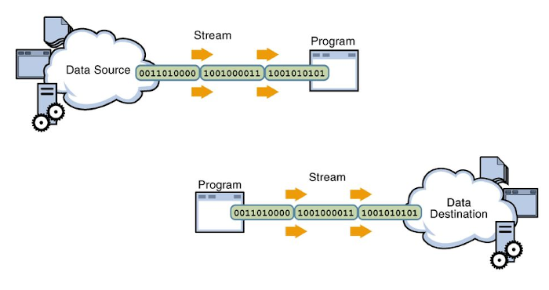
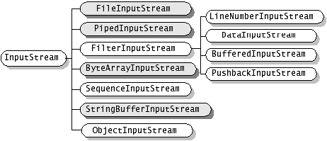
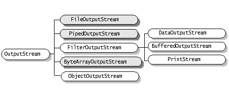
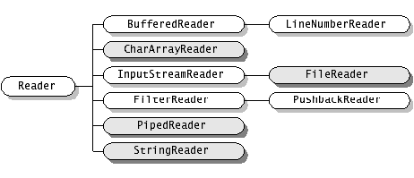
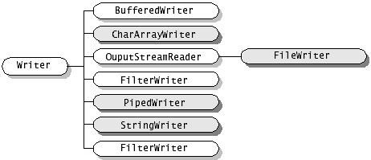
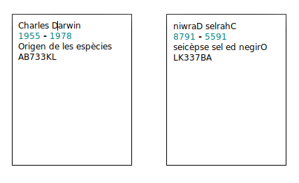

# Tema 8. Entrada i eixida

!!! danger "Resultat d'aprenentatge associat"
    <strong>RA5. Realitza operacions d'entrada i sortida d'informació utilitzant procediments específics del llenguatge i llibreries de classes..</strong>

### Criteris d'avaluació

- [x] RA5.1. S'ha utilitzat la consola per realitzar operacions d'entrada i sortida d'informació.
- [x] RA5.2. S'han aplicat formats en la visualització de la informació.
- [x] RA5.3. S'han reconegut les possibilitats d'entrada / sortida del llenguatge i les llibreries associades.
- [x] RA5.4. S'han utilitzat fitxers per emmagatzemar i recuperar informació.
- [x] RA5.5. S'han creat programes que utilitzin diversos mètodes d'accés al contingut dels fitxers.

## Introducció

!!! note 
    **“Un programa es comunica amb l’usuari i amb el món exterior”**

Una part important de tot llenguatge de programació és com s’establirà el contacte amb l’exterior, bé siga mitjançant la **consola** o a través del **sistema de fitxers**, per finalment poder actuar amb l’usuari d’una aplicació en execució. Ambdós, consola i sistema de fitxers, poden funcionar tant d’entrada als nostres programes com d’eixida.

Java defineix una abstracció, els **streams o fluxos** per tractar la comunicació d’informació amb l’exterior. Per entendre-ho millor, un stream o flux és com un canal de comunicació entre un origen i un destí. Per exemple suposem el cas d’un programa que quan arranque haja de llegir una llista de clients d’un fitxer de text per crear una agenda. En aquest cas **l’origen** seria el fitxer de text i el **destí** el programa o aplicació que s’encarrega d’emplenar l’agenda amb el llistat de clients, doncs bé, l’stream en aquest escenari seria el **canal de comunicació** que s’establiria entre el fitxer de text i el programa per tal que aquest puga llegir la informació.

<center>
    
</center>

A la imatge anterior es poden observar dos tipus de fluxos de dades: El primer és un flux d'entrada de dades, s'enten d'entrada perquè va del sistema de fitxers al programa, mentre que el segon representa un flux de dades d'eixida, ja que aquest va del programa al sistema de fitxers.

En aquest tema explicarem com Java tracta mitjançant objectes l’establiment d'aquests canals de comunicació i quines són les operacions que hi podem fer i com s’han d’utilitzar aquestes abstraccions de Java.
D’altra banda Java també ofereix el mecanisme d’excepcions per controlar els errors sobrevinguts. Una excepció és un problema que es produeix en temps d’execució. Java permet controlar aquests problemes i programar amb els try...catch la solució als errors en temps d’execució.

## Entrada i eixida bàsiques
Com hem dit abans, Java organitza la entrada i eixida mitjançant l’ús d’streams, que són **abstraccions en realitat**, i aquests streams el que fan es transportar la informació del programa o aplicació a dispositius externs. Aquests dispositius externs poden ser bé fitxers o inclús la consola, que es tractada com un fitxer per Java.

### Flux i jerarquia de classes
Com que les possibilitats que tenim en programació respecte de l’ús de fitxers és ampla, podem: llegir de fitxers, escriure en fitxers, llegir per una entrada com un teclat **System.in** o escriure en una eixida com un monitor **System.out**, Java en primera instància distingeix entre dos tipus de fluxos: **flux de bytes** i **flux de caracters**

|E/S|Bytes|Caracters|
|----|----|----|
|Flux entrada|InputStream|Reader|
|Flux eixida|OutputStream|Writer|

Java declara quatre classes **abstractes**, és a dir, que no podem instanciar cap objectes d'aquestes classes, que deriven directament de la superclasse «Object» que són: **InputStream**, **OutputStream**, **Reader** i **Writer**.

**InputStream** és la base per a totes les classes definides per al flux d’entrada de dades a nivell de bytes. A la imatge següent es mostren totes les classes que deriven d'InputStream.  De totes les classes derivades de la classe abstracta InputStream, veurem amb més detall les següents: FileInputStream, DataInputStream i ObjectInputStream.

<center>
    
</center>

**OutputStream** és la classe base per a les classes que gestionen el flux d’eixida a nivell de bytes. A la imatge següent es poden observar totes les seues classes derivades. Pel que fa a aquesta classe abstracta, veurem amb més detall: FileOutputStream, DataOutputStream, PrintStream i ObjectOutputStream.


<center>
    
</center>

**Reader** és la classe per llegir streams a nivell de caracter. Observa les classes derivades a la imatge següent. D'aquesta classe abstracta veurem amb més detall: BufferedReader, InputStreamReader, FileReader

<center>
    
</center>

**Writer** és la classe per escriure a streams a nivell de caracter i les classes que deriven d'ell són les que es poden veure a la següent imatge. De totes les derivades ens centrarem en: OutputStreamWriter, FileWriter, BufferedWriter i PrintWriter.


<center>
    
</center>

## Entrada i eixida per consola en Processing IDE

> *La consola com a eina d’eixida i entrada bàsica d’informació*

!!! success "Criteris d'avaluació associats"
    - [x] RA5.1. S'ha utilitzat la consola per realitzar operacions d'entrada i sortida d'informació.
    - [x] RA5.2. S'han aplicat formats en la visualització de la informació.
    - [x] RA5.3. S'han reconegut les possibilitats d'entrada / sortida del llenguatge i les llibreries associades.

En Processing IDE, la consola **no és el canal principal d’interacció amb l’usuari**, ja que aquest entorn està pensat sobretot per a aplicacions gràfiques i interactives. Tot i això, la consola continua sent molt útil per a:

* mostrar informació i resultats
* indicar l’estat del programa
* detectar errors i depurar codi
* fer proves ràpides amb entrada molt bàsica

En aquest bloc treballarem la **eixida d’informació per consola** i veurem un mecanisme senzill per capturar entrada de dades en Processing, sense utilitzar `Scanner`.

### Eixida de dades per consola

La forma més habitual de mostrar informació en Processing és utilitzar la consola mitjançant l’objecte `System.out` o les funcions pròpies `print()` i `println()`.

**Exemples:**

```java
println("Hola món");
print("Valor actual: ");
println(10);
```

Aquestes instruccions permeten mostrar:

* valors de variables
* resultats de càlculs
* missatges informatius

La consola és especialment útil per comprovar què està passant dins del programa mentre s’executa.

??? question "Activitat 701. Missatges per consola"
    === "Enunciat"
        Escriu un programa que mostre per consola:

        - Un missatge de benvinguda
        - El valor de tres variables diferents (enter, real i text)
        - Un missatge final indicant que el programa ha acabat

    === "Rúbrica"
        | Ítem | 0 - Inexistent | 1 - Incorrecte | 2 - Parcial | 3 - Correcte | 4 - Perfecte | Pes |
        |------|---------------|---------------|------------|-------------|-------------|-----|
        | Missatge de benvinguda | No hi ha cap missatge de benvinguda | El missatge és incorrecte o no té sentit | El missatge és poc clar o incomplet | Missatge correcte i entenedor | Missatge clar, ben redactat i adequat al context | 15% |
        | Mostra de variables | No es mostren variables | Es mostren amb errors greus (tipus o valors incorrectes) | Es mostren algunes variables o amb errors menors | Es mostren correctament les tres variables | Es mostren correctament i amb un format clar i ben presentat | 25% |
        | Missatge final | No hi ha missatge final | El missatge és incorrecte o no indica finalització | El missatge és poc clar | Missatge correcte indicant el final | Missatge clar, ben redactat i coherent amb el programa | 15% |
        | Ús de `println` | No s’utilitza | Ús incorrecte que provoca errors | Ús bàsic amb alguna errada menor | Ús correcte de `println` | Ús correcte i consistent, amb bon estil | 15% |
        | Resultat final | El programa no funciona | Funciona malament o amb molts errors | Funciona parcialment | Funciona correctament | Funciona perfectament i amb una eixida clara i ordenada | 20% |
        | Qualitat i claredat del codi | Codi desordenat o inintel·ligible | Codi amb molts problemes d’organització | Codi acceptable però millorable | Codi clar i ordenat | Codi molt net, ben estructurat i fàcil de llegir | 10% |


### Mostrar informació amb format

Quan volem mostrar informació de manera més clara o ordenada, podem utilitzar formats. Processing permet usar `printf()` igual que Java.

**Exemple:**

```java
int edat = 20;
float nota = 8.345f;

System.out.printf("Edat: %d anys%n", edat);
System.out.printf("Nota final: %.2f%n", nota);
```

Formats habituals:

* `%d` → nombres enters
* `%f` → nombres reals
* `%.2f` → nombre real amb dos decimals
* `%s` → text
* `%n` → salt de línia

L’ús de formats millora molt la llegibilitat de la informació mostrada.

??? question "Activitat 702. Eixida amb format"
    === "Enunciat"
        Declara variables per al nom d’un alumne, la seua edat i una nota mitjana. Mostra tota la informació per consola utilitzant printf() i formats adequats.

    === "Rúbrica"
        | Ítem | 0 - Inexistent | 1 - Incorrecte | 2 - Parcial | 3 - Correcte | 4 - Perfecte | Pes |
        |------|---------------|---------------|------------|-------------|-------------|-----|
        | Declaració de variables | No es declaren variables | Variables incorrectes o amb errors de tipus | Es declaren però amb algun error menor | Variables correctes (nom, edat, nota) | Variables ben definides amb noms clars i coherents | 15% |
        | Ús de `printf` | No s’utilitza `printf` | Ús incorrecte que provoca errors | Ús bàsic amb errors en el format | Ús correcte de `printf` | Ús correcte i consistent amb bon estil | 25% |
        | Aplicació de formats | No s’utilitzen formats | Formats incorrectes (%d, %f, etc.) | Formats parcialment correctes | Formats correctes per a cada tipus | Formats correctes i ben ajustats (ex: decimals) | 25% |
        | Presentació de la informació | No es mostra la informació | Informació confusa o mal estructurada | Informació comprensible però millorable | Informació clara i ordenada | Informació molt clara, ben estructurada i llegible | 15% |
        | Resultat final | El programa no funciona | Funciona amb errors greus | Funciona parcialment | Funciona correctament | Funciona perfectament amb eixida ben formatada | 10% |
        | Qualitat i claredat del codi | Codi desordenat o difícil d’entendre | Codi amb molts problemes | Codi acceptable | Codi clar i ordenat | Codi molt net, ben estructurat i llegible | 10% |

### Entrada de dades bàsica amb el teclat en Processing

!!! danger "Particularitats de Processing IDE"
      Processing IDE és un entorn de desenvolupament senzill que no té la potència d'altres entorns com **Eclipse IDE o Visual Studio Code**, per tant moltes de les classes d'entrada i eixida que veurem en aquest tema no es podran provar en Processing. Sempre podem obrir un projecte nou en Eclipse o Visual Studio i provar els exemples que no funcionen en Processing IDE.

Processing **no està pensat per a una entrada de dades per consola com Java clàssic**, però ofereix un mecanisme molt senzill per capturar l’entrada de l’usuari mitjançant el teclat: la variable `key` i la funció `keyPressed()`.

Aquest mecanisme permet llegir **caràcter a caràcter**, suficient per a entrades simples.

**Exemple: lectura d’un caràcter:**

```java
void keyPressed() {
  println("Tecla premuda: " + key);
}
```

Cada vegada que l’usuari prem una tecla, Processing executa automàticament aquesta funció.

??? question "Activitat 703. Caputra de tecles"
    === "Enunciat"
        🧩 Crea un programa que mostre per consola totes les tecles que va prement l’usuari. Prova a distingir lletres, números i la barra espaiadora.

    === "Rubrica"
        | Ítem | 4 - Perfecte | 3 - Correcte | 2 - Parcial | 1 - Incorrecte | 0 - Inexistent | Pes |
        |------|-------------|-------------|------------|---------------|---------------|-----|
        | Detecció de tecles (`keyPressed`) | Implementa correctament `keyPressed` i captura totes les tecles sense errors | Detecta correctament les tecles | Detecta tecles però amb algun error puntual | Implementació incorrecta de l’esdeveniment | No utilitza `keyPressed` | 25% |
        | Classificació de tecles | Distingeix correctament números, lletres i espai en tots els casos | Distingeix correctament la majoria | Distingeix parcialment (només alguns casos) | Classificació incorrecta | No classifica les tecles | 25% |
        | Ús de condicions | Ús correcte i eficient de condicions (if/else ben estructurats) | Ús correcte de condicions | Ús amb alguns errors o redundàncies | Condicions incorrectes o mal plantejades | No utilitza condicions | 20% |
        | Eixida per consola | Mostra missatges clars i diferenciats per cada tipus de tecla | Mostra informació correcta | Mostra informació parcial o poc clara | Missatges incorrectes o confusos | No mostra informació | 15% |
        | Resultat final | Funciona perfectament en tots els casos | Funciona correctament | Funciona parcialment | Funciona amb errors greus | No funciona | 10% |
        | Qualitat i claredat del codi | Codi molt net, ben estructurat i fàcil de llegir | Codi clar i ordenat | Codi acceptable però millorable | Codi desordenat o poc clar | Codi inexistent o inintel·ligible | 5% |

### Entrada de text senzilla (simulant un Scanner)

Podem simular una entrada de text similar a `Scanner` acumulant els caràcters introduïts per l’usuari fins que preme la tecla **ENTER**.

**Exemple:**

```java
String entrada = "";

void keyPressed() {
  if (key == ENTER) {
    println("Text introduït: " + entrada);
    entrada = ""; // reiniciem l’entrada
  } else {
    entrada += key;
  }
}
```

Aquest codi permet:

* escriure text amb el teclat
* mostrar-lo per consola quan es prem ENTER

És una forma molt bàsica d’entrada de dades, però suficient per entendre com Processing gestiona la interacció amb l’usuari.

??? question "Activitat 704. Entrada de paraules"
    === "Enunciat"
        Modifica el programa perquè l’usuari introduïsca una paraula i el programa la mostre per consola en majúscules quan es premi ENTER.

    === "Rúbrica"
        | Ítem | 4 - Perfecte | 3 - Correcte | 2 - Parcial | 1 - Incorrecte | 0 - Inexistent | Pes |
        |------|-------------|-------------|------------|---------------|---------------|-----|
        | Captura de text (`keyPressed`) | Captura correctament tots els caràcters i construeix la paraula sense errors | Captura correctament el text | Captura parcial amb algun error | Captura incorrecta o incompleta | No captura entrada | 25% |
        | Detecció de la tecla ENTER | Detecta correctament ENTER i executa l’acció en tots els casos | Detecta correctament ENTER | Detecta ENTER amb algun error | Detecció incorrecta | No detecta ENTER | 20% |
        | Conversió a majúscules | Converteix correctament tota la paraula a majúscules sempre | Converteix correctament a majúscules | Conversió parcial o amb errors | Conversió incorrecta | No converteix a majúscules | 20% |
        | Eixida per consola | Mostra correctament la paraula en majúscules amb missatge clar | Mostra correctament la paraula | Mostra parcial o poc clara | Missatge incorrecte | No mostra res | 15% |
        | Reinici de l’entrada | Reinicia correctament la variable després de mostrar el text | Reinicia correctament | Reinici parcial | Reinici incorrecte | No reinicia | 10% |
        | Qualitat i claredat del codi | Codi molt net, ben estructurat i fàcil de llegir | Codi clar i ordenat | Codi acceptable | Codi poc clar o desordenat | Codi inexistent o inintel·ligible | 10% |
    

### Limitacions de l’entrada per consola en Processing

Cal tindre en compte que aquest tipus d’entrada:

* no és bloquejant (el programa continua executant-se)
* no és adequada per a dades complexes
* es fa de manera asíncrona

Per aquest motiu, en els següents blocs del tema:

* la **entrada principal de dades** es farà mitjançant **fitxers** i **interfícies gràfiques**
* la consola quedarà com a eina de suport i depuració


??? question "Activitat 705. Control d'errors en l'entrada per consola"
    === "Enunciat"
        A partir de l’activitat anterior (entrada de paraules amb teclat), millora el programa perquè siga capaç de gestionar errors habituals en la introducció de dades per part de l’usuari.

        L’objectiu és evitar que el programa accepte dades incorrectes i proporcionar missatges clars a l’usuari.

        #### Requisits

        1. El programa ha de continuar permetent introduir text amb el teclat i mostrar-lo quan es prema ENTER.

        2. Abans de mostrar el text, cal validar la informació introduïda:
            - No es poden acceptar paraules buides.
            - No es poden acceptar només espais en blanc.
            - (Opcional) Es poden limitar els caràcters permesos (per exemple, només lletres).

        3. Si l’entrada no és vàlida:
            - El programa ha de mostrar un missatge d’error per consola.
            - No ha de processar la paraula.
            - Ha de permetre tornar a introduir una nova paraula.

        4. Si l’entrada és vàlida:
            - Mostrar la paraula en majúscules.
            - Reiniciar el sistema per permetre una nova entrada.

        #### Exemples de comportament

        Entrada: *(ENTER sense escriure res)*  
        Eixida: `Error: no has introduït cap paraula.`  

        Entrada: `"   "`  
        Eixida: `Error: la paraula no pot estar buida.`  

        Entrada: `"hola"`  
        Eixida: `HOLA`

        #### Pistes

        - Pots utilitzar mètodes de `String` com:
            - `trim()`
            - `isEmpty()`
            - Recorda gestionar correctament la variable on acumules el text.

        #### Objectiu

        Aprendre a validar dades d’entrada i millorar la robustesa dels programes evitant errors habituals de l’usuari.

    === "Rúbrica"
    | Ítem | 4 - Perfecte | 3 - Correcte | 2 - Parcial | 1 - Incorrecte | 0 - Inexistent | Pes |
    |------|-------------|-------------|------------|---------------|---------------|-----|
    | Validació de l’entrada | Valida correctament tots els casos (buit, espais, etc.) | Valida correctament els casos principals | Valida parcialment (només algun cas) | Validació incorrecta o insuficient | No valida l’entrada | 25% |
    | Gestió d’errors | Mostra missatges clars i específics per cada error | Mostra missatges d’error correctes | Missatges poc clars o genèrics | Missatges incorrectes | No gestiona errors | 20% |
    | Control del flux del programa | El programa continua correctament després d’un error i permet nova entrada | Control correcte del flux | Control parcial amb algun problema | Flux incorrecte | El programa es trenca o no continua | 20% |
    | Captura de text (`keyPressed`) | Captura correctament el text sense errors | Captura correctament | Captura amb algun error | Captura incorrecta | No captura entrada | 15% |
    | Eixida per consola | Mostra correctament la paraula en majúscules quan és vàlida | Mostra correctament la informació | Mostra parcial o poc clara | Missatges incorrectes | No mostra res | 10% |
    | Qualitat i claredat del codi | Codi molt net, ben estructurat i fàcil de llegir | Codi clar i ordenat | Codi acceptable | Codi desordenat o poc clar | Codi inexistent o inintel·ligible | 10% |

## Introducció als fitxers

> "Quan les dades han de sobreviure al programa"

!!! success "Criteris d'avaluació associats"
    - [x] RA5.3. S'han reconegut les possibilitats d'entrada / sortida del llenguatge i les llibreries associades.

Fins ara, tota la informació que utilitza el programa desapareix quan aquest s’atura. En aquest bloc introduirem els fitxers com a mecanisme per guardar informació de manera permanent.

En Processing IDE, els fitxers són especialment importants perquè permeten:

- Guardar resultats
- Carregar configuracions
- Reutilitzar dades entre execucions

Aquest bloc és conceptual i pràctic alhora, i servirà de base per als següents apartats del tema.

### Què és un fitxer

Un **arxiu o fitxer** és un conjunt de bytes que són emmagatzemats en un dispositiu. Un arxiu o fitxer es identificat per un nom i la descripció de la carpeta o directori (la ruta) que el conté. Una de les principals finalitats dels arxius és tindre desats en **memòria secundària**, quan les aplicacions ja han acabat d’executar-se, i que siguen recuperables després.

Un **fitxer** sUn **arxiu o fitxer** és un conjunt de bytes que són emmagatzemats en un dispositiu. Un arxiu o fitxer es identificat per un nom i la descripció de la carpeta o directori (la ruta) que el conté. Una de les principals finalitats dels arxius és tindre desats en **memòria secundària**, quan les aplicacions ja han acabat d’executar-se, i que siguen recuperables després.’ha de poder llegir, actualitzar, esborrar registres i tornar a guardar-se de nou amb tots els canvis realitzats. Segons el dispositiu físic que els emmagatzeme, els arxius poden ser **directes o seqüencials**, el primer implica que per poder accedir a qualsevol registre, hem de passar prèviament pels anteriors, per exemple una cinta magnètica, mentre que el segon tipus d’arxiu permet l’accés directe al registre en qüestió sense haver de passar pels anteriors. 

En Java un arxiu és una **seqüencia de bytes** que contenen la informació emmagatzemada. Per poder treballar amb aquestes seqüencies de bytes, Java disposa de classes com són els tipus bàsics (int, double, string..).
D’una altra banda, com ja hem explicat abans, un flux és una abstracció que es refereix a una corrent **(stream)** de dades entre un origen (també conegut com a font o productor) i una destinació o embornal (consumidor) i la connexió que existeix entre els dos també es coneix com a pipe o tub per on circules les dades.

Quan comença qualsevol execució d’un programa Java, es creen tres objectes flux, canals pels que pot fluir informació d’entrada o eixida; aquests objectes estan definits a la classe System i són:

- **System.in:** entrada estàndard, permet l’entrada de dades des del teclat.Una excepció és un fallo que es produeix en temps d’execució. Classe **InputStream**
- **System.out:** eixida estàndard, permet la programa imprimir per pantalla. Classe **PrintStream**
- **System.err:** eixida d’errors, permet al programa imprimir errors per pantalla. Per defecte sol ser la mateixa eixida que System.out. Classe **PrintStream**

En resum, un fitxer és un conjunt de dades emmagatzemades en un dispositiu de memòria secundària (disc dur, SSD, USB…). A diferència de les variables, el contingut d’un fitxer no es perd quan el programa finalitza.

En programació, els fitxers s’utilitzen principalment per:

- Guardar informació
- Recuperar dades
- Compartir informació entre programes

Podem distingir, de manera general, dos tipus de fitxers:

- **Fitxers de text:** contenen informació llegible (txt, csv…)
- **Fitxers binaris:** contenen dades codificades (imatges, dades numèriques, objectes…)

### La classe File

Per poder identificar d’un fitxer al sistema de fitxers de qualsevol sistema operatiu, necessitem: nom i ruta. Per exemple ‘/user/data/file.txt’. El fitxer es diu file.txt i la ruta en la qual es troba és ‘/user/data/’. Aquest identificador de fitxer és el que es passa al constructor de la classe per tal d’obrir un flux.

```java linenums="1"
import java.io.*;
String strPath = sketchPath() + File.separator;
File fitxer = new File ( strPath + "prova.txt");
// Fes el que vullgues fer amb el fitxer
```

Veiem un altre exemple d'ús de la classe File

```java linenums="1"
File f = new File("dades.txt");

if (f.exists()) {
  println("El fitxer existeix");
} else {
  println("El fitxer no existeix");
}
```

#### Ubicació dels fitxers en Processing IDE

En l’exemple anterior hem utilitzat la **classe File** per tal d’instanciar un stream al fitxer que li hem passat per paràmetre «prova.txt». Compte que s’ha de passar la ruta absoluta d’on es troba el fitxer utilitzant la funció de Processing IDE **sketchPath()**.

```java linenums="1"
String ruta = sketchPath("dades.txt");
println(ruta);
```

Hi ha alternatives al constructor de la classe File que hem mostrat a l’exemple anterior, es pot construir també amb dos paràmetres: ruta i nom del fitxer o inclús indicar-li la ruta mitjançant un altre objecte File.

Els mètodes de la classe File són:

|Mètode|Explicació|
|----|----|
|public boolean exists()|Torna true si el fitxer existeix|
|public boolean canWrite()|Torna true si es pot escriure al fitxer|
|public boolean canRead()|Torna true si es només de lectura|
|public boolean isFile()|Torna true si és un fitxer|
|public boolean isDirectory()|Torna true si és un directori|
|public boolean isAbsolute()|Torna true si el directori té ruta completa|
|public long length()|Torna la mida en bytes del fitxer|
|public long lastModified()|Torna el timestamp de l’última modificació|
|public String getName()|Torna una string amb el nom del fitxer|
|public String getPath()|Torna una string amb el path del fitxer|
|public String getAbsolutePath()|Torna la ruta absoluta del fitxer|
|public boolean setReadOnly()|Converteix el fitxer en només lectura|
|public boolean delete()|Elimina el fitxer o directori (si està buit)|
|public boolean renameTo(File nou)|Canvia el nom pel del fitxer nou|
|public boolean mkdir()|Crea el directori del fitxer|
|public String[] list()|Torna un array d’strings dels elements|

??? question "Activitat 706. Class File"
    === "Enunciat"
        Crea un projecte en Processing IDE que obriga un fitxer de prova qualsevol, per exemple: prova.txt. 
        Revisa els mètodes de la classe File i comprova el funcionament d'alguns d'ells per exemple: getName();
        Mostra per pantalla una fitxa en la que es mostre la següent informació: 

        - Nom del fitxer
        - Ruta absoluta del fitxer
        - Data de l'última vegada que s'ha modificat

    === "Rúbrica"
        | Ítem | 4 - Perfecte | 3 - Correcte | 2 - Parcial | 1 - Incorrecte | 0 - Inexistent | Pes |
        |------|-------------|-------------|------------|---------------|---------------|-----|
        | Ús de la classe `File` | Utilitza correctament la classe `File` i inicialitza el fitxer sense errors | Utilitza correctament `File` | Ús amb algun error menor | Ús incorrecte de la classe | No utilitza `File` | 25% |
        | Obtenció de dades del fitxer | Obté correctament nom, ruta i data de modificació | Obté correctament la majoria de dades | Obté només algunes dades | Obtenció incorrecta | No obté informació | 25% |
        | Ús de mètodes (`getName`, `getAbsolutePath`, `lastModified`) | Ús correcte i complet dels mètodes requerits | Ús correcte dels mètodes | Ús parcial o amb errors | Ús incorrecte dels mètodes | No utilitza els mètodes | 20% |
        | Presentació de la informació | Mostra una fitxa clara, ordenada i ben estructurada | Mostra la informació de forma clara | Presentació millorable | Presentació confusa | No mostra la informació | 15% |
        | Resultat final | Funciona perfectament en tots els casos | Funciona correctament | Funciona parcialment | Funciona amb errors | No funciona | 10% |
        | Qualitat i claredat del codi | Codi molt net, ben estructurat i llegible | Codi clar i ordenat | Codi acceptable | Codi desordenat o poc clar | Codi inexistent o inintel·ligible | 5% |

### Carpetes i organització de fitxers
A mesura que un projecte creix, és recomanable organitzar els fitxers en carpetes. La classe File permet treballar també amb carpetes.

Exemple:

```java linenums="1"
File carpeta = new File(sketchPath("dades"));

if (!carpeta.exists()) {
  carpeta.mkdir();
}
```

### Errors habituals

Quan treballem amb fitxers poden aparèixer problemes com:

- Fitxers inexistents
- Rutes incorrectes
- Permisos insuficients

La gestió d’aquests errors es fa mitjançant el mecanisme de les excepcions com ja varem veure al tema 4

Com hauràs pogut comprovar amb **la classe File** t'ha resultat impossible escriure o llegir d'ell.  A continuació estudiarem amb més detall les diferents classes que disposa Java pel tractament de l'entrada i eixida d'informació (Streams). Per tal entendre-ho millor, dividirem aquesta secció en dos blocs: **Tractament a nivell de text** amb les classes abstractes **Writer i reader** i les seues classes derivades i **tractament a nivell de byte** amb les classes abstractes **InputStream i OutputStream** i les seues subclasses.

## Fitxers de text: guardar i recuperar informació

> El primer pas real per a la persistència de dades

!!! success "Criteris d'avaluació associats"
    - [x] RA5.4. S'han utilitzat fitxers per emmagatzemar i recuperar informació.
    - [x] RA5.5. S'han creat programes que utilitzin diversos mètodes d'accés al contingut dels fitxers.

En aquest bloc aprendrem a escriure i llegir fitxers de text. A diferència del bloc anterior, ara sí treballarem amb dades reals que es guardaran en disc i es podran recuperar en una altra execució del programa.

Al cap i a la fi els arxius, en una gran majoria, solen ser seqüències de caracters i des del punt de vista lògic ens resulta més natural treballar amb ells a aquest nivell.

Treballarem dues vies:

- Classes estàndard de Java (PrintWriter, BufferedReader)
- Funcions pròpies de Processing (saveStrings(), loadStrings())

### PrintStream

La classe **PrintStream** deriva de **FilterOutputStream** i el valor afegit d’aquesta classe derivada és que permet afegir el caràcter final de línia als fitxers. Aquests tipus de fluxos són sempre d’eixida i s’associen a un altre flux de bytes de més baix nivell. **System.out** és un objecte de tipus PrintStream. Per tant quan executem la sentència System.out.println(""); el que estem fent realment és cridar al mètode println de la classe PrintStream.


```java linenums="1"
String strPath = sketchPath() + File.separator;
String strFile = strPath + "Complex.dat";
PrintStream ps = new PrintStream(new FileOutputStream(strFile));
// Treballem i tanquem
ps.close();
```

| Mètode | Explicació |
|---|---|
|public PrintStream(OutputStream destino)|Crea un objecte associat a qualsevol objecte d’eixida per paràmetre|
|public PrintStream(OutputStream destino, boolean flag)| Crea un objecte associat a qualsevol objecte d’eixida per paràmetre. Si flag és true, es produeix un bolcat automàtic al escriure final de línia.|
|public void flush()|Bolca el flux actual|
|public void print(Object obj)|Escriu la representació de l’objecte obj al flux|
|public void print(String cad)|Escriu la cadena al flux|
|public void print(char c)|Escriu un caràcter al flux|
|public void println(Object obj)|Escriu la representació de l’objecte al flux i final de línia|
|public void println(String cad)|Escriu la cadena al flux i final de línia|

Observa el codi següent. Utilitzant la classe **PrintStream** s'obre un fitxer 'output.txt' dintre del qual s'escriurà una sola cadena de caracters 'data' i després es tancarà l'stream una vegada finalitzat l'execució del codi.

```java linenums="1"
import java.io.*;

String strFile = sketchPath() + File.separator + "output.txt";
String data = "Text que volem escriure dintre del fitxer";

try {
   PrintStream output = new PrintStream(strFile);

   output.print(data);
   output.close();
}
catch(Exception e) {
   e.getStackTrace();
}

```

### PrintWriter 

Els fluxos més utilitzats en l’eixida de caràcters són de tipus PrintWriter, aquesta classe declara constructors per associar un flux PrintWriter amb qualsevol altre de tipus Writer o bé OutputStream.

| Mètode | Explicació |
|--|--|
|public PrintWriter(OutputStream destí)|Crea un flux associat amb un altre d’eixida a nivell de byte.|
|public PrintWriter(Writer destino)|Crea un flux associat amb un altre d’eixida de caràcters de tipus Writer.|

La importància d’aquesta classe radica en que defineix mètodes print() i println() per cadascun dels tipus de dades simples, per String i per Object; la diferència entre els mètodes print() i println() està en que el segon afegeix els caràcters de final de línia a continuació dels escrits per l’argument. 

| Mètode | Explicació |
|--|--|
|public void print(Object obj)|Escriu la representació de l’objecte obj al flux|
|public void print(String cad)|Escriu la cadena al flux|
|public void print(char c)| Escriu el caràcter c al flux.|
|public void println(Object obj)|Escriu la representació de l’objecte obj al flux i final de línia|
|public void println(String cad)|Escriu la cadena al flux i el final de línia|
|public void println(char c)|Escriu el caràcter c al flux i final de línia.|

Exemple

```java linenums="1"
import java.io.PrintWriter;

String strFile = sketchPath() + File.separator + "output.txt";
FileReader fr = new FileReader(strFile);
String data = "This is a text inside the file.";

try {

PrintWriter output = new PrintWriter(strFile);

output.print(data);
output.close();
}
catch(Exception e) {
e.getStackTrace();
}

```

<!--??? question "Activitat 806. FileWriter, FileReader, BufferedReader i PrintWriter"
      Utilitzant les classes anteriors, obre un fitxer que continga text, llig tot el seu contingut i enregistra'l a un fitxer d'eixida amb la condició que has de canviar majúscules per minúscules i a l'inrevés des del fitxer d'origen.  

      Has de tindre en compte que Processing IDE incorpora les seues pròpies classes BufferedReader i PrintWriter que podràs utilitzar en combinació amb FileWriter i FileReader per poder fer aquesta activitat.-->

<!--      [Descarrega la solució ací](assets/Tema8/act806.zip)-->


### Escriure en un fitxer de text amb PrintWriter (Processing IDE)

La classe PrintWriter permet escriure text en un fitxer de manera senzilla.

```java linenums="1"
import java.io.PrintWriter;

void setup() {
  String ruta = sketchPath("dades.txt");
  PrintWriter writer = createWriter(ruta);
  
  writer.println("Primera línia");
  writer.println("Segona línia");
  
  writer.flush();
  writer.close();
  
  println("Fitxer creat correctament.");
}
```

És important: 

- Escriure les línies amb println()
- Tancar el fitxer amb close()

??? question "Activitat 707. Crear un fitxer de text"
    === "Enunciat"
        Escriu un programa que cree un fitxer anomenat alumne.txt i guarde el teu nom, edat i curs en línies separades.

    === "Rúbrica"
        | Ítem | 4 - Perfecte | 3 - Correcte | 2 - Parcial | 1 - Incorrecte | 0 - Inexistent | Pes |
        |------|-------------|-------------|------------|---------------|---------------|-----|
        | Creació del fitxer | Crea correctament el fitxer amb el nom indicat i sense errors | Crea correctament el fitxer | Crea el fitxer amb algun error menor | Error en la creació del fitxer | No crea el fitxer | 25% |
        | Escriptura de dades | Escriu correctament nom, edat i curs en el fitxer | Escriu correctament les dades | Escriu parcialment o amb errors | Escriptura incorrecta | No escriu dades | 25% |
        | Estructura del fitxer | Les dades estan perfectament separades en línies i ben organitzades | Les dades estan correctament separades | Estructura parcialment correcta | Estructura incorrecta o confusa | No hi ha estructura | 20% |
        | Ús de classes d’E/S (`PrintWriter`, etc.) | Ús correcte i adequat de les classes d’escriptura | Ús correcte de les classes | Ús amb algun error menor | Ús incorrecte | No utilitza classes d’E/S | 15% |
        | Resultat final | El fitxer es crea i conté tota la informació correcta | Funciona correctament | Funciona parcialment | Funciona amb errors | No funciona | 10% |
        | Qualitat i claredat del codi | Codi molt net, ben estructurat i llegible | Codi clar i ordenat | Codi acceptable | Codi desordenat o poc clar | Codi inexistent o inintel·ligible | 5% |

### Llegir un fitxer de text amb loadStrings()
Processing ofereix la funció loadStrings() que permet llegir totes les línies d’un fitxer de text en un array de cadenes.

```java linenums="1"
void setup() {
  String[] linies = loadStrings("dades.txt");
  
  for (int i = 0; i < linies.length; i++) {
    println(linies[i]);
  }
}

```

Cada element de l’array correspon a una línia del fitxer.

??? question "Activitat 708. Llegir un fitxer"
    === "Enunciat"
        Llig el fitxer alumne.txt creat anteriorment i mostra el seu contingut per consola.

    === "Rúbrica"
        | Ítem | 4 - Perfecte | 3 - Correcte | 2 - Parcial | 1 - Incorrecte | 0 - Inexistent | Pes |
        |------|-------------|-------------|------------|---------------|---------------|-----|
        | Ús de `loadStrings()` | Utilitza correctament `loadStrings()` i carrega el fitxer sense errors | Ús correcte de `loadStrings()` | Ús amb algun error menor | Ús incorrecte | No utilitza `loadStrings()` | 25% |
        | Lectura del fitxer | Llig totes les línies correctament | Llig correctament el fitxer | Llig parcialment | Lectura incorrecta | No llig el fitxer | 25% |
        | Recorregut de l’array | Recorre correctament totes les línies amb un bucle ben estructurat | Recorregut correcte | Recorregut parcial | Recorregut incorrecte | No recorre l’array | 20% |
        | Eixida per consola | Mostra totes les línies de forma clara i ordenada | Mostra correctament la informació | Mostra parcial o poc clara | Eixida incorrecta | No mostra res | 15% |
        | Resultat final | Funciona perfectament i mostra tot el contingut del fitxer | Funciona correctament | Funciona parcialment | Funciona amb errors | No funciona | 10% |
        | Qualitat i claredat del codi | Codi molt net, ben estructurat i llegible | Codi clar i ordenat | Codi acceptable | Codi desordenat o poc clar | Codi inexistent o inintel·ligible | 5% |

### Processar la informació llegida
Quan llegim un fitxer, sovint necessitem processar les dades.

Per exemple, si un fitxer conté números, podem convertir-los amb int() o float().

```java linenums="1"
void setup() {
  String[] linies = loadStrings("numeros.txt");
  int suma = 0;
  
  for (String linia : linies) {
    suma += int(linia);
  }
  
  println("Suma total: " + suma);
}

```

??? question "Activitat 709. Sumar valors d'un fitxer"
    === "Enunciat"
        Crea un fitxer amb diversos números (un per línia) i escriu un programa que calcule i mostre la suma total. 
        També hauràs de:
        
        - Modificar el fitxer
        - Afegir numeros enters i decimals
        - Afegir altres caracters
        - Realitzar comprovacions
        - Sumar els numeros enters
        - Multiplicar els decimals
        - Guardar el resultat en un fitxer output.txt

    === "Rúbrica"
        | Ítem | 4 - Perfecte | 3 - Correcte | 2 - Parcial | 1 - Incorrecte | 0 - Inexistent | Pes |
        |------|-------------|-------------|------------|---------------|---------------|-----|
        | Processament de dades | Processa correctament tots els valors diferenciant enters, decimals i altres caràcters | Processa correctament la majoria de dades | Processament parcial amb errors | Processament incorrecte | No processa dades | 25% |
        | Validació i comprovacions | Detecta i gestiona correctament valors no vàlids | Realitza comprovacions bàsiques correctes | Comprovacions parcials | Comprovacions incorrectes | No valida dades | 20% |
        | Operacions (suma i multiplicació) | Calcula correctament suma d’enters i producte de decimals | Calcula correctament les operacions | Càlcul parcial o amb errors | Càlcul incorrecte | No realitza càlculs | 20% |
        | Lectura del fitxer | Llig correctament totes les línies del fitxer | Lectura correcta | Lectura parcial | Lectura incorrecta | No llig el fitxer | 10% |
        | Escriptura del resultat (`output.txt`) | Guarda correctament els resultats en el fitxer amb bon format | Guarda correctament el resultat | Escriptura parcial | Escriptura incorrecta | No guarda el resultat | 10% |
        | Modificació del fitxer | Prova diferents casos (enters, decimals, caràcters) de forma completa | Prova diversos casos | Proves parcials | Proves insuficients | No modifica el fitxer | 10% |
        | Qualitat i claredat del codi | Codi molt net, estructurat i eficient | Codi clar i ordenat | Codi acceptable | Codi desordenat | Codi inexistent o inintel·ligible | 5% |

??? question "Activitat 710. Copiar i invertir"
    === "Enunciat"
        Basat en el codi anterior i fes que al fitxer resultat, el d’eixida, es copie el que apareix a «prova.txt», el d’entrada però a l’inrevés. Per exemple:

        Un possible resultat de l'activitat anterior podria ser el que es pot observar a la imatge següent:      

        

    === "Rúbrica"
        | Ítem | 4 - Perfecte | 3 - Correcte | 2 - Parcial | 1 - Incorrecte | 0 - Inexistent | Pes |
        |------|-------------|-------------|------------|---------------|---------------|-----|
        | Inversió de cadenes | Inverteix correctament totes les línies sense errors | Inverteix correctament les línies | Inversió parcial o amb errors menors | Inversió incorrecta | No inverteix les cadenes | 25% |
        | Processament línia a línia | Processa totes les línies del fitxer correctament | Processament correcte | Processament parcial | Processament incorrecte | No processa línies | 20% |
        | Lectura del fitxer | Llig correctament el fitxer complet | Lectura correcta | Lectura parcial | Lectura incorrecta | No llig el fitxer | 15% |
        | Eixida per consola | Mostra totes les línies invertides de forma clara | Mostra correctament la informació | Mostra parcial o poc clara | Eixida incorrecta | No mostra res | 15% |
        | Algorisme utilitzat | Utilitza un algorisme eficient i ben estructurat per invertir cadenes | Algorisme correcte | Algorisme millorable | Algorisme incorrecte | No hi ha algorisme | 15% |
        | Qualitat i claredat del codi | Codi molt net, estructurat i fàcil de llegir | Codi clar i ordenat | Codi acceptable | Codi desordenat | Codi inexistent o inintel·ligible | 10% |

### Afegir informació a un fitxer existent
Si volem afegir informació sense esborrar el contingut anterior, podem treballar acumulant les dades en un array i tornar-les a guardar.

**Estratègia bàsica:**

1. Llegir el fitxer amb loadStrings()
2. Afegir una nova línia
3. Tornar a guardar amb saveStrings()

```java linenums="1"
void setup() {
  String[] linies = loadStrings("dades.txt");
  String[] novesLinies = append(linies, "Nova línia");
  saveStrings("dades.txt", novesLinies);
}
```

??? question "Activitat 711. Afegir dades"
    === "Enunciat"
        Modifica el programa perquè afegisca una nova línia amb la data actual al fitxer alumne.txt

    === "Rúbrica"
        | Ítem | 4 - Perfecte | 3 - Correcte | 2 - Parcial | 1 - Incorrecte | 0 - Inexistent | Pes |
        |------|-------------|-------------|------------|---------------|---------------|-----|
        | Modificació del fitxer | Afig correctament una nova línia sense perdre el contingut anterior | Afig correctament la nova línia | Afig la línia amb algun error menor | Sobreescriu o modifica incorrectament el fitxer | No modifica el fitxer | 25% |
        | Estratègia (loadStrings + append + saveStrings) | Aplica correctament tota l’estratègia sense errors | Aplica correctament l’estratègia | Aplicació parcial amb errors | Estratègia incorrecta | No aplica l’estratègia | 25% |
        | Lectura del fitxer | Llig correctament el contingut original | Lectura correcta | Lectura parcial | Lectura incorrecta | No llig el fitxer | 15% |
        | Generació de la nova línia (data) | Genera correctament la data actual i la inserix al fitxer | Genera correctament la data | Generació parcial o amb errors | Data incorrecta | No genera la data | 15% |
        | Resultat final | El fitxer conté totes les dades originals + la nova línia correcta | Resultat correcte | Resultat parcial | Resultat incorrecte | No funciona | 10% |
        | Qualitat i claredat del codi | Codi molt net, estructurat i fàcil de llegir | Codi clar i ordenat | Codi acceptable | Codi desordenat | Codi inexistent o inintel·ligible | 10% |

### Problemes habituals i control d'errors

En treballar amb fitxers de text poden aparèixer problemes com:

- Fitxer inexistent
- Contingut inesperat
- Errors de conversió de tipus

Aquests casos es poden controlar amb els mecanismes ja estudiats al Tema 4.

??? question "Activitat 712. Detecció de problemes"
    === "Enunciat"
        Prova què ocorre si intentes llegir un fitxer que no existeix. Explica què passa i com es podria evitar el problema.

    === "Rúbrica"
        | Ítem | 4 - Perfecte | 3 - Correcte | 2 - Parcial | 1 - Incorrecte | 0 - Inexistent | Pes |
        |------|-------------|-------------|------------|---------------|---------------|-----|
        | Experimentació (prova real) | Prova correctament el cas de fitxer inexistent i mostra evidències del resultat | Realitza la prova correctament | Prova parcial o poc clara | Prova incorrecta | No realitza la prova | 25% |
        | Identificació de l’error | Identifica correctament què ocorre (error de lectura, null, excepció, etc.) | Identifica correctament l’error | Identificació parcial | Identificació incorrecta | No identifica l’error | 25% |
        | Explicació del problema | Explica de forma clara i precisa per què es produeix l’error | Explicació correcta | Explicació parcial o poc clara | Explicació incorrecta | No explica el problema | 20% |
        | Proposta de solució | Proposa solucions adequades (comprovacions, control d’errors, etc.) | Proposa una solució correcta | Solució parcial o incompleta | Solució incorrecta | No proposa solució | 20% |
        | Qualitat de la resposta | Resposta clara, ben estructurada i amb bon ús del llenguatge tècnic | Resposta clara | Resposta acceptable | Resposta confusa | Resposta inexistent | 10% |

### BufferedReader a Processing IDE
A l'API de Processing existeix  una classe **BufferedReader.** Aquesta classe s'encarrega de llegir línia a línia com un conjunt d'Strings individuals.  Però s'utilitza per a llegir de fitxers i no de l'entrada (system.in) com als exemples anteriors. Per poder llegir des de teclat a Processing hem d'utilitzar el mètode **keyPressed**

Abans de copiar i provar el següent exemple, descarrega el fitxer [**positions.txt**](assets/Tema8/positions.txt) amb parells de números a cada línia separats per un tabulador.

```java linenums="1"
BufferedReader reader;
String line;

void setup() {
  // Open the file from the createWriter() example
  reader = createReader("positions.txt");    
}
 
void draw() {
  try {
    line = reader.readLine();
  } catch (IOException e) {
    e.printStackTrace();
    line = null;
  }
  if (line == null) {
    // Stop reading because of an error or file is empty
    noLoop();  
  } else {
    String[] pieces = split(line, TAB);
    int x = int(pieces[0]);
    int y = int(pieces[1]);
    point(x, y);
  }
} 
```

### Reader i writer

Els arxius de text són arxius de caràcters, es poden crear fluxos de bytes o de caràcters derivats de les classes abstractes Reader i Writer.

Els fluxos **Reader i Writer** són fluxos de Java orientats a caràcters. Amb aquests fluxos podem llegir i escriure caràcters o cadenes de caràcters al dispositius connectats mitjançant aquests fluxos.

Per llegir arxius de caràcters s’utilitzen fluxos derivats de la classe Reader on es declaren o sobreescriuen mètodes per la lectura de caràcters. Els mètodes més importants són:

| Mètode | Explicació |
|-------|-------|
|public int read()|Llig un caràcter en forma d’enter. Si arriba al final del fitxer torna -1|
|public int read(char [] b)|Llig una seqüencia de caràcters fins completar l’array b o llegir el final del fitxer. Torna el nombre de caràcters llegits o -1 si arriba al final de l’arxiu|

### InputStreamReader i OutputStreamWriter
Els fluxos de la classe **InputStreamReader** envolten (wrap) a un flux de bytes; converteixen la seqüència de bytes en seqüència de caràcters i així ja no ho hem de fer nosaltres; la classe deriva directament de Reader, pel que té disponibles els mètodes read() de la seua classe pare per la lectura de caràcters

```java linenums="1"
InputStreamReader ent = new InputStreamReader(System.in);
// En acabar tanquem l'stream
ent.close();
```
La classe **OutputStreamWriter** que deriva de **writer**, permet escriure caràcters en un flux de bytes al qual s’associa la creació de l’objecte o flux.

```java linenums="1"
OutputStreamWriter ot = new OutputStreamWriter(new FileOutputStream(arxiu));
// Després hem de recordar de tancar l'stream
ot.close();
```
Els mètodes de la classe **InputStreamReader** són:

| Mètode | Explicació |
|-------|-------|
|void close()|Tanca el flux i allibera tots els recursos del sistema associats|
|String getEncoding()|Retorna el nom de la codificació de caràcters que utilitza aquest flux|
|int read()| Llegeix un sol caràcter|
|int read(char[] buf, int offset, int length)|Llegeix caràcters en una part d'una matriu|
|boolean ready()|Indica si aquest flux està llest per ser llegit|

Els mètodes de la classe **OutputStreamWriter** són:

| Mètode | Explicació |
|-------|-------|
|void close()|Tanca el corrent, rentant-lo primer|
|void flush()|Redueix el corrent|
|String getEncoding()|Retorna el nom de la codificació de caràcters que utilitza aquest flux|
|void write(char [] buf, int off, int len)|Escriu una part d'una matriu de caràcters|
|void write(int c)|Escriu un sol caràcter|
|void write(String str, int off, int len)|Escriu una part d'una cadena|

Però allò normal és que no s'utilitzen directament aquestes classes sino que es faja ús de **FileReader i FileWriter**.

### FileReader i FileWriter

Per llegir arxius de text o de caràcters es pot crear un flux del tipus **FileReader**, aquesta classe deriva d’InputStreamReader, hereta els mètodes read() per a llegir caràcters, el constructor té com entrada una cadena amb el nom de l’arxiu

Per exemple

```java linenums="1"
String strFile = sketchPath() + File.separator + "cartes.dat";
FileReader fr = new FileReader(strFile);
fr.close();
```
Els constructors de la classe **FileReader** són:

| Constructor | Explicació |
|-------|-------|
|FileReader(File file)|Crea un nou FileReader , amb el nom del fitxer des del qual cal llegir|
|FileReader(FileDescriptor fd)|Crea un nou FileReader , donat el FileDescriptor per llegir|
|FileReader(String fileName)|Crea un nou FileReader , amb el nom del fitxer des del qual cal llegir|

Els mètodes dels que disposa **FileReader** són:

- **Heretats de java.io.InputStreamReader:** close, getEncoding, read, ready
- **Heretats de java.io.Reader:** mark, markSupported, read, reset, skip
- **Heretats de java.lang.Object:** clone, equals, finalize, getClass, hashCode, notify, notifyAll, toString, wait

No es freqüent utilitzar directament fluxos **OutputStreamWriter**, encara que resulta interessant perquè la classe **FileWriter** és una extensió d’ella. Dissenyada per escriure en un arxiu de caràcters, els fluxos d’aquest tipus escriuen caràcters amb el mètode write() a l’arxiu al que s’associa el flux quan es crea l’objecte.

```java linenums="1"
String strFile = sketchPath() + File.separator + "cartes.dat";
FileReader fr = new FileReader(strFile);
nr.write("Frase qualsevol a escriure");
nr.close();
```
Els constructors de la classe **FileWriter** són:

| Constructor | Explicació |
|-------|-------|
|FileWriter(File file)|Construeix un objecte FileWriter donat un objecte File|
|FileWriter(File file, boolean append)|Construeix un objecte FileWriter donat un objecte File|
|FileWriter(FileDescriptor fd)|Construeix un objecte FileWriter associat a un descriptor de fitxer|
|FileWriter(String fileName)|Construeix un objecte FileWriter amb un nom de fitxer|
|FileWriter(String fileName, boolean append)|Construeix un objecte FileWriter amb un nom de fitxer amb un booleà que indica si s'han d'afegir o no les dades escrites|


En general no resulta eficient llegir directament d’un flux d’aquest tipus, s’utilitzarà un flux **BufferedReader** i **BufferedWriter**

### BufferedReader i BufferedWriter

La lectura d’arxius de text es realitza amb un flux que emmagatzema els caràcters en un **buffer** intermedi, aquests no es lligen directament de l’arxiu si no del buffer. D’aquesta manera augmentem l’eficiència a les operacions d’entrada, la classe **BufferedReader** permet crear fluxos de caràcters amb buffer que no és més que una forma d’organitzar el flux bàsic de caràcters del que ve  el text perquè al crear un flux BufferReader, aquest s’inicialitza com un flux de caràcters InputStreamReader o qualsevol altre.

El constructor de la classe té un argument de tipus Reader, FileReader o InputStreamReader, el flux creat disposa d’un buffer de grandària suficient, el qual es pot especificar en el constructor amb un segon argument encara que no fa falta. Exemples de fluxos amb buffer.

Els mètodes de la classe **BufferedReader** són:

| Mètode | Explicació |
|-------|-------|
|void close()|Tanca el flux i allibera tots els recursos del sistema associats|
|void mark(int readAheadLimit)|Marca la posició actual al flux|
|boolean markSupported()|Indica si aquest flux admet l'operació mark(), que fa|
|read()|Llegeix un sol caràcter|
|int read(char[] cbuf, int off, int len)|Llegeix caràcters en una part d'una matriu|
|String readLine()|Llegeix una línia de text|
|boolean ready()|Indica si aquest flux està llest per ser llegit|
|void reset()|Restableix el flux a la marca més recent|
|long skip(long n)|Omet personatges|


```java linenums="1"
File someFile = new File(...);
int aCount = 0;
FileReader fr = new FileReader(someFile);
BufferedReader br = new BufferedReader(fr);

// Count the number of 'a' characters.
int ch;
while ((ch = br.read()) != -1) {
   if (ch == 'a') {
      aCount++;
   }
}
System.out.println("There are " + aCount + " 'a' characters in " + someFile);
```

**BufferedWriter**, per un altre costat, escriu text en un flux de sortida de caràcters, guarda els caràcters en memòria intermèdia (buffer) per tal de proporcionar una escriptura eficient de caràcters, matrius i cadenes individuals.

Es pot especificar la mida de la memòria intermèdia o es pot acceptar la mida predeterminada. El valor predeterminat és prou gran per a la majoria de propòsits.

Es proporciona un mètode newLine(), que utilitza la pròpia noció de separador de línies de la plataforma tal com es defineix per la propietat del sistema line.separator . No totes les plataformes utilitzen el caràcter de nova línia ('\n') per acabar les línies. Per tant, es prefereix cridar aquest mètode per acabar cada línia de sortida que escriure directament un caràcter de nova línia.

Els mètodes de la classe són:

| Mètode | Explicació |
|-------|-------|
|void close()|Tanca el corrent, rentant-lo primer|
|void flush()|Redueix el corrent|
|void newLine()|Escriu un separador de línies|
|void	write(char[] cbuf, int off, int len)|Escriu una part d'una matriu de caràcters|
|void write(int c)|Escriu un sol caràcter|
|void write(String s, int off, int len)|Escriu una part d'una cadena|

Exemple

```java linenums="1"
import java.io.FileWriter;
import java.io.BufferedWriter;

String data = "This is the data in the output file";

try {
  // Creates a FileWriter
  String strFile = sketchPath() + File.separator + "output.txt";

  FileWriter file = new FileWriter(strFile);

  // Creates a BufferedWriter
  BufferedWriter output = new BufferedWriter(file);

  // Writes the string to the file
  output.write(data);

  // Closes the writer
  output.close();
}
catch (Exception e) {
  e.getStackTrace();
}
 
```

## Fitxers binaris i dades estructurades

!!! note
    "Quan el text no és suficient. Treballar amb dades no textuals"

!!! success "Criteris d'avaluació associats"
    - [x] RA5.4. S'han utilitzat fitxers per emmagatzemar i recuperar informació.
    - [x] RA5.5. S'han creat programes que utilitzin diversos mètodes d'accés al contingut dels fitxers.
    

Els fitxers binaris permeten guardar dades en el seu format intern **(bytes)**, tal com l'ordinador les representa en memòria.

A diferència dels fitxers de text:

- No són llegibles amb un editor de text.
- No guarden caràcters, sino bytes.
- Requereixen conéixer exactament el tipus i l'ordre de les dades per poder llegir-les correctament.

Són útils quan:

- Treballem amb moltes dades numèriques
- Volem més eficiència
- No necessitem que el fitxer siga llegible per humans.

Com ja hem explicat abans, el tractament de l'entrada eixida en java a nivell de bytes es fa amb les classes abstractes **InputStream i OutputStream** de les quals deriven les classes: 

- FileInputStream i FileOutputStream
- PipedInputStream i PipedOutputStream 
- FilterInputStream i FilterOutputStream
- ByteArrayInputStream i ByteArrayOutputStream
- ObjectInputStream i ObjectOutputStream, etc.. 

### FileInputStream i FileOutputStream

Tot arxiu es pot considerar en sí mateix una seqüència de bytes de baix nivell i després sobre aquesta informació es pot construir informació de mes alt nivell per tal de processar dades més complexes des de tipus bàsic fins objectes. 

En altres paraules, si volem obrir un flux de dades a un fitxer o arxiu i volem llegir byte a byte per després decidir nosaltres a nivell de programació que volem fer amb aquests bytes, hauríem d’utilitzar aquestes classes.

```java linenums="1"
import java.io.*;
String strPath = sketchPath() + File.separator;
FileInputStream fen = new FileInputStream(strPath + "provat.txt");
// Fem el que hem de fer amb le fitxer i després s'ha de tancar
fen.close();
```

La classe **FileInputStream** s’utilitza per llegir bytes o grups de bytes del fitxer associat. Tots els mètodes tenen visibilitat pública i s’ha de tenir en compte quina és l’excepció que llencen per controlar els possibles errors en temps d’execució.

|Mètode|Explicació|
|--|--|
|FileOutputStream(String nombre) throws IOException;|Crea un objecte inicialitzat amb el nom d’arxiu que es passa com argument|
|FileOutputStream(String nombre, boolean sw) throws IOException;|Crea un objecte inicialitzat amb el nom d’arxiu que es passa per paràmetre. Si sw és true els nous bytes s’afegeixen al final|
|FileOutputStream(File nombre) throws IOException;|Crea un objecte inicialitzat amb l’objecte file que es passa per paràmetre|
|void write(byte a) throws IOException;|Escriu el byte ‘a’ al flux associat|
|void write(byte[] s) throws IOException;|Escriu l’array de bytes ‘s’ al flux|
|void write(byte[] s, int org, int len) throws IOException;|Llig una seqüència de bytes del flux i la desa a ‘s’ començant per ‘org’ i una mida de ‘len’. Torna -1 si arriba al final del fitxer|
|void close()throws IOException;|Tanca el flux i el fitxer queda lliure per al seu ús posterior|

!!! info "Exemple 1"
      A continuació obrirem el fitxer «prova.txt» amb un FileInputStream per llegir-lo i desarem el seu contingut a un fitxer d’eixida «resultat.txt» que obrirem amb un FileOutputStream. Al fitxer d’eixida, bolcarem el contingut de «prova.txt»

      ```java linenums="1"
      import java.io.*;

      void setup () {
         try {
            String strPath = sketchPath() + File.separator;
            FileInputStream fen = new FileInputStream(strPath + "prova.txt");
            FileOutputStream fout = new FileOutputStream(strPath + "resultat.txt");

            int byteLlegit = fen.read();
            while ( byteLlegit != -1 ) {
               fout.write(byteLlegit);
               byteLlegit = fen.read();
            }
            fen.close();
            fout.close();
         }
         catch (FileNotFoundException f ) {
            println("Fitxer no trobat");
         }
         catch (IOException e) {
            println("Error d'entrada eixida");
         }
      }
      ```
**Observa el codi anterior:** Primer s'instancia un objecte de la classe **FileInputStream** (derivada de InputStream) en la que se li indica la ruta del fitxer amb el que volem treballar. Després aquest objecte FileInputStream s'utilitza per poder instanciar un objecte de la classe **DataInputStream** que utilitzarem per llegir tipus de dades primitius del fitxer.

Bàsicament aquestes classes el que fan és organitzar els bytes en tipus primitius de tal forma que ja podem treballar llegint i escrivint als fluxos: enters, caràcters, reals, cadenes etc..

| Mètode | Explicació |
|--|--|
|public DataInputStream(InputStream entrada) throws IOException|Crea un objecte associat a l’stream que es passa per paràmetre|
|public final boolean readBoolean() throws IOException|Torna el valor de tipus booleà llegit|
|public final byte readByte() throws IOException|Torna el valor de tipus byte llegit|
|public final short readShort() throws IOException|Torna el valor de tipus short llegit|
|public final char readChar() throws IOException|Torna el valor de tipus char llegit|
|public final int readInt() throws IOException|Torna el valor de tipus int llegit|
|public final long readLong() throws IOException|Torna el valor de tipus long llegit|
|public final float readFloat() throws IOException|Torna el valor de tipus float llegit|
|public final double readDouble() throws IOException|Torna el valor de tipus double llegit|
|public final String readUTF() throws IOException|Torna una cadena que es va escriure en UTF|

D’aquesta forma ja no ens hem de preocupar de saber quants bytes de memòria s’han de reservar per un caràcter o un enter. Per exemple si associem  un **DataOutputStream** a un fitxer i després cridem al mètode **writeInt**, realment el que s’està fent és escriure 4 bytes d’informació al fitxer de la qual cosa s’estaria encarregant de manera transparent a l’usuari.


### Escriure dades en format binari

Per escriure dades primitives utilitzem DataOutputStream.

Exemple en Processing:

```java linenums="1"
import java.io.*;

void setup() {
  try {
    FileOutputStream fos = new FileOutputStream(sketchPath("dades.bin"));
    DataOutputStream dos = new DataOutputStream(fos);

    dos.writeInt(25);
    dos.writeFloat(7.5f);
    dos.writeBoolean(true);

    dos.close();
    println("Fitxer binari creat correctament.");
  } catch (IOException e) {
    println("Error en escriure el fitxer.");
  }
}

```

Alguns mètodes disponibles:

- writeInt()
- writeFloat()
- writeDouble()
- writeBoolean()
- writeChar()

És imprescindible tancar el flux amb close().

??? question "Activitat 713. Fitxers binaris"
    Crea un programa que demane per consola un nom d'alumne, edat, notaFinal i ho guarde en un fitxer binari.

### LLegir dades d'un fitxer binari

Per llegir dades utilitzem DataInputStream.

??? warning "Ordre de lectura"
    Les dades s’han de llegir en el mateix ordre en què s’han escrit.

```java linenums="1"
import java.io.*;

void setup() {
  try {
    FileInputStream fis = new FileInputStream(sketchPath("dades.bin"));
    DataInputStream dis = new DataInputStream(fis);

    int edat = dis.readInt();
    float nota = dis.readFloat();
    boolean aprovat = dis.readBoolean();

    println("Edat: " + edat);
    println("Nota: " + nota);
    println("Aprovat: " + aprovat);

    dis.close();
  } catch (IOException e) {
    println("Error en llegir el fitxer.");
  }
}
```

??? question "Activitat 714. Llegir d'un fitxer binari"
    Llig el fitxer creat anteriorment i mostra les dades amb un missatge formatat a l'aplicació de Processing IDE.


### Importància de l'ordre

En un fitxer binari no hi ha separadors ni etiquetes. Només hi ha bytes.

Si escrivim:

```java linenums="1"
dos.writeInt(10);
dos.writeFloat(5.5f);
```

Hem de llegir:
```java linenums="1"
int a = dis.readInt();
float b = dis.readFloat();
```

Si invertim l'ordre, el resultat serà incorrecte perquè els bytes no corresponen al tipus esperat.

??? question "Activitat 715. Canvia l'ordre"
    === "Enunciat"
        Canvia l’ordre de lectura i observa què ocorre. Explica el resultat.

    === "Rúbrica"
        | Ítem | 4 - Perfecte | 3 - Correcte | 2 - Parcial | 1 - Incorrecte | 0 - Inexistent | Pes |
        |------|-------------|-------------|------------|---------------|---------------|-----|
        | Experimentació (canvi d’ordre) | Canvia correctament l’ordre de lectura i prova diferents combinacions | Realitza el canvi i prova el resultat | Canvi parcial o poc clar | Canvi incorrecte | No modifica el codi | 20% |
        | Observació del resultat | Detecta clarament resultats incorrectes, valors absurds o incoherents | Observa correctament que hi ha errors | Observació parcial | Observació incorrecta | No observa el resultat | 20% |
        | Explicació del problema | Explica amb precisió que els fitxers binaris són seqüències de bytes sense etiquetes i que l’ordre i tipus han de coincidir | Explica correctament el problema | Explicació parcial | Explicació incorrecta | No explica el problema | 30% |
        | Relació lectura-escriptura | Relaciona correctament l’ordre de lectura amb l’ordre d’escriptura original | Relació correcta | Relació parcial | Relació incorrecta | No estableix relació | 15% |
        | Qualitat de la resposta | Resposta clara, ben estructurada i amb vocabulari tècnic adequat | Resposta clara | Resposta acceptable | Resposta confusa | Resposta inexistent | 15% |

### Avantatges i inconvenients

**Avantatges**

- Major eficiència.
- Accés directe a dades primitives.
- Més rapidesa en lectura/escriptura.

**Inconvenients**

- No és llegible manualment.
- Dependència estricta de l’ordre.
- Més difícil de depurar.

??? question "Activitat 716. Compara fitxers de text i binaris"
    === "Enunciat"
        Fes una aplicació en la que es necessite l'ús de fitxers de text i també l'ús de fitxers binaris encara que siga per a finalitats distintes. Mínim s'ha de llegir i escriure dels dos fitxers.

    === "Rúbrica"
        | Ítem | 4 - Perfecte | 3 - Correcte | 2 - Parcial | 1 - Incorrecte | 0 - Inexistent | Pes |
        |------|-------------|-------------|------------|---------------|---------------|-----|
        | Ús de fitxer de text | Implementa correctament lectura i escriptura en fitxer de text amb una finalitat clara | Ús correcte del fitxer de text | Ús parcial o amb errors | Ús incorrecte | No utilitza fitxer de text | 20% |
        | Ús de fitxer binari | Implementa correctament lectura i escriptura en fitxer binari amb coherència | Ús correcte del fitxer binari | Ús parcial o amb errors | Ús incorrecte | No utilitza fitxer binari | 20% |
        | Diferenciació d’usos | Justifica o reflecteix clarament per què usa text i binari per a coses distintes | Diferenciació correcta | Diferenciació poc clara | Ús sense sentit | No diferencia usos | 20% |
        | Integració en una aplicació | L’aplicació és coherent i integra correctament ambdós tipus de fitxers | Integració correcta | Integració parcial | Integració incorrecta | No hi ha integració | 15% |
        | Lectura i escriptura | Llig i escriu correctament en ambdós fitxers | Funcionament correcte | Funcionament parcial | Errors importants | No funciona | 15% |
        | Qualitat i claredat del codi | Codi net, estructurat, modular i ben comentat | Codi clar | Codi acceptable | Codi desordenat | Codi inexistent o inintel·ligible | 10% |

Per tal d'instanciar un objecte de la classe **DataOutputStream**, on es podria escriure, ho fariem de la següent forma:

```java linenums="1"
String strPath = sketchPath() + File.separator;
FileOutputStream fn = new FileOutputStream(strPath + "result.txt");
DataOutputStream snb = new DataOutputStream(fn);
// Treballem amb ells i tanquem.
fn.close();
snb.close();
```

Al contrari que passava amb el DataInputStream, al codi anterior estem instanciant un objecte de la classe **DataOutputStream** que utilitzarem per escriure la informació desitjada.

| Mètode | Explicació |
|--|--|
|public DataOutputStream(OutputStream destino) throws IOException|Crea un objecte associat a l’outputstream que es passa per paràmetre|
|public final void writeBoolean(boolean v) throws IOException|Escriu un boolean|
|public final void writeByte(int v) throws IOException|Escriu un byte|
|public final void writeShort(int v) throws IOException|Escriu un short|
|public final void writeChar(int v) throws IOException|Escriu un char|
|public final void writeChars(String v) throws IOException|Escriu tots els chars que conté la String v|
|public final void writeInt(int v) throws IOException|Escriu un int
|public final void writeLong(long v) throws IOException|Escriu un long|
|public final void writeFloat(float v) throws IOException|Escriu un float|
|public final void writeDouble(double v) throws IOException|Escriu un double|
|public final void writeUTF(String cad) throws IOException|Escriu la cadena cad en format UTF|
|public final int close()throws IOException|Tanca el flux|

Un altre exemple d'ús del **DataInputStream:**

```java linenums="1"
import java.io.*;

void setup () {
  String strPath = sketchPath() + File.separator + "prova.txt";
  try {
    InputStream input = new FileInputStream(strPath);
    DataInputStream inst = new DataInputStream(input);
    int count = input.available();  // Quants bytes té l'arxiu
    byte[] arr = new byte[count];
    inst.read(arr);
    
    for (byte byt : arr) {
      if (byt != 10) {          // Si no es tracta del caracter EOF (10 ASCII)
        char ki = (char) byt;
        print(ki+"-");
      }
    }
  }
  catch (Exception e) {
    println("Algo val mal");
  }
}
```

A continuació podem veure un exemple en el que fem ús del **DataOutputStream i DataInputStream**. El que fa aquest exemple és escriure a un fitxer d’eixida «pluges.dat» dos valors double aleatoris per després llegir-los amb un DataInputStream i mostrar-los per pantalla. 

El codi podria ser el següent:

```java linenums="1"
String strPath = sketchPath() + File.separator;
try {
    FileOutputStream fos = new FileOutputStream(strPath + "pluges.dat");
    DataOutputStream dos = new DataOutputStream(fos);

    double info  = random(100);
    dos.writeDouble(info);
    info = random(100);
    dos.writeDouble(info);

    FileInputStream fis = new FileInputStream(strPath + "pluges.dat");
    DataInputStream dis = new DataInputStream(fis);

    double info2 = dis.readDouble();
    System.out.println("Primer valor: " + info2);
    info2 = dis.readDouble();
    System.out.println("Segon valor: " + info2);

    fos.close();
    dos.close();
    fis.close();
    dis.close();
}
catch (FileNotFoundException e) {
    System.out.println("El fitxer no existeix");
}
catch (IOException e) {
    System.out.println("Error IO inesperat");
}
```

??? question "Activitat 717. Data Input i Data Output"
    === "Enunciat"
        Crea un projecte en Processing copia el codi anterior i una vegada acabada l'execució del programa, obre el fitxer "pluges.dat" i compara el que s'ha mostrat a consola amb el que s'ha gravat al fitxer. Posa el mateix? Per què?

    === "Rúbrica"
        | Ítem | 4 - Perfecte | 3 - Correcte | 2 - Parcial | 1 - Incorrecte | 0 - Inexistent | Pes |
        |------|-------------|-------------|------------|---------------|---------------|-----|
        | Execució del programa | Executa correctament el programa i genera el fitxer binari | Execució correcta | Execució parcial | Execució incorrecta | No executa el programa | 15% |
        | Observació del fitxer | Obri i inspecciona correctament el fitxer binari (amb editor o eina adequada) | Observació correcta | Observació parcial | Observació incorrecta | No observa el fitxer | 20% |
        | Comparació consola vs fitxer | Compara correctament la informació mostrada amb el contingut del fitxer | Comparació correcta | Comparació parcial | Comparació incorrecta | No compara | 20% |
        | Explicació del resultat | Explica amb claredat que el fitxer binari no és llegible directament i per què no coincideix visualment amb la consola | Explicació correcta | Explicació parcial | Explicació incorrecta | No explica | 30% |
        | Comprensió del format binari | Entén que les dades es guarden en bytes i no en format text | Comprensió correcta | Comprensió parcial | Comprensió incorrecta | No mostra comprensió | 10% |
        | Qualitat de la resposta | Resposta clara, estructurada i amb llenguatge tècnic adequat | Resposta clara | Resposta acceptable | Resposta confusa | Resposta inexistent | 5% |
      
<!--[Descarrega la solució ací](assets/Tema8/act803.zip)-->

??? question "Activitat 718. LLig per teclat i copia"
    === "Enunciat"
        Utilitzant el mètode mouseClicked fes una aplicació de tal forma que tot allò que es teclege es guarde en un fitxer de text juntament amb l'hora a la qual s'ha escrit. Per exemple, si l'usuari escriu per pantalla el seu nom, "Manolo" i prem Intro, al fitxer d'eixida s'hauria de gravar: 

        [09:05:25] - Manolo

        Has d'utilitzar la classe **PrintStream** per fer aquesta activitat.

    === "Rúbrica"
        | Ítem | 4 - Perfecte | 3 - Correcte | 2 - Parcial | 1 - Incorrecte | 0 - Inexistent | Pes |
        |------|-------------|-------------|------------|---------------|---------------|-----|
        | Captura de text per teclat | Captura correctament el text introduït per l’usuari fins a ENTER | Captura correcta del text | Captura parcial o amb errors | Captura incorrecta | No captura text | 20% |
        | Gestió d’esdeveniments | Utilitza correctament `mouseClicked()` i/o `keyPressed()` per controlar la interacció | Ús correcte dels esdeveniments | Ús parcial | Ús incorrecte | No utilitza esdeveniments | 15% |
        | Ús de PrintStream | Utilitza correctament `PrintStream` per escriure al fitxer | Ús correcte | Ús parcial o amb errors | Ús incorrecte | No utilitza PrintStream | 20% |
        | Format de l’eixida | Escriu correctament el format `[HH:MM:SS] - text` | Format correcte | Format parcial | Format incorrecte | Sense format | 15% |
        | Gestió de l’hora | Obté i mostra correctament l’hora actual | Hora correcta | Hora parcial | Hora incorrecta | No mostra hora | 10% |
        | Funcionament general | El programa funciona correctament i escriu les línies al fitxer | Funciona correctament | Funciona parcialment | Funciona amb errors | No funciona | 10% |
        | Qualitat i claredat del codi | Codi net, estructurat i ben comentat | Codi clar | Codi acceptable | Codi desordenat | Codi inexistent o inintel·ligible | 10% |

<!--      [Descarrega la solució ací](assets/Tema8/act804.zip)-->

## Objectes i persistència

!!! note
    "Guardar objectes complets"

!!! success "Criteris d'avaluació associats"
    - [x] RA5.5. S'han creat programes que utilitzen diversos mètodes d'accés al contingut dels fitxers.

Fins ara hem tractat el tema d'entrada - eixida d'informació utilitzant els tipus primitius o bàsics que ens proporciona el llenguatge de programació: int, char, float, String... però que passa si el que volem desar o llegir des d'un dispositiu extern és un o diversos objectes? Com es guarden i com es recuperen aquestos objectes?

Java proporciona una mecanisme que s'anomena **serialització** que consisteix en convertir un objecte en una seqüència de bytes de tal forma que, ara sí, es podrà desar a un fitxer o un dispositiu extern. El procés de lectura d'un objecte serialitzat a un fitxer, per contra, s'anomena **desserialització**.

Per tal que un objecte continue existint, és a dir, que siga persistent, una vegada ja hem finalitzat l’execució d’un programa o aplicació l’hem de desar a un arxiu d’objectes. Per poder aconseguir açò, utilitzarem les classes **ObjectInputStream i ObjectOutputStream**

### Classe d'objecte persistent

 **Serialització:** és el procés de convertir un objecte (incloses les referències a altres objectes) a una seqüència de bytes, així com també l'acció de reconstruir eixos bytes en un objecte viu en un futur. La serialització s'utilitza quan vols **persistir** un objecte, és a dir, que dure més que el que dura l'execució d'un programa o aplicació.

La declaració de la classe els objectes de la qual van a ser persistents, han de implementar la interfície **«serializable»** del paquet java.io, la qual és buida, no declara mètodes, simplement indica a la màquina virtual de Java que les instàncies d’aquestes classes podran gravar-se en un fitxer.

Exemples

```java linenums="1"
class racional implements serializable { ... }
```

```java linenums="1"
import java.io.Serializable;

public class SerialClass implements Serializable {
   private static final long serialVersionUID = 1L;
   private Date currentTime;

   public SerialClass() {
      currentTime = Calendar.getInstance().getTime();
   }

   public Date getCurrentTime() {
      return currentTime;
   }
}
```

### ObjectOutputStream
Els fluxos de la classe ObjectOutputStream s’utilitzen per gravar objectes persistents. El mètode writeObject() escriu qualsevol objecte d’una classe serializable en el flux de bytes associat. Pot llençar excepcions del tipus IOException que és necessari processar.

```java linenums="1"
public void writeObject(Object obj) throws IOException;
```

El constructor de la classe espera un argument de tipus OutputStream, que és la base dels fluxos d’eixida a nivell de bytes, per tant, per crear aquest tipus de fluxos primer es crea un d’eixida a nivell de bytes associat a un arxiu extern i a continuació, es passa com argument al constructor de ObjectOutputStream, per exemple:

```java linenums="1"
String strFile = sketchPath() + File.separator + "dadesRac.dat";
FileReader fr = new FileReader(strFile);
FileOutputStream bn = new FileOutputStream(strFile);
ObjectOutputStream fobj = new ObjectOutputStream(bn);
bn.close();
fobj.close();
```

A continuació es pot escriure qualsevol objecte al flux:

```java linenums="1"
Persona juan = new Persona("Juan","Martin", "123432123X");
fobj.writeObject(juan);
String str = new String ("Cadena de favors");
fobj.write(str);
fobj.close();
```

### ObjectInputStream

El objectes guardats en arxius amb fluxos de la classe ObjectOutputStream es recuperen i lligen amb fluxos d’entrada del tipus ObjectInputStream, aquesta classe és una extensió d’InputStream, a més a més, implementa la interfície DataInput, per això disposa de diversos mètodes d’entrada (read) per cadascun dels tipus de dades com readInt() o altres. El mètode més important definit per la classe ObjectInputStream és readObject(), el qual llig un objecte del flux d’entrada, és a dir, de l’arxiu associat al flux de baix nivell; l’objecte llegit es va escriure en el seu moment amb el mètode writeObject()

```java linenums="1"
public Object readObject() throws IOException;
```

El constructor de fluxos ObjectInputStream té com entrada un altre flux de baix nivell de qualsevol tipus derivat d’InputStream, per exemple: FileInputStream associat amb l’arxiu d’objectes. A continuació es crea un flux d’entrada per llegir els objectes de l’arxiu «arxiuObjects.dat»

```java linenums="1"
ObjectInputStream obj = new ObjectInputStream(new FileInputStream("arxiuObjects.dat"));
obj.close();
```

El constructor de la classe **ObjectOutputStream** llença una excepció si, per exemple, l’arxiu no existeix, aquella és del tipus «ClassNotFoundException» o «IOException», és necessari poder capturar aquestes excepcions

???+ danger "Compte on poses el codi"
      Ja que l'entorn de desenvolupament que estem utilitzant, Processing IDE, no és un IDE a l'ús com l'Eclipse IDE, Visual Studio Code o NetBeans, la serialització d'objectes pot donar errors. És **molt important** que el codi relatiu als ObjectInputStream i ObjectInputStream estiga escrit en fitxers que no tinguen l'extensió **.pde** i tinguen una extensió **.java**. En altres paraules, aquelles classes que siguen susceptibles de ser serialitzades: 
         
      **(1)** Tindran tot el codi amb els objectes ObjectOutputStream i ObjectInputStream per poder llegir i escriure objectes en fitxers.
      **(2)** Es desaran amb l'extensió *java* i **MAI** *pde*.

=== "Main"
      ```java linenums="1"
      // Creates an object of Dog class
        Dog dog = new Dog("Tyson", "Labrador");
        dog.save();
      ```
   
=== "Dog"
      ```java linenums="1"
      import java.io.*;

      public class Dog implements Serializable {

         String name;
         String breed;

         public Dog(String name, String breed) {
            this.name = name;
            this.breed = breed;
         }

         public void save () {
            try {
                  FileOutputStream file = new FileOutputStream("file.txt");

                  // Creates an ObjectOutputStream
                  ObjectOutputStream output = new ObjectOutputStream(file);

                  // Writes objects to the output stream
                  output.writeObject(dog);

                  FileInputStream fileStream = new FileInputStream("file.txt");

                  // Creates an ObjectInputStream
                  ObjectInputStream input = new ObjectInputStream(fileStream);

                  // Reads the objects
                  Dog newDog = (Dog) input.readObject();

                  System.out.println("Dog Name: " + newDog.name);
                  System.out.println("Dog Breed: " + newDog.breed);

                  output.close();
                  input.close();
            }

            catch (Exception e) {
                  e.printStackTrace();
            }    
         }
      }
      ```

??? question "Activitat 719. Classe alumne"
    === "Enunciat"
        Dissenya una aplicació amb Processing IDE on es podrà per un costat introduir informació d'alumnes que es guardaran en un fitxer que s'anomene: 'alumnes.dat'. 
      
        Al principi l'aplicació llegirà de l'arxiu 'alumnes.dat' tots els alumnes inscrits al curs i els mostrar per pantalla, ordenats alfabèticament pel cognom. 
      
        Una vegada haja mostrat tots els alumnes, l'aplicació esperarà que s'introduisca algun alumne nou per consola, una vegada introduits totes les dades de l'alumne, aquesta es guardarà en un objecte primer i després al fitxer 'alumnes.dat' a continuació dels que ja havien estat enregistrats. 
      
        Finalment tornarà a mostrar els alumnes ordenats alfabèticament i torna a començar.

    === "Rúbrica"
        | Ítem | 4 - Perfecte | 3 - Correcte | 2 - Parcial | 1 - Incorrecte | 0 - Inexistent | Pes |
        |------|-------------|-------------|------------|---------------|---------------|-----|
        | Disseny de la classe Alumne | Classe ben definida amb atributs, constructor i mètodes adequats | Classe correcta | Classe incompleta | Classe incorrecta | No hi ha classe | 15% |
        | Lectura del fitxer binari | Llig correctament tots els alumnes del fitxer | Lectura correcta | Lectura parcial | Lectura incorrecta | No llig el fitxer | 15% |
        | Escriptura en fitxer binari | Guarda correctament nous alumnes sense perdre els existents (append/persistència) | Escriptura correcta | Escriptura parcial | Escriptura incorrecta | No escriu | 15% |
        | Ús d’objectes | Utilitza correctament objectes Alumne per gestionar la informació | Ús correcte | Ús parcial | Ús incorrecte | No usa objectes | 10% |
        | Ordenació alfabètica | Ordena correctament els alumnes pel cognom | Ordenació correcta | Ordenació parcial | Ordenació incorrecta | No ordena | 15% |
        | Flux de l’aplicació | L’aplicació segueix correctament el cicle: llegir → mostrar → afegir → guardar → tornar a mostrar | Flux correcte | Flux parcial | Flux incorrecte | No hi ha flux | 10% |
        | Entrada de dades | Captura correctament les dades del nou alumne | Entrada correcta | Entrada parcial | Entrada incorrecta | No hi ha entrada | 10% |
        | Resultat final | L’aplicació funciona completament i de forma coherent | Funciona correctament | Funciona parcialment | Funciona amb errors | No funciona | 5% |
        | Qualitat i claredat del codi | Codi net, modular, reutilitzable i ben comentat | Codi clar | Codi acceptable | Codi desordenat | Codi inexistent o inintel·ligible | 5% |

      <!--[Descarrega un exemple ací](assets/Tema8/ProvaObjectes.zip)-->

## Fitxers XML

??? question "Activitat 720. Processa un document XML en Java"
   Crear classe Alumne crear estructura xml amb alumnes carregar un arraylist d'alumnes al main. La classe Alumne ha de tindre mètodes LoadXML ....

??? question "Activitat 721. Aplicació traductora amb XML"
    


