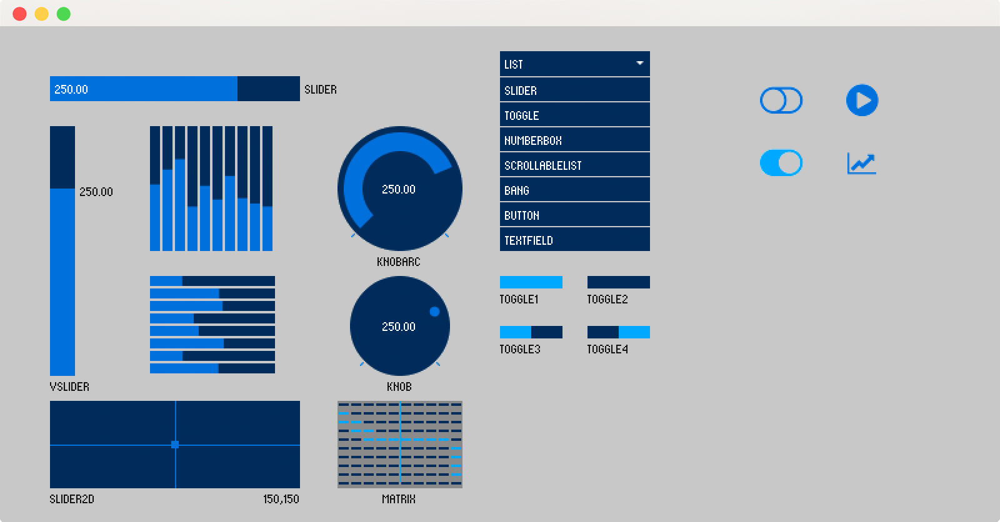
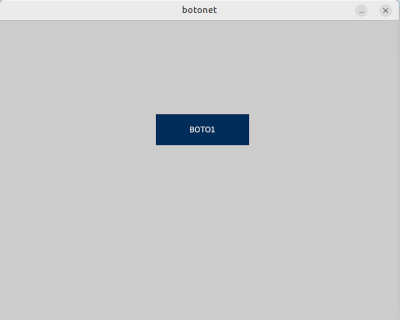

# Tema 9. Gràfics. ControlP5

!!! danger "Resultat d'aprenentatge associat"
    <strong>RA5. Realitza operacions d'entrada i sortida d'informació utilitzant procediments específics del llenguatge i llibreries de classes..</strong>

### Criteris d'avaluació

- [x] RA5.6. S'han utilitzat les eines de l'entorn de desenvolupament per crear interfícies gràfics d'usuari simples.
- [x] RA5.7. S'han programat controladors d'esdeveniments.
- [x] RA5.8. S'han escrit programes que utilitzin interfícies gràfics per a l'entrada i sortida d'informació.
Tainted Love	Imelda May

## Introducció

En aquest tema veurem la llibreria de controls gràfics per a interfícies d'usuari de què es disposa a Processing IDE. La llibreria ControlP5.

<center>
	<kbd style="border:1px solid #888;width:80%;"></kbd>
</center>

## La llibreria ControlP5

Fins ara hem estat utilitzant els esdeveniments keyPressed i mouseClicked per tal d'interactuar amb l'usuari o bé també utilitzant diàlegs popup.....

En aquest tema utilitzarem una llibreria de Processing IDE que es diu controlP5 que s'instal·la des del menú ** Tools --> Manage Tools**. Al diàleg que s'obre anem a la pestanya **Libraries** i busquem i instal·lem la llibreria **ControlP5**

ControlP5 és una col·lecció de controladors per crear una interfície d'usuari gràfica a la part superior del vostre esbós de processament inclouen controls lliscants, botons, commutadors, botons, camps de text, botons de ràdio, caselles de verificació, entre d'altres, i es poden afegir fàcilment a un esbós de processament. Es poden organitzar en contextos PGraphics de control separats i es poden organitzar en pestanyes o grups.

Amb ControlP5 podem fer:

- Grups: poden agrupar diversos controls.
- Botons
- Etiquetes de text o labels.
- Camps i arees de text.
- Desplegables
- Entre molts altres..

Per tal de poder utilitzar les llibreries ControlP5 de Processing només hauriem d'instal·lar la llibreria com s'instal·len les llibreries a Processing IDE.

!!! danger "Particularitats Processing IDE i ControlP5"
        Una vegada ja tens instal·lada la llibreria i abans de passar a utilitzar-la, has de tenir en compte una sèrie de consideracions molt importants per tal que funcione correctament.

        1. Processing treballa la part gràfica de l'entorn amb una classe anomenada PApplet que és la que s'utilitza per a dibuixar els **sketch** i a la qual també s'associen els controls derivats de la llibreria **ControlP5**. Per tant per poder utilitzar-la als nostres projectes ens hem d'assegurar que la classe que continga els controls ha de tindre accés al PApplet principal (main).

        2. La classe que continga els controls, una classe Menú per exemple, si volem que la interacció amb l'usuari funcione de forma correcta, haurà d'implementar la interfície **ControlListener**  per tant, haurà de tindre el mètode public void controlEvent(ControlEvent theEvent).

## Botons

Un botó dispara un esdeveniment després de que s'allibere. Els esdeveniments del botó es poden associar a funcions dins de la teua aplicació. Si vols veure més informació d'aquest control pots anar a la documentació de la [classe Controller](https://sojamo.de/libraries/controlP5/reference/index.html?controlP5/Button.html).

Primer crearem una xicoteta aplicació per posar botons i veure amb un poc més de detall com funcionen i que es pot fer amb ells. 

=== "Main"
    ```java linenums="1"
        Menu menu;

        void setup () {
            size(640,480);
            menu = new Menu(this);
        }   

        void draw () {
            menu.display();
        }
    ```


=== "Menu"
    ```java linenums="1"
        import controlP5.*;

        public class Menu implements ControlListener {
 
            private ControlP5 cp5;
            private Button boto1;
    
            public Menu(PApplet parent){
                cp5 = new ControlP5(parent);
        
                boto1 = cp5.addButton("BOTÓ", 1);
                boto1.setPosition(250,150);
                boto1.setSize(150,50);
                boto1.setColorActive(color(125,125,255));
            }
    
            public void controlEvent(ControlEvent theEvent) {  
                
            }
 
        public void display(){
            boto1.show();
        }
    }
    ```

Al codi anterior s'ha creat la **classe Menú** que és la que contindrà els controls de **controlP5**. Al nostre cas es tractarà inicialment d'un sol botó amb text **BOTO1** a la posició (250,150) amb una grandària de 150 per 150 píxels de color blau. Com pots observar també he implementat el mètode (buit de moment) **controlEvent** ja que es tracta d'una classe que implementa la interfície **ControlListener**. Finalment hem posat un mètode **display** public en el que bàsicament el que es fa és cridar al mètode **show()** de la classe Button de la llibreria ControlP5.

Al executar eixe codi es mostra el següent:

<center>
	
</center>

Ara ens quedaria com aconseguir que es puga interactuar amb l'usuari, en altres paraules, que quan l'usuari prema el botó l'aplicació faja alguna cosa. Per aconseguir-ho cal fer dues coses: la primera és afegir-li a l'objecte controlP5 qui serà el que està escoltant les accions que es poden realitzar amb els controls que conté, bàsicament fer clic sobre el botó en el nostre cas. Això es fa afegint-li al controlP5 un **listener** just després de la instanciació d'aquest.

```java linenums="1"
    cp5 = new ControlP5(parent);
    cp5.addListener(this);
```

En altres paraules el que li estem dient al botó és que quan el premem, el codi que ha d'executar-se associat al botó es troba a la mateixa classe **Menu** (this) mitjançant el mètode **controlEvent** de la interfície **ControlListener**

Finalment ens quedaria escriure el codi necessari al mètode **controlEvent** amb les accions que volem que es produeixen quan fem clic sobre el botó.

!!! danger "ControlEvent NO és un mètode de botó"
        Heu de tenir en compte que el mètode **controlEvent** és un mètode que pot respondre a accions de l'usuari en diferents controls de la mateixa classe. És a dir, que la nostra classe menú pot tindre més d'un botó i tots els esdeveniments executaran el mètode en qüestió.

=== "Main"
    ```java linenums="1"
        Menu menu;

        void setup () {
            size(640,480);
            menu = new Menu(this);
        }   

        void draw () {
            menu.display();
        }
    ```

=== "Menu"
    ```java linenums="1"
        import controlP5.*;

        public class Menu implements ControlListener {
 
            private ControlP5 cp5;
            private Button boto1;
    
            public Menu(PApplet parent){
                cp5 = new ControlP5(parent);
                cp5.addListener(this);
        
                boto1 = cp5.addButton("BOTÓ", 1);
                boto1.setPosition(250,150);
                boto1.setSize(150,50);
                boto1.setColorActive(color(125,125,255));
            }
    
            public void controlEvent(ControlEvent theEvent) {  
                switch (theEvent.getName()) {
                    case "boto1":
                        println("cas 1");
                    break;
                }
            }
 
            public void display(){
                boto1.show();
            }
        }
    ```

Per acabar, què passa si el que volem quan es premi un botó modifique l'estat del programa principal? Hem d'aprofitar que al constructor de la classe menú se li passa el **pare** (programa principal en el nostre cas) i per tant des dels esdeveniments de la classe **Menú** podriem cridar a mètodes de la classe pare. Per tant tot allò que volem que siga susceptible de modificar-se des de classes externes com el menú, haurem de crear mètodes als quals podem cridar des del menú.

=== "Main"
    
    ```java linenums="1"
        Menu menu;

        void setup () {
            size(640,480);
            menu = new Menu(this);
        }   

        void draw () {
            menu.display();
        }

        void mostraText (String strText) {
            println(strText);
        }
    ```

=== "Menu"    
    ```java linenums="1"
        import controlP5.*;

        public class Menu implements ControlListener {
 
            private ControlP5 cp5;
            private Button boto1;
    
            public Menu(PApplet parent){
                cp5 = new ControlP5(parent);
                cp5.addListener(this);
        
                boto1 = cp5.addButton("BOTÓ", 1);
                boto1.setPosition(250,150);
                boto1.setSize(150,50);
                boto1.setColorActive(color(125,125,255));
            }
    
            public void controlEvent(ControlEvent theEvent) {  
                switch (theEvent.getName()) {
                    case "boto1":
                        mostraText("Clic botó 1");
                    break;
                }
            }
 
            public void display(){
                boto1.show();
            }
        }
    ```

Al codi anterior hi ha un exemple amb el codi necessari per tal que un botó quan es premi mostre per terminal un text, però compliquem-ho un poc més. A continuació farem una aplicació simple amb tres botons (centrats) dalt d'una pantalla de 640 per 480 píxels on cadascun dels botons el que farà serà pintar la pantalla de fons d'un color concret. Per exemple: un botó que es diga **Roig** i pinte de roig el fons, un botó **Verd** que pinte de verd i finalment un botó **Blau** que pinte de blau.

=== "Main"
    ```java linenums="1"
        Menu menu;
        color fons;

        void setup () {
            size(640,480);
            fons = color(255);
            menu = new Menu(this);
        }

        void draw () {
            background(fons);
            menu.display();
        }

        void mostraText (String strText) {
            println(strText);
        }

    ```

=== "Menu"
    ```java linenums="1"
        import controlP5.*;

        public class Menu implements ControlListener {
        
            ControlP5 cp5;
            Button btnRoig, btnVerd, btnBlau;
            
            public Menu(PApplet parent){
                cp5 = new ControlP5(parent);
                cp5.addListener(this);
                
                btnRoig = cp5.addButton("ROIG", 1);
                btnRoig.setPosition(50,30);
                btnRoig.setSize(150,50);
                btnRoig.setColorActive(color(220,0,0));
                btnRoig.setFont(createFont("Arial", 12)); 
                
                btnVerd = cp5.addButton("VERD", 1);
                btnVerd.setPosition(250,30);
                btnVerd.setSize(150,50);
                btnVerd.setColorActive(color(0,200,0));
                btnVerd.setFont(createFont("Arial", 12)); 
                
                btnBlau = cp5.addButton("BLAU", 1);
                btnBlau.setPosition(450,30);
                btnBlau.setSize(150,50);
                btnBlau.setColorActive(color(0,0,200));
                btnBlau.setFont(createFont("Arial", 12));                 
            }
            
            public void controlEvent(ControlEvent theEvent) {  
                switch (theEvent.getName()) {
                    case "ROIG":
                        mostraText("Pintem de roig");
                        fons = color(200,0,0);
                    break;
                    
                    case "VERD":
                        println("Pintem de verd");
                        fons = color(0,200,0);
                    break;
                    
                    case "BLAU":
                        println("Pintem de blau");
                        fons = color(0,0,200);
                    break;
                    
                    default:
                        println("Ni idea de que ha passat");
                    break;
                }
            }
            
            public void display(){
                btnRoig.show();
                btnVerd.show();
                btnBlau.show();
            }
        }
    ```

??? question "Activitat 801. Crea una aplicació amb un botó"
    === "Enunciat"
        Dissenya una aplicació amb un menú que tinga quatre botons.

            1. El primer s'encarregarà d'alternar el color de fons de l'aplicació entre pistatxo i fuchsia.
            2. El segon demanarà el nom de l'usuari utilitzant la classe JOptionPane i després saludarà amb el text: "Hola ..."
            3. El tercer botó dibuixarà cercles del color contrari del fons en una posició aleatòria i de grandària 20 píxels.
            4. El quart botó ha de tancar l'aplicació.

    === "Rúbrica"
        | Criteri | 4 (Excel·lent) | 3 (Correcte) | 2 (Parcial) | 1 (Incorrecte) | 0 (Inexistent) | Pes |
        |--------|----------------|--------------|-------------|----------------|----------------|------|
        | **Disseny de la interfície (RA5.6)** | 4 botons clars, ben alineats i interfície neta | 4 botons correctes però disseny millorable | Hi ha botons però mal distribuïts o poc clars | Interfície confusa o incompleta | No hi ha interfície funcional | 20% |
        | **Ús de controlP5 (plugTo)** | Tots els botons usen correctament `plugTo` | Ús correcte amb algun detall menor | Ús inconsistent o barrejat | Mal ús de `plugTo` | No s’utilitza o no funciona | 15% |
        | **Botó 1: canvi de color** | Alterna correctament entre dos colors sempre | Funciona amb algun error puntual | Canvia color però no alterna bé | Funcionament incorrecte | No funciona | 10% |
        | **Botó 2: nom i salutació** | Demana nom i mostra salutació correcta | Funciona amb algun detall menor | Entrada o eixida incompleta | Funcionament incorrecte | No funciona | 15% |
        | **Botó 3: cercles aleatoris** | Cercles correctes, color contrari i posició aleatòria | Funciona amb algun error menor | Dibuixa però amb errors clars | Funcionament incorrecte | No funciona | 15% |
        | **Botó 4: tancar aplicació** | Tanca correctament l’aplicació | Funciona però millorable | Comportament irregular | Funcionament incorrecte | No funciona | 10% |
        | **Gestió d’esdeveniments (RA5.7)** | Mètodes clars i ben separats per a cada botó | Bona estructura amb algun detall | Estructura poc clara | Gestió incorrecta | No hi ha gestió d’esdeveniments | 10% |
        | **Qualitat del codi** | Codi net, ordenat i comentat | Bastant clar | Poc estructurat | Confús | Incomprensible o erroni | 5% |

<!--    [Descarrega la solució ací](assets/Tema9/act901.zip)-->

## CheckBox

En informàtica, una casella de verificació, check box, checkbox, tickbox o tick box es un element de interacció de la interfície gràfica d'usuari del Sistema Operatiu, que permet a este fer selecciones múltiples d'un conjunto de opcions, marcar respostes, etc.. 

Però vegem un exemple. Crearem un checkbox amb sis opcions múltiples que l'usuari podrà marca i desmarcar. Després entrarem més en detall de com controlar els esdeveniments dispara la interacció de l'usuari amb el checkbox.

=== "Main"
    ```java linenums="1"
        Opcions opcions;

        void setup () {
            size(640,480);
            opcions = new Opcions(this);
        }

        void draw () {
            opcions.display();
        }
    ```

=== "Opcions"
    ```java linenums="1"
        import controlP5.*;

        public class Opcions implements ControlListener {
        
            ControlP5 cp5;
            Button boto1;
            CheckBox checkbox;
            
            public Opcions(PApplet parent){
                cp5 = new ControlP5(parent);
                cp5.addListener(this);
                    
                checkbox = cp5.addCheckBox("checkBox");
                checkbox.setPosition(100, 200);
                checkbox.setColorLabels(color(255,0,0));
                checkbox.setSize(40, 40);
                checkbox.setItemsPerRow(3);
                checkbox.setSpacingColumn(35);
                checkbox.setSpacingRow(30);
                checkbox.addItem("OPCIO1", 50);
                checkbox.addItem("OPCIO2", 100);
                checkbox.addItem("OPCIO3", 150);
                checkbox.addItem("OPCIO4", 200);
                checkbox.addItem("OPCIO5", 255);    
            }
            
            public void controlEvent(ControlEvent theEvent) {
                switch (theEvent.getName()) {
                    case "checkBox":
                        println("CheckBox clicat");
                    break;
                
                    default:
                        println("ERROR (controlEvent): " + theEvent.getName());
                    break;
                }
            }
            
            public void display(){
                checkbox.show();
            }
        }
    ```
    
Ara ens queda la part en la que obtenim del nostre checkbox quina o quines són les opcions seleccionades, recorda que un checkbox és un control de selecció múltiple, i quines són les accions a realitzar en base a les opcions clicades, és a dir, programar els esdeveniments associats al checkbox. Per això canviarem el nom de les opcions per tal que siguen més significatives del que es suposa que faran.

Canvia al codi anterior les línies **addItem** per les següents:

```java linenums="1"
    checkbox.addItem("ROIG", 50);
    checkbox.addItem("FONT GRAN", 100);
    checkbox.addItem("VORA", 150);
    checkbox.addItem("VERTICAL", 200);
    checkbox.addItem("HORITZONTAL", 255);    
```

Ara hauriem de implementar el mètode **controlEvent(ControlEvent theEvent)**. Escriu el següent codi i observa el que passa:

```java linenums="1"
    public void controlEvent(ControlEvent theEvent) {
        switch (theEvent.getName()) {
        case "checkBox":
            println("CheckBox clicat");
            List <Toggle> optionsList = checkbox.getItems();
            for (Toggle item : optionsList) {
                println("opció " + t.getName() + " - " + item.getState());
            }
        break;
        
        default:
            println("ERROR (controlEvent): " + theEvent.getName());
        break;
        }
    }
```

Amb el codi anterior, quan fages clic sobre alguna de les opcions del nostre control de selecció múltiple, es mostraran al terminal totes les opcions com les hem programades i quin valor tenen: true (checked), false (not checked).

!!! tip "Configuració de la font"
    Segurament hauràs observat que la grandària del text de les opcions costa un poc de llegir. Si vols canviar les característiques de la font que es mostra a les opcions, afegeix la següent línia:

    ```java linenums="1"
        cp5.setFont(createFont("Arial",10,true));
    ```

??? question "Activitat 802. Crea una aplicació amb un checkbox"
    Crea una aplicació que tinga una llista d'opcions (checkbox) i un botó. Al llistat d'opcions (checkbox) l'usuari determinarà les característiques d'un rectangle que es dibuixarà quan fem clic sobre el botó.

    Les característiques que es podran determinar del rectangle són:

        1. Si te vora o no te vora.
        2. Si està pintat per dins o no.
        3. Si la grandaria de la font es gran o no.
        4. El·lipse vertical.
        5. El·lipse horitzontal.

    L'usuari seleccionarà les opcions que considere i quan faja clic al botó, es modificaran les característiques de l'el·lipse que es dibuixarà al centre de la pantalla de la nostra aplicació.

<!--    [Descarrega la solució ací](assets/Tema9/act902.zip)-->

## Llistes desplegables

Les llistes desplegables són un tipus de control que permet a l'usuari seleccionar una opció de totes les que conté la llista. Quan una llista desplegable està desactivat només mostra un valor, en canvi si està activat, és a dir, si fem clic sobre ella, desplegarà una llista amb totes les opcions disponibles per tal que l'usuari puga triar-ne alguna.

Aquest tipus de control l'hauràs vist per exemple a formularis de subscripció on pot triar la data de naixement, els mesos solen apareixer representats en una llista desplegable.

Veja'm un exemple. Fem una aplicació simple en la que es mostren tres desplegables on podrem triar la data de naixement (dd/mm/aaaa) i cada vegada que canviem algun element de les nostres llistes desplegables, mostrarà un missatge felicitant-nos l'aniversari.

=== "Main"
    ```java linenums="1"

        Opcions opcions;

        void setup () {
            size(640,480);
            opcions = new Opcions(this);
            strDia = "1";
            strMes = "GENER";
            strAny = "1900";
        }

        void draw () {
            clear();
            background(200);
            opcions.display();
            textSize(40);
            textAlign(CENTER);
            text(strDia + " - " + strMes + " - " + strAny, 320, 240); 
        }
    ```

=== "Controls"
    ```java linenums="1"

        import java.util.*;
        import controlP5.*;

        public class Opcions implements ControlListener {
            private ControlP5 cp5;
            private ScrollableList ddlDia, ddlMes, ddlAny;
            
            public Opcions(PApplet parent){
                cp5 = new ControlP5(parent);
                cp5.addListener(this);
                cp5.setFont(createFont("Arial",12,true));
                
                ddlDia = cp5.addScrollableList("dia");
                ddlDia.setHeight(200);
                ddlDia.setPosition (50,50);
                ddlDia.setBarHeight(22);
                ddlDia.setItemHeight(22);
                ddlDia.setOpen(false);
                for (int i=1; i <= 31; i ++)
                    ddlDia.addItem(String.valueOf(i),i);
                
                ddlMes = cp5.addScrollableList("mes");
                ddlMes.setHeight(200);
                ddlMes.setPosition(160,50);
                ddlMes.setBarHeight(20);
                ddlMes.setItemHeight(20);
                ddlMes.setOpen(false);
                ddlMes.addItem("GENER",  1);
                ddlMes.addItem("FEBRER",  2);
                ddlMes.addItem("MARÇ",  3);
                ddlMes.addItem("ABRIL",  4);
                ddlMes.addItem("MAIG",  5);
                ddlMes.addItem("JUNY",  6);
                ddlMes.addItem("JULIOL",  7);
                ddlMes.addItem("AGOST",  8);
                ddlMes.addItem("SETEMBRE",  9);
                ddlMes.addItem("OCTUBRE", 10);
                ddlMes.addItem("NOVEMBRE", 11);
                ddlMes.addItem("DESEMBRE", 12);
                
                ddlAny = cp5.addScrollableList("any");
                ddlAny.setHeight(200);
                ddlAny.setPosition(270,50);
                ddlAny.setBarHeight(20);
                ddlAny.setItemHeight(20);
                ddlAny.setOpen(false);
                for(int i=1950; i < 2020; i++)
                    ddlAny.addItem(String.valueOf(i), i);
            }
            
            public void controlEvent(ControlEvent theEvent) {
                
            }
            
            public void display() {
                ddlDia.show();
                ddlMes.show();
                ddlAny.show();
            }
        }
    ```

Al codi anterior pots observar que el controlP5 que usem és **ScrollableList**. En total hem instanciant tres ScrollableLists, una per als dies del mes (1-31), la segona per als mesos ("GENER - DESEMBRE") i finalment una altra per a l'any de la data de naixement.

!!! danger "ControlP5 DropDownList"
    També existeix dins del repositori de controls de la llibreria **ControlP5** el control **DropdownList** però aquest està obsolet i no és recomanable utilitzar-lo si existeixen alternatives.

Una vegada tenim els controls creats el que hem fet ha sigut afegir-los els items que hi mostraran i el valor que tenen per poder treballar amb ells a posteriori.

La part més complicada d'aquest tipus de controls està en com capturem la informació una vegada la llista llença un esdeveniment (clic normalment o value changed), en altres paraules, què fem quan l'usuari canvie algun valor d'alguna llista desplegable. Mir a el codi i prova'l.

=== "Main"
    ```java linenums="1"
        Opcions opcions;
        String strDia, strMes, strAny;

        void setup () {
            size(640,480);
            opcions = new Opcions(this);
            strDia = "1";
            strMes = "GENER";
            strAny = "1900";
        }

        void draw () {
            clear();
            background(200);
            opcions.display();
            textSize(40);
            textAlign(CENTER);
            text(strDia + " - " + strMes + " - " + strAny, 320, 240); 
        }

        void setDia (String d) {
            this.strDia = d;
        }

        void setMes (String m) {
            this.strMes = m;
        }

        void setAny (String y) {
            this.strAny = y;
        }
    ```

=== "Controls"
    ```java linenums="1"
        import java.util.*;
        import controlP5.*;

        public class Opcions implements ControlListener {
            private ControlP5 cp5;
            private ScrollableList ddlDia, ddlMes, ddlAny;
            
            public Opcions(PApplet parent){
                cp5 = new ControlP5(parent);
                cp5.addListener(this);
                cp5.setFont(createFont("Arial",12,true));
                
                ddlDia = cp5.addScrollableList("dia");
                ddlDia.setHeight(200);
                ddlDia.setPosition (50,50);
                ddlDia.setBarHeight(22);
                ddlDia.setItemHeight(22);
                ddlDia.setOpen(false);
                for (int i=1; i <= 31; i ++)
                ddlDia.addItem(String.valueOf(i),i);
                
                ddlMes = cp5.addScrollableList("mes");
                ddlMes.setHeight(200);
                ddlMes.setPosition(160,50);
                ddlMes.setBarHeight(20);
                ddlMes.setItemHeight(20);
                ddlMes.setOpen(false);
                ddlMes.addItem("GENER",  1);
                ddlMes.addItem("FEBRER",  2);
                ddlMes.addItem("MARÇ",  3);
                ddlMes.addItem("ABRIL",  4);
                ddlMes.addItem("MAIG",  5);
                ddlMes.addItem("JUNY",  6);
                ddlMes.addItem("JULIOL",  7);
                ddlMes.addItem("AGOST",  8);
                ddlMes.addItem("SETEMBRE",  9);
                ddlMes.addItem("OCTUBRE", 10);
                ddlMes.addItem("NOVEMBRE", 11);
                ddlMes.addItem("DESEMBRE", 12);
                
                ddlAny = cp5.addScrollableList("any");
                ddlAny.setHeight(200);
                ddlAny.setPosition(270,50);
                ddlAny.setBarHeight(20);
                ddlAny.setItemHeight(20);
                ddlAny.setOpen(false);
                for(int i=1950; i < 2020; i++)
                ddlAny.addItem(String.valueOf(i), i);
            }
            
            public void controlEvent(ControlEvent theEvent) {
                String name = theEvent.getController().getName();
                int index = (int)theEvent.getController().getValue();
                String valor = cp5.get(ScrollableList.class, name).getItem(index).get("name").toString();
                switch (name) {
                case "dia":
                    println("dia: " + valor);
                    setDia(valor);
                break;
                
                case "mes":
                    println("mes: " + valor);
                    setMes(valor);
                break;
                
                case "any":
                    println("any: " + valor);
                    setAny(valor);
                break;
                }
            }
            
            public void display() {
                ddlDia.show();
                ddlMes.show();
                ddlAny.show();
            }
        }
    ```

A aquest codi se li han afegit els mètodes setDia, setMes i setAny al main per tal que puguen ser cridats des de la classe Opcions on tenim les llistes desplegables. Quan algun valor en alguna llista desplegable canvie, es dispara automàticament el mètode controlEvent. Primer esbrinem quina és la llista que ha provocat aquest esdeveniment amb el **getName()** i després cridem al mètode corresponent del main per tal que modifique els valors de dia, mes o any.

??? question "Activitat 803. Crea una aplicació amb un desplegable"
    Modifica l'exemple anterior per tal que no mostre el resultat dels canvis en les diferents llistes desplegables fins que es premi un botó (Submit) que hi afegiràs.

## RadioButton

El control RadioButton és un control gràfic que permet a l'usuari escollir només una de les opcions que ens mostra aquest control. Aquesta característica singular converteix els **radiobutton** en diferents als **checkbox**, on sí podem escollir més d'una opció simultània.

El primer que farem serà instanciar un control de la classe radiobutton configurar-lo i que es mostre per pantalla amb les opcions necessàries.

=== "Main"
    ```java linenums="1"
        Opcions opcions;

        void setup () {
            size(640,480);
            opcions = new Opcions(this);
        }

        void draw () {
            clear();
            background(200);
            opcions.display();
        }
    ```

=== "Opcions"
    ```java linenums="1"
        import java.util.*;
        import controlP5.*;

        public class Opcions implements ControlListener {
            private ControlP5 cp5;
            private RadioButton r1;
            private PVector position;
            
            public Opcions(PApplet parent){
                cp5 = new ControlP5(parent);
                cp5.addListener(this);
                cp5.setFont(createFont("Arial",11,true));
                    
                position = new PVector(135,230);
                r1 = cp5.addRadioButton("radioButton");
                r1.setPosition(position.x, position.y);
                r1.setSize(20,20);
                r1.setColorForeground(color(120,0,250));
                r1.setColorActive(color(255,0,0));
                r1.setColorLabel(color(0));
                r1.setItemsPerRow(5);
                r1.setSpacingColumn(55);
                r1.addItem("ROIG",1);
                r1.addItem("VERD",2);
                r1.addItem("BLAU",3);
                r1.addItem("FUCHSIA",4);
                r1.addItem("PISTATXO",5);
            }
            
            public void controlEvent(ControlEvent theEvent) {
                println("clic");
            }
            
            public void display() {
                fill(0);
                textSize(16);
                text ("RADIO BUTTON LIST",position.x+110, position.y-20);
                fill(255);
                strokeWeight(1);
                rect(position.x-10, position.y-10, 385, 40);
                stroke(0);
                r1.show();
            }
        }
    ```

Finalment i igual que hem estat fent amb els controls vistos fins ara, ens quedaria programar el seu comportament. El que s'ha de fer és implementariem el mètode **controlEvent** fent que aquest cride als mètodes necessaris a la classe principal **Main**.  

El que farem en aquesta aplicació és assignar un color de fons a cada opció de tal forma que quan seleccionem alguna opció, el color del fons de l'aplicació canvie a l'escollit. Per tant serà necessari implementar un mètode **canviaColor(color c)** a la classe principal que siga accessible des del mètode **controlEvent** de la classe **Opcions**

```java linenums="1"
    public void controlEvent (ControlEvent theEVent) {
        int value = (int)theEvent.getValue();
        switch (value) {
        case 1:
            colorActive = color(255,0,0);
            canviaColor(colorActive);
        break;
        
        case 2:
            colorActive = color(0,255,0);
            canviaColor(colorActive);
        break;
        
        case 3:
            colorActive = color(0,0,255);
            canviaColor(colorActive);
        break;
        
        case 4:
            colorActive = color(255,90,250);
            canviaColor(colorActive);
        break;
        
        case 5:
            colorActive = color(120,225,140);
            canviaColor(colorActive);
        break;
        
        default:
            colorActive = color(255,255,255);
            canviaColor(colorActive);
        break;
        }
        r1.setColorActive(colorActive);
    }
```

```java linenums="1"
    void canviaColor(color c) {
        this.pinta = c;  // pinta és una variable global de l'arxiu principal
    }

```

Nomes quedaria al draw indicar que el background s'ha de pintar amb el valor que conté la variable global **pinta**.

??? question "Activitat 804. Crea una aplicació amb un radiobutton"
    Dissenya una aplicació en la que utilitzes mínim un radiobutton amb 5 opcions diferents. Eres lliure de programar el seu comportament com consideres.

## TextField

Un **TextField** és un control gràfic d'interfície d'usuari, que deuria habilitar a l'usuari per poder introduir informació en forma de text per tal que puga ser utilitzada per una aplicació.

A continuació mostrem un exemple de com es podria utilitzar un textField, des de mostrar-lo per pantalla, configurar-lo i controlar els esdeveniments que llenci.  Mira el codi i fixa't com és molt semblant al que estem fent fins ara amb la resta de controls de la llibreria **controlP5**.

=== "Main"
    ```java linenums="1"
        String strNom;
        Controls control;

        void setup () {
            size(640,480);
            control = new Controls(this);
            strNom = "";
        }

        void draw () {
            clear();
            background(255);
            control.display();
            fill(0);
            textSize(20);
            textAlign(CENTER);
            text("Hola " + this.strNom, width/2, height/2-20);
        }

        void setName (String theValue) {
            this.strNom = theValue;
        }
    ```

=== "Controls"
    ```java linenums="1"
        import controlP5.*;

        public class Controls implements ControlListener {
            private ControlP5 cp5;
            private Textfield txtField;
            private PVector pos;
            
            public Controls(PApplet parent) {
                this.pos = new PVector(width/2,height/2);
                this.cp5 = new ControlP5(parent);
                this.cp5.addListener(this);
                this.cp5.setFont(createFont("FreeMono",14,true));
                
                this.txtField = cp5.addTextfield("NOM",(int)pos.x-100, (int)pos.y-15, 200, 30);
                this.txtField.setColor(color(0));
                this.txtField.setColorActive(color(0,255,0));
                this.txtField.setColorBackground(color(255));
                this.txtField.setColorCaptionLabel(0);
            }
            
            public void display () {
                txtField.show();
            }
            
            public void controlEvent(ControlEvent theEvent) {
                if (theEvent.getName() == "NOM")
                setName(txtField.getText());
            }
        }
    ```


!!! note "Input TextArea"
    Un textArea és molt semblant al textField revisant un poc la seua documentació, és fàcil d'adaptar el codi anterior i convertir que textField que hem utilitzat en un textArea.

??? question "Activitat 805. Crea una aplicació amb un camp de text"
    Dissenya la típica pantalla de login en la que es demana un usuari i una contrasenya. Quan s'introdueixen les dades s'ha de poder premer el botó de login que també hauràs de posar al teu formulari.

## Slide

Per acabar amb aquest tema veurem un control anomenat **Slider**. En l'exemple que mostrarem a continuació, disposarem de tres controls de tipus slide que ens indicaran el percentatge (0-100) de color **roig**, **verd** i **blau** amb els que pintarem el fons de la pantalla.

Mira el codi següent:

=== "Main"
    ```java linenums="1"
        Controls control;
        color pinta;

        void setup () {
            size(640,480);
            control = new Controls(this, new PVector(20,20));
            pinta = color(0,0,0);
        }

        void draw () {
            clear();
            background(pinta);
            control.display();
        }

        void setColor (color c) {
            pinta = c;
        }
    ```

=== "Controls"
    ```java linenums="1"
        import controlP5.*;

        public class Controls implements ControlListener {
            private PVector pos;
            private ControlP5 cp5;
            private Slider sldRed, sldGreen, sldBlue;
            private int iRed, iGreen, iBlue;
            
            public Controls (PApplet parent, PVector p) {
                
                this.iRed = 0;
                this.iGreen = 0;
                this.iBlue = 0;
                color c = color(iRed, iGreen, iBlue);
                setColor(c);
                
                this.pos = p.copy();
                this.cp5 = new ControlP5(parent);
                this.cp5.addListener(this);
                this.cp5.setFont(createFont("FreeMono",14,true));
                
                this.sldRed = cp5.addSlider("ROIG");
                this.sldRed.setPosition(pos.x+10,pos.y+25);
                this.sldRed.setRange(0,255);
                this.sldRed.setSize(140,20);
                this.sldRed.setLabel("ROIG (0-255)");
                this.sldRed.getCaptionLabel().align(ControlP5.LEFT, ControlP5.TOP_OUTSIDE).setPaddingX(0);
                this.sldRed.setColorCaptionLabel(color(0));
                
                this.sldGreen = cp5.addSlider("VERD");
                this.sldGreen.setPosition(pos.x+10,pos.y+70);
                this.sldGreen.setRange(0,255);
                this.sldGreen.setSize(140,20);
                this.sldGreen.setLabel("VERD (0-255)");
                this.sldGreen.getCaptionLabel().align(ControlP5.LEFT, ControlP5.TOP_OUTSIDE).setPaddingX(0);
                this.sldGreen.setColorCaptionLabel(color(0));
                
                this.sldBlue = cp5.addSlider("BLAU");
                this.sldBlue.setPosition(pos.x+10,pos.y+115);
                this.sldBlue.setRange(0,255);
                this.sldBlue.setSize(140,20);
                this.sldBlue.setLabel("BLAU (0-255)");
                this.sldBlue.getCaptionLabel().align(ControlP5.LEFT, ControlP5.TOP_OUTSIDE).setPaddingX(0);
                this.sldBlue.setColorCaptionLabel(color(0));
            }
            
            public void display () {
                fill(210);
                stroke(255);
                strokeWeight(2);
                rect(pos.x,pos.y,160,300);
            }
            
            public void controlEvent(ControlEvent theEvent) {
                switch (theEvent.getController().getName()) {
                case "ROIG":
                    iRed = (int)theEvent.getController().getValue();
                break;
                
                case "VERD":
                    iGreen = (int)cp5.getController("VERD").getValue();
                break;
                
                case "BLAU":
                    iBlue = (int)cp5.getController("BLAU").getValue();
                break;
                }
                
                color c = color(iRed,iGreen,iBlue);
                setColor(c);
            }
        }
    ```

??? question "Activitat 806. Amplia l'exemple anterior"
    Basant-se en l'exemple anterior, afegeix un slider més per tal que també es puga modificar el valor alpha del color de fons.
    


<!--### Introducció a ControlP5
- Què és controlP5
- Instal·lació de la llibreria

### Controls bàsics
- Botons
- Sliders
- Camps de text
- Etiquetes

### Gestió d'esdeveniments
- ControlListener
- controlEvent
- Interacció amb l'usuari.

### Comunicació amb el programa principal
- Classes menú
- Modificar l'estat de l'aplicació

### Connexió amb fitxers
- Guardar dades des de la GUI
- Recuperar informació guardada

## Projecte final del tema

!!! note
    "Aplicació completa d'entrada i eixida"

### Descripció del projecte
- Interfície gràfica
- Entrada de dades per GUI
- Guardar i recuperar dades de fitxer

### Requisits mínims
- Ús de ControlP5
- Eixida per pantalla
- Persistència de les dades.

### Ampliacions possibles
- Millora visual
- Validacions
- Estadístiques.

## Resum i connexions amb altres temes
- Què hem après
- Relació amb programació modular i classes.
- Preparació per a projectes més grans


-->

