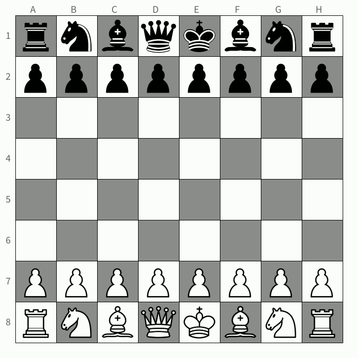

# Tema 10. Herència, polimorfisme i interfícies

## Introducció
Un dels mecanismes més potents que incorpora el **paradigma de programació orientada a objectes** són **l’herència** i el **polimorfisme.** 

El <ins>**primer**</ins> ens permet crear una jerarquia de classes relacionades entre sí de tal forma que la quantitat de codi, especialment el codi redundant, es redueix significativament. 

El <ins>**segon**</ins> permet redefinir mètodes de tal forma que realitzen funcions diferents depenent del context en el qual es troben. En altres paraules, el **polimorfisme** és el mecanisme de la programació orientada a objectes que permet que una funció amb el mateix nom realitze tasques diferents depenent de l’objecte des del qual es fa referència. 

Finalment també veurem com a les **interfícies** podrem especificar les operacions que haurien de definir-se a les classes que la implementen. Una interfície és un mitjà per a que els objectes no relacionats es comuniquen entres sí. Aquestes són les definicions de mètodes i valors sobre els quals els objectes estan d’acord per cooperar.

## Herència
En programació orientada a objectes l’herència és un mecanisme que permet potenciar la reutilització i l’extensibilitat en el desenvolupament de programari a banda de **reduir la quantitat de codi redundant.** Aquest mecanisme permet crear noves classes a partir d’una classe o **jerarquia de classes** preexistent (ja comprovades i verificades) evitant d’aquesta forma el redisseny, la modificació i verificació de la part ja implementada. L’herència facilita la creació d’objectes a partir d’altres ja existents i implica que una subclasse obté tot el comportament (mètodes) i finalment els atributs (variables) de la seua superclasse.

Suposem el cas en el que disposem de dues classes (amb menys classes resultaria impossible l’herència), una s’anomenarà: **classe base, superclasse o classe pare;** mentre que l’altra serà **la classe derivada, subclasse o classe filla.**

Seguint amb l'exemple del tema anterior del **Volcano** [(Descarrega'l ací)](assets/Tema7/Volcano.zip), els nostres piroclasts tenen tots les mateixes característiques (aparença) i tots tenen el mateix comportament conforme l'hem dissenyada fins ara. Si apliquem els conceptes d'herència i polimorfisme al nostre projecte el canvi pot ser significatiu.

Basant-nos en el projecte del volcà del tema anterior però aplicant algunes modificacions de classes i amb el que varem explicar al tema anterior sobre **herència** on haviem dissenyat una sèrie de classes derivades de **Piroclast** com es podreu observar al següent esquema:

!!! danger "Canvis Projecte Volcano"
    La classe **Con** es converteix en la classe **Crater**
    La classe **Cendra** ara és la classe **Fum**

<center>
	```mermaid
		classDiagram 
            Crater "1" --> "*" Piroclast

			Piroclast <|-- Fum
			Piroclast <|-- Lava
			Piroclast <|-- Roca
	```
</center>

Ara tenim una superclasse **Piroclast** amb les subclasses associades **Fum**, **Lava** i **Roca**. Tots tres són **Piroclasts**, és a dir, tots tenen: posició, direcció, velocitat, color inicial, color final, temps de vida i grandaria a banda d'altres atributs que anirem veient i, a més a més, a tots els afecten les lleis de la física, però cadascuna de les subclasses tenen certes **peculiaritats:**

- El **fum** sol anar sempre cap amunt es dissipa amb facilitat i es sol veure afectat per la direcció en la que va el vent.
- La **lava** pot ser des de liquida fins quasi sòlida, els colors varien mentre cau i al final s'esclafa en terra.
- Les **roques** a banda de ser sòlides, poden adoptar moltes formes diferents i quan cauen reboten.

La **classe base** en una jerarquia d’herència és la classe que conté els **atributs i mètodes comuns** a totes les classes derivades i és per això que s’evita la redundància del codi que es produiria si haguérem de repetir codi comú a cadascuna de les subclasses, per tant, es podria deduir que una classe derivada és de facto una ampliació de les funcionalitats de la classe base ja que contindrà tant els membres de la classe base com els que s'afegeixen de més a la classe derivada.

### Declaració d'una classe derivada
Per tal de declarar que una classe hereta d’una altra, Java utilitza la paraula reservada **extends**. Si ens basem en el diagrama de classes anteriors, el codi quedaria de la següent forma:

```java linenums="1"
public class Piroclast {
    // Codi de la classe Piroclast
}

public class Fum extends Piroclast {
    // Codi de la classe Fum
}

public class Lava extends Piroclast {
    // Codi de la classe Lava
}

public class Roca extends Piroclast {
    // Codi de la classe Roca
}
```

Respecte de la **visibilitat** dels membre de la superclasse, les subclasses tindran accés als membres, siguen atributs o mètodes, public o protected mentre que no heretaran els membres privats de la classe pare. 

### Disseny de subclasses
Dissenyar és adaptar la realitat que es vol representar a un model concret, en el nostre cas els diagrames de classes d’UML. És en aquest pas en el que s’han de prendre les decisions que poden condicionar el resultat final de la nostra aplicació i no sempre és fàcil determinar quines són les relacions que s’han d’establir.  És per això que cal tenir en ment sempre la següent màxima: 

!!! quote "Principi de programació"
    «La jerarquia de classes més eficient i efectiva és aquella que minimitza el codi al redundant al màxim i simplifica el codi»
    «És molt habitual una vegada finalitzat el projecte "refactoritzar" i modificar atributs i mètodes comuns»

Al utilitzar el mecanisme de l’herència en programació orientada a objectes hem d’intentar sempre tindre un màxim de membres a la superclasse i després a les diferents subclasses només aquells membres o atributs que fan de discriminador, és a dir, que diferencien la classe especialitzada (o subclasse) de la classe superior.

A la nostra classe Piroclast ens interessa saber com ja haviem fet al tema anterior: la posició, la direcció, velocitat, color inicial, color final i grandària. Mentre que de les subclasses seria interessant saber del fum la seua densitat i com li afecta el vent, de la lava volem saber un color inicial i final que ens simule com va canviant de temperatura, mentre que de la roca ens interessa la forma que té i que pot rebotar.

<center>
	```mermaid
		classDiagram 
			direction LR
            Crater: #ample
            Crater: #alt
            Crater: #color
            Crater: #posicio
            Crater: + Crater(int, int)
            Crater: + display()
            Crater: + update()
            Crater: + run()
            Crater: + createPiroclast()
            Crater: - mostraPiroclasts()
            Crater: - actualitzaPiroclasts()
            Crater: - comprovaMorts()
            Crater "1" --> "*" Piroclast

            Piroclast: # velocitat
            Piroclast: # grandaria
            Piroclast: # lifeSpan
            Piroclast: # colorInicial
            Piroclast: # colorActual
            Piroclast: # colorFinal
            Piroclast: # posicio
            Piroclast: # direccio
            Piroclast: # alturaTerra

            Piroclast: + Piroclast (PVector, int, color, color)
            Piroclast: + display()
            Piroclast: + update()
            Piroclast: + quedaVida() 
            Piroclast: + estaTocantTerra()
            Piroclast: + estaParada() 
            

            Fum: - dissipacio
            Fum: - expansio
            Fum: + display()
            Fum: + update()

            Lava: - percentColor
            Lava: + display()
            Lava: + update()

            Roca: - percentColor
            Roca: - angleDeGir
            Roca: - velAngular
            Roca: - sentitRellotge 
            Roca: + display()
            Roca: + update()
            Roca: - rebota()
            Roca: - calculaAngleGir()
            Roca: - actualitzaColor()

			Piroclast <|-- Fum
			Piroclast <|-- Lava
			Piroclast <|-- Roca
	```
</center>

??? question "Activitat 701. El joc dels escacs"
    Fes un diagrama de classes per al joc dels escacs utilitzant els mecanismes d'herència com hem vist amb l'exemple del Volcano.
    
    <center>
	    <kbd style="border:1px solid #888;width:50%;"></kbd>
    </center>

    Basant-nos en la imatge anterior, podriem fer un dissenya amb un tauler de joc una classe base fitxa que aglutine tots els atributs i mètodes comuns i després per cada una de les fitxes diferents: torre, cavall, àlfil, peó, torre, rei i reina es podrien crear classes derivades on especificariem les diferències en aparença, cada fitxa té una forma, i en comportament, cada fitxa es mou d'una forma diferent.

### Herència pública
En Java tenim la possibilitat de fer protected **(#)** private **(-)** public **(+)** i package **(~)** ens determina la visibilitat dels membres d’una classe. Java considera que l’herència és sempre pública i que la classe derivada tindrà per tant accés als membres protected i public de la classe pare però no als membres privats. El fet de poder tindre elements privats a la nostra classe base seria per poder ocultar informació a les classes derivades.

Fixa't que ací els atributs de la classe pare o **superclasse** ja no usen el modificador de visibilitat private sino **protected**. Si no les subclasses no podrien heretar els atributs de la classe pare.

Traduint el diagrama de classes anterior i aplicant els modificadors de visibilitat adequats, el codi podria quedar de la següent forma:

=== "Piroclast"

    ```java linenums="1"
    public class Piroclast {
        protected int     velocitat;     /** Magnitud en metres per segon                                  */
        protected int     grandaria;     /** Grandaria del piroclast en píxels                             */
        protected int     lifeSpan;      /** Temps de vida que li queda en frames                          */
        protected color   colorInicial;  /** Color base o inicial del piroclast                            */
        protected color   colorActual;   /** Color amb el que el piroclast està pintat                     */
        protected color   colorFinal;    /** Color al qual va el piroclast conforme es gela                */
        protected PVector posicio;       /** Vector de posició del piroclast                               */
        protected PVector direccio;      /** Vector de direcció (en realitat velocitat vectorial)          */
        protected float   alturaTerra;   /** Punt de l'eix de les y on ha de tocar terra la roca i rebotar */

        public Piroclast (PVector v, int i, color c1, color c2) {}
        public void update () {}
        public void display () {}
        public boolean quedaVida () 
        public boolean estaTocantTerra () 
        public boolean estaParada () 
    }
    ```

=== "Fum"

    ```java linenums="1"
    public class Fum extends Piroclast {
        private float dissipacio;
        private float expansio;
        
        public Fum (PVector posCrater) { }
        public void display () {}
        public void update  () {}
    }
    ```

=== "Lava"

    ```java linenums="1"
    public class Lava extends Piroclast {
        private float percentColor;

        public Lava (PVector posCrater) { }
        public void display () {}
        public void update () {}
    }
    ```

=== "Roca"

    ```java linenums="1"
    public class Roca extends Piroclast {
        private float percentColor;
        private float angleGir;
        private float velAngular;
        private boolean sentitRellotge;

        public Roca (PVector posCrater) { }
        public void display () {}
        public void update () {}
        private void rebota() {}
        private void calculaAngleGir () {}
        private void actualitzaColor () {}
    }
    ```

Del codi anterior es pot extreure la següent informació:

    - Totes les subclasses tindran accés, encara que al codi no estiga als atributs de la superclasse.
    - Totes les subclasses quan criden als mètodes display i update, executaran el codi que hi ha a la superclasse sempre que no es s’indique el contrari (sobrecàrrega o sobreescriptura).
    - La lava no rebota mentre que la roca sí.
    - El fum vola cap amunt

Per poder acoblar el nostre volcà al nou sistema de partícules (fum, lava i roques) haurem de fer alguns canvis.
El primer és conceptual, a partir d'ara el nostre **Crater** contindrà un conjunt de **roques, laves i partícules de fum**.
El segon és que ara cada vegada que s'afegisca un nou piroclast al con per expulsat, aquest podrà ser una de les tres opcions anteriors, però com decidim el tipus? Doncs els frames parells crearem lava mentre que als cicles senars crearem roques, el fum es genera a tots els frames.

??? question "Activitat 702. Visibilitat"
    Revisa i comprova que has posat de forma correcta els modificadors de visibilitat al teu projecte. Recorda que a les classes base o pare normalment es posen com a protected els elements susceptibles de ser heretats per les classes derivades.

### Constructors en herència

De la mateixa manera que s’hereten mètodes i atributs també s’hereten els constructors de la classe. D’aquesta forma si declarem un objecte d’una classe derivada, primer s’executa el constructor de la classe base i a continuació s’executa la part de codi de la classe derivada.

Si executes el codi anterior veuràs que dona un error d'execució i no funciona però, què està passant realment? Si feu una traça al codi veureu que el problema està quan s'intenten dibuixar com que no hem inicialitzat els valors de posició etc a les classes derivades, el programa para d'executar-se. I això és perquè quan creem una nova instància de roca per exemple, aquesta crida al constructor de la classe Piroclast sense paràmetres i no assigna valors inicials. Si volem que cride al constructor de la superclasse parametritzat, afegiriem el següent codi al constructor per defecte de les subclasses:

```java linenums="1"
super (new PVector (320,135), 15, color(255,0,0));
```

El que fem amb el codi anterior i la crida a **super** és cridar al constructor de la classe pare passant-li els paràmetres que demana per tal d'inicialitzar els diferents piroclasts de forma correcta.

Per tal de distingir les diferents subclasses, els assignarem diferents colors a les diferents subclasses.

<center>
	<kbd style="border:1px solid #888;width:50%;"></kbd>
</center>

A més a més, super() també ens permet cridar a mètodes de la classe pare de la següent forma:

```java linenums="1"
super.metode(arguments);
```

Mira el següent exemple, passa'l a Processing IDE i comprova que és el que està passant. Seria interessant que abans d'executar el codi per comprovar el que està passant, t'escrigueres el que trobes que va a passar.

??? exemple "Constructors en herència"
    === "Main"

        ```java linenums="1"
        void draw () {
            D d1 = new D();
            println("_______________________\n");
            Dh d2 = new Dh();
        }    
        ```

    === "B1"

        ```java linenums="1"
        public class B1 {
            public B1 () {
                println("Constructor B1");
            }
        }
        ```

    === "B2"

        ```java linenums="1"
        public class B2 {
            public B2 () {
                println("Constructor B2");
            }
        }
        ```

    === "D"

        ```java linenums="1"
        public class D extends B1 {
            public D () {
                println("Constructor D");
            }
        }   
        ```

    === "H" 

        ```java linenums="1"
        public class H extends B2{
            public H () {
                println("Constructor H");
            }
        }   
        ```

    === "Dh"

        ```java linenums="1"
        public class Dh extends H {
            public Dh () {
                println("Constructor Dh");
            }
        }   
        ```

Finalment cal dir que el constructor d'una classe base (superclasse) pot executar una part del codi que és comú a totes les subclasses i la resta del codi necessari per a la construcció d'una subclasse ho pot fer la classe derivada.

Però vegem com afecta el que acabem d'explicar al nostre projecte Volcano. Una vegada afegides les modificacions el projecte podria quedar com mostra el següent codi. Fixa't especialment en la modificació de codi que s'ha fet al mètode **creaPiroclast** de la classe **Crater** que és la que va afegint els piroclasts a l'arrayList:

=== "Main"

    ```java linenums="1"
    
        final static int INTERVAL = 10;
        Crater vesuvi;
        
        void setup () {
            size (640, 480);
            vesuvi = new Crater(320, 135);
            Fisiques2D.vent = new PVector (random(-0.05, 0.05), random(-0.01, 0.01));
        }
        void draw () {
            clear ();
            background (255);

            if (haPassatInterval()) 
                vesuvi.creaPiroclast ();

            vesuvi.display ();
            vesuvi.run     ();        
        }

        boolean haPassatInterval () {
            return (frameCount - INTERVAL*vesuvi.getTotalPiroclasts()) >= INTERVAL;
        }
    ```

=== "Piroclast"

    ```java linenums="1"
        
        public class Piroclast {
            protected int     velocitat;     /** Magnitud en metres per segon                                  */
            protected int     grandaria;     /** Grandaria del piroclast en píxels                             */
            protected int     lifeSpan;      /** Temps de vida que li queda en frames                          */
            protected color   colorInicial;  /** Color base o inicial del piroclast                            */
            protected color   colorActual;   /** Color amb el que el piroclast està pintat                     */
            protected color   colorFinal;    /** Color al qual va el piroclast conforme es gela                */
            protected PVector posicio;       /** Vector de posició del piroclast                               */
            protected PVector direccio;      /** Vector de direcció (en realitat velocitat vectorial)          */
            protected float   alturaTerra;   /** Punt de l'eix de les y on ha de tocar terra la roca i rebotar */
        
            public Piroclast (PVector pos, int tam, color colIni, color colFin) {
                this.grandaria    = tam;
                this.colorInicial = colIni;
                this.colorActual  = colIni;
                this.colorFinal   = colFin;
                this.lifeSpan     = 255;
                this.posicio      = pos.copy();
                this.velocitat    = (int) random(1,3);
                this.alturaTerra  = random (210, 280);     // Inicialitzem el punt y on es simulara que el piroclast xocarà
                this.direccio     = new PVector (random(-1, 1), random(-2, 0));
                this.direccio.mult (this.velocitat);
            }
        
            public void    display () {

            }       
            public void    update  () {
                
            }       
        
            public boolean quedaVida () {
                return this.lifeSpan >= 0;
            }
        
            public boolean estaTocantTerra () {
                if (posicio.y >= alturaTerra) {
                posicio.y = alturaTerra;
                return true;
                }
                else
                return false;
            }
        
            public boolean estaParada () {
                return ((int)posicio.y >= (int)alturaTerra && direccio.mag() <= 0.1);
            }
        }    
    ```

=== "Crater"

    ```java linenums="1"
    
        public class Crater {
            private int       ample;                      // Base del volcà en píxels
            private int       alt;                        // Alt del volcà en píxels
            private color     col;                        // Color del volcà
            public PVector   posicio;                    // Posició en la que es troba el volcà que també posiciona el cràter
            public ArrayList <Piroclast> alPiroclasts;   // Col·lecció de piroclasts que el volcà va expulsant
            
            public Crater (int x, int y) {
                this.ample   = 100;
                this.alt     = 60;
                this.posicio = new PVector (x, y);
                this.col     = color(70, 70, 70);
                this.alPiroclasts = new ArrayList<Piroclast> ();  // Inicialitzem el conjunt de piroclasts a punt de ser expulsats.
            }
            
            public void display () {
                fill     (70);
                stroke   (0);
                rectMode (CENTER);
                triangle (posicio.x, posicio.y, posicio.x-(ample/2), posicio.y+alt, posicio.x+(ample/2), posicio.y+alt);
            }
            
            public void run () {
                mostraPiroclasts     ();
                actualitzaPiroclasts ();
                comprovaMorts        ();
            }
            
            public void creaPiroclast () {
                Fum f = new Fum(this.posicio);
                alPiroclasts.add(f);
                
                if (frameCount % 2 == 0) {
                    Lava l = new Lava (this.posicio);
                    alPiroclasts.add(l);
                }
                else {
                    Roca r = new Roca (this.posicio);
                    alPiroclasts.add(r);
                }
                
                Fum f2 = new Fum (this.posicio);
                alPiroclasts.add (f2);
            }
            
            private void mostraPiroclasts () {
                for (Piroclast piro : this.alPiroclasts)
                piro.display();
            }
            
            private void actualitzaPiroclasts () {
                for (Piroclast piro : this.alPiroclasts) 
                piro.update(); 
            }
            
            private void comprovaMorts () {
                for (int i=0; i < this.alPiroclasts.size(); i ++) {
                Piroclast piro = this.alPiroclasts.get(i);
                if (piro != null && !piro.quedaVida())   // Esborrem els que ja se'ls haja acabada la vida (lifeSpan) 
                    this.alPiroclasts.remove(piro);
                }
            }
            
            public int getTotalPiroclasts () {
                return this.alPiroclasts.size();
            }
        }
    
    ```

=== "Fum"

    ```java linenums="1"
        public class Fum extends Piroclast {
            private int dissipacio;  // Valor que determina la velocitat (píxels) a la que es dissipa el fum
            private int expansio;   // Valor que determina la velocitat (píxels) amb la que s'expandeix el fum
            
            public Fum (PVector posCrater) {
                super (posCrater, (int)random(10,20), color(170,170,170), color(255,255,255));
                this.velocitat = (int)random(0,1);
                this.direccio  = new PVector (random(-0.3, 0.3), random(-1, -0.1));
                this.dissipacio = (int)random(1,3);
                this.expansio  = (int)random(0,2);
                this.lifeSpan  = 190;
            }
            
            public void display () {
                color pinta = color(colorInicial, lifeSpan);
                noStroke();
                fill (pinta);
                circle (posicio.x, posicio.y, grandaria);
            }
            
            public void update () {
                this.direccio.add (Fisiques2D.vent);
                this.posicio.add (direccio);
                
                if (frameCount % 2 == 0)
                this.grandaria += expansio;
                
                this.lifeSpan -= dissipacio;
            }
        }
    
    ```

=== "Lava"

    ```java linenums="1"

        public class Lava extends Piroclast {
            private float   percentColor;   // Percentatge de modulació del color inicial al final
            
            public Lava (PVector posCrater) {
                super (posCrater, (int)random(5,18), color(255,0,0), color(100,0,0));
            }
            
            public void display () {
                noStroke();
                if (!estaTocantTerra()) {
                fill(colorActual);
                circle(posicio.x, posicio.y, grandaria);
                }
                else {
                lifeSpan --;
                fill (colorActual, lifeSpan);
                ellipse(posicio.x, posicio.y, grandaria, 2*grandaria/3);
                }
            }
            
            public void update () {
                if (estaTocantTerra()) 
                return;
                
                if (percentColor < 1)
                percentColor += 0.003;
                
                colorActual = lerpColor(colorInicial, colorFinal, percentColor);
                
                PVector friccioAire = direccio.copy().mult(Fisiques2D.friccioAire);
                direccio.add (friccioAire);
                direccio.add (Fisiques2D.gravetat);
                posicio.add (direccio);
            }
        }
    
    ```

=== "Roca"

    ```java linenums="1"
    
        public class Roca extends Piroclast {
            private float   percentColor;   // Percentatge de modulació del color inicial al final
            private float   angleDeGir;     // Angle necessari per poder simular la rotació sobre l'eix Z
            private float   velAngular;     // Velocitat angular a la que està rodant la roca
            private boolean sentitRellotge; // Sentit de gir: true significa en sentit de les agulles del rellotge
            
            public Roca (PVector posCrater) {
                super (posCrater, (int)random(5,15), color(175,175,175), color(0,0,0));
                velAngular  = random (0.1, 0.20);    // Inicialitzem la velocitat angular (giratòria) de la roca de forma aleatòria.
            }
            
            public void display ( ) {
                stroke(0);
                
                calculaAngleGir ();
                
                if (!estaParada()) {
                pushMatrix();
                    translate(posicio.x, posicio.y);
                    rotate(angleDeGir);
                    fill (colorActual);
                    rect (0, 0, grandaria, grandaria);
                popMatrix();
                }
                else {
                noStroke();
                lifeSpan -= 2;
                fill (colorActual, lifeSpan);
                rect(posicio.x, posicio.y, grandaria, grandaria);
                }
            }
            
            public void update () { 
                if (!estaParada()) {
                PVector friccioAire = direccio.copy().mult(Fisiques2D.friccioAire);
                direccio.add (friccioAire);
                direccio.add (Fisiques2D.gravetat);
                posicio.add  (direccio);
                
                if (estaTocantTerra()) 
                    rebota();   
                
                actualitzaColor (); 
                }
            }
            
            private void rebota() {
                direccio.mult(-0.5);
                velAngular *= 0.5;
                sentitRellotge = !sentitRellotge;  
            }
            
            private void calculaAngleGir () {
                if (sentitRellotge)
                    angleDeGir += velAngular;
                
                else
                    angleDeGir -= velAngular;
                
                if(angleDeGir > TWO_PI) { 
                    angleDeGir = 0.0; 
                }
            }
            
            private void actualitzaColor () {
                if (percentColor < 1)
                    percentColor += 0.01;
                
                colorActual = lerpColor(colorInicial, colorFinal, percentColor);
            }
        }
    
    ```

??? question "Activitat 703. Constructors de classe"
    Implementa els constructors de les classes que has dissenyat per al teu projecte dels Escacs. Recorda que almenys vas a tindre un constructor per cada una de les classes. També has de tindre en compte el que hem vist sobre l'herència de constructors, de com es pot cridar als constructors de la classe pare, on s'executa tot el codi comú a les classes derivades i després ja s'executaria el codi propi i específic de les classes derivades.

### Sobrecàrrega i sobreescriptura de mètodes

La **sobrecàrrega** de mètodes és la creació de diversos mètodes amb el mateix nom però amb diferent llista de tipus de paràmetres o de funcionalitat. Java diferencia entre els mètodes sobrecarregats en base al número i tipus de paràmetres o arguments que té el mètode i no pel tipus que retorna.

D'aquesta forma una classe derivada pot redefinir un mètode de la classe base amb el mateix nom però una llista diferent d’arguments 

Un exemple de sobrecàrrega al codi del nostre projecte de volcà és quan definim diversos constructors per a una mateixa classe. Tenen el mateix identificador però el nombre de paràmetres canvia d'un a l'altre.

Si pel contrari tenim un mateix mètode amb el mateix nom i la mateixa signatura (els mateixos paràmetres) el que estem fent es **sobreescriure** (override) i no sobrecarregar (overloading) que bàsicament consisteix en canviar la signatura (els paràmetres). Imagina que la nostra subclasse **fum** en el seu mètode **update** fa el mateix que la resta de piroclasts però a banda va augmentant el seu diametre. Estariem en un cas de sobreescriptura de mètodes a la classe derivada i el codi quedaria així:

```java linenums="1"
    @Override
    public void update () {
      super.update();
      this.grandaria ++;
    }

```

### Conversió entre subclasse i superclasse
De vegades en programació hem de poder convertir entre tipus de dades, aquest mecanisme s’anomena també «cast». Per exemple si tenim un double amb valor 6,8 i volem convertir-lo en un moment determinat de la nostra aplicació a un int, ho fariem de la següent forma:

```java linenums="1"
double d = 6,8;
int i = (int)d;
```

Entre objectes també existeix la possibilitat de aplicar aquest mecanisme. Al nostre model de piroclasts, ens podríem trobar amb la següent situació:

```java linenums="1"
Piroclast piro = new Piroclast ();
Fum fum = new Fum ();
Roca roca = new Roca ();

piro = fum;   // Conversió automàtica
piro = roca;  // Conversió automàtica
```

### Classes no derivables: atribut final
Si volem que alguna classe en concret no siga ja més derivable, és a dir, que no volem que es creen més subclasses a partir d’una classe concreta, ho indiquem utilitzant la paraula reservada «final»

```java linenums="1"
public final class Fum extends Piroclast {
    public Fum () {

    } 
}

```

## Polimorfisme
El polimorfisme (del Grec πολύς, polys, "molt, molts" i μορφή, morphē, "forma, figura") és una característica d'alguns llenguatges de programació que tenen la propietat d'enviar missatges sintàcticament iguals als objectes de diferents tipus. L'únic requisit que han de complir els objectes que s'utilitzen de manera polimòrfica és saber respondre al missatge que se'ls hi envia, en altres paraules, les classes han de tindre implementats els mètodes amb els que se'ls envia el missatge.

El polimorfisme permet fer referència a altres objectes de classes mitjançant el mateix element de programa i realitzar la mateixa operació de diferents maneres d’acord amb l’objectes al qual es fa referència en cada moment.

### Lligadura

El terme lligadura es correspon a l’enllaç que es produeix entre un objecte o instància d’una classe i les seues propietats. Si aquestes propietats són atributs, la lligadura és refereix a la connexió entre l’atribut i la referència a memòria on es trobaria el valor de l’atribut en qüestió mentre que si estem parlant de mètodes, la lligadura és refereix a la connexió entre el nom del mètode que es pretén executar i el codi que executaria.

Per un altre costat, el temps de lligadura és el moment en el que l’atribut s’associa amb el seu valor o que un mètode s’agrupa amb el seu codi corresponent. Aquest temps de lligadura pot ser ‘estàtic’ o ‘dinàmic’. El primer es produeix durant la compilació del programa mentre que la segona es produeix en temps d’execució.

La majoria de llenguatges de programació com C utilitzen la lligadura estàtica en temps de compilació mitjançant l’enllaçador, pel contrari els llenguatges de programació que utilitzen lligadura dinàmica, no determinen quin és el codi que s’executarà en la crida al mètode fins que arriba el moment en temps d’execució i és només en eixe cas en el que es determinarà de totes les possibilitats de codi a executar (polimorfisme) quin és el que s’enllaçarà o lligarà (lligadura efectiva).

Java és un llenguatge orientat a objectes que utilitza la lligadura dinàmica en temps d’execució amb l’excepció dels mètodes static o final que utilitzen lligadura estàtica.

### Classes i mètodes abstractes
Les classes i mètodes abstractes són un «fenomen» que es dona en algunes de les generalitzacions que ens apareixen quan analitzem una realitat des del punt de vista de la programació orientada a objectes. És a dir, l’abstracció com a tècnica en POO només es pot donar en l’herència entre classes, concretament a les classes més altes de la jerarquia.

Una classe abstracta és aquella de la qual mai s’instanciarà cap objecte. Per exemple Piroclast al nostre volcano on o s’instancia una roca, una lava o fum però mai un piroclast com a tal.

A nivell de codi l’únic canvi que es produeix és que a la classe general «Piroclast» se li afegeix la paraula reservada abstract com a modificador de comportament de la classe.

```java linenums="1"
public abstract class nomClasse {

}
```

Normalment els mètodes d’una classe abstracta també seran abstractes.

Una classe abstracta sol ser aquella que no existeix com a tal en la realitat que volem modelar. Al nostre exemple de volcà, el piroclast podria ser implementat com una classe abstracta ja que en el nostre sistema de particules, mai instanciarem un objecte piroclast. Bé instanciarem un objecte Fum, Lava o Roca, però mai un objecte Piroclast.

**Mètodes Abstractes**
Un mètode abstracte és un mètode que defineix un comportament o funcionalitat concreta però no especifica la seua implementació i ha de ser la classe filla la que implemente el mètode. En altres paraules, a la classe pare o superclasse podem tindre mètodes abstractes sempre i quan no tinguen codi.

La implementació de mètodes abstractes per part de les classes filles en una jerarquia utilitzen la lligadura dinàmica ja que no es possible determinar el codi que s’ha d’executar en temps de compilació.

### Ús del polimorfisme
Arribats a aquest punt podem treure les  següents conclusions: que el polimorfisme ens permet que diferents objectes responguen de manera diferent al mateix missatge (mètode amb el mateix nom) i que aquesta diferenciació de quin codi executar ho fa el compilador amb lligadura dinàmica (en temps d’execució i no de compilació) 

Per usar el polimorfisme a Java hem de seguir les següents regles:

1. Crear una jerarquia de classes amb les operacions importants definies per els mètodes membre declarades com abstractes a la base.
2. Les implementacions específiques dels mètodes abstractes s’han de fer a les classes derivades.
3. Les instàncies d’aquestes classes s’usen mitjançant una referència a la base amb lligadura dinàmica la qual és l’essència del polimorfisme a Java
   
Finalment, en realitat no és necessari declarar abstractes els mètodes a la classe base si després es redefineixen amb la mateixa signatura (nom més paràmetres) a la classe derivada.

??? question "Activitat 704. Classe fitxa abstracta"
    Converteix la classe pare fitxa en una classe abstracta. També has de fer abstractes els mètodes que consideres. Ara és un bon moment per **refactoritzar** el codi, és a dir, revisar aquelles sentències que s'executen comunes a totes les classes derivades i podem posar a la classe general per tal d'evitar redundàncies.
    NOU: directiva override per a mètodes concrets no per a mètodes abstractes.

### Avantatges del polimorfisme

El polimorfisme fa el seu sistema més flexible, sense perdre cap dels avantatges de la compilació estàtica de tipus que tenen lloc en temps de compilació; tal és el cas de Java.

Les aplicacions més freqüents del polimorfisme són:
- Especialització de classes derivades. És a dir, especialitzar classes que han estat definits des; per exemple: Quadrat és una especialització de la classe Rectangle perquè qualsevol quadrat és un tipus de rectangle; aquesta classe de polimorfisme augmenta la eficiència de la subclasse, mentre conserva un alt grau de flexibilitat i permet un mitjà uniforme de manejar rectangles i quadrats.
- Estructures de dades heterogenis. De vegades és útil poder manipular conjunts similars dors d'objectes; amb el polimorfisme es poden crear i gestionar fàcilment estructures de dades heterogenis que són fàcils de dissenyar i dibuixar, sense perdre la comprovació de tipus dels elements utilitzats.
- Gestió d'una jerarquia de classes. Són col·leccions de classes altament estructurades
amb relacions d'herència que es poden estendre fàcilment.

### Mètodes no derivables: atribut final

Al context de l’herència, la paraula reservada final, s’utilitza per protegir la redefinició dels mètodes de la classe base; un mètode que té l’atribut final, no pot tornar a definir-se a la o les classes derivades.

Però veiem com podem aplicar aquestos conceptes al nostre volcà. Per tal d'il·lustrar-ho farem que els diferents tipus de Piroclast es comporten de forma diferent i que tinguen un aspecte diferent. Per un costat el fum ha de poder volar envolar-se amb el vent, la Lava canviarà de color roig a taronja conforme vaja caent i la roca tindrà una forma de requadre i ha d'anar girant sobre l'eix z.

Per tal d'aconseguir-ho, la manera més fàcil és convertir el mètode **display** de la classe Piroclast en **abstract** i després a cada classe filla li escriurem el codi d'acord amb el seu suposat comportament. Haurem de fer el mateix per al mètode **update** ja que el moviment tampoc serà igual per a tots els tipus de Piroclasts. Per tant haurem de substituir el mètode update sobreescrit de la classe fum que haviem fet abans però mantenint el codi anterior al mètode update.

Finalment només ens quedaria afegir el codi necessari als mètodes display i update per tal que el fum vole amb el vent, que la lava canvie gradualment de color i s'esclafe quan arriba a terra que la roca siga un requadre que gira i que rebota a terra fins que perd tota l'energia..

El resultat final seria el següent:

=== "Main"

    ```java linenums="1"
    
        final static int INTERVAL = 10;
        Crater vesuvi;
        
        void setup () {
            size (640, 480);
            vesuvi = new Crater(320, 135);
            Fisiques2D.vent = new PVector (random(-0.05, 0.05), random(-0.01, 0.01));
        }
        void draw () {
            clear ();
            background (255);

            if (haPassatInterval()) 
                vesuvi.creaPiroclast ();

            vesuvi.display ();
            vesuvi.run     ();        
        }

        boolean haPassatInterval () {
            return (frameCount - INTERVAL*vesuvi.getTotalPiroclasts()) >= INTERVAL;
        }
    ```

=== "Piroclast"

    ```java linenums="1"
        
        public abstract class Piroclast {
            protected int     velocitat;     // Magnitud en metres per segon
            protected int     grandaria;     // Grandària del piroclast en píxels
            protected int     lifeSpan;      // Temps de vida que li queda en frames
            protected color   colorInicial;  // Color base o inicial del piroclast
            protected color   colorActual;   // Color amb el que el piroclast està pintat
            protected color   colorFinal;    // Color al qual va el piroclast conforme es gela
            protected PVector posicio;       // Vector de posició del piroclast
            protected PVector direccio;      // Vector de direcció (en realitat velocitat vectorial)
            protected float   alturaTerra;   // Punt de l'eix de les y on ha de tocar terra la roca i rebotar
        
            public Piroclast (PVector pos, int tam, color colIni, color colFin) {
                this.grandaria    = tam;
                this.colorInicial = colIni;
                this.colorActual  = colIni;
                this.colorFinal   = colFin;
                this.lifeSpan     = 255;
                this.posicio      = pos.copy();
                this.velocitat    = (int) random(1,3);
                this.alturaTerra  = random (210, 280);     // Inicialitzem el punt y on es simulara que el piroclast xocarà
                this.direccio     = new PVector (random(-1, 1), random(-2, 0));
                this.direccio.mult (this.velocitat);
            }
        
            public abstract void    display ();       // Mostra la boleta a la posició actual en la que es troba
            public abstract void    update  ();       // Actualitza la posició del piroclast en base al nostre enunciat
        
            public boolean quedaVida () {
                return this.lifeSpan >= 0;
            }
        
            public boolean estaTocantTerra () {
                if (posicio.y >= alturaTerra) {
                posicio.y = alturaTerra;
                return true;
                }
                else
                return false;
            }
        
            public boolean estaParada () {
                return ((int)posicio.y >= (int)alturaTerra && direccio.mag() <= 0.1);
            }
        }    
    ```

=== "Crater"

    ```java linenums="1"
    
        public class Crater {
            private int       ample;                      // Base del volcà en píxels
            private int       alt;                        // Alt del volcà en píxels
            private color     col;                        // Color del volcà
            public PVector   posicio;                    // Posició en la que es troba el volcà que també posiciona el cràter
            public ArrayList <Piroclast> alPiroclasts;   // Col·lecció de piroclasts que el volcà va expulsant
            
            public Crater (int x, int y) {
                this.ample   = 100;
                this.alt     = 60;
                this.posicio = new PVector (x, y);
                this.col     = color(70, 70, 70);
                this.alPiroclasts = new ArrayList<Piroclast> ();  // Inicialitzem el conjunt de piroclasts a punt de ser expulsats.
            }
            
            public void display () {
                fill     (70);
                stroke   (0);
                rectMode (CENTER);
                triangle (posicio.x, posicio.y, posicio.x-(ample/2), posicio.y+alt, posicio.x+(ample/2), posicio.y+alt);
            }
            
            public void run () {
                mostraPiroclasts     ();
                actualitzaPiroclasts ();
                comprovaMorts        ();
            }
            
            public void creaPiroclast () {
                Fum f = new Fum(this.posicio);
                alPiroclasts.add(f);
                
                if (frameCount % 2 == 0) {
                    Lava l = new Lava (this.posicio);
                    alPiroclasts.add(l);
                }
                else {
                    Roca r = new Roca (this.posicio);
                    alPiroclasts.add(r);
                }
                
                Fum f2 = new Fum (this.posicio);
                alPiroclasts.add (f2);
            }
            
            private void mostraPiroclasts () {
                for (Piroclast piro : this.alPiroclasts)
                piro.display();
            }
            
            private void actualitzaPiroclasts () {
                for (Piroclast piro : this.alPiroclasts) 
                piro.update(); 
            }
            
            private void comprovaMorts () {
                for (int i=0; i < this.alPiroclasts.size(); i ++) {
                Piroclast piro = this.alPiroclasts.get(i);
                if (piro != null && !piro.quedaVida())   // Esborrem els que ja se'ls haja acabada la vida (lifeSpan) 
                    this.alPiroclasts.remove(piro);
                }
            }
            
            public int getTotalPiroclasts () {
                return this.alPiroclasts.size();
            }
        }
    
    ```

=== "Fum"

    ```java linenums="1"
        public class Fum extends Piroclast {
            private int dissipacio;  // Valor que determina la velocitat (píxels) a la que es dissipa el fum
            private int expansio;   // Valor que determina la velocitat (píxels) amb la que s'expandeix el fum
            
            public Fum (PVector posCrater) {
                super (posCrater, (int)random(10,20), color(170,170,170), color(255,255,255));
                this.velocitat = (int)random(0,1);
                this.direccio  = new PVector (random(-0.3, 0.3), random(-1, -0.1));
                this.dissipacio = (int)random(1,3);
                this.expansio  = (int)random(0,2);
                this.lifeSpan  = 190;
            }
            
            public void display () {
                color pinta = color(colorInicial, lifeSpan);
                noStroke();
                fill (pinta);
                circle (posicio.x, posicio.y, grandaria);
            }
            
            public void update () {
                this.direccio.add (Fisiques2D.vent);
                this.posicio.add (direccio);
                
                if (frameCount % 2 == 0)
                this.grandaria += expansio;
                
                this.lifeSpan -= dissipacio;
            }
        }
    
    ```

=== "Lava"

    ```java linenums="1"

        public class Lava extends Piroclast {
            private float   percentColor;   // Percentatge de modulació del color inicial al final
            
            public Lava (PVector posCrater) {
                super (posCrater, (int)random(5,18), color(255,0,0), color(100,0,0));
            }
            
            public void display () {
                noStroke();
                if (!estaTocantTerra()) {
                fill(colorActual);
                circle(posicio.x, posicio.y, grandaria);
                }
                else {
                lifeSpan --;
                fill (colorActual, lifeSpan);
                ellipse(posicio.x, posicio.y, grandaria, 2*grandaria/3);
                }
            }
            
            public void update () {
                if (estaTocantTerra()) 
                return;
                
                if (percentColor < 1)
                percentColor += 0.003;
                
                colorActual = lerpColor(colorInicial, colorFinal, percentColor);
                
                PVector friccioAire = direccio.copy().mult(Fisiques2D.friccioAire);
                direccio.add (friccioAire);
                direccio.add (Fisiques2D.gravetat);
                posicio.add (direccio);
            }
        }
    
    ```

=== "Roca"

    ```java linenums="1"
    
        public class Roca extends Piroclast {
            private float   percentColor;   // Percentatge de modulació del color inicial al final
            private float   angleDeGir;     // Angle necessari per poder simular la rotació sobre l'eix Z
            private float   velAngular;     // Velocitat angular a la que està rodant la roca
            private boolean sentitRellotge; // Sentit de gir: true significa en sentit de les agulles del rellotge
            
            public Roca (PVector posCrater) {
                super (posCrater, (int)random(5,15), color(175,175,175), color(0,0,0));
                velAngular  = random (0.1, 0.20);    // Inicialitzem la velocitat angular (giratòria) de la roca de forma aleatòria.
            }
            
            public void display ( ) {
                stroke(0);
                
                calculaAngleGir ();
                
                if (!estaParada()) {
                pushMatrix();
                    translate(posicio.x, posicio.y);
                    rotate(angleDeGir);
                    fill (colorActual);
                    rect (0, 0, grandaria, grandaria);
                popMatrix();
                }
                else {
                noStroke();
                lifeSpan -= 2;
                fill (colorActual, lifeSpan);
                rect(posicio.x, posicio.y, grandaria, grandaria);
                }
            }
            
            public void update () { 
                if (!estaParada()) {
                PVector friccioAire = direccio.copy().mult(Fisiques2D.friccioAire);
                direccio.add (friccioAire);
                direccio.add (Fisiques2D.gravetat);
                posicio.add  (direccio);
                
                if (estaTocantTerra()) 
                    rebota();   
                
                actualitzaColor (); 
                }
            }
            
            private void rebota() {
                direccio.mult(-0.5);
                velAngular *= 0.5;
                sentitRellotge = !sentitRellotge;  
            }
            
            private void calculaAngleGir () {
                if (sentitRellotge)
                    angleDeGir += velAngular;
                
                else
                    angleDeGir -= velAngular;
                
                if(angleDeGir > TWO_PI) { 
                    angleDeGir = 0.0; 
                }
            }
            
            private void actualitzaColor () {
                if (percentColor < 1)
                    percentColor += 0.01;
                
                colorActual = lerpColor(colorInicial, colorFinal, percentColor);
            }
        }
    
    ```

??? question "Activitat 705. Polimorfisme"
    Modifica els mètodes de les classes derivades per tal d'aconseguir que les fitxes es moguen de forma diferent i tinguen una aparença distinta entre elles. El que es preten en aquesta activitat és un poc imitar el que hem fet amb el Volcano, que cada classe derivada tinga una imatge i un comportament diferents.

## Interfícies
Una interfície en Java, és sintàcticament similar a una classe abstracta, en la qual pot especificar un o més mètodes que no tenen cos. Aquests mètodes han de ser implementats per una classe perquè es defineixen les seues accions.


Per tant, una interfície especifica què s'ha de fer, però no com fer-ho. Una vegada que es defineix una interfície, qualsevol quantitat de classes pot implementar-la. A més, una classe pot implementar qualsevol quantitat d'interfícies.

Per implementar una interfície, una classe ha de proporcionar cossos (implementacions) per als mètodes descrits per la interfície. Cada classe és lliure de determinar els detalls de la seva pròpia implementació. Dues classes poden implementar la mateixa interfície de diferents maneres, però cada classe encara admet el mateix conjunt de mètodes. Per tant, el codi que té. Herència, polimorfisme i Interfícies coneixement de la interfície pot usar objectes de qualsevol classe, ja que la interfície amb aquests objectes és la mateixa.

### Implementació d'una interfície
La interfície especifica el comportament comú que tenen un conjunt de dades el qual es realitza en cadascuna d’elles i es coneix també com a implementació d’una interfície. La sintaxis és similar a la derivació o extensió d’una classe amb la paraula reservada implements en llo d’extends.

```java linenums="1"
Class nomClasse implements nomInterficie {
// definició d’atributs
// implementació dels mètodes de la classe
// implementació dels mètodes de la interfícies
}
```

La classe que implementa la interfície ha d’especificar el codi (la implementació) de cadascun dels mètodes, en cas de no fer-ho, la classe es. Herència, polimorfisme i Interfícies converteix en abstracta i com a tal s’ha de declarar. És a dir, si una classe implementa una interfície, està obligada a implementar tots els seus mètodes.

Per tal d’il·lustrar amb un exemple sobre una interfície, utilitzarem un comandament a distància de qualsevol dispositiu electrònic. Es suposa que des d’un comandament a distància podrem: encendre i apagar el dispositiu, pujar i baixar el volum, silenciar etc..

La nostra interfície creada amb Java podria ser com la següent:

```java linenums="1"
public abstract class Comandament {
    public abstract void engegar ();
    public abstract void apagar ();
    public abstract void pujarVolum(int increment);
    public abstract void baixarVolum(int decrement);
    public abstract void silenciar();
}
```

Els mètodes declarats ací a la interfície Comandament deurien ser auto-explicatoris. Hem inclòs només unes poques de les múltiples accions que es poden realitzar amb un comandament a distància d’un dispositiu electrònic i encara se li podrien afegir algunes més ben segur. 

No hi ha definició de cap dels mètodes ací, Els mètodes declarats en una interfície són sempre abstractes i sempre públics per defecte. Ara qualsevol classe que necessite de l’ús de la funcionalitat proveïda per Comandament només ha de declarar que implementa la interficie a més a més de definir cadascun dels mètodes que la formen. 

Posem per exemple una televisió, el codi Java seria el següent:

```java linenums="1"
public class TV implements comandament {
    public void engegar () {
        // Codi necessari per engegar la televisió
    }
    public void apagar () {
        // Codi necessari per apagar la televisió
    }

    public void pujaVolum (int increment) {
        // Codi necessari per incrementar el volum en increment
    }

    public void baixaVolum (int increment) {
        // Codi necessari per disminuir el volum en increment
    }

    public void silenciar () {
        // Codi necessari per silenciar la televisió
    }
}

```

### Jerarquia d'interfícies

Les interfícies també es poden organitzar de forma jerarquica de manera que els mètodes siguen heretats

```java linenums="1"
interficie extends interficie2 extends interficie3...
```

### Herència de classes i implementació d'interfícies
es interfícies no són classes ja que especifiquen un comportament mitjançant mètodes per la classe que els implemente; per això, una classe pot heretar de la seua classe base i al mateix temps implementar una interfície. Per exemple si tenim una classe base anomenada Electrodomèstic de la qual hereten una sèrie de classes com podrien ser: Televisió, DVD, Microones, Forn, Nevera etc..i a més a més també disposem d’una interfície Comandament,  podríem crear una aplicació en la que la televisió herete de la classe general electrodomèstic i a banda implemente la interfície comandament com hem vist abans.

```java linenums="1"
public class Televisio extends Electrodomestic implements comandament { ... }
```

### Classes internes
Una classe interna és una classe que es declara dintre d’una altra classe.