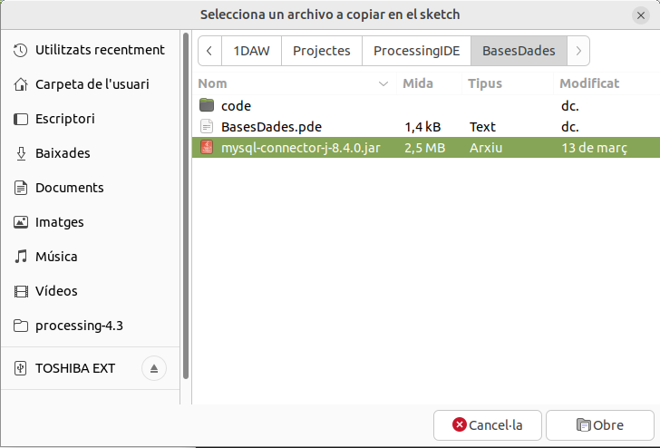

# Tema 11. Bases de dades relacionals

## Introducció

Fins ara hem estat treballant amb aplicacions que si necessitaven desar informació o carregar-la, o com a molt, ho feiem utilitzant arxius o la consola d'entrada. En aquest tema veurem com podem connectar una aplicació Java a una base de dades MySql.

## JDBC

Java proporciona l’API **Java Database Connectivity** (connectivitat Java amb bases de dades) com a mecanisme per poder generar i invocar sentències SQL sobre una base de dades relacional mitjançant codi en programes Java. La seva particularitat és que, en contrast amb altres sistemes existents, ofereix una interfície comuna per a l’accés a qualsevol tipus de BD, independentment del fabricant. Per al desenvolupador, la BD real que hi ha al darrere és totalment transparent i obvia la necessitat d’efectuar cap classe de configuració en la màquina on s’executa l’aplicació que accedeix a les dades. Aquesta biblioteca es troba principalment en els paquets **java.sql** i **javax.sql**. 

Partint de la suposició que ja hi ha una BD correctament configurada i a la qual volem accedir des del codi d’un programa Java, el resum de passos que cal fer dins l’aplicació és:

Però abans de poder començar a treballar amb **JDDBC** hem de fer una sèrie de coses:

1. Incorporem el driver al nostre projecte. Descarrega el  i copia'l a una carpeta dins del teu projecte.
2. Obre el fitxer principal del teu projecte amb Processing IDE i ves a "Sketch-->Afegir arxiu", busca el driver que acabes de descarregar i prem OK.

	

3. Importar les llibreries necessàries al projecte
2. Establir la connexió a la BD.
3. A partir d’aquí, ja es poden executar sentències SQL en la BD i processar-les respostes.
4. Quan ja no es vol treballar més amb la BD, cal tancar la connexió.

JDBC, igual que moltes altres API en Java, està dissenyat amb la simplicitat enel pensament i intenta que l’ordre de les operacions que ha de fer l’operador siga genèric i, fins a cert punt, lògic. Igual que per llegir dades d’un fitxer el que cal feres dir quina és la seva ubicació, obrir-lo, llegir o escriure les dades i tancar-lo, ena quest cas la idea és similar. Simplement, “llegir-lo o escriure’l” vol dir invocar una sentència SQL, enlloc de posicionar un apuntador. Tot i així, cal tenir un cert domini d’SQL per poder fer correctament aquesta feina.

Vejam un exemple per tal d'entendre-ho millor:

## Connexió a la base de dades

Per tal de podre connectar amb una base de dades utilitzarem els paquets **java.sql** i **javax.sql**. Dins d'aquestos paquets disposem d'una sèrie de classes,interfícies etc.. que ens serviran per poder interactuar amb el nostre sistema gestor de bases de dades. Els més importants són: la classe **DriveManager** i les interfícies: **ResultSet**, **Connection**, **Statement** i **DataSource**. Per tant primer, importem tant **java.sql** com **javax.sql** al nostre projecte.

```java linenums="1"
	import java.sql.Connection;
	import java.sql.DriverManager;
	import java.sql.ResultSet;
	import java.sql.SQLException;
	import java.sql.Statement;
```

Una vegada ja tenim importats els paquets del driver **JDBC**, hem d'establir la connexió a la base de dades mitjançant un objecte connexió i aquest objecte connexió estarà relacionat amb un String on s'emmagatzemarà la cadena de connexió a la base de dades. Veiem alguns exemples de cadenes de connexió:

- jdbc:mysql://localhost:port/BD
- jdbc:odbc:DSN_BD
- jdbc:oracle:usuari@servidor:port:BD

Cal tindre també l'usuari i la contrasenya d'accés a la base de dades. També esl pot donar el cas que es llence una excepció, per tant, necessitarem posar el codi dins d'un bloc try..catch.

En definitiva per tal d'establir una connexió amb la nostra base de dades en Java ho fariem al mètode **setup** de la següent forma:

```java linenums="1"
import java.sql.Connection;
import java.sql.DriverManager;
import java.sql.ResultSet;
import java.sql.SQLException;
import java.sql.Statement;

//String url = "jdbc:mysql://localhost:3306/nom_base_de_dades";
String url = "jdbc:mysql://localhost:3306/instituto";
String user = "root";
String password = "root";
Connection conn = null;

void setup() {
    size(400, 400);
    try {
        conn = DriverManager.getConnection(url, user, password);
        println("Connexió establerta.");
    } 
	catch (SQLException e) {
        println("Error de connexió: " + e.getMessage());
    }
}
```

Arribats a aquest punt ja tindriem establerta la connexio entre la nostra aplicació i la base de dades

## Creació i execució de sentències SQL

El següent pas, una vegada ja tenim establerta la connexió amb la nostra base de dades hem de crear un objecte **Statement** des del draw amb el mètode **createStatement()** que ens retornarà un objecte de tipus **Statement**.

Ara hauriem de poder executar les sentències SQL que necessitem. Per poder executar sentències Sql utilitzarem el mètode **executeQuery()** que és un mètode que pertany a l'objecte **Statement** anteriorment creat. Aquest mètode ens retornarà un **ResultSet** què és on tindrem la informació obtinguda de la base de dades.

```java linenums="1"
	void draw() {
		background(200);
		if (conn != null) {
			try {
				Statement stmt = conn.createStatement();
				String query = "SELECT * FROM alumno";
				ResultSet rs = stmt.executeQuery(query);

				while (rs.next()) {
					String valor = rs.getString("nombre");
					println(valor);
				}
				rs.close();
				stmt.close();
			} 
			catch (SQLException e) {
				println("Error executant la consulta: " + e.getMessage());
			}
		}
	}
```

Amb les instruccions vistes als punts anteriors, ja podem connectar-nos a una base de dades i realitzar les consultes mitjançant **queries** però una forma més correcta d'implementar-ho seria creant una classe que s'encarregue de la interacció entre la nostra aplicació i la base de dades sense haver de posar el codi a l'esborrany principal i és en aquesta classe on posarem tots els atributs i mètodes necessaris per poder realitzar connexions a la Base de Dades de manera més eficient.

=== "Main"
	```java linenums="1"
		import java.sql.Connection;
		import java.sql.DriverManager;
		import java.sql.ResultSet;
		import java.sql.SQLException;
		import java.sql.Statement;
		import javax.swing.JFrame;
		import javax.swing.JScrollPane;
		import javax.swing.JTable;

		BDConnection bdCon;
		String url = "jdbc:mysql://localhost:3306/Alumnes";
		String user = "root";
		String password = "password";

		void setup() {
    		size(400, 400);
    		bdCon = new BDConnection (url, user, password);
		}

		void draw() {
			background(200);
	
			if (bdCon.isConnected()) {
				String strQuery = "SELECT * FROM Alumnes";
				ResultSet rs = bdCon.executeQuery(strQuery);
		
				try {
					while(rs.next()) {
						String nom = rs.getString("Nom");
						String co1 = rs.getString("Cognom 1");
						String co2 = rs.getString("Cognom 2");
						println(nom + " " + co1 + " " + co2);
					}
				}
				catch (SQLException ex) {
					println(ex.getMessage());
				}
				bdCon.close();
			}
		}
	```

=== "BDConnection"
	```java linenums="1"
		import java.sql.Connection;
		import java.sql.DriverManager;
		import java.sql.ResultSet;
		import java.sql.SQLException;
		import java.sql.Statement;

		public class BDConnection {
  			private String url;
  			private String usr;
  			private String pwd;
  			private Connection con;
  			private Statement stmt;
  
  			public BDConnection (String strURL, String strUSR, String strPWD) {
    			this.url = strURL;
    			this.usr = strUSR;
    			this.pwd = strPWD;
    
    			try {
        			this.con = DriverManager.getConnection(url, user, password);
        			println("Connexió establerta.");
    			} 
    			catch (SQLException e) {
        			println("Error de connexió: " + e.getMessage());
    			}
  			}
  
  			public ResultSet executeQuery (String strQuery) {
    			ResultSet rs = null;
    			try {
      				stmt = con.createStatement();
      				rs = stmt.executeQuery(strQuery);        
    			} 
    			catch (SQLException e) {
      				println("Error executant la consulta: " + e.getMessage());
    			}
    			return rs;
  			}
  
  			public boolean isConnected () {
    			boolean bConnected = false;
    
    			try {
      				bConnected = !this.con.isClosed();
    			}
    			catch (SQLException ex) {
      				println("Error en BDConnection.isConnected()");
    			}
    			return bConnected;
  			}
  
  			public boolean close () {
    			try {
      				this.con.close();
      				println("Connexió tancada.");
      				return true;
    			}
    			catch (SQLException e) {
      				println("Error tancant la connexió: " + e.getMessage());
      				return false;
    			}
  			}
		}
	```