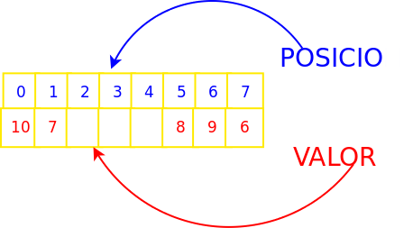
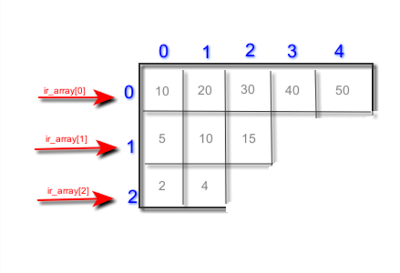
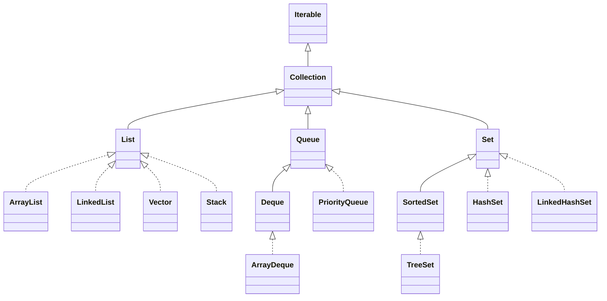

# Tema 5. Arrais i col·leccions

!!! danger "Resultat d'aprenentatge associat"
	<strong>RA6. Escriu programes que manipulin informació seleccionant i utilitzant tipus avançats de dades.</strong>

	### Criteris d'avaluació
	- [x] RA6.1. S'han escrit programes que utilitzin arrais.
	- [x] RA6.2. S'han reconegut les llibreries de classes relacionades amb tipus de dades avançats.
	- [x] RA6.3. S'han utilitzat llistes per emmagatzemar i processar informació.
	- [x] RA6.4. S'han utilitzat iteradors per recórrer els elements de les llistes.
	- [x] RA6.5. S'han reconegut les característiques i avantatges de cadascuna de les col·leccions de dades disponibles.
	- [x] RA6.6. S'han creat classes i mètodes genèrics.
	- [x] RA6.7. S'han utilitzat expressions regulars en la recerca de patrons en cadenes de text.
	- [x] RA6.8. S'han identificat les classes relacionades amb el tractament de documents XML.
	- [x] RA6.9. S'han realitzat programes que realitzin manipulacions sobre documents XML.

## Introducció
Fins ara havíem treballat amb tipus de **dades simples:** int, char, double, float, bool...  però que passa si necessitarem guardar un **conjunt de dades** o informació relativa a una persona? Nom, cognoms, DNI, adreça postal, data de naixement etc? Amb els tipus de dades simples ens seria impossible representar aquesta informació. Es per això que s’utilitzen els **tipus de dades compostos** que ens permetran agrupar de diverses maneres aquesta informació.

Ens podem trobar diversos tipus de dades compostos i en aquest tema veurem: 

- **Arrays:** també coneguts com vectors o _arreglos_, contenen elements d'un mateix tipus base o objectes de la mateixa classe i poden tindre vàries dimensions.
- **Estructures:** conjunt d'elements heterogenis, no tenen per què ser del mateix tipus base.
- **Col·leccions:** Objectes predefinits al framework amb múltiples funcionalitats diferents.

## Arrais
Comencem per veure l'estructura **més simple** de totes, l'array. Un array és un tipus de dades compost que permet emmagatzemar un nombre x d’elements del **mateix tipus**. Amb una única declaració podem tenir accés a un **conjunt de valors** agrupats. Aquestes agrupacions o arrays poden bé ser de tipus simples o també de tipus compostos.

Per tal d’accedir a cadascun dels elements del array s’utilitza un **índex o posició.** La primera posició de tot array és la 0 mentre que la segona seria la que té índex 1. Açò pot marejar un poc al principi.

- **Arrai d’enters:** {8,2,14,55,3,7}
- **Arrai de caràcters:** {‘n’,’a’,’t’,’o’}
- **Arrai de cadenes:** {"hola", "ciao", "hi", "allo"}
  
És molt important distingir entre **valor i posició.** Mentre que el valor és el contingut de l’array en una posició determinada la posició és l’índex que ens permet recorres l’array i tot el seu contingut.

<center>

</center>

A l’exemple anterior tenim un array de 8 enters, la part superior de color blau ens indica les posicions que van de la 0 a la 7, 8 posicions ens total. Mentre que a la fila inferior trobarem el valor que conté cadascuna de les posicions. Per exemple en la posició 5 (la sisena) de l’array tindríem emmagatzemat un valor de 8.

Un altre concepte a tenir en compte és la dimensió o grandària de l’array que ens determina el total d’elements que es poden guardar en aquest. En el nostre cas la mida seria de 8.

Però com podem escriure en Java el mateix esquema que es mostra a la figura anterior?

### Declaració i creació d'un array en Java
Un array en Java és una estructura de dades que ens permet emmagatzemar un conjunt de dades del mateix tipus. El grandària de l’array es determina en la seua declaració i no es permet la seua modificació posterior

```java linenums="1"
tipusBase nomArray [];
nomArray = new tipusBase[grandària];
```

Alguns exemples:

```java linenums="1"
int [] mes;             // Declarem un array mes d'enters (sense espai)
mes = new int [30];     // Creem espai per a 30 elements a l'array mes
char [] grups;          // Declarem un array de caracters (sense espai assignat)
grups = new char [5];   // Creem espai per a 5 elements
```

Aquesta forma de declarar i inicialitzar arrays es pot fer en una sola línia de la següent forma:

```java linenums="1"
int [] agendaMensual = new int [30];  // Declarem un array d'enters i reservem 30 posicions de memòria
```

### Inicialització d'un array
Per tal d’accedir a les dades que conté un array necessitem l’identificador d’aquest així com també la posició concreta a la qual volem accedir. Per exemple, imaginem un array d’enters que es diu números.

```java linenums="1"
int [] números = new int [5];   // Declarem un array d'enters de cinc posicions
números. [] = {2,4,6,8,10};  // Inicialització dels cinc valors
```

A l'exemple anterior hauríem creat un array de 5 enters que contindria els nombres parells fins al 10.

!!! tip "Diferència entre declaració creació i inicialització"
	És molt important que coneixeu bé aquests conceptes:

	- **Declaració:** assignació de nom i tipus.
	- **Creació:** reserva d'espai necessari.
	- **Inicialització:** assignació de valors.

Fins ara tots aquests conceptes anaven lligats quan només utilitzavem tipus de dades bàsics, per exemple, quan creavem en un programa nostre una variable de tipus enter, en la mateixa línia anava la declaració (donem nom a la variable), la creació (automaticament es reserva l'espai necessari per al tipus de dades que hem creat) i la inicialització (ja que per defecte i segons el tipus bàsic s'assignava un valor inicial). Però ara amb els arrays la cosa és un poc més complexa. Vegem algun exemple.

```java linenums="1"
int a; 
int [] array; 
array = new int [10]; 
```

Repassem el codi anterior. A la línia 1 de codi i només amb aquesta línia hem aconseguit:

1. **Declaració:** es declara una variable amb identificador 'a' i de tipus enter
2. **Creació:** automaticament el compilador li reserva l'espai necessari per a representar un enter: 4 bytes.
3. **Inicialització:** per defecte se li dona valor 0.

Ara si mirem les línies següents podrem observar que:

1. A la línia 2 del codi es produeix la **declaració de l'array**. Hem creat l'array i li hem assignat identificador però, quants elements pot emmagatzemar?
2. A la línia 3 del codi és on es **crea l'array**, és a dir, es reserva espai en memòria. Al nostre cas 10 enters, és a dir, 40 bytes.
3. En aquest cas com que el tipus base de l'array és enter, la **inicialització** d'aquest vindria implicita en la reserva de memòria assignant-se valor 0 a tots els elements.

Però com poden inicialitzar cadascun dels elements del nostre array de forma manual?

### Accés als elements d'un array

Una vegada ja tenim la declaració de l’array i la seua inicialització, si volem bé accedir al seu contingut o modificar-ho, necessitaríem l’identificador de l’array i l’índex al qual volem accedir. És molt important tenir en compte que el primer element d’un array en Java està a la posició (índex) 0 i no a la posició 1 com ens indicaria la lògica.

```java linenums="1"
int primerNumero = números. [0]; // primerNumero valdria 2
números. [0] = 12;  // Canviem el  primer numero de l’array
```

??? question "Activitat 501. Declara, crea i inicialitza"
	=== "Problema"
		Escriu un programa en Java utilitzant Processing IDE que permeta emmagatzemar en un array 10 enters. Aquest array s'inicialitzarà element a element cridant a una funció que es dirà 'generaNumAleatori' i que tornara un enter random entre 0 i 100. La funció tindrà el següent prototip:

		- int generaNumAleatori();

		Has de tindre en compte que la inicialització de l'array s'ha de fer al mètode **setup** per tal que no es torne a modificar a cada cicle del **draw**

	=== "Rúbrica"
		Encara no disponible

	=== "Solució"
		
		<center>📦 **Fitxer ZIP amb la solució completa**</center>

		<center>[📥   Descarrega la solució](./assets/Tema4/act401.zip){ .md-button .md-button--secondary }</center>
		
		No disponible
		

### Arrays de caracters

Un array que conté caràcters en lloc de números funciona d’una forma molt semblant al que s’ha explicat en els apartats anteriors. Es pot veure de forma senzilla a l’exemple que vos mostrem a continuació.

```java linenums="1"
// Declaració de l’array vocals que contindrà un total de 5 posicions en memòria
char vocals = new char [5];

// Inicialització de l'array amb les vocals de l'alfabet.
vocals [] = {‘a’,’e’,’i’,’o’,’u’} 

// Accés a l'element primer (0) de l'array per modificar el seu valor
vocals [0] = ‘z’;
```

??? question "Activitat 502. Array de caracters"
	=== "Problema"
		Millora el codi anterior. Afegeix un array que puga emmagatzemar 10 caracters i inicialitza-lo amb un altre mètode que es dirà: 'generaCharAleatori()'. El prototip del mètode hauria de ser:

		- char generaCharAleatori();

		Igual que a l'activitat anterior, hauràs de cridar a aquest mètode des del **setup** i no des del **draw**

	=== "Solució"
		Encara no disponible

### Arrays com a paràmetres

Com qualsevol altre tipus de dades, un array també es pot passar com a **paràmetre a un mètode.** Els arrays sempre es passen **per referència**, és a dir, quan passem un array per paràmetre a un mètode, el que en realitat estem passant és un adreça de memòria que és la que ens indicaria on està l’inici del contingut d’aquest. Passar per referència qualsevol paràmetre significa que qualsevol modificació que es faja dins del mètode afectarà també a l’array fora d’aquest.

No passa el mateix si passem un element concret de l’array, en aquest cas a l’igual que amb els altres paràmetres, aquests es passen per valor, per tant les  modificacions o canvis que es produeixen dins del mètode no afectaran fora d’aquest.

??? question "Activitat 503. Mostra array amigablement"
	=== "Problema"
		Seguint amb el codi anterior, fes dos mètodes per la nostra aplicació que mostre, de forma amigable, l’array de números i l’array de caràcters. Els mètodes es podrien dir mostraEnters i mostraCaracters. Utilitza totes les funcions que conegues de Processing IDE per tal que mostre els arrays de la forma més estètica possible.

		```java linenums="1"
		void mostraEnters (int [] array) {
			// Codi per mostrar el vector d'enters
		}

		void mostraCaracters (char [] array) {
			// Codi per mostrar el vector de caracters
		}
		```

		Igual podria ser útil que li afegires coordenades (x,y) com a paràmetres a la funció de mostrar arrays per tal de poder indicar-li on vols que es mostren.

	=== "Solució"
		Encara no disponible

<!--[Descarrega la solució al problema de mostrar arrays amigablement](assets/Tema8/act503.pde)-->

### Bucle for en Java

A les activitats anteriors t'hauràs trobat amb el dilema de com recórrer tant l'array d'enters com el de caracters per tal d'inicialitzar-lo. Si vares entendre bé el **teorema d'estructura i les estructures iteratives**, segurament hauràs utilitzat un bucle while, un do while o un for. Però aquests bucles a l'hora de recórrer arrays tenen un inconvenient: el **grandària de l'array**. El programador ha de controlar quan s'arriba al final de l'array per tal que l'aplicació no done una errada inesperada i això de vegades no és senzill. Mira els següents exemples de bucles:

```java linenums="1"
final int TAM = 10;
int [] arrayEnters;
arrayEnters = new int [TAM];

// Recorrem l'array amb un for

for (int i=0; i < TAM; i++) 
	arrayEnters[i] = i*10;

// Recorrem l'array amb un while
int i = 0;
while (i < TAM)
	arrayEnters[i] = i*10;

// Recorrem l'array amb un do while
int j = 0;
do {
	arrayEnters[j] = i*10;
	j++;
}
while(j < TAM);

```

??? question "Activitat 504. Fes una traça"
	=== "Problema"
		Fes una traça al codi anterior i observa com els diferents bucles recorren l'array. Escriu la teua conclusió a un comentari de documentació al codi.

	=== "Solució"
		Encara no disponible
		
<!--[Descarrega la solució al problema dels diferents tipus de bucle](assets/Tema/act504.pde)-->

La millor forma de recórrer un array sense haver de controlar quan s’arriba al final és la sentència for usada d’una manera alternativa. Si per exemple tenim un array d’enters que s’anomena «vector» i volem llistar tots els seus elements, podríem fer el següent:

```java linenums="1"
for (int i: vector){
	// Accions a realitzar
}	
```

??? question "Activitat 505. Recorre i mostra l'array"
	=== "Problema"
		Seguint amb les activitats 502 i 503, modifica el mètodes mostraEnters i mostraCaracters per tal que utilitzen aquest últim bucle que hem vist per recorrer arrays en Java. 
		Quan executes per primera vegada, segurament no funcionarà només sustituint la línia del for i hauràs d'afegir algo més de codi per poder solucionar el problema.
		Escriu el problema amb el que t'has trobat i la solució que has aplicat a un comentari.
		
		Podriem fer el mateix als mètodes d'inicialització dels arrays? Per què? Escriu la resposta en a un comentari de documentació.

	=== "Solució"
		Encara no disponible

<!--[Descarrega la solució al problema del bucle for "especial"](assets/Tema8/act505.pde)-->

## Arrays multidimensionals
Fins ara hem estan utilitzant arrays d’una sola dimensió, coneguts també com vectors, taules o llistes. Aquests arrays es recorren amb ajuda d’un sol índex (tenen una sola dimensió). En aquest apartat estudiarem arrays de més d’una dimensió per als que necessitarem més d’un índex a l’hora de ser recorreguts. 
Els arrays multidimensionals més comuns són els de dues dimensions o bidimensionals, també coneguts com matrius. És comú representar aquest tipus de dades com una taula composta per una sèrie de files i columnes:

|     |     |     |     |     |     |
| --- | --- | --- | --- | --- | --- |
| 0,0 | 0,1 | 0,2 | 0,3 | ... | 0,N |
| 1,0 | 1,1 | 1,2 | 1,3 | ... | 1,N |
| 2,0 | 2,1 | 2,2 | 2,3 | ... | 2,N |
| ... | ... | ... | ... | ... | ... |
| N,0 | N,1 | N,2 | N,3 | ... | N,N |

Al contrari del que passava amb els arrays d’una sola dimensió on només necessitavem un índex per accedir al valor, en els arrays de dues dimensions com el de l’exemple anterior, necessitarem dos índex per accedir al valor de l’array.
Les matrius, com es coneixen els arrays bidimensionals es forme per files i columnes.

### Declaració i creació

Per tal de declarar una matriu en java, és a dir, un array de dues dimensions, ho farem de la següent forma:Ç

```java linenums="1"
tipusBase [][] matriu;
```

Si es fixeu, mentre quan declaravem un array d’una sola dimensió utilitzavem només un parell de claudàtors: 

```java linenums="1"
tipusBase [] array;
```
Ara que volem crear una matriu (array de dues dimensions) utilitzarem dos parells de claudàtors.

És fàcil deduir que si volguerem declarar un array de tres dimensions, hauriem d’utilitzar tres parells de claudàtors.

Amb aquesta instrucció el que estem fent es declarar la matriu però no li hem dit quina grandària tindrà. Eixa és la diferència entre declaració i creació. Per tal de crear, és a dir, reservar espai per a la nostra matriu, hem de fer el següent:

```java linenums="1"
tipusBase [][] matriu = new tipusBase[n][m];
```

On n i m són valors enters que ens indiquen la grandària de cada dimensió. 
Per exemple, per declarar i crear una matriu d’enters de 5 files i 10 columnes fariem el següent:

```java linenums="1"
int [][] matriuEnters;
matriuEnters = new int [5][10];
// També ho podriem fer en una sola instrucció
int [][] matriuEnters = new int [5][10];
```

### Inicialització i accés
El procés d’inicialització d’un vector, dona igual les dimensions que tinga, consisteix en donar-li valor a les cel·les que inicialment estan buides. Aquesta inicialització es pot fer de tres formes diferents:

- De forma individual.
- En el moment de la declaració.
- Mitjançant l’ús d’una sentència de control repetitiva.

**Inicialització i accés a cada element de l'array**
Per accedir a una dada en un array multidimensional hem de coneixer els índex de posició d’aquest. En un array de dues dimensions, per accedir a una dada s’ha d’indicar la fila i la columna d’on es troba aquesta informació.

Per exemple, imaginem que tenim la següent taula (array de dos dimensions)

|    |    |   |   |    |    |
|--- |--- |---|---|--- |--- |
| 12 | 13 | 5 | 9 | 22 | 14 |
| 21 | 11 | 8 | 56 | 23 | 7 |
| 6 | 10 | 32 | 36 | 24 | 99 |
| 78 | 55 | 57 | 79 | 18 | 14 |

Per tal d’inicialitzar-la element a element hauriem d’executar les següents sentències:

```java linenums="1"
for (int i = 0; i < FILES; i ) {
	for (int j=0; j< COLUMNES; j++ ) {
		array [i][j] = 0;
	}
}
```

Per tal d’entendre el concepte de matriu o array bidimensional, realitzarem un exercici on treballarem amb les típiques matrius matemàtiques, realitzant les operacions pròpies d’aquestes.

??? question "Activitat 506. Matrius"
	=== "Problema"
		Es tracta de desenvolupar una aplicació que realitze operacions utilitzant matrius de 3x3.<br>
		El menú ha de mostrar el següent:

		1. Emplena la primera matriu
		2. Emplena la segona matriu
		3. Visualitza les matrius
		4. Suma les matrius
		5. Multiplica per un escalar
		6. Producte de matrius
		7. Trasposta
		8. Eixir

		Per a cadascuna de les operacions anteriors s’ha d’implementar un mètode
		Mireu el següent exemple:

		<!---->

	=== "Solució"
		Encara no disponible
		
<!--[Descarrega la solució a l'activitat 519](assets/Tema5/act519.pde)-->

### Arrays irregulars
Una matriu irregular o escalonada no és més que un array de taules, on cadascuna de les taules que formen l’array no necessàriament han de tenir la mateixa grandària.



La declaració d’un array irregular en java seria de la següent manera:

```java linenums="1"
// Declaració d’una matriu (files)
int [][] mat;

// Primer creem la quantitat de files deixant les columnes buit
mat=new int[3][];

// Després creem cada fila indicant la quantitat d’elements
mat[0]=new int[5];
mat[1]=new int[3];
mat[2]=new int[2];
```

??? question "Activitat 507. Alumnes i assignatures"
	=== "Problema"
		Imagina que has de mantindre les notes dels alumnes de tres assignatures. A cada assignatura tens 15 alumnes, tal que s’ha de mantenir la informació mitjançant una variable que gràficament presenta la següent estructura

		|     |     |     |     |     |     |
		| --- | --- | --- | --- | --- | --- |
		| Assignatura 1 | 5 | 6 | 7,3 | 2,3 | 4,5 | ... | 8,3 |
		| Assignatura 2 | 7,8 | 8,7 | 7,7 | 3,3 | 4,8 | ... | 6,5 |
		| Assignatura 3 | 7 | 9 | 10 | 8,2 | 2,8 | ... | 9,2 |

		Crea una aplicació en la que pugues:

		1. Inserir notes de l’assignatura sel·leccionada.
		2. Inserir totes les notes
		3. Calcular la nota mitjana de les assignatures.
		4. Ordenar les notes de forma ascendent.
		5. Estadística.
		6. Eixir de l’aplicació.

		La primera opció primer et demanarà de quina assignatura vols introduir una nota (1, 2, 3) i després et demanarà la nota que podrà ser un número decimal des del 0.0 fins al 10.0.
		La segona, et mostrarà un diàleg on l'usuari anirà introduint notes una a una fins introduir-les totes. Al diàleg s'informarà en tot moment de quina assinatura i quina nota es tracta.
		Calcular la mitjana de les assignatures mostrarà per la pantalla de l'aplicació per a cada assignatura quina és la seua mitjana.
		L'opció d'ordenar les notes de forma ascendent és que per a cada assignatura les notes passaran a estar disposades a l'array de menor a major nota.
		L’opció estadística mostra la quantitat de notes entre 0 i 4, entre 4 i 5, entre 5 i 7, entre 7 i 9 i entre 9 i 10.
		Eixir tancaria l'apliació.

	=== "Solució"
		Encara no disponible

<!--[Descarrega la solució a l'activitat 520](assets/Tema5/act520.pde)-->

### Un sudoku simple

Llig l'enunciat de la següent activitat i fes un **sudoku** simple.

??? question "Activitat 908. Un sudoku simple"
	=== "Problema"
		El següent codi és un mètode que s'encarrega d'emplenar una matriu de 9x9 seguint la lògica del sudoku

		```java linenums="1"
		void inicialitzaArraySudoku (int [][] arraySudoku ) {
			// Primera fase: inicialitzem la matriu
			for(int fil=0; fil < 9; fil ++) {
				for(int col=0; col < 9; col ++) {
				if (fil == 0 || fil == 3 || fil == 6) 
					arraySudoku[fil][col] = (col + fil/3)%9+1;
				else if ((fil > 0 && fil < 3) || (fil > 3 && fil < 6) || (fil > 6 && fil < 9))
					arraySudoku[fil][col] = (arraySudoku[(fil/3)*3][col]+3*fil-1)%9+1;
				}
			}
			
			// Segona fase: barallem files
			for(int fil = 0; fil < 9; fil += 3) {
				int f1, f2;
				do {
				f1 = (int)random(fil,fil+3);
				f2 = (int)random(fil,fil+3);
				}
				while(f1 == f2);
				
				for (int col=0; col < 9; col ++) {
				int aux = arraySudoku[f1][col];
				arraySudoku[f1][col] = arraySudoku[f2][col];
				arraySudoku[f2][col] = aux;
				}
			}
			
			// Tercera fase: barallem les columnes
			for(int col = 0; col < 9; col += 3) {
				int c1, c2;
				do {
				c1 = (int)random(col,col+3);
				c2 = (int)random(col,col+3);
				}
				while(c1 == c2);
				
				for (int fil=0; fil < 9; fil ++) {
				int aux = arraySudoku[fil][c1];
				arraySudoku[fil][c1] = arraySudoku[fil][c2];
				arraySudoku[fil][c2] = aux;
				}
			}
			
			// Quarta fase: interncanviem dues files de submatrius 
			int sm1, sm2;
			do {
				sm1 = (int)random(0,3);
				sm2 = (int)random(0,3);
			}
			while(sm1 == sm2);
			
			for (int i = 0; i < 3; i ++) {
				for(int j = 0; j < 9; j ++) {
				int val1 = 3*sm1+i;
				int val2 = 3*sm2+i;
				int aux = arraySudoku[val1][j];
				arraySudoku[val1][j] = arraySudoku[val2][j];
				arraySudoku[val2][j] = aux;
				}
			}
		}
		```

		Escriu un programa utilitzant Processing IDE que et mostre un Sudoku per pantalla, que permeta al jugador emplenar les cel·les buides i que comprove si el número escollit es vàlid o no.

	=== "Solució"
		Encara no disponible

<!--[Descarrega la solució a l'activitat 521](assets/Tema5/act521.zip)-->

## Col·leccions i llibreries
Les col·leccions en Java són un marc que proporciona una arquitectura per emmagatzemar i manipular el grup d'objectes Poden realitzar totes les operacions que realitzeu sobre les dades, com ara la cerca, l'ordenació, la inserció, la manipulació i la supressió.

Java ofereix interfícies (Set, List, Queue, Deque) i classes (ArrayList, Vector, LinkedList, PriorityQueue, HashSet, LinkedHashSet, TreeSet).

### Jerarquia de classes

A continuació pots observar la jerarquia de classes que ens ofereix l'API de Java respecte de les col·leccions.



### ArrayList
La classe ArrayList implementa la interfície List. Utilitza una matriu dinàmica per emmagatzemar l'element duplicat de diferents tipus de dades. La classe ArrayList manté l'ordre d'inserció i no està sincronitzada. Es pot accedir aleatòriament als elements emmagatzemats a la classe ArrayList. Considereu l'exemple següent.

```java linenums="1"
// Primer creem l'arrayList
ArrayList<String> list = new ArrayList<String>();

// Després afegim elements a la llista
list.add ("Ravi" );
list.add ("Vijay");  
list.add ("Ravi" );  
list.add ("Ajay" );  

```

??? question "Activitat 509. Arraylists en Java"
	Fes un programa que:
		- Guarde noms en una llista
		- Permeta afegir i eliminar noms
		- Mostre la llista final

## Iteradors

Fins ara hem vist com crear algunes de les col·leccions que java posa a disposició dels programadors, però hi han molte més. Segurament també, t'has estat preguntant com es poden recórres aquestes noves llistes element a element. Per tal de fer-ho de la forma més eficient, ho fariem amb **iteradors.** Mira el següent exemple:

```java linenums="1"
 // Crear una col·lecció (ArrayList en aquest cas)
ArrayList<String> names = new ArrayList<>();
names.add("Anna");
names.add("Joan");
names.add("Maria");

// Obtenir un iterador de la col·lecció
Iterator<String> iterator = names.iterator();

// Recórrer els elements amb l'iterador
System.out.println("Recorregut dels elements:");
while (iterator.hasNext()) {
	String name = iterator.next();
	System.out.println(name);
}
```

També es solen utilitzar bucles for-each

```java linenums="1"
for (String nom : names) {
	System.out.println(nom);
}
```

??? question "Activitat 510. Recorre una llista"
	Mostra els elements d'una llista amb el for clàssic, amb un for-each i utiltzant un iterador.

### HashSet
Aquesta classe implementa la interfície Set, recolzada per una taula hash (en realitat una instància HashMap). No ofereix cap garantia quant a l'ordre d'iteració del conjunt; en particular, no garanteix que l'ordre es mantingui constant al llarg del temps. Aquesta classe permet l'element nul.

```java linenums="1"
// Primer creem l'arrayList
HashSet<String> hSet = new HashSet<String>();

// Després afegim elements a la llista
hSet.add ("Ravi" );
hSet.add ("Vijay");  
hSet.add ("Ravi" );  
hSet.add ("Ajay" );

boolean isAdded = participants.add("Anna"); // Aquest no s'afegirà perquè ja existeix
if (!isAdded) {
	println("Anna ja és a la llista de participants!");
}

// Recorrem la llista i mostrem per pantalla
Iterator itr = list.iterator();  
while (itr.hasNext ()) {  
	println (itr.next ());  
}

```

??? question "Activitat 511. Crea una llista amb els dies de la setmana utilitzan un ArrayList"
	Utilitza una col·lecció Arraylist per crear un conjunt amb els dies de la setmana

### Hashmap
Una hashmap és semblant al hashset però permet emmagatzemar parelles clau-valor

```java linenums="1"
HashMap<String, Integer> edats = new HashMap<>();
edats.put("Anna", 20);
System.out.println(edats.get("Anna"));
```

??? question "Activitat 512. Ús de hashmap"
	Enunciat

### TreeSet

```java linenums="1"
// Primer creem l'arrayList
TreeSet<String> words = new ArrayList<String>();

// Després afegim elements a la llista
words.add ("Ravi" );
words.add ("Vijay");  
words.add ("Ravi" );  
words.add ("Ajay" );  

// Mostrar la llista de paraules ordenades
println("Llista de paraules ordenades:");
for (String word : words) {
	println(word);
}

// Comprovar la primera i l'última paraula
println("Primera paraula: " + words.first());
println("Última paraula: " + words.last());

// Afegir més paraules i comprovar l'ordre
words.add("alfabet");
words.add("zebra");
println("Després d'afegir més paraules:");
for (String word : words) {
	println(word);
}

// Eliminar una paraula
words.remove("java");
println("Després d'eliminar 'java': " + words);

// Comprovar si una paraula existeix
String checkWord = "estructures";
if (words.contains(checkWord)) {
	println("'" + checkWord + "' està a la llista.");
} 
else {
	println("'" + checkWord + "' no està a la llista.");
} 

```

??? question "Activitat 513. Crea un conjunt amb els balos d'or usant un HashSet"
	Utilitza una col·lecció HashSet per crear un conjunt amb els guanyadors del baló d'or

### LinkedList

```java linenums="1"

// Crear un LinkedList per gestionar la cua
LinkedList<String> customerQueue = new LinkedList<>();

// Afegir clients a la cua
customerQueue.add("Anna");
customerQueue.add("Joan");
customerQueue.add("Maria");
customerQueue.add("Pere");

// Mostrar la cua inicial
println("Cua inicial de clients: " + customerQueue);

// Atendre el primer client (eliminar-lo de la cua)
String servedCustomer = customerQueue.poll();
println("Client atès: " + servedCustomer);
println("Cua després d'atendre un client: " + customerQueue);

// Afegir un nou client al final de la cua
customerQueue.add("Carla");
println("Cua després d'afegir Carla: " + customerQueue);

// Consultar el primer client sense eliminar-lo
String nextCustomer = customerQueue.peek();
println("El següent client a atendre és: " + nextCustomer);

// Inserir un client d'urgència al principi de la cua
customerQueue.addFirst("Urgent - Miquel");
println("Cua després d'afegir un client urgent: " + customerQueue);

// Eliminar l'últim client
customerQueue.removeLast();
println("Cua després d'eliminar l'últim client: " + customerQueue);

```

??? question "Activitat 514. Crea una llista amb els companys de classe utilitzant una LinkedList"
	Utilitza una col·lecció LinkedList per crear un conjunt amb els noms dels teus companys de classe


??? question "Activitat 515. Llista d'espera de pacients"
	Crea una llista d'espera de pacients amb la col·lecció que trobes més adequada i crida als pacients un a un. Justifica la teua decisió al comentari de codi de l'aplicació.

??? question "Activitat 516. Recorre els balons d'or amb un iterador"
	Recorre el conjunt de guanyadors del baló d'or de l'activitat 523 i mostra'ls de forma amigable per pantalla. Canviaries el tipus de col·ecció en aquesta activitat per emmagatzemar els premiats? Quina escolliries? Per què? Quins avantatges i inconvenients tenen les altres col·eccions de java front a l'escollida per tu? Escriu totes les respostes al comentaris de documentació.

??? question "Activitat 517. Recorre la llista d'espera amb un iterador"
	Recorre la llista d'espera de clients de l'activitat 525 utilitzant un iterador. Canviaries la col·lecció? Per què?

??? question "Activitat 518. Crea un conjunt ordenat amb TreeSet per crear una llista ordenada de noms."
	Crea una llista ordenada de noms.

??? question "Activitat 519. Converteix el Projecte Alumnes i assignatures"
	Basant-nos en l'activitat 520 "Alumnes i Assignatures" utilitza el que hem vist de les distintes col·leccions que ens proporciona java per millorar el nostre codi.

### Genèrics

Peremten treballar amb tipus genèrics

```java linenums="1"
public class Caixa<T> {
    private T valor;

    public void guardar(T valor) {
        this.valor = valor;
    }

    public T obtenir() {
        return valor;
    }
}
```

**Ús**

```java linenums="1"
Caixa<Integer> caixa = new Caixa<>();
caixa.guardar(10);
```

??? question "Activitat 520. Generics"
	Crea una classe genèrica que guarde dos valors i permeta obtenir-los.

### Expressions regulars en Java

Les expressions regulars són una forma de crear un plantilla que pot servir per:

- Comprovar si un text compleix un format determinat:
	El NIF ha de tenir 8 dígits i una lletra.
    Una matrícula de cotxe ha de tenir 4 dígits i 3 lletres.
    Un número de telèfon ha de tenir 3 dígits, un punt, 3 dígits, un punt i 3 dígits.
- Buscar si existeix una subcadena (amb un format determinat) dins d'un text.
- Buscar i canviar una subcadena per una altra dins d'un text, només una vegada o totes les que aparega.

#### Caracters especials

    [ ]: per especificar un conjunt de caràcters.
    ( ): per agrupar.
    { }: per indicar un nombre de repeticions.
    \: per poder utilitzar caràcters especials, per representar caràcters especials o per conjunts de caràcters.
    ^: té dos possibles significats:
        indicar que la coincidència ha d'estar al principi de la línia.
        si es posa com a primer caràcter dins de [ ], implica negació ([^AEIOUaeiou] detectarà qualsevol caràcter que no sigui una vocal).
    $: indica que la coincidència ha d'estar al final de la línia.
    |: per triar entre diferents possibilitats.
    ?: indica que el caràcter o grup anterior pot aparèixer una o cap vegada.
    +: indica que el caràcter o grup anterior ha d'aparèixer una o més vegades.
    *: indica que el caràcter o grup anterior pot aparèixer zero, una o més vegades.
    .: equival a qualsevol caràcter.

    \t: representa un tabulador.
    \n: representa un salt de línia.
    \s: representa qualsevol caràcter que sigui un separador. És equivalent a [ \t\n\x0B\f\r].
    \S: representa qualsevol caràcter que no sigui un separador. És equivalent a [^\s].
    \d: representa qualsevol caràcter que sigui un dígit. És equivalent a [0-9].
    \D: representa qualsevol caràcter que no sigui un dígit. És equivalent a [^0-9].
    \w: representa qualsevol caràcter que pot formar una paraula. És equivalent a [a-zA-Z_0-9].
    \W: representa qualsevol caràcter que no formi part d'una paraula. És equivalent a [^\w].

```java linenums="1"
	// Codi java que serveix per validar un correu electrònic
	import java.util.regex.Pattern;
    String emailRegex = "^[\\w.-]+@[\\w.-]+\\.[a-zA-Z]{2,}$";
    Pattern pattern = Pattern.compile(emailRegex);

	// Correus a validar
	String[] emails = {
		"exemple@domini.com",
		"correu.incorrecte",
		"test123@gmail.net",
		"a@b.c",
		"incorrect@domini"
	};

	// Validació dels correus
	for (String email : emails) {
		if (pattern.matcher(email).matches()) {
			println(email + " és vàlid.");
		} 
		else {
			println(email + " no és vàlid.");
		}
	}
```

??? question "Activitat 521. Expressions regulars en java" 
	Escriu el codi necessari per tal validar adreces de pàgines web.

## Enumeracions (Extra)

Una enumeració és un tipus especial de ‘classe’ que representa un grup de constants. Cada element d’aquesta estructura està associada a un valor de un tipus de dades concret (normalment enter) on el primer element de l’enumeració sol agafar el valor 0

```java linenums="1"
// Exemple 1. Dies de la setmana
enum Dies {
	Dilluns,
	Dimarts,
	Dimecres,
	Dijous,
	Divendres,
	Dissabte,
	Diumenge
}

// Exemple 2. Talles de roba
enum Talles {
	XXL,
	XL,
	L,
	M,
	S,
	XS
}
```

??? example "Com usar una enumeració"

	```java linenums="1"
		enum Colors {
      		RED,
      		BLUE,
      		YELLOW,
      		GREEN
		}

		Colors myColor = Colors.YELLOW;

		switch(myColor) {
			case RED:
				System.out.println("The color is red");
			break;

			case BLUE:
				System.out.println("The color is blue");
			break;

			case YELLOW:
				System.out.println("The color is yellow");
			break;

			case GREEN:
				System.out.println("The color is green");
			break;
		}
	```

